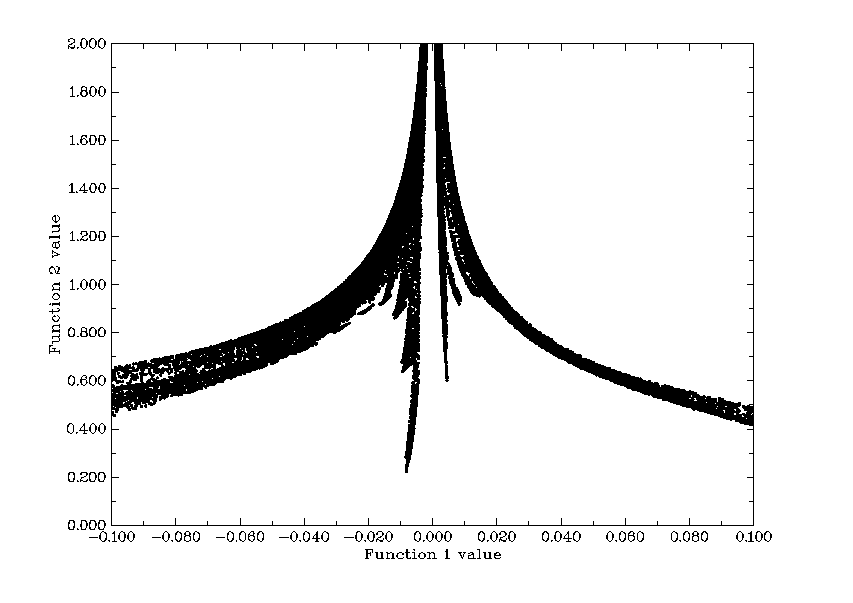
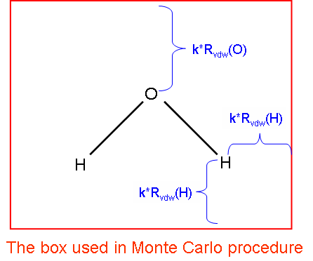
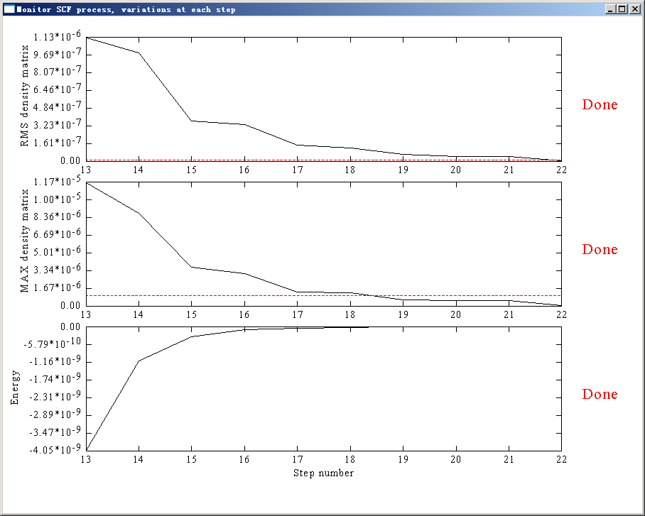
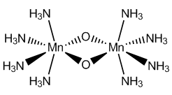
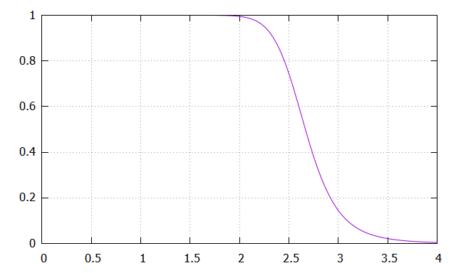
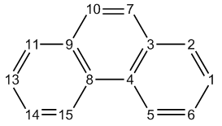
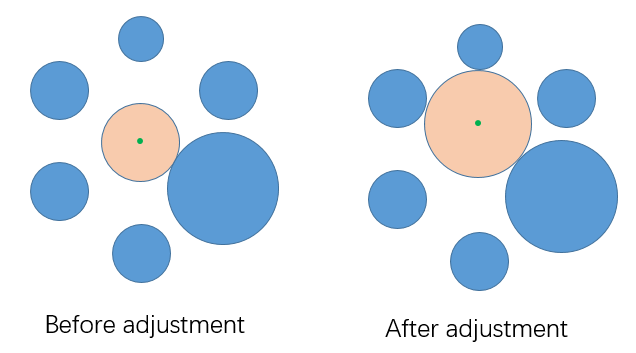

# **3.100 其他功能，第1部分(Other functions, part 1) (100)**

由于Multiwfn的功能太多，其中一些功能相对主要功能而言较为“小”，还有一些功能与波函数分析关系不很密切，这些功能被归为“其他功能(other functions)”。由于“其他功能”中的子功能数量庞大，“其他功能”被分为第1部分（主功能100）和第2部分（主功能200）。下面将描述第1部分，第2部分将在[3.200](sec-3-200-other-functions-part-2.md)节介绍。

## **3.100.1 绘制两个函数之间的散点图并生成它们的cube文件(Draw scatter graph between two functions and generate their cube files)**

该功能允许在共享网格设置下同时生成两个函数的网格数据，你可以选择导出它们的cube文件、查看它们的等值面图以及绘制它们之间的散点图(scatter graph)。

进入该功能后，选择你感兴趣的两个实空间函数(real space functions)，例如你想分析实空间函数16和14，则应输入*16,14*（下面将第一个和第二个函数分别称为函数1和函数2）。然后选择一种设置网格点的方式。之后Multiwfn开始计算两者的网格数据。计算完成后，会打印所有网格点上两个函数的Pearson相关系数(Pearson correlation coefficient)，并出现一个菜单，所有选项都是自明的。如果你选择-1绘制散点图，会立即弹出如下图形：



每个散点对应每个网格点，散点在X轴和Y轴上的位置分别对应函数1和函数2在该点的值。Multiwfn根据最小值和最大值自动确定坐标轴范围，有时你必须用选项4和5自行重置范围，否则图中几乎看不到点。点的大小可通过*settings.ini*中的“symbolsize”调节。图形可通过选项1保存到当前目录。点的X-Y数据集可通过选项2导出到当前目录的*output.txt*。

选项-2和-3分别将函数1的值在特定范围内或范围之外处的函数2的值设为指定值。注意，数据一旦修改就无法恢复。

**特殊用法(Special usage)**：如果你已有待研究的两个函数的cube文件（分别称为*func1.cub*和*func2.cub*），并想在后处理菜单中直接使用这些函数（*例如*绘制散点图、修改数值），应按以下步骤操作：启动Multiwfn后输入*func1.cub*的路径，然后进入主功能100并选择子功能1，在选择实空间函数时输入*0,0*，再输入*func2.cub*的路径，之后两个cube文件的网格数据将直接被当作函数1和函数2。注意，当然*func1.cub*和*func2.cub*的网格设置必须完全相同。

## **3.100.2 导出各类文件或生成量子化学程序的输入文件(Export various files or generate input file of quantum chemistry programs)**

### **导出各类文件(Exporting various kinds of files)**

该功能可将当前结构输出为.pdb、.xyz、.gro、.cif、.cml文件。当只有GTF信息时，波函数信息可导出为.wfn或.wfx文件；当有基函数信息时，还可导出为.mwfn、.molden、.fch、GENNBO输入文件(.47)、旧版Molekel输入文件(.mkl)。显然，Multiwfn可用作非常有用的文件格式转换器，*例如* .mwfn/.wfn/.wfx/.fch/.molden/.gms ... → .pdb/.xyz/.cml/.gjf/.wfn/.wfx/.molden/.fch/.47 ...

另外，值得注意的是，可以用Gaussian或其他程序生成.fch或.molden文件，然后用Multiwfn将其转换为.mkl文件，再用`orca_2mkl test -gbw`把*test.mkl*转为*test.gbw*，从而使ORCA能使用其他程序产生的波函数作为初猜。我还有一个自动完成此过程的shell脚本，见<http://sobereva.com/517>。

如果当前输入文件是.chg格式，它载有原子信息和原子电荷（详见[2.5](sec-2-5-input-files-and-wavefunction-types.md)节），你可以用选项1将其转换为.pqr文件。.pqr与.pdb格式非常相似，主要区别在于前者多了两列记录原子电荷(atomic charges)和原子半径。结果.pqr文件中的原子电荷与.chg文件中的相同，而原子半径列对应Bondi vdW半径。.pqr可直接载入VMD程序，并可按原子电荷给原子着色（如果.chg文件第四列记录的是其他原子信息，如原子自旋布居(atomic spin populations)，在VMD中也可按自旋布居给原子着色）。这对于直观展示原子性质非常有用，示例见[4.A.10](sec-4-A-special-topics-and-advanced-tutorials.md#4a10-通过给原子着色直观展示原子性质)节。

### **导出网格数据文件(Exporting grid data file)**

当内存中有一套网格数据时（可能从*例如*.cub文件载入，或由*例如*主功能5计算得到），则：

- 通过选项35可以导出流行的.cub文件。

- 通过选项36可以导出.vti文件，这是一种著名的免费体数据可视化软件ParaView(<https://www.paraview.org>)支持的格式，同时Multiwfn会询问你是否同时导出一个以Bohr为单位记录当前体系的.cml文件，如果你选择导出，就可以用ParaView载入它，从而同时绘制网格数据和分子结构。

- 通过选项37可以导出VASP格式的网格数据，就像CHGCAR和LOCPOT一样。

### **生成量子化学和第一性原理程序的输入文件(Generating input file of quantum chemistry and first-principles programs)**

该功能还能基于当前结构、净电荷和多重度生成一批知名量子化学程序的输入文件，包括Gaussian、GAMESS-US、ORCA、MOPAC、Dalton、MRCC、Molpro、NWChem、PSI4、CFOUR、Molcas。也可以生成流行的第一性原理程序CP2K和Quantum ESPRESSO的输入文件。

生成Gaussian或GAMESS-US输入文件时，如果有基函数信息，你可以选择是否把轨道展开系数写入它们的输入文件，以便将当前波函数用作初始SCF猜测。注意，此时必须在输入文件中手动指定与得到当前波函数时原本所用的相同的基组，否则Gaussian或GAMESS-US任务必定失败。

导出Dalton输入文件时，如果有基函数信息，你可以选择把轨道展开系数写入导出的.dal文件，可直接用作初猜。利用这一设计，例如你可以很方便地把由UHF/UKS波函数产生的非限制自然轨道(unrestricted natural orbitals, UNO)作为Dalton CASSCF计算的初始轨道（Dalton本身不支持UHF/UKS！）。详细信息和例子见“使用Multiwfn将其他程序产生的轨道作为Dalton计算的初猜”（中文，<http://sobereva.com/740>）。

由于ORCA非常流行、速度快且有许多重要功能，而它的关键词不如Gaussian易于指定，因此专门提供了一个生成ORCA输入文件的界面，其中可选择常用的ORCA计算级别，生成的关键词是相应级别下最合适、最高效的。非常详细的说明见“Multiwfn中生成ORCA输入文件的功能”（中文，<http://sobereva.com/490>），还有一个实际例子“使用ORCA和Multiwfn模拟UV-Vis和ECD光谱”(<http://sobereva.com/485>)。视频“基于ORCA程序和其他程序研究几何、振动、IR光谱和轨道”(<https://youtu.be/tiTmTbtbtig>)也用到了该功能。

由于PSI4程序在做对称匹配微扰理论(symmetry-adapted perturbation theory, SAPT)方面非常流行，生成PSI4输入文件的功能就是专为此目的精心设计的。

生成CP2K输入文件的能力极其强大和有用。把分子或周期体系的几何文件载入Multiwfn后，该功能可生成各种任务、包含多种常用选项的CP2K输入文件。详见“使用Multiwfn非常方便地创建CP2K的输入文件”(<http://sobereva.com/587>)。

> **所需信息(Information needed)**
>
> 原子坐标，GTFs（用于导出.wfn/.wfx），基函数（用于导出.mwfn/.fch/.molden/.47），网格数据（用于导出cub、vti和VASP网格数据）

## **3.100.3 计算分子范德华体积(Calculate molecular van der Waals volume)**

该功能用蒙特卡罗(Monte Carlo)方法计算当前体系的范德华(van der Waals, vdW)体积，提供两种vdW区域定义：(1) 原子vdW球的叠加。这种定义不太准确，因为没有考虑电子效应，但计算速度很快，且不需要波函数信息。(2) 由电子密度(electron density)某个等值面包围的区域，等值面值0.001适合孤立体系，0.002更适合凝聚相中的分子。可通过*settings.ini*中的“MCvolmethod”选择定义。

蒙特卡罗过程的原理非常简单：如果定义一个能装下整个体系的盒子（体积为$L$），并令$N$个粒子随机分布在盒子中，若有$n$个粒子落在vdW区域内，则当前体系的vdW体积为$n/N\times L$。当然，$N$越大结果越好。在Multiwfn中，你需要输入一个数$i$来定义$N$，关系为$N=100\times 2^{i}$，对小分子$i$=9时精度一般可接受，对大体系你可能需要逐渐增大$i$，直到$i$与$i+1$的结果变化小到可接受、视为收敛。对于vdW区域的定义2，你还需要输入密度的等值面值，以及用于定义盒子的因子$k$，见下面的示意图，其中R$_{vdw}$为vdW半径。若$k$太小，vdW区域可能被截断，但若$k$太大，则需要更多点以保持足够的精度。对等值面值0.001，推荐$k$=1.7。



> **所需信息**
>
> 原子坐标（用于定义1），GTFs（用于定义2）

## **3.100.4 在全空间对函数积分(Integrate a function over the whole space)**

这是一个非常有用且强大的功能，用于在全空间对选定的实空间函数积分。这里使用的数值积分方法基于Becke在论文*J. Chem. Phys.*, **88**, 2547 (1988)中提出的用于积分DFT泛函的方法，它也适用于任何实空间函数，但注意函数必须光滑且在无穷远处渐近趋于零。精度由积分点的数量决定，你可分别通过*settings.ini*中的“radpot”和“sphpot”参数调节径向和角向积分点的数量。被积函数(integrand)可从内建函数中选择，你也可以自己编写新函数作为用户自定义函数，见[2.6](sec-2-6-real-space-functions.md)和[2.7](sec-2-7-user-defined-real-space-function.md)节。

如果*settings.ini*中的*outmedinfo*设为1，则在该功能的计算过程中会在当前目录导出名为*integrate.txt*的文件，其中包含所有积分点的数据：序号、笛卡尔坐标、函数值、Lebedev积分权重和原子权重函数。

### **检验两个波函数文件之间实空间函数的差异(Examination of difference of a real space function between two wavefunction files)**

顺便说一下，如果你想检验两个波函数文件之间某个实空间函数的差异，可以在主功能100中选择函数-4或-5（隐藏功能），待积分的函数将分别为$[f\,(\text{file1})-f\,(\text{file2})]^2$或$\left|f\,(\text{file1})-f\,(\text{file2})\right|$，其中$f$是你将选择的实空间函数，“file1”是启动Multiwfn时载入的波函数文件，“file2”是你将在该功能中选择的波函数文件。在该功能中你还可以设置电子密度的判据，从而让Multiwfn只计算低密度区域的差异（*即*忽略核区）。此外，计算后Multiwfn会自动把file1的网格数据导出为当前目录下的纯文本文件，文件名直接反映当前计算条件。例如，文件名*a.wfn_003_0075_0434*意味着“file1”为*a.wfn*，选择了第3个实空间函数，径向和角向积分点分别为75和434。在以后的研究中，如果所有计算条件与文件名相符（该文件必须放在当前目录），Multiwfn将直接从该文件载入“file1”的数据而不重新计算，以节省计算时间。

### **计算球对称平均ELF / LOL(Evaluation of spherically symmetric average ELF / LOL)**

在*J. Comput. Chem.*, **38**, 2258 (2017)中，作者提出可以用下面的量来确定 universal range-separated DFT泛函的最优*ω*参数：

$$
\begin{gathered}r_{\mathrm{ELF}}=\sqrt{\frac{\int \mathrm{ELF}(\mathbf{r})\mathbf{r}^2\mathrm{ELF}(\mathbf{r})\mathrm{d}\mathbf{r}}{\int \mathrm{ELF}(\mathbf{r})\mathrm{ELF}(\mathbf{r})\mathrm{d}\mathbf{r}}}\end{gathered}
$$

在Multiwfn中，如果你在当前功能中选择ELF作为被积函数，会自动计算并输出该量。$r_{\mathrm{ELF}}$以“球对称平均ELF(spherically symmetric average ELF)”输出，根号内的分子和分母也一并输出。

在*J. Phys. Chem. C*, **123**, 4407 (2019)中提出了LOL-tuning，其中涉及“球对称平均LOL(spherically symmetric average LOL)”：

$$
\begin{gathered}r_{\mathrm{LOL}}=\sqrt{\frac{\int \mathrm{LOL}(\mathbf{r})\mathbf{r}^2\mathrm{LOL}(\mathbf{r})\mathrm{d}\mathbf{r}}{\int \mathrm{LOL}(\mathbf{r})\mathrm{LOL}(\mathbf{r})\mathrm{d}\mathbf{r}}}\end{gathered}
$$

如果在当前功能中选择LOL，会打印$r_{\mathrm{LOL}}$及其根号内的分子和分母。

例子见[4.100.4](sec-4-100-other-functions-part-1.md#41004-通过数值积分-numerical-integration计算光气-phosgene的动能-kinetic-energy和核吸引势能-nuclear-attraction-potential-energy)节。

> **所需信息**
>
> 原子坐标，GTFs。

## **3.100.5 显示alpha和beta轨道之间的重叠积分(Show overlap integral between alpha and beta orbitals)**

对非限制(unrestricted)波函数，alpha和beta轨道之间一般不满足正交归一条件。该功能计算alpha和beta轨道之间的重叠矩阵(overlap matrix)

$$
\begin{gathered}S_{i,j}^{\alpha\beta}=\int \varphi_{i}^{\alpha}(\mathbf{r})\varphi_{j}^{\beta}(\mathbf{r})\mathrm{d}\mathbf{r}\end{gathered}
$$

对角元有助于评估相应自旋轨道对的匹配程度，明显偏离1表明自旋极化(spin polarization)显著。

当前功能有两个选项，选项1计算完整的重叠矩阵，对角元会打印在屏幕上，整个重叠矩阵可选择输出到当前目录的*ovlpmat.txt*；此外还会给出Alpha与Beta轨道之间的最大配对。该计算对大体系可能耗时。选项2只计算并打印对角元，速度总是很快。

由于单Slater行列式(single determinant, SD)波函数的$S$*²*算符期望值可由重叠矩阵方便地导出，如果选择选项1，Multiwfn还会输出该量：

$$
\begin{gathered}\left\langle S^2 \right\rangle_{\mathrm{SD}}=\left\langle S^2 \right\rangle_{\mathrm{exact}}+N^{\beta}-\sum_{i}^{N^{\alpha}}\sum_{j}^{N^{\beta}}\left| S_{i,j}^{\alpha\beta} \right|^2\end{gathered}
$$

其中$N$*$^{α}$*和$N$*$^{β}$*分别为alpha和beta电子数，${\left\langle {S}^{2} \right\rangle}_{\mathrm{exact}}$为总自旋角动量平方的精确值

$$
\begin{gathered}\left\langle S^2 \right\rangle_{\mathrm{exact}}=S(S+1)=\frac{N^{\alpha}-N^{\beta}}{2}\left( \frac{N^{\alpha}-N^{\beta}}{2}+1 \right)\end{gathered}
$$

> **所需信息**
>
> GTFs

## **3.100.6 监控Gaussian的SCF收敛过程(Monitor SCF convergence process of Gaussian)**

SCF收敛困难是日常工作中经常遇到的令人烦恼的问题，监控收敛过程对找到合适的解决办法很重要。Multiwfn可以用Gaussian输出文件作为输入文件来监控SCF过程。注意路线部分必须指定*\#P*，否则输出文件中不会记录SCF过程的中间信息。

进入该功能（主功能100的子功能6）后，屏幕上会打印之前所有步骤的信息和收敛阈值，例如

```text
Step#   RMSDP  Conv?   MaxDP  Conv?     DE    Conv?
    8  3.51D-06  NO   5.15D-05  NO   -8.43D-08  YES
    9  1.37D-06  NO   9.11D-06  NO   -2.17D-09  YES
   10  3.03D-07  NO   2.91D-06  NO   -3.75D-10  YES
   11  3.12D-08  NO   4.76D-07  YES  -1.07D-11  YES
   12  7.69D-09  YES  5.72D-08  YES  -1.56D-13  YES
Goal   1.00D-08       1.00D-06        1.00D-06
 SCF done!
```

同时会弹出一个窗口，其中包含能量、密度矩阵(density matrix)最大值和RMS变化收敛过程的曲线。关闭窗口后，你可以通过选择相应选项打印信息并在特定步数范围内重新绘制曲线图，Y轴会根据数据范围自动调整。

如果SCF任务正在进行，即输出文件在不断更新，每次你选择打印并绘制收敛过程时，Gaussian输出文件都会重新载入，所以你看到的总是最新信息。对于监控耗时的SCF过程，我建议在SCF任务结束前一直停留在此界面，期间每隔一段时间选择选项2以显示最近5步并分析收敛趋势。

图中灰色虚线表示Y轴零点位置，红色虚线表示收敛阈值。下图显示了一个体系最后10个SCF步。若最右侧出现“Done”，意味着相应性质已收敛，这里三项都标有“Done”，所以整个SCF过程已完成。



该功能也兼容关键词*SCF=QC*和*SCF=XQC*，但不兼容*SCF=DM*。

## **3.100.8 生成以碎片波函数组合为初猜的Gaussian输入文件(Generate Gaussian input file with initial guess combined from fragment wavefunctions)**

该功能用于把几个碎片(fragment)波函数组合成初猜波函数，主要有三个用途：

### **1 为复合物生成高质量初猜波函数(Generate high-quality initial guess wavefunction for complex)**

如果你已有每个碎片收敛的波函数，且碎片间相互作用不是很强，用组合波函数作为复合物的初猜可使复合物的SCF过程收敛更快。

### **2 做简单的能量分解(Perform simple energy decomposition)**

> **注(Note)**
>
> 强烈不建议再用下面这种方式做能量分解！使用sobEDA或sobEDAw能量分解分析（基于Multiwfn和Gaussian）是好得多的选择，不仅能得到完整的分解项，而且用起来容易得多。见*J. Phys. Chem. A*, **127**, 7023 (2023)和非常详细的教程：<http://sobereva.com/soft/sobEDA_tutorial.zip>。

形成复合物的总能量变化可分解为

$$
\Delta E_{\mathrm{tot}} = E^{\mathrm{complex}} - \sum_{i} E_{i}^{\mathrm{frag}} = \left( \Delta E_{\mathrm{els}} + \Delta E_{\mathrm{XC}} + \Delta E_{\mathrm{Pauli}} \right) + \Delta E_{\mathrm{orb}} = \Delta E_{\mathrm{steric}} + \Delta E_{\mathrm{orb}}
$$

其中Δ$E_{\mathrm{els}}$为静电相互作用(electrostatic interaction)项，若碎片为中性通常为负；Δ$E_{\mathrm{XC}}$为复合过程中交换相关能的变化；Δ$E_{\mathrm{Pauli}}$来自碎片占据轨道中电子间的Pauli排斥效应，恒为正，有时也称为交换排斥项。为方便起见，通常把这三项合在一起称为空间位阻(steric)项（Δ$E_{\mathrm{steric}}$）。

上式中的Δ$E_{\mathrm{orb}}$为轨道相互作用(orbital interaction)项，它来自占据MO与空MO的混合，体现极化和电荷转移效应。如果用组合波函数作为复合物的初猜，则Δ$E_{\mathrm{orb}}$可由最后一个SCF迭代能量减去第一个SCF迭代能量求得：

$$
\Delta E_{\mathrm{orb}}=E_{\mathrm{SCF,last}}-E_{\mathrm{SCF,1st}}
$$

注意$E_{\mathrm{SCF,last}}$=$E^{\mathrm{complex}}$。显然有如下关系

$$
\Delta E_{\mathrm{steric}} = \Delta E_{\mathrm{tot}} - \Delta E_{\mathrm{orb}} = E_{\mathrm{SCF,1st}} - \sum_{i} E_{i}^{\mathrm{frag}}
$$

顺便说一下，如果你研究的复合物涉及明显的色散相互作用(dispersion interaction, vdW相互作用)，有两种可能的方法评估色散能成分：

- (1) 先用Hartree-Fock计算相互作用能（$\Delta {E}_{\mathrm{tot}}^{\mathrm{HF}}$），再用MP2（或更好的post-HF方法）计算相互作用能（$\Delta {E}_{\mathrm{tot}}^{\mathrm{MP2}}$），则$\Delta {E}_{\mathrm{disp}}=\Delta {E}_{\mathrm{tot}}^{\mathrm{MP2}}-\Delta {E}_{\mathrm{tot}}^{\mathrm{HF}}$。该关系源于HF能量中完全缺失色散能这一事实。

- (2) 用HF或完全不能描述色散能的DFT泛函（*例如*B3LYP和BLYP）计算相互作用能，再用Grimme的DFT-D3程序(<https://www.chemie.uni-bonn.de/grimme/de/software/dft-d3/get_dft-d3>)以相应参数计算DFT-D3色散对相互作用能的校正，可简单视为总相互作用能中的色散成分。如果你不知道怎么做且能读中文，可参考我博客中的文章：<http://sobereva.com/210>。

简单能量分解的例子见[4.100.8](sec-4-100-other-functions-part-1.md#41008-使用组合的碎片波函数-fragment-wavefunction进行简单的能量分解-energy-decomposition)节。

### **3 模拟反铁磁耦合体系(Modelling antiferromagnetic coupling system)**

我将以一个有代表性的反铁磁耦合(antiferromagnetic coupling)体系——Mn₂O₂(NH₃)₈为例说明这一概念并展示该功能的用法，



基态为单重态，而两个Mn原子自旋相反，且每个Mn原子为高自旋。显然，限制性闭壳层计算不适合该体系，需要做非限制计算，但默认初猜是非对称破缺(symmetry-broken)态，因此收敛的非限制波函数会回到限制性闭壳层波函数。为了使波函数收敛到预期的状态，必须分别计算四个碎片的波函数，再用Multiwfn把它们组合起来构造合适的对称破缺初猜。四个碎片应定义为

- 碎片1：左侧的Mn(NH₃)₄。电荷 = +2，六重态。

- 碎片2：右侧的Mn(NH₃)₄。电荷 = +2，六重态。

- 碎片3：其中一个桥氧原子。电荷 = -2，单重态。

- 碎片4：另一个桥氧原子。电荷 = -2，单重态。

注意每个碎片的计算必须指定*nosymm*和*pop=full*关键词。假设输出文件分别为*frag1.out*、*frag2.out*、*frag3.out*和*frag4.out*，启动后先让Multiwfn载入*frag1.out*，然后选择功能100的子功能8进入当前功能，输入*4*告诉Multiwfn共有四个碎片；由于*frag1.out*已载入，只需依次输入*frag2.out*、*frag3.out*和*frag4.out*的路径（含文件名）。之后当前目录会输出名为*new.gjf*的Gaussian输入文件。注意，每输入一个碎片，Multiwfn都会问你是否翻转其自旋，只有对碎片2应选择*y*，即把未配对电子的自旋方向变为向下（默认自旋方向向上），以恰好抵消碎片1中相反的自旋，使复合物的多重度为1。

从*new.gjf*的注释（感叹号后面的文字）中可以清楚知道复合物的MO是如何由碎片的MO组合而来的。例如，对一个双碎片体系，*new.gjf*中的一个复合物MO为

```orca
! Alpha orbital:    12 Occ:  1.000000 from fragment   2
     0.00000E+00     0.00000E+00     0.00000E+00     0.00000E+00     0.00000E+00
     0.00000E+00     0.00000E+00     0.00000E+00     0.18850E-01    -0.53690E-01
    -0.74180E-01     0.48861E+00     0.16080E+00    -0.12897E+00    -0.12897E+00
     0.47150E-01    -0.25269E+00     0.39361E+00    -0.48811E+00     0.36123E+00
```

我们已知碎片1有8个基函数，碎片2有12个基函数，而这个复合物MO来自碎片2，所以前8个数据（高亮部分）为零，只有后12个数据有值（与碎片2的Gaussian输出文件中相应的MO系数相同）。

如果你用了弥散函数，在用Gaussian运行*new.gjf*时在Link401遇到问题，可以加上*IOp(3/32=2)*关键词再试。

## **3.100.9 计算原子间连接性和原子配位数(Evaluate interatomic connectivity and atomic coordination number)**

在DFT-D3的原始论文（*J. Chem. Phys.*, **132**, 154104 (2010)）中，作者认为原子*A*的配位数(*coordination number*, *CN*)可近似表示为

$$
CN_{A} = \sum_{B \neq A} \frac{1}{1 + \exp\{-16 \times [(4/3)(R_{A} + R_{B}) / r_{AB} - 1]\}}
$$

其中$R$为Pyykkö共价半径，见*Chem. Eur. J.*, **15**, 186 (2009)，$r$*$_{AB}$*为$A$与$B$之间的距离。

按照这一思想，在当前模块中$A$与$B$之间的原子间连接性指数(interatomic connectivity index, $I$)按如下方式确定：

$$
I_{AB}(r_{AB}) = \frac{1}{1 + \exp\{-16 \times [(4/3)(R_{A} + R_{B}) / r_{AB} - 1]\}}
$$

假设$R$*$_{A}$*+$R$*$_{B}$*=2.0，则该函数可绘制如下。当$r$*$_{AB}$*=$R$*$_{A}$*+$R$*$_{B}$*时$I$值为0.995



注意$I$不应用作键级的指标，它没有区分成键类型和强度的能力。

当前模块输出每对原子之间的$I$，打印阈值可由用户输入。通常，当$I$接近1.0时意味着两个原子成键，而若接近0.0，则可视为它们之间没有化学键相连。还输出$I$的最接近整数，即*nint*($I$)，以便检查结果。

对每个原子（*例如*原子*A*），$\sum_{B \neq A} I_{AB}$以“连接性之和(Sum of connectivity)”打印，而$\sum_{B \neq A} nint(I_{AB})$以“整数连接性之和(Sum of integer connectivity)”打印。前者和后者可分别视为粗略和实际的配位数。

最后，你可以选择是否把所有$I$值以矩阵形式导出到当前目录的*connmat.txt*。

下面是平衡几何下乙炔(ethyne)的输出例子：

```text
    1C   ---    2C  :   0.99951   Nearest integer:  1
    1C   ---    3H  :   0.99974   Nearest integer:  1
    2C   ---    4H  :   0.99974   Nearest integer:  1

    1  C   Sum of connectivity:  2.0016   Sum of integer connectivity:  2
    2  C   Sum of connectivity:  2.0016   Sum of integer connectivity:  2
    3  H   Sum of connectivity:  1.0021   Sum of integer connectivity:  1
    4  H   Sum of connectivity:  1.0021   Sum of integer connectivity:  1
```

> **所需信息**
>
> 原子坐标

## **3.100.11 计算两个轨道之间的重叠和质心距离(Calculate overlap and centroid distance between two orbitals)**

该功能用于计算两个轨道之间的重叠(overlap)和质心(centroid)距离，这有许多用途，*例如*分析电子激发过程中的电荷转移。你需要输入两个轨道的序号，然后按如下方式计算轨道质心的X、Y、Z

$$
\begin{gathered} X_{i} = \int \left| \varphi_{i}(\mathbf{r}) \right|^{2} x \, \mathrm{d}\mathbf{r} \quad\quad Y_{i} = \int \left| \varphi_{i}(\mathbf{r}) \right|^{2} y \, \mathrm{d}\mathbf{r} \quad\quad Z_{i} = \int \left| \varphi_{i}(\mathbf{r}) \right|^{2} z \, \mathrm{d}\mathbf{r} \end{gathered}
$$

然后轨道$i$与$j$之间的质心距离计算为

$$
D_{ij} = \sqrt{\left( X_{i} - X_{j} \right)^{2} + \left( Y_{i} - Y_{j} \right)^{2} + \left( Z_{i} - Z_{j} \right)^{2}}
$$

当前功能还计算两个轨道的重叠程度，分别计算下面两个量（而直接计算两个轨道波函数的重叠积分显然没有意义，由于正交归一条件它必定为零）：

$$
\begin{gathered} \int \left| \varphi_{i}(\mathbf{r}) \right| \left| \varphi_{j}(\mathbf{r}) \right| \mathrm{d}\mathbf{r} \quad\quad \int \left| \varphi_{i}(\mathbf{r}) \right|^{2} \left| \varphi_{j}(\mathbf{r}) \right|^{2} \mathrm{d}\mathbf{r} \end{gathered}
$$

上面所示的积分不是解析计算的，而是通过基于Becke的格点积分方法数值计算的。积分格点可通过*settings.ini*中的“radpot”和“sphpot”设置，默认值已足够高，对大体系你可能想适当减小它们以降低计算成本，特别是当你想研究许多轨道对时。

计算完成后，Multiwfn会问你是否把两个质心作为两个额外的虚拟原子(dummy atoms)加入（符号为Bq）。如果你选择*y*，就可以到主功能0以透明或网格风格可视化相应的轨道等值面，以考察质心位置与轨道形状的对应关系。

> **所需信息**
>
> GTFs、原子坐标

## **3.100.12 alpha与beta轨道之间的双正交化(Biorthogonalization between alpha and beta orbitals)**

### **简介(Introduction)**

众所周知，对非限制开壳层计算（UHF或UKS）产生的波函数，alpha和beta轨道常常明显不匹配，这给轨道分析带来困难，因为必须同时考虑两套轨道。虽然限制性开壳层（ROHF或ROKS）计算没有这个问题，但总电子能量、轨道能量和电子分布不如非限制开壳层计算准确。

当前功能用于对自旋多重度大于1的非限制开壳层波函数做alpha与beta轨道之间的双正交化(biorthogonalization)。原来的alpha和beta分子轨道将分别变换为一套新的轨道。虽然最后仍有两套轨道，但它们的波函数已几乎完美匹配，因此之后只需讨论其中一套轨道。

这里所谓的双正交化特指同时满足两个条件：(1) 对每套自旋轨道，它们自身正交归一；(2) alpha轨道与不同序号的beta轨道正交。不做双正交化时，UHF/UKS轨道只满足第一个条件。

### **算法细节(Algorithm details)**

双正交化通过奇异值分解(singular value decomposition, SVD)技术实现。首先构建alpha与beta轨道之间的重叠积分矩阵**O**，然后做SVD分解**O**=**UΣV**$^{\dagger }$，其中**Σ**为对角矩阵，对角元称为“奇异值(singular values)”，它们本质上对应双正交化变换后轨道之间的重叠积分，正常情况下应非常接近1.0。列矩阵**U**（**V**）对应alpha（beta）自旋的原轨道与新轨道之间的变换矩阵。新生成的双正交化轨道的系数矩阵可按如下得到

$$
\begin{gathered} \mathbf{C}_{\mathrm{biortho}}^{\alpha} = \mathbf{U}\mathbf{C}_{\mathrm{original}}^{\alpha} \\ \mathbf{C}_{\mathrm{biortho}}^{\beta} = \mathbf{V}\mathbf{C}_{\mathrm{original}}^{\beta} \end{gathered}
$$

由于**U**和**V**为酉矩阵，这样的变换不影响当前体系的可观测性质。

注意双正交化变换不应一次对所有轨道做，因为这会导致占据与空轨道混合，从而改变可观测性质。在Multiwfn中，变换按下述三个步骤依次进行。记每种自旋的轨道总数为$n_{\mathrm{tot}}$，alpha和beta电子数分别记为$n$*$_{α}$*和$n$*$_{β}$*，假设$n$*$_{α}$*\>$n$*$_{β}$*。

- (1) 所有占据alpha轨道（1\~$n$*$_{α}$*）与所有占据beta轨道（1\~$n$*$_{β}$*）之间的双正交化。这一步使每个得到的占据beta轨道与一个得到的alpha轨道配对。

- (2) alpha轨道（$n$*$_{β}$*+1\~$n$*$_{α}$*）与所有虚beta轨道（$n$*$_{β}$*+1\~$n_{\mathrm{tot}}$）之间的双正交化。这一步使每个得到的“单占据”alpha轨道与一个得到的beta虚轨道配对

- (3) 所有alpha虚轨道（$n$*$_{α}$*+1\~$n_{\mathrm{tot}}$）与尚未配对的beta虚轨道（$n$*$_{α}$*+1\~$n_{\mathrm{tot}}$）之间的双正交化。

  > **注(Note)**
  >
  > 注意，在双正交化步骤2和3中，所用的重叠积分矩阵**O**应基于上一步更新后的系数矩阵重新构建。

经过这三步变换，在多数情况下所有alpha与beta轨道之间很好地满足一一配对，即序号相同的alpha轨道与beta轨道的波函数分布差异可忽略。同时，每个alpha轨道与不同序号的beta轨道近乎正交。值得注意的是，这样得到的alpha轨道与beta轨道并非严格正交，因为要达到严格正交条件必须同时变换所有MO，这会导致占据与未占据MO之间不希望的混合。

双正交化轨道不像分子轨道那样是Fock算符（或Kohn-Sham算符，下同）的本征函数，但它们的能量可作为相应自旋Fock算符的期望值求得。具体地，如果你要求Multiwfn计算轨道能量，Multiwfn做如下表象变换：

$$
\begin{gathered} \mathbf{F}_{\mathrm{biortho}}^{\alpha} = \left( \mathbf{C}^{\alpha} \right)^{\mathrm{T}} \mathbf{F}_{\mathrm{AO}}^{\alpha} \mathbf{C}^{\alpha} \quad\quad \mathbf{F}_{\mathrm{biortho}}^{\beta} = \left( \mathbf{C}^{\beta} \right)^{\mathrm{T}} \mathbf{F}_{\mathrm{AO}}^{\beta} \mathbf{C}^{\beta} \end{gathered}
$$

其中**F**$^{σ}_{AO}$为从外部文件载入的σ自旋在原基函数下的Fock矩阵，$C^σ$(*µ*, $i$)对应σ自旋双正交化轨道$i$中基函数*µ*的系数。双正交化轨道$j$的能量即为$F_{\mathrm{biortho}}$($j$, $j$)。

> **注(Note)**
>
> 通常α与β电子的数量不同，和/或它们的分布不对称，因此两种自旋的单电子有效势（由相应的Fock算符体现）不同。所以，即使你发现序号相同的α与β双正交化轨道形状几乎完全一样，它们的能量也可能显著不同。

生成轨道能量后，Multiwfn能按能量对轨道排序。注意排序过程中用的能量是alpha轨道与其beta对应轨道能量的平均值，且三批轨道（1\~$n$*$_{β}$*）、（$n$*$_{β}$*+1\~$n$*$_{α}$*）和（$n$*$_{α}$*+1\~$n_{\mathrm{tot}}$）分别单独排序（因此例如原来在第二批的轨道排序后序号仍必定高于第一批中的任何轨道）。

由于未占据MO的数量一般远多于占据MO的数量，而人们常常只对占据的双正交化轨道感兴趣，因此Multiwfn提供跳过未占据MO之间双正交化的选项，即跳过上面所示的步骤(3)。此时（$n$*$_{α}$*+1\~$n_{\mathrm{tot}}$）范围内的alpha和beta轨道将没有意义，你不应再研究它们。

### **用法(Usage)**

启动Multiwfn后，只需载入一个包含基函数信息的、由UHF或UKS计算产生的文件（*例如*.mwfn、.fch、.molden、.gms），然后进入主功能100的子功能12，程序会问你是否也对未占据MO做双正交化、是否计算双正交化轨道的能量，以及是否按前面所述方式依能量对双正交化轨道排序。用于计算双正交化轨道能量的Fock矩阵既可通过**F**=**SCEC**⁻¹直接用MO能量和系数矩阵生成，也可从文件载入（见本手册[附录7](sec-6-7-about-providing-fock-ks-matrix-to-multiwfn.md)）。

双正交化完成后，会向当前目录导出两个文件

- *biortho.txt*：该文件包含双正交化轨道的奇异值和占据数。如果已计算轨道能量，也会写入该文件。

- *biortho.fch*：该文件包含双正交化的alpha和beta轨道。如果你没有要求Multiwfn计算它们的能量，则该文件中轨道能量（a.u.）对应它们的奇异值；而如果已生成它们的能量，则能量会作为轨道能量信息写入该.fch文件。

最后，如果你输入*y*，则*biortho.fch*会被直接载入，从而你可直接通过主功能0可视化新生成的轨道或用各种功能分析它们；如果你输入*n*，则会重新载入启动Multiwfn时载入的文件以恢复初始状态。

实际体系的双正交化变换应用示例见[4.100.12](sec-4-100-other-functions-part-1.md#410012-非限制性开壳层波函数-unrestricted-open-shell-wavefunction轨道的双正交化-biorthogonalization分析)节。

> **所需信息**
>
> 基函数

## **3.100.14 计算LOLIPOP(Calculate LOLIPOP (LOL Integrated Pi Over Plane))**

在论文*Chem. Commun.*, **48**, 9239 (2012)中，作者提出了一个叫LOLIPOP（定域轨道定位子在平面上的π积分，localized orbital locator integrated pi over plane）的量来衡量芳香体系的π堆积能力，他们认为LOLIPOP值越小的环π缺乏(π-depletion)越强（即π离域越低），因而表现出越强的π堆积能力。

LOLIPOP定义为LOL-π（纯由π轨道贡献的LOL）从距分子平面0.5 Å处起的定积分。只有LOL-π \> 0.55的点才计入。积分在垂直于分子平面的圆柱区域内进行，半径取为1.94 Å，对应苯中C与H环半径的平均值。

在Multiwfn中，主功能100的功能14专为计算LOLIPOP设计，上述默认值1.94和0.5 Å可分别通过选项3和4修改。开始计算前，必须通过选项1选择哪些轨道是π轨道。计算可由选项0触发，需要按原子连接顺序输入环中原子的序号，然后会计算环周围LOL-π的网格数据，再通过数值积分算出LOLIPOP值。当然，网格间距越小积分精度越高，但计算LOL的成本也越高。网格数据的默认间距为0.08 Bohr，一般已足够精细。

如果想分别计算环两侧的LOLIPOP，可用选项5选择一侧。默认考虑两侧。

如果想检查算出的LOL-π是否合理，可选一次选项7，则LOLIPOP计算后会显示LOL-π的等值面图。

如果想直观验证实际计入LOLIPOP积分的点的分布，可选一次选项6，则LOLIPOP计算后当前目录会有*pt.xyz*，可用VMD软件可视化该文件中记录的点，它们对应实际对LOLIPOP有贡献的点。

该功能的例子见[4.100.14](sec-4-100-other-functions-part-1.md#410014-计算-lolipop-指数)节。

> **所需信息**
>
> GTFs、原子坐标

## **3.100.15 计算分子间轨道重叠(Calculate intermolecular orbital overlap)**

该功能用于计算两个分子之间的轨道重叠积分(orbital overlap integral)，即

$$
\begin{gathered}S_{i,j}^{\mathrm{inter}}=\int \varphi_{i}^{\mathrm{monomer1}}(\mathbf{r})\varphi_{j}^{\mathrm{monomer2}}(\mathbf{r})\mathrm{d}\mathbf{r}\end{gathered}
$$

其中$i$和$l$分别为单体(monomer)1和单体2的分子轨道序号。该积分在讨论分子间电荷转移时很有用，*例如* *J. Phys. Chem. B*, **106**, 2093 (2002)。

计算该积分需要下面三个文件，任何含基函数的文件都可作为输入文件。

- (1) 二聚体的波函数文件

- (2) 单体1的波函数文件

- (3) 单体2的波函数文件

计算该积分时，启动Multiwfn后应先载入文件(1)。进入当前模块后，依次输入文件(2)和(3)的路径。然后可输入如*8,15*以得到${S}_{8,15}^{\mathrm{inter}}$，即单体1的MO 8与单体2的MO 15之间的积分。如果输入字母$o$，则整个$S^{\mathrm{inter}}$矩阵会输出到当前目录的*ovlpint.txt*。

注意文件(2)和(3)中的原子坐标必须与文件(1)中的一致，且文件中原子顺序应相同。三次计算所用的基组必须相同。还要注意，如果二聚体中分子*A*的原子排在分子*B*的原子之前，则在当前功能中必须先载入分子*A*的波函数文件再载入分子*B*的，否则结果不正确。

> **注(Note)**
>
> 特殊情况：
>
> 如果你是Gaussian用户，除了用.fch/fchk作为输入文件，也可以用Gaussian输出文件做当前模块（虽然不推荐，因为精度略低）。此时三个文件应为
>
> \(1\) 二聚体的Gaussian输出文件，路线部分应指定*IOp(3/33=1) nosymm guess=only*。Multiwfn会从该文件读取重叠矩阵。
>
> \(2\) 单体1的Gaussian输出文件，路线部分应指定*nosymm pop=full*。Multiwfn会从该文件读取单体1的轨道系数。
>
> \(3\) 单体2的Gaussian输出文件，路线部分应指定*nosymm pop=full*。Multiwfn会从该文件读取单体2的轨道系数。

该功能的相应例子见[4.100.15](sec-4-100-other-functions-part-1.md#410015-计算-db-ttf-的分子间轨道重叠积分-intermolecular-orbital-overlap-integral)节。

## **3.100.17 基于轨道能量和系数生成Fock/KS矩阵(Generate Fock/KS matrix based on orbital energies and coefficients)**

该功能用于基于轨道能量和轨道在基函数下的展开系数生成单电子有效哈密顿矩阵。对Hartree-Fock波函数，生成的矩阵对应Fock矩阵；对Kohn-Sham DFT波函数，对应Kohn-Sham矩阵。

该功能的原理很容易理解：HF或KS-DFT方程为**FC**=**SCE**，其中**F**为Fock/KS矩阵，**C**为系数矩阵，**S**为重叠矩阵，**E**为对角矩阵，其对角元对应各分子轨道能量。显然其他矩阵已知时**F**可解为**F**=**SCEC**⁻¹。

用该功能生成Fock/KS矩阵时，启动Multiwfn后应载入一个包含全部分子轨道的基函数信息文件。例如，可用HF或DFT计算产生的.fch/.molden/.mwfn/.gms文件。然后进入主功能100的子功能17，就会按上述方式生成Fock/KS矩阵。然后程序会让你输入一个纯文本文件的路径，生成的Fock/KS矩阵会以下三角形式导出到其中，文件结构为：

$F$ (1,1) $F$ (2,1) $F$ (2,2) $F$ (3,1) $F$ (3,2) $F$ (3,3) ... $F$ (*nbasis*,*nbasis*)

其中*nbasis*为基函数总数。对非限制开壳层情形，alpha和beta的Fock/KS矩阵（*Fa*和*Fb*）分别生成并按如下方式输出

$Fa$ (1,1) $Fa$ (2,1) $Fa$ (2,2) $Fa$ (3,1) $Fa$ (3,2) $Fa$ (3,3) ... $Fa$ (*nbasis*,*nbasis*)\
$Fb$ (1,1) $Fb$ (2,1) $Fb$ (2,2) $Fb$ (3,1) $Fb$ (3,2) $Fb$ (3,3) ... $Fb$ (*nbasis*,*nbasis*)

注意，Multiwfn的一些功能需要用户提供含Fock/KS矩阵的文件以便计算特定轨道的能量，当前功能导出的文件符合那些功能的要求。

值得一提的是，由于数值误差，按**F**=**SCEC**⁻¹得到的Fock/KS矩阵精度不可避免地低于量子化学程序原本产生的矩阵，但差异非常小。

如果量子化学计算中自动删除了线性依赖的基函数，则当前功能无法使用，此时解出的MO数（从而载入的MO能量数）少于基函数数。通常只有在大量使用弥散函数时才会出现此问题。

### **例子(Example)**

本例为*examples\ClPO2.fch*生成KS矩阵。启动Multiwfn并输入

```text
examples\ClPO2.fch
100
17
ClPO2_KSmat.txt
```

现在当前目录有了*ClPO2_KSmat.txt*，其中以下三角形式包含KS矩阵元。

## **3.100.18 Yoshizawa电子输运路径分析(Yoshizawa's electron transport route analysis)**

### **理论(Theory)**

该功能用于分析电子输运路径(electron transport route)，主要基于Yoshizawa公式（*Acc. Chem. Res.*, **45**, 1612 (2012)）。在费米能量(Fermi energy)处，描述隧穿电子经分子部分中的轨道从格点(site)*r*传播到格点*s*的零阶格林函数(Green's function)矩阵元${G}_{rs}^{\left( 0 \right)R/A}$可写为：

$$
G_{rs}^{(0)\mathrm{R/A}}\left( E_{\mathrm{F}} \right) = \sum_{k} \frac{C_{rk} C_{sk}^{\ast}}{E_{\mathrm{F}} - \varepsilon_{k} \pm i\eta}
$$

其中$C_{rk}$为格点*r*处第*k*个MO的系数，MO系数上的星号表示复共轭，$ε_{k}$为第*k*个MO的能量，*η*是由局域态密度与格林函数虚部的关系决定的无穷小数。用此公式，若两个电极分别连在格点*r*和*s*上，由此公式可方便地预测两格点间的透射概率。从分母的表达式可以看出，HOMO和LUMO对*G*的贡献最大。如果只考虑HOMO和LUMO，公式可明确写为

$$
G_{rs}^{(0)\mathrm{R/A}}\left( E_{\mathrm{F}} \right) = \frac{C_{r\mathrm{HOMO}} C_{s\mathrm{HOMO}}^{\ast}}{E_{\mathrm{F}} - \varepsilon_{\mathrm{HOMO}} \pm i\eta} + \frac{C_{r\mathrm{LUMO}} C_{s\mathrm{LUMO}}^{\ast}}{E_{\mathrm{F}} - \varepsilon_{\mathrm{LUMO}} \pm i\eta}
$$

此公式允许通过观察分子轨道图直观考察格点*r*与*s*之间电子透射的可能性。如果格点*r*和*s*的C绝对值都很大，且它们在HOMO和LUMO中的相对相位不同，则*G*的绝对值会很大，表明*r*与*s*之间的透射是有利的。例如见*Acc. Chem. Res.*, **45**, 1612 (2012)。注意*G*可正可负，但只有*G*的绝对值对讨论透射有意义。

在Multiwfn中，*G*中的*iη*项总是被忽略，因为这是无穷小数。系数*C*来自NBO程序的“NAOMO”关键词的输出。在几乎所有有机导体中，σ轨道对电导的贡献很小，因此当前功能只考虑π轨道，且分子平面必须平行于XY或YZ或XZ平面。

### **输入文件(Input file)**

做此类分析时，输入文件有两种选择

- (1) 只用Gaussian输出文件

  路线部分必须指定*pop=nboread*，且最后一行必须写*\$NBO NAOMO \$END*，例如：

  ```text
  #P b3lyp/6-31g* pop=nboread

  b3lyp/6-31g* opted

  0 1
  [Molecular geometry field]

  $NBO NAOMO $END
  　
  　
  ```

- (2) 启动Multiwfn时载入一个含基函数信息的文件，然后进入当前功能后再载入一个含NAOMO信息的NBO输出文件（即已向NBO程序传递了*NAOMO*关键词。若用GENNBO，可在.47文件的\$NBO…\$END域中加入*NAOMO*）。

### **用法(Usage)**

进入该功能后，需要选择分子平面平行于哪个平面。然后程序会载入文件并找出具有预期的π原子轨道的原子（严格说，是垂直于所选平面的“Val”型*p*自然原子轨道）。这些原子轨道的系数将用于计算*G*。

然后你会看到一个菜单，各选项说明如下：

- **-4 设置距离判据(Set distance criterion)：**输入下限和上限。然后在选项2和3中，距离超出此判据的路径将不显示。

- **-3 设置数值判据(Set value criterion)：**在选项1中，对*G*的贡献小于此判据的MO将不显示。在选项2和3中，\|*G*\|小于此判据的路径将不显示。

- **-2 设置费米能级(Set Fermi energy level)：**即设置Yoshizawa公式中的$E_{\mathrm{F}}$。

- **-1 选择考虑的MO范围(Select the range of MOs to be considered)：**即设置Yoshizawa公式求和中的MO范围。

- **0 查看分子结构(View molecular structure)：**顾名思义。

- **1 输出两个原子之间的电子输运概率细节(Output detail of electron transport probability between two atoms)：**需要输入两个原子的序号，它们将被视为格点*r*和*s*，然后输出$G_{rs}$（“Total value”后面的值）；同时程序还输出每个MO的贡献、两原子的距离，以及只把HOMO和LUMO纳入求和时算出的$G_{rs}$。

- **2 输出并排序体系中所有电子输运路径(Output and rank all electron transport routes in the system)：**测试当前体系中的所有路径，若某路径同时满足由-3和-4设置的*G*与距离判据，则打印该路径涉及的原子、*G*和距离。路径按*G*的绝对值排序。

- **3 输出并排序某个原子的所有电子输运路径(Output and rank all electron transport routes for an atom)：**与选项2类似，但只考虑涉及特定原子的路径。

> **所需信息**
>
> 如上所述

## **3.100.19 通过组合碎片波函数生成新波函数(Generate new wavefunction by combining fragment wavefunctions)**

该功能用于通过组合碎片的波函数生成新波函数（.wfn、.fch或.mwfn格式）。新波函数中的电子分布就对应组合碎片电子分布的叠加；换句话说，在这种组合态中碎片之间的电子极化和电荷转移尚未发生。每个组合轨道直接对应某个碎片轨道。

在该功能中可组合无穷多个碎片。若要导出组合波函数的.wfn文件，碎片波函数文件可为任何格式；但若选择导出为.mwfn或.fch文件，输入的碎片波函数应含基函数信息，如.fch/mwfn/molden/gms。

假设组合波函数由*N*个碎片组成，启动Multiwfn后应先让Multiwfn载入第一个碎片波函数文件，然后进入当前功能（主功能100的子功能19），选择要导出的新波函数格式，再输入碎片总数（*N*），依次输入其他碎片波函数文件的路径。最后得到组合波函数对应的波函数文件。

导出的组合波函数文件中，轨道按轨道占据数从高到低排序。

若任一碎片为非限制开壳层，则组合波函数也为非限制开壳层，即导出的波函数文件中alpha和beta轨道分别出现。此时对每个非限制开壳层碎片，Multiwfn会问你是否翻转其轨道的自旋；若输入*y*，则所有alpha与所有beta轨道的信息互换。该处理在你想由自由基碎片波函数得到整个体系的人工波函数时特别有用。

碎片波函数计算中可能用了ghost原子。如果每次碎片计算用相同的基函数和原子（仅ghost原子的选择不同，且各碎片中实原子的并集恰对应整个体系），应输入碎片数的负数以表示这种特殊情况。此时只支持单行列式波函数，且只考虑占据轨道生成组合波函数，虚轨道忽略（若导出为.fch或.mwfn格式，虚轨道的系数和能量为零）。组合波函数中所有原子都记录为实原子。

例子见[4.100.19](sec-4-100-other-functions-part-1.md#410019-对由片段波函数组合而成的整体波函数的elf分析)节。

## **3.100.20 计算Hellmann-Feynman力(Calculate Hellmann-Feynman forces)**

Hellmann-Feynman (H-F)力是量子体系中作用在核上的真实力，由电子密度和其他核施加：

$$
\mathbf{F}_{A} = -\left\langle \Psi \left| \frac{\partial \hat{H}}{\partial \mathbf{R}_{A}} \right| \Psi \right\rangle = \mathbf{F}_{A}^{\mathrm{ele}} + \mathbf{F}_{A}^{\mathrm{nuc}} = -Z_{A} \int \frac{\rho(\mathbf{r})\left( \mathbf{R}_{A} - \mathbf{r} \right)}{\left| \mathbf{R}_{A} - \mathbf{r} \right|^{3}} \mathrm{d}\mathbf{r} + Z_{A} \sum_{B \neq A} \frac{Z_{B}\left( \mathbf{R}_{A} - \mathbf{R}_{B} \right)}{\left| \mathbf{R}_{A} - \mathbf{R}_{B} \right|^{3}}
$$

当前功能计算并打印总H-F力，以及分别来自电子密度和其他核的贡献。

实际中注意，按上式基于波函数文件中记录的电子波函数和核信息算出的H-F力一般不等于量子化学程序在当前计算水平下算出的力（**F**$^{QC}$），后者可表示为：

$$
\mathbf{F}_{A}^{\mathrm{QC}} = -\frac{\partial E}{\partial \mathbf{R}_{A}} = -\left\langle \Psi \left| \frac{\partial \hat{H}}{\partial \mathbf{R}_{A}} \right| \Psi \right\rangle - 2\left\langle \partial\Psi/\partial\mathbf{R}_{A} \left| \hat{H} \right| \Psi \right\rangle
$$

波函数对核坐标的偏导涉及轨道系数、组态系数和基函数对**R***$_{A}$*的偏导。因此，只有对全变分波函数如HF、DFT和MCSCF，且基函数与核坐标无关（*例如*平面波），上式右端第二项才为零，此时H-F力才等于当前计算水平下的力。

> **所需信息**
>
> GTFs、原子坐标

## **3.100.21 基于几何信息计算特定原子的性质(Calculate properties based on geometry information for specific atoms)**

该功能旨在表征分子或其局域区域的结构性质。它有许多能力，分别如下所示

### **计算所选原子的几何信息(Calculate geometry information for selected atoms)**

输入一些原子的序号范围（或输入*all*选择整个体系），则会为它们计算许多基于几何信息的性质，包括

- (1) 质量(Mass)

- (2) 几何中心、质心、核电荷中心(Geometry center, center of mass, center of nuclear charges)

- (3) 回转半径(Radius of gyration)

- (4) 核电荷之和与核电荷偶极矩(Sum of nuclear charges and dipole moments from nuclear charges)

- (5) X/Y/Z坐标最小/最大的原子(The atom having minimum/maximum coordinate in X/Y/Z)

- (6) 最小和最大距离(Minimum and maximum distance)

- (7) 惯量张量、主轴和主转动惯量(Moments of inertia tensor, principal axes and principal moments of inertia)

- (8) 转动常数(Rotational constant)

- (9) 核电荷之间的静电相互作用能(Electrostatic interaction energy between nuclear charges)

注意：若输入文件为.chg，则上述“核电荷”对应原子电荷。

回转半径计算为

$$
R_{\mathrm{g}} = \sqrt{\frac{\sum_i m_i (\mathbf{r}_i - \mathbf{r}_c)^2}{\sum_j m_j}}
$$

其中**r**为核坐标，**r**$_{c}$为质心，*m*为原子质量。

惯量张量(moments of inertia tensor)为对称矩阵，计算为

$$
\mathbf{I} = \begin{bmatrix} I_{XX} & I_{XY} & I_{XZ} \\ I_{YX} & I_{YY} & I_{YZ} \\ I_{ZX} & I_{ZY} & I_{ZZ} \end{bmatrix} = \begin{bmatrix} \sum_i m_i (y_i^2 + z_i^2) & -\sum_i m_i x_i y_i & -\sum_i m_i x_i z_i \\ -\sum_i m_i y_i x_i & \sum_i m_i (x_i^2 + z_i^2) & -\sum_i m_i y_i z_i \\ -\sum_i m_i z_i x_i & -\sum_i m_i z_i y_i & \sum_i m_i (x_i^2 + y_i^2) \end{bmatrix}
$$

其中*x*、*y*、*z*为原子相对质心的笛卡尔分量。输出中“相对X、Y、Z轴的转动惯量(The moments of inertia relative to X,Y,Z axes)”对应**I**的三个对角元。

**I**的三个本征矢称为主轴(principal axes)，以标题“\*\*\*\*\* Principal axes (each column vector) \*\*\*\*\*”的矩阵的三列输出。相应的三个本征值为相对主轴的转动惯量。

若转动惯量以amu⋅Ų给出，则可直接求出以GHz为单位的转动常数；例如，相对Z轴的转动常数为$h/(8{\pi}^{2}{I}_{ZZ}\xi)\mathrm{\times }{10}^{11}$，其中*h*为Planck常数，*ξ*=1.66053878\*10⁻²⁷是把amu换算为kg的因子。

### **计算半径、直径、长、宽、高(Evaluate radius, diameter, length, width and height)**

如果在该功能中输入*size*，体系会被适当旋转使其三个主轴分别平行于三个笛卡尔轴。然后，根据边界原子的位置和Bondi提出的vdW半径（*J. Phys. Chem.*, **68**, 441 (1964)），计算并打印当前体系的半径、直径、长、宽、高。长宽高可在图形界面窗口中可视化为包围体系的盒子，体系还可导出为当前目录的*new.pdb*文件，可进一步在VMD程序中可视化。

例子见[4.100.21.1](sec-4-100-other-functions-part-1.md#4100211-计算-alpha-cyclodextrin-的分子直径和长宽高)节。

### **估计两个碎片之间的距离(Estimate distance between two fragments)**

如果在该功能中输入*dist*，程序会让你定义两个碎片，然后输出碎片之间的最小和最大距离，以及它们几何中心之间或质心之间的距离。

### **计算环的面积和周长(Calculate area and perimeter of a ring)**

在该功能中输入*ring*可计算环的面积和周长。需要按顺时针顺序输入环中原子的序号，例如，菲(phenanthrene)，



若要计算中间的环，例如应输入*3,4,8,9,10,7*。

计算中环会被划分为多个三角形，分别计算它们的面积再加和作为总面积。

环可含任意多个原子，环也可以是非平面的；但应确保环是凸的，否则结果可能没有意义。所以，对形状复杂的大环（*例如*卟啉(porphyrin)），最好分别计算其各部分的面积再手动加和。

值得注意的是，在*J. Org. Chem.*, **72**, 9163 (2007)中曾提出，整个多环体系的芳香性可按ΣNICS(1)$_{ZZ}$/area²评估。

### **研究分子平面性(Study molecular planarity)**

分子平面性(Molecular planarity)与许多分子性质密切相关。在*J. Mol. Model.*, **27**, 263 (2021)中，我提出了两个严格、有意义且普适的整分子或局域区域平面性度量，即分子平面性参数(molecular planarity parameter, MPP)和偏离平面跨度(span of deviation from plane, SDP)，细节和应用例子见原文。简单说，对给定的一组原子（共$N_{\mathrm{atom}}$个原子），MPP定义为

$$
MPP = \sqrt{\frac{1}{N_{\mathrm{atom}}} \sum_i d_i^2}
$$

其中$d_{i}$为原子*i*到为所考虑原子拟合的平面的距离。

原子*i*到拟合平面的*带符号*距离可表示为

$$
d_i^{\mathrm{s}} = \frac{Ax_i + By_i + Cz_i + D}{\sqrt{A^2 + B^2 + C^2}}
$$

其中*A*、*B*、*C*、*D*为拟合平面的参数。SDP简单定义为${d}_{\mathrm{max}}^{\mathrm{s}}-{d}_{\mathrm{min}}^{\mathrm{s}}$，其中${d}_{\mathrm{max}}^{\mathrm{s}}$和${d}_{\mathrm{min}}^{\mathrm{s}}$分别表示所有考虑原子中最正和最负的$d^{\mathrm{s}}$。

显然，MPP是原子偏离拟合平面的总体程度的直接度量，而SDP旨在展示体系相对拟合平面的偏离跨度。显然，这两个度量互补。

要计算MPP和SDP，可在进入主功能100的子功能21后输入*MPP*。也可直接在Multiwfn主菜单输入*MPP*。之后程序会让你输入要考虑的原子的序号，然后计算这些原子的拟合平面，再输出MPP和SDP。然后Multiwfn还可导出一个.pqr文件，其“电荷”属性对应$d^{\mathrm{s}}$值，因此可用VMD软件载入它并按“电荷”属性给原子着色，原子相对拟合平面的位置将生动展示。

若输入文件是多帧.xyz文件，Multiwfn会让你输入要处理的帧的序号，然后所有选中帧的MPP和SDP会导出到当前目录的*MPP_SDP.txt*。

例子见[4.100.21.2](sec-4-100-other-functions-part-1.md#4100212-14annulene分子平面性-planarity研究)和[4.100.21.3](sec-4-100-other-functions-part-1.md#4100213-研究分子动力学轨迹中cyclo18carbon分子平面性的演化)节。

### **计算空腔直径(Calculate diameter of cavity)**

若在该功能或Multiwfn主菜单输入*cav*，可进入计算空腔直径(diameter of cavity)的模块。这里只简述该功能，更多信息见我的博客文章“使用Multiwfn计算分子和晶体中的空腔”<http://sobereva.com/643>（中文）。

Multiwfn中空腔半径/直径计算的思想很简单。用户应先选定出现在空腔周围的一组原子，再定义一个球心（通常可直接用这组原子的几何中心），然后计算使球与所选原子的最近范德华(vdW)球相切的半径，如下图左半部分的橙色球所示（绿点为球心）。多数情况下，此半径不能直接用作空腔半径，因为若把球心位置适当调整，可使半径更大，从而更真实地反映空腔的实际半径。Multiwfn用最速上升法迭代调整球心位置使半径尽量大。当球心位置收敛（位移小于0.01Å）时，球的直径就是实际空腔直径，见下图右半部分。注意迭代算法要求每步球心最大变化不超过0.3 Å。该功能用的vdW半径是Bondi在*J. Phys. Chem.*, **68**, 441 (1964)中定义的那些。



有些体系含不止一个空腔。只要恰当定义用于检测接触的原子并设置球心初始位置，上述算法可算出其中任何一个（迭代过程中球心会自动移到最近空腔的中心，从而最终报告该空腔的直径）。

例子见[4.100.21.4](sec-4-100-other-functions-part-1.md#4100214-评估空腔直径-cavity-diameter并图形化展示其区域)节。

> **所需信息**
>
> 原子坐标

## **3.100.22 检测π轨道、设置占据数并计算π组成(Detect π orbitals, set occupation numbers and calculate π composition)**

> **注(Note)**
>
> 强烈建议阅读我的论文[*Theor. Chem. Acc.*](https://link.springer.com/article/10.1007%2Fs00214-019-2541-z)[,](https://link.springer.com/article/10.1007%2Fs00214-019-2541-z)[**139**](https://link.springer.com/article/10.1007%2Fs00214-019-2541-z)[, 25 (2020)](https://link.springer.com/article/10.1007%2Fs00214-019-2541-z)，其中非常详细地描述了本模块的算法并给出了许多有趣的研究例子。如果你的工作涉及本模块，请不仅引用Multiwfn原始论文，还要引用这篇论文。

该功能专为自动识别π轨道(π orbitals)、设置占据数(occupation numbers)和计算给定轨道的π组成(π composition)设计。该功能对研究π电子至关重要，*例如*计算ELF-π。进入当前功能（主功能100的子功能22）后，你会看到一个界面，应根据轨道类型正确选择选项，离域和定域轨道的检测方法完全不同。

### **检测离域轨道的π轨道(Detecting π orbitals for delocalized orbitals)**

若输入文件含离域轨道，*例如*分子轨道(molecular orbital, MO)、自然轨道(natural orbital, NO)和自然跃迁轨道(natural transition orbitals, NTO)，且同时所有原子都在XY或YZ或XZ平面内，应选“0 Orbitals are in delocalized form”。程序会自动找到实际分子平面，然后在轨道检测过程中，识别出的π轨道的序号、占据数和能量显示在屏幕上。之后，可选选项1把这些π轨道的占据数置零，或选选项2把其他所有轨道的占据数置零。选项3与选项1类似，但只考虑价π轨道。选项4用于清除除价π轨道外所有轨道的占据数。

> **注(Note)**
>
> 对不严格平面的体系，σ与π轨道不能严格分离或定义。有时，体系的局域区域是平面的，但其他原子不严格在同一平面内，此时也可用当前模式检测离域在局域平面区域的类π轨道。例如，对甲苯(toluene)，你想得到离域在六元环上的所有类π轨道的序号。在该体系的单点计算前，应使环严格平行于XY平面，然后计算并把得到的波函数文件载入Multiwfn后，应先用主功能6的选项-4删除甲基上的所有GTF。之后，进入当前功能（主功能100的子功能2）并选择选项0。此时程序会让你手动选择平面，因为程序无法自动确定平面，你应选择对应XY平面的选项，再输入两个容差。最后，三个类π轨道会被成功识别。

### **检测定域形式轨道的π轨道(Detecting π orbitals for orbitals in localized form)**

若输入文件含定域形式的轨道（常用定域分子轨道(localized molecular orbital, LMO)，但也支持其他如自然键轨道），应选选项“-1 Orbitals are in localized form”，你会进入一个界面，其中若选“0 Detect pi orbitals and then set occupation numbers”，π轨道会被检测出来，然后可为π轨道或其他轨道设置占据数。

为此所用的算法由我提出（待发表）。首先，Multiwfn计算当前轨道的轨道组成(orbital composition)并找出贡献最大的原子和贡献第二大的原子（下面分别称为原子*A*和*B*）。若*A*的贡献大于给定阈值（默认为85%），则该轨道被视为单中心轨道从而跳过。若该轨道不是单中心的，则计算两个探测点0.7**R***$_{A}$*+0.3**R***$_{B}$*和0.3**R***$_{A}$*+0.7**R***$_{B}$*处的轨道密度，即$\left|\varphi(\mathbf{r})\right|^2$，其中**R***$_{A}$*和**R***$_{B}$*分别为原子*A*和*B*的坐标。若两点处的轨道密度都小于给定阈值（默认为0.01 a.u.），该轨道最终被识别为π轨道。这种识别方法的思想和引入密度阈值的原因很容易理解：若两个原子间形成理想π轨道，由于π轨道沿键有一个节面(nodal plane)，两原子连线上的两个探测点处的轨道密度应严格为零。但当两原子不在严格平面的局域区域时，由于不可避免的σ-π混合使σ与π轨道不能严格分离，沿连线方向的轨道密度必定不完全为零，因此设一个阈值容忍这种情况。

界面中有许多选项。通过选项1和2，可设置上述检测算法用的两个阈值。通过选项3，可选择对哪些范围的轨道识别π轨道。通过选项“5 Set constraint of atom range”，可输入原子序号设置原子范围约束。例如，若输入*2,4-7,9*，则只有贡献最大的两个原子都在2、4、5、6、7、9范围内的轨道才可能最终被识别为π轨道。显然，可用该功能识别感兴趣区域（*例如*共轭环）上的所有π型LMO。

用于识别π轨道的轨道组成的默认计算方式是“Mulliken+SCPA”，即占据轨道用Mulliken方法而空轨道用SCPA方法，注意此时绝不能用弥散函数，否则得到的组成毫无用处。对空轨道用SCPA的原因是Mulliken方法常给出物理上无意义的组成（*例如*原子贡献大于100%或小于0%）。通过选项“6 Set the method for calculating orbital composition”，也可选择其他计算组成的方法。若生成波函数时不得不用弥散函数，应使用Hirshfeld或Becke方法，它们与弥散函数完全兼容。但这两种方法相对更贵，且据我的测试，它们有时会错误识别空π轨道（主要原因之一是它们的结果不能忠实反映轨道节面特征）。关于轨道组成计算的更多信息见[3.10](sec-3-10-orbital-composition-analysis.md)节。

值得注意的是，只有Pipek-Mezey轨道定域方法产生的LMO表现出σ与π分离特征，才能与当前功能联用。虽然Multiwfn也支持Foster-Boys定域，但σ与π特征混在一起形成香蕉键，因此得到的LMO不能与当前功能联用。

### **计算给定轨道的π组成(Evaluating π composition for given orbitals)**

选择上述“-1 Orbitals are in localized form”后，若选“-1 Detect pi orbitals and then evaluate pi composition for orbitals in another file”，则先按上述方式检测π型LMO，然后程序会让你输入一个波函数文件的路径，其几何和基函数数必须与当前波函数完全相同。然后基于检测到的π LMO计算该文件中轨道的π组成。例如，轨道*i*的π组成计算为：

$$
\begin{gathered} \Theta_i = 100\% \times \sum_j^{\pi\mathrm{LMO}} c_{j,i}^2 \\ c_{j,i} = \left\langle j \middle| i \right\rangle = \sum_\mu \sum_\nu C_{\mu,i} C_{\nu,j} \left\langle \chi_\mu \middle| \chi_\nu \right\rangle \end{gathered}
$$

程序会让你输入一个阈值，只有π组成大于此阈值的轨道会打印在屏幕上。

对非限制波函数，alpha和beta轨道的π组成分别基于alpha和beta的π型LMO计算。

注意，该分析后内存中的波函数对应你新载入的文件。

有一个很重要的选项“3 Switch the orbitals in consideration”，它决定哪些LMO用于计算π组成。该选项有下面两种状态，需根据要研究的轨道正确选择状态。

- “Occupied localized orbitals”：这是默认状态，只检测占据π LMO并用于计算π组成。若只想研究占据MO、占据双正交化轨道或占据NTO的π组成，该状态合适，因为容易证明这些轨道只由占据LMO贡献。此时只需先得到占据LMO。

- “All localized orbitals”：检测所有π LMO并用于计算π组成，显然分析前必须同时有占据和空LMO。该状态可用于计算空MO/NTO/双正交化轨道的π组成，它们只由空LMO贡献。若要计算自然轨道的π组成，也需切换到该状态，因为这些轨道可同时由占据和空LMO贡献。

定域形式轨道用该功能的示例见[4.100.22](sec-4-100-other-functions-part-1.md#410022-分析非平面体系-non-planar-system的π电子-π-electron特征环庚三烯-cycloheptatriene)节。[4.4.9](sec-4-4-output-and-plot-various-properties-in-a-plane.md#449-绘制卟啉的-lol-π-图以揭示有利的电子离域路径)和[4.5.3](sec-4-5-generate-grid-data-and-view-isosurface-map.md#453-计算-elf-σ-和-elf-π-以研究苯的芳香性)节也涉及该功能，但针对离域轨道的情形。

> **所需信息**
>
> GTFs（离域轨道情形），基函数（定域轨道情形），原子坐标

## **3.100.23 拟合函数分布到原子值(Fit function distribution to atomic value)**

该功能与拟合ESP电荷用的功能很相似（见[3.9.10](sec-3-9-population-analysis-and-calculation-of-atomic-charges.md#3910-chelpg-charges-from-electrostatic-potentials-using-a-grid-based-method-esp-拟合原子电荷-12)和[3.9.11](sec-3-9-population-analysis-and-calculation-of-atomic-charges.md#3911-merz-kollmann-mk-esp-拟合原子电荷-13)节），但待拟合的实空间函数不限于ESP，例如可把分子表面上的平均局域电离能甚至Fukui函数拟合到原子值。

选择选项1，再选择一个实空间函数后，会在拟合点上计算函数值再用最小二乘法拟合到原子值，即最小化下面的误差函数

$$
F(p_1, p_2 \cdots p_N) = \sum_i \left[ V(\mathbf{r}_i) - V'(\mathbf{r}_i) \right]^2
$$

其中*i*表示拟合点序号，*p*为原子值，*V*为实空间函数的值，而*V'*为由原子值算出的函数值，定义为

$$
V'(\mathbf{r}_i) = \sum_A \frac{p_A}{r_{A,i}}
$$

其中*A*表示原子序号，$r_{A,i}$对应原子A的核与拟合点*i*之间的距离。

拟合误差用RMSE和RRMSE衡量

$$
\begin{gathered} \mathrm{RMSE} = \sqrt{\frac{\sum_i \left[ V(\mathbf{r}_i) - V'(\mathbf{r}_i) \right]^2}{N}} \quad\quad \mathrm{RRMSE} = \sqrt{\frac{\sum_i \left[ V(\mathbf{r}_i) - V'(\mathbf{r}_i) \right]^2}{\sum_i V(\mathbf{r}_i)^2}} \end{gathered}
$$

其中*N*表示拟合点数。

默认所有拟合中心都放在核上，也可用选项-2从外部文件载入额外的拟合中心，格式见[3.9.10](sec-3-9-population-analysis-and-calculation-of-atomic-charges.md#3910-chelpg-charges-from-electrostatic-potentials-using-a-grid-based-method-esp-拟合原子电荷-12)节。

默认拟合点与Merz-Kollman方法用的完全相同（见[3.9.11](sec-3-9-population-analysis-and-calculation-of-atomic-charges.md#3911-merz-kollmann-mk-esp-拟合原子电荷-13)节）。可用选项3自定义层数，用选项2调节分布在面上的拟合点的密度，用选项4设置构建每层所用的vdW半径的缩放因子。（*例如*若设两层，其缩放因子分别设为1.0和1.2，则第一层和第二层分别由所有原子的vdW半径乘以1.0和1.2叠加构建）

默认不对总值（*即*$\sum_{i} {p}_{i}$）加约束。但可用选项5对总值设约束。显然，若约束设为体系的净电荷，且选ESP为拟合函数，则结果与MK电荷相同。

拟合点也可用选项-1通过外部纯文本文件直接定义（从而不再通过叠加vdW球构建），文件格式见[3.9.10](sec-3-9-population-analysis-and-calculation-of-atomic-charges.md#3910-chelpg-charges-from-electrostatic-potentials-using-a-grid-based-method-esp-拟合原子电荷-12)节。若文件中含所有拟合点已算好的函数值，且该文件第一行（点数）设为负值，则Multiwfn不再计算每个拟合点的实空间函数，而是直接从该文件载入。

用该功能基于用户提供的ESP cube文件计算ESP拟合电荷的例子见<http://sobereva.com/wfnbbs/viewtopic.php?pid=1542>的\#4。该例子说明本模块的普适性。

> **所需信息**
>
> 原子坐标
