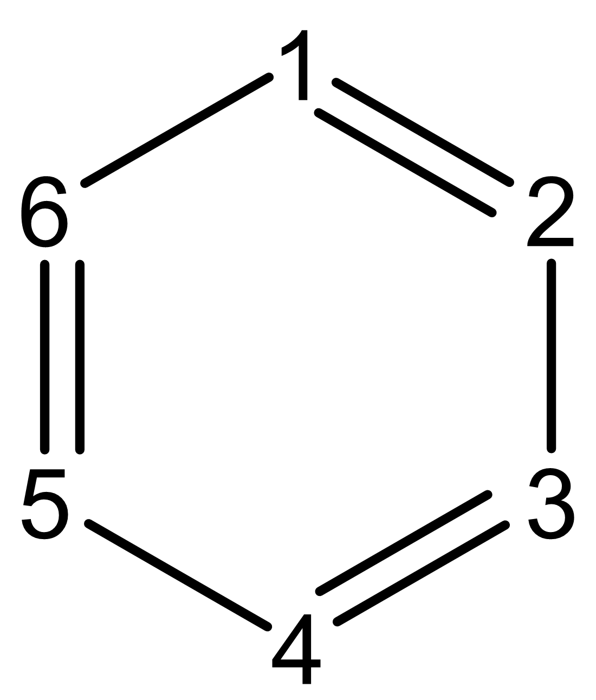
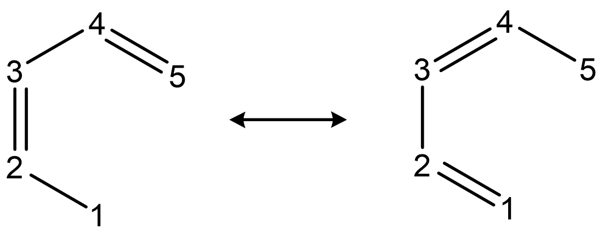

# **3.11 键级分析(Bond order analysis) (9)**

在键级分析模块中，你可以直接选择一个选项以用相应的方法分析键级。

如果你想获得两个分子片段(molecular fragments)中原子之间的总键级(total bond order)，你可以在键级分析之前使用选项 -1来定义片段1和2。然后如果你选择一个选项计算键级，两个片段之间的总键级 $I_{\mathrm{RS}}$ 将通过对原子间键级(interatomic bond orders)求和如下计算，同时与双中心键级(two-center bond orders)一起输出
$$
I_{RS}=\sum_{A\in R}\sum_{B\in S} I_{AB}
$$
> **注**
>
> 显然，片段间键级计算(interfragment bond order calculation)对多中心键级分析(multi-center bond order analysis)、轨道占据微扰Mayer键级(orbital occupancy-perturbed Mayer bond order)和Wiberg键级分解分析(Wiberg bond order decomposition analysis)不可用。

## **3.11.1 Mayer键级分析(Mayer bond order analysis) (1)**

原子*A*和*B*之间的Mayer键级定义为(*Chem. Phys. Lett*, **97**, 270 (1983))
$$
I_{AB}=I_{AB}^{\alpha}+I_{AB}^{\beta}=2\sum_{a\in A}\sum_{b\in B}[(\mathbf{P}^{\alpha}\mathbf{S})_{ba}(\mathbf{P}^{\alpha}\mathbf{S})_{ab}+(\mathbf{P}^{\beta}\mathbf{S})_{ba}(\mathbf{P}^{\beta}\mathbf{S})_{ab}]
$$
其中 $P^{α}$ 和 $P^{β}$ 分别为α和β密度矩阵(density matrix)，*S* 为重叠矩阵(overlap matrix)。上式可使用总密度矩阵(total density matrix) **P**= $P^{α}$ + $P^{β}$ 和自旋密度矩阵(spin density matrix) $P^{s}$ = $P^{α}$ − $P^{β}$ 等价改写
$$
I_{AB}=\sum_{a\in A}\sum_{b\in B}[(\mathbf{PS})_{ba}(\mathbf{PS})_{ab}+(\mathbf{P}^{\mathrm{s}}\mathbf{S})_{ba}(\mathbf{P}^{\mathrm{s}}\mathbf{S})_{ab}]
$$
对于限制性闭壳层(restricted closed-shell)情形，由于自旋密度矩阵(spin density matrix)为零，公式可简化为
$$
I_{AB}=\sum_{a\in A}\sum_{b\in B}(\mathbf{PS})_{ab}(\mathbf{PS})_{ba}
$$
一般来说，Mayer键级(Mayer bond order)的值与经验键级(empirical bond order)一致；对于单键、双键和三键，其值分别接近1.0、2.0和3.0。对于非限制(unrestricted)或限制性开壳层(restricted open-shell)波函数(wavefunction)，α(alpha)、β(beta)和总(total)Mayer键级将分别输出。默认情况下，只有键级超过0.05的键才会被打印到屏幕上，该阈值(threshold)可通过*settings.ini*中的“bndordthres”参数(parameter)调整，你还可以选择导出完整的键级矩阵(bond order matrix)。

此外，Multiwfn输出总价(total valence)和自由价(free valence)，前者定义为
$$
V_A=2\sum_{a\in A}(\mathbf{PS})_{aa}-\sum_{a\in A}\sum_{b\in A}(\mathbf{PS})_{ab}(\mathbf{PS})_{ba}
$$
后者定义为
$$
F_A=V_A-\sum_{B\neq A}I_{AB}=\sum_{a\in A}\sum_{b\in A}(\mathbf{P}^{\mathrm{s}}\mathbf{S})_{ab}(\mathbf{P}^{\mathrm{s}}\mathbf{S})_{ba}
$$
对于限制性闭壳层波函数(restricted closed-shell wavefunctions)，自由价(free valences)为零，因为$P^{s}$ =0，因此原子(atom)的总价(total valence)就是相关键级(bond orders)之和
$$
V_A=\sum_{B\neq A}I_{AB}
$$
总价(Total valence)(也称为原子价(atomic valence))衡量原子成键能力(bonding capacity)，而自由价(free valence)表征通过共享电子对(electron pairs)形成新键的剩余能力。

对于非限制(unrestricted)或限制性开壳(restricted open-shell)体系，存在另一种计算总键级(total bond order)的方法，而不是对alpha和beta键级求和，即首先将alpha和beta密度矩阵(density matrices)加和以形成总密度矩阵(total density matrix)，然后使用限制性闭壳(restricted closed-shell)公式计算Mayer键级(Mayer bond order)，该处理有时被称为“广义Wiberg键级(generalized Wiberg bond order)”，这些总键级打印在标题“Mayer bond order from mixed alpha&beta density matrix”之后。

与Mulliken布居(Mulliken population)类似，Mayer键级和下述多中心键级(multi-center bond order)对基组(basis set)敏感，因此不要使用带有弥散函数(diffuse functions)的基组，否则键级结果将不可靠。

尽管Mayer键级最初是为单行列式波函数(single-determinant wavefunctions)定义的，对于post-HF波函数(post-HF wavefunctions)，Multiwfn基于相应的post-HF密度矩阵通过与上文完全相同的公式计算Mayer键级。该处理的合理性已在*Chem. Phys. Lett.*, **544**, 83 (2012)中得到验证。

Mayer键级的一些应用可见于*J. Chem. Soc., Dalton Trans.*, **2001**, 2095。

> **所需信息(Information needed)**
>
> 基函数(Basis functions)

## **3.11.2 多中心键级分析(Multi-center bond order analysis) (2, -2, -3)**

在主功能9(main function 9)中有三个选项(2, -2, -3)用于计算多中心键级，它们非常相似，将在下文依次介绍。最后，将提及关于原子序号(atomic indices)输入顺序(input order)的一个值得注意的要点。

### **选项2(Option 2)：标准多中心键级(Standard multi-center bond order)**

多中心键指数(Multi-center bond index)最初在*Struct. Chem.*, **1**, 423 (1990)中提出，我更倾向于称其为多中心键级(MCBO)，因为其形式与Mayer键级非常相似。在某种意义上，MCBO可被视为Mayer键级向多中心情形(multi-center cases)的推广。三/四/五/六中心键级分别定义为
$$
\begin{gathered}I_{ABC}=\sum_{a\in A}\sum_{b\in B}\sum_{c\in C}(\mathbf{PS})_{ab}(\mathbf{PS})_{bc}(\mathbf{PS})_{ca}\\ I_{ABCD}=\sum_{a\in A}\sum_{b\in B}\sum_{c\in C}\sum_{d\in D}(\mathbf{PS})_{ab}(\mathbf{PS})_{bc}(\mathbf{PS})_{cd}(\mathbf{PS})_{da}\\ I_{ABCDE}=\sum_{a\in A}\sum_{b\in B}\sum_{c\in C}\sum_{d\in D}\sum_{e\in E}(\mathbf{PS})_{ab}(\mathbf{PS})_{bc}(\mathbf{PS})_{cd}(\mathbf{PS})_{de}(\mathbf{PS})_{ea}\\ I_{ABCDEF}=\sum_{a\in A}\sum_{b\in B}\sum_{c\in C}\sum_{d\in D}\sum_{e\in E}\sum_{f\in F}(\mathbf{PS})_{ab}(\mathbf{PS})_{bc}(\mathbf{PS})_{cd}(\mathbf{PS})_{de}(\mathbf{PS})_{ef}(\mathbf{PS})_{fa}\end{gathered}
$$
类似地，无限中心键级(infinite-center bond order)可写为
$$
I_{ABCDEF\cdots K}=\sum_{a\in A}\sum_{b\in B}\sum_{c\in C}\cdots\sum_{k\in K}(\mathbf{PS})_{ab}(\mathbf{PS})_{bc}(\mathbf{PS})_{cd}\cdots(\mathbf{PS})_{ka}
$$
对于开壳层(open-shell)情况，多中心键级(MCBO)有两种定义，第一种是α部分和β部分之和：
$$
\begin{aligned}&I_{ABCDEF\cdots K}=I_{ABCDEF\cdots K}^{\alpha}+I_{ABCDEF\cdots K}^{\beta}\\& =2^{n-1}\left[\sum_{a\in A}\sum_{b\in B}\sum_{c\in C}\cdots\sum_{k\in K}(\mathbf{P}^{\alpha}\mathbf{S})_{ab}(\mathbf{P}^{\alpha}\mathbf{S})_{bc}(\mathbf{P}^{\alpha}\mathbf{S})_{cd}\cdots(\mathbf{P}^{\alpha}\mathbf{S})_{ka}\right]\\& +2^{n-1}\left[\sum_{a\in A}\sum_{b\in B}\sum_{c\in C}\cdots\sum_{k\in K}(\mathbf{P}^{\beta}\mathbf{S})_{ab}(\mathbf{P}^{\beta}\mathbf{S})_{bc}(\mathbf{P}^{\beta}\mathbf{S})_{cd}\cdots(\mathbf{P}^{\beta}\mathbf{S})_{ka}\right]\end{aligned}
$$
另一种定义是使用混合密度矩阵(mixed density matrix)，这不如上述严格：
$$
\begin{gathered}I_{ABCDEF\cdots K}=\sum_{a\in A}\sum_{b\in B}\sum_{c\in C}\cdots\sum_{k\in K}(\mathbf{P}^{\mathrm{mixed}}\mathbf{S})_{ab}(\mathbf{P}^{\mathrm{mixed}}\mathbf{S})_{bc}(\mathbf{P}^{\mathrm{mixed}}\mathbf{S})_{cd}\cdots(\mathbf{P}^{\mathrm{mixed}}\mathbf{S})_{ka}\\ \mathbf{P}^{\mathrm{mixed}}=\mathbf{P}^{\alpha}+\mathbf{P}^{\beta}\end{gathered}
$$
对于非限制或限制性开壳层波函数(unrestricted or restricted open-shell wavefunction)，多中心键级(MCBO)分析的输出由四项组成，如上所述：(1) 来自α密度矩阵(alpha density matrix)的结果(2) 来自β密度矩阵(beta density matrix)的结果(3) α和β部分结果之和(4) 来自混合α&β密度矩阵(mixed alpha&beta density matrix)的结果。通常，如果您仅对总多中心键级(total MCBO)感兴趣，**您应使用(3)**。

注意，不同中心数的多中心键级不能直接比较，因为结果不在同一量级。然而，在*Phys. Chem. Chem. Phys.*，**18**，11839 (2016)中表明，归一化多中心键级(normalized MCBO)对于不同环大小(ring size)是可比的，并且可以简单地计算为$\mathrm{MCBO}^{1/n}$，其中*n*是中心数(number of centers)。例如，在B3LYP/6-31G\*水平(level)下，$H_{3}^{+}$、苯(benzene，6个中心)和萘(naphthalene，10个中心)的多中心键级分别为0.2963、0.0863和0.0080，而归一化结果分别为0.667、0.665和0.617。当多中心键级为负时，归一化值将计算为$-|\mathrm{MCBO}|^{1/n}$。通常，如果您需要在不同中心数之间比较多中心键级，您应采用Multiwfn打印的信息中的归一化多中心键级，否则建议使用原始多中心键级(raw MCBO)值。

Multiwfn能够自动搜索多中心键(multi-center bonds)。如果当Multiwfn要求您输入原子组合(atom combination)时您输入-*3*，则将计算所有三中心键级(three-center bond orders)，仅打印大于您输入的阈值(threshold)的那些。类似地，通过分别输入*-4*、*-5*和*-6*可以搜索四、五和六中心键。出于效率考虑，搜索可能不是穷举的(exhaustive)。还请注意，对于开壳层情形，搜索基于混合α&β密度矩阵。

在主功能(main function) 9中有一个隐藏选项(hidden option) -3，它用于计算Löwdin正交化基(Löwdin orthogonalized basis)下的多中心键级。该选项与上述选项2的唯一区别在于，该选项在计算多中心键级之前对基函数(basis functions)进行Löwdin正交化(Löwdin orthogonalization)。由于该方法相对于标准多中心键级定义(standard MCBO definition)没有明显优势，因此该选项很少使用，在界面(interface)中不可见。然而，如果您有兴趣，可以试一下。

### **选项-2：在自然原子轨道(natural atomic orbital, NAO)基(basis)中的多中心键级**

多中心键级最严重的缺点是其高度的基组依赖性(basis set dependency)。特别地，**如果存在弥散函数(diffuse functions)，则多中心键级结果可能是误导性的或完全没有意义**。为了解决该问题，我提出了一种计算多中心键级的替代方法(待发表)，该想法已作为选项-2实现。

选项-2与选项2(如上所述)非常相似，唯一区别在于多中心键级基于自然原子轨道基而非基于基组最初定义的基函数进行计算。由于自然原子轨道是正交归一集(orthonormal set)，因此重叠矩阵(overlap matrix) *S*是单位矩阵(identity matrix)，公式可简化为(以闭壳层形式(closed-shell form)为例)
$$
I_{ABCDEF\cdots K}=\sum_{a\in A}\sum_{b\in B}\sum_{c\in C}\cdots\sum_{k\in K} P_{ab}P_{bc}P_{cd}\cdots P_{ka}
$$
以这种方式计算的多中心键级(MCBO)对于基组(basis set)变化具有非常好的稳定性。即使存在弥散函数(diffuse functions)，结果仍然完全可靠。根据我的经验，如果没有基函数(basis function)表现出弥散特征，选项2和-2给出的结果将非常相似，尽管并非完全相同。

为了使用选项-2，应使用嵌入在Gaussian中的自然键轨道(NBO)模块或独立的自然键轨道程序（即GENNBO）的输出文件作为输入文件，并且必须使用*DMNAO*关键词使自然键轨道打印在自然原子轨道(NAO)基下的密度矩阵(density matrix)。如果你是Gaussian用户，例如，你可以使用下面实例的输出文件作为Multiwfn的输入文件（不要为此分析使用.fch文件！）。

```text
#p PBE1PBE/6-311G** pop=nboread

opted

0 1
 C                  0.00000000    1.38886900    0.00000000
... [ignored]
 H                 -2.14060700    1.23588000    0.00000000

$NBO DMNAO $END
```
在该功能中，如果你只输入两个原子的序号(indices)，那么结果就只是NAO基(NAO basis)下的Wiberg键级(Wiberg bond order)，这与NBO程序(NBO program)的*bndidx*关键词(keyword)打印的结果完全一致。

### **原子序号输入顺序(input order)对结果的影响**

输入的原子序号的方向(direction)(*e.g.* A,B,C,D vs. D,C,B,A)和排列(permutation)(*e.g.* A,B,C,D vs. B,D,C,A ...)都会影响计算得到的多中心键级(MCBO)，下面我详细描述这一点。

- **输入方向**

  由于原始多中心键级的数学形式(mathematical form)(*i.e.*由选项2计算的那一种)，多中心键级的结果可能依赖于输入方向。例如，输入A,B,C,D得到的结果可能与输入D,C,B,A得到的结果不同。原因很清楚：对应于A,B,C,D的一项是$(\mathbf{PS})_{ab}(\mathbf{PS})_{bc}(\mathbf{PS})_{cd}(\mathbf{PS})_{da}$，而如果反转输入顺序，该项将变为$(\mathbf{PS})_{dc}(\mathbf{PS})_{cb}(\mathbf{PS})_{ba}(\mathbf{PS})_{ad}$。虽然**P**和**S**都是对称矩阵(symmetry matrices)，但它们的乘积**PS**不一定对称，因此这两项并不等价。在我看来，为了获得更合理的结果，如果在一个环中原子连接关系为A-B-C-D-E-F(A还与F相连)，应分别计算A,B,C,D,E,F和F,E,D,C,B,A，然后取其平均值。如果你想让Multiwfn直接打印平均值，可以将*settings.ini*中的"iMCBOtype"设为1，在这种情况下你不需要手动进行两次计算，当然，与正常情况相比计算耗费会加倍。

  使用选项-2在NAO基中计算多中心键级和使用选项-3在Löwdin正交化基(Löwdin orthogonalized basis)中计算它的一个优点是，结果与输入方向无关，这是因为在这些情况下重叠矩阵(overlap matrix)**S**不显式参与，且密度矩阵(density matrix)**P**是对称矩阵。

- **序号排列**

  在多中心键级计算中，对输入的原子序号作排列会显著改变结果。例如，输入1,2,3,4,5,6的结果可能与输入2,4,3,5,6,1的结果非常不同，无论使用哪种形式的多中心键级。如果你的目的是研究芳香性(aromaticity)并表征环上电子的环离域(cyclic delocalization)，你应按顺时针或逆时针顺序输入原子序号，或如上所述取其平均值。

  有人主张需要考虑所有可能的排列才能得到确定性的结果，见*J. Phys. Org. Chem.*，**18**，706 (2005)；这意味着对于由六个原子组成的区域，(B,C,A,D,E,F)、(C,A,B,D,E,F)、(D,B,C,A,F,E)等等(共6!=720种)的键级都需要被考虑在内。这一定义在*Phys. Chem. Chem. Phys.*，**18**，11839 (2016)中被称为多中心指数(multi-center index, MCI)。明确定义如下，见*Phys. Chem. Chem. Phys.*，**18**，11839 (2016)的Eq. 9：
$$
\mathrm{MCI}=\frac{1}{2n}\sum_{\hat{P}(A,B,C\cdots)} I_{A,B,C\cdots}
$$
其中 *n* 是参与计算的原子数量，$\hat{P}$ 是生成所有可能置换序列的置换算符(permutation operator)。多中心指数(MCI)的计算开销明显大于多中心键级(MCBO)，且它不适合衡量芳香性(aromaticity)或环离域(cyclic delocalization)。然而，它可能有助于衡量簇状区域中原子间的"全局"电子离域(electron delocalization)。

  如果你想让Multiwfn直接打印多中心指数，可将*settings.ini*中的"iMCBOtype"设为2，然后像通常一样计算多中心键级(经由选项2、-2和-3中的任一个)，打印的结果将对应于多中心指数。

最后，值得注意的是，在某些情况下多中心键级可能略为负值。如果你未使用弥散函数(diffuse functions)，或多中心键级是基于自然原子轨道(NAOs)计算的，那么可将非常小的负多中心键级简单视作零。对于三中心情形，若多中心键级为明显的负值，则意味着存在三中心四电子(three-center four-electron, 3c-4e)相互作用(interaction)(*例如* CO₂)。

> **所需信息(Information needed)**
>
> 基函数(basis functions)(选项2、-3)，带有DMNAO关键词(keyword)的NBO输出文件(NBO output file)(选项-2)

### **附录(Appendix)：Multiwfn中多中心键级的极高效实现(implementation)**

根据表达式，多中心键级的计算开销(computational cost)似乎随环(ring)中原子数的增加呈指数增长，使得其对大环的评估不可行。得益于我提出的多中心键级的特殊实现，Multiwfn中多中心键级的开销仅随环成员数量(ring members)线性增长，即使对于由数十个原子构成的环，计算时间(computational time)也可忽略不计！该算法(algorithm)描述如下。

此处以五中心(five-center)多中心键级为例，其原始定义(original definition)为
$$
I_{ABCDE}=\sum_{a\in A}\sum_{b\in B}\sum_{c\in C}\sum_{d\in D}\sum_{e\in E}(PS)_{ab}(PS)_{bc}(PS)_{cd}(PS)_{de}(PS)_{ea}
$$
其可重新表述为
$$
I_{ABCDE}=\sum_{a\in A}\sum_{b\in B}(PS)_{ab}\sum_{c\in C}(PS)_{bc}\sum_{d\in D}(PS)_{cd}\sum_{e\in E}(PS)_{de}(PS)_{ea}
$$
如果中间矩阵(intermediate matrix)**A**已被完整计算并存储在内存中，其元素表示为

$A_{d,a}=\sum_{e\in E}(PS)_{de}(PS)_{ea}$ ，

则多中心键级(MCBO)可简化为
$$
I_{ABCDE}=\sum_{a\in A}\sum_{b\in B}(PS)_{ab}\sum_{c\in C}(PS)_{bc}\sum_{d\in D}(PS)_{cd}A_{d,a}
$$
接下来，如果中间矩阵(intermediate matrix) **B**被完整计算并存储在内存中，其元素表示为

$B_{c,a}=\sum_{d\in D}(PS)_{cd}A_{d,a}$ ,

则多中心键级(MCBO)可简化为
$$
I_{ABCDE}=\sum_{a\in A}\sum_{b\in B}(PS)_{ab}\sum_{c\in C}(PS)_{bc}B_{c,a}
$$
此外，如果中间矩阵(intermediate matrix) **C** 被完整计算并存储在内存中，其元素表示为

$C_{b,a}=\sum_{c\in C}(PS)_{bc}B_{c,a}$ ,

则多中心键级(MCBO)最终可简化为
$$
I_{ABCDE}=\sum_{a\in A}\sum_{b\in B}(PS)_{ab}C_{b,a}
$$
显然，使用中间矩阵(intermediate matrices)**A**、**B**、**C**，多中心键级(MCBO)可以以相当简单的方式求值，而**A**、**B**、**C**的构建也非常廉价。这种多中心键级重构形式的计算量仅随原子数线性增加，因此即使对于由100多个原子组成的环也可以轻松应用。

为了证明Multiwfn中多中心键级特殊实现(special implementation)的正确性和重要价值，下面给出了在ωB97XD/def2-TZVP水平下计算cyclo\[*n*\]carbon体系的$\mathrm{MCBO}^{1/n}$的结果和耗时比较。表中，“old”表示基于多中心键级原始方程的直接编程，其使用Multiwfn 3.6完成（其中尚无当前算法），“current”表示上文所述的算法。测试使用Intel i9-13980HX CPU。可以看到，两种算法给出完全相同的结果，然而对于cyclo\[8\]carbon，“old”算法的开销已经很高（即使使用像6-31G\*这样的小基组(basis set)，多中心键级通常至多只能用于包含十几个原子的环）。相比之下，当前算法仅在1秒内即可精确计算cyclo\[48\]carbon的多中心键级！

<table style="width: auto; margin-left: auto; margin-right: auto;">
<thead>
<tr>
<th rowspan="2"><em>n</em></th>
<th colspan="2" style="text-align: center;">墙钟时间(Wall time) (s)</th>
<th colspan="2" style="text-align: center;">$\mathrm{MCBO}^{1/n}$</th>
</tr>
<tr>
<th style="text-align: center;">old</th>
<th style="text-align: center;">current</th>
<th style="text-align: center;">old</th>
<th style="text-align: center;">current</th>
</tr>
</thead>
<tbody>
<tr>
<td>6</td>
<td>&lt;1s</td>
<td>&lt;1s</td>
<td>0.639945</td>
<td>0.639945</td>
</tr>
<tr>
<td>8</td>
<td>358s</td>
<td>&lt;1s</td>
<td>0.578652</td>
<td>0.578652</td>
</tr>
<tr>
<td>10</td>
<td></td>
<td>&lt;1s</td>
<td></td>
<td>0.649397</td>
</tr>
<tr>
<td>12</td>
<td></td>
<td>&lt;1s</td>
<td></td>
<td>0.611403</td>
</tr>
<tr>
<td>14</td>
<td></td>
<td>&lt;1s</td>
<td></td>
<td>0.637272</td>
</tr>
<tr>
<td>24</td>
<td></td>
<td>&lt;1s</td>
<td></td>
<td>0.561782</td>
</tr>
<tr>
<td>48</td>
<td></td>
<td>&lt;1s</td>
<td></td>
<td>0.549418</td>
</tr>
</tbody>
</table>

## **3.11.3 在Löwdin正交化基(Löwdin orthogonalized basis)下的Wiberg键级(Wiberg bond order)分析 (3)**

Wiberg键级定义如下，见*Tetrahedron*，**24**，1083 (1968)中的脚注
$$
I_{AB}=\sum_{a\in A}\sum_{b\in B} P_{ab}^2
$$
Wiberg键级(Wiberg bond order)的原始定义仅适用于由正交基函数表示的波函数，例如大多数半经验波函数，且仅针对限制性闭壳层体系定义。实际上，Mayer键级(Mayer bond order)可视为Wiberg键级的推广，对于限制性闭壳层体系且基函数正交归一（即*S*矩阵为单位矩阵）的情形，二者的结果完全相同。

在此功能中，Multiwfn首先通过Löwdin方法对基函数进行正交化，然后进行常规的Mayer键级分析。打印阈值也由*settings.ini*中的“bndordthres”控制。

如*J. Mol. Struct. (THEOCHEM)*, **870**, 1 (2008)所示，以此方式计算的Wiberg键级，即$W_{L}$，对基组的敏感性远小于Mayer键级（而对于小基组，二者的结果彼此接近）。应注意，与Mayer键级相比，$W_{L}$倾向于高估极性键的键级。

通常，若无特殊原因，优选使用Mayer键级。

注意，许多论文使用NBO程序计算Wiberg键级，其结果必定与本功能产生的结果有所不同，因为在NBO程序中，Wiberg键级是在自然原子轨道(natural atomic orbitals, NAO)基下计算的，该轨道由OWSO正交化方法生成。Multiwfn也能够在NAO基下计算Wiberg键级，此外，结果可分解为原子轨道对贡献，详见[3.11.8](#3118-将nao基nao-basis中的wiberg键级分解为原子轨道对贡献atomic-orbital-pair-contributions-9)节。

> **所需信息**
>
> 基函数

## **3.11.4 Mulliken键级(Mulliken bond order)分析(4)与分解(5)**

Mulliken键级是最早的键级定义，其定义为
$$
I_{AB}=\sum_i\eta_i\sum_{a\in A}\sum_{b\in B}2C_{a,i}C_{b,i}S_{a,b}=2\sum_{a\in A}\sum_{b\in B} P_{a,b}S_{a,b}
$$
Mulliken键级(Mulliken bond order)与经验键级(empirical bond order)的一致性较低，不建议用于定量描述成键强度(bonding strength)，Mayer键级(Mayer bond order)在该方面总是表现更好。然而，Mulliken键级是成键(bonding)（正值）和反键(antibonding)（负值）的良好定性指标(qualitative indicator)。打印结果的阈值(threshold)由*settings.ini*中的“bndordthres”参数(parameter)控制。

Mulliken键级易于分解为轨道贡献(orbital contributions)，轨道*i*对键级*AB*的贡献为
$$
I_{AB}^i=\eta_i\sum_{a\in A}\sum_{b\in B}2C_{a,i}C_{b,i}S_{a,b}
$$
从该分解(decomposition)可以知道哪些轨道(orbitals)对特定成键(bonding)是有利的和不利的。

> **所需信息**
>
> 基函数(Basis functions)

## **3.11.5 轨道占据微扰Mayer键级(Orbital occupancy-perturbed Mayer bond order) (6)**

轨道占据微扰Mayer键级首次提出于*J. Chem. Theory Comput.*，**8**，908 (2012)。简单来说，通过使用该方法可以获得特定轨道对Mayer键级的贡献有多大。

轨道占据微扰Mayer键级可以写为
$$
I_{A,B}^*=I_{AB}^{*,\alpha}+I_{AB}^{*,\beta}=2\sum_{a\in A}\sum_{b\in B}[(\mathbf{P}_X^{\alpha}\mathbf{S})_{ba}(\mathbf{P}_X^{\alpha}\mathbf{S})_{ab}+(\mathbf{P}_X^{\beta}\mathbf{S})_{ba}(\mathbf{P}_X^{\beta}\mathbf{S})_{ab}]
$$
该定义与第[3.11.1](#3111-mayer键级分析mayer-bond-order-analysis-1)节所示的Mayer键级(Mayer bond order)之间的唯一区别在于，$P^{α}$和$P^{β}$已分别被${\mathbf{P}}_{X}^{\alpha}$和${\mathbf{P}}_{X}^{\beta}$取代。$P_{X}$代表当特定轨道(orbital)的占据数(occupation number)设为零时生成的密度矩阵(density matrix)。${I}_{A,B}^{*}$与Mayer键级之差可被视为该轨道对Mayer键级贡献的量度。请注意，由于Mayer键级不是密度矩阵的线性函数(linear function)，一般而言，所有轨道的${I}_{A,B}^{*}$之和不等于Mayer键级。

在Multiwfn中，你只需输入两个原子的序号，随后将输出所有占据轨道的${I}_{A,B}^{*}$以及${I}_{A,B}^{*}$与Mayer键级之差。该差值越负(正)，由于该轨道的存在，对成键(bonding)越有利(有害)。

你也可以用另一种方式计算${I}_{A,B}^{*}$，即使用波函数修正模块(wavefunction modification module)(主功能6)手动将特定轨道的占据数设为零，然后像往常一样计算Mayer键级，但如果你想计算许多轨道的${I}_{A,B}^{*}$，这种方式可能会很繁琐。

这类分析在第[4.9.1](sec-4-9-bond-order-analysis.md#491-乙酰胺的mayer键级与模糊键级分析)节和第[4.19.3](sec-4-19-orbital-localization-analysis.md#4193-表征-re₂cl₈²-阴离子的-re-re-键)节中进行了说明。

> **所需信息**
>
> 基函数(Basis functions)

## **3.11.6 模糊键级(Fuzzy bond order) (7)**

模糊键级(FBO)由Mayer在*Chem. Phys. Lett.*，**383**，368 (2004)中首次提出：
$$
\begin{gathered}B_{AB}=B_{AB}^{\alpha}+B_{AB}^{\beta}=2\sum_{\mu}\sum_{\nu}[(\mathbf{P}^{\alpha}\mathbf{S}^A)_{\mu\nu}(\mathbf{P}^{\alpha}\mathbf{S}^B)_{\nu\mu}+(\mathbf{P}^{\beta}\mathbf{S}^A)_{\mu\nu}(\mathbf{P}^{\beta}\mathbf{S}^B)_{\nu\mu}]\\ S_{\mu\nu}^A=\int w_A(\mathbf{r})\chi_\mu^*(\mathbf{r})\chi_\nu(\mathbf{r})\mathrm{d}\mathbf{r}\end{gathered}
$$
其中**S**为模糊原子空间(fuzzy atomic spaces)中基函数(basis functions)之间的重叠矩阵(overlap matrix)。在Multiwfn中，用于计算模糊键级(FBO)的是带有陡峭参数(sharpness parameter)*k*=3并结合修正的CSD半径(modified CSD radii)的Becke模糊原子空间(Becke's fuzzy atomic space)。(模糊原子空间的介绍见[3.18.0](sec-3-18-fuzzy-atomic-space-analysis.md#3180-基本概念)节)。

通常模糊键级的数值接近Mayer键级(Mayer bond order)，特别是对于低极性键(low-polar bonds)，但相对于基组(basis set)变化要稳定得多。根据*J. Phys. Chem. A*, **109**, 9904 (2005)中给出的模糊键级与离域指数(delocalization index, DI)之间的比较，模糊键级本质上是在模糊原子空间中计算的离域指数。关于离域指数的细节见[3.18.5](sec-3-18-fuzzy-atomic-space-analysis.md#3185-定域化指数-li与离域化指数-di-4-44)节。

模糊键级的计算需要执行Becke的DFT数值积分(Becke's DFT numerical integration)，因此其计算代价(computational cost)大于Mayer键级的评估。默认情况下，数值积分使用40个径向点(radial points)和230个角向点(angular points)。该设置一般能够给出足够准确的结果。如果你想进一步精细化结果，可以在*settings.ini*中手动通过"radpot"和"sphpot"设置径向点和角向点的数目，并确保"iautointgrid"已设为0。

打印结果的阈值(threshold)由*settings.ini*中的“bndordthres”参数(parameter)控制。

> **所需信息(Information needed)**
>
> 高斯型函数(GTFs)、原子坐标(atom coordinates)

## **3.11.7 拉普拉斯键级(Laplacian bond order) (8)**

在*J. Phys. Chem. A*, **117**, 3100 (2013) (<http://pubs.acs.org/doi/abs/10.1021/jp4010345>)中，我提出了一种基于模糊重叠空间(fuzzy overlap space)中电子密度的拉普拉斯(Laplacian of electron density)${\mathrm{\nabla }}^{2}\rho$的共价键级(covalent bond order)的新定义，称为拉普拉斯键级(Laplacian bond order, LBO)。原子A和B之间的拉普拉斯键级可简单写为
$$
L_{A,B}=-10\times\int_{\nabla^2\rho<0} w_A(\mathbf{r})w_B(\mathbf{r})\nabla^2\rho(\mathbf{r})\mathrm{d}\mathbf{r}
$$
其中*w*是由Becke提出的平滑变化的加权函数(weighting function)，代表模糊原子空间(fuzzy atomic space)，因此$w_{A}$ $w_{B}$对应于*A*与*B*之间的模糊重叠空间(fuzzy overlap space)。注意积分(integration)仅限于${\mathrm{\nabla }}^{2}\rho$的负值部分。LBO的物理基础是，在模糊重叠空间中负${\mathrm{\nabla }}^{2}\rho$的积分的量值越大，电子密度(electron density)在成键区域(bonding region)集中得越强烈，因此共价成键(covalent bonding)越强。

在LBO的原始论文中，通过将其应用于多种多样的分子并与许多已有的键级(bond order)定义进行比较，证明了LBO的合理性和实用性。结果表明，LBO与键极性(bond polarity)、键解离能(bond dissociation energy)和键振动频率(bond vibrational frequency)直接相关。LBO的计算开销(computational cost)低，而且LBO对用于生成电子密度的计算级别(computational level)不敏感。此外，由于LBO本质上与波函数(wavefunction)无关，原则上可以利用源自X射线衍射(X-ray diffraction)数据的精确电子密度获得LBO。

在Multiwfn中，用于计算LBO的是结合了修正的CSD半径(modified CSD radii)的、锐度参数(sharpness parameter)*k*=3的Becke模糊原子空间。(关于模糊原子空间的细节，见[3.18.0](sec-3-18-fuzzy-atomic-space-analysis.md#3180-基本概念)节)。打印结果的阈值由*settings.ini*中的“bndordthres”参数控制。

注意，在当前实现中，LBO特别适合于有机体系(organic systems)，但不适合离子键(ionic bonds)，因为在这些情况下应使用更好的原子空间(atomic space)定义以忠实地展现实际原子空间。LBO也不太适合研究两个重原子(heavy atoms，重于Ar)之间的成键，因为这些键在模糊重叠空间中往往伴随着不显著的电荷集中(charge concentration)，尽管其成键无疑是共价的。

LBO的一个很好的应用实例是*Carbon*，**165**，468 (2020)，其中LBO被用于表征cyclo\[18\]carbon中两种不同类型的C-C键之间的成键。

> **所需信息**
>
> GTFs, 原子坐标(atom coordinates)

## **3.11.8 将NAO基(NAO basis)中的Wiberg键级分解为原子轨道对贡献(atomic orbital pair contributions) (9)**

### **理论(Theory)**

正如[3.11.3](#3113-在löwdin正交化基löwdin-orthogonalized-basis下的wiberg键级wiberg-bond-order分析-3)节所述，Wiberg键级表示为
$$
I_{AB}=\sum_{a\in A}\sum_{b\in B} P_{ab}^2
$$
该数据是针对原子对(atomic pairs)计算的。由于该表达式仅仅是密度矩阵元(density matrix element)平方的线性组合(linear combination)，将Wiberg键级(Wiberg bond order)分解为基函数对贡献(basis function pair contribution)是很直接的(该想法即将发表)。例如，$P_{\mathrm{ab}}$ ² 仅仅是基函数*a*和*b*之间相互作用的贡献。由于在使用扩展基组(extended basis set)时缺乏基函数与原子轨道(atomic orbital)之间的一一对应(one-to-one correspondence)，为了使分解方法具有充分的物理意义，最好在自然原子轨道(natural atomic orbitals)(NAOs)下进行分解。每个非Rydberg型(non-Rydberg type)的自然原子轨道唯一对应于一个原子轨道，因此，通过上述分解方法，可以得到*原子轨道尺度(atomic orbital scale)上的*Wiberg键级。

此外，原子轨道壳层(atomic orbital shells) *i*和*j*之间相互作用的贡献可表示为 $\sum_{a\in\mathrm{shell}\ i}\sum_{b\in\mathrm{shell}\ j} P_{ab}^2$ 。

顺便提一下，将多中心键级(multi-center bond order)分解为原子轨道贡献(atomic orbital contribution)也是可能的。例如，三中心键级(three-center bond order)表示为
$$
I_{ABC}=\sum_{a\in A}\sum_{b\in B}\sum_{c\in C} P_{ab}P_{bc}P_{ca}
$$
显然，$P_{\mathrm{ab}}$ $P_{\mathrm{bc}}$ $P_{\mathrm{ca}}$可视为来自自然原子轨道(NAO) *a*、*b*和*c*之间相互作用的贡献。然而，基于自然原子轨道基的多中心键级(multi-center bond order)的分解(decomposition)尚未实现。

### **用法**

进入此函数后，只需输入两个原子的序号，来自自然原子轨道对和自然原子轨道壳对的不可忽略的贡献以及总Wiberg键将一并被打印。

您也可以输入-1以输入原子序号来定义两个片段(fragment)，然后将给出两个片段之间的自然原子轨道壳贡献对片段间Wiberg键级(interfragment Wiberg bond order)的贡献。

该函数的输入文件与第[3.11.2](#3112-多中心键级分析multi-center-bond-order-analysis-2--2--3)节中描述的选项-2完全相同，即含有密度矩阵(density matrix)信息的NBO程序的输出文件(*即*需要"DMNAO"关键词)。

此分解分析的说明性例子见第[4.9.4](sec-4-9-bond-order-analysis.md#494-甲醛在nao基组下的wiberg键级的分解分析)节。

## **3.11.9 本征键强度指数(intrinsic bond strength index, IBSI) (10)**

### **理论**

本征键强度指数(IBSI)在*J. Phys. Chem. A*，**124**，1850 (2020)中被提出，用于量化化学键(chemical bond)的强度，它也可用于比较弱相互作用(weak interaction)的强度。本征键强度指数最初是在独立梯度模型(independent gradient model, IGM)框架下定义的，该模型在第[3.23.5](sec-3-23-visual-study-of-weak-interaction.md#3235-基于前分子-promolecular密度的独立梯度模型-independent-gradient-model-igm分析-10)节中有非常详细的描述。本征键强度指数表示为
$$
\mathrm{IBSI}=\frac{(1/d^2)\int\delta g^{\mathrm{pair}}\mathrm{d}\mathbf{r}}{(1/d_{\mathrm{H}_2}^2)\int\delta g^{\mathrm{H}_2}\mathrm{d}\mathbf{r}}
$$
其中*d*是待研究相互作用(interaction)的两个原子之间的距离。分子中的积分相当于我定义的这两个原子之间的原子对δ*g*指数(atomic pair δ*g* index)，详情见[3.23.6](sec-3-23-visual-study-of-weak-interaction.md#3236-基于电子密度-hirshfeld-分区的-igm-igmh分析-11)节。分母是参考体系(reference system)的数据，其中${d}_{{\mathrm{H}}_{2}}$和该积分分别是H₂在其平衡结构下的键长(bond length)和原子对δ*g*指数。在IBSI的原始论文中已表明，IBSI值与共价键(covalent bond)的强度呈适度的正相关。此外，还发现过渡金属配位键(transition metal coordinate bond)的IBSI量级明显小于共价键，而弱相互作用(weak interaction)的IBSI量级还要低得多，IBSI的这一特征可用于区分相互作用类型。

### **实现(Implementation)**

需要注意的是，在IBSI论文中作者使用基于梯度划分(gradient-based partition)的IGM（IG $M^{\mathrm{GBP}}$ ）计算IBSI，然而Multiwfn不支持这种形式的IGM。目前Multiwfn支持IGM的原始形式，即基于预分子近似(promolecular approximation)的IGM（IG $M^{\mathrm{pro}}$ ），也支持基于分子密度Hirshfeld划分(Hirshfeld partition of molecular density)的IGM（IGMH），以及mIGM。不同形式的IGM对应于计算原子密度梯度(gradient of atomic density)的不同方式，因此IBSI表达式中积分的值也相应不同。在Multiwfn中，IBSI可基于IG $M^{\mathrm{pro}}$ 、IGMH和mIGM计算，它们的结果差异很大，我发现基于IG $M^{\mathrm{pro}}$ 的结果明显更接近IBSI原始论文。

### **用法(Usage)**

要计算IBSI，只需进入主功能(main function) 9并选择子功能(subfunction) 10，然后选择选项(option) 0开始计算。

计算前，Multiwfn会要求你选择积分格点(integration grid)的质量，显然格点越好，开销越高，而结果越准确。根据我的经验，对于IG $M^{\mathrm{pro}}$ ，“medium quality”已能给出定量准确的结果；而对于IGMH和mIGM，若对精度(accuracy)有要求，至少应使用“high-quality”。

你可通过选项2选择IBSI计算中使用哪种形式的IGM。若输入文件包含波函数信息(wavefunction information)，默认使用IGMH，而若输入文件仅包含几何信息(geometry information)（*e.g.* .pdb, .mol, .xyz...），则可使用IG $M^{\mathrm{pro}}$ 或mIGM。注意，IGMH比IG $M^{\mathrm{pro}}$ 昂贵得多，因其计算原子密度梯度的公式要复杂得多。

若你仅对局域区域内的相互作用感兴趣，可选择选项3定义待研究的区域，仅会计算并输出所定义片段(fragment)中原子之间的IBSI，其开销相应低于对整个体系的IBSI计算，尤其当体系巨大时。

可通过选项4设置参考值(reference value)，它对应于IBSI公式的分母。当然，该值对于IG $M^{\mathrm{pro}}$ 、IGMH和mIGM必然不同。默认参考值是针对具有实验键长(0.74144 Å)的H₂计算得到的，在IGMH情形下采用了B3LYP/6-311G\*\*波函数。通常，参考值无需更改。然而，对于以IGMH计算IBSI，若你想获得当前计算水平下的参考值以追求更严格的结果，可载入H₂的波函数文件(wavefunction file)，然后进入当前功能，将参考值设为1.0，再使用选项0开始计算IBSI，所得结果可用作研究实际分子的参考值。

为了避免过多的输出，默认仅打印间距小于3.5 Å的原子对的数据，因为如果间距更大，内在键强度指数(IBSI)应该可以忽略不计。如果需要调整距离打印阈值，请使用选项5。

计算内在键强度指数的示例见第[4.9.6](sec-4-9-bond-order-analysis.md#496-用本征键强度指数ibsi衡量化学键强度)节。

> **需要的信息(Information needed)**
>
> 原子坐标(Atom coordinates)（用于基于IG $M^{\mathrm{pro}}$和mIGM的内在键强度指数），GTF信息(GTF information)（用于基于IGMH的内在键强度指数）

## **3.11.10 AV1245指数(AV1245 index)（大环的近似多中心键级(approximate multi-center bond order for large rings)）和AVmin**

### **理论(Theory)**

多中心键级(multi-center bond order, MCBO)如第[3.11.2](#3112-多中心键级分析multi-center-bond-order-analysis-2--2--3)节所介绍，是表征芳香性(aromaticity)的一种非常严谨且流行的方法。在*Phys. Chem. Chem. Phys.*，**18**，11839 (2016)中，作者提出了AV1245指数以量化大环的芳香性，它可被视为多中心键级的近似。

> **注(Note)**
>
> AV1245相对于多中心键级的最初关键优势在于AV1245的计算成本仅随原子数线性增加，而对于由超过11\~12个原子组成的环，多中心键级的成本通常高得令人望而却步。然而，自Multiwfn 3.8起，多中心键级的计算时间也与环成员成线性比例，因此多中心键级可以很容易地用于非常大的环，AV1245的价值变得不那么明显。

原始论文中AV1245的定义是"对环上保持位置关系为1, 2, 4, 5的所有4c-ESI值求平均"。在此我澄清其定义。作为一个实例，对于下面的环，



其AV1245按如下计算
$$
\mathrm{AV1245}=\left[\mathrm{ESI}(1,2,4,5)+\mathrm{ESI}(2,3,5,6)+\mathrm{ESI}(3,4,6,1)+\mathrm{ESI}(4,5,1,2)+\mathrm{ESI}(5,6,2,3)+\mathrm{ESI}(6,1,3,4)\right] / 6
$$
其中*n*c-ESI（*n*中心电子共享指数(*n*-center electron sharing index)）可经由带有所有可能排列的多中心键级(multi-center bond order)（即*I* $^{perm}$，详见第[3.11.2](#3112-多中心键级分析multi-center-bond-order-analysis-2--2--3)节）通过以下关系式直接获得
$$
\mathrm{ESI}=\frac{2}{(n-1)!}I^{\mathrm{perm}}
$$
其中 *n* 是原子(atoms)的数量。显然，4c-ESI = (4c- $I^{\mathrm{perm}}$ ) / 3。

AV1245的核心思想基于以下事实：在芳香环(aromatic ring)中，1-2键与4-5键之间的共振(resonance)很强，如下图所示。该特征可由ESI(1,2,4,5)捕捉。



循环路径(cyclic path)的AV1245值越大意味着离域(delocalization)越强，从而环的芳香性(aromaticity)越大。由于AV1245的量级很小，在呈现数据时常将其乘以1000。

值得注意的是，在AV1245的原始论文中，多中心键级(MCBO)是基于AIM划分(AIM partition)下的原子重叠矩阵(atomic overlap matrix)计算的，这种计算方式不仅昂贵而且复杂。在Multiwfn中，AV1245中涉及的MCBO按常规方式计算，即基于密度矩阵(density matrix)和重叠矩阵(overlap matrix)。由于在这种情况下4中心 *I* $^{perm}$ 的计算相当廉价，即使对于大体系和大环也能快速获得AV1245。然而，由于MCBO计算上的差异，Multiwfn产生的AV1245结果小于原始论文中的结果。此外，当用Multiwfn直接计算AV1245时（换句话说，在原始基函数(original basis functions)中计算AV1245），所用的基组不应包含弥散函数(diffuse functions)，否则AV1245将毫无意义。

Multiwfn还支持在自然原子轨道(natural atomic orbital, NAO)基下计算AV1245，在这种情况下即使存在弥散函数也能获得合理的结果。如果没有弥散函数，在原始基函数中计算的结果与在NAO基下计算的结果几乎相同。

AVmin指标在 *J. Phys. Chem. C*, **121**, 27118 (2017)中提出，并在 *Phys. Chem. Chem. Phys.*, **20**, 2787 (2018)中进一步讨论。它对应于AV1245计算中所涉及的所有4c-ESI的最小绝对值。与AV1245不同，AVmin定量了整个路径中的最低共轭(conjugation)程度，因此在区分不同离域路径(delocalization pathways)的芳香性方面具有独特价值，因为根据通常的直觉，一条路径的芳香性应主要由在整个路径上最阻断离域的局域区域决定。换句话说，AVmin能够确定给定路径芳香性的瓶颈(bottleneck)。

### **用法(Usage)**

- 在原始基函数中计算AV1245和AVmin

  你应进入主功能(main function)200的子功能(subfunction)19，然后按连接顺序（沿环顺时针或逆时针）输入环中原子的原子序号(atomic indices)。此后，将输出AV1245及其组成的4c-ESI值以及AVmin

  > **注(Note)**
  >
  > Multiwfn为输入大环的原子序号提供了便利。如果你先输入 *d* 并按ENTER键，然后你能以任意顺序输入原子序号，因为在这种情况下实际顺序将根据原子间连接性(interatomic connectivity)自动推测。然而，当环中任一原子与环中两个以上的其它原子相连时，不能使用此输入模式。

- 在NAO基下计算AV1245和AVmin

  操作过程与“在原始基函数中计算AV1245和AVmin”相同，然而，你应使用独立NBO程序的输出文件或量子化学程序(quantum chemistry codes)中内嵌的NBO模块的输出文件作为Multiwfn的输入文件，同时在NBO分析中必须使用"DMNAO"关键词。请注意在这种情况下上述的"d"序号输入模式不可用。

在[4.9.11](sec-4-9-bond-order-analysis.md#4911-用av1245和avmin指数研究芳香性的例子)节中给出了运用AV1245和AVmin研究小环和大环芳香性的例子。

> **所需信息(Information needed)**
>
> 原子坐标(Atom coordinates)，基函数

## **3.11.12 AIM盆(AIM basins)之间的离域指数(delocalization index, DI)**

离域指数的概念在第[3.18.5](sec-3-18-fuzzy-atomic-space-analysis.md#3185-定域化指数-li与离域化指数-di-4-44)节中给出。在分子中的原子盆，即对电子密度(electron density)划分的盆之间计算的离域指数是对不同原子共享的电子对(electron pairs)数目的定量，也可被视为键级(bond order)的一种度量。然而，这种离域指数对于具有更高键极性(bond polarity)的键往往偏低。由于这一原因，对于非极性键(nonpolar bonds)，离域指数通常与Mayer键级(Mayer bond order)和模糊键级(fuzzy bond order)非常接近，而对于极性键(polar bonds)，差异可能相当大。

盆分析模块(basin analysis module)可计算离域指数，如第[3.20](sec-3-20-basin-analysis.md)节所述。然而，获得原子间离域指数的最直接方法是直接使用专用功能，即主功能9的子功能12。您将被要求选择网格质量(grid quality)，质量越好，开销越高，而结果越准确。在此功能中，采用均匀网格与原子中心积分网格(atomic centered integration grids)来计算离域指数。

> **所需信息(Information needed)**
>
> 原子坐标(Atom coordinates)，基函数(basis functions)