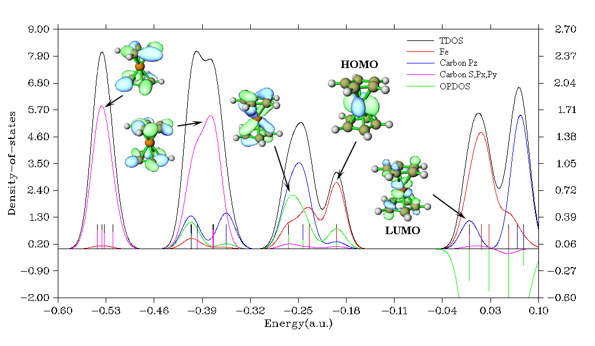

# **3.12 绘制态密度(density-of-states, DOS)、光电子能谱(photoelectron spectrum, PES)和COHP (10)**

总态密度(TDOS)、分态密度(PDOS)和重叠布居态密度(OPDOS)是最常研究的态密度类型，它们的定义和在Multiwfn中的绘制方法将在[3.12.1](#3121-理论theory)、[3.12.2](#3122-输入文件input-file)和[3.12.3](#3123-绘制态密度dos图的选项与基本用法)节中描述。局域态密度(local DOS, LDOS)是一种特殊的态密度，将在[3.12.4](#3124-局域态密度local-dos)节中介绍。由于总态密度与光电子能谱密切相关，该模块还能够绘制光电子能谱，这将在[3.12.5](#3125-光电子能谱photoelectron-spectrum)节中介绍。在[3.12.6](#3126-cohp)节中，将介绍晶体重叠哈密顿布居(crystal overlap Hamilton populations, COHP)，其与重叠布居态密度密切相关。

## **3.12.1 理论(Theory)**

态密度是固体物理(solid physics)的一个重要概念，其表示单位能量区间内的状态数，由于能级是连续的，因此态密度可以绘制为曲线图。在孤立体系(isolated system)（如分子）中，能级是分立的，态密度的概念是有疑问的，有人认为在这种情况下态密度完全没有价值。然而，如果将分立能级人为展宽为曲线，态密度图可用作分析电子结构(electron structure)性质的有价值工具。

孤立体系的总态密度可写为
$$
\mathrm{TDOS}(E)=\sum_i\delta(E-\varepsilon_i)
$$
其中 {*ε*} 是单粒子哈密顿(single-particle Hamilton)的本征值集合(eigenvalue set)，*δ* 是狄拉克δ函数(Dirac delta function)。如果 *δ* 被展宽函数(broadening function) *F*(*x*)取代，例如高斯函数(Gaussian)、洛伦兹函数(Lorentzian)和赝沃伊特函数(pseudo-Voigt function)，则得到加宽的总态密度(broadened TDOS)。

归一化高斯函数(normalized Gaussian function)定义为

$G(x)=\frac{1}{c\sqrt{2\pi}}e^{-\frac{x^2}{2c^2}}$ 其中 $c=\frac{\mathrm{FWHM}}{2\sqrt{2\ln 2}}$

半高宽(FWHM)是“半高全宽(full width at half maximum)”的首字母缩写(acronym)，它是Multiwfn中的可调参数(adjustable parameter)。半高宽越大，总态密度图越平滑，但损失的关于能级分布(energy level distribution)的详细信息越多。

归一化洛伦兹函数(normalized Lorentzian function)定义为
$$
L(x)=\frac{\mathrm{FWHM}}{2\pi}\frac{1}{x^2+0.25\times\mathrm{FWHM}^2}
$$
赝Voigt函数(Pseudo-Voigt function)是高斯函数(Gaussian function)和洛伦兹函数(Lorentzian function)的加权线性组合：
$$
P(x)=w_{\mathrm{Gauss}}G(x)+(1-w_{\mathrm{Gauss}})L(x)
$$
显然，如果*G*(*x*)和*L*(*x*)是归一化的，则无论$w_{\mathrm{Gauss}}$的选择如何，*P*(*x*)的归一化条件恒成立。

加宽的部分态密度(partial DOS, PDOS)和重叠态密度(overlap DOS, OPDOS)的曲线图对于轨道组成的可视化研究非常有价值。碎片*A*的部分态密度定义为
$$
\mathrm{PDOS}_A(E)=\sum_i\Theta_{i,A}F(E-\varepsilon_i)
$$
其中 $\Theta_{i,A}$ 是片段(fragment) *A* 在轨道(orbital) *i* 中的组成(composition)。注意，一些论文中使用的词语 "投影态密度(projected DOS)" 本质上等同于分态密度(partial DOS)。

片段 *A* 和 *B* 之间的重叠布居态密度(OPDOS)定义为
$$
\mathrm{OPDOS}_{A,B}(E)=\sum_i X_{A,B}^i F(E-\varepsilon_i)
$$
其中${\mathrm{X}}_{A,B}^{i}$是轨道*i*中碎片*A*和*B*之间总交叉项的组成。我已在[3.10.3](sec-3-10-orbital-composition-analysis.md#3103-用-mullikenstout-politzer-和-scpa-方法输出片段-1-的成分和片段间成分-4-5-6)节中讨论了如何计算Θ和Χ。

在Multiwfn中，重叠布居态密度(OPDOS)也可以在所有最近邻原子之间计算。在这种情况下，重叠布居态密度计算为
$$
\mathrm{OPDOS}^{\mathrm{near}}(E)=\sum_i\sum_A n_{A,A_{\mathrm{adj}}}^i F(E-\varepsilon_i)
$$
其中*A*遍历所有原子(atom)，$A_{\mathrm{adj}}$表示体系中与*A*最接近的原子。${n}_{{A,A}_{\mathrm{adj}}}^{i}$对应于轨道(orbital)*i*中*A*与$A_{\mathrm{adj}}$之间的重叠布居(overlap population)。

当用户定义了一个或多个片段(fragment)时，Multiwfn在显示DOS图(DOS map)时将自动按下式计算每个片段的PDOS中心(center of PDOS)，并将其打印在命令行窗口(command-line window)中
$$
\varepsilon_{c,F}=\frac{\int_{\mathrm{low}}^{\mathrm{high}} E\times\mathrm{PDOS}_F(E)\mathrm{d}E}{\int_{\mathrm{low}}^{\mathrm{high}}\mathrm{PDOS}_F(E)\mathrm{d}E}
$$
其中*low*和*high*分别是当前X轴即能量范围(energy range)的下限和上限，*F*表示所考虑的碎片(fragment)。通过此功能，可以轻松计算*d*带中心(d-band center)，这对研究过渡金属(transition metal)表面上的化学吸附(chemisorption)很重要。示例见第[4.10.6](sec-4-10-plot-density-of-states-dos-maps.md#4106-计算过渡金属团簇的-d-带中心-d-band-center)节。

### **态密度(DOS)图示：二茂铁(Ferrocene)**

下面是一个典型分子二茂铁的态密度图，对铁采用了Lanl2DZ基组(basis set)结合Lanl2赝势(pseudopotential)，而对其它元素采用了6-31G\*。在此体系中，Z轴垂直于环戊二烯基(cyclopentadienyl groups)。



该图清楚地展示了不同能量范围内的轨道(orbital)特征，每条分立线对应一个分子轨道(MO)。这些曲线是通过对分立线应用展宽函数(broadening function)得到的。左右Y轴分别对应曲线和分立线。注意，只有曲线的相对高度而非绝对高度是有意义的。显然，碳的*s*、$p_{x}$和$p_{y}$原子轨道(atomic orbitals)的主要贡献（品红色曲线）来自低能分子轨道，而非前线分子轨道(frontier MOs)。-0.25 a.u.附近的分子轨道的主要组成来自碳的$p_{z}$轨道（蓝色曲线）和铁原子（红色曲线）。考察对应于碳$p_{z}$与铁原子之间成键的绿色重叠态密度曲线，可以发现碳$p_{z}$轨道对二茂铁的稳定非常重要，因为重叠态密度在这些范围内具有很大的正值。最高占据分子轨道(HOMO)几乎完全由铁轨道贡献，但其与碳$p_{z}$轨道的轻微重叠仍有利于成键。对于所有虚分子轨道，重叠态密度曲线位于负值区域并表现出反键(antibonding)特征，这是由于轨道相位(orbital phase)的不利重叠所致，从最低未占据分子轨道(LUMO)等值面(isosurface)可以看出。

## **3.12.2 输入文件(Input file)**

.mwfn/.fch/.molden/.gms文件可用作输入。也可以使用Gaussian程序单点任务(single point task)的输出文件作为输入（必须指定*pop=full*关键词(keyword)）。

为了通用性，Multiwfn还支持使用纯文本文件(plain text file)作为输入文件，格式自由，轨道数量没有上限。文件的格式应为
```text
nmo inp
energy occ [strength] [FWHM]         ← For orbital 1
energy occ [strength] [FWHM]         ← For orbital 2
energy occ [strength] [FWHM]         ← For orbital 3
...
energy occ [strength] [FWHM]         ← For orbital nmo
```
其中*energy*和*occ*分别表示轨道能量(orbital energy)和占据数(occupation number)。*nmo*是此文件中记录的轨道数量。*inp*是输入类型(input type)，有四种情况：

- 1：仅载入能量(以a.u.为单位)和占据数，而所有轨道的强度(strengths)和半高宽(FWHMs)将分别自动设置为1.0和0.25 a.u.

- 2：与1相同，但你还必须将每个轨道的强度和半高宽作为第3列和第4列指定，因为在这种情况下它们也将被载入。如果某轨道的强度设为*k*，则来自该轨道的展宽曲线(broadened curve)将被归一化为*k*而不是1(默认值)

- 3：与1相同，但能量单位(energy unit)为eV。

- 4：与2相同，但能量单位为eV。

## **3.12.3 绘制态密度(DOS)图的选项与基本用法**

当你进入绘制态密度的界面时，你将看到以下选项。注意，仅当输入文件包含基函数(basis function)信息时才会出现选项-1和7，也就是说，如果你想绘制部分态密度(PDOS)和重叠布居态密度(OPDOS)图，就必须使用.mwfn/.fch/.molden/.gms文件作为输入。

还请注意，在此界面中，你可以输入*s*将当前状态(绘图设置(plotting settings)、片段定义(fragment definition)和轨道信息(orbital information))保存到特定文件，也可以输入*l*从特定文件载入状态，以便无需重复设置即可快速重绘图谱。

**-6 设置能级(energy levels)位移：**在此选项中，轨道能量可按输入值进行位移。如果你输入*H*，则位移将被设为最高占据分子轨道(HOMO)能量的负值，从而使态密度图中的最高占据分子轨道对应于0的位置。

**-5 自定义特定分子轨道(MOs)的能级、占据数、强度和半高宽：**通过此选项，你可以手动设置特定轨道的能量、占据数、强度和半高宽。例如，如果你只想绘制少数几个分子轨道的态密度，可以将其它分子轨道的强度设为零(默认情况下，所有分子轨道的强度均为1.0)。

**-4 显示所有轨道信息：**在屏幕上打印所有轨道的信息。

**-3 将能级、强度、半高宽导出到纯文本文件(plain text file)：**将每个轨道的能量、强度和半高宽导出到当前目录下的*orginfo.txt*，此文件符合上一节介绍的格式，因此可直接用作输入文件。

**-2 定义用于MO分态密度(MO-PDOS)的MO片段(MO fragments)：**"MO分态密度"是一种特殊的部分态密度，用于揭示不同分子轨道集合(而非原子(atoms)或基函数)贡献的态密度，对应于不同分子轨道集合的态密度曲线和离散线(discrete lines)用不同颜色绘制。此选项用于定义"MO分态密度"图中涉及的不同分子轨道集合。有关示例，见[4.10.5节](sec-4-10-plot-density-of-states-dos-maps.md#4105-绘制cyclo18carbon的mo-pdos图-mo-pdos-map以揭示由不同分子轨道-molecular-orbitals-mos贡献的投影态密度-projected-density-of-states-pdos)。

**-1 定义用于部分态密度/重叠布居态密度的片段：**在此选项中，你最多可定义10个片段，以便绘制部分态密度和重叠布居态密度。进入此选项后，屏幕上会显示当前片段的信息。你可以输入*x*来定义片段*x*，输入-*x*来取消片段*x*的定义，或输入*i*,*j*来交换片段*i*和*j*的定义。要离开此界面，请输入*0*或*q*。通过选项0，将为在此选项中定义的每个片段绘制部分态密度。只有当片段1和2均已定义时，才能绘制重叠布居态密度。

> **注(Note)**
>
> 值得注意的是，在绘制重叠布居态密度时，所定义的片段1和片段2可以共用一个或多个基函数，两个片段甚至可以具有相同定义。在这种情况下，仅计算基函数之间的交叉项(cross terms)，而局域项(local terms)(表征在位相互作用(on-site interactions))将被忽略。

**0 绘制总态密度(TDOS)/分态密度(PDOS)/重叠分态密度(OPDOS)图：** 选择此选项后，总态密度图将立即显示在屏幕上。如果已定义了任何碎片(fragment)，将绘制总态密度+分态密度。如果碎片1和2均已定义，将绘制总态密度+分态密度+重叠分态密度，但在这种情况下你也可以选择选项-0以仅绘制总态密度+分态密度。

**00 绘制最近原子间的总态密度和重叠分态密度：** 如果你尚未定义任何碎片，此选项可见。选择它后，总态密度和第[3.12.1](#3121-理论theory)节中提到的OPDO $S^{\mathrm{near}}$将一起绘制。

**1 选择展宽函数(broadening function)：** 选择将使用哪种展宽函数，你可以选择洛伦兹(Lorentzian)、高斯(Gaussian)或赝Voigt(Pseudo-Voigt)函数。默认是高斯函数。

**2 设置能量范围(energy range)和步长(step)：** 此选项用于设置X轴(X-axis)刻度间的下限(lower limit)、上限(upper limit)和步长。

**3 设置半高全宽(full width at half maximum, FWHM)：** 如标题所述。

**4 设置DOS曲线(DOS curve)的放缩比(scale ratio)：** 如果此选项设为*k*，则所有曲线的高度将乘以*k*(在整个能量范围内)。

**5 设置高斯权重系数(Gaussian-weighting coefficient)：** 此选项设置$w_{\mathrm{gauss}}$，其在上一节中提到。此选项仅在选择赝Voigt函数时出现。

**6 选择轨道自旋(orbital spin)：** 此选项仅在载入的文件包含基函数信息(basis function information)且波函数(wavefunction)是非限制(unrestricted)时出现。此选项决定将考虑哪组轨道(orbitals)(alpha、beta或同时alpha和beta)。

**7 设置计算分态密度的方法：** 支持Mulliken、SCPA、Hirshfeld和Becke方法用于计算绘制分态密度所用的轨道组成(orbital compositions)，通过此选项你可以选择其中之一。Hirshfeld和Becke方法比Mulliken和SCPA方法更稳健，尤其是对于未占据分子轨道(unoccupied MOs)，不幸的是它们更耗时，在这种情况下不能绘制重叠分态密度(*i.e.*碎片只能定义为一个原子集(set of atoms))。**非常重要的一点是，当存在弥散函数(diffuse functions)时，基于Mulliken或SCPA方法绘制的分态密度图将毫无意义！**如果你因特殊原因不能忽略弥散函数，则必须采用Hirshfeld或Becke方法。

对于孤立体系(isolated systems)，Mulliken是默认方法；而对于周期体系(periodic systems)，SCPA是默认方法，因为对大的周期性晶胞(periodic cell)计算重叠矩阵(overlap matrix)可能非常耗时，而SCPA不需要重叠矩阵。

**8 在a.u.和eV之间切换单位(unit)**： 你可以通过此选项切换态密度图的X轴单位。eV更常用。

**9 切换是否用线高(line height)显示轨道简并(orbital degeneracy)**： 如果你想在态密度图中显示轨道的简并，你可以选择此选项以启用此效果，然后你将被要求输入用于判断简并的能量差(energy difference)阈值(threshold)。此功能可用于绘制总态密度和分子轨道分态密度(MO-PDOS)时，但不能用于绘制分态密度时。

一旦你在态密度模块(DOS module)中选择选项0，Multiwfn即开始计算数据，然后态密度图弹出。你可以看到有一条垂直虚线(vertical dash line)，它标示了HOMO能级(HOMO level)的位置。请注意，有些人认为这是费米能量(Fermi energy)，然而对于孤立体系，这是一个定义不清的概念，任何≥ $E_{\mathrm{HOMO}}$且\< $E_{\mathrm{LUMO}}$的能量都可被视为“费米能量”。

关闭图形后，屏幕上会出现一个后处理菜单(post-processing menu)，其中包含许多选项，这些选项是不言自明的，可用于调整各种绘图参数。更改参数后，可以选择“1 再次显示图形”查看效果。值得注意的是，有一个名为“设置重叠态密度(OPDOS)的Y轴(Y-axis)范围缩放因子”的选项，如果该值设为*k*且左轴（对应总态密度(TDOS)/偏态密度(PDOS)）的范围设为*例如*\[-3.5, 2.0\]，则右轴（对应重叠态密度）的范围将变为\[-3.5\**k*, 2.0\**k*\]。Multiwfn使用双轴的原因是重叠态密度的量级一般远小于总态密度和偏态密度。你还可以选择将态密度(DOS)图导出为当前文件夹中的图形文件，或将态密度的X-Y数据集导出为纯文本文件，以便用第三方软件（如Origin）重现图形。通过选择选项0可以返回上一界面，通过重复调整直到满意，可以逐步提高态密度图的绘制质量。

态密度曲线的绝对值没有明显的实际意义，只有曲线在不同能量区域的相对高度值得关注。因此，在正确设置各项绘图参数后，可以在后处理菜单中选择选项“13 切换Y轴标签和刻度的显示”将其状态切换为“否”。

在第[4.10.1](sec-4-10-plot-density-of-states-dos-maps.md#4101-绘制-n-phenylpyrrole-的总态密度偏态密度和重叠态密度-total-partial-and-overlap-dos)节中给出了绘制总态密度、偏态密度和重叠态密度的非常详细的示例，而第[4.10.3](sec-4-10-plot-density-of-states-dos-maps.md#4103-绘制非限制开壳体系的dos图na₃osi₁₂c₁₂)节说明了如何通过Multiwfn结合Origin软件绘制开壳体系(open-shell systems)的态密度以获得更好的效果。

## **3.12.4 局域态密度(Local DOS)**

有一种特殊的态密度称为局域态密度(LDOS)，它也被称为空间态密度(spatial DOS)。给定点**r**的局域态密度曲线按如下方式计算：
$$
\mathrm{LDOS}(\mathbf{r},E)=\sum_i\varphi_i^2(\mathbf{r})f(E-\varepsilon_i)
$$
> **注记(Note)**
>
> 值得注意的是，在一些第一性原理(first-principles)书籍和论文中，词语“局域态密度(Local DOS)”实际上指的是在[3.12.1节](#3121-理论theory)中介绍的部分态密度(Partial DOS, PDOS)，不要混淆！

要绘制局域态密度(LDOS)图，在进入主功能(Main function)10后选择选项“10 Draw local DOS for a point”，程序将提示你输入点**r**的坐标。

也可以将均匀分布在一条直线上的一组点的局域态密度绘制为颜色填充图，X轴对应于能量(Energy)，Y轴对应于直线上相对于起始点的坐标。要绘制这种局域态密度图，选择选项“11 Draw local DOS along a line”，程序将提示你输入定义该直线的起始点和终点的坐标，以及构成该直线的点的数目。

在态密度(Density of States, DOS)模块中，控制半峰全宽(Full Width at Half Maximum, FWHM)、能量单位(Energy unit)、能量范围(Energy range)和缩放比例(Scale ratio)的选项会影响所得的局域态密度图形。

注意，碎片定义(Fragment definition)不影响局域态密度的结果，*即*局域态密度始终对应于总态密度(Total DOS)。然而，如果你想分离对局域态密度的角矩(Angular moment)贡献，你可以使用主功能6的子功能(Subfunction)25将所有分子轨道(Molecular Orbital, MO)中不需要的高斯型函数(Gaussian-type function, GTF)的系数设为零，然后它们将不对局域态密度产生贡献。

绘制局域态密度的例子可在[4.10.2节](sec-4-10-plot-density-of-states-dos-maps.md#4102-绘制13-丁二烯-13-butadiene的局域态密度-local-dos)中找到。

## **3.12.5 光电子能谱(Photoelectron spectrum)**

基于(广义)Koopmans定理(Koopmans' theorem)的光电子能谱(PES)谱的绘制与绘制总态密度(TDOS)密切相关。由于光电子能谱是一种经常被研究的谱，在态密度模块中提供了一个专用接口，用于方便地生成理论模拟的光电子能谱。

### **理论(Theory)**

光电子能谱中峰的位置反映了各种*N*-1态与原始*N*电子态之间的能量差。如果一个体系是中性的，该体系通常处于中性电子态(Neutral electronic state)的振动基态(Vibrational ground state)。在电离出一个电子后，体系可以处于阳离子态(Cationic state)的不同振动态。因此，光电子能谱具有精细结构，其反映了振动耦合效应(Vibration coupling effect)。然而，为了简化问题，我们常常忽略核运动的量子效应(Quantum effect of nuclear motion)，并且电离被假设为从初态势能面(Potential energy surface)极小点开始的垂直过程(Vertical process)。此时，光电子能谱中的峰位置等价于当前体系不同壳层(Shell)电子的垂直电离能(Vertical ionization energy, VIP)。显然，只要我们对体系进行优化然后计算垂直电离能，我们就可以模拟光电子能谱。

第一个垂直电离能对应于电离掉最外层(Outermost shell)电子所需的能量，它通常计算为在*N*电子态势能面极小点几何下含有*N*个电子的体系的*E*(*N*-1) - *E*(*N*)；其中*E*表示电子能量(Electronic energy)。对应于内层电子(Inner electrons)的垂直电离能也可以在理论上计算，但需要特殊方法，如OVGF、IP-EOM-CC、ADC等。

绘制光电子能谱的最简单方法是基于Koopmans定理，该定理指出一个电子的电离能(Ionization energy)等于相应壳层轨道能量(Orbital energy)的负值。注意，这只是一种近似关系，它完全忽略了电子相关(Electron correlation)和轨道弛豫效应(Orbital relaxation effect)。在Koopmans定理下，模拟的光电子能谱简单地对应于由所有占据分子轨道展宽的总态密度曲线，然而在展宽之前轨道能量的符号应反转（对应于“电子结合能(Electronic binding energy)”）。

由于库普曼斯定理(Koopmans' theorem)对大多数流行的DFT泛函(DFT functionals)效果不佳（除了一些特殊的泛函，如QTP17），分子轨道能量(MO energies)的负值与实际垂直电离势(VIP)明显偏离，导致与实验相比光电子能谱(PES)较差。幸运的是，存在所谓的广义库普曼斯定理(generalized Koopmans' theorem)，如果将其应用于光电子能谱的理论模拟，它本质上相当于在光电子能谱绘制之前对所有电子结合能(electronic binding energies)加上一个偏移值(shift value)，该偏移值定义为第1垂直电离势 + E(HOMO)。在考虑该偏移值后，模拟光电子能谱的第一个峰将恰好对应于第1垂直电离势，只要DFT泛函和基组(basis set)选择得当，几何构型(geometry)已充分优化，且待计算的电子态(electronic state)对应于实际基态(ground state)，它与实验光电子能谱的第一个峰就不会有明显偏离。

### **用法**

光电子能谱绘制界面(PES plotting interface)作为选项12嵌入在态密度模块(DOS module)中，它允许用户基于(广义)库普曼斯定理极其容易地绘制光电子能谱。任何用于绘制态密度的输入文件(input files)也可用于光电子能谱绘制目的。

如果您想基于库普曼斯定理绘制光电子能谱，只需在进入光电子能谱绘制界面后选择选项1。如果您想采用广义库普曼斯定理，您应在绘制之前选择选项3以设置偏移值。

在光电子能谱绘制界面中有许多与态密度绘制界面中相似的参数和选项(parameters and options)，例如X和Y轴的范围和步长(range and step of X and Y axes)、半峰全宽(FWHM)、是否显示分立线(discrete lines)等，然而大多数参数并不被这两个界面共享。注意，对于光电子能谱绘制，只能采用eV单位(eV unit)和高斯展宽函数(Gaussian broadening function)。如果当前波函数(wavefunction)是非限制性开壳层(unrestricted open-shell)波函数，则不区分轨道自旋(orbital spin)的类型。

如果您想调节光电子能谱曲线(PES curve)与对应于各种结合能级(binding energy levels)的分立线之间的相对高度，您可以使用"11 设置光电子能谱曲线的缩放比"来设置缩放比(scale ratio)。该比值越小，曲线越低。

如果在选择选项1绘制光电子能谱后未显示任何内容，您应该：

- 选择选项"-2 显示所有结合能级信息"，然后检查结合能的值是否正确。

- 检查X轴(X-axis)的范围是否已正确设置。要绘制光电子能谱，当前X轴范围内必须至少存在一个结合能。

默认情况下，所有轨道(orbitals)具有相同的强度(strength)（1.0）和半峰全宽（0.2 eV），后者可通过选项6在光电子能谱界面中直接设置。如果您想调节单个轨道的强度和半峰全宽，您可以选择"-3 将占据分子轨道能量、强度和半峰全宽导出为纯文本文件(plain text file)"，然后将以节[3.12.2](#3122-输入文件input-file)中所述格式的文件*PESinfo.txt*导出到当前文件夹(current folder)。然后您可以在此文件中手动调节某些轨道的强度和半峰全宽，再使用此文件作为输入文件绘制光电子能谱，从而使模拟光电子能谱更接近实验光电子能谱。

光电子能谱曲线的绝对值没有实际意义。因此，在您已正确设置Y轴(Y-axis)的范围后，您可以选择"13 切换是否在Y轴上显示标签和刻度"将其状态切换为"No"。

在节[4.10.4](sec-4-10-plot-density-of-states-dos-maps.md#4104-绘制cr₃si₁₂团簇的光电子谱-photoelectron-spectrum-pes)中给出了绘制光电子能谱的一个例子。

> **所需信息**
>
> 对于部分态密度(PDOS)、重叠布居态密度(OPDOS)和局域态密度(local DOS)，见节[3.12.2](#3122-输入文件input-file)。对于总态密度(TDOS)和光电子能谱，使用.mwfn/.fch/.molden/.gms文件，或带有*pop=full*的Gaussian输出文件，或如节[3.12.2](#3122-输入文件input-file)中所述格式的纯文本文件。

## **3.12.6 COHP**

### **理论**

在第一性原理(first-principles)研究领域，重叠布居态密度(OPDOS)常被称为晶体轨道重叠布居(crystal orbital overlap population, COOP)，还有一个与其密切相关的概念，名为晶体重叠哈密顿布居(crystal overlap Hamilton populations, COHP)。晶体重叠哈密顿布居最初在*J. Phys. Chem.*, **97**, 8617 (1993)中提出，在理解固体成键和材料设计中有广泛应用，综述见*J. Phys. Chem. A*, **115**, 5461 (2011)和*Angew. Chem. Int. Ed.*, **39**, 1560 (2000)。

对于由以原子为中心的基函数(atomic-centered basis function)表示的波函数(wavefunction)，例如由Gaussian和CP2K产生的波函数，晶体重叠哈密顿布居可视为仅将晶体轨道重叠布居中的重叠矩阵(overlap matrix)替换为Kohn-Sham矩阵(Kohn-Sham matrix)，因此晶体重叠哈密顿布居从能量角度与原子间或片段(fragment)间相互作用相关。每个分子轨道(molecular orbital, MO)对所关注的相互作用都有其晶体轨道重叠布居值和晶体重叠哈密顿布居值，正的晶体轨道重叠布居和负的晶体重叠哈密顿布居均表明该分子轨道在被占据时(*i.e.*成键态(bonding state))对原子间或片段间成键有正贡献，晶体轨道重叠布居越正、晶体重叠哈密顿布居越负，贡献越大。相反，反键态(antibonding state)的分子轨道具有负的晶体轨道重叠布居和正的晶体重叠哈密顿布居。由于考虑了能量因素，晶体重叠哈密顿布居与原子间/片段间成键强度的相关性可能比晶体轨道重叠布居更好。然而，我发现晶体重叠哈密顿布居曲线对所用基组(basis set)较为敏感。因此，在比较不同情形的晶体重叠哈密顿布居时，应使用完全相同的基组。

### **用法**

Multiwfn的态密度(DOS)模块还支持绘制片段间或最近邻原子(nearest atom)间的晶体重叠哈密顿布居。要绘制晶体重叠哈密顿布居，应执行以下步骤

- (1) 加载包含基函数信息的文件，例如.mwfn、.fch或.molden文件，见节[2.5](sec-2-5-input-files-and-wavefunction-types.md)。

- (2) 进入态密度绘制模块(主功能10)，并选择选项“-7切换到晶体重叠哈密顿布居绘制模式”。

- (3) 现在Multiwfn要求你提供Kohn-Sham矩阵。你可以直接让Multiwfn基于波函数信息生成它，或从外部文件加载它，详情见节[6.7](sec-6-7-about-providing-fock-ks-matrix-to-multiwfn.md)。

- (4) 如果你想绘制最近邻原子间的晶体重叠哈密顿布居，只需选择选项0。如果你想绘制两个片段间的晶体重叠哈密顿布居，应先在选项-1中定义两个片段，然后再选择选项0。注意，定义晶体重叠哈密顿布居片段的界面与定义部分态密度(PDOS)片段的界面完全相同。

- (5) 现在Multiwfn计算绘制的能量范围内每个分子轨道的最近邻原子间或片段间的晶体重叠哈密顿布居，然后将其展宽为曲线并显示在屏幕上。

- (6) 绘制晶体重叠哈密顿布居的后处理菜单与绘制态密度的后处理菜单非常相似。然而，有一个专用选项“-2显示晶体重叠哈密顿布居原始数据和积分晶体重叠哈密顿布居(ICOHP)”，通过它你可以让Multiwfn打印晶体重叠哈密顿布居图中所有分子轨道的晶体重叠哈密顿布居值，以便定量比较不同情形间的晶体重叠哈密顿布居数据。图中占据能级的晶体重叠哈密顿布居值之和也会被打印，可用于评估分子轨道对原子间或片段间成键的贡献。

在节[4.10.7](sec-4-10-plot-density-of-states-dos-maps.md#4107-为c₆₀富勒烯-fullerene和n-phenylpyrrole绘制晶体轨道哈密顿布居-cohp)中给出了一个绘制晶体重叠哈密顿布居的例子。