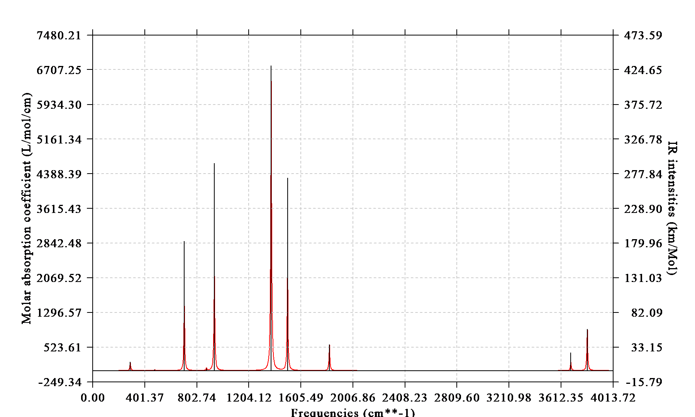

# **3.13 绘制IR、Raman、UV-Vis、ECD、VCD、ROA和NMR光谱 (11)**

Multiwfn有一个非常强大灵活的模块，可用于绘制红外 (Infrared, IR)、普通Raman/预共振 (pre-resonance) Raman、UV-Vis (紫外-可见, ultraviolet-visible)、ECD (电子圆二色, electronic circular dichroism)、VCD (振动圆二色, vibrational circular dichroism)和Raman光学活性 (Raman optical activity, ROA)光谱，介绍见[3.13.1](#3131-理论theory)~[3.13.4](#3134-同时绘制多体系和加权光谱plotting-multiple-systems-together-and-weighted-spectrum)节。绘制各类光谱的许多例子见[4.11](sec-4-11-plot-various-kinds-of-spectra.md)节。

Multiwfn还能绘制NMR (核磁共振, nuclear magnetic resonance)光谱，介绍见[3.13.5](#3135-绘制nmr光谱plotting-nmr-spectrum)节，例子见[4.11.10](sec-4-11-plot-various-kinds-of-spectra.md#41110-绘制-nmr-谱-nmr-spectrum)节。

对于振动光谱，Multiwfn能将其分解以深入理解其本质，这称为部分振动光谱 (partial vibrational spectrum, PVS)，将在[3.13.6](#3136-部分振动光谱-partial-vibrational-spectrum-pvs和部分振动态密度-partial-vibrational-density-of-states-pvdos)节中描述，相关例子见[4.11.12](sec-4-11-plot-various-kinds-of-spectra.md#41112-绘制部分振动谱-partial-vibrational-spectrum-pvs和部分振动能态密度-partial-vibrational-density-of-states-pvdos)节。

Multiwfn能根据理论或实验UV-Vis光谱精确预测颜色，介绍见[3.13.7](#3137-基于uv-vis光谱曲线预测颜色predicting-color-based-on-uv-vis-spectrum-curve)节，例子见[4.11.14](sec-4-11-plot-various-kinds-of-spectra.md#41114-靛蓝-indigo和诱惑红-allura-red颜色的预测)节。

## **3.13.1 理论(Theory)**

为了将理论结果与实验光谱比较，必须把对应每个跃迁模式的分立谱线展宽，以模拟真实世界中的情形，振动光谱（IR、Raman、VCD和ROA）常用的展宽函数是洛伦兹函数 (Lorentzian function)，而电子光谱（UV-Vis和ECD）常用高斯函数 (Gaussian function)，详见[3.12.1](sec-3-12-plotting-density-of-states-pes-and-cohp.md#3121-理论theory)节。与DOS图不同，DOS图中每个能级的强度总是简单设为1.0（即每个能级展宽出的曲线归一化为1.0），而绘制光谱时跃迁强度是非常重要的数据。

IR、Raman、VCD和ROA光谱的跃迁能量常用单位是cm⁻¹，UV-Vis和ECD光谱常用eV (1 eV=8.0655×1000 cm⁻¹)、nm和1000 cm⁻¹作单位。量子化学程序输出的每个跃迁模式的强度数据与展宽曲线下的面积成正比。下面分别讨论Multiwfn支持的六种光谱的一些细节。

**IR**：摩尔吸光系数 (molar absorptivity) *ε* 的常用单位L(mol⋅cm)⁻¹可改写为

$$
\frac{\mathrm{L}}{\mathrm{mol}\times\mathrm{cm}}=\frac{1000\mathrm{cm}^3}{\mathrm{mol}\times\mathrm{cm}}=\frac{1000\mathrm{cm}^2}{\mathrm{mol}}
$$

由于IR强度 $\varsigma=\int\varepsilon(\nu)\mathrm{d}\nu$ ，其中*ν*为跃迁频率，*ς*的单位应为

$$
\frac{1000\ \mathrm{cm}^2}{\mathrm{mol}}(\mathrm{cm}^{-1})=\frac{1000\ \mathrm{cm}}{\mathrm{mol}}=\frac{0.01\ \mathrm{km}}{\mathrm{mol}}
$$

然而，km/mol是IR强度更常用的单位，因此若某振动模式的IR强度为*p* km/mol，则由其展宽出的曲线应归一化为100\**p*（换言之，曲线下面积为100\**p*）。有时IR强度用esu²cm²作单位，其与km/mol的换算关系为1 esu²cm² = 2.5066 km/mol。

下面是Multiwfn绘制的IR光谱示例。注意左轴对应曲线（人工展宽数据），右轴对应分立谱线（原始跃迁数据）。



**Raman（普通或预共振）**：Raman光谱测量散射光的强度。注意，对于特定的振动模式*i*，其Raman活性 (Raman activity) $S_{i}$ 与Raman强度 (Raman intensity) $I_{i}$ 是两个不同的量。Raman活性是每个分子振动模式的内禀性质，而Raman强度与实验Raman光谱直接相关，其数值取决于入射光波数 (wavenumber) *ν*₀的选择以及温度。换算关系可在许多论文中找到，例如我的论文*Chem. Asian J.*, **16**, 56 (2021) DOI: [10.1002/asia.202001228](https://doi.org/10.1002/asia.202001228)中给出，可引用：

$$
I_i=\frac{C(\nu_0-\nu_i)^4S_i}{\nu_i B_i}\qquad B_i=1-\mathrm{exp}\left(-\frac{hc\nu_i}{kT}\right)
$$

其中*C*是对所有峰强度适当选取的公共归一化因子，$ν_{i}$ 为振动频率。只有基于Raman强度展宽的Raman光谱才能与实验光谱严格比较；然而，由于Raman活性和强度的峰位置相同，且特定振动模式的强度与其活性成正比，由Raman活性展宽的Raman光谱在某种意义上也有用。

几乎所有量子化学程序只输出Raman活性，因此默认情况下，Multiwfn通过展宽Raman活性来模拟Raman光谱。但你也可以让Multiwfn先用选项19（ $v_{0}$ 和*T*由用户提供）按上式把活性换算为强度，再由Raman强度展宽得到Raman光谱。归一化系数*C*在Multiwfn中固定为10⁻¹²（这不重要，因为我们关心的是Raman光谱的形状而非绝对高度）。由一个单位Raman活性或强度展宽出的峰的积分等于1。

**UV-Vis**：在理论化学领域，振子强度 (oscillator strength) (*f*)用于表示UV-Vis光谱中的跃迁强度，其定义为

$$
f_{ij}=\frac{2}{3}(E_j-E_i)\left|\boldsymbol{\mu}_{ij}\right|^2
$$

其中*i*和*j*分别代表初态和末态，在UV-Vis光谱语境下分别对应基态和激发态。*E*为态能量。\|**µ***$_{ij}$*\|² 为两态之间跃迁电偶极矩矢量的模方。

理论数据与实验光谱之间存在如下关系：若X轴和Y轴单位分别用1000 cm⁻¹和L/mol/cm，则由每单位*f*展宽出的曲线下面积应为1/4.32\*10⁶。等价地，若X轴单位用eV，该值应为1/4.32/8.0655\*10⁶=28700。利用此关系，可由理论数据模拟UV-Vis光谱。

荧光光谱可用与UV-Vis完全相同的方式绘制，与UV-Vis的唯一区别是，根据Kasha规则，只应考虑第一单重激发态 (S1)，且应使用优化的S1态几何（但注意有些体系违背Kasha规则）。绘制磷光光谱时，只应考虑第一三重激发态 (T1)，且应使用优化的T1态几何。注意，要得到非零的对应磷光发射的*f*，必须考虑自旋-轨道耦合效应。

**方向UV-Vis (Directional UV-Vis)**：上面提到的\|**µ***$_{ij}$*\|² 可写成其三个笛卡尔分量之和，即 ${\left| {\boldsymbol{\mu}}_{ij} \right|}^{2}={\left( {\mu}_{ij}^{X} \right)}^{2}+{\left( {\mu}_{ij}^{Y} \right)}^{2}+{\left( {\mu}_{ij}^{Z} \right)}^{2}$ 。Multiwfn中所谓的方向UV-Vis光谱 (directional UV-Vis spectrum)，是指只考虑\|**µ***$_{ij}$*\|² 中特定分量贡献的情形。你可以选择绘制X、Y、Z、X+Y、X+Z、Y+Z或特定方向类型的光谱。例如，若绘制X+Y类型，则 ${\left| {\boldsymbol{\mu}}_{ij} \right|}^{2}$ 将被替换为 ${\left( {\mu}_{ij}^{X} \right)}^{2}+{\left( {\mu}_{ij}^{Y} \right)}^{2}$ ，所得光谱将只体现当前体系与沿X和Y方向振荡的电场相互作用产生的吸收。若手动把方向定义为(1,0,1)，对应归一化矢量( $\frac{1}{\sqrt{2}},0,\frac{1}{\sqrt{2}}$ )，则 ${\left| {\boldsymbol{\mu}}_{ij} \right|}^{2}={\left( {\frac{1}{\sqrt{2}}\mu}_{ij}^{X} \right)}^{2}+{\left( \frac{1}{\sqrt{2}}{\mu}_{ij}^{Z} \right)}^{2}$ 。显然，方向UV-Vis光谱对从与特定方向振荡电场相互作用的角度理解光吸收本质非常有帮助。相比之下，普通UV-Vis光谱对应入射振荡电场各向同性的情形。注意方向UV-Vis光谱是可加的，例如X、Y和Z三种类型光谱之和，以及X+Y与Z两种类型光谱之和，都等价于普通UV-Vis光谱。

**ECD**：ECD光谱中旋光强度 (rotatory strength)的意义类似于UV-Vis光谱中的振子强度，每个电子跃迁模式对应一个旋光强度。若把旋光强度展宽，经适当缩放和平移后，所得曲线可与实验ECD光谱比较。由一个单位旋光强度展宽出的峰的积分等于1。在量子化学程序（如Gaussian）中，旋光强度可在长度表象 (length representation)或速度表象 (velocity representation)下计算，前者所得强度与原点选取有关，后者与原点无关。对于完备基组情形，两种表象的结果收敛到相同值。通常推荐使用速度表象。

**VCD**：VCD测量分子对左、右圆偏振光在不同波数*λ*下的吸收系数之差，即VCD曲线可表为 $\Delta \varepsilon(\lambda)={\varepsilon}_{\mathrm{L}}(\lambda)-{\varepsilon}_{\mathrm{R}}(\lambda)$ 。每个振动模式都有一个旋光强度，把所有振动模式的旋光强度展宽后，所得曲线形状可与实验VCD光谱比较。某振动模式对 $\Delta \varepsilon(\lambda)$ 曲线贡献的积分面积与其旋光强度成正比。

**ROA**：ROA光谱测量右旋与左旋圆偏振光散射强度之差：

$$
\mathrm{ROA\ intensity}\equiv I_i^{\mathrm{R}}-I_i^{\mathrm{L}}\propto\frac{(\nu_0-\nu_i)^4A_i}{\nu_i B_i}\qquad B_i=1-\mathrm{exp}\left(-\frac{hc\nu_i}{kT}\right)
$$

Gaussian的ROA任务输出的ROA强度数据实际上是上式中的 $A_{i}$ 项，应按上式将其换算为实际ROA强度。 $A_{i}$ 项与入射光频率有关。由一个单位ROA强度展宽出的峰的积分等于1。ROA有几种不同形式，包括ROA SCP(180)、ROA SCP(90)、ROA DCP(180)，其中90和180表示入射光与散射光的夹角。SCP (散射圆偏振, scattered circular polarization)指入射光为线偏振光而散射光为圆偏振光；DCP (双圆偏振, dual circular polarization)指入射光和散射光均为圆偏振光。常用的是ROA SCP(180)，也称为SCP背散射ROA (SCP backscattered ROA)。

Gaussian的ROA任务还同时输出频率相关的Raman强度，对应下式中的 $R_{i}$ 项

$$
\mathrm{Raman\ intensity}\equiv I_i^{\mathrm{R}}+I_i^{\mathrm{L}}\propto\frac{(\nu_0-\nu_i)^4R_i}{\nu_i B_i}\qquad B_i=1-\mathrm{exp}\left(-\frac{hc\nu_i}{kT}\right)
$$

相应地，也有Raman SCP(180)、Raman SCP(90)和Raman DCP(180)数据。由于当前所用入射光应远离电子激发能量，这种Raman光谱称为远离共振Raman (far from resonance Raman)。

## **3.13.2 输入文件(Input file)**

本节提到的输入文件是Multiwfn为绘制光谱而支持的输入文件。不要用如.fch、.molden和.wfn作输入文件，显然绘制光谱所需数据没有记录在这些文件中。

### **1 Gaussian输出文件(Gaussian output file)**

- IR光谱：用*freq*任务的输出文件作输入。若用Gaussian 09 D.01或更新版本，且同时指定了*freq=anharm*关键词做非谐分析，Multiwfn会提示你选择载入非谐 (anharmonic)频率和IR强度来代替简谐 (harmonic)下的。

- Raman光谱：用*freq=raman*任务的输出文件作输入。若要绘制预共振Raman光谱，还应同时用*CPHF=rdfreq*关键词，并在几何结构说明后的空行后写下入射光频率，如*300nm 400nm 500nm*。若希望绘制非谐Raman光谱，用*freq(raman,anharm)*关键词，Multiwfn会提示你选择载入非谐频率和Raman活性来代替简谐下的。

- VCD光谱：用*freq=VCD*任务的输出文件作输入。若希望绘制非谐Raman光谱（Gaussian自G16起支持），用*freq(VCD,anharm)*关键词，Multiwfn会提示你选择载入非谐频率和旋光强度来代替简谐下的。

对于非谐IR、Raman和VCD光谱，你可选择只载入非谐基频数据，还是同时载入非谐泛频或合频数据。

- UV-Vis、方向UV-Vis和ECD光谱：用TDDFT、TDHF、CIS、ZINDO或EOM-CCSD任务的输出文件作输入，无需额外关键词。长度和速度表象下的旋光强度（分别为"R(length)"和"R(velocity)"下的数据）都可被Multiwfn选择载入。激发态优化任务的输出文件也可用，Multiwfn只载入最后一次输出的跃迁信息，因此所得光谱对应最终几何。

- ROA光谱：用*freq=ROA*任务的输出文件作输入。入射光频率应在几何结构说明后的空行后指定，如*0.02, 0.03, 0.04, 0.05*，单位默认为a.u.；或写如*500nm 520nm 550nm*。

### **2 ORCA输出文件(ORCA output file)**

- IR光谱：用*freq*关键词。

- Raman光谱：用如下关键词

  ```orca
  ! b3lyp def2-SVP numfreq
  %elprop Polar 1 end
  ```

- UV-Vis、方向UV-Vis和ECD光谱：常用TDDFT，关键词示例：

  ```orca
  ! b3lyp def2-SVP
  %tddft
  nroots 20
  TDA false
  end
  ```

注意，TDDFT计算时ORCA默认用Tamm-Dancoff近似 (Tamm-Dancoff Approximation, TDA)，此时振子强度和旋光强度明显不如TDDFT的好，因此上例中用*TDA false*使ORCA用标准TDDFT形式。还值得注意的是，ORCA对ECD的旋光强度用长度表象。

ORCA的sTDA或sTD-DFT任务的输出文件（详见下文）也被Multiwfn支持用于绘制（方向）UV-Vis或ECD光谱。示例如下：

  ```orca
  ! PBE0 def2-SVP def2/J RIJCOSX
  %maxcore 6000
  %pal nprocs 36 end
  %tddft
  Mode sTDDFT
  Ethresh 10.0
  maxcore 6000
  end
  ```

自ORCA 4.1起，可在TDDFT计算中考虑自旋-轨道耦合 (spin-orbit coupling, SOC)效应，绘制SOC修正的UV-Vis和ECD光谱所需的全部数据都会自动输出。因此，当把SOC-TDDFT任务的输出文件载入Multiwfn后，进入UV-Vis和ECD绘制选项时，可选择载入SOC修正数据而非不考虑SOC的。用*%tddft*区加*dosoc true*即可很容易地做SOC-TDDFT，例如：

  ```orca
  %tddft nroots=40 TDA false dosoc true end
  ```

CIS、TDHF、ZINDO、EOM-CCSD、(DLPNO-)STEOM-CCSD计算的输出文件也可用作Multiwfn模拟（方向）UV-Vis和ECD光谱的输入文件。

- VCD：用带*%freq doVCD true end*设置的常规频率分析任务的输出文件。

- ROA光谱：ORCA目前不支持。

### **3 Grimme的sTDA输出文件(Grimme's sTDA output file)**

Grimme在*J. Chem. Phys.*, **138**, 244104 (2013)中提出的sTDA是近似求解TDDFT方程的方法，能把TDDFT计算中电子激发部分的计算量降低约两三个数量级。相应的sTDA程序可在<https://github.com/grimme-lab/stda>免费下载。

虽然Grimme的sTDA代码已植入ORCA程序，独立sTDA程序输出的*tda.dat*文件也可用作Multiwfn绘制UV-Vis或ECD的输入文件。

绘制ECD时，可选择用哪种表象的旋光强度。长度和速度表象已在上文提到，而混合表象 (mixed-form)定义为 $R_{M}$ = $R_{V}$ × $f_{L}$ / $f_{V}$ ，其中 $f_{L}$ 和 $f_{V}$ 分别为振子强度的长度和速度表象， $R_{V}$ 为旋光强度的速度表象，该表象在sTDA原文中被推荐。

### **4 Grimme的xtb输出文件(Grimme's xtb output file)**

Grimme写的xtb程序主要用于做GFN-xTB计算（*J. Chem. Theory Comput.*, **13**, 1989 (2017)和*J. Chem. Theory Comput.*, **15**, 1652 (2019)），可看作DFT方法的半经验变体。它不仅稳健而且很快，可方便地用于含数百原子的体系。注意，虽然xtb频率的精度经检验基本合理，但xtb输出的IR强度质量不太令人满意（据我的经验）。xtb程序可经<https://github.com/grimme-lab/xtb/>免费获得。

运行*xtb test.xyz --ohesst*，xtb将优化*test.xyz*中的结构再做频率分析。当前文件夹下输出的*vibspectrum*含简谐频率和IR强度，可用作Multiwfn绘制IR光谱的输入文件。

### **5 CP2K输出文件(CP2K output file)**

CP2K振动分析任务的输出文件可用作绘制IR和Raman光谱的输入文件。*INTENSITIES T*应出现在*&VIBRATIONAL_ANALYSIS*中。另外，绘制IR时，&DFT中应有以下内容：

```text
    &PRINT
      &MOMENTS
        PERIODIC T  (for isolated systems, use F)
      &END
    &END
```

绘制Raman光谱时，&FORCE_EVAL中应有以下内容：

```text
  &PROPERTIES
    &LINRES
      PRECONDITIONER FULL_ALL
      &POLAR
        DO_RAMAN T
        PERIODIC_DIPOLE_OPERATOR T  (for isolated systems, use F)
      &END POLAR
    &END LINRES
  &END PROPERTIES
```

另外，若在&VIBRATIONAL_ANALYSIS域中加入以下内容，要求CP2K导出含振动模式和IR强度的.mol (Molden)文件，则.mol文件也可用作绘制IR光谱的输入文件。

```text
  &PRINT
    &MOLDEN_VIB
    &END MOLDEN_VIB
  &END PRINT
```

CP2K的TDDFPT计算的输出文件可用作绘制（方向）UV-Vis光谱的输入文件，也支持sTDA核。若在&TDDFPT区用以下内容激活自旋-轨道耦合，则可绘制自旋-轨道耦合修正的UV-Vis光谱。

```text
      &SOC
      &END SOC
      &PRINT
        &SOC_PRINT
          SPLITTING
          SOME
        &END SOC_PRINT
      &END PRINT
```

Multiwfn可基于CP2K的&XAS_TDP任务产生的.spectrum文件绘制X吸收光谱。你需按下例把.spectrum中的数据手动整理为纯文本文件。

注意，上述任务的CP2K输入文件可用主功能100的子功能2中的相应选项轻松生成。

### **6 BDF输出文件(BDF output file)**

BDF的TDDFT任务的输出文件可用作绘制UV-Vis光谱的输入文件。

### **7 纯文本文件(Plain text file)**

为通用起见，Multiwfn支持纯文本文件作输入，你可从上述程序之外的计算化学程序输出文件中提取跃迁数据，再按下例格式填入文件

```text
numdata inptype
energy strength [FWHM]                    ← For transition 1
energy strength [FWHM]                    ← For transition 2
energy strength [FWHM]                    ← For transition 3
...
energy strength [FWHM]                    ← For transition numdata
```

其中*numdata*表示此文件中有多少条目。若*inptype*设为1，则只读入*energy*和*strength*，所有跃迁的半高全宽 (full width at half maximum, FWHM)将自动设定。若*inptype*设为2，则也读入半高全宽。跃迁应按能量从低到高排序。对IR、Raman、VCD和ROA光谱，*energy*和*FWHM*的单位应为cm⁻¹，对UV-Vis和ECD光谱应为eV。强度单位对IR、Raman、ECD、VCD、ROA光谱应分别为km/mol、Å⁴/amu、cgs (10⁻⁴⁰ erg-esu-cm/Gauss)、10⁻⁴⁴ esu²cm²、10⁴ K（UV-Vis的振子强度无量纲）。

下面是纯文本文件的例子（对IR）：

```text
6 2
  81.32920        0.72170    8.0
 417.97970        3.58980    8.0
 544.67320       21.06430    8.0
 583.12940       41.33960    8.0
 678.66900       91.47940    8.0
 867.37410        2.94480    8.0
```

## **3.13.3 用法和选项(Usage and options)**

启动Multiwfn后，先输入上述程序输出文件或含跃迁数据的纯文本文件的路径，再进入主功能11，会被要求选择光谱类型（对预共振Raman和ROA，还需选择感兴趣的频率），之后会看到以下选项。某些选项的含义对各类光谱可能不同。

注意，在此界面可随时输入*s*把当前绘制设置存到文件，或输入*l*从文件载入绘制设置，以便快速恢复绘制状态。

**-4 设置保存图形文件的格式：**用于选择选项1导出的图形文件的格式。通常推荐用ps、pdf和svg等矢量格式。

**-2 导出跃迁数据到纯文本文件：**把所有跃迁的能量、强度和半高全宽输出到当前目录的*transinfo.txt*，此文件完全符合上节介绍的格式，可直接用作输入文件。

**-1 显示跃迁数据：**在屏幕上打印所有跃迁的能量和强度数据。

**0 绘制光谱：**立即绘制光谱！光谱将显示在屏幕上，同时光谱曲线的极小和极大值会显示在控制台窗口。

**1 保存光谱图形文件到当前文件夹：**如题。

**2 导出谱线和曲线的X-Y数据集到纯文本文件：**把谱线和展宽光谱的X-Y数据集分别导出到当前目录的*spectrum_line.txt*和*spectrum_curve.txt*，你可用外部程序（如Origin）由这两个文件重绘曲线和分立谱线图。

**3 设置X轴上下限：**如题。还需输入刻度间隔。默认X轴范围根据最小和最大跃迁能量自动调整。

**4 设置左Y轴：**设置左Y轴的起始值、终止值和步长。默认Y轴范围根据最大峰自动调整。

**5 设置右Y轴：**如选项4，但针对右Y轴。

多数情况下，调整一侧Y轴设置后，该侧Y轴零点位置与另一侧Y轴零点偏离，图形看起来别扭；为解决此问题，选项4和5让你选择是否相应调整另一侧Y轴范围。若输入*y*，则另一侧Y轴的上下限和标签间隔将按比例缩放，使左右Y轴零点在同一水平线上。

**6 选择展宽函数：**可选高斯 (Gaussian)、洛伦兹 (Lorentzian)和赝沃伊特 (Pseudo-Voigt)函数把分立谱线展宽为曲线。

**7 设置曲线缩放比：**若设为*k*，则曲线高度在全范围乘以*k*。Raman、ECD、VCD和ROA光谱默认值1.0，IR为100，UV-Vis光谱能量单位为eV或nm时用经验值28700.0，单位为1000 cm⁻¹时用1/(4.32\*10⁻⁶)。

**8 输入半高全宽 (FWHM)：**如题。

**9 切换显示分立谱线：**选择是否在光谱图上显示跃迁对应的分立谱线。

**10 切换红外强度单位/设置激发能量单位：**对IR光谱，在km/mol（默认）和esu²cm²之间切换IR强度单位。对UV-Vis和ECD光谱，在eV、nm和1000 cm⁻¹之间选择能量单位。

**11 设置高斯权重系数：**设置 $w_{\mathrm{gauss}}$ ，即[3.12.1](sec-3-12-plotting-density-of-states-pes-and-cohp.md#3121-理论theory)节提到的，此选项只在选赝沃伊特函数时出现。

**12 设置X方向平移值：**若设为*k*，则最终曲线和分立谱线在X方向平移*k*。

**13 设置曲线和分立谱线的颜色：**如题。

**14 设置跃迁能量（或振动频率）缩放因子：**用此选项，跃迁能量可乘以一个因子，要绘制的光谱会受影响。

缩放振动频率有两种方法：

- (1) 均匀缩放：所选频率简单乘以用户输入的因子。可按序号范围或频率范围选择频率。

- (2) 幂律缩放：此方法在*J. Chem. Theory Comput.*, **22**, 9039 (2026)中检验过，表现优于均匀缩放。每个频率按 ${\lambda}_{1}{\omega}^{{\lambda}_{2}}$ 缩放，其中*λ*₁和*λ*₂为用户指定的拟合参数，*ω*为原频率。

**15 输出各跃迁对光谱的贡献：**若选此选项，会提示输入判据（如*k*），则不仅总光谱（如选项2），强度绝对值大于*k*的各跃迁的贡献也会输出到当前文件夹的*spectrum_curve.txt*。此功能对识别总光谱本质特别有用。

在此功能中还可先输入*0*，再输入光谱的X位置，则对该位置贡献最大的10个跃迁会显示出来，这对弄清特定光谱位置（如重要吸收峰位）的主要贡献者很方便。

**16 设置光谱极小和极大值标签显示状态：**会进入一个界面，其中有许多选项用于设置如何在图上显示光谱极小和极大值，都是自明的。

**17 其他绘制设置：**可在此设置各种绘制设置，如是否显示虚线网格线、是否显示坐标轴标签、坐标轴名/刻度/图例文字大小、坐标轴小数位数、左Y轴标签类型、图例位置、设置不同体系谱线和曲线颜色。

**18 切换各体系光谱加权：**见下节解释。

**19 把Raman（或ROA）活性换算为强度：**如前所述，此选项用于把Raman（或ROA）活性换算为强度。之后，选项0绘制的Raman（或ROA）光谱将是基于Raman（或ROA）强度而非活性展宽的。入射光波数和温度由用户输入。

**20 修改强度：**可选择一些跃迁并把其强度（取决于光谱类型）改为特定值。若要绘制荧光光谱，此选项很有用，此时需把除最低单重激发外所有跃迁的振子强度设为零（Kasha规则）。

**21 设置加权曲线和各体系曲线显示状态：**如下节所示，Multiwfn能按给定权重绘制多体系加权光谱。此选项控制是否绘制加权曲线和各体系曲线。

**22 设置曲线/谱线/文字/坐标轴粗细：**如题。

**23 设置显示指示跃迁能级尖峰的状态：**用此选项，可在光谱底部绘制一组或多组尖峰以指示不同组跃迁的位置。若一些跃迁简并，尖峰高度可反映简并度。此选项的说明见[4.11.9](sec-4-11-plot-various-kinds-of-spectra.md#4119-技巧使用尖峰-spikes指示跃迁能级-transition-levels的位置)节。当同时考虑多体系绘制时此选项不可用。

注意，构成光谱的实际点数由*settings.ini*中的"num1Dpoints"参数控制。默认值通常足够大，无需调整。

## **3.13.4 同时绘制多体系和加权光谱(Plotting multiple systems together and weighted spectrum)**

在Multiwfn中，可同时绘制多文件的光谱，同时考虑权重。此功能对获得有许多热可及构象的柔性分子的实际光谱很有用。

例如，有一分子有四个可及构象，已按Boltzmann方法根据算得的自由能确定了其分布比。若要绘制其加权光谱和每个构象的光谱，应写一个名为*multiple.txt*的纯文本文件（其他文件名不能被Multiwfn识别），内容为：

```text
boltz\Excit\a.out 0.6046
boltz\Excit\b.out 0.1950
boltz\Excit\c.out 0.1686
boltz\Excit\d.out 0.0317
```

其中第一列和第二列分别对应每个构象输入文件路径和权重。不同类型的输入文件可同时出现在此文件中。若用此文件作输入文件，进入光谱绘制模块后，Multiwfn会依次从这些文件载入数据。绘制光谱时，四个构象的光谱会分别算出并以不同颜色画出。另外，加权光谱作为粗红曲线画在图上，按下式算得：

weighted spectrum = 0.6046×a + 0.1950×b + 0.1686×c + 0.0317×d

图中还可看到许多黑色分立谱线，是不同构象分立谱线的集合。注意其高度已乘以相应权重。

若绘制光谱前选过一次选项18，则图上各构象光谱是加权过的；换言之，这些曲线代表每个构象对实际光谱（粗红曲线）的贡献。此时加权分立谱线的颜色不再全黑，而与曲线颜色一致，以便用户容易识别不同体系曲线与分立谱线的对应。

若只想同时绘制多体系光谱而不想画加权光谱，则*multiple.txt*第二列不应为权重，而应为自定义图例，例如

```text
boltz\Excit\a.out Molecule A
boltz\Excit\b.out Molecule B
boltz\Excit\c.out Molecule C
boltz\Excit\d.out Molecule D
```

然后照常绘制光谱，四个体系的曲线会同时显示，图例为"Molecule A"、"Molecule B"等。

> **注(Note)**
>
> 当图例完全由数字组成时，图例会被当作权重。若图例必须为数字，应在图例前加\$ 让Multiwfn知道它是图例而非权重。例如，\$50 会被识别为“50”图例。

若用Linux平台且*multiple.txt*中一些文件路径含/符号或空格，应在文件路径两端加双引号，使路径能正确载入。

## **3.13.5 绘制NMR光谱(Plotting NMR spectrum)**

### **理论(Theory)**

许多量子化学程序能算出原子核处的磁屏蔽张量 (magnetic shielding tensor) **σ**，通常只关心其对角项平均值，即各向同性磁屏蔽值 (isotropic magnetic shielding value) σ$_{iso}$，因为NMR光谱通常在溶剂环境中测定，溶质可自由转动。

化学位移 (chemical shift) δ按下式算出

$$
\delta=\frac{\sigma^{\mathrm{ref}}-\sigma}{1-\sigma^{\mathrm{ref}}}\approx\sigma^{\mathrm{ref}}-\sigma
$$

其中*σ*$^{ref}$ 为参比物质的屏蔽值（对¹³C和¹H NMR为四甲基硅烷），*σ* 为待测样品的屏蔽值。两值必须在完全相同的计算设置（理论方法、基组、溶剂化模型……）下算得。

确定化学位移的另一方法是缩放法，详见<http://cheshirenmr.info>。简言之，此方法按下式很简单地算出δ：

$$
\delta=a\times\sigma+b
$$

其中 $a$ 和*b* 为对特定计算水平基于训练集预先拟合的斜率和截距参数。例如，若用B3LYP/6-31G\*在真空中优化而用B3LYP/6-31G\*在SMD溶剂化模型表示的氯仿环境下算屏蔽值，则对¹H NMR有 $a$ = -1.0157和*b* = 32.2109，而对¹³C NMR有 $a$ = -0.9449和*b* = 188.4418。

若体系中有甲基，生成NMR光谱前应对其三个氢的δ取平均，因为甲基转动壁垒极低，实际环境中可自由转动。另外，若有多个热可及且易互变的构象，应按构象权重算出每个原子的加权平均屏蔽值：

$$
\overline{\delta^A}=\sum_i p_i\delta_i^A
$$

其中*i*为构象序号，*A*为原子序号。 $p_{i}$ 代表构象*i*的权重，可按构象间相对自由能由Boltzmann分布算出。

有了所有原子的δ，就可绘制NMR分立谱线图，图中尖峰的X轴对应δ，Y轴对应简并度 (degeneracy)，若*N*个化学位移间最大间隔小于特定阈值（如0.05 ppm），简并度为*N*，其他情形简并度为1.0。

用洛伦兹函数把尖峰展宽可生成有有限峰宽的实际NMR光谱，半高全宽 (FWHM)是控制峰形的关键参数。此曲线图中峰高对应NMR信号强度。

### **输入文件(Input file)**

Gaussian、ORCA和BDF程序NMR任务的输出文件直接支持用作绘制NMR光谱的输入文件。CP2K的NMR任务生成的.data文件也可用。

- Gaussian的NMR任务示例

  ```text
  # B972/def2tzvp scrf=solvent=chloroform NMR

  Title Card Required

  0 1
   N                 -0.14557000    1.69364200    0.17479300
   H                 -1.18363600    1.59873700    0.51496300
  [...ignored]
  ```

- ORCA的NMR任务示例

  ```orca
  ! B3LYP/G 6-31G* NMR cpcm(chloroform) RIJK autoaux
  * xyz   0   1
   C                     0.        1.14218   0.72212
   C                     0.        1.19872  -0.67302
  [...ignored]
  ```

- CP2K的NMR任务示例。在普通GAPW任务输入文件的&FORCE_EVAL中加入以下内容。另外，建议设&SCF / EPS_SCF为1E-7、EPS_DEFAULT为1E-14以保证足够数值精度。

  ```text
  &LINRES
    PRECONDITIONER FULL_KINETIC
    EPS 1E-8
    MAX_ITER 300
    &CURRENT
      CHI_PBC T
      GAUGE R_AND_STEP_FUNCTION
      ORBITAL_CENTER ATOM
    &END CURRENT
    &LOCALIZE
       MAX_ITER 20000
       EPS_LOCALIZATION 1E-5
    &END LOCALIZE
    &NMR
    &END NMR
  &END LINRES
  ```

- 纯文本文件

记录原子名和屏蔽值的纯文本文件也可用作绘制NMR光谱的输入文件，例子见*examples\spectra\NMR\general.txt*。因此原则上Multiwfn可对任何能给出屏蔽值的程序绘制NMR。

### **用法(Usage)**

载入输入文件后，进入主功能11并选NMR，会看到NMR绘制界面。选选项0即显示NMR光谱，原始数据会显示在控制台窗口。此界面多数选项是自明的，下面只提几个值得注意的选项。

- **-2 导出NMR数据到纯文本文件**：此选项把屏蔽值导出到当前文件夹的*NMRdata.txt*。若已用选项7把屏蔽值换算为化学位移，则两者都会导出。

- **6 选择绘制时考虑的元素**：用此选项可选择考虑的元素。例如，若要绘制¹H NMR光谱或查看相关数据，应选此选项并输入*H*。

- **7 设置如何确定化学位移**：默认绘制的NMR光谱X轴对应磁屏蔽值，若要使X轴为化学位移δ，应在绘制前选此选项。在此选项中可选定δ的方式：

  (1) 取当前体系与参比体系屏蔽值之差。可手动输入参比值或直接用内置数据。

  (2) 用缩放法确定δ。可手动输入拟合的斜率和截距，或直接用内置数据。

  有几套内置数据，对应很适合算δ的水平。

- **10 对特定原子平均屏蔽值**：例如，通常应对同一甲基中的氢的δ取平均，可用此功能实现。

- **11 设置特定原子的强度**：默认每个原子强度1.0，即对简并度贡献1.0。用此选项可修改特定原子的强度。例如，若把原子3、6、7的强度设为0，则这些原子会在绘制的光谱中消失。

- **16 改变标记原子的设置**：为在NMR光谱中区分原子，Multiwfn在绘制的峰上标记原子序号。用此选项可控制标记细节，如位置、大小、颜色、标记内容等。

### **绘制构象加权光谱和含多体系的光谱(Plotting conformation weighted spectrum and spectrum containing multiple systems)**

构象加权NMR光谱可用纯文本文件作输入（文件名须含"multiple"，例如*valine_multiple.txt*为有效名），每行含输入文件路径和相应构象权重，例如：

```text
D:\valine\conf1.out 0.43
D:\valine\conf2.out 0.25
D:\valine\conf3.out 0.32
```

若只想把多体系NMR光谱画在一起，每行指定文件路径和图例，例如

```text
/lovelive/nico.out Isomer 1
/lovelive/nozomi.out Isomer 2
```

然后进入NMR绘制界面后，绘图步骤与画单体系完全相同。注意所有体系必须有相同原子数。

### **特别说明(Special notes)**

要把NMR光谱存为图形文件，可选选项1。强烈建议用pdf格式，因为它是矢量格式，光谱可无损缩放，线条和文字看起来很平滑。格式可用选项-3选择，默认格式可用*settings.ini*中的"graphformat"更改。

调整好各种绘制设置后，可在界面中输入*s*把绘制设置存到特定文本文件，以便将来想以完全相同效果重绘NMR光谱时，输入*l*直接从文本文件恢复绘制设置。注意对绘制数据的任何操作每次都须手动重做（如平均屏蔽值、把屏蔽值换算为化学位移等）。

绘制NMR光谱的一些例子见[4.11.10](sec-4-11-plot-various-kinds-of-spectra.md#41110-绘制-nmr-谱-nmr-spectrum)节。

## **3.13.6 部分振动光谱 (partial vibrational spectrum, PVS)和部分振动态密度 (partial vibrational density-of-states, PVDOS)**

部分振动光谱 (PVS)由我提出，用于直观理解振动光谱峰的本质。部分振动态密度 (PVDOS)与之密切相关。本节将描述其定义和在Multiwfn中的实现。

### **3.13.6.1 理论(Theory)**

#### **PVS和PVDOS**

回想振动光谱曲线可表为

$$
\varepsilon(E)=c\sum_i f_i G(E-E_i^{\mathrm{vib}})
$$

其中*c*是取决于振动光谱类型的常数，*i*遍历所有振动模式，*f*和 $E^{\mathrm{vib}}$ 分别对应某振动模式的强度（如IR光谱的IR强度、VCD光谱的旋光强度）和跃迁能量，*G*为展宽函数（振动光谱常用洛伦兹函数）。

PVS方法把总振动光谱分解为不同碎片 (fragment)的贡献。碎片*A*的PVS曲线表为

$$
\varepsilon_A(E)=c\sum_i\Theta_A^i f_i G(E-E_i^{\mathrm{vib}})
$$

其中 ${\Theta}_{A}^{i}$ 为碎片*A*在振动模式*i*中的组成 (composition)。

振动态密度 (vibrational density-of-states, VDOS)表示单位波数内振动跃迁密度，表为

$$
\rho(E)=c\sum_i G(E-E_i^{\mathrm{vib}})
$$

系数*c*和VDOS单位是任意的，只有不同能量处VDOS相对大小有意义。碎片*A*的部分VDOS (PVDOS)曲线表为

$$
\rho_A(E)=c\sum_i\Theta_A^i G(E-E_i^{\mathrm{vib}})
$$

#### **碎片类型(Type of fragment)**

在Multiwfn中，最多可同时定义10个碎片来画其PVS或PVDOS曲线。碎片可用两种方式定义：

(1) 一组原子。可考虑其全部笛卡尔坐标或特定笛卡尔分量（即X、Y、Z、XY、XZ或YZ）。

(2) 一组冗余内坐标 (redundant internal coordinates, RIC)。RIC可为键、角和二面角，允许在碎片中混合。

#### **振动模式中碎片的组成(Composition of fragment in vibrational modes)**

算 ${\Theta}_{A}^{i}$ 的方式不唯一。每个振动模式有两个关键特征：简正坐标 (normal coordinate)和强度，所以 ${\Theta}_{A}^{i}$ 可定义为碎片*A*对振动模式*i*其中之一的百分比贡献，如下所述。

**组成类型1：对简正坐标的百分比贡献**

每个振动模式的简正坐标*q*代表参与振动的3 $N_{\mathrm{atom}}$ 个原子笛卡尔坐标{*x*}的运动。设 $L_{j}$ $_{,}$*$_{i}$* 代表 $x_{j}$ 在 $q_{i}$ 中的分量，并设 $q_{i}$ 归一化，则 ${\Theta}_{A}^{i}$ 定义为

$$
\Theta_A^i=100\%\times\sum_{j\in A}L_{j,i}^2
$$

其中*j*遍历碎片*A*中原子的全部或特定笛卡尔坐标。

**组成类型2：对强度的百分比贡献**

这种组成类型比组成类型1复杂得多，目前只适用于IR强度。振动模式*i*的IR强度表为

$$
I^i=s\left|\frac{\partial\boldsymbol{\mu}}{\partial q_i}\right|^2=s\sum_{\sigma=x,y,z}\left(\frac{\partial\mu_\sigma}{\partial q_i}\right)^2
$$

其中*s*为常数因子， $µ_{σ}$ 代表当前体系电偶极矩的笛卡尔*σ*分量。 $µ_{σ}$ 对 $q_{i}$ 的导数可进一步写成电偶极矩对原子笛卡尔坐标导数与简正坐标相应分量乘积之和：

$$
\frac{\partial\mu_\sigma}{\partial q_i}=\sum_j\frac{\partial\mu_\sigma}{\partial x_j}\frac{\partial x_j}{\partial q_i}\equiv\sum_j\frac{\partial\mu_\sigma}{\partial x_j}L_{j,i}
$$

经简单整理，IR强度可表为下式，其中碎片*B*含不属于碎片*A*的全部原子笛卡尔坐标

$$
I^i=s\sum_{\sigma=x,y,z}\left[I_{A,\mathrm{intra}}^{i,\sigma}+I_{B,\mathrm{intra}}^{i,\sigma}+I_{AB}^{i,\sigma}\right]
$$

其中

$$
\begin{gathered}I_{A,\mathrm{intra}}^{i,\sigma}=\left(\sum_{j\in A}\frac{\partial\mu_\sigma}{\partial x_j}L_{j,i}\right)^2\qquad I_{B,\mathrm{intra}}^{i,\sigma}=\left(\sum_{k\in B}\frac{\partial\mu_\sigma}{\partial x_k}L_{k,i}\right)^2\\ I_{AB}^{i,\sigma}=2\left(\sum_{j\in A}\frac{\partial\mu_\sigma}{\partial x_j}L_{j,i}\right)\left(\sum_{k\in B}\frac{\partial\mu_\sigma}{\partial x_k}L_{k,i}\right)\end{gathered}
$$

其中 ${I}_{A,\mathrm{intra}}^{i,\sigma}$ 代表碎片*A*对模式*i*在*σ*方向的片内贡献， ${I}_{A\mathrm{B}}^{i,\sigma}$ 对应碎片*A*和*B*耦合的贡献。把耦合项划分给碎片的方式不唯一，我倾向于简单地平分，此时碎片*A*对 $I^{i}$ 的贡献写为

$$
I_A^i=s\sum_{\sigma=x,y,z}\left(I_{A,\mathrm{intra}}^{i,\sigma}+\frac{1}{2}I_{AB}^{i,\sigma}\right)=s\sum_{\sigma=x,y,z}\left(\sum_{j\in A}\frac{\partial\mu_\sigma}{\partial x_j}L_{j,i}\right)\left(\sum_k\frac{\partial\mu_\sigma}{\partial x_k}L_{k,i}\right)
$$

最后， ${\Theta}_{A}^{i}$ 按下式算出

$$
\Theta_A^i=100\%\times\frac{I_A^i}{I^i}
$$

注意，以上方式定义的 ${\Theta}_{A}^{i}$ 在某些情况下可略为负或大于100%，这不可避免，绝不意味着结果不正确。负值源于片间耦合贡献可为负，其大小甚至可超过正的片内贡献。

#### **碎片光谱类型小结(Summary of type of fragment spectrum)**

综合上述全部信息，现在可定义代表碎片对振动模式贡献的不同形式的光谱，Multiwfn目前支持以下：

- PVS-NC(atom)

- PVS-NC(RIC)

- PVS-I(atom)

- PVDOS-NC(atom)

- PVDOS-NC(RIC)

PVS和PVDOS的含义很明确。“I”和“NC”指碎片在振动模式中的组成分别定义为碎片对其强度和简正坐标的贡献。(atom)和(RIC)指碎片分别由一组原子（及其一些笛卡尔分量）和冗余内坐标组成。

如前所述，PVS-I(atom)只能用于IR光谱的分解分析，而PVS-NC(atom/RIC)可用于分解任何振动光谱。PVDOS与振动光谱类型无关，因为不涉及强度信息。

不同类型光谱有不同实用价值。例如，从PVS-NC(atom)可直观认出不同波数范围活性振动模式主要有哪些原子参与，而PVS-NC(RIC)允许从内坐标运动角度研究。用PVS-I(atom)，可生动理解振动中哪些原子运动对不同波数处IR吸收强度有显著贡献。光谱不活性的振动模式不能用PVS-NC或PVS-I光谱直观研究，但可分别用PVDOS-NC(atom)和PVDOS-NC(RIC)容易理解哪些原子和内坐标显著参与不同能量区的振动模式。

#### **重叠PVS (overlap PVS, OPVS)和重叠PVDOS (overlap PVDOS, OPVDOS)**

为直观研究不同两碎片原子运动在振动光谱中的耦合效应，我定义了OPVS和OPVDOS，分别表为

$$
\begin{gathered}\varepsilon_{AB}(E)=c\sum_i\Theta_{AB}^i f_i G(E-E_i^{\mathrm{vib}})\\ \rho_{AB}(E)=c\sum_i\Theta_{AB}^i G(E-E_i^{\mathrm{vib}})\end{gathered}
$$

其中*A*和*B*为要研究其耦合效应的两碎片， ${\Theta}_{AB}^{i}$ 为其对振动模式*i*的百分比耦合贡献。

对重叠PVS-NC (OPVS-NC)和重叠PVDOS-NC (OPVDOS-NC)， ${\Theta}_{AB}^{i}$ 定义为

$$
\Theta_{AB}^i=100\%\times 2\times\mathrm{min}(\Theta_A^i,\Theta_B^i)
$$

若模式*i*被碎片*A*和*B*等同贡献，即 ${\Theta}_{A}^{i}={\Theta}_{B}^{i}=50\%$ ，则 ${\Theta}_{AB}^{i}=100\%$ 。在某波数处，OPVS-NC ( ${\varepsilon}_{AB}$ )曲线越接近*ε*曲线，或OPVDOS-NC ( ${\rho}_{AB}$ )曲线越接近*ρ*曲线，该波数处光谱越体现碎片*A*和*B*的集体运动。

对重叠PVS-I (OPVS-I)光谱， ${\Theta}_{AB}^{i}$ 定义为 $100\%\times {I}_{AB}^{i}/{I}^{i}$ ，其中 ${I}_{AB}^{i}$ 为碎片*A*和*B*对振动模式*i*的耦合贡献：

$$
I_{AB}^i=s\sum_{\sigma=x,y,z}I_{AB}^{i,\sigma}
$$

OPVS-I曲线越正（负），片间耦合效应对IR吸收的增强（抑制）越多。

### **3.13.6.2 用法(Usage)**

要绘制上介绍的碎片贡献的光谱曲线，启动Multiwfn后，需载入绘制普通振动光谱的输入文件，再进入主功能11，选择要绘制的振动光谱类型，包括IR、Raman、VCD或ROA（PVS-I只支持IR。对VDOS，它们都等价）。然后，选选项“24 Set partial vibrational spectra (PVS) or vibrational DOS (VDOS)”后，会进入定义碎片和调整相关绘制设置的界面。从屏幕上看到，输入*t*可选碎片光谱类型。输入数字可定义该序号的碎片，请仔细按屏幕提示操作，最多可定义10个碎片。若已定义两个或更多碎片，可用选项0选择要绘制OPVS或OPVDOS曲线的两碎片。

定义碎片完成后，可输入*q*离开界面，同时Multiwfn会从输入文件载入所需数据并生成各碎片在每个振动模式中的组成，定量结果会显示在屏幕上。（对PVS-I，还会被要求输入Gaussian的“freq”任务产生的.fch/fchk文件，Multiwfn从中载入算IR强度所需数据。同时，Multiwfn会问是否输出*IRinten.txt*文件，其中含关于IR强度求值的非常详细的原始和中间信息，对理解 ${I}_{A}^{i,\sigma}$ 的来源特别有帮助）

离开选项24后，可照常选选项0绘制振动光谱，PVS/OPVS或VDOS/OPVDOS曲线会与振动光谱曲线一起显示。

注意，要把Raman或ROA光谱与其伴随的PVS-NC曲线一起绘制，需照常先把Raman活性换算为Raman强度。

#### **输入文件(Input file)**

- PVS-NC(atom)和PVDOS-NC(atom)：可用Gaussian、ORCA和CP2K程序频率分析的输出文件作输入文件。

  xtb程序也支持但情况稍特殊：用xtb做Hessian计算任务后，会有*vibspectrum*和*g98.out*文件。启动Multiwfn后应载入*vibspectrum*，在定义碎片并离开选项24界面后，会被要求输入*g98.out*的路径，Multiwfn从中载入简正坐标。

- PVS-NC(RIC)和PVDOS-NC(RIC)：应用Gaussian频率分析的输出文件作输入文件。必须用Gaussian的*freq=intmodes*关键词，使各振动模式中RIC组成写入Gaussian输出文件，离开选项24时Multiwfn会载入。

- PVS-I(atom)：应用Gaussian频率分析的输出文件作输入文件，且此任务产生的.chk文件转换的.fch/fchk文件必须保留，离开选项24时Multiwfn要求提供。

绘制(O)PVS和(O)VDOS的例子见[4.11.12](sec-4-11-plot-various-kinds-of-spectra.md#41112-绘制部分振动谱-partial-vibrational-spectrum-pvs和部分振动能态密度-partial-vibrational-density-of-states-pvdos)节。

## **3.13.7 基于UV-Vis光谱曲线预测颜色(Predicting color based on UV-Vis spectrum curve)**

Multiwfn提供很有用很强大的功能，可基于其UV-Vis吸收光谱曲线预测化学物质的颜色。非常详细的解释见我的博客文章“Predicting color of chemical substances through quantum chemistry calculations and Multiwfn program”(<http://sobereva.com/662>，中文），这里只给出关键信息。

### **理论(Theory)**

化学物质若在可见光范围有光吸收则显示颜色，显示的颜色对应反射和透射光。本质上，显示的颜色是相对UV-Vis吸收光谱对应颜色（即吸收色）的互补色。要把UV-Vis光谱转为显示的颜色，需以下步骤：

- (1) 基于CIE1931 2°三刺激函数（文献中给的表格数据）和按常规方式生成的UV-Vis光谱算出CIE1931 XYZ颜色空间的X、Y、Z值。详见<https://www.oceanopticsbook.info/view/photometry-and-visibility/chromaticity>。

- (2) 经线性变换把X、Y、Z值转为sRGB颜色空间的R、G、B值。详见<https://www.oceanopticsbook.info/view/photometry-and-visibility/from-xyz-to-rgb>。注意不用Gamma校正。

- (3) 若R、G、B值有超出sRGB颜色空间有效范围的，把它缩放到有效范围，即\[0,1\]。

- (4) 取吸收光对应颜色的互补色为(1.0-R,1.0-G,1.0-B)。

- (5) 分别把吸收色及其互补色的最大分量移到1.0，得到其最大亮度色，使两颜色亮度相等。

现在，互补色的最大亮度色可看作化学物质实际显示的颜色。

注意，Multiwfn不仅报告\[0,1\]范围吸收色和互补色的R、G、B分量，也报告\[0,255\]范围的。

### **用法(Usage)**

用Multiwfn预测颜色有两种方式

- 情形1：直接基于Multiwfn生成的理论UV-Vis光谱预测颜色

  此时输入文件与[3.13.2](#3132-输入文件input-file)节所述绘制UV-Vis光谱的相同。载入输入文件后，进入主功能11，选选项“25 Evaluate color based on the spectrum in visible range”，则先在屏幕上显示360-830 nm内的UV-Vis光谱，关闭后，会看到UV-Vis光谱对应的吸收色及其互补色。同时，两颜色的最大亮度形式也显示在屏幕上。通常窗口右下角显示的颜色可看作物质实际显示的颜色。同时，从Multiwfn命令行窗口可找到屏幕上颜色的详细参数，如CIE1931 XYZ值、sRGB颜色空间RGB值等。

- 情形2：对纯文本文件记录的给定光谱曲线预测颜色

  此时可基于如实验测定的光谱曲线预测颜色。输入文件应为含两列数据的纯文本文件，第一列为nm单位的波长，第二列为任意单位的吸光度（例子见*examples\spectra\Allura_red_UV-Vis.txt*。数据范围和间隔任意，两列应用空格或逗号分隔）。载入输入文件后，进入主功能11再选选项“0: Predicting color based on UV-Vis spectrum recorded in text file”，会看到预测的颜色，Multiwfn提供的信息与情形1中提到的形式相同。

### **两点注意(Two noteworthy points)**

本功能显然也可用于预测发射光谱的颜色。例如，有一满足Kasha规则的体系。要预测其荧光光谱，应在其优化的S1几何下做电子激发计算，并把输出文件用作Multiwfn输入文件。进入主功能11并选选项3进入绘制UV-Vis光谱模块后，应先选选项“20 Modify oscillator strengths”把除S1外所有激发态的振子强度设为零，再用选项25预测当前光谱（对应荧光光谱）的颜色。此时应把图形窗口中“color”标签下显示的颜色作为荧光发射的颜色，窗口中显示的互补色在此时无用。

柔性分子在感兴趣温度下常有多个权重不可忽略的构象，若其中一些在可见光范围显示明显不同的光吸收特征，要可靠预测颜色必须考虑构象加权平均光谱。此时应用含构象权重的*multiple.txt*（见[3.13.4](#3134-同时绘制多体系和加权光谱plotting-multiple-systems-together-and-weighted-spectrum)节）作Multiwfn输入文件，再按上述常规步骤预测颜色。

预测颜色的例子见[4.11.14](sec-4-11-plot-various-kinds-of-spectra.md#41114-靛蓝-indigo和诱惑红-allura-red颜色的预测)节。
