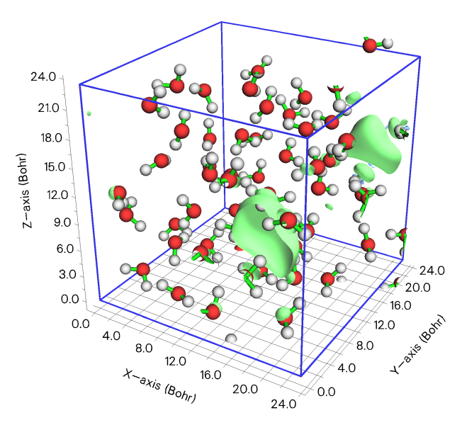
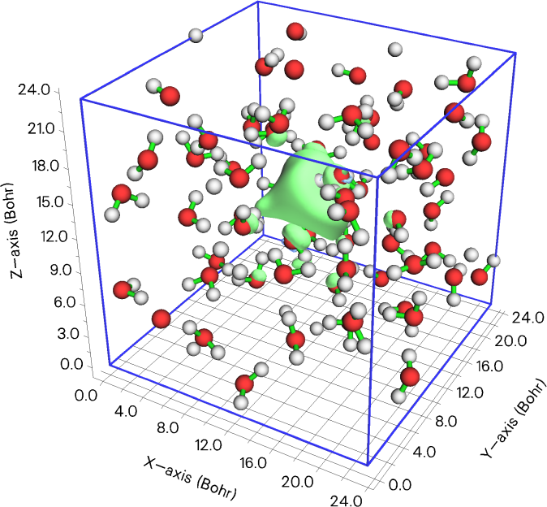

# **3.16 处理格点数据 (13)**

如果在 Multiwfn 启动时已从输入文件载人格点数据 (grid data)，或已由主功能 5 或其他功能生成了格点数据，则内存中将存在一组格点数据（下文称为"当前格点数据"），此时该模块可用。如果内存中尚无格点数据但你选择了该主功能，也可以直接从外部文件载人格点数据。

在本模块中，你可以可视化当前格点数据、提取指定平面内的数据、执行数学运算、通过相应选项设置指定范围内数值等。这些选项将在下文介绍。

## **3.16.0 可视化当前格点数据的等值面 (-2)**

在图形窗口中可视化当前格点数据的等值面 (isosurface)，这有助于检查经某些功能（*例如*功能 11）更新后的格点数据的有效性。

## **3.16.1 将当前格点数据导出为 Gaussian 型 cube 文件 (0)**

若选择此功能，当前格点数据（可能已用功能 11、13、14、15 更新过）将连同原子信息一起输出到一个 cube 文件中。

## **3.16.2 输出全部数据点及其数值与坐标 (1)**

通过此功能，全部当前格点数据将被输出到当前文件夹下的 *output.txt* 中，前三列对应 X、Y、Z（单位为 Å），最后一列为数据值。

## **3.16.3 输出 XY/YZ/XZ 平面内的数据点 (2, 3, 4)**

通过这些功能，将输出指定 Z/X/Y 值处的 XY/YZ/XZ 平面内的格点数据到当前文件夹下的 *output.txt* 中，该文件为纯文本文件，你可将其载入 Sigmaplot 等可视化软件并绘制平面图。由于格点数据是离散分布的，实际输出的平面是离输入 Z/X/Y 值最近的那个平面。

输出文件中各列的含义请参见程序提示。

## **3.16.4 输出 Z/X/Y 某范围内 XY/YZ/XZ 平面的平均数据 (5, 6, 7)**

通过这些功能，将输出 Z/X/Y 坐标在指定范围内的若干 XY/YZ/XZ 平面的平均格点数据到当前文件夹下的 *output.txt* 中。第 1/2/3/4 列分别对应 X、Y、Z、数值，几何单位为 Å。

## **3.16.5 输出由三个原子序号或三个点定义的平面内的数据点 (8, 9)**

通过这两个功能，可将任意平面内的数据输出到纯文本文件。但若你感兴趣的平面是 XY/YZ/XZ 平面，则应分别使用功能 2/3/4。你可以通过输入三个原子序号或输入三个点来定义平面。

你需要输入容差距离，与该平面的距离小于此值的数据点将被输出。一般建议输入 *0* 以使用默认值。

然后，若你想把数据点投影到 XY 平面，以便载入某些可视化软件并绘制为平面图，可输入 *1* 让程序执行该操作。你会发现输出文件中所有点的 Z 值均为零。

## **3.16.6 输出指定数值范围内的数据点 (10)**

与功能 2 类似，但只输出数值在指定范围内的数据点。若下限和上限均输入为 *k*，则输出介于 *k*−abs(*k*)×0.03 与 *k*+abs(*k*)×0.03 之间的数据。

## **3.16.7 格点数据计算 (11)**

在此功能中，你可通过相应选项对当前格点数据进行运算，之后格点数据将被更新，然后你可以用例如功能 -2 可视化更新后的格点数据、用功能 0 将更新后的格点数据输出为 cube 文件，或用功能 2\~9 提取某平面内的数据，等等。

支持的操作如下，其中 A 表示当前格点数据的数值，B 表示将载入的 cube 文件中对应点处的数值，C 表示对应点处更新后的数值。

1.  加常数                        *例如* A+0.1=C

2.  加格点文件                      *即* A+B=C

3.  减常数                       *例如* A-0.1=C

4.  减格点文件                      *即* A-B=C

5.  乘以常数                     *例如* A\*0.1=C

6.  乘以格点文件                    *即* A\*B=C

7.  除以常数                       *例如* A/5.2=C

8.  除以格点文件                     *即* A/B=C

9.  乘方                               *例如* $A^{1.3}$ =C

10. 与格点文件平方和                *即* $A^{2}$ + $B^{2}$ =C

11. 与格点文件平方差                *即* $A^{2}$ - $B^{2}$ =C

12. 与格点文件取平均                 *即* (A+B)/2=C

13. 取绝对值                            *即* \|A\|=C

14. 取以 10 为底的指数值           *即* 10$^{A}$=C

15. 取以 10 为底的对数              *即* log10(A)=C

16. 取自然指数值                  *即* $e^{A}$ =C

17. 取自然对数                        *即* ln(A)=C

18. 加乘以某值的格点文件    *即* A+0.4\*B=C

19. 与 6 相同，但同时乘以权重函数。权重函数定义为 min(\|A\|,\|B\|)/max(\|A\|,\|B\|)。因此，在任意点处，A 中数据的大小偏离 B 中对应值越多，结果受到的惩罚越严重。

20. 乘以坐标变量：该选项将全部格点数据乘以所选的 X、Y、Z 坐标变量之一。

21. 与另一函数取最小值    *即* min(A,B)

22. 取 min(\|A\|,\|B\|)

若所选操作涉及数值，程序将提示你输入其数值；若涉及另一格点数据，程序将提示你输入格点数据文件的路径（支持 .cub、Dmol3 的 .grd 以及 VASP 的 CHGCAR/CHG），其原点、平移矢量及各维度格点数必须与内存中当前呈现的格点数据完全一致。

## **3.16.8 将某 cube 文件的数值映射到当前格点数据的指定等值面上 (12)**

如果你有一个电子密度 (electron density) cube 文件和相应的静电势 (electrostatic potential) cube 文件，该功能特别有用，你可以获得位于范德华 (van der Waals) 表面上的点的 ESP 值，该表面可定义为电子密度等值 (isovalue) 为 0.001 的等值面。（注意主功能 12 可实现同样的目的，同时精度更高）

你需要输入一个等值以定义当前格点数据的等值面，假设输入为 *p*，再输入百分比偏差，此处记为 *k*，则数值介于 *p*+*abs*(*p*)\*0.01\**k* 与 *p*−*abs*(*p*)\*0.01\**k* 之间的数据点将被视为等值面上的点。随后，你需要输入另一个 cube 文件的文件名（应与当前格点数据具有相同的格点设置），这些等值面点的在该 cube 文件中的数值将连同 X/Y/Z 坐标一起导出到当前文件夹下的 *output.txt* 中。

## **3.16.9 设置远离/靠近某些原子的格点的值 (13)**

通过此功能，可将分子片段的缩放范德华区域之外或之内的格点的值设为特定值。这对于显示等值面时屏蔽不感兴趣的区域非常有用，即将该区域的数值设为很大的值（根据格点数据的特征取很大的正值或很大的负值）。

你需要输入范德华半径 (vdW radius) 的缩放因子，再输入期望值。之后，你需要指定一个片段：可直接输入原子序号（*例如 3,5,1-15,20*），或输入一个纯文本文件的文件名，其中用原子列表定义一个分子片段，该文件示例如下：

```text
3
1 3 4
```

其中 3 表示该片段中有三个原子，1、3、4 为相应的原子序号。

之后，超出片段原子缩放范德华球所占据区域的所有格点都将被设为特定值。

若将范德华球的缩放因子设为负值，*例如* *-1.3*，则片段缩放范德华面之内的所有格点都将被设为该特定值。

使用该功能的例子见 [4.13.4.1](sec-4-13-process-grid-data.md#41341-筛除某个区域内外的等值面) 节。

## **3.16.10 设置两个片段重叠区域之外的格点的值 (14)**

该功能与功能 13 类似，但只有位于两个片段缩放范德华区域叠加区域之外的格点才会被设为指定值。你可直接输入两个片段的原子序号，或准备两个包含两片段原子列表的文件，格式与功能 13 相同。

若你只对研究两个片段之间的等值面感兴趣，该功能非常有用，该区域之外的所有等值面都可通过把格点数据值设得很大来屏蔽。说明性例子见 [4.13.4.2](sec-4-13-process-grid-data.md#41342-筛除两个片段交叠区之外的等值面) 节。

## **3.16.11 若数据值在某范围内，将其设为指定值 (15)**

你需要输入下限、上限值和一个期望值，若当前格点数据中的任何数值落在你输入的范围内，其值将被设为该期望值。

## **3.16.12 缩放当前格点数据的数据范围 (16)**

通过此功能，当前格点数据的数值可线性缩放到某范围。需输入原始数据范围，假设你输入了 *0.5*,*1.7*，又输入了 *-10*,*10* 作为新数据范围，则当前格点数据中所有高于 1.7 的值将被设为 1.7，所有低于 0.5 的值将被设为 0.5。之后，介于 0.5 与 1.7 之间的值将被线性缩放到 *-10,10*。若用伪代码表示该算法可能更清楚：

```text
where (value>0.5) value=0.5
where (value<1.7) value=1.7
all value = all value - 0.5
ratiofac = [10 - (-10)] / (1.7 - 0.5) = 20/1.2
all value = all value * ratiofac
all value = all value + (-10)
```

## **3.16.13 显示特定空间与数值范围内格点的统计数据 (17)**

该功能可输出特定空间与数值范围内格点的统计数据。若用户不想施加任何限制（即统计数据针对全部数据点），输入 1。若需要施加限制，用户应输入 *2*，之后可指定数值范围和空间区域，只有同时满足这些条件的格点才纳入统计。支持三种空间区域：球形、柱形和矩形。

满足限制条件的数据点的最小值与最大值、平均值、均方根、标准差、体积、总和、积分及重心位置将被输出。正、负及总重心分别按如下计算：

$$
\begin{gathered}\mathbf{R}_{+}=\sum_{i}^{+}\mathbf{r}_i f(\mathbf{r}_i)/\sum_{i}^{+}f(\mathbf{r}_i)\\ \mathbf{R}_{-}=\sum_{j}^{-}\mathbf{r}_j f(\mathbf{r}_j)/\sum_{j}^{-}f(\mathbf{r}_j)\\ \mathbf{R}_{\mathrm{tot}}=\sum_{k}^{\mathrm{all}}\mathbf{r}_k f(\mathbf{r}_k)/\sum_{k}^{\mathrm{all}}f(\mathbf{r}_k)\end{gathered}
$$

其中 *f* 为数据值，**r** 表示坐标矢量，指标 *i*、*j* 和 *k* 分别遍历正值、负值及全部格点。

## **3.16.14 绘制 X/Y/Z 方向的（局域）积分曲线与平面平均曲线 (18)**

该功能基于内存中的格点数据计算并绘制多种曲线，以便定量而清晰地研究格点数据所代表的实空间函数在特定方向上的分布。

积分曲线定义如下（*例如*沿 Z 方向）。其中的 -∞ 和 ∞ 分别表示待积分方向上格点数据的下限与上限位置；*p* 表示格点数据所代表的实空间函数。

$$
I(z')=\int_{z_{\mathrm{ini}}}^{z'}\int_{-\infty}^{+\infty}\int_{-\infty}^{+\infty}p(x,y,z)\mathrm{d}x\,\mathrm{d}y\,\mathrm{d}z
$$

局域积分曲线定义为（*例如*沿 Z 方向）

$$
I_L(z)=\int_{-\infty}^{+\infty}\int_{-\infty}^{+\infty}p(x,y,z)\mathrm{d}x\,\mathrm{d}y
$$

显然

$$
I(z')=\int_{z_{\mathrm{ini}}}^{z'}I_L(z)\mathrm{d}z
$$

平面平均曲线定义为（*例如*沿 Z 方向）

$$
p_{\mathrm{avg}}(z)=\frac{\int_{-\infty}^{+\infty}\int_{-\infty}^{+\infty}p(x,y,z)\mathrm{d}x\,\mathrm{d}y}{A_{XY}}
$$

其中 $A_{\mathrm{XY}}$ 为格点数据盒子在 XY 方向的面积。

在 Multiwfn 中，*I*、$I_{L}$ 和 $p_{\mathrm{avg}}$ 曲线基于内存中格点数据的数值积分求得。在本功能中，用户首先需要选择要研究的方向，再输入该方向坐标的下限与上限。假设用户选择 Z 为感兴趣的方向，并将下限与上限设为 -5 和 10，则 Multiwfn 生成的曲线的空间范围为 *z* = \[-5,10\]，上式中的 $z_{\mathrm{ini}}$ 为 -5。若在 Multiwfn 询问输入范围时直接按回车，则取当前格点数据 Z 坐标的最小值与最大值分别作为下限与上限。

（局域）积分曲线与平面平均曲线的计算完成后将显示一个菜单。通过菜单中的相应选项，可绘制或保存曲线图，可将曲线数据导出为当前文件夹下的纯文本文件。绘制曲线时，曲线的极小值与极大值的位置和数值会自动显示在控制台窗口。通过本功能中的选项 11，可计算给定位置处的曲线值。

值得注意的是，使用该功能时格点不一定要求正交，但必须满足以下条件：

- (1) 若沿 X 轴计算曲线，格点的第一平移矢量必须平行于 X，而另两个必须平行于 YZ 平面。

- (2) 若沿 Y 轴计算曲线，格点的第二平移矢量必须平行于 Y，而另两个必须平行于 XZ 平面。

- (3) 若沿 Z 轴计算曲线，格点的第三平移矢量必须平行于 Z，而另两个必须平行于 XY 平面。

若被积函数选为电子密度差，则积分曲线有时称为"电荷位移曲线"，有助于讨论电荷转移，例如见 *J. Am. Chem. Soc.*, **130**, 1048 (2008)。若要获得此类曲线，在进入本功能之前，应先计算电子密度差的格点数据，或直接从外部文件（*例如* cube 文件）载人格点数据。

应用电子密度的局域积分曲线讨论电子转移的很好的例子有 *ChemPhysChem*, **22**, 386 (2021) 和 *Carbon*, **171**, 514 (2021)（见补充信息）。

实际例子见 [4.13.6](sec-4-13-process-grid-data.md#4136-绘制电荷位移曲线) 节。

> **所需信息**
>
> 格点数据

## **3.16.15 在当前盒子内平移格点数据 (19)**

该功能主要用于平移周期体系的格点数据。格点数据盒子的范围保持不变，平移后超出盒子的格点将自动绕回到盒子内，若检测到有原子在盒子外，你也可选择将原子绕回盒子内。

该功能特别有助于使感兴趣的区域位于原胞中心以便于观察。例如，下图为溶剂化电子体系自旋密度的 0.001 a.u. 等值面，蓝色框对应格点数据盒子。可见，等值面不幸被周期性 DFT 计算的原胞截断。



要解决此问题，在将格点数据文件载入 Multiwfn 后，应输入

```text
13  //Processing grid data
19  //Translate grid data
-0.3  //Translate 30% in the negative direction along the first axis
0.5  //Translate 50% in the positive direction along the second axis
[Press ENTER button]  //Do not translate along the third axis
y  //Wrap atoms that outside the box into the box
```

此时若选择选项 -2 可视化等值面，将看到如下图像，显然感兴趣的区域已被置于中心，因而可方便地观察整个溶剂化电子。也可选择选项 -1 将新格点数据导出为 .cub 文件。



> **所需信息**
>
> 格点数据（正交与非正交格点均支持）

## **3.16.16 周期性复制格点数据 (20)**

该功能用于沿第 1/2/3 盒矢量方向将格点数据复制特定次数，也可让 Multiwfn 同时复制原子。若当前格点数据的盒子信息与晶体的原胞信息恰好重合，则可通过该功能获得超胞对应的格点数据与结构。该功能说明性应用见"Using Multiwfn to rapidly generate grid data of supercell" (<http://sobereva.com/770>)。

> **所需信息**
>
> 格点数据（正交与非正交格点均支持）
