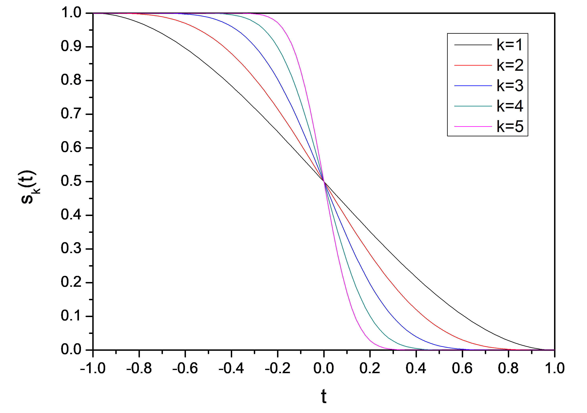
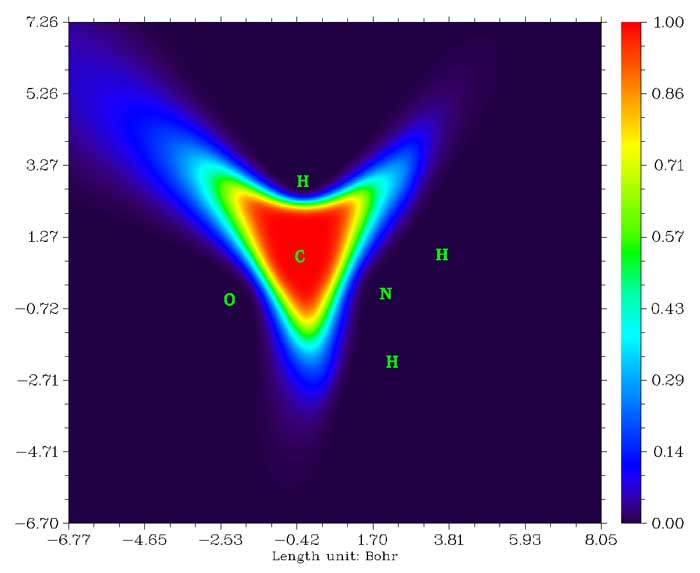

# **3.18 模糊原子空间分析 (15)**

## **3.18.0 基本概念**

在介绍各个具体功能之前，这里首先介绍模糊原子空间 (fuzzy atomic space)的一些基本概念。

原子空间 (atomic space)是指在整个三维分子空间中归属于特定原子的局域空间。下面我们将原子空间表示为权重函数 (weighing function) *w*。将整个空间划分为原子空间的方法可分为两类：

**1 离散划分 (Discrete partition)方法：**两种代表性方法是 Bader 划分（亦称 AIM 划分）与 Voronoi 划分。它们对分子空间作离散划分，因此任何一点只能归属于一个原子，换言之，

$$
\left\{\begin{gathered}w_A(\mathbf{r})=1\qquad \mathrm{if}\ \mathbf{r}\in\Omega_{\mathrm{A}}\\ w_A(\mathbf{r})=0\qquad \mathrm{if}\ \mathbf{r}\notin\Omega_{\mathrm{A}}\end{gathered}\right.
$$

其中 Ω$_{A}$ 为原子 A 的原子空间。

**2 模糊划分 (Fuzzy partition)方法：**代表性方法包括 Hirshfeld、Becke、Hirshfeld-I、MBIS 与 ISA。它们对分子空间作连续划分，原子空间彼此交叠，任何一点都可同时以不同程度归属于多个原子，且权重归一化为 1。换言之，对所有原子和任何一点，以下两个条件成立

$$
\begin{gathered}0\leq w_A(\mathbf{r})\leq 1\qquad \forall A\\ \sum_B w_B(\mathbf{r})=1\end{gathered}
$$

模糊划分最显著的优点或许在于，在模糊原子空间中对实空间函数作数值积分远比在离散原子空间中容易。采用 Becke 数值 DFT 积分方案 (*J. Chem. Phys.*, **88**, 2547 (1988))，只需相对较小的计算代价，即可对大多数实空间函数在模糊原子空间中实现高精度的积分。在 Multiwfn 的模糊原子空间分析模块中，所有积分均由此方案实现。使用的积分点越多，可达到的积分精度越高，可通过 *settings.ini* 中的 "radpot" 与 "sphpot" 参数调节积分点数目。

在 Multiwfn 的模糊原子空间分析模块中，可以得到许多基于模糊原子空间的性质。目前支持最广泛使用的模糊原子空间定义，即 Hirshfeld、Hirshfeld-I 与 Becke，介绍如下。可通过选项 -1 选择使用哪种模糊原子空间。

**Hirshfeld 原子空间：**在 *Theor. Chim. Acta (Berl.)*, **44**, 129 (1977) 中，Hirshfeld 将原子空间定义为

$$
w_A^{\mathrm{Hirsh}}(\mathbf{r})=\frac{\rho_A^{\mathrm{free}}(\mathbf{r}-\mathbf{R}_A)}{\sum_B\rho_B^{\mathrm{free}}(\mathbf{r}-\mathbf{R}_A)}
$$

其中 **R** 为原子核坐标，*ρ*$^{free}$ 表示自由态下球平均的原子电子密度 (electron density)。

在选项 -1 中，你会发现 "Hirshfeld" 与 "Hirshfeld\*" 两个选项。前者用原子 .wfn 文件计算权重，你必须自行提供这些文件，或让 Multiwfn 自动调用 Gaussian 生成，详见第 [3.7.3](sec-3-7-custom-operation-promolecular-and-deformation-properties.md#373-原子波函数的生成-generation-of-atomic-wavefunctions) 节。后者直接基于内置的径向原子密度计算权重，因而更为方便，细节见[附录 3](sec-6-3-detail-of-built-in-atomic-densities.md)。强烈建议使用 "Hirshfeld\*" 而非 "Hirshfeld"。

**Hirshfeld-I (HI) 原子空间：**这是 Hirshfeld 方法的一个著名推广，在 *J. Chem. Phys.*, **126**, 144111 (2007) 中提出。通常 HI 定义的原子空间比 Hirshfeld 的更具物理意义，因为它能响应实际分子环境。不幸的是，由于其迭代本质，HI 比 Hirshfeld 昂贵得多。Hirshfeld-I 及其在 Multiwfn 中实现的细节已在第 [3.9.13](sec-3-9-population-analysis-and-calculation-of-atomic-charges.md#3913-hirshfeld-i-原子电荷-15) 节介绍，此处不再重复。当你在选项 -1 中选择 HI 时，Multiwfn 将首先进行常规 HI 迭代（若对操作有疑问，请参阅第 [4.7.4](sec-4-7-population-analysis-and-atomic-charge-calculation.md#474-hirshfeld-i原子电荷计算示例) 节中计算 HI 电荷的例子）。待 HI 原子空间收敛后，即可进行后续分析。

**MBIS 原子空间：**与 HI 一样，MBIS 迭代地优化原子空间。详见第 [3.9.18](sec-3-9-population-analysis-and-calculation-of-atomic-charges.md#3918-最小基迭代-stockholder-mbis-电荷-20) 节。当你在选项 -1 中选择 MBIS 时，将进入执行 MBIS 迭代的界面，应选择选项 1 开始原子空间优化过程。待 MBIS 原子空间收敛后，即可进行后续分析。

**Becke 原子空间：**首先考虑函数 *p*

$$
p(d)=(3/2)d-(1/2)d^3
$$

它可以迭代多次

$$
\begin{gathered}f_1(d)=p(d)\\ f_2(d)=p[p(d)]\\ f_3(d)=p\{p[p(d)]\}\\ \cdots\end{gathered}
$$

再定义函数 *s*

$$
s_k(t)=(1/2)[1-f_k(t)]
$$

$s_{k}$ 随 *t* 的变化曲线如下

由上图可见，$s_{k}$ 随 *t* 从 -1 变到 1 而由 1 逐渐降为 0。*k* 越大，曲线越陡。Becke 原子空间的权重函数 (weighting function)基于 $s_{k}$ 的简单变换，细节请参阅原文 *J. Chem. Phys.*, **88**, 2547 (1988)。

$$
w_A^{\mathrm{Becke}}(\mathbf{r})=\frac{P_A(\mathbf{r})}{\sum_B P_B(\mathbf{r})}
$$

$$
\begin{gathered}P_A(\mathbf{r})=\prod_{B\neq A}s_k(v_{AB}(\mathbf{r}))\qquad v_{AB}(\mathbf{r})=\mu_{AB}(\mathbf{r})+a_{AB}(1-\mu_{AB}(\mathbf{r})^2)\\ a_{AB}=\frac{u_{AB}}{u_{AB}^2-1}\qquad u_{AB}=\frac{\chi_{AB}-1}{\chi_{AB}+1}\qquad \chi_{AB}=\frac{R_A^{\mathrm{cov}}}{R_B^{\mathrm{cov}}}\\ \left\{\begin{gathered}a_{AB}=-0.5\qquad \mathrm{if}\ a_{AB}<-0.5\\ a_{AB}=0.5\qquad \mathrm{if}\ a_{AB}>0.5\end{gathered}\right.\\ \mu_{AB}(\mathbf{r})=\frac{r_A-r_B}{R_{AB}}\qquad R_{AB}=\left|\mathbf{R}_A-\mathbf{R}_B\right|\qquad r_A=\left|\mathbf{r}-\mathbf{R}_A\right|\qquad r_B=\left|\mathbf{r}-\mathbf{R}_B\right|\end{gathered}
$$

其中 **R** 表示原子核坐标。$R^{\mathrm{cov}}$ 表示共价半径。

迭代次数，即 *k* 值，可通过选项 -3 设定。默认值 (3) 对大多数情形是合适的。用于生成 Becke 原子空间的共价半径的定义可通过选项 -2 选择。通过相应的子选项，可以直接选择一组内置半径（CSD 半径、修正 CSD 半径、Pyykkö 半径、Suresh 半径、Hugo 半径），从外部纯文本文件载入半径信息（所需格式在程序提示中有说明），或通过手动输入修改当前半径。

CSD 半径的原文是 *Dalton Trans.*, **2008**, 2832，这些半径由剑桥结构数据库 (Cambridge Structural Database, CSD) 的统计得出，覆盖原子序数至 96 的元素。Pyykkö 半径定义于 *Chem. Eur. J.*, **15**, 186 (2008)，覆盖整个元素周期表，第 1–18 族，Z=1–118。Suresh 半径在 *J. Phys. Chem. A*, **105**, 5940 (2001) 中提出，基于 H₃C-EH$_{n}$ 理论计算几何构型，所定义的半径覆盖周期表中大多数主族与过渡元素。Hugo 半径在 *Chem. Phys. Lett.*, **480**, 127 (2009) 中提出，具有明确的物理意义，基于原子电离能。注意氢的 Hugo 半径相当大（甚至比 Kr 大 0.01 Bohr）。

我发现直接用上述任何一种共价半径定义来定义 Becke 原子空间都是不合适的。IA 与 IIA 族金属元素的共价半径总是很大，*例如*锂的 CSD 半径为 1.28 Å。而如 VIIA 族等元素的共价半径总是很小，*例如*氟的 CSD 半径仅为 0.58 Å。对主族元素，共价半径小（大）的元素一般电负性大（小）。因此，在分子环境中，共价半径小（大）的原子倾向于攫取（给出）电子以扩大（缩小）其有效尺寸，这一行为使得每一行主族元素的实际半径趋于均衡。为了忠实反映这一行为，我定义了所谓的“修正 CSD 半径”，即将所有主族元素（第一行除外）的 CSD 半径替换为同行 IVA 族元素的 CSD 半径，而过渡元素仍使用其原始 CSD 半径。修正 CSD 半径是 Becke 原子空间的默认半径定义。

用默认参数构建的乙酰胺中碳的 Becke 原子空间如下图所示

## **3.18.1 在模糊原子空间中对实空间函数积分 (1)**

此功能用于在原子空间中对实空间函数 *f* 积分

$$
I_A=\int_A w_A(\mathbf{r})f(\mathbf{r})\mathrm{d}\mathbf{r}
$$

例如，若 *f* 选为电子密度，则 $I_{A}$ 即为原子 *A* 的电子布居数 (population)。

*f* 也可选择涉及两个电子坐标的实空间函数，如交换相关密度与源函数。对此情形，可通过选项 -10 设定参考点坐标（这等价于设定 *settings.ini* 中的 "refxyz"）。若你已做过拓扑分析，还可用选项 -11 将一个临界点 (critical point)设为参考点，这对研究源函数尤为方便（对源函数通常将键临界点设为参考点）。

输出中的 "% of sum" 与 "% of sum abs" 分别定义为 $\left(I_A/\sum_B I_B\right)\times 100\%$ 与 $\left(I_A/\sum_B\left|I_B\right|\right)\times 100\%$ 。

默认对所有原子空间积分。若只需某些原子的积分值，可用选项 -5 定义原子列表。

## **3.18.2 在交叠空间中对实空间函数积分 (8)**

此功能用于在原子对之间的交叠空间中对指定的实空间函数 *f* 积分

$$
I_{AB}=\int_A w_A(\mathbf{r})w_B(\mathbf{r})f(\mathbf{r})\mathrm{d}\mathbf{r}
$$

例如，若 *f* 选为电子密度，则 $I_{\mathrm{AB}}$ 即为原子 *A* 与 *B* 共有的电子数。*f* 也可选择涉及两个电子坐标的实空间函数。

*f* 的正部与负部的积分分别输出。同时一并输出正部与负部的对角元之和 $\sum_{A} {I}_{AA}$ 、非对角元之和 $\sum_{A} \sum_{B\neq A} {I}_{AB}$ 以及全部元之和 $\sum_{A} \sum_{B} {I}_{AB}$ 。

目前此功能只能使用 Becke 定义的模糊原子空间。

## **3.18.3 原子与分子多极矩及 \<*r*²\> (2)**

此功能用于计算原子与分子的单极、偶极、四极矩与八极矩以及 $\langle r^{2}\rangle$。输出中的所有单位均为 a.u.。

在以下公式中，上标 *A* 表示名为 *A* 的原子。*x*、*y* 与 *z* 为电子坐标 **r** 相对于原子核坐标 **R** 的分量。

$$
x=r_x-R_x^A\qquad y=r_y-R_y^A\qquad z=r_z-R_z^A
$$

且 $r^{2}$ = $x^{2}$ + $y^{2}$ + $z^{2}$ 。

源于电子的原子单极矩就是电子布居数的负值

$$
p_A=-\int w_A(\mathbf{r})\rho(\mathbf{r})\mathrm{d}\mathbf{r}
$$

原子电荷一并输出，即 $q_{A}$ = $p_{A}$ + $Z_{A}$ ，其中 *Z* 表示核电荷。

原子偶极矩用于衡量原子周围电子分布的极化，定义为

$$
\boldsymbol{\mu}^A=\begin{bmatrix}\mu_x^A\\ \mu_y^A\\ \mu_z^A\end{bmatrix}=-\int\begin{bmatrix}x\\ y\\ z\end{bmatrix}w_A(\mathbf{r})\rho(\mathbf{r})\mathrm{d}\mathbf{r}
$$

其大小，即其模，为

$$
\left|\boldsymbol{\mu}^A\right|=\sqrt{(\mu_x^A)^2+(\mu_y^A)^2+(\mu_z^A)^2}
$$

Multiwfn 还输出本原子对总分子偶极矩的贡献，计算为 $q_{A}$ **R** + **µ***$^{A}$*。

无迹 Cartesian 形式的原子四极矩张量定义如下（见专著 *The Quantum Theory of Atoms in Molecules-From Solid State to DNA and Drug Design* 第 1.8.7 节）。

$$
\boldsymbol{\Theta}^A=\begin{bmatrix}\Theta_{xx}^A & \Theta_{xy}^A & \Theta_{xz}^A\\ \Theta_{yx}^A & \Theta_{yy}^A & \Theta_{yz}^A\\ \Theta_{zx}^A & \Theta_{zy}^A & \Theta_{zz}^A\end{bmatrix}=-\frac{1}{2}\int\begin{bmatrix}3x^2-r^2 & 3xy & 3xz\\ 3yx & 3y^2-r^2 & 3yz\\ 3zx & 3zy & 3z^2-r^2\end{bmatrix}w_A(\mathbf{r})\rho(\mathbf{r})\mathrm{d}\mathbf{r}
$$

其大小可计算为

$$
\left|\boldsymbol{\Theta}^A\right|=\sqrt{(2/3)\left[(\Theta_{xx}^A)^2+(\Theta_{yy}^A)^2+(\Theta_{zz}^A)^2\right]}
$$

Cartesian 形式的原子四极矩可用于展示电子分布相对原子核球对称的偏离。具体而言，${\Theta}_{ii}^{A}$ $<0$（${\Theta}_{ii}^{A}$ $>0$）表明原子 *A* 的电子密度沿 *i* 方向伸长（收缩）。若原子电子密度具有严格的球对称，则 Θ*$_{xx}$* = Θ*$_{yy}$* = Θ*$_{zz}$*。注意此处给出的 Cartesian 四极矩张量 **Θ** 是无迹的，即满足条件 Θ*$_{xx}$* + Θ*$_{yy}$* + Θ*$_{zz}$* = 0。

标准 Cartesian 形式的原子四极矩张量定义如下。默认不输出，因为它很少有用。但若希望输出，可将 *settings.ini* 中的 “ispecial” 设为 1。

$$
\boldsymbol{\Theta}^A=\begin{bmatrix}\Theta_{xx}^A & \Theta_{xy}^A & \Theta_{xz}^A\\ \Theta_{yx}^A & \Theta_{yy}^A & \Theta_{yz}^A\\ \Theta_{zx}^A & \Theta_{zy}^A & \Theta_{zz}^A\end{bmatrix}=-\int\begin{bmatrix}x^2 & xy & xz\\ yx & y^2 & yz\\ zx & zy & z^2\end{bmatrix}w_A(\mathbf{r})\rho(\mathbf{r})\mathrm{d}\mathbf{r}
$$

受电子空间范围 (electronic spatial extent)启发（见第 [3.300.5](sec-3-300-other-functions-part-3.md#33005-计算电偶极多极矩和电子空间范围) 节），我定义了原子电子空间范围 $\left\langle {r}_{A}^{2} \right\rangle$ ，表示为

$$
\left\langle {r}_{A}^{2} \right\rangle=\int {r}^{2}{w}_{A}\left( \mathbf{r} \right)\rho\left( \mathbf{r} \right)\mathrm{d}\mathbf{r}=\left\langle {x}_{A}^{2} \right\rangle+\left\langle {y}_{A}^{2} \right\rangle+\left\langle {z}_{A}^{2} \right\rangle
$$

其 *X* 分量表示如下

$$
\left\langle {x}_{A}^{2} \right\rangle=\int {x}^{2}{w}_{A}\left( \mathbf{r} \right)\rho(\mathbf{r}\mathrm{)d}\mathbf{r}
$$

$\left\langle {y}_{A}^{2} \right\rangle$ 与 $\left\langle {z}_{A}^{2} \right\rangle$ 类似。

$\left\langle {r}_{A}^{2} \right\rangle$ 是衡量模糊原子内电子分布总体空间范围的有用指标，而其 Cartesian 分量揭示特定方向上的电子空间范围。

球谐形式的原子四极与八极矩也一并输出。球谐形式多极矩的一般表达式为

$$
Q_{l,m}^A=-\int R_{l,m}^A(\mathbf{r})w_A(\mathbf{r})\rho(\mathbf{r})\mathrm{d}\mathbf{r}
$$

球谐形式的四极矩的全部五个分量对应于

$$
\begin{gathered}R_{2,0}=(3z^2-r^2)/2\\ R_{2,-1}=\sqrt{3}yz\qquad R_{2,1}=\sqrt{3}xz\\ R_{2,-2}=\sqrt{3}xy\qquad R_{2,2}=(\sqrt{3}/2)(x^2-y^2)\end{gathered}
$$

球谐形式的八极矩的全部 7 个分量对应于

$$
\begin{gathered}R_{3,0}=(1/2)(5z^2-3r^2)z\\ R_{3,-1}=\sqrt{3/8}(5z^2-r^2)y\qquad R_{3,1}=\sqrt{3/8}(5z^2-r^2)x\\ R_{3,-2}=\sqrt{15}xyz\qquad R_{3,2}=(\sqrt{15}/2)(x^2-y^2)z\\ R_{3,-3}=\sqrt{5/8}(3x^2-y^2)y\qquad R_{3,3}=\sqrt{5/8}(x^2-3y^2)x\end{gathered}
$$

球谐形式多极矩的大小计算为

$$
\left|Q_l^A\right|=\sqrt{\sum_m(Q_{l,m}^A)^2}
$$

计算结束时，输出总电子数、分子偶极矩及其大小。分子偶极矩计算为所有原子偶极矩与原子电荷贡献之和（*即*输出信息中所有 "Contribution to molecular dipole moment" 项之和）

$$
\boldsymbol{\mu}^{\mathrm{mol}}=\sum_A\left(q_A\mathbf{R}^A+\boldsymbol{\mu}^A\right)
$$

此外，Multiwfn 输出 Cartesian 形式与球谐形式的分子四极与八极矩，它们也可视为原子贡献之和。例如，分子四极矩的 Θ*$_{xy}$* 分量表示为

$$
\Theta_{xy}=\frac{3}{2}\left[\sum_A R_x^A R_y^A Z_A-\sum_A\int xyw_A(\mathbf{r})\rho(\mathbf{r})\mathrm{d}\mathbf{r}\right]
$$

其中此处的 *x*、*y*、*z* 为 **r** 相对于 (0,0,0) 位置的 Cartesian 分量。分子的 $\langle r^{2}\rangle$ 可写为

$$
\left\langle {r}^{2} \right\rangle=\sum_{A} \int {r}^{2}{w}_{A}\left( \mathbf{r} \right)\rho\left( \mathbf{r} \right)\mathrm{d}\mathbf{r}
$$

其中 *r* 为相对于 (0,0,0) 的径向距离。

默认计算所有原子的原子多极矩与 $\langle r^{2}\rangle$，最后打印整个体系的这些量。若只需特定原子的这些量，可用选项 -5 定义原子列表，此时只计算并输出所选原子的量。此外，利用此特性可以计算分子复合物中一个分子的量，或计算分子中一个片段的量，因为此时输出末尾打印的 "Molecular dipole and multipole moments" 仅由所定义列表中原子的贡献构成。关于此特性的用法示例见第 [4.15.3](sec-4-15-fuzzy-atomic-space-analysis.md#4153-计算片段偶极矩以展示局域极性) 节。

进入本功能后，将被询问输出去向。若选择 2 将结果输出到 *multipole.txt*，当前目录下还会产生一个名为 *atom_moment.txt* 的文件。基于此文件，可通过专门脚本在 VMD 程序中可视化原子电偶极与四极矩，细节见第 [4.15.5](sec-4-15-fuzzy-atomic-space-analysis.md#4155-可视化原子电偶极矩和四极矩) 节。

> **PS 1**
>
> 若目的仅是计算整个体系的电偶极/多极矩与 $\langle r^{2}\rangle$，最好使用第 [3.300.5](sec-3-300-other-functions-part-3.md#33005-计算电偶极多极矩和电子空间范围) 节所述的功能，它明显更快更准，因为它解析地计算这些量。

> **PS 2**
>
> 若 *settings.ini* 中的 “ispecial” 设为 1，则本功能涉及的电子密度将被替换为用户自定义函数。利用此特性可实现一些特殊目的，如计算对应于电子密度变化的原子偶极矩，见 \#10 及 <http://sobereva.com/wfnbbs/viewtopic.php?id=650> 中的相关讨论。

## **3.18.4 原子交叠矩阵与片段交叠矩阵 (3, 33)**

模糊分析模块中的子功能 3 用于计算原子空间中轨道的原子交叠矩阵 (atomic overlap matrix, AOM)，AOM 将输出到当前目录下的 *AOM.txt*。AOM 的矩阵元定义为

$$
S_{ij}(A)=\int_A\varphi_i(\mathbf{r})\varphi_j(\mathbf{r})\mathrm{d}\mathbf{r}
$$

其中 *i* 与 *j* 为轨道序号，积分在原子 *A* 的模糊空间内进行。对非限制波函数，每个原子的 α 轨道之间与 β 轨道之间的 AOM 分别输出。

注意最高的虚轨道在计算中不予考虑。例如，当前体系共 10 个轨道，其中 7、8、9、10 未占据，且用户已通过主功能 6 的选项 26 将轨道 3 的占据数设为零，则 Multiwfn 输出的每个 AOM 的维度为 (6,6)，对应每个原子空间中前 6 个轨道之间的交叠积分。若希望考虑全部轨道，将 *settings.ini* 中的 “ispecial” 设为 3。

由于轨道在整个空间中正交，原则上将所有原子的 AOM 加和（对应在整个空间中积分）应得到单位矩阵

$$
\mathbf{SUM}=\sum_A\mathbf{s}(A)=\mathbf{I}
$$

当然，由于积分是数值进行的，该条件并不严格成立。**SUM** 对单位矩阵的偏离是衡量积分精度的有用指标

$$
\mathrm{Error}=\frac{\sum_i\sum_j\left|SUM_{i,j}-I_{i,j}\right|}{N_{\mathrm{atom}}}
$$

Multiwfn 自动输出 "Error" 值。若它不够小，*例如* $>$0.001，则可通过以下方式提高积分精度

- (1) 增大 *settings.ini* 中的 "radpot" 与 "sphpot"

- (2) 将 *settings.ini* 中的 "radcut" 设为 0

- (3) 选择选项 -6，将默认的原子积分格点换为昂贵得多的分子积分格点

- (4) 若大量使用了弥散函数，将其去掉

### **片段交叠矩阵**

片段交叠矩阵 (fragment overlap matrix, FOM)就是片段中原子的 AOM 之和。可用模糊分析模块的子功能 33 计算一个或两个片段的 FOM，结果输出到当前目录下的 *FOM.txt*。可在本子功能中直接定义片段中的原子。

当用原子积分格点计算 AOM，且一个或两个片段涉及的原子数远小于总原子数时，计算 FOM 的代价远低于用子功能 3 计算全部 AOM，因为不属于片段的原子将被直接跳过。

## **3.18.5 定域化指数 (LI)与离域化指数 (DI) (4, 44)**

### **3.18.5.1 理论背景**

#### **LI 与 DI 的定义**

对开壳层体系，α 与 β 电子的 LI (*λ*) 与 DI (*δ*) 分别计算。下面只给出 α 电子的 LI 与 DI 表达式。β 电子只需将 α 换为 β，下同。原子空间 *A* 中可离域到原子空间 *B* 的电子计算为

$$
\delta^\alpha(A\to B)=-\int_A\int_B\Gamma_{\mathrm{XC}}^{\alpha,\mathrm{tot}}(\mathbf{r}_1,\mathbf{r}_2)\mathrm{d}\mathbf{r}_1\mathrm{d}\mathbf{r}_2
$$

其中 Г$_{XC}$ 为交换相关密度；若对此不熟悉，请参阅第 [2.6](sec-2-6-real-space-functions.md) 节第 17 部分的讨论。原子空间 *B* 中可离域到原子空间 *A* 的电子为

$$
\delta^\alpha(B\to A)=-\int_B\int_A\Gamma_{\mathrm{XC}}^{\alpha,\mathrm{tot}}(\mathbf{r}_1,\mathbf{r}_2)\mathrm{d}\mathbf{r}_1\mathrm{d}\mathbf{r}_2
$$

显然以上两项数值相同，因此我们如下定义 *A* 与 *B* 之间的 DI，它衡量原子 *A* 与 *B* 共有的 α 电子总数

$$
\delta^\alpha(A,B)=\delta^\alpha(A\to B)+\delta^\alpha(B\to A)=-2\int_A\int_B\Gamma_{\mathrm{XC}}^{\alpha,\mathrm{tot}}(\mathbf{r}_1,\mathbf{r}_2)\mathrm{d}\mathbf{r}_1\mathrm{d}\mathbf{r}_2
$$

$\lambda^\alpha$ 衡量定域于一个原子中的 α 电子数。注意该量不可加。

$$
\lambda^\alpha(A)=-\int_A\int_A\Gamma_{\mathrm{XC}}^{\alpha,\mathrm{tot}}(\mathbf{r}_1,\mathbf{r}_2)\mathrm{d}\mathbf{r}_1\mathrm{d}\mathbf{r}_2=\delta^\alpha(A,A)/2
$$

LI、DI 与原子空间中电子布居数的关系如下，其物理意义是原子 *A* 中定域于原子 *A* 的 α 电子与离域到其它区域的 α 电子之和即为空间 *A* 中的 α 电子总数。

$$
\begin{aligned}&\lambda^\alpha(A)+(1/2)\sum_{B\neq A}\delta^\alpha(A,B)\equiv\lambda^\alpha(A)+\sum_{B\neq A}\delta^\alpha(A\to B)=\\
&=-\int_A\int\Gamma_{\mathrm{XC}}^{\alpha,\mathrm{tot}}(\mathbf{r}_1,\mathbf{r}_2)=\int_A\rho^\alpha(\mathbf{r})\mathrm{d}\mathbf{r}=N_A^\alpha\end{aligned}
$$

利用 Г$_{XC}$ 的 Müller 近似表达式，DI 与 LI 可明确写为如下形式（此形式的 *δ* 亦称 Fulton 指数，见 *Phys. Chem. Chem. Phys.*, **28**, 19133 (2026) 的综述）

$$
\begin{gathered}\delta^\alpha(A,B)=2\sum_{i\in\alpha}\sum_{j\in\alpha}\sqrt{\eta_i\eta_j S_{ij}(A)S_{ij}(B)}\\ \lambda^\alpha(A)=\sum_{i\in\alpha}\sum_{j\in\alpha}\sqrt{\eta_i\eta_j S_{ij}(A)S_{ij}(A)}\end{gathered}
$$

其中 **S** 为原子交叠矩阵 (AOM)，介绍见第 [3.18.4](#3184-原子交叠矩阵与片段交叠矩阵-3-33) 节。

总 DI 与 LI 为 α 部分与 β 部分之和

$$
\begin{gathered}\delta(A,B)=\delta^\alpha(A,B)+\delta^\beta(A,B)\\ \lambda(A)=\lambda^\alpha(A)+\lambda^\beta(A)\end{gathered}
$$

还值得一提的是 Ángyán-Loos-Mayer (ALM) 形式的 DI (*J. Phys. Chem.*, **98**, 5244 (1994))，如下所示，其中轨道为空间轨道，*η* 在 \[0.0,2.0\] 范围内。它在 Multiwfn 中没有实现。

$$
\delta^\alpha(A,B)=\sum_i\sum_j\eta_i\eta_j S_{ij}(A)S_{ij}(B)
$$

#### **闭壳层情形的特殊形式**

由于闭壳层情形 $\delta^\alpha(A,B)=\delta^\beta(A,B)$ ，总 DI 可计算为

$$
\delta(A,B)=2\delta^\alpha(A,B)=2\times 2\sum_m\sum_n\sqrt{\frac{\eta_m}{2}\frac{\eta_n}{2}}S_{mn}(A)S_{mn}(B)=2\sum_m\sum_n\sqrt{\eta_m\eta_n}S_{mn}(A)S_{mn}(B)
$$

其中 *m* 与 *n* 表示闭壳层自然轨道。类似地，闭壳层情形的总 LI 为

$$
\lambda(A)=\sum_m\sum_n\sqrt{\eta_m\eta_n}S_{mn}(A)S_{mn}(A)
$$

对闭壳层体系，一般认为总 DI 的数值定量衡量两个原子间共有的电子对数。例如，总 *δ*(*A*,*B*)=1.0 意味着原子 *A* 与 *B* 间共有一对电子（一个 α 与一个 β 电子）。（事实上，这仅对如 H₂ 中 H-H 键这样的非极性键严格成立。在极性键中，DI 必小于形式键级，因为总 DI 实际反映的是两个原子间共有的*有效*电子对数，因而在一定程度上反映共价性。注意 DI 的数值对所用原子空间的定义非常敏感。

#### **片段 LI 与片段间 DI**

片段 *F* 与 *G* 之间的片段间 DI (interfragment DI, IFDI)可计算为

$$
\begin{aligned}&\delta^\alpha(F,G)=2\sum_{i\in\alpha}\sum_{j\in\alpha}\sqrt{\eta_i\eta_j S_{ij}(F)S_{ij}(G)}\\ &\to 2\sum_{i\in\alpha}\sum_{j\in\alpha}\sqrt{\eta_i\eta_j}\sum_{A\in F}S_{ij}(A)\sum_{B\in G}S_{ij}(B)\\ &\to \sum_{A\in F}\sum_{B\in G}\left[2\sum_{i\in\alpha}\sum_{j\in\alpha}\sqrt{\eta_i\eta_j S_{ij}(A)S_{ij}(B)}\right]\\ &\to \sum_{A\in F}\sum_{B\in G}\delta^\alpha(A,B)\end{aligned}
$$

在 *Phys. Chem. Chem. Phys.*, **24**, 11486 (2022) 中表明，整体共轭体系中两个末端片段之间的 IFDI 在表征整体离域程度方面非常有用，且发现 IFDI 与两片段间的旋转势垒呈良好的正相关。这是因为原来的 π 共轭越强，两基团相对转动时共轭被破坏得越明显，能量上升得越高。

片段 *F* 的片段 LI (fragment LI, FLI)可计算为

$$
\begin{aligned}&\lambda^\alpha(F)=\sum_{i\in\alpha}\sum_{j\in\alpha}\sqrt{\eta_i\eta_j S_{ij}(F)S_{ij}(F)}\\ &\to \sum_{A\in F}\sum_{B\in F}\sum_{i\in\alpha}\sum_{j\in\alpha}\sqrt{\eta_i\eta_j S_{ij}(A)S_{ij}(B)}\\ &\to \sum_{A\in F}\sum_{i\in\alpha}\sum_{j\in\alpha}\sqrt{\eta_i\eta_j S_{ij}(A)S_{ij}(A)}+\sum_{(B>A)\in F}2\sum_{i\in\alpha}\sum_{j\in\alpha}\sqrt{\eta_i\eta_j S_{ij}(A)S_{ij}(B)}\\ &\to \sum_{A\in F}\lambda^\alpha(A)+\sum_{(B>A)\in F}\delta^\alpha(A,B)\end{aligned}
$$

#### **单行列式波函数的特殊形式**

对单行列式波函数，由于轨道占据数为整数，DI 与 LI 可简化为

$$
\begin{gathered}\delta^\alpha(A,B)=2\sum_{i\in\alpha}^{\mathrm{occ}}\sum_{j\in\alpha}^{\mathrm{occ}}S_{ij}(A)S_{ij}(B)\\ \delta(A,B)=4\sum_m^{\mathrm{occ}}\sum_n^{\mathrm{occ}}S_{mn}(A)S_{mn}(B)\\ \lambda^\alpha(A)=\sum_{i\in\alpha}^{\mathrm{occ}}\sum_{j\in\alpha}^{\mathrm{occ}}S_{ij}(A)S_{ij}(A)\\ \lambda(A)=2\sum_m^{\mathrm{occ}}\sum_n^{\mathrm{occ}}S_{mn}(A)S_{mn}(A)\end{gathered}
$$

#### **DI 与模糊键级的关系**

传统上 LI 与 DI 在 AIM 原子空间（亦称 AIM 盆 (basin)）中计算。而在 Multiwfn 的模糊原子空间分析模块中，它们在模糊原子空间中计算，物理本质相同。根据 *J. Phys. Chem. A*, **109**, 9904 (2005) 中的讨论（比较 Eq. 13 与 Eq. 18），在模糊原子空间中计算的 DI 就是所谓的模糊键级 (fuzzy bond order)，由 Mayer 在 *Chem. Phys. Lett.*, **383**, 368 (2004) 中定义。

对闭壳层体系，原子价 (valence)可计算为其模糊键级之和

$$
V(A)=\sum_{B\neq A}\delta(A,B)
$$

#### **σ 与 π 贡献的分离**

对严格平面分子，由于 σ 轨道与 π 轨道在原子空间中的交叠积分严格为零，DI 中 σ 与 π 电子的贡献可严格分解为 DI-σ 与 DI-π

$$
\begin{gathered}\delta^\alpha(A,B)=\delta_\sigma^\alpha(A,B)+\delta_\pi^\alpha(A,B)\\ \delta_\sigma^\alpha(A,B)=2\sum_{i\in\alpha}^{\sigma}\sum_{j\in\alpha}^{\sigma}\sqrt{\eta_i\eta_j S_{ij}(A)S_{ij}(B)}\\ \delta_\pi^\alpha(A,B)=2\sum_{i\in\alpha}^{\pi}\sum_{j\in\alpha}^{\pi}\sqrt{\eta_i\eta_j S_{ij}(A)S_{ij}(B)}\end{gathered}
$$

类似地，LI 可分解为 LI-σ 与 LI-π。将 DI-σ 与 DI-π 矩阵中相应的非对角元加和，分别得到 σ 原子价与 π 原子价。若想计算 DI/LI-σ (DI/LI-π)，在 DI/LI 计算之前，应通过主功能 6 的子功能 26 将所有 π 轨道 (σ 轨道) 的占据数设为零。

#### **协方差与相对涨落参数**

在一些文献中，特别是由 Bernard Silvi 撰写的文献，讨论原子空间中电子涨落的方差 *σ*²(*A*)与两个原子空间之间电子对涨落的协方差 cov(*A*,*B*)。Multiwfn 不直接输出它们，因为 *σ*²(*A*)、cov(*A*,*B*) 与 DI(*A*,*B*) 之间存在非常简单的关系，因而你可以很容易地算出它们，推导见 *Chem. Rev.*, **105**, 3911 (2005)

$$
\begin{gathered}\mathrm{cov}(A,B)=-\delta(A,B)/2\\ \sigma^2(A)=N_A-\lambda(A)=-\sum_{B\neq A}\mathrm{cov}(A,B)=\sum_{B\neq A}\delta(A,B)/2\end{gathered}
$$

其中 $N_{A}$ 为 *A* 中的电子布居数。如上所述，Multiwfn 输出的 DI 矩阵的对角元计算为相应行（或列）非对角元之和，因此只需将 DI 矩阵相应的对角元除以二，即可简单得到 *σ*²。

与 *σ*² 密切相关的一个量是 Bader 引入的相对涨落参数，它表示给定原子空间的电子涨落相对其电子布居的大小，如需可手动计算

$$
\lambda_{\mathrm{F}}(A)=\sigma^2(A)/N_A
$$

或者，可计算下值以衡量定域于原子空间中的电子所占比例

$$
l(A)=\lambda(A)/N_A
$$

### **3.18.5.2 用法**

在 Multiwfn 中，计算 LI 与 DI 之前自动先计算 AOM，这是最耗时的步骤。对开壳层体系，α 与 β 电子以及全部电子的 LI 与 DI 分别输出。注意 DI 矩阵的对角元计算为相应非对角行（或列）元之和。对闭壳层体系，如上所述，它们对应于原子价。

## **3.18.6 对位离域化指数 (PDI) (5)**

对位离域化指数 (para-delocalization index, PDI)是用于衡量六元环芳香性的量。PDI 最早在 *Chem. Eur. J.*, **9**, 400 (2003) 中提出，更多讨论亦见 *Chem. Rev.*, **105**, 3911 (2005)。PDI 本质上是六元环中对位离域化指数（对位 DI）的平均值。

$$
\mathrm{PDI}=\frac{\delta(1,4)+\delta(2,5)+\delta(3,6)}{3}
$$

PDI 背后的基本思想是 Bader 等人报道苯中对位碳原子间的 DI 大于间位碳原子间的 DI。显然，PDI 越大，离域越大，芳香性越强。PDI 定义的主要局限在于只能用于研究六元环的芳香性，且已表明当环平面发生面外畸变时 PDI 不再适用。

在 Multiwfn 中，计算 PDI 之前自动先计算 AOM 与 DI。然后将提示输入所关注环中原子的序号，输入顺序必须与原子连接顺序一致。

PDI 目前仅适用于闭壳层体系，理论上能否推广到开壳层情形尚不清楚。

注意对完全平面体系，由于 DI 可分解为 α 与 π 部分，PDI 也可分离为 PDI-α 与 PDI-π，分别研究 α 芳香性与 π 芳香性。为了计算 PDI-α (PDI-π)，在进入本模块之前，应首先手动将除 π (α) MO 之外所有 MO 的占据数设为零（或利用主功能 100 的选项 22 做这一步，会方便得多）。

## **3.18.7 芳香涨落指数 (FLU)与 FLU-π (6,7)**

芳香涨落指数 (aromatic fluctuation index, FLU)在 *J. Chem. Phys.*, **122**, 014109 (2005) 中提出，更多讨论亦见 *Chem. Rev.*, **105**, 3911 (2005)。与 PDI 一样，FLU 是基于 DI 的芳香性指数，但可用于研究任意元数的环。FLU 指数遵循 HOMA 思想构建（见第 [3.28.6](sec-3-28-electron-delocalization-and-aromaticity-analyses.md#3286-计算-homa-和-bird-芳香性指数) 节），*即*衡量相对选作参考的芳香分子的偏离（每对成键的 DI 差）。FLU 定义如下

$$
\mathrm{FLU}=\frac{1}{n}\sum_{A-B}^{\mathrm{ring}}\left[\left(\frac{V(B)}{V(A)}\right)^\alpha\left(\frac{\delta(A,B)-\delta_{\mathrm{ref}}(A,B)}{\delta_{\mathrm{ref}}(A,B)}\right)\right]^2
$$

其中求和遍历环上所有相邻原子对，*n* 等于环中原子数，*δ*$_{ref}$ 为预先计算好的参考 DI 值。α 用于保证原子价之比大于 1

$$
\alpha=\left\{\begin{gathered}1\qquad V(B)>V(A)\\ -1\qquad V(B)\leq V(A)\end{gathered}\right.
$$

FLU 公式中的第一个因子惩罚电子高度定域的情形，第二个因子衡量相对典型芳香体系的相对偏离。显然，FLU 越低，芳香性越强。

对参考值的依赖是 FLU 的主要弱点之一。Multiwfn 中 C-C、C-N、B-N 的默认 δ$_{ref}$ 分别为 1.468、1.566 与 1.260，它们分别由苯、吡啶与硼嗪在 HF/6-31G\* 下的计算得到（几何在同样水平优化。用具修正 CSD 半径、锐度参数 *k*=3 的 Becke 原子空间求得 *δ*$_{ref}$）。用户可通过选项 -4 修改或添加 δ$_{ref}$。

FLU 的原文还定义了 FLU-π，它基于 DI-π 与 π 原子价

$$
\mathrm{FLU}_\pi=\frac{1}{n}\sum_{A-B}^{\mathrm{ring}}\left[\left(\frac{V_\pi(B)}{V_\pi(A)}\right)^\alpha\left(\frac{\delta_\pi(A,B)-\delta_{\mathrm{avg}}}{\delta_{\mathrm{avg}}}\right)\right]^2
$$

其中 *δ*$_{π}$ 为环中成键原子对 DI-π 的平均值，其它符号表示仅用 π 轨道计算的上述量。FLU-π 相对 FLU 的优势在于 FLU-π 不依赖预定义的参考 DI 值，缺点是 FLU-π 只能对平面分子严格计算。

与 FLU 类似，FLU-π 越低，环的芳香性越强。若 FLU-π 等于零，意味着环中 DI-π 完全均衡。用 FLU-π 衡量芳香性的合理性在于，对大多数芳香分子，芳香性几乎完全由 π 电子贡献，而非 σ 电子。

在 Multiwfn 的模糊原子空间分析模块中，PDI、FLU 与 FLU-π 在模糊原子空间中计算。在 *J. Phys. Chem. A*, **110**, 5108 (2006) 中，作者表明在模糊原子空间中计算的 PDI、FLU 与 FLU-π 与在 AIM 原子空间中计算的结果相关性极好。

在 Multiwfn 中，计算 FLU 与 FLU-π 之前自动计算 AOM。若计算 FLU-π，将提示输入 π 轨道的序号，可通过主功能 0 查看所有轨道的等值面 (isosurface)找出它们的序号。然后生成 DI 或 DI-π 矩阵。接着应输入环中原子的序号，输入顺序必须与原子连接顺序一致。除输出 FLU 或 FLU-π 值，还输出每个成键原子对的贡献。

FLU 与 FLU-π 在 Multiwfn 中仅适用于闭壳层体系。FLU 与 FLU-π 是否也适用于开壳层体系尚不清楚。

## **3.18.8 凝聚线性响应核 (CLRK) (9)**

线性响应核 (linear response kernel, LRK)是 DFT 框架下定义的重要概念，可写为

$$
\chi(\mathbf{r}_1,\mathbf{r}_2)=\left(\frac{\delta^2 E}{\delta v(\mathbf{r}_1)\delta v(\mathbf{r}_2)}\right)_N=\left(\frac{\delta\rho(\mathbf{r}_1)}{\delta v(\mathbf{r}_2)}\right)_N
$$

该量反映 $r_{2}$ 处外势扰动对 $r_{1}$ 处电子密度的影响，也可视为 $r_{1}$ 与 $r_{2}$ 处电子之间的耦合大小。

在 Multiwfn 中，LRK 用基于二阶微扰理论的近似形式计算（见 *Phys. Chem. Chem. Phys.*, **14**, 3960 (2012) 的 Eq.3）

$$
\chi(\mathbf{r}_1,\mathbf{r}_2)\approx 4\sum_{i\in\mathrm{occ}}\sum_{j\in\mathrm{vir}}\frac{\varphi_i^*(\mathbf{r}_1)\varphi_j(\mathbf{r}_1)\varphi_j^*(\mathbf{r}_2)\varphi_i(\mathbf{r}_2)}{\varepsilon_i-\varepsilon_j}
$$

其中 *φ* 为分子轨道，*ε* 表示 MO 能量。注意此近似形式仅适用于 HF/DFT 闭壳层体系，因此本功能仅适用于 HF/DFT 闭壳层体系。

凝聚线性响应核 (condensed linear response kernel, CLRK)计算为

$$
\chi_{A,B}=\int_A\int_B\chi(\mathbf{r}_1,\mathbf{r}_2)\mathrm{d}\mathbf{r}_1\mathrm{d}\mathbf{r}_2=4\sum_{i\in\mathrm{occ}}\sum_{j\in\mathrm{vir}}\frac{S_{ij}(A)S_{ji}(B)}{\varepsilon_i-\varepsilon_j}
$$

其中 *A* 与 *S*(*A*) 分别表示原子 A 的模糊原子空间与原子交叠矩阵，原子 B 类似。在 *Phys. Chem. Chem. Phys.,* **15**, 2882 (2013) 中表明 CLRK 有助于研究芳香性与反芳香性。

本功能用于计算当前体系中所有原子对之间的 CLRK，结果以矩阵形式输出。由于计算 LRK 需要虚 MO 信息，当前版本必须用 .mwfn/.fch/.molden/.gms 文件作为输入文件。

注意 CLRK 可分解为轨道贡献，*例如* MO *i* 的贡献

$$
\chi_{A,B}^{(i)}=4\sum_{j\in\mathrm{vir}}\frac{S_{ij}(A)S_{ji}(B)}{\varepsilon_i-\varepsilon_j}
$$

例如，假设想计算 MO 3、4、7 的贡献，则在计算 CLRK 之前，应进入主功能 6，用选项 26 将除 3、4、7 之外所有 MO 的占据数设为零。（注意用于计算 LRK 的虚 MO 自动仍为原始虚 MO，而非修改 MO 占据数之后的虚 MO。）

## **3.18.9 对位线性响应指数 (PLR) (10)**

对位线性响应指数 (para linear response index, PLR)的定义类似于 PDI，唯一区别是用 CLRK 代替 DI

$$
PLR(A,B)=\frac{\chi_{1,4}+\chi_{2,5}+\chi_{3,6}}{3}
$$

在 *Phys. Chem. Chem. Phys.*, **14**, 3960 (2012) 中，作者认为 PLR 在定量衡量芳香性方面与 PDI 同样有用，且发现 PLR 与 PDI 之间的线性关系高达 $R^{2}$ =0.96。

本功能用于计算 PLR。Multiwfn 将首先计算 CLRK，然后应输入构成所研究环的原子的序号，*例如* 3,5,6,7,9,2。输入顺序必须与原子连接顺序一致。然后 PLR 立即输出到屏幕。PLR 仅适用于 HF/DFT 闭壳层体系，目前必须用 .mwfn/.fch/.molden/.gms 作为输入文件。

注意对完全平面体系，PLR 可严格分离为 PLR-α 与 PLR-π，分别研究 α 芳香性与 π 芳香性。为了计算 PLR-α (PLR-π)，在进入本模块之前，应首先手动将除 π (α) MO 之外所有 MO 的占据数设为零（或利用主功能 100 的选项 22 做这一步，会方便得多）。

## **3.18.10 多中心离域化指数 (11)**

*n* 中心多中心 DI 计算为

$$
\delta(A,B,C\cdots H)=2^{n-1}\sum_i\sum_j\sum_k\cdots\sum_qS_{ij}(A)S_{jk}(B)S_{kl}(C)\cdots S_{qi}(H)
$$

其中 *i*、*j*、*k*……只遍历占据轨道。多中心 DI 的归一化形式定义为 *δ*$^{1/}$*ⁿ*，可在不同元数的环之间比较。

目前此功能仅适用于单行列式闭壳层波函数，最多支持 10 个中心。注意对相对较大的体系，计算 6 个以上中心的多中心 DI 可能相当耗时。

## **3.18.11 信息论芳香性指数 (12)**

在 *ACS Omega*, **3**, 18370 (2018) 中表明，构成环的原子的某些信息论量的算术平均值与其它广泛接受的芳香性指数，如 HOMA 与芳香稳定化能 (aromatic stabilization energy, ASE)，具有良好的线性关系。由此可见该算术平均值可用作衡量芳香性的指数，尽管这一点还需进一步探索。

信息论芳香性指数，即上述算术平均值，可通过模糊分析模块的子功能 12 计算。进入此功能后，应选择定义原子信息论量的方式，目前有三种选择：

- 原子 Shannon 熵：$s_{\mathrm{S}}(A)=\int-\rho(\mathbf{r})\ln\rho(\mathbf{r})w_A(\mathbf{r})\mathrm{d}\mathbf{r}$

- 原子 Fisher 信息：$i_{\mathrm{F}}(A)=\int\left|\nabla\rho(\mathbf{r})\right|^2/\rho(\mathbf{r})w_A(\mathbf{r})\mathrm{d}\mathbf{r}$

- 原子 GBP 熵：$s_{\mathrm{GBP}}(A)=\int(3/2)\rho(\mathbf{r})\{\lambda+\ln[t(\mathbf{r})/t_{\mathrm{TF}}(\mathbf{r})]\}w_A(\mathbf{r})\mathrm{d}\mathbf{r}$

本质上，这三个量对应于在模糊原子空间中对用户自定义函数 50、51 与 54 的积分。在此功能中，还需输入环中原子的序号。一旦完成环中所有原子所选量的计算，将显示平均值，它可视为芳香性指数。

使用此功能之前，可先选择定义原子空间的方式。原文用 Hirshfeld 划分，而模糊分析模块的默认划分方法是 Becke。

**模糊分析模块所需的信息：** GTFs, atom coordinates

## **3.18.12 原子有效体积、自由体积、极化率与 *C*₆ 系数 (13)**

### **理论**

分子体系中零频原子（有效）极化率 ${\alpha}_{}^{\mathrm{eff}}(0)$ 是非常重要的量；然而没有唯一的方法估计它，一般而言它也不是实验可观测量。在 Tkatchenko-Scheffler (TS) 色散校正方法的原文 *Phys. Rev. Lett.*, **102**, 073005 (2009) 中，作者建议通过标度已知的自由原子极化率 ${\alpha}_{}^{\mathrm{free}}(0)$ 来估计它，他们假设某元素的原子极化率与其原子体积成正比。然后在综述 *Chem. Rev.*, **117**, 4714 (2017) 中，此方法明确表示为

$$
\alpha_A^{\mathrm{eff}}(0)=\alpha_A^{\mathrm{free}}(0)\frac{V_A^{\mathrm{eff}}}{V_A^{\mathrm{free}}}
$$

其中分子中的原子有效体积 $V^{\mathrm{eff}}$ 与原子自由体积 $V^{\mathrm{free}}$ 表示为

$$
\begin{gathered}V_A^{\mathrm{eff}}=\int\rho(\mathbf{r})w_A(\mathbf{r})\left|\mathbf{r}-\mathbf{R}_A\right|^3\mathrm{d}\mathbf{r}\\ V_A^{\mathrm{free}}=\int\rho_A^{\mathrm{free}}(\mathbf{r})\left|\mathbf{r}-\mathbf{R}_A\right|^3\mathrm{d}\mathbf{r}\end{gathered}
$$

其中 $w_{A}$ 为原子 *A* 的原子权重函数。$R_{A}$ 为原子 *A* 的核位置。*ρ* 为分子电子密度，${\rho}_{A}^{\mathrm{free}}$ 为原子 *A* 自由态的电子密度。注意计算 *ρ* 与 *ρ*$^{free}$ 所用的计算水平必须完全相同。

理想情况下，所有原子的 ${\alpha}_{}^{\mathrm{eff}}(0)$ 之和应等于整个体系的静态极化率。但由于上述方法并不严格，该条件显然不可能达到。此外值得注意的是，原子权重函数的选择显著影响计算结果，但尚不清楚哪种权重函数最适合此目的。

我认为将某原子对总极化率的百分比贡献定义为

$$
\alpha_A^{\%}=\frac{\alpha_A^{\mathrm{eff}}(0)}{\sum_A\alpha_A^{\mathrm{eff}}(0)}\times 100\%
$$

是有用的。该量显然有助于分析分子极化率的主要来源。

根据 TS 方法，实际化学环境中原子的 $C_{6}$ 色散系数可容易地近似计算为

$$
C_{6,AA}^{\mathrm{TS}}=\left(\frac{V_A^{\mathrm{eff}}}{V_A^{\mathrm{free}}}\right)^2 C_{6,AA}^{\mathrm{free}}
$$

其中 ${C}_{6,AA}^{\mathrm{free}}$ 为已知的自由态原子的 $C_{6}$ 色散系数。进而，不同两原子之间的 $C_{6}$ 可计算为

$$
C_{6,AB}^{\mathrm{TS}}=\frac{2C_{6,AA}^{\mathrm{TS}}C_{6,BB}^{\mathrm{TS}}}{\frac{\alpha_B^{\mathrm{eff}}(0)}{\alpha_A^{\mathrm{eff}}(0)}C_{6,AA}^{\mathrm{TS}}+\frac{\alpha_A^{\mathrm{eff}}(0)}{\alpha_B^{\mathrm{eff}}(0)}C_{6,BB}^{\mathrm{TS}}}
$$

最后，分子间 $C_{6}$ 系数可如下得到

$$
C_6^{\mathrm{mol}}=\sum_{A\in\mathrm{mol1}}\sum_{B\in\mathrm{mol2}}C_{6,AB}^{\mathrm{TS}}
$$

### **用法**

Multiwfn 能计算所有原子的 $V^{\mathrm{eff}}$ 、$V^{\mathrm{free}}$ 、${\alpha}_{}^{\mathrm{eff}}(0)$ 、${\alpha}_{}^{\%}$ 与 ${C}_{6,AA}^{\mathrm{TS}}$。此外还给出两个当前体系之间的 ${C}_{6}^{\mathrm{mol}}$，换言之，同分子 ${C}_{6}^{\mathrm{mol}}$ 。计算步骤为：

1.  用你喜欢的量子化学程序手动生成当前体系中每种原子的波函数文件。

2.  启动 Multiwfn 并载入该体系的波函数文件。

3.  进入主功能 15，通过选项 -1 选择想用的权重函数。

4.  选择选项 13。Multiwfn 将要求输入当前体系中每种元素对应的波函数文件路径，相应密度将用于计算 $V^{\mathrm{free}}$ 。输入路径后，计算开始。

计算过程中，可看到每个原子的 $V^{\mathrm{eff}}$ 、$V^{\mathrm{free}}$ 及其比值 $V^{\mathrm{eff}}$ / $V^{\mathrm{free}}$ 被打印出来。一旦计算完全结束，Multiwfn 将打印所有原子的 ${\alpha}^{\mathrm{eff}}(0)$ 、${\alpha}^{\%}$ 与 ${C}_{6,AA}^{\mathrm{TS}}$。注意用于计算它们的 ${\alpha}^{\mathrm{free}}(0)$ 来自 CTCP 原子极化率表中的推荐值 (<http://ctcp.massey.ac.nz/index.php?menu=dipole&page=dipole>，取 2020 年 11 月 16 日版本的数据)。内置的 ${C}_{6,AA}^{\mathrm{free}}$ 来自 *J. Chem. Phys.*, **121**, 4083 (2004)，H 的值来自 TS 方法原文的 Table I。只有前五行除 Zr-Cd 之外元素的 ${C}_{6,AA}^{\mathrm{free}}$ 值可用，其它元素的值为零。

若只需体系中某些原子的上述数据，可先用选项 -5 定义原子列表，则其它原子不参与选项 13 的计算。

> **注**
>
> 值得注意的是，若选择以手动提供原子波函数文件的方式用 Hirshfeld 或 Hirshfeld-I 方法构建原子权重函数，这些原子波函数文件与用于计算 $V^{\mathrm{free}}$ 的那些完全无关。前者必须对应球化的密度，而后者无此要求。

使用此功能的例子见第 [4.15.4](sec-4-15-fuzzy-atomic-space-analysis.md#4154-计算原子有效体积自由体积原子极化率和原子-c₆-系数以环氧乙烷和-sih₄-为例) 节。
