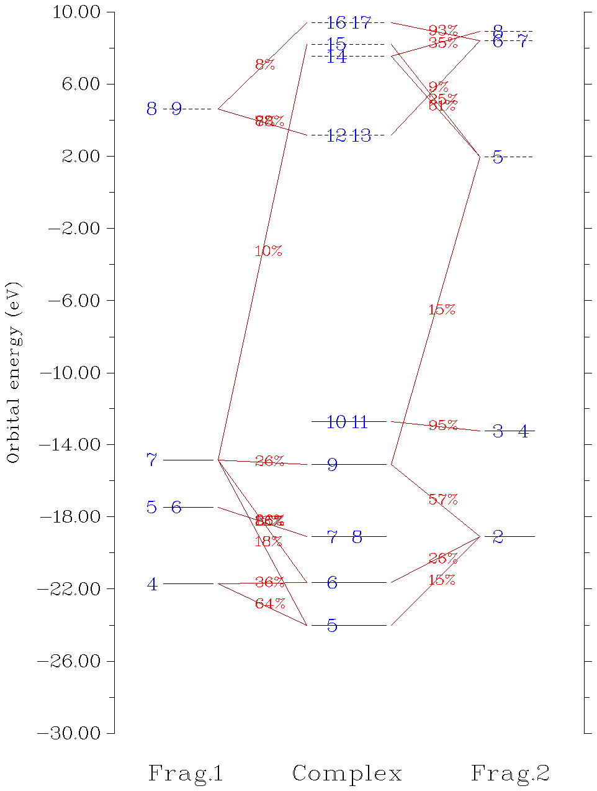

# **3.19 电荷分解分析与绘制轨道相互作用图 (16)**

## **3.19.1 理论**

由 Dapprich 和 Frenking 提出的电荷分解分析（charge decomposition analysis，CDA）（*J. Phys. Chem.*, **99**, 9352 (1995)）用于深入揭示复合物中各片段之间如何转移电荷以达到电荷平衡。CDA 的思想基于片段轨道（fragment orbital，FO），即片段处于孤立状态时的分子轨道（molecular orbital，MO）。此外，一旦得到了复合物分子轨道中片段轨道的组成，就可以直接绘制轨道相互作用图，从而直观地理解片段的轨道是如何混合形成复合物的轨道的。

为简单起见，本节假设复合物仅由两个片段组成。CDA 也可以直接用于多于两个片段的情形。

### **片段轨道**

考虑我们正在研究复合物 AB，片段 *A* 的原子上分布着$N_{A}$个基函数，片段 *B* 上分布着$N_{B}$个基函数，则复合物的每条分子轨道将由$N_{A}$+$N_{B}$个基函数线性展开，同时复合物具有$N_{A}$+$N_{B}$条分子轨道。若使用相同的基组，并保持与复合物中相同的几何构型，分别计算两个片段，可得到片段$N_{A}$的$N_{A}$条分子轨道和片段$N_{B}$的$N_{B}$条分子轨道，它们统称为片段轨道（FO）。我们可以把这些片段轨道作为基函数来线性展开复合物的分子轨道。由于维数（基函数数目）仍为$N_{A}$+$N_{B}$，该展开是精确的。换言之，我们等价地变换了基。

### **电荷分解分析**

在 CDA 的原始文献中，作者定义了三项：

$$
\begin{gathered}d_i=\sum_{m\in A}^{\mathrm{occ}}\sum_{n\in B}^{\mathrm{vir}}\eta_i C_{m,i}C_{n,i}S_{m,n}\\ b_i=\sum_{m\in A}^{\mathrm{vir}}\sum_{n\in B}^{\mathrm{occ}}\eta_i C_{m,i}C_{n,i}S_{m,n}\\ r_i=\sum_{m\in A}^{\mathrm{occ}}\sum_{n\in B}^{\mathrm{occ}}\eta_i C_{m,i}C_{n,i}S_{m,n}\end{gathered}
$$

其中 *i* 和 *η* 分别为复合物分子轨道的指标和占据数。$S_{m,n}=\int\varphi_m(\mathbf{r})\varphi_n(\mathbf{r})\mathrm{d}\mathbf{r}$为片段轨道 *m* 与片段轨道 *n* 之间的重叠积分。注意，虽然 *NA* 个和 *NB* 个片段轨道各自是正交归一的集合，但 *NA* 集合通常与 *NB* 集合不正交，因此 *S* 不是单位矩阵。$C_{m,i}$表示复合物分子轨道 *i* 中片段轨道 *m* 的系数。上标 "vir" 和 "occ" 分别表示虚（即未占据）和占据。

项$d_{i}$表示经由复合物的分子轨道 *i* 从片段 A 向片段 B 给予的电子量；类似地，项$b_{i}$表示从 B 向 A 回授的电子。事实上，*η$_{i}$ $C_{m,i}$ $C_{n,i}$ $S_{m,n}$* 可视为分子轨道 *i* 中片段轨道 *m* 与 *n* 之间重叠布居的一半。因此，*d* 项与 *b* 项的区别在于哪个片段将其占据片段轨道中的电子提供给另一片段的虚片段轨道。*r* 项揭示了位于不同片段的两个占据片段轨道之间的闭壳层相互作用；$r_{i}$为正值意味着由于分子轨道 *i*，两个片段的电子在其重叠区域累积，表现出成键特征，而负值则表示电子从重叠区域耗尽，从而反映电子排斥效应。所有$r_{i}$项之和通常为负，因为占据轨道之间的总体相互作用通常是排斥的。*r* 也被称为“排斥极化”项。

注意，尽管原始文献中给出的 CDA 公式是正确的，但经仔细检查数据，我发现原文示例中的 *d*、*b* 和 *r* 项是错误的（数据应除以二）。

### **CDA 的推广**

原始 CDA 定义有两个缺点。第一，它只适用于闭壳层情形（即复合物和每个片段都必须是闭壳层的），因此当两个片段以共价键结合时无法使用。第二，在 post-HF 计算中，虽然复合物的分子轨道可用自然轨道（natural orbital，NO）代替，但片段轨道只能由 HF 或 DFT 计算产生，因为原始 CDA 公式中没有显式考虑片段轨道的占据数。

为克服原始定义的局限，我在论文 *J. Adv. Phys. Chem.*, **4**, 111-124 (2015) (<http://dx.doi.org/10.12677/JAPC.2015.44013>) 中提出了广义形式的 CDA，这也是 Multiwfn 的 CDA 模块中所采用的形式：

$$
\begin{gathered}t_i=\sum_{m\in A}\sum_{n\in B}\eta_i\frac{\left|\eta_m^{\mathrm{FO}}-\eta_n^{\mathrm{FO}}\right|}{\eta_{\mathrm{ref}}}C_{m,i}C_{n,i}S_{m,n}\\ r_i=\sum_{m\in A}\sum_{n\in B}2\frac{\min(\eta_m^{\mathrm{FO}},\eta_n^{\mathrm{FO}})}{\eta_{\mathrm{ref}}}\eta_i C_{m,i}C_{n,i}S_{m,n}\end{gathered}
$$

在广义 CDA 中，复合物和片段的轨道既可由 HF/DFT 方法产生，也可由 post-HF 方法产生，分别对应分子轨道和自然轨道。${\eta}_{m}^{\mathrm{FO}}$表示片段轨道 *m* 的占据数。对于开壳层情形，*η*$_{ref}$为 1.0，CDA 将对 alpha 自旋和 beta 自旋分别进行；对于前者，*i* 表示复合物的 alpha 轨道，*m* 和 *n* 遍历所有 alpha 片段轨道；对于后者，*i* 表示复合物的 beta 轨道，*m* 和 *n* 遍历所有 beta 片段轨道。对于闭壳层情形，*η*$_{ref}$为 2.0，*m* 和 *n* 遍历空间轨道。min() 是用于取两个值中最小值的函数。在计算 *t* 时，若仅对${\eta}_{m}^{\mathrm{FO}}>{\eta}_{n}^{\mathrm{FO}}$的情形累加，则所得 *t* 即为 *d*；若仅对${\eta}_{m}^{\mathrm{FO}}<{\eta}_{n}^{\mathrm{FO}}$的情形累加，则 *t* 为 *b*。

对于原始 CDA 适用的情形，广义形式算得的 *b* 和 *d* 与按原始定义得到的结果完全相同；而 *r* 则恰为按原始定义所得结果的两倍。在广义形式的 *r* 中引入因子 2 的原因在于，这样 *r* 具有更明确的物理意义，即它等于两个片段中占据片段轨道之间的重叠布居（也称为 Mulliken 键级）。

由于 CDA 已被推广，下文中 FO 将表示片段的分子轨道或自然轨道，“复合物轨道”将表示复合物的分子轨道或自然轨道。这些轨道可以是自旋空间轨道（对于开壳层），也可以是空间轨道（对于闭壳层）。

显然，*d*、*b* 和 *r* 项可以分解为片段轨道对的贡献，Multiwfn 支持这种分解，这大大方便了对片段轨道相互作用本质的分析。

### **复合物轨道中片段轨道的组成与轨道相互作用图**

利用[3.10](sec-3-10-orbital-composition-analysis.md)节中讨论的方法，可以计算复合物轨道中片段轨道的组成。通常，Mulliken 方法是此用途的最佳选择，复合物轨道 *i* 中片段轨道 *m* 的组成按如下计算：

$$
\Theta_{m,i}=\left(C_{m,i}^2+\sum_{n\neq m}C_{m,i}C_{n,i}S_{m,n}\right)\times 100\%
$$

注意，由于 Mulliken 方法一个众所周知的缺点，有时会出现负贡献。由于负值通常不大，可直接视为零。此外，有时贡献可能略大于 100%，可直接视为 100%。

也支持用 SCPA 方法代替 Mulliken 方法计算组成，只需将 *settings.ini* 中的“iCDAcomp”改为 2。SCPA 相对于 Mulliken 的优点是组成永远不会超过 100%，且恒为正。但若 *i* 是高能虚轨道，算得的组成可能不太合理。

由 Θ 可清楚地了解每条复合物轨道是由两个片段的片段轨道如何混合形成的。进而可绘制轨道相互作用图，直观地研究复合物轨道与片段轨道之间的关系，即按能量为每条复合物轨道和片段轨道画一条线，再检查每个 Θ 以确定如何连接这些线，例如若 Θ$_{m}$$_{,}$$_{i}$的值大于 5%，则将片段轨道 *m* 与复合物轨道 *i* 对应的两条线相连。于是，从图中可直接知道片段轨道 *m* 对复合物轨道 *i* 有重要贡献。

### **扩展的电荷分解分析（ECDA）**

给予和回授电子总数之差，即 *d* - *b*，可视为净转移电子数。然而，在 *J. Am. Chem. Soc.*, **128**, 278 (2006) 中，作者认为这种观点不正确，因为 *b* 和 *d* 项不仅代表电荷转移效应（CT），还包含电子极化效应（PL）；后者描述复合物形成过程中因同一片段的虚片段轨道与占据片段轨道混合而导致的片段内部电子分布调整，在计算净转移电子数时应予排除。在该文中他们提出了扩展的电荷分解分析（extended charge decomposition analysis，ECDA）方法，认为用该方法能更合理地计算净转移电子数。

在 ECDA 观点下，可定义如下四项：

1.  PL(A) + CT(A→B) = 片段 A 的占据片段轨道在复合物所有虚轨道中的组成之和，乘以 *Occ*

2.  PL(A) + CT(B→A) = 片段 A 的虚片段轨道在复合物所有占据轨道中的组成之和，乘以 *Occ*

3.  PL(B) + CT(B→A) = 片段 B 的占据片段轨道在复合物所有虚轨道中的组成之和，乘以 *Occ*

4.  PL(B) + CT(A→B) = 片段 B 的虚片段轨道在复合物所有占据轨道中的组成之和，乘以 *Occ*

其中 *Occ* 对开壳层和闭壳层情形分别为 1.0 和 2.0。

算得这四项之后，从片段 A 向片段 B 的净转移电子数可直接得到：

$\mathrm{CT}(A\to B)-\mathrm{CT}(B\to A)=[\mathrm{PL}(A)+\mathrm{CT}(A\to B)]-[\mathrm{PL}(A)+\mathrm{CT}(B\to A)]$

复合物轨道的组成可用多种方法计算，导致不同的 ECDA 结果。Multiwfn 中使用的方法与 ECDA 原始文献中的方法相同，即 Mulliken 方法。

注意，ECDA 既不能用于 post-HF 计算，也不能用于由多于两个片段组成的体系。当用 SCPA 计算轨道组成时，也不能使用 ECDA。

从名称上看，ECDA 像是 CDA 的扩展，但在我个人看来，ECDA 与 CDA 并无关联，它们的基本思想很不相同，因此 ECDA 算得的净转移电子数与 CDA 给出的 *d* - *b* 完全不可比。此外，虽然 Multiwfn 实现了 ECDA，但我认为这不是一个有用的方法。CDA 最显著的特点是电子转移可分解为复合物轨道的贡献，而 ECDA 做不到这一点；ECDA 只能给出两个片段之间转移了多少电子，但这个量实际上可用更直接的方法得到，即把片段中所有原子的电荷加和得到片段电荷，再减去片段在孤立状态下的净电荷。

## **3.19.2 输入文件**

只要拥有包含复合物及所有片段基函数信息的文件，就可以进行 CDA 分析。如[2.5](sec-2-5-input-files-and-wavefunction-types.md)节所述，此时 .mwfn、.fch、.gms、.molden 可用作输入文件。

应注意对输入文件的以下要求：

- (1) 复合物和片段计算所用的方法和基组必须相同，否则结果毫无意义。例如，假设你要为一个过渡金属配合物准备 CDA 分析的输入文件，若复合物计算用了混合基组（例如金属用 Lanl2TZ、配体用 6-31G\*），则片段计算中金属片段必须用 Lanl2TZ，配体片段必须用 6-31G\*。

- (2) 各片段波函数文件中的坐标必须与复合物波函数文件中的坐标完全一致。

  > **注**
  >
  > 为保证这一点，最好先优化复合物（同时得到其波函数文件），然后直接从优化好的复合物几何构型中取出各片段的坐标，分别写成单点任务的输入文件（计算后即得到片段的波函数文件）。显然，绝不能优化片段，否则其坐标将与复合物的坐标不一致。

- (3) 片段与复合物中的原子顺序必须一致，也就是说，复合物中的实际原子顺序应能通过依次拼接片段 1、2、3……中的原子得到。

- (4) **尽量避免使用弥散函数！**根据我的经验，存在弥散基函数时，CDA 结果常常不合理，甚至完全没有意义。

"examples\CDA\COBH3_ORCA" 文件夹中包含 ORCA 3.0.1 生成的用于对 COBH₃ 体系进行 CDA 分析的示例 .molden 文件。

### **给 Gaussian 用户的特别说明**

Gaussian 用户应注意以下几点：

- 由于 Gaussian 会自动将体系置于标准取向，为满足上述要求 (2)，计算中应使用 *nosymm* 关键词以避免此处理。

- 若打算使用混合基组，特别是涉及 Pople 型基组（如 6-31G\*）时，最好在片段计算中指定 *5d* 关键词，强制 Gaussian 对 *d* 壳层使用球谐型基函数。

- 默认情况下，Gaussian 会自动删除线性相关的基函数，因此在某些情况下（通常是使用了弥散函数时），基函数数目与轨道数目不相等，此时无法进行 CDA。使用 *IOp(3/32=2)* 可避免此问题。

- 若复合物和片段计算采用了 post-HF 方法，需按[Chapter 4](4-tutorials-and-examples.md)开头所述步骤将自然轨道保存到 .fch 文件中。

单点任务的 Gaussian 输出文件也可用于 CDA 分析。所有情况下都必须使用 *nosymm pop=full*，复合物计算还应指定 *IOp(3/33=1)*。分子几何构型必须用笛卡尔坐标给出。若要在 post-HF 水平上进行 CDA 分析，对闭壳层和开壳层情形，不要用 *pop=full*，而分别用 *density pop=NO* 和 *density pop=NOAB*，以便输出自然轨道系数。

## **3.19.3 使用方法**

启动 Multiwfn 后，应先输入复合物文件的路径，再进入 CDA 模块。接着设置片段数目，然后依次输入每个片段文件的路径。

对于开壳层片段，程序会提示是否翻转其电子自旋。若选择 "y"，则其 alpha 与 beta 轨道的信息将互换。引入这一步的原因很清楚：例如，我们想用 CDA 分解 CH₃NH₂ 中片段 CH₃ 与 NH₂ 之间的电子转移；CH₃NH₂ 有 9 个 alpha 和 9 个 beta 电子。但在量子化学程序计算时，CH₃ 和 NH₂ 都会被视为各有 5 个 alpha 和 4 个 beta 电子。因此，为了进行 CDA，必须翻转 CH₃ 或 NH₂ 其中之一的电子自旋，否则两个片段的 alpha 与 beta 电子总数，即分别为 5+5=10 和 4+4=8，将与复合物的 9 和 9 不等。

加载完成后，Multiwfn 开始计算一些数据。若只定义了两个片段，将直接显示 CDA 和 ECDA 结果。然后会看到如下菜单：

**-3 设置选项 0 和 -1 中打印 CDA 结果的阈值**：在选项 0 中，只有对 *d*、*b* 或 *r* 项的贡献大于此选项指定阈值的复合物轨道才会被打印。此选项有助于在打印 CDA 结果时筛除不重要的复合物轨道。

**-2 切换输出目标（用于选项 0 和 1）**：默认情况下，选项 0 和 1 将结果输出到屏幕；若选择此选项一次，则它们的结果将输出到当前文件夹下的 *CDA.txt*。

**0 打印 CDA 结果和 ECDA 结果**：输入两个片段的指标（若总共只有两个片段则不需要），将输出它们之间的 CDA 和 ECDA 分析结果。

**1 打印完整 CDA 结果**：此选项仅当轨道为自然轨道（非整数占据数）时可用，将显示所有复合物轨道。相比之下，在选项 0 中，Multiwfn 不输出高于 LUNO+4 的复合物轨道的 CDA 结果，因为这类轨道数目通常很大，而由于其占据数通常很小，它们对 *d*、*b* 和 *r* 项的贡献通常完全可忽略。

**2 显示特定复合物轨道的片段轨道贡献**：若输入 *x*，将输出复合物轨道 *x* 的组成（对开壳层情形，将分别输出第 *x* 个 alpha 和第 *x* 个 beta 复合物轨道）。默认只显示贡献 ≥1% 的片段轨道，但此阈值可用 *settings.ini* 中的 "compthresCDA" 参数修改。

若要得到某片段轨道在所有复合物轨道中的组成，例如可输入 *1,6*，表示选中片段 1 的轨道 6。

**3 以片段轨道基导出复合物轨道的系数矩阵**：所有复合物轨道中所有片段轨道对应的系数矩阵将输出到当前文件夹下的 *coFO.txt*。

**4 导出片段轨道之间的重叠矩阵**：所有片段轨道之间的重叠矩阵将输出到当前文件夹下的 *ovlpint.txt*。

**6 分解复合物轨道对 CDA 的贡献**：需输入一条复合物轨道的指标并设置打印阈值，若一对片段轨道对此复合物轨道的 d、b、r 任一项的贡献大于阈值，则显示该贡献值。这大大方便了对片段轨道间相互作用的分析。

**5 绘制轨道相互作用图：**若选择此选项，将进入一个新菜单，可通过相应选项绘制并保存轨道相互作用图，以及调整绘图参数，如标签大小、能量范围（即 Y 轴范围）和连接线的判据。默认设置下绘制的轨道相互作用图如下所示：

在上图中，占据轨道和虚轨道分别用实线和虚线表示，纵坐标位置由其能量决定。左右两侧的线对应所选两个片段的片段轨道，中间的线对应复合物轨道。轨道指标用蓝色文字标注。若同一条线上出现两个或多个标注，说明这些轨道能量简并。若某片段轨道在某复合物轨道中的组成大于特定判据，则对应的两条线之间用红线连接，因此只需看图就能直接了解复合物轨道主要由哪些片段轨道混合构成。组成标注在线的中央。

默认绘制所有片段轨道和复合物分子轨道，若片段 A 或 B 的某片段轨道对某复合物分子轨道的贡献大于 10%，则将它们相连。对大体系，图中通常有太多线条和连线，难以据图辨认轨道相互作用模式。此时应恰当使用选项 "4 Set the rule for connecting and drawing orbital bars"，手动设置连接和绘制轨道线的规则。具体用法见屏幕上的提示。

有时轨道相互作用图中两个片段的轨道能量相差太大，不便分析，此时可能希望拉平它们的能量。这种情况下，可用选项 "12 Set orbital energy shifting value" 设置用于平移复合物或图中左右两侧两个片段轨道能量的数值；它们的轨道能量将增加给定值。

### **一些说明**

若复合物或任一片段为非限制开壳层体系，则 CDA 将对 alpha 和 beta 电子分别进行。

包含限制性开壳层波函数的文件也可用作 CDA 分析的输入文件，但 Multiwfn 处理这种情况的方式与闭壳层情形相同，因此由于 alpha 与 beta 轨道占据数不正确，CDA 数据完全错误，但轨道相互作用图仍可用。若想基于限制性开壳层波函数正确进行 CDA，以避免显式区分 alpha 与 beta 轨道，应在分析前手动将限制性开壳层波函数转换为等价的非限制开壳层波函数，例如见[4.16.4](sec-4-16-charge-decomposition-analysis-and-orbital-interaction-diagram.md#4164-基于限制性开壳层波函数的-cda-分析乙烷)节。

可以定义任意多个片段；但若定义了多于两个片段，则 ECDA 分析不可用。

若复合物或任一片段采用多组态方法（例如 MP2、double-hybrid functional）计算，则 ECDA 分析和轨道相互作用图不可用，因为自然轨道的轨道能量是未定义的。

CDA 的一些例子见[4.16](sec-4-16-charge-decomposition-analysis-and-orbital-interaction-diagram.md)节。
