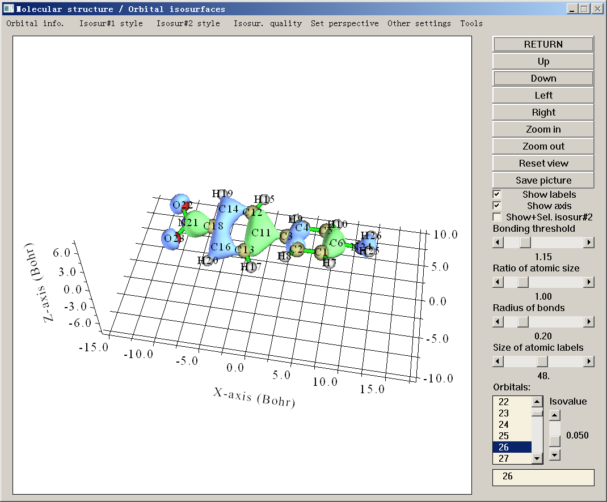

# **3.2 显示分子结构与查看轨道/等值面 (0)**

选择主功能 0 后，文本窗口会打印所有原子的信息以及特征轨道的基本信息（*例如* HOMO 与 LUMO 的编号、HOMO-LUMO 能隙），同时 GUI 窗口中会显示分子结构。如果输入文件包含轨道信息，可通过点击窗口右下角列表中相应的轨道编号，或在文本框中直接输入轨道编号来查看轨道，见下面的截图。如果输入文件为 .cub 或 .grd 格式，则可在此界面查看格点数据的等值面。

由于该 GUI 中的大多数控件都是自明的，这里只提及一些值得注意的事项。

## **改变视角**

- 鼠标拖拽操作：在绘图区域中，可用鼠标左键拖拽体系以自由旋转。按住 Ctrl 键并水平拖拽体系，可沿屏幕旋转；按住 Ctrl 键并垂直拖拽体系，可缩放体系。按住 Shift 键并拖拽体系，可平移。*Linux 用户请注意*：只有先单击一次绘图区域使图标变为手形之后，上述拖拽操作才可用。

- 其它操作：也可通过点击 GUI 右侧的 "Left"、"Right"、"Up"、"Down" 按钮旋转视角。在绘图区域滚动鼠标滚轮也可实现放大与缩小。

若要精确设定视角，还可通过菜单中 "Set view" 下拉列表里的 "Set rotation of viewpoint" 选项直接输入旋转角度，该列表中还有许多其它改变视角的选项。

## **改变绘制设置**

"Ratio of atomic size" 是指屏幕上显示的原子半径的四分之一与其范德华 (vdW) 半径之比，因此若将滑动条拖到 4.0，则显示的就是 vdW 表面。

体系结构有三种预定义的绘制风格，可通过菜单中 "Other settings" 下的“Use CPK style”、“Use vdW style”和“Use line style”激活其中一种。

Multiwfn 按经验距离判据判断两个原子是否成键：若两个原子之间的距离短于它们 CSD 共价半径之和的 1.15 倍，则认为它们成键。可通过拖拽 "Bonding threshold" 滑动条调整该判据。

> **注**
>
> 若输入文件包含连接信息，如 .mol 和 .mol2，则将直接按提供的连接关系显示化学键。

键、原子标签和原子球的颜色可分别通过 *settings.ini* 中的 "bondRGB"、"atmlabRGB" 和 "atmcolorfile" 参数设置，详见其中相应的注释。调整这些参数后，需要重启 Multiwfn 才能生效。也可通过 GUI 中“Other settings”-“Set atomic label color”直接改变原子标签颜色。

## **查看轨道**

点击 **"Orbital info."** 再选择相应选项，可在文本窗口打印基本的轨道信息。

右下角方框中列出了所有轨道编号，默认选择为“none”（不显示任何轨道）。若点击某个轨道编号，Multiwfn 会计算相应轨道波函数值的格点数据，随即出现该轨道的等值面。绿色与蓝色部分分别对应正值区与负值区。“Isovalue”滑动条控制等值面的等值。

出于效率考虑，默认的格点数据质量比较粗糙，格点数可通过 **"Isosur. quality"** 设置，数值越大等值面越光滑（注意调整该数值后，当前的等值面会被删除）。也可通过修改 *settings.ini* 中的“nprevorbgrid”设置默认的格点数。

对于非限制性波函数，alpha 与 beta 轨道是分开记录的。假设有 $N_{a}$ 个 alpha 轨道和 $N_{b}$ 个 beta 轨道，则轨道选择列表中的前 $N_{a}$ 个和后 $N_{b}$ 个轨道分别对应 alpha 与 beta 轨道。而在轨道选择框中，负编号对应 beta 轨道。例如，若输入 *-9*，则显示第 9 个 beta 轨道，轨道选择列表会自动切换到第 $N_{a}$ +9 项。

有时同时显示两个轨道很有用；例如分析两个 NBO 的相位重叠。这可通过 **"Show+Sel. Isosur#2"** (Sel.=Select) 复选框实现。该复选框默认未激活，一旦选定了一个轨道（其等值面将被称为等值面 \#1），该复选框即被激活。勾选该复选框后，新选轨道的等值面（将被称为等值面 \#2）会与之前所选轨道一起显示，黄绿色与紫色部分分别对应正值区与负值区。若取消勾选该复选框，等值面 \#2 会消失，之后若重新勾选，相同的等值面 \#2 会被重绘。

等值面 \#1 和 \#2 的表现风格可通过 **"Isosur. \#1"** 和 **"Isosur. \#2"** 下各自的子选项分别调整，可用风格包括实面（默认）、网格、点、实面+网格和透明面。（注意 Multiwfn 不能只把一个等值面绘制为透明面）。面以及网格/点的颜色也可通过相应的子选项设置，用户会被提示依次输入正值部分与负值部分的红、绿、蓝分量，分量应在 0.0 到 1.0 之间。例如，*1.0,0.0,0.0* 对应纯红，而 *1.0,1.0,0.0* 对应黄色。正值部分与负值部分的默认值可分别通过 *settings.ini* 中的 "isoRGB_same" 和 "isoRGB_oppo" 设置。透明面的不透明度也可自定义，有效范围为 0.0（完全透明）到 1.0（完全不透明）。

在显示轨道等值面之前，Multiwfn 先在内部建立一个方盒子，再计算均匀分布于盒子中各点处的轨道波函数值。建立盒子时的默认外延距离由 *settings.ini* 中的 "Aug3D" 参数控制。默认值对一般情形是合适且高效的；但在极少数情形（*例如* 可视化 Rydberg 轨道）下，可能需要手动增大外延距离，既可修改 Aug3D 以改变默认设置，也可选择“**Other settings**”-“**Set extension distance**”再输入数值，以修改本次的外延距离。

当轨道等值面绘制为实面时，极少数情形下绘制效果不太好，例如正负区域难以区分，此时可尝试通过选择“**Other settings**”-“**Set lighting**”调整光照设置，或适当旋转体系以避开该问题。

若想可视化所选轨道的概率密度而非其波函数，可选择“**Other settings**”-“**Choose plotting wavefunction or density**”，再选择“**Density**”。

## **“Tools”子菜单**

菜单栏 "Tools" 中有许多选项：

- Write settings to GUIsettings.ini：将可视化状态（*例如* 颜色、视角、分子表现形式、文字大小等）写入当前文件夹下的 *GUIsettings.ini*。若已定义 "Multiwfnpath" 环境变量，则 *GUIsettings.ini* 将写入该环境变量所定义的目录。

- Load settings from GUIsettings.ini：从当前文件夹下的 *GUIsettings.ini* 载入可视化状态，从而快速恢复之前的可视化状态。若已定义 "Multiwfnpath" 环境变量，Multiwfn 会先尝试从该环境变量所定义的目录载入此文件。

- Measure geometry：在方框中输入两个、三个和四个原子编号并按 ENTER 按钮，将返回键长、键角和二面角。

- Batch plotting orbitals：通过该工具可非常方便地将大量选定的轨道分别保存为当前文件夹下的图像文件，视频演示见 <https://youtu.be/SHwrQhqBHZ0>。

- Select fragment：选中该项并输入一个原子编号后，该原子所在的整个片段会被高亮显示，并返回该片段中所有原子的编号。当进行某些需要输入感兴趣片段中原子编号的分析时，这很有用。

- Get atom indices of a given element：输入元素名，程序将返回所有属于该元素的原子的编号。

- Print XYZ coordinates in Angstrom：所有原子的 X、Y、Z 坐标（以 Å 为单位）将显示在控制台窗口。

- Print fractional coordinates：将显示所有原子的分数坐标。该选项仅在存在晶胞信息时可用。

- Export all internal coordinates：该选项将当前体系的所有键、角和二面角导出到当前文件夹下的 *int_coord.txt*。若想在无 GUI 版 Multiwfn 中使用此功能，进入主菜单后可输入 *geomparm*，则所有内坐标可导出到指定文件。

主功能 0 的更多功能和使用说明见第 [4.0](sec-4-0-view-orbitals-and-structure.md) 节。

> **所需信息**
>
> GTFs（仅查看轨道时需要）、原子坐标、格点数据（仅查看格点数据等值面时需要）
