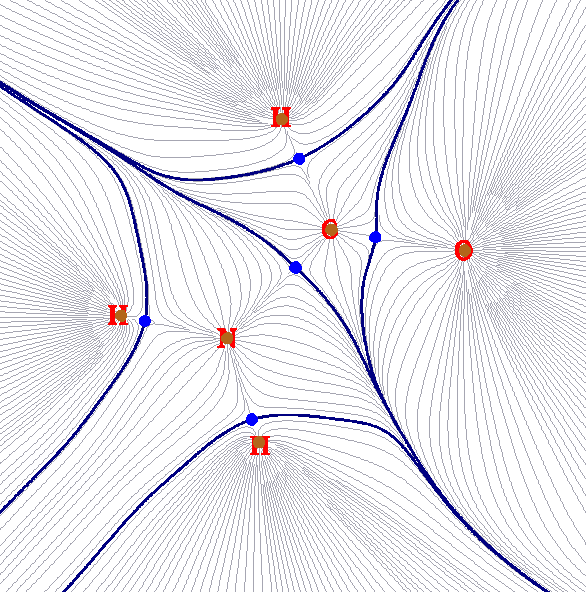
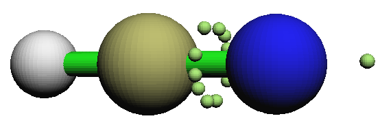
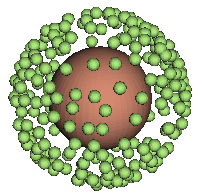
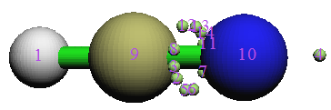
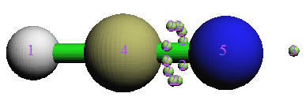
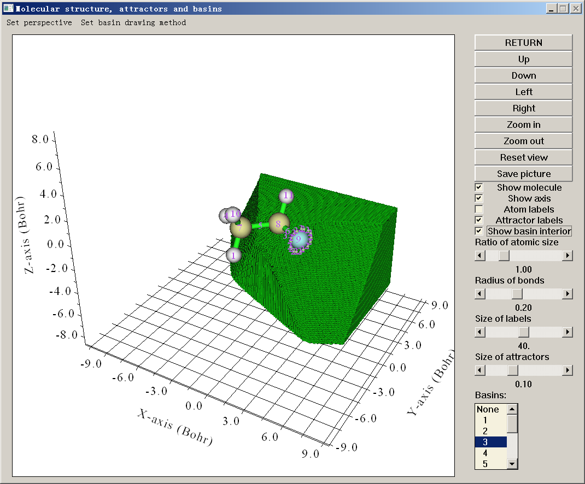

# **3.20 Basin 分析 (17)**

## **3.20.1 理论**

Basin（盆）的概念最早由 Bader 在其分子中的原子 (AIM, atom in molecular) 理论中引入，之后 Savin 和 Silvi 将该概念移植到 ELF 分析中。事实上，basin 可对任何实空间函数定义，如分子轨道、电子密度差、静电势乃至 Fukui 函数。

实空间函数一般有一个或多个极大值，称为吸引子 (attractor) 或 (3,-3) 临界点。每个 basin 是整个空间的一个子空间，且唯一包含一个吸引子。Basin 之间由 interbasin 面分隔，本质上是实空间函数的零通量面；数学上，这类面由满足 $\mathrm{\nabla }f\left( \mathbf{r} \right)\cdot \mathbf{n}\left( \mathbf{r} \right)=0$ 的所有点 {**r**} 组成，其中 **n**(**r**) 代表位置 **r** 处面的单位法向量。

下图展示了 NH₂COH 总电子密度的 basin，这类图常出现在 AIM 分析中。棕色点是吸引子；此时它们对应总电子密度的极大值，因而非常靠近原子核。蓝色粗线对应 interbasin 面，把整个分子空间切分为 basin，在当前情形也称为 AIM 原子空间或 AIM basin。灰色线是总电子密度的梯度路径，从吸引子发出。

Multiwfn 能对任何支持的实空间函数生成 basin，如电子密度、ELF、LOL、静电势。或者，也可让 Multiwfn 载入第三方程序生成的格点文件（*例如* cube 文件或 .grd 文件），再对格点数据中记录的实空间函数生成 basin。

生成 basin 后，可进行基于 basin 的分析以提取感兴趣的化学信息。Multiwfn 支持三种最有用的 basin 分析，简介如下。它们都需要在 basin 内做积分。

(1) 研究实空间函数在 basin 中的积分。例如，可先用电子密度定义 basin，再在 basin 中积分电子密度以得到 basin 中的电子布居数；该量称为 AIM 原子布居数。再如，可先按 ELF 函数把空间划分为 basin，再计算自旋密度在 basin 中的积分。

(2) 研究 basin 中的电多极矩。在 Multiwfn 中可计算 basin 中的电单极、偶极和四极矩。这对深入定量理解电子在体系不同区域如何分布非常有用。基于这些数据，可清楚理解诸如孤对电子如何贡献分子偶极矩（见 *J. Comput. Chem.*, **29**, 1440 (2008) 中的例子，其中用了 ELF basin）、当另一分子接近时原子周围电子密度如何极化。

(3) 研究 basin 中的定域化指数和离域化指数。前者度量平均有多少电子定域在一个 basin 中，后者定量度量两个 basin 之间离域（或说共享）的电子数。它们已在第 [3.18.5](sec-3-18-fuzzy-atomic-space-analysis.md#3185-定域化指数-li与离域化指数-di-4-44) 节详细介绍过，此处不再赘述。相对于第 [3.18.5](sec-3-18-fuzzy-atomic-space-analysis.md#3185-定域化指数-li与离域化指数-di-4-44) 节的唯一区别是，当前考虑的积分范围是 basin 而非模糊原子空间。

## **3.20.2 数值方面**

本节将描述 basin 分析中涉及的许多数值方面，以便你理解 Multiwfn 的 basin 分析模块如何工作。

### **生成 basin 的算法**

用于生成/积分 basin 的算法可分为三类：

- (1) 解析方法。由于 AIM 理论的流行和重要，以及 AIM basin 形状复杂，很久以前就提出了许多方法试图加快 AIM basin 的积分效率、提高积分精度，*例如* *J. Comput. Chem.*, **21**, 1040 (2000) 和 *J. Phys. Chem. A*, **115**, 13169 (2011)。所有这些方法都是解析的，几乎所有老的或经典的 AIM 程序都采用它们，如 AIMPAC、AIM2000、Morphy 和 AIMAll。这类方法有许多严重缺点：1. 算法非常复杂 2. 计算代价高 3. 只适用于总电子密度分析 4. 生成 basin 之前必须先用某种方式定位 (3,-3) 和 (3,-1) 临界点。这类方法的唯一优点是积分精度非常令人满意。

- (2) 基于格点的方法。这类方法依赖立方（或矩形）格点数据。自旨在分析 ELF basin、首次使用基于格点方法的 TopMoD 程序发表以来，基于格点的方法不断被提出并受到越来越多关注。基于格点的方法解决了所有解析方法的缺点；它们易于编码，计算代价相对较低，更重要的是适用于任何类型的实空间函数。不幸的是，这些方法并非没有缺点，核心缺点是积分精度高度依赖格点数据质量；要获得高精度的积分值，格点间距必须足够小。

- (3) 解析与基于格点混合的方法。这类方法唯一的实例见 *J. Comput. Chem.,* **30**, 1082 (2009)，其中用 Becke 多中心积分方案积分 basin。该方法比解析方法快，比基于格点的方法准，但只适合分析总电子密度，应用范围严重受限。由于 Multiwfn 的 basin 分析模块注重通用性，目前未实现该方法。

目前最好的基于格点的方法是 near-grid 方法 (*J. Phys.: Condens. Matter*, **21**, 084204 (2009))，Multiwfn 采用它作为生成 basin 的默认方法。Multiwfn 也支持 on-grid 方法 (*Comput .Mat. Sci.*, **36**, 354 (2006))，它是 near-grid 方法的前身。

### **Multiwfn 中生成 basin 与定位吸引子的基本步骤**

在 Multiwfn 中，生成 basin 与定位吸引子同时进行；基本过程概括如下：给定格点数据，依次遍历所有格点（盒子边界上的格点除外）。从每个格点出发，沿最大梯度方向连续演化一条轨迹。每步移动限制在其相邻格点内，每个格点处的梯度通过它与其相邻格点的函数值用单向有限差分计算。当前轨迹的演化在四种情形下终止并转入下一个格点：(a) 轨迹到达一个格点，其中所有方向的梯度都等于或小于零；该格点将被视为吸引子，同时轨迹中包含的所有格点都被归属到该吸引子。(b) 轨迹到达一个已被归属的格点；轨迹中包含的所有格点都被归属到同一吸引子。该处理大大降低了计算开销。(c) 达到步数上限。(d) 轨迹到达盒子边界上的格点；轨迹中的所有格点都被标记为“travelled to boundary”状态。

遍历完所有格点后，就得到了格点数据空间范围覆盖的所有吸引子的位置。归属到同一吸引子的每组格点共同构成该吸引子对应的 basin。然后按“任一相邻格点属于不同吸引子”的判据检测 interbasin 格点。注意有时上述过程结束后，一些格点可能仍未被归属，一些格点可能处于“travelled to boundary”状态。这类格点常远离原子而不重要，一般可放心忽略。

on-grid 方法与 near-grid 方法的唯一区别是，后者引入了所谓“correction step”，不断校准轨迹的演化方向，大大消除了 on-grid 方法导致的 interbasin 面的人为性问题，进而使 basin 积分更接近真实值。near-grid 方法在最后阶段还可辅以 interbasin 面的精修步骤，使 basin 划分更准确，该附加步骤不太耗时。

对 ELF（或许还有其它实空间函数），若体系中存在球形或环形吸引子，在相应区域会找到大量函数值基本相同的吸引子。下面两个例子分别展示了环绕 HCN 的 N-C 键的环形 ELF 吸引子和包围 Ar 原子的球形 ELF 吸引子的存在。

 

基于最近邻算法，Multiwfn 自动检查所有已定位吸引子对之间的距离和相对值差，再把一些吸引子聚到一起。所得吸引子因而有多个成员吸引子，后文称为“简并吸引子”。例如下面左右两图分别显示了聚类前后的吸引子编号。可见聚类后，构成环形 ELF 吸引子的所有吸引子有了相同编号，表明相应的 basin 已合并为 basin \#2。

 

对某些情形，在远离体系的区域会定位到一些人为的或物理上无意义的吸引子。这些吸引子的函数值很低，故称为“insignificant”吸引子；相对地，其它吸引子可称为“significant”吸引子。出现 insignificant 吸引子是因为相应区域函数值很小，函数行为不很确定，即使函数值的微小涨落或 trivial 的数值扰动也足以产生新吸引子。当检测到 insignificant 吸引子时，Multiwfn 会提示你选择如何处理，有三个选项：(1) 什么都不做，即不移除这些吸引子。(2) 移除这些吸引子，同时把相应的格点设为未归属格点。(3) 移除这些吸引子，同时把相应的格点归属到最近的 significant 吸引子。一般推荐第三个选项。

若实空间函数同时有正值和负值部分，*例如* 静电势，Multiwfn 会自动反转格点数据负值部分的符号，再照常定位吸引子并生成 basin，之后恢复符号。因此对负值部分，Multiwfn 定位的“吸引子”实际是“排斥子”。

若发现格点数据处处非负，而你想定位其极小值（排斥子）而非极大值（吸引子），可在 basin 分析模块的选项“-1 Select the method for generating basins”中选择相应的子选项以切换定位对象，或把 *settings.ini* 中的 "ibasinlocmin" 参数设为 1。之后报告的吸引子对应排斥子。该功能对定位 RDG 和 IRI 的极小值很有用，它们在揭示相互作用中有独特价值。

### **Basin 的积分**

用基于格点的方法生成 basin 后，实空间函数 *f* 在 basin *P* 中的积分可直接计算为 $F=\sum_{i\in P} f({\mathbf{r}}_i)\times \mathrm{d}V$，其中 *i* 是格点编号，d*V* 是体积微元。显然，所用格点数据越精细（格点间距越小），积分值越准确，相应地必须付出更多计算 effort。

由于格点的排布一般与体系对称性不一致，不应期望积分值总是很好满足体系对称性，除非用很精细的格点。

注意不同函数对格点数据质量的要求不同。格点间距相同时，函数变化越快，积分精度越低。由于电子密度的 Laplacian、source function 和动能密度函数等在核附近剧烈涨落，仅用基于格点的方法（因为只用均匀格点，不能很好描述核区）不可能以满意精度直接在 AIM basin 中积分这些函数。为解决该困难，我提出并在 Multiwfn 中支持了一种基于原子中心格点与均匀格点混合的积分方法，其中靠近核的区域用原子中心格点积分，其它区域用均匀格点积分。该方法能对任何实空间函数积分 AIM basin，包括行为复杂的函数，以可接受的精度且相对基于格点的方法无明显的额外计算代价。为进一步提高 AIM basin 的积分精度，Multiwfn 还允许精确精修 basin 边界上格点的归属。从每个边界格点发出一条精确的最速上升轨迹，到达吸引子时终止。由于边界格点数常很大，且每步最速上升都要计算一次电子密度梯度，该过程耗时。在 Multiwfn 中这些梯度也可用基于预计算梯度格点数据的三线性插值近似计算，可节省 AIM basin 积分总耗时的大约 1/3\~1/2。注意若采用原子中心与均匀混合型格点，特别是同时开启边界 basin 精确精修过程时，对格点质量的要求会明显降低，一般在“中等质量格点”（格点间距 = 0.1 Bohr）水平即可得到准确结果。

值得注意的是，尽管 Multiwfn 的 basin 分析模块可用于获取吸引子位置，但精度直接受格点数据质量限制，因为吸引子会被定位在格点上。而且该模块不能用于搜索其它类型的临界点（吸引子对应 (3,-3) 型临界点）；因此，若想得到所有类型临界点的准确坐标和数值，应使用主功能 2，即拓扑分析功能。

## **3.20.3 用法**

Multiwfn 中的 basin 分析模块非常强大、快速且灵活。可对任何实空间函数生成并可视化 basin，同时可在生成的 basin 中积分任何实空间函数。可计算 basin 中的电多极矩与定域化指数以及 basin 间的离域化指数。

### **基本步骤**

在 Multiwfn 中做 basin 分析，需要做五个基本步骤

- (1) 把输入文件载入 Multiwfn，再进入主功能 17。

- (2) 选择选项 1 生成 basin 并定位吸引子。在此之前，可通过选项 -1 改变生成 basin 的方法，或通过选项 -6 调整聚类吸引子的参数。

- (3) 用选项 0 可视化吸引子和 basin。该步可选。

- (4) 做你想要的分析。生成 basin 中实空间函数的积分、basin 中的电多极矩和 basin 的定域化/离域化指数可分别用选项 2（或 7）、3（或 8）和 4 计算。

可用选项 -5 把生成的 basin 导出为 cube 文件，用选项 -4 把吸引子导出为 .pdb 文件，用选项 -3 查看已定位吸引子的坐标，用选项 -2 测量吸引子或原子之间的距离、夹角和二面角。也可用选项 -6 中的子选项 3 把指定的 basin 手动合并为一个。若想对其它实空间函数或在新设置下重新生成 basin 并定位吸引子，可再次选择选项 1。

### **关于输入文件和格点数据**

生成 basin 之前必须先获得格点数据。在 basin 分析模块的选项 1 中，可让 Multiwfn 计算格点数据。但若内存中已存有格点数据，可直接选择使用它。内存中存有格点数据有两种情形：(1) 输入文件包含格点数据，*例如* .cub 和 .grd 文件 (2) 在进入主功能 17 之前已用主功能 5 或 13 计算过格点数据。该设计使 Multiwfn 相当灵活：可用 Multiwfn 对记录在 .cub 或 .grd 文件中的实空间函数生成 basin，该文件可能由第三方程序输出；也可先用主功能 5 或 17 对电子密度差、Fukui 函数、dual descriptor 等生成格点数据，再对它们生成 basin。

在 basin 积分功能即选项 2 中，每个格点处被积函数的值必须已知才能计算积分。这些值可来自三种途径，可任选其一：(1) 让 Multiwfn 直接计算。(2) 载入并使用*例如* .cub 文件中的格点数据，注意该操作不会覆盖内存中已存的格点数据。(3) 使用内存中已存的格点数据。注意内存中的格点数据或格点数据文件中的格点数据的格点设置必须与生成 basin 所用格点数据的格点设置严格一致，否则积分无意义。

注意若已让 Multiwfn 对实空间函数计算了格点数据，则该格点数据会存于内存中，因而在 basin 积分步骤可直接使用它。

### **可视化**

在选项 0 中可可视化吸引子和 basin，例如

大多数按钮都是自明的，请随意尝试。可在右下角 basin 列表中选择相应编号绘制 basin。默认只显示 basin 边界上的格点。若想绘制整个 basin 区域，应勾选 "Show basin interior" 复选框。若只想可视化 basin 中被 $\rho$ = 0.001 a.u. 等值面包围的区域（vdW 表面的常用定义），应选择 "Set basin drawing method" - "rho>0.001 region only"。

在 basin 列表末尾，"Unas" 项指 basin 生成中的未归属格点，而 "Boun" 项对应跑到盒子边界的格点，可选择它们以绘制相应的格点。有些 basin 很小且非常靠近原子核，如 ELF 的芯型 basin，它们常被分子结构遮挡；若想查看这些 basin，应取消勾选 "Show molecule" 复选框。

浅绿色球表示吸引子，相应的 basin 着为绿色。若实空间函数同时有正值和负值部分，负值区中的“吸引子”（实际是排斥子）显示为浅蓝色球，相应的 basin 绘制为蓝色。

若一组吸引子已被聚类为一个，虽然它们都会显示在 GUI 中，但其上方显示的编号标签相同，即相应简并吸引子的编号。

用选项 1 定位吸引子后，若用主功能 5 或 13 的 GUI 可视化等值面，也能看到吸引子及其标签。该设计便于对吸引子和等值面做比较研究。

### **各选项细节**

下面描述 basin 分析模块涉及的所有选项；有些选项上文已部分讨论过。

**♦ -6** 该选项控制吸引子聚类所用的参数：若子选项 1 和 2 中的参数分别设为 A 和 B，意味着对任意两个吸引子，若它们之间的相对值差小于 A，同时间距小于 B\**sqrt*( $d_{x}^{2}$ + $d_{y}^{2}$ + $d_{z}^{2}$ )，其中 $d_{x}$、$d_{y}$、$d_{z}$ 是 X、Y、Z 方向的格点间距，则它们会被聚到一起。若想取消生成 basin 后的自动聚类步骤，只需把子选项 2 中的参数设为 0。

生成 basin 后，也可用子选项 3 手动聚类指定的吸引子。

**♦ -45** 导出吸引子信息和当前格点数据的 cube 文件：该选项在已生成吸引子和 basin 时可用。通过该选项可把吸引子和 basin 信息导出为当前文件夹下的 *basinana.txt*，把当前格点数据导出为当前文件夹下的 *basinana.cub*。下次做相同的 basin 分析时，在选择选项 1 尝试生成 basin 后，若在当前文件夹发现这两个文件，Multiwfn 会询问是否直接载入；若选 *y*，吸引子&basin 信息以及格点数据都会被载入，从而完全避免重新生成的开销。

**♦ -5** 把 basin 导出为 cube 文件：若输入 basin 编号，所选 basin 将输出到当前文件夹下的 *basinXXXX.cub* 文件，其中 XXXX 是 basin 编号。通过该选项，可用 VMD 等其它可视化软件以等值 0.5 的等值面图渲染 basin，详见第 [4.17](sec-4-17-basin-analysis.md) 节某些例子中的相应描述和插图。

在该选项中也可输入 *a*，则所有 basin 被集体导出到当前文件夹下的 *basin.cub*，其中格点值对应格点所属 basin 的编号。

该选项中还有一个特殊模式，输入 *b* 进入，主要用于在 VMD 中绘制 ELF 或 LOL 的按 basin 类型着色的等值面图，见第 [4.17.10](sec-4-17-basin-analysis.md#41710-绘制按流域类型着色的-elf-等值面图) 节的插图。

在该选项中也可输入 *c* 再输入 basin 编号，则特定 basin 区域内函数值的格点数据被导出到当前文件夹下的 *basinsel.cub*，借此可只对所选 basin 可视化等值面。见第 [4.17.10](sec-4-17-basin-analysis.md#41710-绘制按流域类型着色的-elf-等值面图) 节使用该选项的例子。

**♦ -4** 把吸引子导出为 pdb/pqr/txt/gjf 文件：通过该选项，可把找到的所有吸引子导出为以下文件之一：

- *attractors.pdb*：该文件中原子编号对应聚类前的吸引子编号，而残基编号对应聚类后的吸引子编号。

- *attractors.pqr*：与 pdb 相同，但该文件中的“charge”列对应吸引子处的函数值

- *attractors.txt*：每行包含一个吸引子的 X、Y、Z 坐标（Bohr）和函数值

- *attractors.gjf*：Gaussian 输入文件，真实原子定义为高层，吸引子记录为中层幽灵原子 (Bq)。可载入 GaussView 以方便可视化吸引子。为使吸引子的图形效果满意，建议选择 "File"-"Preference"-"Display Format"-"Molecule"，并把低层设为 "Tube"。还建议关闭原子标签显示。

**♦ -3** 显示吸引子信息：所有吸引子的坐标和数值将输出到屏幕。对简并吸引子，显示的坐标和数值是其成员吸引子的平均值，所有成员吸引子的坐标和数值也会分别显示在屏幕上。该选项还会询问是否按值从最负到最正排序后打印吸引子信息。

**♦ -2** 测量吸引子或原子之间的距离、夹角和二面角：如题所示。请按屏幕提示操作。

**♦ -1** 选择生成 basin 的方法：在该选项中，可选择定位哪种极值（极小或极大），也可选择划分 basin 的算法，支持三种算法：(1) on-grid 方法 (2) near-grid 方法 (3) 带边界精修步骤的 near-grid 方法。注意 Multiwfn 中的 near-grid 方法经我改动过，因而更稳健。一般推荐 (3)，它也是默认的。

**♦ 0** 可视化吸引子和 basin：该选项上文已介绍过。

**♦ 1** 生成 basin 并定位吸引子：选择实空间函数，再选择格点设置，然后 Multiwfn 计算格点数据，再生成 basin 同时定位吸引子。之后如前所述，若有些吸引子值相近且位置靠近，会被自动聚类。若内存中已存有一套格点数据，可直接选择使用该格点数据以避免计算新格点数据。可反复用该选项重新生成 basin。

Multiwfn 提供了很多定义格点设置的方式。若想研究整个体系的 basin，一般对定性分析推荐“中等质量格点”；而若想获得更高的积分精度，一般推荐“高质量格点”。若只需研究整个体系中局域区域的 basin，可使格点数据的空间范围只覆盖该区域；为此建议用“Input center coordinate, grid spacing and box length”选项，可方便定义格点数据的空间范围。

**♦ 2** 在 basin 中积分实空间函数：选择实空间函数，或选择内存中的格点数据，或选用外部 .cub/.grd 文件，则所选实空间函数或格点数据中记录的实空间函数将在选项 1 已生成的 basin 中积分，输出每个 basin 中的积分和 basin 体积。若有些未归属格点或跑到盒子边界的格点，它们的积分也会显示。

若分析的是 AIM basin，强烈推荐改用选项 7 以获得好得多的积分精度。

**♦ 3** 计算 basin 的电偶极与多极矩以及 $\langle r^{2}\rangle$：请参阅第 [3.18.3](sec-3-18-fuzzy-atomic-space-analysis.md#3183-原子与分子多极矩及--2) 节。相对于第 [3.18.3](sec-3-18-fuzzy-atomic-space-analysis.md#3183-原子与分子多极矩及--2) 节的区别是，积分的空间范围限于各自 basin 而非模糊原子空间，核位置换为吸引子位置。多极矩输出到四极矩，更高的八极矩及以上不计算，因为基于格点积分难以准确计算它们。

若研究的 basin 是 AIM basin，强烈推荐改用选项 8 以获得好得多的积分精度。

**♦ 4** 计算 basin 的定域化指数 (LI) 和离域化指数 (DI)：请参阅第 [3.18.5](sec-3-18-fuzzy-atomic-space-analysis.md#3185-定域化指数-li与离域化指数-di-4-44) 节。相对于第 [3.18.5](sec-3-18-fuzzy-atomic-space-analysis.md#3185-定域化指数-li与离域化指数-di-4-44) 节的唯一区别是，当前考虑的积分范围是 basin 而非模糊原子空间。

> **注**
>
> 注意该选项、选项 5 和选项 6 都涉及 basin 重叠矩阵 (BOM)。若用电子密度定义 basin，即 basin 是 AIM basin，Multiwfn 会让你选择计算 BOM 所用的积分格点类型，一般应选混合型格点，因为其结果优于均匀格点，特别是涉及芯 MO 的 BOM 矩阵元，因为它们在核附近剧烈变化。

**♦ 5** 计算并输出所有 basin 中的轨道重叠矩阵（也称 basin 重叠矩阵，BOM）到当前文件夹下的 *BOM.txt*：basin *K* 的 BOM 的 (*i*,*j*) 元定义为 $S_{ij}\left(K\right)=\int_{\Omega_K}\varphi_i\left(\mathbf{r}\right)\varphi_j\left(\mathbf{r}\right)\mathrm{d}\mathbf{r}$，其中 $\Omega$ *$_{K}$* 表示 basin *K* 的区域，$\varphi$ *$_{i}$* 对应占据分子轨道 *i*。不考虑所有虚轨道。

*下面介绍的选项 6\~9 仅在用于定义 basin 的实空间函数是电子密度时才在菜单中可见*

**♦ 6** 计算并输出所有原子中的轨道重叠矩阵（也称原子重叠矩阵，AOM）到当前文件夹下的 *AOM.txt*：定义与 BOM 完全相同，唯一区别是用原子编号代替 basin 编号。注意对应非核吸引子的 basin 不输出。

**♦ 7** 用混合型格点在 AIM basin 中积分实空间函数：该选项专门用于积分 AIM basin；有三种不同的实现方式：

> **提示**
>
> 精度：(2)≥(3)$\gg$(1)。耗时：(2)$>$(3)$\gg$(1)。内存需求：(3)$>$(2)=(1)

- **(1)** 用原子中心+均匀格点积分特定函数：原子中心格点主要用于积分核附近的实空间函数，均匀格点主要用于其它区域。精度远好于只用均匀格点（即 basin 分析模块的选项 2）。

- **(2)** 与 (1) 相同，但对 basin 边界做精确精修：相对选项 (2)，在积分 basin 边界上格点时，这些格点的归属会用最速上升方案精确精修，因而结果比用选项 (1) 更准确，不幸的是精修步骤耗时。

- **(3)** 与 (2) 相同，但对 basin 边界做近似精修：这是选项 (2) 的近似版本。精修步骤用的电子密度梯度不精确计算，而是由预计算的梯度格点数据三线性插值得到。虽然计算梯度的格点数据也耗时，但总耗时低于选项 (2)，精度损失微不足道。

用选项 (2) 或 (3) 一次后，边界格点的归属会被永久更新，意味着之后若用选项 (1)，结果与 (2) 或 (3) 完全相同。

随积分一起输出的不仅有 basin 体积，还有电子密度 $>$ 0.001 的 basin 体积，可视为原子尺寸。

**♦ 8** 用混合型格点计算 AIM basin 中的电偶极与多极矩：与选项 3 类似，但用原子中心与均匀混合格点计算电多极矩，以无明显额外计算代价获得更好精度。该选项只适用于 AIM basin。

计算后会询问是否同时把结果写入 *multipole.txt*。若选 *y*，当前文件夹下还会产生名为 *atom_moment.txt* 的文件。基于该文件，可通过特殊脚本在 VMD 程序中可视化原子电偶极和四极矩，详见第 [4.15.5](sec-4-15-fuzzy-atomic-space-analysis.md#4155-可视化原子电偶极矩和四极矩) 节。

> **注**
>
> 用选项 7 和 8 时，若对某原子用了有效芯势 (ECP) 同时又没允许 Multiwfn 补充 EDF 信息（见 *settings.ini* 中的 "isupplyEDF" 参数），则该原子的价区会出现许多吸引子；因此在进入选项 7 和 8 之前，必须用选项 -6 中的子选项 3 把这些吸引子手动聚为一个。

**♦ 9** 求外部 basin 布居的原子贡献：外部 basin 指当前文件夹下名为 *basin.cub* 的 cube 文件定义的 basin，其中格点值对应 basin 编号。该选项旨在基于 AIM 划分求 ELF 键 basin（或其它类型 basin）布居的原子贡献。例子见第 [4.17.7](sec-4-17-basin-analysis.md#4177-计算-elf-流域布居数的原子贡献) 节。

**♦ 10** 计算高 ELF 定域域布居和体积 (HELP, HELV)：该选项用于计算 HELP 和 HELV，它们定义于 *ChemPhysChem*, **14**, 3714 (2013) 以表征孤对电子。该选项仅在用于划分 basin 的实空间函数是 ELF 时出现。用该选项计算 HELP 和 HELV 的例子见第 [4.17.8](sec-4-17-basin-analysis.md#4178-计算高-elf-定域域布居数和体积-helphelv) 节。

**♦ 11** 计算各 basin 对轨道组成的贡献：通过该选项，可计算 AIM basin 或其它类型 basin（如 ELF basin）对特定轨道的贡献。例子见第 [4.8.6](sec-4-8-molecular-orbital-composition-analysis.md#486-计算aim盆及其他类型盆贡献的轨道组成) 节。

**♦ 12** 指定 ELF basin 标签：当用于生成 basin 的实空间函数是 ELF 时，该选项用于自动指定所有 basin 的标签，basin 体积和布居也一起打印。指定标签的例子：C(F2)、V(O3)、V(S5,F7)、V(Li1,Li2,Li3)。标签输出两次，第一次按 basin 编号输出数据，第二次按排序后的 basin 标签输出数据。例子见第 [4.17.2](sec-4-17-basin-analysis.md#4172-elf-流域分析例子) 节。

> **注**
>
> ELF basin 标签自动指定的算法细节：
>
> 先指定芯 basin。若 ELF 吸引子与核的距离小于阈值，则相应 basin 被指定为芯型。阈值距离是内置的，对不同元素不同。对某元素，阈值定为基于高质量基态原子波函数的球平均 ELF 径向曲线最外层极小的位置。内置阈值已对 H\~Lr 确定，因此若体系含比 Lr 更重的元素，则该选项不能用，即必须通过可视化吸引子位置和/或 basin 空间范围手动确定标签。
>
> 之后，其它所有 basin 都标为价型。若某吸引子的任一格点与芯 basin 的格点相邻，则该芯 basin 对应的原子被加入该吸引子的成员列表。假设某吸引子最终成员为 C1 和 O2，则其标签为 V(C1,O2)。H 和 Ne 比较特殊，若吸引子与 H 或 Ne 核的距离小于 0.2 Bohr，则该原子被加入成员列表。
>
> 注意对用赝势的元素不能正确指定 basin 标签，因为此时无法指定芯 basin。

对选项 3、4、5、7 和 8，若所用输入文件不含 GTF 信息（*例如* 用 .cub 文件作输入文件并直接用其携带的格点数据生成 basin），则 Multiwfn 会提示输入一个新文件，该文件应含当前体系的 GTF 信息，例如可用 mwfn/.wfn/.wfx/.fch/.molden/.gms 作输入。

本模块的许多例子见第 [4.18](sec-4-18-electron-excitation-analysis.md) 节。

> **所需信息**
>
> GTFs 或从外部文件载入的格点数据（*例如* .cub）、原子坐标
