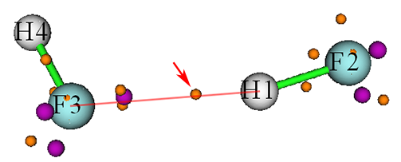
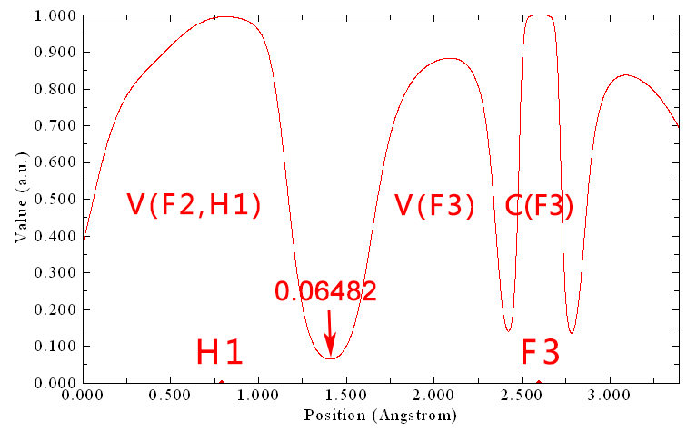
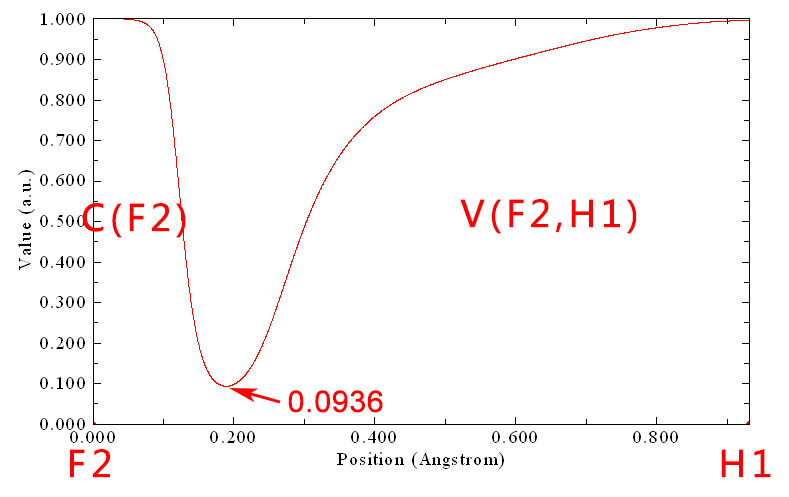
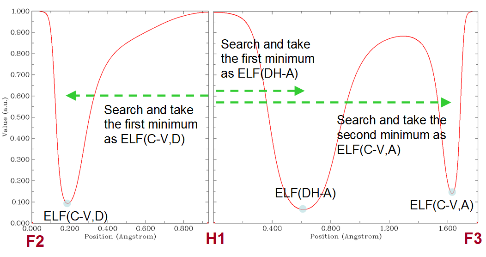
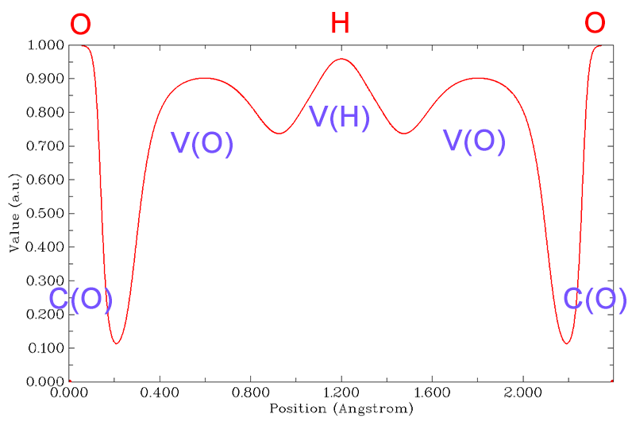
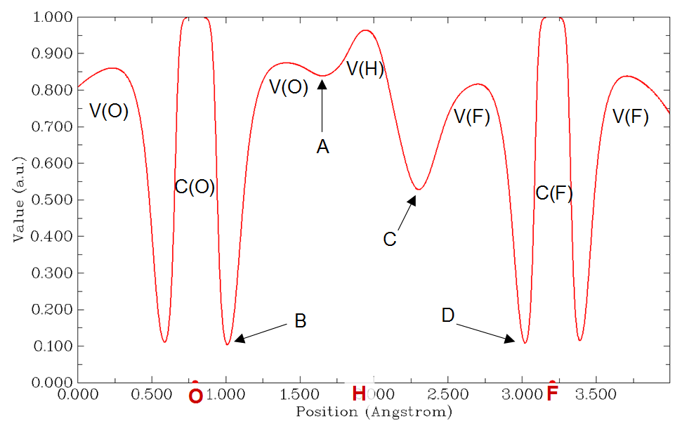
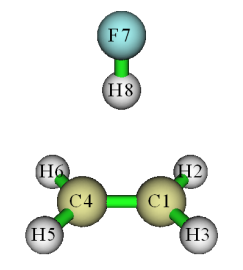
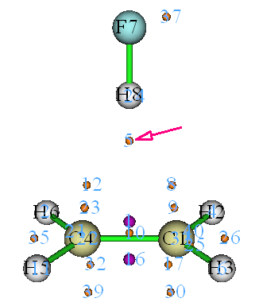
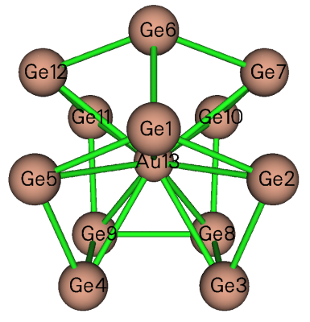

# **3.200 其它功能，第二部分 (200)**

## **3.200.1 计算核-价分叉 (CVB) 指数及相关量**

> **注**
>
> 本节的中文版是我的博客文章“使用 Multiwfn 计算 CVB 指数并衡量氢键强度”(<http://sobereva.com/461>)。

### **(1) CVB 指数理论**

所谓核-价分叉 (CVB, core-valence bifurcation) 指数的想法最早提出于 *Theor. Chem. Acc.*, **104**, 13 (2000)，该指数基于电子定域函数 (ELF) 定义，主要用于区分各种氢键 (H-bond) 的强弱。对典型形式 (D-H⋅⋅⋅A，其中 D=给体，H=氢，A=受体) 的 H 键，该指数表示为：

CVB 指数 = ELF(C-V) – ELF(DH-A)

其中 ELF(C-V) 对应 ELF 芯区与价区之间的 ELF 分叉值，而 ELF(DH-A) 代表 V(D,H) 与 V(A) 之间分叉点处的 ELF 值。

在上述 *Theor. Chem. Acc.* 论文中，作者考察了许多由 HF 与各种单体组成的 H 键二聚体，发现 CVB 指数与 H 键结合能有很好的线性关系。在后续一些论文中，如 *Struct. Chem.*, **16**, 203 (2005) 和 *J. Phys. Chem. A*, **115**, 10078 (2011)，该结论得到进一步证实，前者指出 CVB 指数“在弱复合物情形为正，在较强复合物情形为负”。此外，*Chem. Rev.*, **111**, 2597 (2011) 的作者称 CVB 指数“对弱氢键为正，随该相互作用增强而减小；对强氢键该指数通常为负”。

我发现 ELF(C-V) 和 ELF(DH-A) 本身有时与 H 键结合能的线性关系比 CVB 指数更好，因此建议你在实际研究中打算用 CVB 指数时也考察这一点。

### **(2) 手动计算 CVB 指数**

下面展示如何手动计算 CVB 指数涉及的两项。以 HF⋅⋅⋅HF 二聚体为例，波函数文件为 *examples\HF_HF.wfn*，在 B3LYP-D3(BJ)/def2-TZVP 水平生成，优化也在该水平进行。该体系中 D、H、A 原子分别对应 F2、H1、F3。

ELF(DH-A) 项在原始论文中定义明确。Multiwfn 的拓扑分析模块能定位 ELF 的分叉点，即 ELF 的 (3,-1) 临界点。然后可查看位于氢与受体原子之间的分叉点的 ELF 值（第 [4.2.2](sec-4-2-topology-analysis.md#422-乙酸的定域轨道指示剂-lol-拓扑分析) 节演示了如何对 LOL 做拓扑分析，ELF 可以类似方式分析）。但对大体系 ELF 拓扑分析耗时。考虑到 V(D,H) 与 V(A) 之间的实际 ELF 分叉点几乎恰好落在连接 H 和 A 的直线上，用 Multiwfn 的主功能 3 绘制从 H 到 A 的 ELF 曲线图再直接读出相应极小值更好。下面是 HF⋅⋅⋅HF 二聚体 ELF 拓扑分析结果的截图



紫色和橙色球分别是 (3,-3) 和 (3,-1) 型 ELF 临界点 (CPs)。箭头所指的 (3,-1) CP 对应上述 V(D,H) 与 V(A) 之间的 ELF 分叉点，其 ELF 值为 0.06487，正是当前体系的 ELF(DH-A)。

由上图可见，红色连线基本穿过橙色球中心，这就是为什么 ELF(DH-A) 也可用 H1 与 F3 之间的 ELF 曲线图近似计算。用主功能 3 绘制的曲线图如下所示



箭头标出的极小值为 0.06482，与基于昂贵的 ELF 拓扑分析得到的值 0.06487 非常接近。这很好证明了用 H 与 A 之间的 ELF 曲线图估计 ELF(DH-A) 的合理性。

至于 ELF(C-V)，其定义相当含糊。由于 CVB 指数原始论文的作者没有明确清楚地说明该量应如何计算，不同论文常用不同规则计算它，导致现有文献中严重混乱。例如，在 CVB 原始论文即 *Theor. Chem. Acc.*, **104**, 13 (2000) 中，ELF(C-V) 似乎定为 D 与 A 原子之间 ELF 曲线上分隔芯与价壳的所有 ELF 极小中的最大值。但在同一作者后续论文 *Struct. Chem.*, **16**, 203 (2005) 中，我发现 ELF(C-V) 似乎算的是连接给体原子芯与价 basin 的某个精确定位的 ELF 分叉点处的 ELF 值（而受体原子似乎被忽略了）。

在我看来，ELF(C-V) 最好的定义应是 D 与 H 之间 ELF 曲线上分隔给体原子芯与价壳的极小处的 ELF 值。仍以 HF⋅⋅⋅HF (H4-F3⋅⋅⋅H1-F2) 二聚体为例，F2 与 H1 之间绘制的 ELF 曲线为：



即 ELF(C-V) = 0.0936。于是 HF⋅⋅⋅HF 体系的 CVB 指数为 0.0936 − 0.0648 = 0.0288。该值与 *Theor. Chem. Acc.*, **104**, 13 (2000) 表 2 中的对应值 (-0.006) 很不同，因为计算水平不同、获得 ELF(C-V) 的方式不同，且该论文中数据的符号被错误反转了。

### **(3) 全自动计算 CVB 指数**

为尽量简化上述 CVB 指数的计算，Multiwfn 提供了全自动计算该指数的功能。仍以 HF⋅⋅⋅HF 二聚体为例，启动 Multiwfn 并输入以下命令

```text
examples\HF_HF.wfn
200  // Other function, part 2
1  // Calculate CVB index and related quantities
2,1,3  // Index of donor atom, hydrogen and acceptor atom of the H-bond, respectively
```

结果为

```text
Core-valence bifurcation value at donor, ELF(C-V,D):  0.0936
Distance between corresponding minimum and the hydrogen:   0.743 Angstrom

Core-valence bifurcation value at acceptor, ELF(C-V,A):  0.1408
Distance between corresponding minimum and the hydrogen:   1.628 Angstrom

Bifurcation value at H-bond, ELF(DH-A):  0.0648
Distance between corresponding minimum and the hydrogen:   0.614 Angstrom

The CVB index, namely ELF(C-V,D) - ELF(DH-A):    0.028768
```

该结果与我们手动计算的完全相同。输出的 ELF(CV,A) 在当前语境无用，但一些用户可能感兴趣。

为使你更好理解 Multiwfn 如何自动计算 CVB 指数，这里说明实现细节。用户输入 D、H 和 A 原子编号后，依次计算 D-H 和 H-A 对应的 ELF 曲线，再从曲线数据中自动识别 ELF(CV,D)、ELF(DH-A) 和 ELF(CV-A)，如下图所示



### **(4) 特殊情形：计算某些很强 H 键的 CVB 指数**

原则上，上述 CVB 指数计算流程对大多数有典型 H 键的体系有效，分子间和分子内 H 键都可用同样方式分析。但对某些很强的 H 键，其氢位于两个重原子中点，如 H₂O⋅⋅⋅H⁺⋅⋅⋅OH₂，该流程不再有效，因为其 ELF 曲线没有典型特征，如下所示（由于该体系 O-H-O 角接近 180°，只需一张图）：



可见 V(D,H) 已分叉为 V(O) 和 V(H)。此时应通过绘制 ELF 曲线图手动计算 CVB 指数，标准 CVB 指数表达式中的 ELF(DH-A) 应换为曲线图中 V(H) 与 V(O) 之间局域极小处的 ELF 值。

下面是更复杂的情形，F⁻⋅⋅⋅H⋅⋅O-H，也需通过绘制 ELF 曲线图手动计算 CVB 指数。下图所示 ELF 曲线图绘制于 F 与 O 之间（F⋅⋅⋅H⋅⋅⋅O 几乎线性，因此只需一张图），可见 ELF 相对中心氢不对称：



该体系可视为有两个 H 键，O-H...F 与 O...H-F 的 H 键结合能必然很不同。对前者，CVB 指数 = ELF(B) - ELF(C)，而对后者，CVB 指数 = ELF(D) - ELF(A)。这是因为把体系看作 O-H...F (O...H-F) 时，O 与 F (F 与 O) 分别充当给体与受体原子。因此，H 与 F 之间 C 点的极小应视为 ELF(DH-A)，而 B 点的极小应视为 ELF(C-V,D)。

### **(5) 特殊情形：H 键受体不是单个原子**

有些 H 键的受体不是单个原子。例如 HF⋅⋅⋅ethylene 的受体是 ethylene 的 π 区。这类 H 键称为 π 氢键。此时也必须手动计算 CVB 指数。

HF⋅⋅⋅ethylene 的波函数文件为 *examples\C2H4_HF.wfn*，其几何如下所示。



对该体系，可通过绘制 F7 与 H8 之间的 ELF 曲线图得到 ELF(C-V,D)，读出极小处的 ELF 值，为 0.0944。

该体系的 ELF(DH-A) 可通过 ELF 拓扑分析得到。为此，在 Multiwfn 中输入以下命令：

```text
2  // Topology analysis
-11  // Select the real space function to be analyzed
9  // ELF
6  // Search critical points by randomly distribute initial guesses within a sphere
4  // Set the sphere center as geometry center of three atoms
1,4,8  // Center of C1, C4 and H8 will be set as the sphere center
0  // Start searching (the sphere radius, the number of starting points can be set by corresponding options in the interface)
-9  // Return
0  // Visualize topology analysis result
```

此时可见下图。显然，临界点 5 对应 V(D,H) 与 π 电子 basin 之间的分叉点。



关闭 GUI，选择选项 7，再输入 *5* 查看临界点 5 的性质，会发现其 ELF 值为 0.1241，正是该 H 键的 ELF(DH-A)。于是该体系的 CVB 指数为 0.0944 - 0.1241 = -0.0297。

> **注**
>
> 事实上，由于该体系对称性高，也可通过绘制 H8 与 C1-C4 中点之间的 ELF 曲线图得到临界点 5 的 ELF 值。

> **所需信息**
>
> 原子坐标、GTFs
## **3.200.2 在 Hilbert 空间计算原子与键偶极矩**

该功能用于直接基于基函数（*即* 在 Hilbert 空间）计算原子与键偶极矩。也可参阅 *Ideas of Quantum Chemistry* (L. Piela, 2007) 一书的 12.3.2 节。

### **理论**

在基函数形式下，体系偶极矩可表示为

$$
\boldsymbol{\mu} = \boldsymbol{\mu}^{\mathrm{nuc}} + \boldsymbol{\mu}^{\mathrm{ele}} = \sum_{A} Z_{A}\mathbf{R}_{A} - \sum_{i}\sum_{j} P_{i,j}\left\langle \chi_{i} \left| \mathbf{r} \right| \chi_{j} \right\rangle
$$

其中 *Z* 和 **R** 分别是核的电荷和坐标，*P* 是密度矩阵，$\left\langle \chi_{i} \left| \mathbf{r} \right| \chi_{j} \right\rangle$ 是基函数 *i* 与 *j* 之间的偶极矩积分。

体系偶极矩可分解为单原子项与原子对项之和

$$
\boldsymbol{\mu} = \sum_{A} \boldsymbol{\mu}_{A}^{\mathrm{tot}} + \sum_{A}\sum_{B>A} \boldsymbol{\mu}_{AB}^{\mathrm{tot}} = \sum_{A} \left( \boldsymbol{\mu}_{A}^{\mathrm{nuc}} + \boldsymbol{\mu}_{A}^{\mathrm{pop}} + \boldsymbol{\mu}_{A}^{\mathrm{dip}} \right) + \sum_{A}\sum_{B>A} \left( \boldsymbol{\mu}_{AB}^{\mathrm{pop}} + \boldsymbol{\mu}_{AB}^{\mathrm{dip}} \right)
$$

五项的表达式和物理意义为

${\boldsymbol{\mu}}_{A}^{\mathrm{nuc}}$：核电荷导致的偶极矩

$$
\boldsymbol{\mu}_{A}^{\mathrm{nuc}} = Z_{A}\mathbf{R}_{A}
$$

${\boldsymbol{\mu}}_{A}^{\mathrm{pop}}$：定域在单个原子上的电子布居数导致的偶极矩（注意这不同于 Mulliken 或类似方法算出的电子布居数，因为重叠布居数没有被吸收到各自原子中）

$$
\boldsymbol{\mu}_{A}^{\mathrm{pop}} = -p_{A}^{\mathrm{loc}}\mathbf{R}_{A}\quad\quad p_{A}^{\mathrm{loc}} = \sum_{i \in A}\sum_{j \in A} P_{i,j}\left\langle \chi_{i} \left| \chi_{j} \right. \right\rangle
$$

${\boldsymbol{\mu}}_{A}^{\mathrm{dip}}$：原子偶极矩，反映原子周围的电子偶极矩。**r**$_{A}$ 是相对于核 *A* 的坐标变量

$$
\begin{aligned}\boldsymbol{\mu}_{A}^{\mathrm{dip}} &= -\sum_{i \in A}\sum_{j \in A} P_{i,j}\left\langle \chi_{i} \left| \mathbf{r}_{A} \right| \chi_{j} \right\rangle\quad\quad \mathrm{where}\ \ \mathbf{r}_{A} = \mathbf{r} - \mathbf{R}_{A}\\ &= -\sum_{i \in A}\sum_{j \in A} P_{i,j}\left\langle \chi_{i} \left| \mathbf{r} \right| \chi_{j} \right\rangle - \boldsymbol{\mu}_{A}^{\mathrm{pop}}\end{aligned}
$$

${\boldsymbol{\mu}}_{AB}^{\mathrm{pop}}$：原子 *A* 与 *B* 之间重叠布居导致的偶极矩

$$
\boldsymbol{\mu}_{AB}^{\mathrm{pop}} = -p_{AB}\mathbf{R}_{AB}\quad\quad p_{AB} = 2\sum_{i \in A}\sum_{j \in B} P_{i,j}\left\langle \chi_{i} \left| \chi_{j} \right. \right\rangle\quad\quad \mathbf{R}_{AB} = \left( \mathbf{R}_{A} + \mathbf{R}_{B} \right)/2
$$

${\boldsymbol{\mu}}_{AB}^{\mathrm{dip}}$：键偶极矩，在一定程度上反映相应两原子几何中心周围的电子偶极矩。当然，若 *A* 与 *B* 彼此不靠近，则该项很小，不宜称为键偶极矩。

$$
\begin{aligned}\boldsymbol{\mu}_{AB}^{\mathrm{dip}} &= -2\sum_{i \in A}\sum_{j \in B} P_{i,j}\left\langle \chi_{i} \left| \mathbf{r}_{AB} \right| \chi_{j} \right\rangle\quad\quad \mathrm{where}\ \ \mathbf{r}_{AB} = \mathbf{r} - \mathbf{R}_{AB}\\ &= -2\sum_{i \in A}\sum_{j \in B} P_{i,j}\left\langle \chi_{i} \left| \mathbf{r} \right| \chi_{j} \right\rangle - \boldsymbol{\mu}_{AB}^{\mathrm{pop}}\end{aligned}
$$

通过 Mulliken 型划分，键偶极矩可并入原子偶极矩，从而体系偶极矩可写为单中心项之和

$$
\boldsymbol{\mu} = \sum_{A} \left( \boldsymbol{\mu}_{A}^{\mathrm{nuc}} + \boldsymbol{\mu}_{A}^{,\mathrm{pop}} + \boldsymbol{\mu}_{A}^{,\mathrm{dip}} \right)
$$

其中 ${\boldsymbol{\mu}'}_{A}^{\mathrm{pop}}$ 是原子 *A* 的 Mulliken 布居数导致的偶极矩

$$
\boldsymbol{\mu}_{A}^{,\mathrm{pop}} = -p_{A}^{\mathrm{Mul}}\mathbf{R}_{A}\quad\quad p_{A}^{\mathrm{Mul}} = \sum_{B}\sum_{i \in B}\sum_{j \in B} P_{i,j}\left\langle \chi_{i} \left| \chi_{j} \right. \right\rangle
$$

${\boldsymbol{\mu}'}_{A}^{\mathrm{dip}}$ 是原子 *A* 的原子总偶极矩

$$
\boldsymbol{\mu}_{A}^{,\mathrm{dip}} = -\sum_{B}\sum_{i \in B}\sum_{j \in B} P_{i,j}\left\langle \chi_{i} \left| \mathbf{r}_{A} \right| \chi_{j} \right\rangle = -\sum_{B}\sum_{i \in B}\sum_{j \in B} P_{i,j}\left\langle \chi_{i} \left| \mathbf{r} \right| \chi_{j} \right\rangle - \boldsymbol{\mu}_{A}^{\mathrm{Mul}}
$$

注意上式中编号 *B* 遍历所有原子。

### **用法**

输入文件必须包含基函数信息（*例如* .mwfn、.fch、.molden 和 .gms）。

进入本功能后，可选选项 1 输出特定原子的信息，包括：原子局域布居数 ${p}_{A}^{\mathrm{loc}}$；原子偶极矩 ${\boldsymbol{\mu}}_{A}^{\mathrm{dip}}$；核电荷对体系偶极矩的贡献 ${\boldsymbol{\mu}}_{A}^{\mathrm{nuc}}$；电子对体系偶极矩的贡献 ${\boldsymbol{\mu}}_{A}^{\mathrm{dip}}+{\boldsymbol{\mu}}_{A}^{\mathrm{pop}}$；对体系偶极矩的贡献 ${\boldsymbol{\mu}}_{A}^{\mathrm{nuc}}+{\boldsymbol{\mu}}_{A}^{\mathrm{dip}}+{\boldsymbol{\mu}}_{A}^{\mathrm{pop}}$。

也可选选项 2 输出特定原子对之间的信息，包括：键布居数 ${\boldsymbol{\mu}}_{AB}^{\mathrm{pop}}$；键偶极矩 ${\boldsymbol{\mu}}_{AB}^{\mathrm{dip}}$；对体系偶极矩的贡献 ${\boldsymbol{\mu}}_{AB}^{\mathrm{pop}}+{\boldsymbol{\mu}}_{AB}^{\mathrm{dip}}$。

若选 3，将输出所选原子的原子总偶极矩及相关信息，包括：原子 Mulliken 布居数 ${p}_{A}^{\mathrm{Mul}}$；原子总偶极矩 ${\boldsymbol{\mu}'}_{A}^{\mathrm{dip}}$；核电荷对体系偶极矩的贡献 ${\boldsymbol{\mu}}_{A}^{\mathrm{nuc}}$；电子对体系偶极矩的贡献 ${\boldsymbol{\mu}'}_{A}^{\mathrm{dip}}+{\boldsymbol{\mu}'}_{A}^{\mathrm{pop}}$；对体系偶极矩的贡献 ${\boldsymbol{\mu}}_{A}^{\mathrm{nuc}}+{\boldsymbol{\mu}'}_{A}^{\mathrm{dip}}+{\boldsymbol{\mu}'}_{A}^{\mathrm{pop}}$。

若选选项 10，则电子偶极矩矩阵的 X/Y/Z 分量分别输出到当前文件夹下的 *dipmatx.txt*、*dipmaty.txt* 和 *dipmatz.txt*。例如，电子偶极矩矩阵 Z 分量的 (*i*, *j*) 元对应

$$
-\sum_{i}\sum_{j} P_{i,j}\left\langle \chi_{i} \left| z \right| \chi_{j} \right\rangle
$$

> **所需信息**
>
> 原子坐标、基函数

## **3.200.3 为多个轨道波函数生成 cube 文件**

通过该功能，可计算多个轨道波函数的格点数据并同时导出到单个 cube 文件或多个 cube 文件。

进入该功能后，需先选择感兴趣的轨道（*例如 3,5,9-17*），再定义格点设置，再选择导出格点数据的方案。若选方案 1，则格点数据导出为多个文件，例如 *orb000003.cub*、*orb000005.cub*、*orb000009.cub* 等。文件名中的数字对应轨道编号。若选方案 2，则所选所有轨道的格点数据集体导出到当前文件夹下的 *orbital.cub*。很多可视化程序包括 VMD 和 Multiwfn 都支持含多套格点数据的 cube 文件。

对限制性和非限制性单行列式波函数，在该功能中可基于 HOMO 和 LUMO 选择轨道。例如 *h-3* 指 HOMO-3，*l+2* 对应 LUMO+2。更多例子见屏幕提示。

> **所需信息**
>
> 原子坐标、GTFs

## **3.200.5 对实空间函数绘制径向分布函数**

该功能用于对实空间函数绘制径向分布函数 (RDF, radial distribution function)

$$
RDF(r) = \int f(r,\Omega) r^{2} \mathrm{d}\Omega
$$

其中 *r* 是到球心的径向距离，Ω 表示球层中的角坐标。

也可绘制 RDF 的积分曲线

$$
I(r^{\prime}) = \int_{r_{\mathrm{low}}}^{r^{\prime}} RDF(r) \mathrm{d}r = \int_{r_{\mathrm{low}}}^{r^{\prime}} \int f(r,\Omega) r^{2} \mathrm{d}\Omega\, \mathrm{d}r
$$

显然，若 $r_{\mathrm{low}}$ 设为 0（*即* 球心），则 *I*(∞) 就是 *f* 在全空间的积分。

在本功能中，可选择要研究的实空间函数，设定球心位置，设定要计算和绘制的下限和上限，设定径向和角向部分的点数。点数越多，积分曲线越准确。

参数设好后，选选项 0 开始计算，会看到新菜单，可在其中绘制 RDF 及其积分曲线、保存图形或导出相应的原始数据。在该菜单中还有一个导出球平均函数 ( $f^{\mathrm{sph}}$ ) 的选项，它与 RDF 有如下关系

$$
f^{\mathrm{sph}}(r) = \frac{RDF(r)}{4\pi r^{2}}
$$

例子见第 [4.200.5](sec-4-200-other-functions-part-2.md#42005-绘制电子密度的径向分布函数) 节。

> **所需信息**
>
> 原子坐标、GTFs

## **3.200.6 分析两个波函数中轨道的对应关系**

### **理论**

该功能主要用于分析两个波函数中轨道的对应关系。两套轨道可在不同基组下、由不同理论方法、在不同外部环境、不同电子态或略有不同的几何下产生。两套轨道也可以是不同类型，例如第一套轨道是 Hartree-Fock 计算产生的正则 MO，而第二套轨道是 post-HF 计算产生的自然轨道。

当前波函数（Multiwfn 启动时载入的波函数）中的轨道 {*i*} 可表示为另一波函数（进入本模块后指定的波函数）中轨道 {*j*} 的线性组合，*即*

$\left| i \right\rangle = \sum_{j} C_{i,j} \left| j \right\rangle$ 其中 $C_{i,j} = \left\langle i \middle| j \right\rangle \equiv \int \varphi_{i}(\mathbf{r}) \varphi_{j}(\mathbf{r}) \mathrm{d}\mathbf{r}$

一旦得到重叠积分，就立刻知道 *j* 与 *i* 如何关联。轨道 *j* 对轨道 *i* 的贡献就是重叠积分的平方，即 \<*i*\|*j*\>²×100%。本功能能计算 **C** 矩阵及相应的贡献，从而轻松弄清两套轨道之间的关系。

### **用法**

进入该功能后，首先输入当前波函数要考虑的轨道范围（*istart1*\~*iend1*），再输入第二个波函数的路径和要考虑的轨道范围（*istart2*\~*iend2*）。之后用 Becke 多中心数值积分方案计算 *istart1*\~*iend1* 与 *istart2*\~*iend2* 之间的重叠矩阵。然后看到 *istart1*\~*iend1* 中每个轨道来自 *istart2*\~*iend2* 的五个最大贡献。

若想得到 *istart1*\~*iend1* 中某个特定轨道里 *istart2*\~*iend2* 的所有系数（及相应贡献），可直接输入该轨道的编号。

若当前波函数中的轨道 (*i*) 可精确展开为 *istart2*\~*iend2* 的线性组合，则必须满足归一化条件：

$$
\sum_{j=\mathrm{istart2}}^{\mathrm{iend2}} \left\langle i \middle| j \right\rangle^{2} \times 100\% = 100\%
$$

从 Multiwfn 输出中可找到对归一化条件的最大偏离。若该值为零，意味着 *istart1*\~*iend1* 中的所有轨道都可被 *istart2*\~*iend2* 中的轨道精确表示。

注意当前波函数与第二个波函数的原子坐标不一定要相同，两个波函数甚至可对应不同分子。但若两波函数原子坐标分布范围差别大，积分精度必然低，结果不可靠。

一般默认积分格点足够精细，*即* 30 个径向点、302 个角向点，"radcut=15"。若想提高精度，应把 *settings.ini* 中的 "iautointgrid" 设为 0，再在 *settings.ini* 中定义 "radpot"、"sphpot" 和 "radcut"；增大它们的值会提高积分精度。

该功能的计算代价直接取决于考虑的轨道数；因此若体系含非常多的轨道，不要一次全选。

### **特殊用法：计算两套轨道之间的重叠积分和叠加**

本功能也可用于计算轨道之间的重叠，轨道可来自同一波函数，也可来自两个不同波函数。

进入本功能的界面后，若想得到上述第一波函数中轨道 *istart1\~iend1* 与第二波函数中轨道 *istart2\~iend2* 之间的所有重叠积分（*即* 所有 \<*i*\|*j*\>），只需输入 *-1*，这些积分将输出到当前文件夹下的 *convmat.txt*。

若需要的不是轨道波函数之间的普通重叠积分，而是轨道波函数**模**之间的重叠积分，它对衡量轨道叠加有用，表示为 $\int \left| {\varphi}_{i}(\mathbf{r}) \right||{\varphi}_{j}(\mathbf{r})|\mathrm{d}\mathbf{r}$，应在界面中输入 *-2*，则轨道 *istart1\~iend1* 与 *istart2\~iend2* 之间的所有这类积分将输出到当前文件夹下的 *Snormmat.txt*。类似地，若需要的是 $\int {\left| {\varphi}_{i}(\mathbf{r}) \right|}^{2}{|{\varphi}_{j}(\mathbf{r})|}^{2}\mathrm{d}\mathbf{r}$，应在界面输入 *-3*，结果将输出到 *Snorm2mat.txt*。

事实上，本功能可在一定程度上等价实现第 [3.100.5](sec-3-100-other-functions-part-1.md#31005-显示alpha和beta轨道之间的重叠积分show-overlap-integral-between-alpha-and-beta-orbitals)、[3.100.11](sec-3-100-other-functions-part-1.md#310011-计算两个轨道之间的重叠和质心距离calculate-overlap-and-centroid-distance-between-two-orbitals) 和 [3.100.15](sec-3-100-other-functions-part-1.md#310015-计算分子间轨道重叠calculate-intermolecular-orbital-overlap) 节介绍的功能，只是输出格式和主要目的不同。

该功能的一些用例见第 [4.200.6](sec-4-200-other-functions-part-2.md#42006-研究不同波函数文件中轨道之间的对应关系) 节。

> **所需信息**
>
> 原子坐标、GTFs

## **3.200.9 计算平均键长和平均配位数**

该功能用于计算两种元素之间的平均键长和平均配位数。该功能对分析原子团簇的结构特征特别有用，例如下图所示的 Ge₁₂Au 团簇（结构文件为 *examples\Ge12Au.pdb*）。用该功能可立刻得到平均 Ge-Ge 键长和平均 Au-Ge 键长，以及 Ge 由于 Ge-Au 或 Ge-Ge 键的平均配位数，或 Au 由于 Ge-Au 键的平均配位数。对 Al 团簇的这类分析的一个漂亮应用见 *J. Chem. Phys.*, **111**, 1890 (1999)。



平均键长定义为

$$
\left\langle R \right\rangle = \frac{1}{n_{\mathrm{b}}} \sum_{i>j} R_{ij}
$$

其中 $R_{ij}$ 是原子 *i* 与 *j* 之间的距离，只有小于或等于给定距离截断（*例如* 2.2 Å）的项才被视为键并计入求和。$n_{\mathrm{b}}$ 是总键数。

平均配位数计算为

$$
CN = \frac{1}{n} \sum_{i} N_{i}
$$

其中 $N_{i}$ 是原子 *i* 周围的键数，*n* 是总原子数。

进入该功能后，需输入两种元素，例如 *Ge,Au*，再输入距离截断，例如 3.2，则 ≤ 3.2 Å 的 Ge-Au 接触被视为 Ge-Au 键并计算平均键长，同时输出最短和最长键长。之后若选 *y*，将显示 Ge 由于 Ge-Au 键的平均配位数。

> **所需信息**
>
> 原子坐标

## **3.200.10 输出轨道之间的各种积分**

该功能用于计算轨道之间的电/磁偶极矩积分、速度积分、动能积分和重叠积分，高级用户当能认出这些数据的意义。对一批轨道的情形，结果导出到当前文件夹下的 *orbint.txt*，第一、二列对应两个轨道的编号；对一对轨道的情形，结果直接打印在屏幕上。

两轨道之间的电偶极矩积分矢量定义为

$$
\mathbf{\boldsymbol{\mu}}_{ij} = \mathbf{\boldsymbol{\mu}}_{ji} = \left\langle \varphi_{i} \middle| -\mathbf{r} \middle| \varphi_{j} \right\rangle
$$

两轨道之间的磁偶极矩积分矢量计算为（更多细节见第 [3.21.1.1](sec-3-21-electron-excitation-analysis.md#32111-理论) 节。忽略负号）

$$
\mathbf{M}_{ij} = i \left\langle \varphi_{i} \middle| \mathbf{r} \times \nabla \middle| \varphi_{j} \right\rangle
$$

两轨道之间的速度积分矢量计算为（忽略负号）

$$
\mathbf{v}_{ij} = i \left\langle \varphi_{i} \middle| \nabla \middle| \varphi_{j} \right\rangle
$$

值得注意的是，由于算符的 Hermiticity，有

$$
\begin{gathered}\mathbf{M}_{ii} = 0 \quad\quad \mathbf{M}_{ij} = {\mathbf{M}_{ji}}^{*} = -\mathbf{M}_{ji} \\\mathbf{v}_{ii} = 0 \quad\quad \mathbf{v}_{ij} = {\mathbf{v}_{ji}}^{*} = -\mathbf{v}_{ji}\end{gathered}
$$

注意输出中没有显式显示虚数符号。

两轨道之间的动能积分和重叠积分分别计算为

$$
K_{ij} = -\frac{1}{2} \left\langle \varphi_{i} \middle| \nabla^{2} \middle| \varphi_{j} \right\rangle \quad\quad S_{ij} = \left\langle \varphi_{i} \middle| \varphi_{j} \right\rangle
$$

若需计算两轨道之间的 Coulomb 或交换积分，应使用第 [3.200.17](#320017-计算两轨道之间的-coulomb-和交换积分) 节描述的功能。

> **所需信息**
>
> 原子坐标、GTFs

## **3.200.11 计算函数的中心、一阶/二阶矩、回转半径和 \<*r*²\>**

该功能用于计算表征所选实空间函数分布的各种量。

### **理论**

实空间函数 *f* 的中心定义为

$$
\mathbf{r}_\mathrm{c} = \frac{\int \mathbf{r} \times f(\mathbf{r}) \mathrm{d}\mathbf{r}}{\int f(\mathbf{r}) \mathrm{d}\mathbf{r}}
$$

其中积分在全空间进行。

一阶矩是矢量，计算为

$$
\mathbf{\boldsymbol{\mu}} = \begin{bmatrix} \mu_{x} \\ \mu_{y} \\ \mu_{z} \end{bmatrix} = \int \begin{bmatrix} x \\ y \\ z \end{bmatrix} f(\mathbf{r}) \mathrm{d}\mathbf{r}
$$

其中 *x*、*y*、*z* 是相对于 **r**$_{c}$ 的笛卡尔坐标分量。

二阶矩是矩阵，定义为

$$
\mathbf{\Theta} = \begin{bmatrix} \Theta_{xx} & \Theta_{xy} & \Theta_{xz} \\ \Theta_{yx} & \Theta_{yy} & \Theta_{yz} \\ \Theta_{zx} & \Theta_{zy} & \Theta_{zz} \end{bmatrix} = \int \begin{bmatrix} x^{2} & xy & xz \\ yx & y^{2} & yz \\ zx & zy & z^{2} \end{bmatrix} f(\mathbf{r}) \mathrm{d}\mathbf{r}
$$

若其本征值 {*ε*} 从小到大排序，则 **Θ** 的各向异性可算为 $\varepsilon_{3} - \left( \varepsilon_{1} + \varepsilon_{2} \right) / 2$。回转半径算为 $\sqrt{\frac{\varepsilon_{1} + \varepsilon_{2} + \varepsilon_{3}}{\int f(\mathbf{r}) \mathrm{d}\mathbf{r}}}$。

空间范围 $\left\langle {r}^{2} \right\rangle=\int ({x}^{2}+{y}^{2}+{z}^{2})f(\mathbf{r})\mathrm{d}\mathbf{r}$ 就是二阶矩矩阵的迹，或其三个本征值之和。若 *f*(**r**) 选为电子密度，则 \< $r^2$ \> 对应著名的电子空间范围 (ESE, electronic spatial extent)。注意 ESE 和电偶极/多极矩可用 Multiwfn 中的专门功能解析且高效得多地计算，见第 [3.300.5](sec-3-300-other-functions-part-3.md#33005-计算电偶极多极矩和电子空间范围) 节。

### **用法**

该功能用 Becke 多中心积分方法计算上述量。精度完全由径向点数和角向点数决定，可分别通过 *settings.ini* 中的 "radpot" 和 "sphpot" 设置。

选项 1 计算并输出上述所有量。待研究的实空间函数可用选项 3 选择。中心 (**r**$_{c}$) 默认为 (0,0,0)，可用选项 4 手动设置。选项 2 用于计算所选实空间函数的中心，可直接作为后续选项 1 计算的 **r**$_{c}$（显然，若 **r**$_{c}$ 设为所选函数的中心，算出的一阶矩为零）。

用选项 1 时，若待研究的实空间函数选为电子密度，还会输出四极矩的核贡献和分子四极矩张量。事实上后者可直接由前者减去电子密度的二阶矩得到。

若感兴趣的实空间函数正负部分幅度相当（*例如* 正负相明显的轨道波函数），一般推荐用选项 5 而非选项 2 计算所选实空间函数的分布中心，因为选项 5 在计算中用*绝对*函数值，可避免抵消效应。此外，对这类实空间函数，为计算上述统计量，建议在选选项 1 之前先选一次选项 -1，此时计算中用*绝对*函数值。

这里给一个简例。计算自旋密度的一阶和二阶矩（相对于自旋密度中心），载入波函数文件后应输入

```text
200  // Other function (Part 2)
11  // The present function
3  // Select a real space function
5  // Spin density
2  // Calculate center of spin density
y  // Take the calculated center for evaluating various data in option 1
1  // Evaluate various data for spin density
```

然后数据会显示在屏幕上。

我的博客文章“使用 Multiwfn 展示多余电子并计算其回转半径”(<http://sobereva.com/658>，中文) 进一步演示了该模块的用法。

> **所需信息**
>
> 原子坐标、GTFs

## **3.200.12 计算能量指数 (EI) 或键极性指数 (BPI)**

该功能用于计算能量指数 (EI, energy index) 和键极性指数 (BPI, bond polarity index)，它们定义于 *J. Phys. Chem.*, **94**, 5602 (1990) 并在 *J. Phys. Chem.*, **96**, 157 (1992) 中进一步讨论。

分子中原子 *A* 的 EI 定义为

$$
\mathrm{EI}_{A} = \frac{\sum_{i}^{\mathrm{val}} \varepsilon_{i} \eta_{i} \Theta_{i,A}}{\sum_{i}^{\mathrm{val}} \eta_{i} \Theta_{i,A}}
$$

其中 Θ*$_{i}$*$_{,}$*$_{A}$* 表示 MO *i* 中原子 *A* 的组成，*η*$_{i}$ 和 *ε*$_{i}$ 分别是 MO *i* 的占据数和能量。求和遍历价 MO。事实上分母就是原子 *A* 的价电子数，分子对应其价电子的总能量。因此 EI*$_{A}$* 可视为原子 *A* 的平均每个价电子能量。在 EI 原始论文中用 Mulliken 方法计算原子对 MO 的贡献，因此当前 EI 实现也用该方法，尽管 Hirshfeld 划分等其它方法应当同样好甚至更好。（注意由于用了 Mulliken 方法，它与弥散函数不兼容，必须避免用弥散基函数！）

分子中原子 *A* 与 *B* 之间的 BPI 定义为

$$
\mathrm{BPI}_{AB} = \left( \mathrm{EI}_{A} - \mathrm{EI}_{A}^{\mathrm{ref}} \right) - \left( \mathrm{EI}_{B} - \mathrm{EI}_{B}^{\mathrm{ref}} \right)
$$

其中 EI$^{ref}$ 是由同核物种计算得到的参考 EI 值。例如研究 H₃C-NH₂ 的 BPI$_{CN}$，则 ${\mathrm{EI}}_{\mathrm{C}}^{\mathrm{ref}}$ 算为乙烷中的 EI$_{C}$，${\mathrm{EI}}_{\mathrm{N}}^{\mathrm{ref}}$ 算为 H₂N-NH₂ 中的 EI$_{N}$。BPI*$_{AB}$* 的绝对值越大意味着 *A*-*B* 键极性越高。

基团电负性计算为相应自由基连接原子的负 EI$_{X}$，X 为连接原子。例如求 -CH₃ 基团的电负性，应计算 ⋅CH₃ 自由基的 -EI$_{C}$。

Multiwfn 的该功能用于计算当前体系中特定原子的 EI，支持所有 R、RO 和 U 型的 HF/DFT 波函数。Multiwfn 自动检测内层芯电子数并确定哪些 MO 是价轨道从而应计入。

例子见第 [4.200.12](sec-4-200-other-functions-part-2.md#420012-计算能量指数ei与键极性指数bpi) 节。

> **所需信息**
>
> 原子坐标、基函数

## **3.200.13 计算轨道对密度差或其它格点数据的贡献**

### **理论**

该功能主要用于计算所选各轨道对给定密度差 Δ*ρ* 的贡献，从而清楚理解哪个(些)轨道是电子密度分布变化的主要贡献者。类似的想法已用于 *J. Mol. Model.*, **24**, 25 (2017)，研究各 NBO 轨道对 Fukui 函数（一类特殊的电子密度，见第 [4.5.4](sec-4-5-generate-grid-data-and-view-isosurface-map.md#454-用福井函数和对偶描述符研究苯酚亲电进攻的有利位点) 节）的贡献以更好揭示其化学意义。下面概述本功能用的理论和算法。

Δ*ρ* 可近似表示为轨道概率密度（即相应轨道波函数的模方）的线性组合

$$
\Delta\rho(\mathbf{r}) \approx \sum_{i} p_{i} \left| \varphi_{i}(\mathbf{r}) \right|^{2}
$$

需要求的是展开 Δ*ρ* 的最优 {*p*}。$p_{i}$ 可视为轨道 *i* 对 Δ*ρ* 的贡献。{*p*} 可通过最小二乘法得到，即在全空间最小化 Δ*ρ* 与 $\sum_{i} p_{i} \left| \varphi_{i}(\mathbf{r}) \right|^{2}$ 之差，同时通过 Lagrange 乘子技术把 {*p*} 之和约束为给定值 *P*。实际实现中要最小化的误差函数为

$$
F = \int \left[ \Delta\rho(\mathbf{r}) - \sum_{i} p_{i} \left| \varphi_{i}(\mathbf{r}) \right|^{2} \right]^{2} \mathrm{d}\mathbf{r} + \lambda \left[ \sum_{i} p_{i} - P \right]
$$

在 Multiwfn 中，积分按均匀分布格点的数值积分处理，即

$$
F = \Delta_{V} \sum_{\mu} \left[ \Delta\rho(\mathbf{r}) - \sum_{i} p_{i} \left| \varphi_{i}(\mathbf{r}) \right|^{2} \right]^{2} + \lambda \left[ \sum_{i} p_{i} - P \right]
$$

其中 *µ* 是格点编号，Δ*$_{V}$* 是格点体积。

显然，确定最优 {*p*} 应满足以下条件

$$
\begin{gathered} \frac{\partial F}{\partial p_{i}} = 0 \quad\quad i = \{1,2,3...\} \\ \sum_{i} p_{i} = P \end{gathered}
$$

更明确地，

$$
\frac{\partial F}{\partial p_{i}} = 0 \Rightarrow \sum_{j} p_{j} \sum_{\mu} \left| \varphi_{i}(\mathbf{r}_{\mu}) \right|^{2} \left| \varphi_{j}(\mathbf{r}_{\mu}) \right|^{2} + \lambda = \sum_{\mu} \left| \varphi_{i}(\mathbf{r}_{\mu}) \right|^{2} \Delta\rho(\mathbf{r}_{\mu})
$$

显然，确定 {*p*} 的工作方程应为

$$
\begin{gathered} \begin{bmatrix} A_{1,1} & \cdots & A_{1,N} & 1 \\ \vdots & \ddots & \vdots & \vdots \\ A_{N,1} & \cdots & A_{N,N} & 1 \\ 1 & 1 & 1 & 0 \end{bmatrix} \begin{bmatrix} p_{1} \\ \vdots \\ p_{N} \\ \lambda \end{bmatrix} = \begin{bmatrix} B_{1} \\ \vdots \\ B_{N} \\ P \end{bmatrix} \\ A_{i,j} = A_{j,i} = \sum_{\mu} \left| \varphi_{i}(\mathbf{r}_{\mu}) \right|^{2} \left| \varphi_{j}(\mathbf{r}_{\mu}) \right|^{2} \\ B_{i} = \sum_{\mu} \left| \varphi_{i}(\mathbf{r}_{\mu}) \right|^{2} \Delta\rho(\mathbf{r}_{\mu}) \end{gathered}
$$

Multiwfn 报告的拟合误差用下式估计

$$
\begin{gathered} \mathrm{definition\ 1}: \int \left| \Delta\rho(\mathbf{r}) - \sum_{i} p_{i} \left| \varphi_{i}(\mathbf{r}) \right|^{2} \right| \mathrm{d}\mathbf{r} \\ \mathrm{definition\ 2}: \int \left( \Delta\rho(\mathbf{r}) - \sum_{i} p_{i} \left| \varphi_{i}(\mathbf{r}) \right|^{2} \right)^{2} \mathrm{d}\mathbf{r} \end{gathered}
$$

原则上该算法对任何 Δ*ρ* 和轨道都有效。例如 Δ*ρ* 可对应 Fukui 函数、电子激发中的密度变化等。轨道可以是定域化分子轨道 (LMO)、NBO、MO 等。贡献 *p* 可正可负，符号反映轨道密度参与 Δ*ρ* 的相位。注意轨道范围的选择高度任意且明显影响结果。例如范围可包括某类所有轨道，或只包括占据轨道。

### **用法**

下面是通过本功能得到一套轨道对 Δ*ρ* 贡献的常用流程

- (1) 用 Multiwfn 或其它程序生成 Δ*ρ* 的 cube 文件。计算 Δ*ρ* 格点数据的流程已在本手册许多节充分说明，例如第 [4.5.4](sec-4-5-generate-grid-data-and-view-isosurface-map.md#454-用福井函数和对偶描述符研究苯酚亲电进攻的有利位点) 节（Fukui 函数和 dual descriptor）和第 [4.18.3](sec-4-18-electron-excitation-analysis.md#4183-基于电子密度差分析电子激发中的电荷转移) 节（对应电子激发的 Δ*ρ*）。

- (2) 把含感兴趣轨道的文件载入 Multiwfn，再进入主功能 200 的子功能 13。

- (3) 输入含 Δ*ρ* 的 cube 文件的路径让 Multiwfn 载入它。

- (4) 用选项 1 设定对贡献之和的约束，即上式中的 *P* 值。*P* 默认为 1.0。

- (5) 选选项 0，再设定要考虑的轨道范围。计算后，所有选中轨道的贡献 (*p*) 显示在屏幕上。

- (6) 在后处理菜单中，可选择可视化 Δ*ρ*、拟合密度 $\sum_{i} p_{i} \left| \varphi_{i}(\mathbf{r}) \right|^{2}$ 或其差 $\Delta\rho - \sum_{i} p_{i} \left| \varphi_{i}(\mathbf{r}) \right|^{2}$ 的等值面，从而直观检查拟合质量。拟合密度也可导出为 cube 文件。

在 Multiwfn 中，构建 **A** 矩阵和 **B** 矢量时处理轨道格点数据有以下两种模式，可通过选项 2 切换。

- 基于内存（默认）：先自动计算所选所有轨道密度的格点数据并记录在内存中，此时计算相当快，但当所选轨道范围大且格点质量较高时对可用内存要求很高。若 Multiwfn 不因内存不足崩溃，强烈推荐用该模式。

- 基于 cube 文件：自动计算所选所有轨道密度的格点数据并作为各自的 cube 文件保存在当前文件夹下如 *rho_xxxxx.cub*，其中 *xxxxx* 是轨道编号。在用相应轨道构建 **A** 矩阵和 **B** 矢量时载入该文件。该模式比“基于内存”模式慢得多，优点是内存消耗几乎可忽略。

  注意自动计算的轨道密度的格点设置被程序设为与载入的 Δ*ρ* 格点数据严格相同。

重要的是注意本功能通用灵活，不一定限于研究轨道对 Δ*ρ* 的贡献。例如，若提供的 cube 文件含的是 *ρ* 而非 Δ*ρ* 的格点数据，则本功能给出所选轨道对 *ρ* 的贡献（当然，做之前应把 *P* 设合适以使所得贡献值有意义。若不知如何设，可直接去掉约束）

本功能的实际分析例子见第 [4.200.13](sec-4-200-other-functions-part-2.md#420013-研究轨道对密度差的贡献) 节。

## **3.200.14 域分析（求函数等值面内的性质）**

该功能用于在域中积分特定的实空间函数。域指特定实空间函数等值面包围的各个空间区域。例如可用该功能在约化密度梯度 (RDG) 等值面定义的各域中积分电子密度，以研究不同位置弱相互作用的强度。若灵活运用该模块，可实现许多特殊分析。例如，可视化并求分子空腔体积（例子见第 [4.200.14.2](sec-4-200-other-functions-part-2.md#4200142-用域分析模块可视化分子空腔并计算其体积) 节）。

### **基本用法**

下面是使用该模块的基本流程：

- (1) 进入域分析模块后，用选项 2 和 3 设定定义域的方式。例如用选项 2 选 RDG 并在选项 3 输入 *\<0.5*，则 RDG 小于 0.5 的区域被识别为不同的域。

  注意识别域时可考虑周期性。要开启它，选择选项“4 Toggle considering periodicity during domain analysis”将其状态设为“Yes”。

- (2) 选选项 1 并恰当定义格点，然后 Multiwfn 开始计算所选实空间函数的格点数据并识别满足所设判据的域。

  注：若内存中已有格点数据，例如刚用主功能 5 算过或在 Multiwfn 启动时直接载入了 .cub 文件，也可直接选选项 -1 使用该格点数据而不计算新格点数据。此时选项 2 显然无意义。

- (3) 上步计算完成后，Multiwfn 打印每个域中的总格点数。在非常简单的情形，可直接从该信息推断哪些域是想研究的，而一般情形需用选项 "3 Visualize domains" 在 GUI 窗口可视化域，可在右下角列表选择域并查看其形状，图上每个绿点对应域中的一个格点。

找到感兴趣的域后，若想在域中积分实空间函数，可选选项 "1 Perform integration for a domain"，然后按提示输入域的编号，再选择被积函数。被积函数可以是 (1) Multiwfn 支持的任意实空间函数 (2) 当前存于内存的格点数据 (3) .cub 文件中记录的格点数据（会被要求输入路径。该文件中的格点分布必须与当前格点数据严格相同）。积分后输出积分值、域体积以及被积函数在域中的平均/最大/最小值。此外还输出属于该域的格点的 X/Y/Z 最小最大值，以及 X/Y/Z 方向的跨度。也可选选项 "2 Perform integration for all domains" 一次得到所有域的积分值。（提示：若只需要域体积，可选用户自定义函数作被积函数，它默认处处为 1.0，因而积分它不花任何计算时间）。

此外，感兴趣的某些区域可能被识别为分开的域，为更方便研究这些区域的性质，可选选项 "-1 Merge specific domains" 把所选域合并为单个域，就不用手动加总它们的积分值了。

通过后处理菜单中的选项 12，可把特定域中所有格点的 X、Y、Z 坐标连同格点数据值导出到当前文件夹下的 *domain.txt*。

### **用第三方工具可视化域**

若想在 VMD 等第三方程序中可视化域，有两种方式：

- 选 "10 Export a domain as domain.cub file in current folder" 并输入感兴趣域的编号，Multiwfn 把该域导出为 *domain.cub*，其中属于和不属于该域的格点值分别为 1 和 0（边界格点的值也输出为 0 以保证等值面看起来总是闭合的）。之后可把该 cube 文件载入可视化程序以等值 0.5 可视化等值面。

- 选 "11 Export boundary grids of a domain to domain.pdb file in current folder" 并输入感兴趣域的编号，所得 .pdb 文件含粒子，每个对应一个边界格点。可直接把该文件拖入 VMD 并把粒子渲染为球以可视化域。

### **特殊用法：研究相互作用**

在后处理菜单中，有选项 "5 Calculate q_bind index for a domain"，用于计算定义于 *J. Phys. Chem. A*, **115**, 12983 (2011) 的 $q_{\mathrm{bind}}$ 指数，其中证明对氢键二聚体 $q_{\mathrm{bind}}$ 指数的扫描曲线很好模仿实际势能曲线。该指数对域定义为：

$$
\begin{gathered} q_{\mathrm{att}} = \int_{\lambda_{2}(\mathbf{r}) < 0} \rho^{n}(\mathbf{r}) \mathrm{d}\mathbf{r} \quad\quad \mathrm{attractive\ effect} \\ q_{\mathrm{rep}} = \int_{\lambda_{2}(\mathbf{r}) > 0} \rho^{n}(\mathbf{r}) \mathrm{d}\mathbf{r} \quad\quad \mathrm{repulsive\ effect} \\ q_{\mathrm{bind}} = -\left( q_{\mathrm{att}} - q_{\mathrm{rep}} \right) \end{gathered}
$$

其中 *λ*₂(**r**) 是 **r** 处电子密度 Hessian 矩阵的第二大本征值，其符号可用于判别相互作用类型。论文表明 *n* = 4/3 使 $q_{\mathrm{bind}}$ 与实际势能曲线相关性最好。在 Multiwfn 中 *n* 可手动设置。注意论文计算该指数时用 RDG = 0.6 的等值面。$q_{\mathrm{bind}}$ 越负可能意味着相互作用越稳定。

值得注意的是后处理菜单中有一个非常灵活的选项 "Perform integration for subregion of some domains according to range of sign(lambda)\*rho"，它在研究相互作用时可能有用。可先选一批域，再通过设定 *sign*(*λ*₂)*ρ* 的范围定义要积分的域的子区域（若不熟悉它，见第 [3.23.1](sec-3-23-visual-study-of-weak-interaction.md#3231-非共价相互作用-noncovalent-interaction-nci分析-1) 节），被积的实空间函数可任意选。计算后依次输出所考虑每个域的所选实空间函数的积分和子区域体积；此外子区域中 *λ*₂ 为正和为负区域的结果也分别打印。通过该选项可实现特殊目的，例如求 RDG \< 0.6 且对应分子间相互作用区域的域中 *sign*(*λ*₂)*ρ* 在 -0.015 到 0.015 a.u. 之间的子区域内动能密度的积分。

### **关于积分精度**

本模块积分域用的方法是均匀格点积分法。换言之，域的实空间函数积分值就是构成该域的格点的实空间函数值之和乘以格点体积。因此积分结果的精度直接受所设格点质量影响。

本模块的演示性应用例子见第 [4.200.14](sec-4-200-other-functions-part-2.md#420014-域分析例子) 节。

## **3.200.15 计算电子相关指数**

Matito 等在 *Phys. Chem. Chem. Phys.*, **18**, 24015 (2016) 中提出的总、动态和非动态电子相关指数是衡量当前体系电子相关大小的有用指标。

动态和非动态电子相关指数 ( $I_{\mathrm{D}}$ 和 $I_{\mathrm{ND}}$ ) 定义为

$$
\begin{aligned} I_{\mathrm{D}} &= \frac{1}{4} \sum_{i} \left\{ \left[ \eta_{i}(1-\eta_{i}) \right]^{1/2} - 2\eta_{i}(1-\eta_{i}) \right\} \\ I_{\mathrm{ND}} &= \frac{1}{2} \sum_{i} \eta_{i}(1-\eta_{i}) \end{aligned}
$$

其中 *i* 表示自然自旋轨道的编号，*η* 是相应的占据数。注意某些情形 *η* 可能略大于 1.0 或为负，Multiwfn 自动将其设为 1.0 和 0.0 以使计算可行。

总电子相关指数定义为

$$
I_{\mathrm{T}} = I_{\mathrm{D}} + I_{\mathrm{ND}} = \frac{1}{4} \sum_{i} \sqrt{\eta_{i}(1-\eta_{i})}
$$

本功能用于计算这三个电子相关指数。任何携带自然轨道占据数的波函数文件都可用作输入文件，*例如* .mwfn、.wfn、.wfx 和 .molden 文件。例子见第 [4.A.6](sec-4-A-special-topics-and-advanced-tutorials.md#4a6-计算奇电子密度) 节。

注意 Matito 等还提出了这三个函数的局域版本以表征局域区域的电子相关，Multiwfn 也能研究它们，例子见第 [4.A.6](sec-4-A-special-topics-and-advanced-tutorials.md#4a6-计算奇电子密度) 节。

## **3.200.16 基于 .fch/.fchk 文件中的密度矩阵生成自然轨道、自然自旋轨道 (NSO) 和自旋自然轨道 (SNO)**

在 .fch（或 .fchk）文件中总记录密度矩阵。例如，若用 Gaussian 关键词 "# MP2/cc-pVTZ density" 对开壳体系做了 MP2 计算，则所得 .fch 文件有以下四个记录相应类型密度矩阵的字段：

```text
Total SCF Density, Spin SCF Density, Total MP2 Density, Spin MP2 Density
```

而对闭壳体系，若关键词为 "# TD PBE1PBE/6-311G\* density"，则所得 .fch 文件含以下类型的密度矩阵：

```text
Total SCF Density, Total SCF Density, Total CI Rho(1) Density, Total CI Density
```

若不知 .fch 文件中记录了哪种密度矩阵，直接在文件中搜索 "Density" 即可。

各种自然轨道可通过对角化适当类型的密度矩阵得到：

- **自然轨道 (NOs, natural orbitals)**：对角化总密度矩阵。占据数为 0.0 到 2.0。这类 NO 也称空间 NO，具体地，对非限制性波函数称非限制性自然轨道 (UNO, unrestricted natural orbital)

- **alpha 和 beta 自然轨道**（统称自然自旋轨道，NSOs, natural spin orbitals）：分别对角化 alpha 和 beta 密度矩阵。占据数为 0.0 到 1.0。

- **自旋自然轨道 (SNOs, spin natural orbitals)**：对角化自旋密度矩阵（*即* alpha 与 beta 密度矩阵之差）。占据数为 -1.0 到 1.0。占据为正（负）的 SNO 代表未成对 alpha (beta) 电子的分布。

用本功能可得到上述任何一套 NO。例如，若想得到三重态水在 CCSD/cc-pVDZ 水平的 SNO，可运行以下 Gaussian 输入文件：

```text
%chk=C:\CCSD_water_m3.chk
#p CCSD/cc-pVDZ density

test

0 3
O 0.00000000     0.00000000     0.11930801
H 0.00000000     0.75895306    -0.47723204
H 0.00000000    -0.75895306    -0.
```

把 .chk 文件转为 .fch，再启动 Multiwfn 并输入

```text
C:\CCSD_water_m3.fch
200
16
CC   // Meaning that we want to analyze coupled-cluster density matrix. You can also input SCF here to analyze Hartree-Fock density matrix
3  // Generate SNOs (if the system is closed-shell, this selection will not occur, since only NOs can be generated in this case)
```

此时内存中的基函数信息已更新为 SNO。若之后想可视化 SNO，或做实空间函数分析（*例如* 通过 Hirshfeld 划分分析 SNO 的轨道组成），应选 *y* 把波函数信息导出到当前文件夹下的 *new.mwfn*，程序会自动载入它。之后所有分析都对应 SNO。

我的一篇博客文章详细讨论并给出了 SNO 的分析例子：“Multiwfn 中基于 fch 文件生成自然轨道的方法以及激发态波函数和自旋自然轨道的分析实例”（中文）<http://sobereva.com/403>。

注：一旦含 SNO 的 .mwfn 文件载入 Multiwfn，体系被视为开壳且 alpha 与 beta 轨道数相同，只有前者对应 SNO，后者完全无意义，应直接忽略。

该功能对 Gaussian 和 PSI4 产生的 .fch/.fchk 文件效果很好，对其它程序可能兼容也可能不兼容。

若该功能与 PSI4 联用，可分析高达 CCSD(T) 水平的波函数，详见第 [4.A.8](sec-4-A-special-topics-and-advanced-tutorials.md#4a8-分析高于ccsd水平的波函数) 节。

第 [4.18.9](sec-4-18-electron-excitation-analysis.md#4189-产生跃迁密度矩阵并变换为轨道表象) 节的例子用该功能对跃迁密度矩阵生成了自然轨道。

> **所需信息**
>
> .fch/.fchk 文件

## **3.200.17 计算两轨道之间的 Coulomb 和交换积分**

### **理论与实现**

Coulomb (*ii*\|*jj*) 和交换积分 (*ij*\|*ji*) 是量子化学中最重要的两类积分。该功能用于计算所选两轨道 *i* 与 *j* 之间的它们，表达式为：

$$
\begin{gathered} \left( ii \middle| jj \right) = \int\!\!\int \frac{\varphi_{i}^{*}(\mathbf{r}_{1})\varphi_{i}(\mathbf{r}_{1})\varphi_{j}^{*}(\mathbf{r}_{2})\varphi_{j}(\mathbf{r}_{2})}{r_{12}} \mathrm{d}\mathbf{r}_{1} \mathrm{d}\mathbf{r}_{2} \\ \left( ij \middle| ji \right) = \int\!\!\int \frac{\varphi_{i}^{*}(\mathbf{r}_{1})\varphi_{j}(\mathbf{r}_{1})\varphi_{j}^{*}(\mathbf{r}_{2})\varphi_{i}(\mathbf{r}_{2})}{r_{12}} \mathrm{d}\mathbf{r}_{1} \mathrm{d}\mathbf{r}_{2} \end{gathered}
$$

该功能适用于任何轨道，如分子轨道、定域化分子轨道、自然跃迁轨道等。

目前积分基于均匀格点（*即* 均匀放置的格点）计算：

$$
\begin{gathered} \left( ii \middle| jj \right) = (d_{\mathrm{x}} d_{\mathrm{y}} d_{\mathrm{z}})^{2} \sum_{k} \varphi_{i}^{2}(\mathbf{r}_{k}) \sum_{l \neq k} \frac{\varphi_{j}^{2}(\mathbf{r}_{l})}{\left| \mathbf{r}_{l} - \mathbf{r}_{k} \right|} \\ \left( ij \middle| ji \right) = (d_{\mathrm{x}} d_{\mathrm{y}} d_{\mathrm{z}})^{2} \sum_{k} \varphi_{i}(\mathbf{r}_{k})\varphi_{j}(\mathbf{r}_{k}) \sum_{l \neq k} \frac{\varphi_{i}(\mathbf{r}_{l})\varphi_{j}(\mathbf{r}_{l})}{\left| \mathbf{r}_{l} - \mathbf{r}_{k} \right|} \end{gathered}
$$

其中 *k* 和 *l* 是格点编号；$d_{\mathrm{x}}$、$d_{\mathrm{y}}$ 和 $d_{\mathrm{z}}$ 分别是 X、Y、Z 方向的格点间距。

该功能相当耗时。对给定体系，间距越小，计算代价越高而精度越好。若不知当前用的格点间距是否足够小，可做收敛测试，即逐渐减小间距看数值何时收敛。

有两种可用的输入文件：

- 含轨道波函数的文件。若在 Multiwfn 启动时用如 .mwfn、.fch 或 .molden 作输入文件，进入本功能后会被要求输入两个轨道编号并选择格点设置，然后自动对它们计算波函数的格点数据。

- 两个含轨道波函数的 cube 文件。应在 Multiwfn 启动时输入第一个轨道的 cube 文件，进入本功能后再输入另一轨道的 cube 文件。cube 文件可由任何量子化学程序生成（也包括 Multiwfn 的主功能 5）。

在本功能的界面中，可在计算前分别设定 Coulomb ( $\zeta_\mathrm{J}$ ) 积分和交换积分 ( $\zeta_\mathrm{K}$ ) 的截断值。若 $\varphi_{i}^{2}(\mathbf{r}_{k}) < \zeta_\mathrm{J}$ 和 $\left| \varphi_{i}(\mathbf{r}_{k})\varphi_{j}(\mathbf{r}_{k}) \right| < \zeta_\mathrm{K}$，则分别忽略 Coulomb 和交换积分的最内层求和。显然，若截断值设得恰当，代价可显著降低而精度几乎不变。一般建议用默认值。

注意若需计算单电子轨道积分，应使用第 [3.200.10](#320010-输出轨道之间的各种积分) 节描述的功能。

### **例子**

这里以水分子为例说明这两类积分的计算。启动 Multiwfn 并输入

```text
examples\H2O_iijj.fch  // Containing molecular orbitals at HF/6-31G* level
200  // Other functions (Part 2)
17  // Calculate Coulomb and exchange integrals between two orbitals
4,10  // The two orbitals are selected to be MO4 and MO10
1  // Low-quality grid (corresponding to grid spacing of 0.2 Bohr)
1  // Calculate Coulomb integral with default truncation level. The result is 0.615700
3  // Calculate exchange integral with default truncation level. The result is 0.122246
```

用解析积分算出的 (*ii*\|*jj*) 和 (*ij*\|*ji*) 精确值分别为 0.623256 和 0.129893，显然我们基于数值积分的值精度基本满意。若用更好的格点，例如 0.1 Bohr 间距（对应“中等质量格点”），精度会进一步明显改善（分别为 0.62143 和 0.12793），但代价高八倍，注意代价与格点间距的立方成反比。

## **3.200.18 计算键长/键级交替 (BLA/BOA) 以及键角/二面角交替**

### **理论**

在共轭聚合物中，共轭链上的原子和键性质呈现交替特征。键长交替 (BLA, bond length alternation) 是研究这类体系的重要量。要计算 BLA，需给出共轭链中的原子序列。例如原子序列为 3-5-6-9-10-12，则键 1 为 3-5，键 2 为 5-6，等等。此时的 BLA 算为

BLA = (R₅₋₆+R₉₋₁₀)/2 − (R₃₋₅+R₆₋₉+R₁₀₋₁₂)/3

其中 R 是键长。更一般地，BLA 定义如下（见 Handbook of Thiophene-based Materials: Applications in Organic Electronics and Photonics 的 Eq. 7.6）

BLA = 偶数键的平均长度 − 奇数键的平均长度

BLA 绝对值越小意味着沿所选路径电子共轭越好。该量在文献中常用，研究例子见 *J. Chem. Phys.*, **136**, 094904 (2012)，关于 BLA 与各种分子性质关系的全面综述见 <http://photonicswiki.org/index.php?title=Structure-Property_Relationships>。

键级是与键长密切相关的量，因此键级交替 (BOA, bond order alternation) 也是与 BLA 同样有用的量。BOA 与 BLA 的唯一区别是后者中的键长换为键级。相对 BLA，BOA 从电子结构角度而非单纯几何角度体现键交替特征。如第 [3.11](sec-3-11-bond-order-analysis.md) 节充分介绍的，键级没有唯一定义。Mayer 键级非常适合算 BOA，因为它相当通用、便宜且大小接近形式键级。

键角交替和二面角交替也常被研究，Multiwfn 能计算沿链的键角和二面角的变化。

### **用法**

用该功能必须定义原子序列，这很容易。进入本功能后，会被要求输入组成序列的原子的编号，顺序完全任意。再输入序列中起始原子和终止原子的编号。之后，基于这些信息和原子间连接关系，Multiwfn 自动识别实际原子序列并打印在屏幕上，建议简要检查以确保序列正确。然后，对原子序列中的每根键，Multiwfn 打印其编号、相应的原子编号、键长和 Mayer 键级，再输出 BLA 和 BOA 值。键数据也导出到当前文件夹作 *bondalter.txt*，可导入 Origin 等数据绘图工具绘制“键长 vs. 键编号”和“键级 vs. 键编号”曲线图。最后，若想研究沿序列的键角和二面角交替，也可让 Multiwfn 输出它们。

本功能也能用于研究闭合路径（*例如* 环）的上述性质，此时终止原子的编号应与起始原子相同。

若输入文件同时含原子信息和基函数信息，如 .mwfn、.fch 和 .molden 文件，如上所述同时输出键长和键级。但若输入文件只含原子信息，如 .xyz、.mol2 和 .pdb 文件，则不计算打印键级信息。

若输入文件含原子间连接关系，如 .mol 和 .mol2 格式，连接矩阵直接从中载入。对其它文件格式，连接关系基于原子坐标和原子半径猜测。若本功能工作不正常，建议用连接关系正确的 .mol 或 .mol2 文件作输入文件。

由于 Mayer 键级与弥散函数不兼容，生成波函数时必须避免用弥散函数。

计算 BLA/BOA 并绘制“键长/键级 vs. 键编号”图的例子见第 [4.200.18](sec-4-200-other-functions-part-2.md#420018-研究特定路径的键长键级交替blaboa以及键角与二面角的变化) 节。

> **所需信息**
>
> 原子坐标、基函数（可选）

## **3.200.19 计算轨道或函数的空间离域指数 (SDI)**

### **简介**

空间离域指数 (SDI, spatial delocalization index) 由 Tian Lu 定义，用于衡量实空间函数 *f* 的空间离域程度，表示为

$$
\begin{gathered}\mathrm{SDI} = \frac{1}{\sqrt{\int \left| f_{\mathrm{norm}}(\mathbf{r}) \right|^{n} \mathrm{d}\mathbf{r}}}\quad\quad f_{\mathrm{norm}}(\mathbf{r}) = \frac{f(\mathbf{r})}{\int \left| f(\mathbf{r}) \right| \mathrm{d}\mathbf{r}}\end{gathered}
$$

其中 $f_{\mathrm{norm}}$ 是归一化函数。归一化使要比较的函数归一到不同值时比较空间离域程度成为可能。SDI 标准定义中 *n* = 2。

SDI 越大，函数在整个三维空间分布越均匀。若函数分布倾向聚集在某些局域区域，则 SDI 必然小。

指数因子 *n* 越大，SDI 值区分空间离域程度的能力越强。若 *n* = 1，则所有函数的 SDI 总为 1.0。

SDI 的一个关键应用是确定轨道的空间离域程度。此时轨道 *i* 的 SDI 可写为

$$
\begin{gathered}\mathrm{SDI}_{i} = \frac{1}{\sqrt{\int \left| \rho_{i}(\mathbf{r}) \right|^{n} \mathrm{d}\mathbf{r}}}\quad\quad \rho_{i}(\mathbf{r}) = \left| \varphi_{i}(\mathbf{r}) \right|^{2}\end{gathered}
$$

其中 $\varphi$ 是轨道波函数。通过 SDI 可轻松定量表征轨道的离域特征。它适用于任何轨道，如分子轨道、自然跃迁轨道等。

### **用法**

用该功能算 SDI 有三种方式：

- (1) 对实空间函数算 SDI：会被要求从菜单选择实空间函数，然后计算 SDI。

- (2) 对轨道波函数的密度算 SDI：会被要求输入要算 SDI 的轨道的编号。输入文件当然应含波函数信息，见第 [2.5](sec-2-5-input-files-and-wavefunction-types.md) 节。Multiwfn 打印所有选中轨道的 SDI。

- (3) 基于内存中的格点数据算 SDI：用该模式，在 Multiwfn 启动时应载入含 *f* 在均匀分布格点上值的格点数据文件（*例如* .cub 文件）。若 *f* 不能被 Multiwfn 直接计算，该模式有用。

对情形 (1) 和 (2)，SDI 用 Becke 多中心积分算法计算，而对情形 (3)，SDI 基于均匀格点计算。

在该功能中，选项 -1 用于调整指数因子 *n*。一般不需要调。

用该功能的例子见第 [4.200.19](sec-4-200-other-functions-part-2.md#420019-计算空间离域指数的例子) 节。

## **3.200.20 键级密度 (BOD) 和自然自适应轨道 (NAdO) 分析**

### **1 前言**

离域化指数 (DI) 的概念已在第 [3.18.5](sec-3-18-fuzzy-atomic-space-analysis.md#3185-定域化指数-li与离域化指数-di-4-44) 节详细介绍。两区域之间的 DI 与两区域之间的电子相关密切相关。本质上，Mayer 键级和模糊键级是分别基于 Hilbert 划分和模糊划分的原子空间算出的 DI。

DI 是个数值。若能可视化它，将对理解其本质和原子间相互作用很有帮助。在 *J. Phys. Chem. A*, **124**, 339 (2020) 中，作者提出了一个名为键级密度 (BOD, bond order density) 的实空间函数，它在全空间的积分正是 DI，因此 BOD 直接揭示对 DI 的局域贡献。显然 BOD 必是表征化学键的有用函数。自然自适应轨道 (NAdO, natural adaptive orbital) 是一种与 BOD 密切相关的轨道，它能以轨道图像展示 DI 的来源。我还推广了 BOD/NAdO 的想法，使它们能研究 basin 之间或特定片段之间的相互作用。下面详细介绍 BOD 和 NAdO 的所有细节。

> **注**
>
> 注意 NAdO 与第 [3.17](sec-3-17-adaptive-natural-density-partitioning-analysis.md) 节介绍的自适应自然密度划分 (AdNDP, adaptive natural density partitioning) 轨道没有关系！

### **2 BOD 理论**

为充分理解 BOA 背后的想法，首先熟悉一些相关概念至关重要。

- *n* 阶累积密度

  *n* 阶累积密度 ${\rho}_{\mathrm{C}}^{n}({\mathbf{r}}_{1}, {\mathbf{r}}_{2}\cdots {\mathbf{r}}_{n})$ 已在 *Comput. Theor. Chem.*, **1003**, 71 (2013) 中详细介绍，它代表 *n* 阶约化密度 ${\rho}^{n}({\mathbf{r}}_{1}, {\mathbf{r}}_{2}\cdots {\mathbf{r}}_{n})$ 中不能用低阶约化密度表示的部分，因而恰当衡量体系中存在的 *n* 电子相关。下面给出 ${\rho}_{\mathrm{C}}^{1}$、${\rho}_{\mathrm{C}}^{2}$ 和 ${\rho}_{\mathrm{C}}^{3}$ 的显式表达式（其它阶的表达式见 *Comput. Theor. Chem.* 论文）。

  
$$
\begin{aligned}& \rho_\mathrm{C}^{1}(\mathbf{r}) = \rho(\mathbf{r})\\& \rho_\mathrm{C}^{2}(\mathbf{r}_{1}, \mathbf{r}_{2}) = \rho(\mathbf{r}_{1})\rho(\mathbf{r}_{2}) - \rho^{2}(\mathbf{r}_{1}, \mathbf{r}_{2})\\& \rho_\mathrm{C}^{3}(\mathbf{r}_{1}, \mathbf{r}_{2}, \mathbf{r}_{3}) = \rho(\mathbf{r}_{1})\rho(\mathbf{r}_{2})\rho(\mathbf{r}_{3}) + (1 / 2)\rho^{3}(\mathbf{r}_{1}, \mathbf{r}_{2}, \mathbf{r}_{3})\\& - (1 / 2)\left[ \rho(\mathbf{r}_{1})\rho^{2}(\mathbf{r}_{2}, \mathbf{r}_{3}) + \rho(\mathbf{r}_{2})\rho^{2}(\mathbf{r}_{1}, \mathbf{r}_{3}) + \rho(\mathbf{r}_{3})\rho^{2}(\mathbf{r}_{1}, \mathbf{r}_{2}) \right]\end{aligned}
$$

  其中 ${\rho}^{2}({\mathbf{r}}_{1}, {\mathbf{r}}_{2})$ 对应第 [2.6](sec-2-6-real-space-functions.md) 节介绍的对密度 *π*。

  ${\rho}_{\mathrm{C}}^{n}$ 有一个重要特征

  
$$
\rho_\mathrm{C}^{n-1}(\mathbf{r}_{1} \cdots \mathbf{r}_{n-1}) = \int \rho_\mathrm{C}^{n}(\mathbf{r}_{1} \cdots \mathbf{r}_{n}) \mathrm{d}\mathbf{r}_{n}
$$

  于是，

  
$$
\int \cdots \int \rho_\mathrm{C}^{n}(\mathbf{r}_{1} \cdots \mathbf{r}_{n}) \mathrm{d}\mathbf{r}_{1} \cdots \mathrm{d}\mathbf{r}_{n} = N
$$

  其中 *N* 是总电子数。

- *n* 中心布居和 DI

  *n* 中心布居定义为

  
$$
N(A, B \cdots n) = \int_{A} \int_{B} \cdots \int_{n} \rho_\mathrm{C}^{n}(\mathbf{r}_{1} \cdots \mathbf{r}_{n}) \mathrm{d}\mathbf{r}_{1} \, \mathrm{d}\mathbf{r}_{2} \cdots \mathrm{d}\mathbf{r}_{n}
$$

  积分下标表示积分区域，一般对应原子空间。适当归一化后，*n* 中心布居可称为 *n* 中心离域化指数以定量多中心离域程度。

  重要的是注意 ${\rho}_{\mathrm{C}}^{2}$ 恰好对应著名交换相关密度 Γ$_{XC}$ 的负值，其积分直接定义 DI (*δ*)：

  
$$
\delta(A, B) = -2 \int_{A} \int_{B} \Gamma_{\mathrm{XC}}(\mathbf{r}_{1}, \mathbf{r}_{2}) \mathrm{d}\mathbf{r}_{1} \, \mathrm{d}\mathbf{r}_{2} = 2 \int_{A} \int_{B} \rho_\mathrm{C}^{2}(\mathbf{r}_{1}, \mathbf{r}_{2}) \mathrm{d}\mathbf{r}_{1} \, \mathrm{d}\mathbf{r}_{2}
$$

  DI 的详细介绍见第 [3.18.5](sec-3-18-fuzzy-atomic-space-analysis.md#3185-定域化指数-li与离域化指数-di-4-44) 节。显然，*δ*(*A*,*B*) 本质对应 *2* 中心布居（仅差 2 因子）。

- BOD 的定义

  区域 *A* 与 *B* 之间的单电子函数 **BOD** 定义为
  
$$
\mathrm{BOD}_{AB}(\mathbf{r}) = 2\rho_{AB}(\mathbf{r})
$$

  其中

  
$$
\rho_{AB}(\mathbf{r}) = \int_{A} \int_{B} \rho_\mathrm{C}^{3}(\mathbf{r}_{1}, \mathbf{r}_{2}, \mathbf{r}_{3}) \mathrm{d}\mathbf{r}_{2} \, \mathrm{d}\mathbf{r}_{3}
$$

  对闭壳情形，单行列式波函数（因而波函数中没有 Coulomb 相关的显式表示）的工作方程为

  
$$
\begin{aligned}& \rho_{AB}(\mathbf{r}) = \sum_{i}^{\mathrm{occ}} \sum_{j}^{\mathrm{occ}} \varphi_{i}^{*}(\mathbf{r}) D_{i,j}^{AB} \varphi_{j}(\mathbf{r})\\& \mathbf{D}^{AB} = \mathbf{S}(A)\mathbf{S}(B) + \mathbf{S}(B)\mathbf{S}(A)\end{aligned}
$$

  其中 *i* 和 *j* 是双占据空间轨道，$\varphi$ 是轨道波函数。在 Multiwfn 中，计算中可采用以下 **S** 的定义：

- 原子重叠矩阵 (AOM)：见第 [3.18.4](sec-3-18-fuzzy-atomic-space-analysis.md#3184-原子交叠矩阵与片段交叠矩阵-3-33) 节

- 片段重叠矩阵 (FOM)，定义为所涉原子的 AOM 之和

BOD 与 DI 和定域化指数 (LI, *λ*) 有如下重要关系

$$
\begin{aligned} \int \mathrm{BOD}_{AB}(\mathbf{r}) \mathrm{d}\mathbf{r} &= \delta(A, B)\\ (1 / 2) \int \mathrm{BOD}_{AA}(\mathbf{r}) \mathrm{d}\mathbf{r} &= \lambda(A)\end{aligned}
$$

显然，BOD 能揭示每个空间位置对 DI 和 LI 的贡献。

对非限制性开壳单行列式波函数，*α* 和 *β* 自旋应分别考虑：

$$
\mathrm{BOD}_{AB}(\mathbf{r}) = \mathrm{BOD}_{AB}^{\alpha}(\mathbf{r}) + \mathrm{BOD}_{AB}^{\beta}(\mathbf{r})
$$

*σ* 自旋的工作方程为

$$
\begin{aligned}& \mathrm{BOD}_{AB}^{\sigma}(\mathbf{r}) = 2\rho_{AB}^{\sigma}(\mathbf{r}) = \sum_{i \in \sigma}^{\mathrm{occ}} \sum_{j \in \sigma}^{\mathrm{occ}} \varphi_{i}^{*}(\mathbf{r}) D_{i,j}^{\sigma,AB} \varphi_{j}(\mathbf{r})\\& \mathbf{D}^{\sigma,AB} = \mathbf{S}^{\sigma}(A)\mathbf{S}^{\sigma}(B) + \mathbf{S}^{\sigma}(B)\mathbf{S}^{\sigma}(A)\\& S_{i,j}^{\sigma}(A) = \int_{A} \varphi_{i}^{*}(\mathbf{r})\varphi_{j}(\mathbf{r}) \mathrm{d}\mathbf{r} \quad\quad i, j \in \sigma\end{aligned}
$$

相关关系：

$$
\begin{aligned} \int \mathrm{BOD}_{AB}^{\sigma}(\mathbf{r}) \mathrm{d}\mathbf{r} &= \delta^{\sigma}(A, B)\\ (1 / 2) \int \mathrm{BOD}_{AA}^{\sigma}(\mathbf{r}) \mathrm{d}\mathbf{r} &= \lambda^{\sigma}(A)\end{aligned}
$$

事实上，考虑到（轨道正交归一条件）这些关系很容易证明

$$
\begin{aligned} \int \mathrm{BOD}_{AB}^{\sigma}(\mathbf{r}) \mathrm{d}\mathbf{r} &= \sum_{i \in \sigma}^{\mathrm{occ}} \sum_{j \in \sigma}^{\mathrm{occ}} D_{i,j}^{\sigma,AB} \int \varphi_{i}^{*}(\mathbf{r})\varphi_{j}(\mathbf{r}) \mathrm{d}\mathbf{r} = \sum_{i \in \sigma}^{\mathrm{occ}} D_{i,i}^{\sigma,AB}\\ D_{i,j}^{\sigma,AB} &= \sum_{k \in \sigma}^{\mathrm{occ}} \left[ S_{i,k}^{\sigma}(A)S_{k,j}^{\sigma}(B) + S_{i,k}^{\sigma}(B)S_{k,j}^{\sigma}(A) \right]\end{aligned}
$$

有（注意 **S** 是对称矩阵）

$$
\begin{aligned} \int \mathrm{BOD}_{AB}^{\sigma}(\mathbf{r}) \mathrm{d}\mathbf{r} &= \sum_{i \in \sigma}^{\mathrm{occ}} \sum_{k \in \sigma}^{\mathrm{occ}} \left[ S_{i,k}^{\sigma}(A)S_{k,i}^{\sigma}(B) + S_{i,k}^{\sigma}(B)S_{k,i}^{\sigma}(A) \right]\\ &= \sum_{i \in \sigma}^{\mathrm{occ}} \sum_{k \in \sigma}^{\mathrm{occ}} \left[ S_{i,k}^{\sigma}(A)S_{i,k}^{\sigma}(B) + S_{i,k}^{\sigma}(A)S_{i,k}^{\sigma}(B) \right]\\ &= 2 \sum_{i \in \sigma}^{\mathrm{occ}} \sum_{k \in \sigma}^{\mathrm{occ}} S_{i,k}^{\sigma}(A)S_{i,k}^{\sigma}(B)\end{aligned}
$$

这对应第 [3.18.5](sec-3-18-fuzzy-atomic-space-analysis.md#3185-定域化指数-li与离域化指数-di-4-44) 节给出的 $δ^{σ}$ 表达式。

原则上 BOD 可用于多组态波函数，但目前 Multiwfn 只支持单行列式波函数的 BOD 分析。

### **3 自然自适应轨道 (NAdO)**

*σ* 自旋的 BOD 也可用 *σ* 自旋的自然自适应轨道 (NAdOs, $\varphi$ ) 表示：

$$
\rho_{AB}^{\sigma}(\mathbf{r}) = \sum_{i \in \sigma} \varphi_{i}^{*}(\mathbf{r}) n_{AB}^{\sigma,i} \varphi_{i}(\mathbf{r})
$$

${n}_{AB}^{\sigma,i}$ 是 *σ* 自旋 NAdO *i* 的本征值。显然，若把本征值视为占据数，BOD 等价于基于 NAdO 算出的电子密度。

区域 *A* 与 *B* 之间的 NAdO 很容易构建。首先对角化 **D***$^{AB}$* 得本征值矩阵 **n** 和本征矢矩阵 **U**

$$
\mathbf{U}^{-1}\mathbf{D}^{AB}\mathbf{U} = \mathbf{n}
$$

MO 可通过幺正变换矩阵 **U** 变换为 NAdO

$$
\mathbf{C}_{\mathrm{occ}}^{\mathrm{NAdO}} = \mathbf{C}_{\mathrm{occ}}^{\mathrm{MO}}\mathbf{U}
$$

其中 ${\mathbf{C}}_{\mathrm{occ}}^{\mathrm{MO}}$ 和 ${\mathbf{C}}_{\mathrm{occ}}^{\mathrm{NAdO}}$ 分别是基函数下占据 MO 和 NAdO 的系数矩阵，不同列对应不同轨道。假设有 *m* 个占据 MO，则二者都有 *m* 列。

注意对非限制性波函数，α 和 β NAdO 分别基于 α 和 β 占据 MO 用上述方式生成。

尽管 NAdO 不是 Fock/KS 算符的本征函数，其能量仍可有意义地作为 Fock/KS 算符的期望值计算。

### **4 BOD/NAdO 分析模块的用法**

该模块对应主功能 200 的子功能 20，也可通过键级分析模块（主功能 9）的子功能 20 进入。如界面所示，它可做三种分析：

- (1) 基于原子重叠矩阵 (AOM) 的原子间相互作用分析：AOM 从文件载入，可由模糊原子空间分析模块或 basin 分析模块（AIM 划分情形）生成。然后会被要求输入两个原子编号。

- (2) 基于 basin 重叠矩阵 (BOM) 的 basin 间相互作用分析：BOM 从文件载入，可由 basin 分析模块生成（任何 basin 都可用）。然后会被要求输入两个 basin 编号。

- (3) 基于片段重叠矩阵 (FOM) 的片段间相互作用分析，FOM 有两种提供方式，分别对应选项 3 和 4

  - 方式 1：提供含 AOM 的文件（与情形 (1) 完全相同），再输入两片段中原子的编号。然后基于 AOM 生成 FOM。

  - 方式 2：直接提供含两片段 FOM 的文件。该文件可直接由主功能 15 的子功能 33 生成，详见第 [3.18.4](sec-3-18-fuzzy-atomic-space-analysis.md#3184-原子交叠矩阵与片段交叠矩阵-3-33) 节。若两片段只涉及小部分原子，且发现用主功能 15 的子功能 3 生成 AOM 的计算代价太高，则建议用该方式提供 FOM，因为此时用主功能 15 的子功能 33 生成两个 FOM 的计算代价显著更低。

然后 NAdO 生成并导出到当前文件夹下的 *NAdOs.mwfn*，其中输入波函数文件中原来占据的轨道现已被 NAdO 取代，其占据数对应 NAdO 本征值，因而占据数之和恰等于 DI。*NAdOs.mwfn* 中的非占据轨道仍是原来的。

接下来，若想直接查看 BOD 和 NAdO，应选 "y" 载入 *NAdOs.mwfn*，然后例如通过主功能 0 可视化 NAdO 或通过主功能 8 做轨道组成分析。注意如上所述电子密度当前对应 BOD，因此例如若想绘制 BOD 的等值面，可用主功能 5 计算并绘制电子密度，所得图即对应 BOD 等值面。

默认不计算 NAdO 能量而简单设为零。若想得到能量，应在进入 BOD/NAdO 功能后选选项“-1 Toggle if calculating energies for NAdOs”，再选两种提供 Fock 矩阵 **F** 的方式之一：(1) 基于 MO 的能量和系数矩阵通过 **F**=**SCEC**⁻¹ 关系生成 (2) 输入含 **F** 的文件的路径，然后载入该矩阵，详见本手册[附录 7](sec-6-7-about-providing-fock-ks-matrix-to-multiwfn.md)。之后，生成 NAdO 时会计算 NAdO 能量并记录到 *NAdOs.mwfn*。

用 BOD 和 NAdO 分析实际化学体系的例子见第 [4.200.20](sec-4-200-other-functions-part-2.md#420020-用键级密度与自然适应性轨道研究化学键) 节。

> **所需信息**
>
> 原子坐标、基函数。

## **3.200.21 在占据轨道之间做 Löwdin 正交化**

有时占据轨道彼此不正交归一。例如通过第 [3.100.19](sec-3-100-other-functions-part-1.md#310019-通过组合碎片波函数生成新波函数generate-new-wavefunction-by-combining-fragment-wavefunctions) 节描述的功能组合多个单体波函数得到的波函数就是一例。本功能在占据轨道之间做 Löwdin 正交化，使它们形成正交归一集。内存中的系数矩阵和密度矩阵在该功能中更新。

该功能只支持单行列式波函数的限制性闭壳和非限制性开壳形式。对后者，分别在 alpha 占据轨道之间和 beta 占据轨道之间做 Löwdin 正交化。

> **所需信息**
>
> 原子坐标、基函数。
