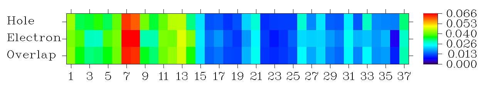

# **3.21 电子激发分析 (18)**

## **3.21.A 电子激发分析模块的基本信息**

### **3.21.A.1 概述**

主功能 18 包含大量用于电子激发分析的子功能，即以各种方式表征电子激发。该类别的所有功能完全支持单参考方法（*即* 产生激发态波函数的参考波函数是单个 Slater 行列式），包括 TDDFT、TDA-DFT、CIS 和 TDHF，跃迁密度矩阵绘制功能也支持 ZINDO。其它激发态方法如 EOM-CCSD、LR-CC2/3、CASSCF、CASPT2 和 MRCI 则不正式支持。这些电子激发分析功能的一些例子见第 [4.18](sec-4-18-electron-excitation-analysis.md) 节。

Multiwfn 的所有电子激发分析完全支持闭壳和开壳体系。

### **3.21.A.2 关于单参考方法的基础知识**

CIS 和 TDA-DFT 方法的激发态波函数 (Ψ$^{exc}$) 可表示为

$$
\Psi^{\mathrm{exc}}=\sum_{i\to a}w_i^a\Phi_i^a\equiv\sum_{i}^{\mathrm{occ}}\sum_{a}^{\mathrm{vir}}w_i^a\Phi_i^a
$$

其中 *i* 和 $a$ 分别遍历所有占据和所有非占据 MO，下文亦然。${\Phi}_{i}^{a}$ 是把一个电子从原来占据的 MO *i* 移到虚 MO $a$ 对应的组态态函数。*w* 称为组态系数。CIS 或 TDA-DFT 框架下的电子激发因此可表示为轨道对跃迁的线性组合。权重系数 *w* 满足归一化条件：

$$
\sum_{i\to a}\left(w_i^a\right)^2=1.0
$$

显然，*i*→ $a$ 轨道对跃迁对电子激发的贡献为 ${{100\%\times (w}_{i}^{a})}^{2}$。

而对 TDHF 和 TDDFT，激发态波函数还包含所谓的退激发部分：

$$
\Psi^{\mathrm{exc}}=\sum_{i\to a}w_i^a\Phi_i^a+\sum_{i\leftarrow a}w_i^{\prime a}\Phi_i^a
$$

其中 *w* 和 *w'* 分别对应激发和退激发的组态系数。此时归一化条件变为：

$$
\sum_{i\to a}\left(w_i^a\right)^2-\sum_{i\leftarrow a}\left(w_i^{\prime a}\right)^2=1
$$

CIS/TDHF 和 TDA-DFT/TDDFT 用的 MO 分别由当前体系基态的 HF 和 DFT 计算产生。由占据 MO 组成的 Slater 行列式即基态波函数，称为参考态。若参考态是闭壳的，则 α 和 β MO 完全匹配，β→β 轨道跃迁与 α→α 轨道跃迁一一对应；此时只记录一套轨道跃迁，相应地组态系数归一到 0.5 而非 1。

### **3.21.A.3 输入文件**

几乎所有电子激发分析功能的输入文件基本相同，子功能 3（基于密度差格点数据分析电荷转移）除外。**需要两种输入文件**：

**(1) 含基函数和分子轨道信息的文件（参考态的轨道波函数）**

激发态计算（如 TDDFT）产生的 mwfn、.fch/.fchk、.molden 和 .gms 文件可直接使用。该文件应在 Multiwfn 启动时载入。例如，可用 Gaussian 的 TDDFT 任务 .chk 文件经 formchk 转换的 .fch 文件，再如，可用 ORCA 的 TDDFT 任务 .gbw 文件经 orca_2mkl 转换的 .molden.input 文件。

**(2) 含激发态组态系数的文件**

进入相应的分析功能时应输入这类文件的路径，Multiwfn 从该文件载入组态系数。有以下几种情形：

- **Gaussian 用户**：CIS、TDHF、TDDFT 和 TDA-DFT 任务的输出文件（.out 或 .log）可用。单点和优化任务都支持；对后者，Multiwfn 在终点几何分析电子激发。由于默认 Gaussian 只输出绝对值大于 0.1 的组态系数，为达到可接受的精度，必须在 route 部分加 *IOp(9/40=4)* 关键词，使所有幅度大于 0.0001 的组态系数都被打印（若发现 Multiwfn 中的计算太贵，用 *IOp(9/40=3)* 代替一般也可接受）。隐式溶剂化模型，包括溶剂对跃迁响应的外迭代（态特定）处理，完全兼容。

- **用 CIS 或 TDA-DFT 的 ORCA 用户**：CIS 或 TDA-DFT 任务的输出文件可用。注意必须在 %cis 或 %tddft 中用 *TPrint* 关键词，否则只打印极少量的组态系数。*TPrint x* 指输出对激发态贡献大于 *x*\*100% 的组态。一般我建议用 *TPrint 1E-8*。由于贡献算为组态系数的平方，*TPrint 1E-8* 就是输出系数值绝对值大于 1E-4 的组态，效果与 Gaussian 中的 *IOp(9/40=4)* 完全相同。下面是输入例子：

  ```orca
  ! PBE0 def2-SVP
  %tddft
  nroots 8
  tprint 1E-8
  end
  ```

  ORCA 的自旋翻转 TDDFT 输出文件也支持，只需在 %tddft 中加 *SF TRUE* 并设参考态自旋多重度 ≥ 3。注意只有少数功能正式支持，包括产生激发态自然轨道、空穴-电子分析及相关分析，其它功能未经测试。特别地，所有直接基于跃迁密度矩阵的分析（包括 NTO 分析）都不支持。

- **用 TDDFT 的 ORCA 用户**：由于输出文件中没有显式记录激发和退激发组态的系数，此时不仅需要 TDDFT 输出文件，还需要一个记录所有组态系数的 json 文件。运行典型的名为*例如* *TDDFT.inp* 的 TDDFT 输入文件后，当前文件夹有 *TDDFT.gbw*。然后创建名为 *TDDFT.json.conf* 的文本文件，内容如下。

  ```json
  {
  "CIS": true,
  "CISNRoots": true
  }
  ```

  然后运行 *orca_2json TDDFT.gbw*，当前文件夹得到 *TDDFT.json*。之后，当 Multiwfn 在分析中尝试载入输入的 *TDDFT.out* 时，若同名同文件夹有 .json 后缀的文件（*即 TDDFT.json*），激发和退激发组态自动从 *TDDFT.json* 载入。若仍困惑，请读我的博客文章 <http://sobereva.com/758>（中文），其中描述了如何准备文件并结合 ORCA 的 TDDFT 计算用 Multiwfn 做典型分析。

- **用 sTDA 或 sTDDFT 的 ORCA 用户**：它们分别是常规 TDA 和 TDDFT 的近似，其输出文件可用。在 ORCA 中，它们的计算基于 DFT MO；DFT 单点任务完成后，sTDA/sTDDFT 以可忽略的代价算出激发态。做这些计算用如下关键词（详见 ORCA 手册）

  ```orca
  ! wB97X-D3 def2-SV(P) def2/J RIJCOSX
  %tddft
  Mode sTDDFT    //The sTDDFT may also be changed to sTDA
  Ethresh 7.0
  PThresh 1e-4
  PTLimit 30
  maxcore 6000
  end
  ```

  重要的是注意计算中只打印三个最大的组态系数（不幸的是 *TPrint* 对 sTDA/sTDDFT 计算无效），因此组态系数的归一化条件常被明显破坏，此时分析结果不可靠甚至完全误导！所以，请留意选中激发态载入后屏幕显示的 "Deviation to expected normalization value"。

- **BDF 用户**：BDF 程序 TDDFT 任务的输出文件可用。

- **CP2K 用户**：支持 CP2K 的周期性 TDDFT（含/不含 sTDA 核）任务。目前只有空穴-电子分析、NTO 分析、“产生特定激发态的自然轨道”、“检查、修改和导出激发的组态系数”和“打印所有激发态中的主要 MO 跃迁”正式支持，其它分析可能行也可能不行（至少我没测试过）。

  启动 Multiwfn 后，应载入含所有虚轨道和晶胞信息的 .molden 文件。然后进入分析模块后，载入 CP2K 的输出文件。

  值得注意的是用 Multiwfn 准备 CP2K 的 TDDFT 任务输入文件很容易。启动 Multiwfn 后先载入结构文件（对晶体常用 .cif，详见第 [2.9.3](sec-2-9-analysis-of-periodic-systems.md#293-周期体系的其它各类分析) 节），然后输入 *cp2k* 和要导出的输入文件路径。之后可先进入选项 -11 再进子选项 19 把当前晶胞扩展为超胞（如需要）。然后回到创建 CP2K 输入文件的界面，选选项 15 开启 TDDFT 计算，再输入 *y* 让 CP2K 生成含所有轨道的 .molden 文件并指定求解记录多少虚轨道。最后选选项 0 产生 CP2K 输入文件。再用 CP2K 运行该输入文件，算完后手动把晶胞信息插入 .molden 文件（如第 [2.9.2.1](sec-2-9-analysis-of-periodic-systems.md#2921-生成-molden-波函数文件) 节所述）。此时 .molden 文件和输出文件可用于电子激发分析。

  > **注**
  >
  > 注意 .molden 文件中记录的虚轨道应覆盖打印的组态涉及的所有虚轨道。若不知应算多少虚轨道，直接设非常大的值使所有虚轨道都被求解记录，但此时 .molden 文件可能很大。也可先做一次 TDDFT，再查看打印的组态找出最高的虚轨道，然后在输入文件中恰当设定要求解的虚轨道数并重做单点以产生 .molden 文件。

- **一般情形**：也可用纯文本文件作输入文件。跃迁信息的格式应与 Gaussian 输出完全相同，例如：（// 及其后的文字不应出现在你的文件中）

  ```text
  Excited State   1   1   5.7945    // Label, index, multiplicity and excitation energy (eV)
         5 ->  6         0.70642    // MO pairs and configuration coefficients
                                    // Use a blank line to separate each excited state
  Excited State   2   1   7.8943
         5 ->  7         0.63860
         5 ->  8         0.30006

  Excited State   3   1   7.8943
         5 ->  7        -0.30006
         5 ->  8         0.63860
         4 <-  8         0.01000
  ```

  下面给出非限制性 TDDFT 计算的例子。注意自旋多重度设为 0，即未定义，因为这类计算产生的激发态不是纯自旋态。

  ```text
  Excited State   1      0     2.07774
         600B -> 601B        -0.676085
         598A -> 602A         0.454805
         600A -> 603A         0.416875
  ...ignored

   Excited State   2      0     2.07792
         599B -> 601B         0.561757
         598A -> 601A         0.496762
         600B -> 603B         0.468381
  ...ignored
  ```

  显然，上述两种文件必须对应相同几何和相同计算水平。例如，若 .fch 中的 MO 在 B3LYP/6-31G\* 水平产生，而 Gaussian 输出文件对应 PBE0/6-31G\* 水平的 TDDFT 任务，分析结果完全无意义。

  > **注**
  >
  > 注 1：对闭壳参考情形，纯文本文件中的系数应遵循 Gaussian 惯例，即所有系数平方和为 0.5（而非归一到 1.0）。
  >
  > 注 2：给 Multiwfn 的纯文本文件中 MO 编号应从 1 开始。但 ORCA 等一些程序的 MO 编号从 0 开始，其用户准备纯文本文件时需手动把 MO 编号加 1。

- **GAMESS-US 和 Firefly 用户的特殊情形**：若你是 Firefly 或 GAMESS-US 用户，做电子激发分析不需要像上文那样分别提供两种文件。若 Multiwfn 用的输入文件是 .gms 后缀的 TDDFT 输出文件，Multiwfn 启动时不仅从该文件载入基函数和分子轨道信息，做电子激发分析时还载入激发态的组态系数。"examples\excit\\" 文件夹中的 *H2CO_TDDFT_Firefly.gms* 和 *H2CO_TDDFT_GAMESS.gms* 分别是 Firefly 和 GAMESS-US 的 TDDFT 输出文件例子。

  - Firefly 用户应减小 \$TDDFT 中的 "PRTTOL" 参数以打印更多组态系数。

  - GAMESS-US 没有控制组态系数打印阈值的选项，因此有些有不可忽略贡献的组态可能被忽略，分析结果可能不太准。此外 Multiwfn 不支持 GAMESS-US 的 CIS 任务。

  GAMESS-US 和 Firefly 的激发态优化和频率任务的输出文件不支持。

## **3.21.0 检查、修改和导出激发的组态系数 (-1)**

该功能可检查、修改和导出组态系数。本功能所需的输入文件已在本节 [3.21](sec-3-21-electron-excitation-analysis.md) 开头详细介绍，即 Multiwfn 启动时载入含基函数信息的文件，再载入含激发态组态系数的文件。屏幕打印所有识别的激发态的总结，应选其中之一，该电子激发涉及的轨道对的组态系数被载入。之后自动显示对激发绝对贡献最大的至多 10 个轨道对。然后在新出现的菜单中有以下选项：

- **1 Set coefficient of an orbital pair**：用该选项把某轨道对的已载入组态系数换为输入值。

- **2 Set coefficient for specific range of orbital pairs**：该选项用于批量把已载入组态系数换为输入值。应输入轨道跃迁对应的占据 MO 和虚 MO 的编号范围。

  用上述两选项手动修改系数后，为使修改影响后续电子激发分析，应先用选项 -3 把修改后的系数导出为纯文本文件，再把该文件作电子激发分析的第二种输入文件。

- **-1 Retrieve original coefficient of all orbital pairs**：若已用上述两选项手动修改过组态系数，可选该选项把系数恢复为原来载入的值。

- **-2 Print coefficient (and contribution to excitation) of some orbital pairs**：用该选项可打印绝对值大于特定值的组态系数，同时显示其对电子激发的相应贡献。通过该选项可轻松找出哪些轨道对跃迁对电子激发有关键贡献。

- **-3 Export current excitation information to a plain text file**：当前选中激发态的基本信息和组态系数可导出到指定的纯文本文件。**该文件之后可用作 Multiwfn 各种电子激发分析功能的第二种输入文件**，*例如* 空穴-电子分析和 NTO 分析，分析结果对应修改后的组态系数。

显然，若把某些轨道对的系数设为零，则它们对所研究量的贡献被完全忽略；而若除特定轨道对外清掉所有系数，则所得量只揭示该轨道跃迁的特征。

第 [4.18.10](sec-4-18-electron-excitation-analysis.md#41810-获得分子轨道对对跃迁偶极矩的贡献) 节的例子用了该功能。

## **3.21.1 分析并可视化空穴&电子分布、跃迁密度和跃迁电/磁偶极矩密度 (1)**

该非常强大的模块用于分析并可视化空穴-电子分布、跃迁密度和跃迁电/磁偶极矩密度。而且，空穴和电子可分解为轨道对贡献以及原子和片段贡献；进而原子/片段贡献可直接绘制为热图以便直观查看。

### **3.21.1.1 理论**

该模块涉及许多知识点，先在下面描述。

#### **理论 1：空穴和电子的实空间表示**

单电子激发过程可描述为“一个电子离开*空穴*跑到*电子*上”，“空穴”和“电子”有不同的定义方式。若激发可完美描述为 HOMO→LUMO 跃迁，则空穴和电子可简单用 HOMO 和 LUMO 分别表示。但在大多数实际情况，单轨道对表示不合适，激发必须表示为多个 MO 对带相应权重系数的跃迁。

当没有占主导的 MO 对跃迁时如何表示空穴和电子分布？一种方式是用自然跃迁轨道 (NTO) 分析，如第 [3.21.6](#3216-产生自然跃迁轨道-ntos-6) 节介绍。不幸的是，很多情形即使 MO 已变换为 NTO，仍没有占主导的 NTO 对。空穴和电子最好的表示应是本节介绍的，想法最初由我和合作者 Cheng Zhong 在 2013 年提出。虽然详细介绍该方法的论文尚未发表，若你的研究涉及该理论，请引用我的工作：*Carbon*, **165**, 461-467 (2020) DOI: [10.1016/j.carbon.2020.05.023](http://doi.org/10.1016/j.carbon.2020.05.023)，其中用了空穴-电子分析并做了简述。

可证明空穴和电子的密度分布可完美定义为

$$
\begin{gathered}\rho^{\mathrm{hole}}(\mathbf{r})=\rho_{(\mathrm{loc})}^{\mathrm{hole}}(\mathbf{r})+\rho_{(\mathrm{cross})}^{\mathrm{hole}}(\mathbf{r})=\sum_{i\to a}(w_i^a)^2\varphi_i(\mathbf{r})\varphi_i(\mathbf{r})+\sum_{i\to a}\sum_{j\neq i\to a}w_i^a w_j^a\varphi_i(\mathbf{r})\varphi_j(\mathbf{r})\\ \rho^{\mathrm{ele}}(\mathbf{r})=\rho_{(\mathrm{loc})}^{\mathrm{ele}}(\mathbf{r})+\rho_{(\mathrm{cross})}^{\mathrm{ele}}(\mathbf{r})=\sum_{i\to a}(w_i^a)^2\varphi_a(\mathbf{r})\varphi_a(\mathbf{r})+\sum_{i\to a}\sum_{i\to b\neq a}w_i^a w_i^b\varphi_a(\mathbf{r})\varphi_b(\mathbf{r})\end{gathered}
$$

注意这里用的记号：

$$
\sum_{i\to a}\equiv\sum_{i}^{\mathrm{occ}}\sum_{a}^{\mathrm{vir}}\qquad \sum_{i\to a}\sum_{j\neq i\to a}\equiv\sum_{i}^{\mathrm{occ}}\sum_{j\neq i}^{\mathrm{occ}}\sum_{a}^{\mathrm{vir}}
$$

其中 $\varphi$ 表示 MO 波函数。"loc" 和 "cross" 分别代表局域项和交叉项对空穴和电子分布的贡献。注意上文给出的空穴和电子定义是密度形式而非波函数形式，因而空穴和电子没有相位（若确实需要空穴和电子的相位信息，应求助 NTO 分析，见第 [3.21.6](#3216-产生自然跃迁轨道-ntos-6) 节）。

由于 MO 的正交归一以及所有组态系数平方和为 1.0 的事实，显然

$$
\int\rho^{\mathrm{hole}}(\mathbf{r})\mathrm{d}\mathbf{r}=1\qquad \int\rho^{\mathrm{ele}}(\mathbf{r})\mathrm{d}\mathbf{r}=1
$$

这是任何合理的空穴和电子分布定义都应满足的重要性质，表明有一个电子被激发。

空穴和电子分布之间的重叠函数可定义为

$$
S_{\mathrm{m}}(\mathbf{r})=\min\left[\rho^{\mathrm{hole}}(\mathbf{r}),\rho^{\mathrm{ele}}(\mathbf{r})\right]
$$

即处处取 *ρ*$^{hole}$ 和 *ρ*$^{ele}$ 的最小值。另一个衡量重叠的函数是

$$
S_{r}(\mathbf{r})=\sqrt{\rho^{\mathrm{hole}}(\mathbf{r})\rho^{\mathrm{ele}}(\mathbf{r})}
$$

显然 $S_\mathrm{r}$ 总等于或大于 $S_\mathrm{m}$。两种定义都合理，但我更喜欢用 $S_\mathrm{r}$，因为其图形效果更好且数学意义更明确。

激发态与基态之间的电荷密度差 (CDD) 可轻松计算为

$$
\Delta\rho(\mathbf{r})=\rho^{\mathrm{ele}}(\mathbf{r})-\rho^{\mathrm{hole}}(\mathbf{r})
$$

注：注意若你是 Gaussian 用户，这样算出的 Δ*ρ* 与用激发态密度减基态密度产生的 Δ*ρ* 明显不同，除非产生激发态 .wfn/wfx 文件时指定了关键词 *density=rhoci*。因为默认 Gaussian 导出到 .wfn/wfx 文件的激发态密度是弛豫密度而非未弛豫密度（后者直接由 MO 和激发态组态系数构建）。换言之，未弛豫激发态密度可简单写为 ${\rho}^{\mathrm{excited}}\left( \mathbf{r} \right)={\rho}^{\mathrm{ground}}\left( \mathbf{r} \right)-{\rho}^{\mathrm{hole}}\left( \mathbf{r} \right)+{\rho}^{\mathrm{ele}}\left( \mathbf{r} \right)$，而导出弛豫激发态密度需要用非常复杂的 "Z-vector" 方法。

推广后，上述空穴和电子定义也可用于 TDHF 和 TDDFT 情形，其中必须考虑退激发。推广的局域项为

$$
\begin{gathered}\rho_{(\mathrm{loc})}^{\mathrm{hole}}=\sum_{i\to a}\left(w_i^a\right)^2\rho_i-\sum_{i\leftarrow a}\left(w_i^{\prime a}\right)^2\rho_i\\ \rho_{(\mathrm{loc})}^{\mathrm{ele}}=\sum_{i\to a}\left(w_i^a\right)^2\rho_a-\sum_{i\leftarrow a}\left(w_i^{\prime a}\right)^2\rho_a\end{gathered}
$$

其中 $\rho_i=|\varphi_i|^2$ 代表轨道 *i* 的电子密度，*w'* 表示退激发的组态系数。推广的交叉项为

$$
\begin{gathered}\rho_{(\mathrm{cross})}^{\mathrm{hole}}=\sum_{i\to a}\sum_{j\neq i\to a}w_i^a w_j^a\varphi_i\varphi_j-\sum_{i\leftarrow a}\sum_{j\neq i\leftarrow a}w_i^{\prime a}w_j^{\prime a}\varphi_i\varphi_j\\ \rho_{(\mathrm{cross})}^{\mathrm{ele}}=\sum_{i\to a}\sum_{i\to b\neq a}w_i^a w_i^b\varphi_a\varphi_b-\sum_{i\leftarrow a}\sum_{i\leftarrow b\neq a}w_i^{\prime a}w_i^{\prime b}\varphi_a\varphi_b\end{gathered}
$$

若把局域和交叉项合并，空穴和电子的表达式可简单表示为

$$
\begin{gathered}\rho^{\mathrm{hole}}=\sum_{i,j\to a}w_i^a w_j^a\varphi_i\varphi_j-\sum_{i,j\leftarrow a}w_i^{\prime a}w_j^{\prime a}\varphi_i\varphi_j\\ \rho^{\mathrm{ele}}=\sum_{i\to a,b}w_i^a w_i^b\varphi_a\varphi_b-\sum_{i\leftarrow a,b}w_i^{\prime a}w_i^{\prime b}\varphi_a\varphi_b\end{gathered}
$$

#### **理论 2：MO、基函数、原子和片段对空穴和电子分布的贡献**

为考察哪些 MO 对空穴和电子有显著贡献，我定义了占据 MO 对空穴的贡献和虚 MO 对电子的贡献如下

$$
\Theta_i^{\mathrm{hole}}=\sum_{a}\left[(w_i^a)^2-(w_i^{\prime a})^2\right]\qquad \Theta_a^{\mathrm{ele}}=\sum_{i}\left[(w_i^a)^2-(w_i^{\prime a})^2\right]
$$

显然成立以下归一化条件：

$$
\sum_{i}\Theta_i^{\mathrm{hole}}=1\qquad \sum_{a}\Theta_a^{\mathrm{ele}}=1
$$

原子对空穴/电子的贡献可用 Hirshfeld、Hirshfeld-I 和 Becke 等实空间划分轻松计算。例如用 Hirshfeld 划分算原子 *A* 对空穴的贡献：

$$
\Theta_A^{\mathrm{hole}}=\int w_A^{\mathrm{Hirsh}}(\mathbf{r})\rho^{\mathrm{hole}}(\mathbf{r})\mathrm{d}\mathbf{r}
$$

其中 ${w}_{A}^{\mathrm{Hirsh}}$ 是 Hirshfeld 划分下原子 *A* 的权重函数，详见第 [3.9.1](sec-3-9-population-analysis-and-calculation-of-atomic-charges.md#391-hirshfeld-原子电荷-1) 节。

Mulliken 型划分也可能，工作方程推导如下。考虑空穴的归一化条件（为简单暂时忽略退激发部分）

$$
\begin{aligned}&\int\left(\sum_{i,j\to a}w_i^a w_j^a\varphi_i\varphi_j\right)\mathrm{d}\mathbf{r}=1\\ &\int\left(\sum_{i,j\to a}w_i^a w_j^a\sum_{\mu}\sum_{\nu}C_{\mu,i}C_{\nu,j}\chi_{\mu}\chi_{\nu}\right)\mathrm{d}\mathbf{r}=1\\ &\sum_{i,j\to a}w_i^a w_j^a\sum_{\mu}\sum_{\nu}C_{\mu,i}C_{\nu,j}\int\chi_{\mu}\chi_{\nu}\mathrm{d}\mathbf{r}=1\\ &\sum_{i,j\to a}w_i^a w_j^a\sum_{\mu}\sum_{\nu}C_{\mu,i}C_{\nu,j}S_{\mu,\nu}=1\end{aligned}
$$

其中 *χ* 表示基函数，**S** 和 **C** 分别是重叠矩阵和系数矩阵。若用 Mulliken 型方法把 $\sum_{\mu}\sum_{\nu}C_{\mu,i}C_{\nu,j}S_{\mu,\nu}$ 项划分为原子贡献，则可如下定义原子 *A* 对空穴的贡献

$$
\Theta_A^{\mathrm{hole}}=\sum_{i,j\to a}w_i^a w_j^a\frac{1}{2}\left(\sum_{\mu\in A}\sum_{\nu}C_{\mu,i}C_{\nu,j}S_{\mu,\nu}+\sum_{\mu}\sum_{\nu\in A}C_{\mu,i}C_{\nu,j}S_{\mu,\nu}\right)
$$

上述处理同样可用于空穴的退激发部分以及电子。实际用于计算原子对空穴和电子贡献的工作方程为

$$
\begin{gathered}\Theta_A^{\mathrm{hole}}=\sum_{i,j\to a}w_i^a w_j^a\frac{1}{2}\left(\sum_{\mu\in A}\sum_{\nu}T_{\mu,\nu}^{ij}+\sum_{\mu}\sum_{\nu\in A}T_{\mu,\nu}^{ij}\right)-\sum_{i,j\leftarrow a}w_i^{\prime a}w_j^{\prime a}\frac{1}{2}\left(\sum_{\mu\in A}\sum_{\nu}T_{\mu,\nu}^{ij}+\sum_{\mu}\sum_{\nu\in A}T_{\mu,\nu}^{ij}\right)\\ \Theta_A^{\mathrm{ele}}=\sum_{i\to a,b}w_i^a w_i^b\frac{1}{2}\left(\sum_{\mu\in A}\sum_{\nu}T_{\mu,\nu}^{ab}+\sum_{\mu}\sum_{\nu\in A}T_{\mu,\nu}^{ab}\right)-\sum_{i\leftarrow a,b}w_i^{\prime a}w_i^{\prime b}\frac{1}{2}\left(\sum_{\mu\in A}\sum_{\nu}T_{\mu,\nu}^{ab}+\sum_{\mu}\sum_{\nu\in A}T_{\mu,\nu}^{ab}\right)\end{gathered}
$$

其中 **T** 是为方便计算的中间矩阵，定义为 $T_{\mu,\nu}^{ij}=C_{\mu,i}C_{\nu,j}S_{\mu,\nu}$。

基函数 *µ* 对空穴和电子的贡献可定义为

$$
\begin{gathered}\Theta_{\mu}^{\mathrm{hole}}=\sum_{i,j\to a}w_i^a w_j^a\frac{1}{2}\left(\sum_{\nu}T_{\mu,\nu}^{ij}+\sum_{\nu}T_{\nu,\mu}^{ij}\right)-\sum_{i,j\leftarrow a}w_i^{\prime a}w_j^{\prime a}\frac{1}{2}\left(\sum_{\nu}T_{\mu,\nu}^{ij}+\sum_{\nu}T_{\nu,\mu}^{ij}\right)\\ \Theta_{\mu}^{\mathrm{ele}}=\sum_{i\to a,b}w_i^a w_i^b\frac{1}{2}\left(\sum_{\nu}T_{\mu,\nu}^{ab}+\sum_{\nu}T_{\nu,\mu}^{ab}\right)-\sum_{i\leftarrow a,b}w_i^{\prime a}w_i^{\prime b}\frac{1}{2}\left(\sum_{\nu}T_{\mu,\nu}^{ab}+\sum_{\nu}T_{\nu,\mu}^{ab}\right)\end{gathered}
$$

> **注**
>
> 为显著节省计算时间，Multiwfn 忽略相应两组态系数乘积幅度小于 0.001 的所有项。该技巧带来的精度损失可忽略。

对 Mulliken 型和 Hirshfeld 划分，片段对空穴和电子的贡献可简单加和原子贡献得到：

$$
\Theta_{\mathrm{frag}}^{\mathrm{hole}}=\sum_{A\in\mathrm{frag}}\Theta_A^{\mathrm{hole}}\qquad \Theta_{\mathrm{frag}}^{\mathrm{ele}}=\sum_{A\in\mathrm{frag}}\Theta_A^{\mathrm{ele}}
$$

进而，我定义了原子和片段对电荷密度差（原子和片段电子布居的变化）的贡献为

$$
\Theta_A^{\mathrm{CDD}}=\Theta_A^{\mathrm{ele}}-\Theta_A^{\mathrm{hole}}\qquad \Theta_{\mathrm{frag}}^{\mathrm{CDD}}=\Theta_{\mathrm{frag}}^{\mathrm{ele}}-\Theta_{\mathrm{frag}}^{\mathrm{hole}}
$$

原子和片段空间中空穴和电子的重叠定义为其贡献的几何平均：

$$
\Theta_A^{\mathrm{ovlp}}=\sqrt{\Theta_A^{\mathrm{ele}}\Theta_A^{\mathrm{hole}}}\qquad \Theta_{\mathrm{frag}}^{\mathrm{ovlp}}=\sqrt{\Theta_{\mathrm{frag}}^{\mathrm{ele}}\Theta_{\mathrm{frag}}^{\mathrm{hole}}}
$$

注意这种形式的重叠不具加和性，即 $\Theta_A^{\mathrm{ovlp}}+\Theta_B^{\mathrm{ovlp}}\neq\Theta_{AB}^{\mathrm{ovlp}}$。

Mulliken 型划分对大多数情形合理，但它与弥散函数不兼容。该划分另一个众所周知的缺点是某些情形一些原子贡献可能是小的负值，显然此时相应原子空间中空穴和电子的重叠无法计算，Multiwfn 自动把重叠值设为零。显然，当必须用弥散函数（*例如* 阴离子体系、Rydberg 激发态），或观察到明显的原子对空穴或电子的负贡献时，必须换用更稳健但计算代价更高的 Hirshfeld 划分。

Mulliken 型和 Hirshfeld 划分可在空穴-电子分析模块直接选择。由于 Multiwfn 的极大灵活性，也可用其它方式确定原子对空穴和电子的贡献，如 Becke 和 Hirshfeld-I 划分。但必须手动计算。例如，若想对空穴和电子用 Becke 划分，应先导出空穴或电子的 cube 文件，再把 *settings.ini* 中的 "iuserfunc" 设为 -1（此时用户自定义函数对应基于格点数据的插值函数），再把空穴或电子 cube 文件载入 Multiwfn，用主功能 15 的子功能 1 在每个 Becke 原子模糊空间积分“用户自定义函数”。注意若在主功能 15 中先选选项 -4 定义片段再用子功能 1 积分用户自定义函数，则所有原子的结果之和对应片段贡献。

#### **理论 3：全空间空穴和电子分布的定量表征**

空穴和电子的整体分布可用以下方式定量表征，它们对识别电子激发类型很有用。

为空穴和电子的重叠程度，$S_\mathrm{m}$ 指数和 $S_\mathrm{r}$ 指数定义为（$S_\mathrm{r}$ 必等于或大于 $S_\mathrm{m}$ 指数）

$$
\begin{gathered}S_{\mathrm{m}}\ \mathrm{index}=\int S_{\mathrm{m}}(\mathbf{r})\mathrm{d}\mathbf{r}\equiv\int\min\left[\rho^{\mathrm{hole}}(\mathbf{r}),\rho^{\mathrm{ele}}(\mathbf{r})\right]\mathrm{d}\mathbf{r}\\ S_{\mathrm{r}}\ \mathrm{index}=\int S_{\mathrm{r}}(\mathbf{r})\mathrm{d}\mathbf{r}\equiv\int\sqrt{\rho^{\mathrm{hole}}(\mathbf{r})\rho^{\mathrm{ele}}(\mathbf{r})}\mathrm{d}\mathbf{r}\end{gathered}
$$

质心可用于揭示空穴和电子分布的最具代表性的位置。例如电子质心的 X 坐标写为

$$
X_{\mathrm{ele}}=\int x\rho^{\mathrm{ele}}(\mathbf{r})\mathrm{d}\mathbf{r}
$$

其中 *x* 是位置矢量 **r** 的 X 分量。

相应方向上空穴和电子质心之间的距离可衡量 X/Y/Z 的电荷转移 (CT) 长度：

$$
D_{x}=\left|X_{\mathrm{ele}}-X_{\mathrm{hole}}\right|\qquad D_{y}=\left|Y_{\mathrm{ele}}-Y_{\mathrm{hole}}\right|\qquad D_{z}=\left|Z_{\mathrm{ele}}-Z_{\mathrm{hole}}\right|
$$

CT 长度的总大小称为 *D* 指数：

$$
D\ \mathrm{index}=\left|\mathbf{D}\right|\equiv\sqrt{(D_{x})^2+(D_{y})^2+(D_{z})^2}
$$

值得注意的是激发态（对应未弛豫密度）相对基态的偶极矩在 X、Y、Z 的变化可简单算为

$$
\Delta\mu_{\mathrm{x}}=-(X_{\mathrm{ele}}-X_{\mathrm{hole}})\qquad \Delta\mu_{\mathrm{y}}=-(Y_{\mathrm{ele}}-Y_{\mathrm{hole}})\qquad \Delta\mu_{\mathrm{z}}=-(Z_{\mathrm{ele}}-Z_{\mathrm{hole}})
$$

空穴和电子的 RMSD 可用于表征其空间分布范围。例如空穴 RMSD 的 X 分量表示为

$$
\sigma_{\mathrm{hole},x}=\sqrt{\int(x-X_{\mathrm{hole}})^2\rho^{\mathrm{hole}}(\mathbf{r})\mathrm{d}\mathbf{r}}
$$

\|**σ**$_{hole}$\| 和 \|**σ**$_{ele}$\| 分别称为 *σ*$_{hole}$ 和 *σ*$_{ele}$ 指数，分别衡量空穴和电子的整体 RMSD。

X/Y/Z 方向电子与空穴 RMSD 之差可用 Δ$σ_{λ}$ 衡量，整体之差可用 Δ*σ* 指数衡量

$$
\begin{gathered}\Delta\sigma_{\lambda}=\sigma_{\mathrm{ele},\lambda}-\sigma_{\mathrm{hole},\lambda}\qquad \lambda=\{x,y,z\}\\ \Delta\sigma\ \mathrm{index}=\left|\boldsymbol{\sigma}_{\mathrm{ele}}\right|-\left|\boldsymbol{\sigma}_{\mathrm{hole}}\right|\end{gathered}
$$

$H_{λ}$ 衡量 X/Y/Z 方向空穴和电子分布空间扩展的平均程度，$H_{\mathrm{CT}}$ 是 CT 方向的，*H* 指数是整体衡量

$$
\begin{gathered}H_{\lambda}=(\sigma_{\mathrm{ele},\lambda}+\sigma_{\mathrm{hole},\lambda})/2\qquad \lambda=\{x,y,z\}\\ H_{\mathrm{CT}}=\left|\mathbf{H}\cdot\mathbf{u}_{\mathrm{CT}}\right|\\ H\ \mathrm{index}=\left(\left|\boldsymbol{\sigma}_{\mathrm{ele}}\right|+\left|\boldsymbol{\sigma}_{\mathrm{hole}}\right|\right)/2\end{gathered}
$$

其中 $u_{\mathrm{CT}}$ 是 CT 方向的单位矢量，可用空穴和电子的质心直接导出。

*t* 指数用于衡量 CT 方向空穴和电子的分离程度：

$$
t\ \mathrm{index}=D\ \mathrm{index}-H_{\mathrm{CT}}
$$

若 *t* 指数$<0$，意味着空穴和电子没有因 CT 而实质分离。空穴和电子分布的明显分离必然对应明显为正的 *t* 指数。

空穴离域指数 (HDI) 和电子离域指数 (EDI) 定义为

$$
\begin{gathered}HDI=100\times\sqrt{\int[\rho^{\mathrm{hole}}(\mathbf{r})]^2\mathrm{d}\mathbf{r}}\\ EDI=100\times\sqrt{\int[\rho^{\mathrm{ele}}(\mathbf{r})]^2\mathrm{d}\mathbf{r}}\end{gathered}
$$

发现 HDI (EDI) 越小，空穴（电子）的空间离域越大；换言之，在整个体系分布越均匀。HDI 和 EDI 在定量空间分布广度上很有用（虽然 \|**σ**$_{hole}$\| 和 \|**σ**$_{ele}$\| 也能揭示这一点，但当空穴或电子集中在多个区域时它们不合适）。

空穴和电子分布中常有许多节点或复杂涨落。为使空穴和电子的直观研究更容易，$C_{\mathrm{hole}}$ 和 $C_{\mathrm{ele}}$ 函数定义为。$C_{\mathrm{hole}}$ 和 $C_{\mathrm{ele}}$ 的函数行为类似 Gaussian 函数，是高度光滑的函数，值从空穴/电子的质心向外渐近趋于零。

$$
\begin{gathered}C_{\mathrm{ele}}(\mathbf{r})=A_{\mathrm{ele}}\exp\left(-\frac{(x-X_{\mathrm{ele}})^2}{2\sigma_{\mathrm{ele},x}^2}-\frac{(y-Y_{\mathrm{ele}})^2}{2\sigma_{\mathrm{ele},y}^2}-\frac{(z-Z_{\mathrm{ele}})^2}{2\sigma_{\mathrm{ele},z}^2}\right)\\ C_{\mathrm{hole}}(\mathbf{r})=A_{\mathrm{hole}}\exp\left(-\frac{(x-X_{\mathrm{hole}})^2}{2\sigma_{\mathrm{hole},x}^2}-\frac{(y-Y_{\mathrm{hole}})^2}{2\sigma_{\mathrm{hole},y}^2}-\frac{(z-Z_{\mathrm{hole}})^2}{2\sigma_{\mathrm{hole},z}^2}\right)\end{gathered}
$$

引入因子 *A* 使 $C_{\mathrm{hole}}$ 和 $C_{\mathrm{ele}}$ 归一化。

事实上，上述 RMSD、$C_{\mathrm{hole}}$、$C_{\mathrm{ele}}$、*H* 和 *t* 指数的定义受 *J. Chem. Theory Comput.*, **7**, 2498 (2011) 启发，这些量最初用于基于密度差分析电子激发，但我发现它们在空穴-电子分析框架下都很好用。还注意引入空穴-电子分析框架时这些指数的许多细节已被修改。

上述定量指数可用于区分电子激发类型。我的经验规则总结如下，应适用于大多数情形。

<table style="width: auto; margin-left: auto; margin-right: auto;">
<thead>
<tr>
<th rowspan="2" style="text-align: center;">激发类型</th>
<th colspan="5" style="text-align: center;">指数</th>
</tr>
<tr>
<th style="text-align: center;"><em>D</em></th>
<th style="text-align: center;"><em>S</em>$_{r}$</th>
<th style="text-align: center;"><em>t</em></th>
<th style="text-align: center;">∆<em>σ</em></th>
<th></th>
</tr>
</thead>
<tbody>
<tr>
<td style="text-align: center;">LE</td>
<td style="text-align: center;">小</td>
<td style="text-align: center;">中 ~ 大</td>
<td style="text-align: center;">&lt;0</td>
<td style="text-align: center;">小</td>
<td></td>
</tr>
<tr>
<td style="text-align: center;">单方向 CT</td>
<td style="text-align: center;">大</td>
<td style="text-align: center;">?</td>
<td style="text-align: center;">?</td>
<td style="text-align: center;">?</td>
<td></td>
</tr>
<tr>
<td style="text-align: center;">中心对称 CT</td>
<td style="text-align: center;">小</td>
<td style="text-align: center;">?</td>
<td style="text-align: center;">&lt;0</td>
<td style="text-align: center;">大</td>
<td></td>
</tr>
<tr>
<td style="text-align: center;">Rydberg</td>
<td style="text-align: center;">小</td>
<td style="text-align: center;">小</td>
<td style="text-align: center;">&lt;0</td>
<td style="text-align: center;">大</td>
<td></td>
</tr>
</tbody>
</table>

表中涉及三种激发：

- 局域激发 (LE, local excitation)：空穴和电子占据类似的空间区域。

- 电荷转移激发 (CT)：空穴和电子的空间分离大，导致电荷密度的明显位移。CT 可以是单方向或多方向的（中心对称 CT 是后者的特例）。

- Rydberg 激发：电子主要由非常弥散的 MO 组成，因此电子和空穴的重叠必然小。这类激发一般不导致显著的长程电荷密度位移。

#### **理论 4：跃迁密度矩阵和跃迁密度**

*N* 电子体系激发态与基态之间的（单电子、无自旋）跃迁密度矩阵在实空间表示中定义为（假设实型波函数，故省略复共轭符号）

$$
T(\mathbf{r};\mathbf{r}')\equiv T(\mathbf{r}_1;\mathbf{r}_1')=\int\Phi^0(x_1,x_2,\cdots x_N)\Psi^{\mathrm{exc}}(x_1',x_2,\cdots x_N)\mathrm{d}\sigma_1\mathrm{d}x_2\mathrm{d}x_3\cdots\mathrm{d}x_N
$$

其中 Φ⁰ 是基态波函数的 Slater 行列式。**x** 是自旋-空间坐标，*σ* 代表自旋坐标。**T** 被称为矩阵是因为它有两个连续编号。

对单参考方法产生的激发态波函数，展开 Ψ$^{exc}$ 并用 Slater-Condon 规则，可轻松证明 **T** 可显式写为

$$
T(\mathbf{r};\mathbf{r}')=\sum_{i}\sum_{a}w_i^a\varphi_i(\mathbf{r})\varphi_a(\mathbf{r}')
$$

若只取跃迁密度矩阵的对角项，则得到跃迁密度

$$
T(\mathbf{r})=\sum_{i}\sum_{a}w_i^a\varphi_i(\mathbf{r})\varphi_a(\mathbf{r})
$$

*T*(**r**) 可作为普通的实空间函数研究，例如可视化为等值面图。假设只有一对占主导的轨道跃迁，例如 HOMO→LUMO，则 *T*(**r**) 就是 $\varphi$ $_{HOMO}$(**r**) $\varphi$ $_{LUMO}$(**r**)。因此容易理解，若某区域跃迁密度幅度大，空穴和电子在该区域必然强耦合；而若某区域 *T*(**r**) 分布小，则该区域空穴和电子的重叠应不显著。显然，*T*(**r**) 是表征电子激发内在本质的有用函数，其主要分布特征与 $S_{r}$ (**r**) 函数密切相关。

注意由于 MO 的正交归一，*T*(**r**) 在全空间的积分为严格零。若激发态和基态对应不同自旋态，由于自旋坐标的正交归一，*T*(**r**;**r'**) 必为零矩阵，*T*(**r**) 相应处处为零。但注意 Multiwfn 计算时只考虑 *T*(**r**) 的空间部分，因此仍能研究*例如* S0→T1 激发的 *T*(**r**)。

#### **理论 5：跃迁电/磁偶极矩密度**

注意跃迁偶极矩有很多种，包括跃迁电偶极矩、跃迁磁偶极矩、跃迁速度偶极矩等。“跃迁偶极矩”一词一般指跃迁电偶极矩。

跃迁电偶极矩密度的 X、Y、Z 分量可分别写为 X、Y、Z 坐标变量与跃迁密度乘积的负值：

$$
T_{\mathrm{x}}(\mathbf{r})=-xT(\mathbf{r})\qquad T_{\mathrm{y}}(\mathbf{r})=-yT(\mathbf{r})\qquad T_{\mathrm{z}}(\mathbf{r})=-zT(\mathbf{r})
$$

在全空间积分跃迁电偶极矩密度得到跃迁偶极矩 **D**

$$
D_{\mathrm{x}}=\int T_{\mathrm{x}}(\mathbf{r})\mathrm{d}\mathbf{r}\qquad D_{\mathrm{y}}=\int T_{\mathrm{y}}(\mathbf{r})\mathrm{d}\mathbf{r}\qquad D_{\mathrm{z}}=\int T_{\mathrm{z}}(\mathbf{r})\mathrm{d}\mathbf{r}
$$

显然，通过绘制跃迁电偶极矩密度可方便研究各分子区域对跃迁电偶极矩的贡献。

接下来看跃迁磁偶极矩。电子运动产生的磁偶极矩的算符是角动量算符 **L**（见*例如* *Theor. Chim. Acta*, **6**, 341 (1966)）

$$
\begin{aligned}&\hat{\mathbf{L}}=-i(\mathbf{r}\times\nabla)=\hat{\mathbf{i}}L_{x}+\hat{\mathbf{j}}L_{y}+\hat{\mathbf{k}}L_{z}\\ &=-i\left[\hat{\mathbf{i}}\left(y\frac{\partial}{\partial z}-z\frac{\partial}{\partial y}\right)+\hat{\mathbf{j}}\left(z\frac{\partial}{\partial x}-x\frac{\partial}{\partial z}\right)+\hat{\mathbf{k}}\left(x\frac{\partial}{\partial y}-y\frac{\partial}{\partial x}\right)\right]\end{aligned}
$$

其中 **i**、**j**、**k** 分别是 X、Y、Z 方向的单位矢量。因此，跃迁磁偶极矩的 X 分量可显式定义如下。为得到实数值，去掉虚数和负号；符号 "←" 在 TDHF/TDDFT 形式中表示退激发 MO 对。

$$
M_{x}=\left\langle\Phi^0\left|y\frac{\partial}{\partial z}-z\frac{\partial}{\partial y}\right|\Psi^{\mathrm{exc}}\right\rangle=\sum_{i\to a}w_i^a\left\langle\varphi_i\left|y\frac{\partial}{\partial z}-z\frac{\partial}{\partial y}\right|\varphi_a\right\rangle-\sum_{j\leftarrow b}w_j^{\prime b}\left\langle\varphi_j\left|y\frac{\partial}{\partial z}-z\frac{\partial}{\partial y}\right|\varphi_b\right\rangle
$$

$M_{y}$ 和 $M_{z}$ 可类似定义。注意要把上文给出的跃迁磁偶极矩（也是 Multiwfn 输出的）换为更常用的定义 $\frac{1}{2}i\left\langle {\psi}_{i}\middle|\mathbf{r}\times\mathbf{\nabla }\middle|{\psi}_{j} \right\rangle$，应手动除以 2。

可通过关系 $M_{i}=\int m_{i}(\mathbf{r})\mathrm{d}\mathbf{r}\qquad i=x,y,z$ 定义跃迁磁偶极矩密度分量 $m_{i}$ (**r**)，从而跃迁磁偶极矩的分布可视化为*例如*等值面图。下面给出 X 分量 $m_{i}$ (**r**) 的显式表达式，Y 和 Z 分量可类似定义。

$$
m_{\mathrm{x}}(\mathbf{r})=\sum_{i\to a}w_i^a\varphi_i(\mathbf{r})\left[y\frac{\partial\varphi_a}{\partial z}(\mathbf{r})-z\frac{\partial\varphi_a}{\partial y}(\mathbf{r})\right]-\sum_{j\leftarrow b}w_j^{\prime b}\varphi_j(\mathbf{r})\left[y\frac{\partial\varphi_b}{\partial z}(\mathbf{r})-z\frac{\partial\varphi_b}{\partial y}(\mathbf{r})\right]
$$

#### **理论 6：空穴和电子之间的 Coulomb 吸引（激子结合能）**

“电子”当然带负电，而“空穴”可视为带正电，因此形式上二者之间有 Coulomb 吸引能，其负值称为激子结合能，是正值。该项可用简单的 Coulomb 公式计算（原子单位形式）：

$$
E_{\mathrm{C}}=\int\int\frac{\rho^{\mathrm{hole}}(\mathbf{r}_1)\rho^{\mathrm{ele}}(\mathbf{r}_2)}{\left|\mathbf{r}_1-\mathbf{r}_2\right|}\mathrm{d}\mathbf{r}_1\mathrm{d}\mathbf{r}_2
$$

关于激子结合能的讨论见*例如* *J. Chem. Phys.*, **143**, 244905 (2015) 和 *J. Phys. Chem. C*, **121**, 17088 (2017)。

> **注**
>
> 注意上式算出的激子结合能不同于另一种形式定义的激子结合能，即 $E_{C}$ =(IP-EA)- $E_{optical gap}$（更多细节见 *Mater. Horiz.*, **1**, 17 (2014)），因为实际的电子电离和电子亲合过程涉及电子相关和轨道弛豫效应；而且事实上 $E_{C}$ 中还有交换项（尽管空穴和电子分离显著时它可忽略）。计算 Multiwfn 中的激子结合能时忽略了所有这些因素。

在 Multiwfn 中，上面积分直接基于空穴和电子的均匀分布格点数据计算。注意虽然代码已大幅优化并行化，计算代价仍高，因此计算时需耐心等待。代价形式上正比于格点数的平方；因此中等质量格点的代价比低质量格点高一个量级。

### **3.21.1.2 用法与功能**

本模块所需的输入文件已在本节 [3.21](sec-3-21-electron-excitation-analysis.md) 开头详细介绍，即 Multiwfn 启动时载入含基函数信息的文件，再载入含激发态组态系数信息的文件。屏幕打印识别的激发态的总结，应选要做上述分析的激发态。每次只能分析一个态，若想分析另一态，应退出该功能再进入选另一态。

本模块有很多功能，下面依次描述。

#### **功能 1：可视化并分析空穴、电子和跃迁密度等**

进入该功能后，被要求设置格点数据，然后对空穴分布、电子分布、空穴和电子的重叠、跃迁密度、跃迁电/磁偶极矩密度、电荷密度差和 $C_{\mathrm{ele}}$ / $C_{\mathrm{hole}}$ 函数计算格点数据。

格点数据算完后，基于均匀分布格点数据计算第 [3.21.1.1](#32111-理论) 节介绍的各种量并显示在屏幕上，其意义应很容易理解。输出的跃迁电/磁偶极矩通过积分跃迁偶极矩密度的格点数据算出，值应与量子化学程序直接输出的很接近。空穴或电子在全空间积分的理想值为 1.0，而跃迁密度理想值为 0。若实际输出值偏离期望值太远，则打印的 *t* 指数、*H* 指数、*D* 指数、$S_{m}$ 指数等可能不可靠。有三个原因可能导致该问题：

- (1) 格点质量太差。应用更多格点数

- (2) 格点数据的空间范围太窄，应增大外延距离使格点数据覆盖更广的区域

- (3) 忘了用本节 [3.21](sec-3-21-electron-excitation-analysis.md) 开头提到的 *IOp(9/40=x)* 选项，结果只载入了极少量的组态系数

在后处理菜单中，空穴、电子、跃迁密度、$S_{m}$ / $S_{r}$ 等的格点数据可直接可视化为等值面图，或通过相应选项导出为当前文件夹下的 cube 文件。也可选相应选项计算空穴和电子分布之间的 Coulomb 吸引能，注意即使只选低质量格点该计算也很贵。

默认不计算跃迁磁偶极矩密度，因为它不如跃迁电偶极矩密度重要。若想计算它，进入该功能前选选项 -1。

对大体系，若格点数据的计算代价太高而只需定性查看空穴、电子、跃迁密度等的等值面图，在 Gaussian 中可放心用 *IOp(9/40=3)* 代替 *IOp(9/40=4)*，从而考虑更少组态。

#### **功能 2：显示分子轨道对空穴和电子分布的贡献**

只需输入打印阈值，就会显示 MO 对空穴和电子分布的贡献。该功能对识别哪些 MO 对空穴和电子有显著贡献很有用。下面是输出例子：

```text
 MO     126, Occ:   2.00000    Hole:  0.29664     Electron:  0.00000
 MO     127, Occ:   2.00000    Hole:  0.19783     Electron:  0.00000
 MO     128, Occ:   2.00000    Hole:  0.38666     Electron:  0.00000
 MO     130, Occ:   0.00000    Hole:  0.00000     Electron:  0.08058
 MO     131, Occ:   0.00000    Hole:  0.00000     Electron:  0.46282
 MO     132, Occ:   0.00000    Hole:  0.00000     Electron:  0.16703
 MO     133, Occ:   0.00000    Hole:  0.00000     Electron:  0.22976
 Sum of hole:  1.00000    Sum of electron:  1.00000
```

#### **功能 3：显示原子或片段对空穴和电子的贡献并把贡献绘制为热图**

进入该功能后，屏幕打印第 [3.21.1.1](#32111-理论) 节“理论 2”提到的许多量，下面是输出例子。原子贡献用 Mulliken 型划分得到。

```text
Contribution of each non-hydrogen atom to hole and electron:
    1(C )  Hole:  1.37 %  Electron:  8.96 %  Overlap:  3.50 %  Diff.:   7.59 %
    2(C )  Hole: 11.86 %  Electron:  0.74 %  Overlap:  2.97 %  Diff.: -11.11 %
    3(C )  Hole:  8.96 %  Electron: 11.00 %  Overlap:  9.93 %  Diff.:   2.04 %
...[ignored]
   14(N )  Hole:  0.18 %  Electron: 23.80 %  Overlap:  2.07 %  Diff.:  23.62 %
   15(O )  Hole:  3.07 %  Electron: 17.23 %  Overlap:  7.28 %  Diff.:  14.16 %
   16(O )  Hole:  3.07 %  Electron: 17.23 %  Overlap:  7.28 %  Diff.:  14.16 %
```

输出中 "Overlap" 就是 "Hole" 和 "Electron" 的几何平均，而 "Diff." 由 "Electron" 减 "Hole" 得到。由于氢一般不参与感兴趣的电子激发，默认忽略氢，但可通过 "Toggle if taking hydrogens into account" 选项切换状态。

若需要分子片段对上述量的贡献，可选选项 "-1 Load fragment definition" 再依次输入片段数和每个片段的原子编号。片段定义也可从外部纯文本文件载入，其中每片段占一行，例如

```text
1,3,6-10,12
2,4,5
11
13-15
```

该例子共定义四个片段，第一片段由原子 1,3,6,7,8,9,10,12 组成。片段定义完成后，片段对各种量的贡献立刻打印在屏幕上。

原子/片段在空穴和电子中的组成以及各原子/片段空间中空穴-电子重叠可绘制为热图，从而非常生动展示其分布特征。下面是例子，颜色对应函数值，横坐标对应原子编号。



从图可立刻认出这是局域激发，因为空穴和电子大都在由原子 1-14 组成的片段上分布。特别地，原子 7 和 8 是对该电子激发贡献最大的原子。若在绘图前载入片段定义，则热图横坐标对应片段编号。菜单中还有调整色标、图的比例和 X 轴标签间隔的选项。

该空穴-电子模块的非常详细的例子见第 [4.18.1](sec-4-18-electron-excitation-analysis.md#4181-用空穴-电子分析完整表征电子激发) 节。用该模块分析跃迁密度和跃迁偶极矩密度的例子见第 [4.18.2.1](sec-4-18-electron-excitation-analysis.md#41821-在实空间分析跃迁密度和跃迁偶极矩密度) 节。更多讨论和例子见我的博客文章“使用 Multiwfn 做空穴-电子分析全面考察电子激发特征”（中文，<http://sobereva.com/434>）。

> **所需信息**
>
> 见本节 [3.21](sec-3-21-electron-excitation-analysis.md) 开头。

## **3.21.2 把各种原子/片段跃迁矩阵绘制为热图 (2)**

该功能用于把各种原子跃迁矩阵 (ATM, atom transition matrix) 绘制为热图（颜色填充矩阵图）。ATM 指任何表示两态之间电子跃迁信息的基于原子的矩阵。例如，它可对应基于原子的跃迁密度矩阵（见下）、原子-原子电荷转移矩阵、原子跃迁偶极矩矩阵等。在该功能中，ATM 还可进一步转为片段跃迁矩阵 (FTM) 再绘制为热图。

虽然该功能也可绘制其它矩阵的热图，但开发该功能的主要目的是绘制基于原子或片段的跃迁密度矩阵，因此先介绍跃迁密度矩阵相关的理论。

### **关于跃迁密度矩阵 (TDM) 的理论**

下面，“TDM”指基函数表示下的跃迁密度矩阵。基态与激发态之间的 TDM 可算为（为简单忽略退激发跃迁）

$$
P_{\mu\nu}^{\mathrm{tran}}=\sum_{i}^{\mathrm{occ}}\sum_{a}^{\mathrm{vir}}w_i^a C_{\mu i}C_{\nu a}
$$

其中 $C_{\mu i}$ 表示 MO *i* 中基函数 *µ* 的展开系数。顺便值得注意的是实空间表示的 TDM（第 [3.21.1.1](#32111-理论) 节介绍）可通过基函数表示的 TDM 轻松构建（*χ* 代表基函数）：

$$
T(\mathbf{r};\mathbf{r}')=\sum_{\mu}\sum_{\nu}P_{\mu\nu}^{\mathrm{tran}}\chi_{\mu}(\mathbf{r})\chi_{\nu}(\mathbf{r}')
$$

TDM 的非对角元本质代表电子激发中各基函数之间的耦合。假设只有两个基函数同时激发可完美表示为 *i*→ $a$ MO 跃迁，则 TDM 可显式写为如下形式（注意元的编号已按 TDM 热图的惯例重排）

$$
\mathbf{P}^{\mathrm{tran}}=\begin{bmatrix}1,2 & 2,2\\ 1,1 & 2,1\end{bmatrix}=\begin{bmatrix}C_{1i}C_{2a} & C_{2i}C_{2a}\\ C_{1i}C_{1a} & C_{2i}C_{1a}\end{bmatrix}
$$

若非对角元 ${P}_{1,2}^{\mathrm{tran}}$ 幅度大，意味着基函数 1 和 2 分别显著参与占据轨道 *i* 和虚轨道 $a$。更一般地，可说基函数 1 和 2 分别对空穴和电子有大贡献，此时两基函数在激发中强耦合。对角项也有意义，若元 ${P}_{\mu,\mu}^{\mathrm{tran}}$ 幅度大，意味着基函数 *µ* 必*同时*对空穴和电子都有大贡献。

由于 TDM 一般不是对称矩阵，为使某些讨论更容易，一些论文用下面的对称化形式

$$
\overline{\mathbf{P}}_{\mu\nu}^{\mathrm{tran}}=\frac{\mathbf{P}_{\mu\nu}^{\mathrm{tran}}+\mathbf{P}_{\nu\mu}^{\mathrm{tran}}}{\sqrt{2}}
$$

TDM 可按基函数与原子的对应关系收缩为基于原子的形式，记为 **p**。在 Multiwfn 中有以下构建方式：

$$
\begin{gathered}\mathrm{Way}\ 1:\ p_{AB}=\sum_{\mu\in A}\sum_{\nu\in B}(P_{\mu\nu}^{\mathrm{tran}})^2\\ \mathrm{Way}\ 2:\ p_{AB}=\sqrt{\sum_{\mu\in A}\sum_{\nu\in B}(P_{\mu\nu}^{\mathrm{tran}})^2}\\ \mathrm{Way}\ 3:\ p_{AB}=\sum_{\mu\in A}\sum_{\nu\in B}\left|P_{\mu\nu}^{\mathrm{tran}}\right|\\ \mathrm{Way}\ 4:\ p_{AA}=\sum_{\mu\in A}\left|P_{\mu\mu}^{\mathrm{tran}}\right|,\qquad p_{A\neq B}^{\mathrm{tran}}=\sqrt{\sum_{\mu\in A}\sum_{\nu\in B}(P_{\mu\nu}^{\mathrm{tran}})^2}\end{gathered}
$$

其中 *µ* 和 *ν* 分别表示中心在原子 *A* 上和 *B* 上的基函数。这里可用原始形式和对称化形式的 TDM。

若用方式 1，**p** 对应所谓相关电子-空穴几率图 (CEHPD, correlated electron-hole probability diagram) 的矩阵，其 (*A*,*B*) 元解释为同时在原子 *A* 发现空穴、在原子 *B* 发现电子的几率（该解释在一般情形不严格成立）*。*例子见 *J. Chem. Phys.*, **113**, 10002 (2000) 和 *J. Am. Chem. Soc.*, **129**, 14257 (2007)，其中作者用了 ZINDO 水平的 ${\bar{P}}_{\mu\nu}^{\mathrm{tran}}$。

若 **p** 用方式 2、3 或 4 构建，所得矩阵可称为原子跃迁密度矩阵。例如方式 4 已用于 *Chem. Rev.*, **102**, 3171 (2002)。但按我的经验，推荐用方式 2 或 3，因为我发现方式 4 的对角项相对非对角项常太大。

假设构建 **p** 用的 TDM 没有对称化，所得 **p** 的一般结构可表示为如下形式

$$
\mathbf{p}\equiv\mathrm{electron}\begin{bmatrix}1,N & 2,N & \cdots & N,N\\ \vdots & \vdots & \ddots & \vdots\\ 1,2 & 2,2 & \cdots & N,2\\ 1,1 & 2,1 & \cdots & N,1\end{bmatrix}\ \ \mathrm{hole}
$$

与关于 TDM 的讨论完全类似，**p** 矩阵元的物理意义可粗略理解如下，不论具体选哪种构建 **p** 的方式：

对角项：若 (*A*,*A*) 大，意味着原子 *A* 对空穴和电子都有大贡献，因此电子激发应在原子 *A* 内导致明显的电荷重组

非对角项：若 (*A*,*B*) 大，则原子 *A* 应对空穴有大贡献同时原子 *B* 应对电子有大贡献，意味着电子激发导致从 *A* 到 *B* 的 CT

> **注**
>
> 上文提到的“空穴”和“电子”是高度抽象的概念，虽然它们与空穴-电子分析（第 [3.21.1](#3211-分析并可视化空穴电子分布跃迁密度和跃迁电磁偶极矩密度-1) 节）定义的物理意义相同，但不能期望任何一种上述方式定义的 **p** 的图像总是与原子-原子电荷转移矩阵很接近，后者定义严格得多且更有意义。

若用对称化形式的 TDM 构建 **p**，则 **p** 不反映 CT 方向信息。此时若非对角项 (*A*,*B*)=(*B*,*A*) 大，可简单说激发中原子 *A* 与 *B* 之间的相干强，换言之，原子 *A* 与 *B* 之间发生电荷转移。

**p** 的热图对分析大尺寸高共轭分子特别有用。绘图一般省略氢以使图紧凑，因为氢很少参与感兴趣的电子激发。

若定义了片段，**p**（或其它原子跃迁矩阵）可进一步收缩为基于片段的形式：

$$
p_{RS}=\sum_{A\in\mathrm{frag}\ R}\sum_{B\in\mathrm{frag}\ S}p_{AB}
$$

当想研究各片段在电子激发中的作用时，该形式很方便。

### **输入文件**

由于原子跃迁矩阵有不同类型，且矩阵可以不同方式传给 Multiwfn，有以下几种情形，应使用恰当的输入文件。Multiwfn 启动时载入的文件总是含基函数信息的文件，它应对应进入本功能时需载入的另一文件。

- (1) 按常规方式绘制 **p** 的热图

  进入该功能时应载入含激发态组态系数信息的文件（见本节 [3.21](sec-3-21-electron-excitation-analysis.md) 开头）。然后 Multiwfn 自动产生基态与所选激发态之间的 TDM，同时可选择是否按上述方式对称化所得 TDM。

- (2) 基于 Gaussian 输出文件中记录的 TDM 绘制 **p** 的热图

  进入该功能时应载入电子激发任务的 Gaussian 输出文件。Gaussian 输入文件必须指定关键词 *density=transition=x IOp(6/8=3)*，从而 Gaussian 的 Link 601 在输出文件中打印基态与激发态 *x* 之间的 TDM。通过该方式，不仅可绘制 CIS/TDHF/TDA-DFT/TDDFT 的 TDM，还可绘制 EOM-CCSD 和半经验 ZINDO 方法产生的 TDM。

  > **注 1**
  >
  > Gaussian 输出的 TDM 是上述对称化形式。

  > **注 2**
  >
  > 若基态是单重态而你用如 *TD=triplet* 让 Gaussian 算三重态激发态，则输出的 TDM 因自旋禁阻严格为零，Multiwfn 无法绘制相应的 TDM 图。但可绘制单重态-三重态 TDM 的空间部分。为此，应让 Multiwfn 自己产生 TDM，见 (1)。

  > **注 3**
  >
  > 若所用基组含弥散基函数，极少数情形 Gaussian 输出的 TDM 不正确，所得热图无用。
  >
  > 总之，若用的方法不是 ZINDO，不要让 Multiwfn 从 Gaussian 输出文件直接载入 TDM。

- (3) 基于纯文本文件中记录的 TDM 绘制 **p** 的热图

  进入该功能时应载入名为 *tdmat.txt* 的文件，Multiwfn 从该文件读 TDM。一般 *tdmat.txt* 由主功能 18 的子功能 9 产生（详见第 [3.21.9](#3219-产生并导出跃迁密度矩阵-9) 节），它不仅能产生基态与激发态之间的 TDM，还能产生两激发态之间的 TDM。例子文件为 *examples\excit\tdmat.txt*。

对上述三种情形，可选择把 TDM 收缩为 **p** 的方式。

- (4) 绘制原子跃迁偶极矩矩阵

  进入该功能时应载入名为 *AAtrdip.txt*、*AAtrdipX.txt*、*AAtrdipY.txt*、*AAtrdipZ.txt* 之一的文件，Multiwfn 从该文件读原子跃迁偶极矩矩阵。一般它们由主功能 18 的子功能 11 产生（详见第 [3.21.11](#32111-把跃迁电磁偶极矩分解为基函数和原子贡献-11) 节）。绘制这些矩阵的热图可轻松认出哪些原子和哪些原子间耦合显著影响跃迁偶极矩。

- (5) 绘制原子-原子电荷转移矩阵

  进入该功能时应载入名为 *atmCTmat.txt* 的文件，Multiwfn 从该文件读原子-原子电荷转移矩阵。一般 *atmCTmat.txt* 由主功能 18 的子功能 8 产生（详见第 [3.21.8](#3218-用-ifct-方法计算电子激发中的片段间电荷转移-8) 节）。绘制这类矩阵的热图可直观认出各原子或片段之间的电荷转移以及电荷重组位置。

> **提示**
>
> 事实上，也可让 *tdmat.txt* 或 *AAtrdip.txt*/*atmCTmat.txt* 含其它矩阵从而通过本模块绘制为热图。例如，可用主功能 9 的相应子功能把键级矩阵导出为 *bndmat.txt*，再重命名为 *atmCTmat.txt* 并删掉第一行，然后进入本模块时把该文件载入 Multiwfn，绘制的热图对应键级矩阵。

### **用法**

如上载入所有需要的文件并产生所有需要的数据后，进入绘制原子跃迁矩阵 (ATM) 热图的界面。有些选项自明，其它描述如下：

- 选项 0：在屏幕显示 ATM 的热图。默认该图的横纵坐标标签对应非氢原子的编号。

- 选项 1：与选项 0 相同，但把热图保存为当前文件夹下的图形文件。

- 选项 3：把 ATM 导出为当前文件夹下的 *matrix.txt*，从而方便用 Origin 和 Sigmaplot 等第三方工具绘制。

- 选项 4：切换热图中是否包括氢的状态

- 选项 5：改变色标的上下限。默认自动设为 ATM 的最大和最小矩阵元。

- 选项 6：改变格点数据之间的插值步数。若想让图看起来光滑，应设大值（默认 10 已相当大）；若设为 1，则不做插值，此时图中每个方格恰对应一个矩阵元。

- 选项 8：确定是否归一化。若状态切换为 "Yes"，则用归一化因子使 ATM 所有元之和等于 1。

若选选项 "-1 Define fragments"，可直接输入片段定义或从纯文本文件载入，文件形如下面，每片段占一行：

```text
1,3,6-10,12
2,4,5
11
13-15
```

然后 Multiwfn 把原子跃迁矩阵收缩为片段跃迁矩阵 (FTM)。之后，本模块要绘制或导出的矩阵是 FTM 而非 ATM

绘制并研究 **p** 矩阵的例子见第 [4.18.2.2](sec-4-18-electron-excitation-analysis.md#41822-绘制并分析跃迁密度矩阵-tdm) 节；分析跃迁偶极矩矩阵的例子见第 [4.18.2.3](sec-4-18-electron-excitation-analysis.md#41823-绘制并分析跃迁偶极矩矩阵) 节；绘制原子-原子电荷转移矩阵的例子见第 [4.18.8](sec-4-18-electron-excitation-analysis.md#4188-用-ifct-方法和电荷转移矩阵热图研究电子激发中的片段间电荷转移) 节。

## **3.21.3 基于密度差格点数据分析电荷转移 (3)**

### **理论**

在 *J. Chem. Theory Comput.*, **7**, 2498 (2011) 中，作者提出了分析电子跃迁中电荷转移 (CT) 的方法，本功能完整实现了该分析方法。该方法也可能用于研究其它过程中的 CT，如分子复合物的形成。原始论文中作者只讨论了电荷转移在一维的情形，而 Multiwfn 中该方案已推广到三维情形。此外，下面介绍的一些量不是原始论文提出的而是我提出的，原始论文中一些量的定义也被我修改以使分析更有意义。

激发态 (EX) 与基态 (GS) 之间的电子密度变化为

$$
\Delta\rho(\mathbf{r})=\rho_{\mathrm{EX}}(\mathbf{r})-\rho_{\mathrm{GS}}(\mathbf{r})
$$

注意算 $\rho_{\mathrm{EX}}$ 和 $\rho_{\mathrm{GS}}$ 用的几何必须相同，否则所得 Δ*ρ* 无意义。因此本功能只能用于表征“垂直”过程。Δ*ρ* 可分为正负两部分，即 *ρ*₊ 和 *ρ*₋。当然，*ρ*₊ 和 -*ρ*₋ 在全空间的积分应相等。若观察到明显不等，意味着数值积分误差不可忽略，需要更高质量的格点（*即* 更多格点数）。即使分析的是单电子激发，*ρ*₊ 和 *ρ*₋ 的大小及其在全空间的积分原则上也可大于 1.0，因为一个电子的激发必然导致其余电子分布的重组，它也对 Δ*ρ* 有贡献。

转移电荷 $q_{\mathrm{CT}}$ 是 *ρ*₊ 和 *ρ*₋ 在全空间积分的幅度。正确认识该量的物理意义很重要。$q_{\mathrm{CT}}$ 只对应电子激发中分布被扰动的电荷总量，不对应从一片段到另一片段（*例如* 从给体基团到受体基团）的净电荷转移

Δ*ρ* 正负部分的重心可算为

$$
\begin{gathered}\mathbf{R}_{+}=\int\mathbf{r}\rho_{+}(\mathbf{r})\mathrm{d}\mathbf{r}/\int\rho_{+}(\mathbf{r})\mathrm{d}\mathbf{r}\\ \mathbf{R}_{-}=\int\mathbf{r}\rho_{-}(\mathbf{r})\mathrm{d}\mathbf{r}/\int\rho_{-}(\mathbf{r})\mathrm{d}\mathbf{r}\end{gathered}
$$

$R_{+}$ 的笛卡尔分量坐标下文称为 $X_{+}$、$Y_{+}$、$Z_{+}$，而 $R_{-}$ 的称为 $X_{-}$、$Y_{-}$、$Z_{-}$。

两重心之间的距离衡量 CT 长度，其三个笛卡尔分量：

$$
D_{x}=\left|X_{+}-X_{-}\right|\qquad D_{y}=\left|Y_{+}-Y_{-}\right|\qquad D_{z}=\left|Z_{+}-Z_{-}\right|
$$

*D* 指数定义为 $\sqrt{(D_{x})^2+(D_{y})^2+(D_{z})^2}\equiv\left|\mathbf{R}_{+}-\mathbf{R}_{-}\right|$，表征总 CT 长度。

电子激发导致的偶极矩变化可计算为

$$
\begin{gathered}
\Delta\mu_{X}=(X_{+}-X_{-})q_{\mathrm{CT}}\\
\Delta\mu_{Y}=(Y_{+}-Y_{-})q_{\mathrm{CT}}\\
\Delta\mu_{Z}=(Z_{+}-Z_{-})q_{\mathrm{CT}}
\end{gathered}
$$

*ρ*₊ 和 *ρ*₋ 在各方向分布的 RMSD 定义为

$$
\sigma_{a,\lambda}=\sqrt{\frac{\int\rho_a(\mathbf{r})(\lambda'-\lambda_a)^2\mathrm{d}\mathbf{r}}{\int\rho_a(\mathbf{r})\mathrm{d}\mathbf{r}}}
$$

其中 $a$ ={+,-}，*λ’*={*x*,*y*,*z*}，*λ*={*X*, *Y*, *Z*}。*x*、*y* 和 *z* 是位置矢量 **r** 的笛卡尔分量。例如 *σ*$_{+,}$*$_{y}$* 可显式写为

$$
\sigma_{+,y}=\sqrt{\frac{\int\rho_{+}(\mathbf{r})(y-Y_{+})^2\mathrm{d}\mathbf{r}}{\int\rho_{+}(\mathbf{r})\mathrm{d}\mathbf{r}}}
$$

X/Y/Z 方向 *ρ*₊ 与 *ρ*₋ 的 RMSD 之差可用 Δ$σ_{λ}$ 衡量，整体之差可用 Δ*σ* 指数衡量

$$
\begin{gathered}\Delta\sigma_{\lambda}=\sigma_{+,\lambda}-\sigma_{-,\lambda}\qquad \lambda=\{x,y,z\}\\ \Delta\sigma\ \mathrm{index}=\left|\boldsymbol{\sigma}_{+}\right|-\left|\boldsymbol{\sigma}_{-}\right|\end{gathered}
$$

值得注意的是 *D* 指数对严格中心对称体系为零，因此对这类体系的 CT 问题讨论无用。但 Δ*σ* 指数常可用于识别这类激发，因为此时 Δ*σ* 指数必然大，因为 *ρ*₊ 的弥散程度远高于 *ρ*₋。

$C_{+}$ 和 $C_{-}$ 函数旨在比 Δ*ρ* 更直观可视化 CT。它们的结构类似 Gaussian 函数，值从函数的质心向外渐近趋于零。

$$
\begin{gathered}C_{+}(\mathbf{r})=A_{+}\exp\left(-\frac{(x-X_{+})^2}{2\sigma_{+,x}^2}-\frac{(y-Y_{+})^2}{2\sigma_{+,y}^2}-\frac{(z-Z_{+})^2}{2\sigma_{+,z}^2}\right)\\ C_{-}(\mathbf{r})=A_{-}\exp\left(-\frac{(x-X_{-})^2}{2\sigma_{-,x}^2}-\frac{(y-Y_{-})^2}{2\sigma_{-,y}^2}-\frac{(z-Z_{-})^2}{2\sigma_{-,z}^2}\right)\end{gathered}
$$

引入归一化因子 *A* 使 $C_{+}$ 和 $C_{-}$ 在全空间的积分分别等于 *ρ*₊ 和 *ρ*₋ 的。

$H_{λ}$ 衡量 X/Y/Z 方向 *ρ*₋ 和 *ρ*₊ 空间扩展的平均程度，$H_{\mathrm{CT}}$ 是 CT 方向的，*H* 指数是整体衡量：

$$
\begin{gathered}H_{\lambda}=(\sigma_{+,\lambda}+\sigma_{-,\lambda})/2\qquad \lambda=\{x,y,z\}\\ H_{\mathrm{CT}}=\left|\mathbf{H}\cdot\mathbf{u}_{\mathrm{CT}}\right|\\ H\ \mathrm{index}=\left(\left|\boldsymbol{\sigma}_{+}\right|+\left|\boldsymbol{\sigma}_{-}\right|\right)/2\end{gathered}
$$

其中 $u_{\mathrm{CT}}$ 是 CT 方向的单位矢量，可用 *ρ*₋ 和 *ρ*₊ 的质心直接导出。

*t* 指数衡量 *ρ*₊ 和 *ρ*₋ 的分离程度：

$$
t\ \mathrm{index}=D\ \mathrm{index}-H_{\mathrm{CT}}
$$

若 *t* 指数$<0$，意味着 *ρ*₋ 和 *ρ*₊ 没有因 CT 而实质分离。*ρ*₋ 和 *ρ*₊ 分布的明显分离必然对应明显为正的 *t* 指数。

我定义了另一个量衡量 $C_{+}$ 和 $C_{-}$ 之间的重叠程度：

$$
S_{+-}=\int\sqrt{C_{+}(\mathbf{r})/A_{+}}\sqrt{C_{-}(\mathbf{r})/A_{-}}\mathrm{d}\mathbf{r}
$$

若该值等于 1，意味着两函数完全叠加，若为零，表明其分布完全分离。该指数无量纲。

### **用法**

由于上述所有数值积分都基于均匀分布格点数据计算，用户需用主功能 5 的自定义操作产生 Δ*ρ* 的格点数据，见第 [3.7.1](sec-3-7-custom-operation-promolecular-and-deformation-properties.md#371-多个波函数的自定义操作-custom-operation-for-multiple-wavefunctions0) 节，或在 Multiwfn 启动时载入含密度差格点数据的文件（*例如* cube 文件）。之后进入主功能 18 的子功能 3，上述所有量立刻显示在屏幕上。“Overlap integral between C+ and C-”项就是上文介绍的 $S_{+-}$。在后处理菜单中，用户可选择可视化 $C_{+}$ 和 $C_{-}$，或把两函数的格点数据导出为当前文件夹下的 cube 文件。

例子见第 [4.18.3](sec-4-18-electron-excitation-analysis.md#4183-基于电子密度差分析电子激发中的电荷转移) 节。

> **所需信息**
>
> 电子密度差的格点数据

## **3.21.4 计算 ∆r 指数衡量电荷转移长度 (4)**

### **理论**

在 *J. Chem. Theory Comput.*, **9**, 3118 (2013) 中，提出了 Δ*r* 指数衡量电子激发中的 CT 长度。Δ*r* 可表示为

$$
\Delta r=\sum_{i,a}\Delta r_i^a
$$

其中 $\Delta {r}_{i}^{a}$ 是 *i* 与 $a$ 之间轨道跃迁对 Δ*r* 指数的贡献：

$$
\Delta r_i^a=\frac{(K_i^a)^2}{\sum_{i,a}(K_i^a)^2}\left|\left\langle\varphi_a\left|\mathbf{r}\right|\varphi_a\right\rangle-\left\langle\varphi_i\left|\mathbf{r}\right|\varphi_i\right\rangle\right|
$$

编号 *i* 和 $a$ 分别遍历所有占据和虚 MO。$\varphi$ 是轨道波函数。假设算电子激发用的方法是 CIS 或 Tamm-Dancoff 近似下的 TDDFT，则 ${K}_{i}^{a}$ 就是 *i*→ $a$ 激发的组态系数。而若用的方法是 TDHF 或 TDDFT，则 ${K}_{i}^{a}={w}_{i}^{a}+{w'}_{i}^{a}$，其中 ${w}_{i}^{a}$ 和 ${w'}_{i}^{a}$ 分别表示 *i*→ $a$ 激发和 *i*← $a$ 退激发的组态系数。

Δ*r* 对诊断某些 DFT 泛函在 TDDFT 中何时失效特别有用。Δ*r* 大时，BLYP 和 PBE 等纯泛函以及 B3LYP 和 PBE0 等低 Hartree-Fock 交换成分的杂化泛函效果不好。此时应用长程校正泛函；例如 CAM-B3LYP 和 *ω*B97XD。

值得一提的是，若电子激发可完美表示为一对 MO 跃迁，则 Δ*r* 指数与空穴-电子分析框架定义的 *D* 指数原则上严格相同：

$$
\begin{gathered}\Delta r=\left|\left\langle\varphi_a\left|\mathbf{r}\right|\varphi_a\right\rangle-\left\langle\varphi_i\left|\mathbf{r}\right|\varphi_i\right\rangle\right|\equiv\left|\int\mathbf{r}\left|\varphi_a(\mathbf{r})\right|^2\mathrm{d}\mathbf{r}-\int\mathbf{r}\left|\varphi_i(\mathbf{r})\right|^2\mathrm{d}\mathbf{r}\right|\\ D\ \mathrm{index}=\left|\mathbf{D}\right|=\left|\int\mathbf{r}\rho^{\mathrm{ele}}(\mathbf{r})\mathrm{d}\mathbf{r}-\int\mathbf{r}\rho^{\mathrm{hole}}(\mathbf{r})\mathrm{d}\mathbf{r}\right|=\left|\int\mathbf{r}\left|\varphi_a(\mathbf{r})\right|^2\mathrm{d}\mathbf{r}-\int\mathbf{r}\left|\varphi_i(\mathbf{r})\right|^2\mathrm{d}\mathbf{r}\right|\end{gathered}
$$

但 Multiwfn 输出的值应略有不同，因为它们基于不同的数值积分算法计算。

### **用法**

本模块所需的输入文件已在本节 [3.21](sec-3-21-electron-excitation-analysis.md) 开头详细介绍，即 Multiwfn 启动时载入含基函数信息的文件，再载入含激发态组态系数信息的文件。

进入本功能（主功能 18 的子功能 4）后，会被提示选择要算 Δ*r* 的激发态，结果立刻打印在屏幕上。

若只选了一个态，Multiwfn 会询问是否把 Δ*r* 分解为轨道对贡献。若输入*例如* 0.01，则打印对 Δ*r* 贡献大于 0.01 的轨道对。从输出可轻松识别哪些轨道对对电子激发的电荷转移有显著贡献。

本功能的例子见第 [4.18.4](sec-4-18-electron-excitation-analysis.md#4184-计算-r-和-λ-指标表征-n-苯基吡咯的各种电子激发) 节。

> **所需信息**
>
> 见本节 [3.21](sec-3-21-electron-excitation-analysis.md) 开头。

## **3.21.5 计算所有态之间的跃迁电/磁偶极矩和每个态的偶极矩 (5)**

该功能用于计算所有态（包括基态和激发态）之间的跃迁电/磁偶极矩。该功能还能打印每个态的电偶极矩。

对跃迁 *i* → *j*，跃迁电偶极矩定义为 $\left\langle {\psi}_{i}\middle|\mathbf{-r}\middle|{\psi}_{j} \right\rangle$；当 *i*=*j* 时，该量对应此态电子贡献的电偶极矩。跃迁磁偶极矩定义为 $\frac{1}{2}i\left\langle {\psi}_{i}\middle|\mathbf{r}\times\mathbf{\nabla }\middle|{\psi}_{j} \right\rangle$，但该功能输出的矩只对应 $\left\langle {\psi}_{i}\middle|\mathbf{r}\times\mathbf{\nabla }\middle|{\psi}_{j} \right\rangle$，与 Gaussian 中电子激发计算输出的值相同。

本功能所需的输入文件已在本节 [3.21](sec-3-21-electron-excitation-analysis.md) 开头详细介绍，即 Multiwfn 启动时载入含基函数信息的文件，再载入含激发态组态系数信息的文件。若需要非常准确的跃迁偶极矩，应用 Gaussian 的 *IOp(9/40=5)* 关键词或 ORCA 的 *TPrint 1E-10* 关键词让程序打印尽可能多的组态系数。

进入本功能后，打印所有激发的总结。“Normalization”应尽量接近期望值（闭壳和开壳参考态分别为 0.5 和 1.0）。若偏离大，则所得跃迁偶极矩必然误差大，必须让量子化学程序输出更多组态系数。

在界面中可用选项 0 选择要算的（跃迁）偶极矩类型，默认是电，可换为磁。可用选项 1 \~ 4 选择要做的任务，见下，其中选项 3 和 4 仅在要算的（跃迁）偶极矩设为电时可用。

- 选项 1：输出所有态（包括基态和激发态）之间的跃迁电偶极矩到屏幕

- 选项 2：与 1 相同，但输出到当前文件夹下的 *transdipmom.txt*。

- 选项 3：产生 Multiwfn 的 SOS 模块的输入文件作当前文件夹下的 *SOS.txt*。然后若用 *SOS.txt* 作输入文件，可用 SOS 模块计算（超）极化率，详见第 [3.27.2](sec-3-27-hyperpolarizability-analysis.md#3272-用态求和-sos-方法研究超极化率及两三能级模型分析) 节。

- 选项 4：输出每个激发态的电偶极矩到当前文件夹下的 *dipmom.txt*。注意该值同时考虑电子和核的贡献（这与选项 1 和 2 打印的 *i*=*j* 情形的值明显不同，后者只考虑电子的贡献）。

所有任务的计算过程分三阶段：

- 阶段 1：计算所有基函数之间的偶极矩积分

- 阶段 2：计算所有 MO 之间的偶极矩积分

- 阶段 3：计算所有激发态之间的偶极矩积分。一般这是最耗时的步骤。

若量子化学程序的输出文件同时包括单重态和三重态激发态，例如参考态是闭壳而你在 Gaussian 中用了 *TD(50-50)* 关键词，则上述任务只有 (1) 和 (2) 可用，Multiwfn 分别计算输出所有单重态-单重态对（包括基态）和三重态-三重态对的跃迁偶极矩，而单重态-三重态对被忽略，因为自旋禁阻结果必为零。此外，输出末尾打印 S0 与所有激发态之间的激发能。该功能若想用 PySOC 程序算自旋-轨道耦合矩阵元非常重要，见我的博客文章“使用 Gaussian+PySOC 计算 TDDFT 下的自旋-轨道耦合矩阵元”（<http://sobereva.com/411>，中文）。

*settings.ini* 中有参数 "maxloadexc"，若该值不为 0（默认）且实际激发态数高于该值，则只载入前 "maxloadexc" 个激发态做跃迁电偶极矩计算。

对大体系算激发态之间的跃迁偶极矩相当耗时。但若只需要基态与激发态之间的，数据总能快速算出。此时，开始计算前应选选项“-1: Toggle if only calculating between ground and excited states”将其状态改为“Yes”，则不计算打印激发态之间的跃迁偶极矩。

该功能的例子见第 [4.18.5](sec-4-18-electron-excitation-analysis.md#4185-计算-4-硝基苯胺各激发态的偶极矩和所有态之间的跃迁偶极矩) 节。

> **所需信息**
>
> 见本节 [3.21](sec-3-21-electron-excitation-analysis.md) 开头。

### **附录**

本功能用的推导电子态之间跃迁电/磁偶极矩的公式给出如下

(1) 基态与激发态 *K* 之间的跃迁电偶极矩：

$$
\mathbf{D}_{0\to K}=\left\langle\Psi_0\left|-\mathbf{r}\right|\Psi_K\right\rangle=\sum_{i}^{\mathrm{occ}}\sum_{a}^{\mathrm{vir}}w_{i,a}^{K}\left\langle\varphi_i\left|-\mathbf{r}\right|\varphi_a\right\rangle+\sum_{i}^{\mathrm{occ}}\sum_{a}^{\mathrm{vir}}w_{i,a}^{\prime K}\left\langle\varphi_i\left|-\mathbf{r}\right|\varphi_a\right\rangle
$$

其中 *w* 和 *w’* 分别是激发和退激发组态的系数。*i* 和 $a$ 分别表示占据和非占据分子轨道的编号。

(2) 基态与激发态 *K* 之间的跃迁磁偶极矩：

$$
\mathbf{M}_{0\to K}=\left\langle\psi_0\left|\mathbf{r}\times\nabla\right|\psi_K\right\rangle=\sum_{i}^{\mathrm{occ}}\sum_{a}^{\mathrm{vir}}w_{i,a}^{K}\left\langle\varphi_i\left|\mathbf{r}\times\nabla\right|\varphi_a\right\rangle-\sum_{i}^{\mathrm{occ}}\sum_{a}^{\mathrm{vir}}w_{i,a}^{\prime K}\left\langle\varphi_i\left|\mathbf{r}\times\nabla\right|\varphi_a\right\rangle
$$

为什么计算电和磁跃迁偶极矩时对激发和退激发的处理不同，见 *J. Chem. Phys.*, **66**, 3460 (1977) 的 Eqs. 22 和 24。

(3) 激发态 *K* 与 *L* 之间的跃迁电/磁偶极矩：

$$
\mathbf{T}_{K\to L}=\left\langle\psi_K\left|\hat{\mathbf{v}}\right|\psi_L\right\rangle=\sum_{i}^{\mathrm{occ}}\sum_{a}^{\mathrm{vir}}\tilde{w}_{i,a}^{K}\sum_{j}^{\mathrm{occ}}\sum_{b}^{\mathrm{vir}}\tilde{w}_{j,b}^{L}V^{iajb}
$$

其中

$$
\begin{gathered}V^{iajb}=\left\{\begin{gathered}\left\langle\varphi_i\left|\hat{\mathbf{v}}\right|\varphi_a\right\rangle\qquad (i=j,a\neq b)\\ -\left\langle\varphi_i\left|\hat{\mathbf{v}}\right|\varphi_a\right\rangle\qquad (i\neq j,a=b)\\ \mathbf{v}^0-\left\langle\varphi_i\left|\hat{\mathbf{v}}\right|\varphi_i\right\rangle+\left\langle\varphi_a\left|\hat{\mathbf{v}}\right|\varphi_a\right\rangle\qquad (i=j,a=b)\\ 0\qquad (i\neq j,a\neq b)\end{gathered}\right.\\ \mathbf{v}^0=\sum_{l}^{\mathrm{occ}}\eta_l\left\langle\varphi_l\left|\hat{\mathbf{v}}\right|\varphi_l\right\rangle\end{gathered}
$$

其中 $\tilde{w}$ 表示 *w* 和 *w’*。$v^{0}$ 对应 *η* 为轨道占据数的基态性质。算符 $\hat{\mathbf{v}}=-\mathbf{r}$ 是跃迁电偶极矩的，$\hat{\mathbf{v}}=\mathbf{r}\times \mathrm{\nabla }$ 是跃迁磁偶极矩的。对 TD 情形，激发与退激发组态之间的 *V* 项直接忽略。此外，算退激发组态之间的 *V* 时，换为 −*V*。

## **3.21.6 产生自然跃迁轨道 (NTOs) (6)**

### **理论**

该功能用于产生自然跃迁轨道 (NTOs, natural transition orbitals)。NTO 提出于 *J. Chem. Phys.*, **118**, 4775 (2003)，已成为分析单参考方法得到的电子激发特征的非常流行有用的方式。

电子态的跃迁常不只由一对 MO 主导，很多情形多个 MO 对跃迁同时有不可忽略的贡献，可计算为相应组态系数的平方。该事实给通过直接可视化相关 MO 分析电子激发特征带来很大障碍。NTO 方法旨在缓解该困难，它对占据 MO 和虚 MO 分别做幺正变换，从而只有一对或极少数轨道对有主导贡献。

产生 NTO 的基本流程概述如下：

(1) 产生 MO 基下的跃迁密度矩阵 (**T**)。假设体系有 $n_{\mathrm{occ}}$ 个占据 MO 和 $n_{\mathrm{vir}}$ 个虚 MO，则 **T** 的维数是 ( $n_{\mathrm{occ}}$ , $n_{\mathrm{vir}}$ )，其 (*i*,*l*) 元简单构建为

$$
T_{i,l}=w_i^a
$$

其中 $i<n_{\mathrm{occ}}$，$l<n_{\mathrm{vir}}$，$a=l+n_\mathrm{occ}$。${w}_{i}^{a}$ 代表 $i\to a$ 轨道跃迁对应的组态系数。注意对 TD 形式，可能有些退激发，构建 **T** 时直接忽略其组态系数。

(2) 分别产生占据和虚轨道的临时矩阵

$$
\mathbf{T}_{\mathrm{occ}}=\mathbf{T}\mathbf{T}^{\mathrm{T}}\qquad \mathbf{T}_{\mathrm{vir}}=\mathbf{T}^{\mathrm{T}}\mathbf{T}
$$

显然，$T_{\mathrm{occ}}$ 和 $T_{\mathrm{vir}}$ 都是方阵，维数分别是 $n_{\mathrm{occ}}$ 和 $n_{\mathrm{vir}}$。

(3) 对角化 $T_{\mathrm{occ}}$ 和 $T_{\mathrm{vir}}$ 得本征值和本征矢

$$
\mathbf{U}_{\mathrm{occ}}^{-1}\mathbf{T}_{\mathrm{occ}}\mathbf{U}_{\mathrm{occ}}=\Lambda_{\mathrm{occ}}\qquad \mathbf{U}_{\mathrm{vir}}^{-1}\mathbf{T}_{\mathrm{vir}}\mathbf{U}_{\mathrm{vir}}=\Lambda_{\mathrm{vir}}
$$

(4) **Λ**$_{occ}$ 和 **Λ**$_{vir}$ 的对角项分别是占据和虚 NTO 的本征值。对前者，本征值一般从小到大排序，而对后者，本征值一般从大到小排序。NTO 对由共享相同本征值的占据 NTO 和虚 NTO 组成。NTO 对的本征值乘 100 就是其对电子激发的百分比贡献。

对 CIS 和 TDA-DFT，本征值范围必为 0.0\~1.0。但在 TDHF 和 TDDFT 情形，由于存在退激发，而 NTO 分析没有显式考虑它，NTO 对的本征值可能略大于 1.0，此时可直接视为 1.0（但若该值远大于 1.0，TDDFT 结果可能不可靠，建议改用 TDA-DFT）。

(5) MO 通过幺正变换矩阵 **U** 变换为 NTO

$$
\mathbf{C}_{\mathrm{occ}}^{\mathrm{NTO}}=\mathbf{C}_{\mathrm{occ}}^{\mathrm{MO}}\mathbf{U}_{\mathrm{occ}}\qquad \mathbf{C}_{\mathrm{vir}}^{\mathrm{NTO}}=\mathbf{C}_{\mathrm{vir}}^{\mathrm{MO}}\mathbf{U}_{\mathrm{vir}}
$$

其中 ${\mathbf{C}}_{\mathrm{occ}}^{\mathrm{MO}}$ 和 ${\mathbf{C}}_{\mathrm{vir}}^{\mathrm{MO}}$ 分别是原基函数下占据 MO 和虚 MO 的系数矩阵；其列对应不同的 MO。带 NTO 上标的对应矩阵表示占据和虚 NTO 的系数矩阵。

### **实现与用法**

本功能所需的输入文件已在本节 [3.21](sec-3-21-electron-excitation-analysis.md) 开头详细介绍，即 Multiwfn 启动时载入含基函数信息的文件，再载入含激发态组态系数信息的文件。

进入本功能后，应输入要研究的电子激发的编号，然后 Multiwfn 载入相应的组态系数并按上式产生 NTO，再输出 NTO 对的本征值。接下来，可选择是否把 NTO 导出为 .fch/.molden/.mwfn 文件。若选择导出，就可用 Multiwfn 载入新产生的文件以可视化 NTO、分析 NTO 轨道组成等（注意此时轨道能量字段中的数据实际是 NTO 本征值）。

本功能对限制性和非限制性参考态都有效；对后者，Alpha 部分和 Beta 部分的结果分别计算打印，只需关注本征值最大的 NTO 对（*例如* Alpha 部分最大本征值是 0.03，而 Beta 部分最大本征值是 0.95，意味着该电子激发由 Beta NTO 对的跃迁主导）

按我的经验，NTO 分析常与第 [3.21.1](#3211-分析并可视化空穴电子分布跃迁密度和跃迁电磁偶极矩密度-1) 节介绍的空穴-电子分析效果相当，即二者都能避免讨论电子激发时查看许多 MO 的必要。NTO 分析相对空穴-电子分析的额外优点是保留了轨道相位信息；但在某些情形 NTO 分析完全失效，即从 MO 变换到 NTO 表示后仍没有占主导的轨道对跃迁。显然此时必须求助空穴-电子分析。

产生并分析 NTO 的例子见第 [4.18.6](sec-4-18-electron-excitation-analysis.md#4186-产生并分析尿嘧啶的自然跃迁轨道-nto) 节。

> **所需信息**
>
> 见本节 [3.21](sec-3-21-electron-excitation-analysis.md) 开头

## **3.21.7 计算 ghost-hunter 指数 (7)**

### **理论背景**

ghost 态是由纯 DFT 泛函或低 Hartree-Fock 交换成分杂化泛函的交换势在长程电子相互作用中渐近行为明显不正确导致的虚假的很低的电荷转移 (CT) 激发态，其激发波长一般在 1000 nm 或更长。由于 ghost 态不是真实的态，讨论电子激发和绘制电子光谱时应忽略它们。当识别出 ghost 态后，应采用相对高全局 HF 交换成分的 DFT 泛函（*例如* M06-2X 和 BH&HLYP），或长程校正泛函（*例如* ωB97XD），或在电子相互作用长程有高 HF 交换成分的 range-separated 泛函（*例如* CAM-B3LYP），以消除它们。

CT 态的 TDDFT 激发能下限可表示为

$$
{\omega}_{\mathrm{low}}={IP}_{D}-{EA}_{A}-1/R
$$

其中 $\mathit{IP}_{D}$ 是电子给体部分的电离势（拉出一个电子的能量消耗），$\mathit{EA}_{A}$ 是电子受体部分的电子亲合势（其负值是接收电子带来的能量降低），*R* 表示 CT 激发后空穴和电子之间的静电相互作用。按 Koopmans 定理，*IP*≈−ε$_{HOMO}$，*EA*≈−ε$_{LUMO}$，并假设激发完全对应 HOMO→LUMO 跃迁，其中 HOMO 和 LUMO 分别完全定域在给体和受体区，有

$$
{\omega}_{\mathrm{low}}\approx -{\varepsilon}_{\mathrm{HOMO}}+{\varepsilon}_{\mathrm{LUMO}}-1/R
$$

实际中电子激发由多个轨道跃迁贡献，因此应用加权 MO 能量。此外，*R* 可用 $D_{\mathrm{CT}}$ 指数估计（见后）。于是上式可转为

$$
\omega_{\mathrm{low}}=\underbrace{\sum_{i,a}\left[\frac{\left(w_i^a\right)^2}{\sum_{i,a}\left(w_i^a\right)^2}\left(\varepsilon_a-\varepsilon_i\right)\right]}_{\mathrm{term}\ 1}-\underbrace{\frac{1}{D_{\mathrm{CT}}}}_{\mathrm{term}\ 2}
$$

其中 *i* 和 $a$ 分别表示占据和虚 MO。求和遍历所有 TDDFT 组态。*w* 是组态系数。*ε* 代表 MO 能量。

在 *J. Comput. Chem.*, **38**, 2151 (2017) 中，作者提出了 ghost-hunter 指数 ( $M_{\mathrm{AC}}$ ) 以诊断当前 TDDFT 算出的激发态是否可能是 ghost 态。$M_{\mathrm{AC}}$ 就是上文的 *ω*$_{low}$。

注意原始 $M_{\mathrm{AC}}$ 论文中他们在上式中错误用了 *w* 而非 $w^{2}$，且 $ε_a$ 前的符号错了，这些问题在其后来的论文 *J. Chem. Phys.*, **154**, 204102 (2021) 中已修正。该论文和原始 $M_{\mathrm{AC}}$ 论文都没有明确提到如何处理退激发组态，在 Multiwfn 的实现中，所有退激发组态都被忽略。

由于 $M_{\mathrm{AC}}$ 对应 TDDFT 算出的 CT 激发能的理论下限 ( $E_{\mathrm{TDDFT}}$ )，ghost-hunter 指数的论文中认为

$$
{E}_{\mathrm{TDDFT}}<{M}_{\mathrm{AC}}\to \mathrm{ghost\ CT\ state}
$$

$$
{E}_{\mathrm{TDDFT}}>{M}_{\mathrm{AC}}\to \mathrm{real\ CT\ state}
$$

ghost-hunter 指数无疑有用，但按我的经验，*该判据常过于严格*。我建议只把 $E_{\mathrm{TDDFT}}<M_{\mathrm{AC}}$ 视为判断 ghost CT 态存在的必要而非充分条件。

### **计算 ghost-hunter 指数**

要算 $M_{\mathrm{AC}}$，应照常做空穴-电子分析，见第 [3.21.1](#3211-分析并可视化空穴电子分布跃迁密度和跃迁电磁偶极矩密度-1) 节的介绍和第 [4.18.1](sec-4-18-electron-excitation-analysis.md#4181-用空穴-电子分析完整表征电子激发) 节的例子。一旦空穴和电子的格点数据算完，Multiwfn 自动打印 $M_{\mathrm{AC}}$ 指数及其两项（两项的意义见上式）。

注意在 Multiwfn 中，$M_{\mathrm{AC}}$ 表达式用的 $D_{\mathrm{CT}}$ 算为空穴和电子分布质心之间的距离，该情形对应采用激发态的未弛豫密度。它与原始 $M_{\mathrm{AC}}$ 论文中算的 $D_{\mathrm{CT}}$（下称 $D_{\mathrm{CT}}$ '）多少有些不同，后者算为弛豫激发态密度与基态密度之密度差正负部分质心之间的距离。空穴-电子分析模块算的 $D_{\mathrm{CT}}$ 不仅足够合理，而且比 $D_{\mathrm{CT}}$' 便宜得多，因为对大体系算 TDDFT 弛豫密度相当贵。但若确实想基于 $D_{\mathrm{CT}}$ ' 算 $M_{\mathrm{AC}}$ 指数，应通过电子-空穴分析模块得到 $M_{\mathrm{AC}}$ 的第一项，再通过主功能 18 的子功能 3 得到 $D_{\mathrm{CT}}$ '（见第 [4.18.3](sec-4-18-electron-excitation-analysis.md#4183-基于电子密度差分析电子激发中的电荷转移) 节的例子）并手动算 $M_{\mathrm{AC}}$ 的第二项（即 -1/ $D_{\mathrm{CT}}$ '），最后加总两项得 $M_{\mathrm{AC}}$。

值得一提的是 $M_{\mathrm{AC}}$ 指数原则上只适用于一维 CT 情形，若 CT 在多个方向发生，则该指数不能正确识别 ghost 态。

$M_{\mathrm{AC}}$ 的计算包含在第 [4.18.1](sec-4-18-electron-excitation-analysis.md#4181-用空穴-电子分析完整表征电子激发) 节的空穴-电子分析例子中。

> **所需信息**
>
> 见本节 [3.21](sec-3-21-electron-excitation-analysis.md) 开头

## **3.21.8 用 IFCT 方法计算电子激发中的片段间电荷转移 (8)**

### **理论**

片段间电荷转移是电子激发过程中非常重要的现象。我设计了一个虽简单但很有用的计算任意片段数之间片段间电荷转移量的方法，描述如下（待发表）。该方法称为 IFCT (InterFragment Charge Transfer)。

IFCT 方法分三步：

(1) 计算原子对空穴和电子的贡献（见第 [3.21.1.1](#32111-理论) 节空穴和电子概念的介绍）

(2) 加和原子贡献算片段对空穴和电子的贡献

(3) 构建片段间电荷转移矩阵 **Q**。其 (*R*,*S*) 元对应激发中从片段 *R* 到片段 *S* 的电子转移：

$$
Q_{R,S}=\Theta_{R,\mathrm{hole}}\Theta_{S,\mathrm{ele}}
$$

其中 Θ*$_{R}$*$_{,hole}$ 和 Θ*$_{S}$*$_{,ele}$ 分别表示片段 *R* 对空穴的贡献和片段 *S* 对电子的贡献。上式很容易理解，它本质假设从 *R* 到 *S* 的电子转移同时正比于 *R* 在空穴中的组成（电子离开处）和 *S* 在电子中的组成（电子去处）。

然后可定义三个额外的有用 量：

- 片段 *S* 到 *R* 的电子净转移：$p_{S\to R}=Q_{S,R}-Q_{R,S}$

- 片段 *R* 的电子布居变化：$\Delta p_{R}=\sum_{S\neq R}p_{S\to R}=\sum_{S\neq R}\left(Q_{S,R}-Q_{R,S}\right)$

- 片段 *R* 的片段内电子重排：$Q_{R,R}$

顺便说，容易证明以上述方式计算的片段电子布居变化相当合理：

$$
\begin{aligned}&\Delta p_{R}=\sum_{S\neq R}\left(Q_{S,R}-Q_{R,S}\right)=\sum_{S\neq R}\left(\Theta_{S,\mathrm{hole}}\Theta_{R,\mathrm{ele}}-\Theta_{R,\mathrm{hole}}\Theta_{S,\mathrm{ele}}\right)\\ &=\Theta_{R,\mathrm{ele}}\sum_{S\neq R}\Theta_{S,\mathrm{hole}}-\Theta_{R,\mathrm{hole}}\sum_{S\neq R}\Theta_{S,\mathrm{ele}}\\ &=\Theta_{R,\mathrm{ele}}\left(1-\Theta_{R,\mathrm{hole}}\right)-\Theta_{R,\mathrm{hole}}\left(1-\Theta_{R,\mathrm{ele}}\right)\\ &=\Theta_{R,\mathrm{ele}}-\Theta_{R,\mathrm{hole}}\end{aligned}
$$

容易理解这是计算片段 *R* 电子布居变化的相当合理的方式，从而很好证明了上文片段间电荷分析形式的合理性。

此外，值得注意的是片段间转移电子量与片段内重排电子量之和恰等于 1，反映只有一个电子被激发：

$$
\begin{aligned}&\sum_{R}\sum_{S\neq R}Q_{R,S}+\sum_{S}Q_{S,S}\\ &=\sum_{R}\sum_{S}Q_{R,S}\\ &=\sum_{R}\sum_{S}\Theta_{R,\mathrm{hole}}\Theta_{S,\mathrm{ele}}\\ &=\sum_{R}\Theta_{R,\mathrm{hole}}\sum_{S}\Theta_{S,\mathrm{ele}}\\ &=1\end{aligned}
$$

### **关于 CT% 的计算**

电荷转移百分比 (CT%) 及其补集局域激发百分比 (LE%) 的概念在电子激发研究中常用。在 IFCT 框架中，它们有两种不同的定义，我认为明确区分它们有用。

- 本征 CT% 和 LE%：前者计算为 $\mathrm{CT}\%=100\%\times \sum_{R} \sum_{S\neq R} {Q}_{R,S}$，后者计算为 $\mathrm{LE}\%=100\%\times \sum_{S} {Q}_{S,S}$，显然二者加和为 100%。该定义对任意片段数都有效。

- 表观 CT% 和 LE%：该定义只对两片段情形有效。表观 CT% 简单计算为 $100\%\times|\Delta p_{R}|$，表观 LE% 定义为 100%−CT%，其中 *R* 表示任一片段。

在两片段（*R* 和 *S*）情形，本征 CT% 和表观 CT% 必然多少有些不同，二者各有价值。本征 CT% 代表本质参与电荷转移的电子量，不反映 *R*→*S* 和 *S*←*R* 电子转移之间的抵消效应。相反，表观 CT% 对应 *R* 与 *S* 之间净电子转移的表观现象，即考虑了双向电子转移的抵消。显然，本征 CT% 必等于或大于表观 CT%，二者相等仅当片段间电荷转移完全是单方向的，即空穴和电子完全分别定域在两片段上。

值得强调的是 %CT 直接依赖片段的定义，因为它表征片段之间的电荷转移量。极限情形，把整个体系定义为单个片段，则所有激发的 %CT 必严格为零。

### **用法**

IFCT 分析所需的输入文件已在本节 [3.21](sec-3-21-electron-excitation-analysis.md) 开头详细介绍，即 Multiwfn 启动时载入含基函数信息的文件，再载入含激发态组态系数信息的文件。

进入该功能后，需选择计算片段对空穴和电子分布的方法，选择要研究的激发态，再输入总片段数，之后依次输入每个片段输入原子编号定义每个片段。若想从纯文本文件载入片段定义，可在 Multiwfn 让设定总片段数时输入 *0*，再输入含片段定义的文件的路径，文件格式形如下面，每片段的定义占一行：

```text
1,3,6-10,12
2,4,5
11
13-15
```

若在这步输入 *-1*，Multiwfn 不做常规 IFCT 分析而导出当前文件夹下名为 *atmCTmat.txt* 的文件，该文件记录原子-原子电荷转移矩阵，其元定义为 $Q_{A,B}$ = Θ*$_{A}$*$_{,hole}$Θ*$_{B}$*$_{,ele}$。若在进入绘制原子/片段跃迁矩阵的功能后输入该文件的路径（见第 [3.21.2](#3212-把各种原子片段跃迁矩阵绘制为热图-2) 节），该矩阵可绘制为热图以便直观研究其矩阵元。

片段定义完成后，Multiwfn 计算打印所有已定义片段对空穴和电子的贡献，以及片段之间的电子转移量。此外还打印每个片段的净电子转移以及电子布居变化。下面是输出实例：

```text
 Variation of population number of fragment  1:  -0.25313
 Variation of population number of fragment  2:  -0.23110
 Variation of population number of fragment  3:   0.48423

 Intrafragment electron redistribution of fragment  1:   0.00334
 Intrafragment electron redistribution of fragment  2:   0.31271
 Intrafragment electron redistribution of fragment  3:   0.02419

 Transferred electrons between fragments:
  1 ->  2:   0.11977       1 <-  2:   0.00874     Net  1 ->  2:   0.11103
  1 ->  3:   0.14299       1 <-  3:   0.00089     Net  1 ->  3:   0.14210
  2 ->  3:   0.36476       2 <-  3:   0.02263     Net  2 ->  3:   0.34213
```

若定义了两片段，则打印本征和表观 CT(%) 和 LE(%)，若定义了多于两片段，只打印本征 CT(%) 和 LE(%)。

一般 Mulliken 型划分是计算片段对空穴和电子贡献的合理选择，该方法的细节见第 [3.21.1.1](#32111-理论) 节“理论 2”。但此时绝不能用弥散函数，否则结果可能很误导。Hirshfeld 方法更稳健且与弥散函数完全兼容，但明显更贵。没有弥散函数时，Mulliken 型划分和 Hirshfeld 划分的 IFCT 结果符合很好。

IFCT 分析的例子见第 [4.18.8](sec-4-18-electron-excitation-analysis.md#4188-用-ifct-方法和电荷转移矩阵热图研究电子激发中的片段间电荷转移) 节。

> **所需信息**
>
> 见本节 [3.21](sec-3-21-electron-excitation-analysis.md) 开头

## **3.21.9 产生并导出跃迁密度矩阵 (9)**

根据 MO 展开系数和组态系数，本功能可构建基函数表示的跃迁密度矩阵 (TDM)。可产生两种 TDM：

(1) 基态与所选激发态 *K* 之间的 TDM：

$$
P_{\mu\nu}^{\mathrm{tran}}=\sum_{i}^{\mathrm{occ}}\sum_{a}^{\mathrm{vir}}w_{i,a}^{K}C_{\mu i}C_{\nu a}
$$

其中 *w* 对应激发涉及组态的系数，$C_{\mu i}$ 表示 MO *i* 中基函数 *µ* 的展开系数。此处不区分激发和退激发情形（附注：这样构建的 TDM 适合研究跃迁电偶极矩，但不适合研究跃迁速度和磁偶极矩，见 *J. Chem. Phys.*, **66**, 3460 (1977) 的 Eqs. 22、23 和 24）。

(2) 所选两激发态 *K* 与 *L* 之间的 TDM：

$$
\begin{gathered}P_{\mu\nu}^{KL}=\sum_{i}^{\mathrm{occ}}\sum_{a}^{\mathrm{vir}}w_{i,a}^{K}\sum_{j}^{\mathrm{occ}}\sum_{b}^{\mathrm{vir}}w_{j,b}^{L}V_{\mu\nu}^{iajb}\\ V_{\mu\nu}^{iajb}=\left\{\begin{gathered}C_{\mu a}C_{\nu b}\qquad (i=j,a\neq b)\\ -C_{\nu i}C_{\mu j}\qquad (i\neq j,a=b)\\ P_{\mu\nu}-C_{\mu i}C_{\nu i}+C_{\mu a}C_{\nu a}\qquad (i=j,a=b)\\ 0\qquad (i\neq j,a\neq b)\end{gathered}\right.\end{gathered}
$$

其中 **P** 是基态的密度矩阵。对 TD 情形，激发与退激发组态之间的 *V* 直接忽略。此外，算退激发组态之间的 *V* 时，换为 −*V*。

TDM 产生完后，可选择是否对称化 TDM。有两种方式

- 方式 1：$\overline{P}_{\mu\nu}^{\mathrm{tran}}=\left(P_{\mu\nu}^{\mathrm{tran}}+P_{\nu\mu}^{\mathrm{tran}}\right)/2$

- 方式 2：$\overline{P}_{\mu\nu}^{\mathrm{tran}}=\left(P_{\mu\nu}^{\mathrm{tran}}+P_{\nu\mu}^{\mathrm{tran}}\right)/\sqrt{2}$

方式 1 合理，一般情形应用。但应注意 Gaussian 程序产生的 TDM 对应按方式 2 对称化的，因此若想所得 TDM 遵循 Gaussian 的惯例，应选方式 2。

产生的矩阵输出到当前文件夹下的 *tdmat.txt*。也可选择输出当前文件夹下的 *TDM.fch*，其“Total SCF Density”字段对应 TDM（若想用 Gaussian 的 cubegen 工具算 TrEsp 型原子跃迁电荷，该文件有用，详见第 [4.A.9](sec-4-A-special-topics-and-advanced-tutorials.md#4a9-计算tresp由静电势得到的跃迁电荷电荷并分析激子耦合) 节）。

注意当基态和激发态自旋多重度不同时，由于自旋坐标的正交归一，虽然原则上跃迁密度矩阵应为零，但输出的矩阵不为零，因为 Multiwfn 在构建矩阵时只考虑 MO 的空间部分。

本功能所需的输入文件已在本节 [3.21](sec-3-21-electron-excitation-analysis.md) 开头详细介绍，即 Multiwfn 启动时载入含基函数信息的文件，再载入含激发态组态系数信息的文件。

第 [4.18.2.4](sec-4-18-electron-excitation-analysis.md#41824-研究激发态之间的跃迁密度和跃迁密度矩阵) 节和第 [4.18.9](sec-4-18-electron-excitation-analysis.md#4189-产生跃迁密度矩阵并变换为轨道表象) 节的例子用了本功能。

> **所需信息**
>
> 见本节 [3.21](sec-3-21-electron-excitation-analysis.md) 开头

### **附录：推导计算两激发态之间 TDM 的公式**

实空间表示的两激发态 *K* 与 *L* 之间的 TDM 为

$$
T^{KL}(\mathbf{r};\mathbf{r}')=\int\Psi^{K}(\mathbf{r},\mathbf{r}_{2},\cdots,\mathbf{r}_{N})\Psi^{L}(\mathbf{r}',\mathbf{r}_{2},\cdots,\mathbf{r}_{N})\mathrm{d}\mathbf{r}_{2}\cdots\mathrm{d}\mathbf{r}_{N}
$$

其中激发态波函数表示为单激发 Slater 行列式的线性组合

$$
\Psi^{K}=\sum_{i}^{\mathrm{occ}}\sum_{a}^{\mathrm{vir}}w_{i,a}^{K}\Phi_{i}^{a}\qquad \Psi^{L}=\sum_{j}^{\mathrm{occ}}\sum_{b}^{\mathrm{vir}}w_{j,b}^{L}\Phi_{j}^{b}
$$

有

$$
T^{KL}(\mathbf{r};\mathbf{r}')=\sum_{i}^{\mathrm{occ}}\sum_{a}^{\mathrm{vir}}w_{i,a}^{K}\sum_{j}^{\mathrm{occ}}\sum_{b}^{\mathrm{vir}}w_{j,b}^{L}\int\Phi_{i}^{a}(\mathbf{r},\mathbf{r}_{2},\cdots,\mathbf{r}_{N})\Phi_{j}^{b}(\mathbf{r}',\mathbf{r}_{2},\cdots,\mathbf{r}_{N})\mathrm{d}\mathbf{r}_{2}\cdots\mathrm{d}\mathbf{r}_{N}
$$

Slater-Condon 规则表明，对单电子算符 $\hat{\mathcal{H}}=\sum_{i} {h}_{i}$，两单激发行列式之间的积分即 $\left\langle {\Phi}_{i}^{a}\middle|\hat{\mathcal{H}}\middle|{\Phi}_{j}^{b} \right\rangle$ 满足

$$
\begin{aligned}&=0\qquad (i\neq j,a\neq b)\\ &=\left\langle a\middle|h\middle|b\right\rangle\qquad (i=j,a\neq b)\\ &=-\left\langle j\middle|h\middle|i\right\rangle\qquad (i\neq j,a=b)\\ &=\sum_{p}^{N}\left\langle p\middle|h\middle|p\right\rangle-\left\langle i\middle|h\middle|i\right\rangle+\left\langle a\middle|h\middle|a\right\rangle\qquad (i=j,a=b)\end{aligned}
$$

不做积分而把 *h* 算符视为 1，基于上述关系有

$$
\begin{gathered}T^{KL}(\mathbf{r};\mathbf{r}')=\left\{\begin{gathered}0\qquad (i\neq j,a\neq b)\\ \sum_{i}\sum_{a}\sum_{b}w_{i,a}^{K}w_{i,b}^{L}\varphi_{a}(\mathbf{r})\varphi_{b}(\mathbf{r}')\qquad (i=j,a\neq b)\\ -\sum_{i}\sum_{j}\sum_{a}w_{i,a}^{K}w_{j,a}^{L}\varphi_{j}(\mathbf{r})\varphi_{i}(\mathbf{r}')\qquad (i\neq j,a=b)\\ \sum_{i}\sum_{a}w_{i,a}^{K}w_{i,a}^{L}\left[\sum_{p}^{N}\varphi_{p}(\mathbf{r})\varphi_{p}(\mathbf{r}')-\varphi_{i}(\mathbf{r})\varphi_{i}(\mathbf{r}')+\varphi_{a}(\mathbf{r})\varphi_{a}(\mathbf{r}')\right]\qquad (i=j,a=b)\end{gathered}\right.\end{gathered}
$$

给定

$$
\begin{gathered}T^{KL}(\mathbf{r};\mathbf{r}')=\sum_{\mu}\sum_{\nu}P_{\mu\nu}^{KL}\chi_{\mu}(\mathbf{r})\chi_{\nu}(\mathbf{r}')\\ \varphi_{k}(\mathbf{r})=\sum_{\mu}C_{\mu k}\chi_{\mu}(\mathbf{r})\end{gathered}
$$

其中 *χ* 是基函数，最终得到本节前面给出的计算 $P^{KL}$ 的公式。例如 *i*=*j*、$a$ ≠*b* 的情形：

$$
\begin{aligned}&T^{KL}(\mathbf{r};\mathbf{r}')=\sum_{i}\sum_{a}\sum_{b}w_{i,a}^{K}w_{i,b}^{L}\varphi_{a}(\mathbf{r})\varphi_{b}(\mathbf{r}')\\ &=\sum_{i}\sum_{a}\sum_{b}w_{i,a}^{K}w_{i,b}^{L}\sum_{\mu}\sum_{\nu}C_{\mu a}C_{\nu b}\chi_{\mu}(\mathbf{r})\chi_{\nu}(\mathbf{r}')\\ &\Rightarrow P^{KL}=\sum_{i}\sum_{a}\sum_{b}w_{i,a}^{K}w_{i,b}^{L}C_{\mu a}C_{\nu b}\end{aligned}
$$

## **3.21.10 把跃迁电/磁偶极矩分解为分子轨道对贡献 (10)**

理论化学家常用分子轨道跃迁研究电子激发，该功能在这方面帮助他们。该功能把基态到感兴趣激发态的跃迁电或磁偶极矩分解为分子轨道对贡献，使用户更深入理解电子激发。

### **理论**

如第 [3.13.1](sec-3-13-plotting-spectra.md#3131-理论theory) 节所述，电子激发的振子强度 (*f*) 直接关联相应吸收峰的积分面积。*f* 与跃迁电偶极矩 $D^{\mathrm{tran}}$ 有直接关系（原子单位）：

$$
f=\frac{2}{3}\Delta E\times\left|\mathbf{D}^{\mathrm{tran}}\right|^{2}
$$

其中 Δ*E* 表示两电子态之间的跃迁能。显然，$\mathbf{D}^{\mathrm{tran}}$ 是电子激发的关键量，很大程度决定光吸收。基态与激发态之间的 $\mathbf{D}^{\mathrm{tran}}$ 算为

$$
\mathbf{D}^{\mathrm{tran}}=\sum_{i,a}\left(w_{i,a}+w_{i,a}^{\prime}\right)\left\langle\varphi_{i}\middle|-\mathbf{r}\middle|\varphi_{a}\right\rangle
$$

其中 *i* 和 $a$ 分别遍历所有占据和虚 MO。*w* 和 *w′* 分别是激发和退激发的组态系数。$\varphi$ 表示分子轨道波函数。显然跃迁偶极矩可直接分解为各 MO 对的贡献。通过这种分解，可轻松研究为什么有些激发振子强度相对大因而吸收强，为什么有些激发振子强度小因而在电子光谱中难观察到。

跃迁磁偶极矩 $\mathbf{M}^{\mathrm{tran}}$ 也是电子激发的重要量，因为 $\mathbf{M}^{\mathrm{tran}}$ 和 $\mathbf{D}^{\mathrm{tran}}$ 共同决定旋光强度，后者决定电子圆二色 (ECD) 和圆偏振发光 (CPL) 光谱。基态与激发态之间的 $\mathbf{M}^{\mathrm{tran}}$ 算为

$$
\mathbf{M}^{\mathrm{tran}}=\sum_{i,a}\left(w_{i,a}-w_{i,a}^{\prime}\right)\left\langle\varphi_{i}\middle|\mathbf{r}\times\nabla\middle|\varphi_{a}\right\rangle
$$

显然，$\mathbf{M}^{\mathrm{tran}}$ 也可直接分解为各 MO 对的贡献。

### **用法**

本功能所需的输入文件已在本节 [3.21](sec-3-21-electron-excitation-analysis.md) 开头详细介绍，即 Multiwfn 启动时载入含基函数信息的文件，进入该功能时再载入含激发态组态系数信息的文件。

在该功能中，会被要求选择跃迁偶极矩的类型，会被提示选择要把跃迁偶极矩分解为 MO 对的激发态，然后出现菜单。可选相应选项让 Multiwfn 把每个 MO 对的贡献输出到当前文件夹下的 *transdip.txt*，或让 Multiwfn 按对跃迁偶极矩的贡献排序 MO 对再输出前几个或几十个，从而立刻识别最重要的 MO 跃迁。此外，可要求 Multiwfn 只输出贡献大于给定阈值的 MO 对。

该功能的例子见第 [4.18.10](sec-4-18-electron-excitation-analysis.md#41810-获得分子轨道对对跃迁偶极矩的贡献) 节。

> **所需信息**
>
> 见本节 [3.21](sec-3-21-electron-excitation-analysis.md) 开头

## **3.21.11 把跃迁电/磁偶极矩分解为基函数和原子贡献 (11)**

该功能用于把基态与所选激发态之间或两激发态之间的跃迁电或磁偶极矩分解为各基函数和原子的贡献。结果导出到 *trdipcontri.txt*。因此，可轻松查看体系的哪部分对振子强度等激发性质有显著影响。

分解有很多可能的方式。本功能用 Mulliken 型划分因其简单。基函数 *μ* 对跃迁电偶极矩矢量的贡献计算为

$$
\mathbf{D}_{\mu}=P_{\mu\mu}^{\mathrm{tran}}\left\langle\chi_{\mu}\middle|-\mathbf{r}\middle|\chi_{\mu}\right\rangle+\frac{1}{2}\sum_{\nu\neq\mu}\left(P_{\mu\nu}^{\mathrm{tran}}\left\langle\chi_{\mu}\middle|-\mathbf{r}\middle|\chi_{\nu}\right\rangle+P_{\nu\mu}^{\mathrm{tran}}\left\langle\chi_{\nu}\middle|-\mathbf{r}\middle|\chi_{\mu}\right\rangle\right)
$$

基函数 *μ* 对跃迁磁偶极矩矢量的贡献计算为

$$
\mathbf{M}_{\mu}=P_{\mu\mu}^{\mathrm{tran}}\left\langle\chi_{\mu}\middle|\mathbf{r}\times\nabla\middle|\chi_{\mu}\right\rangle+\frac{1}{2}\sum_{\nu\neq\mu}\left(P_{\mu\nu}^{\mathrm{tran}}\left\langle\chi_{\mu}\middle|\mathbf{r}\times\nabla\middle|\chi_{\nu}\right\rangle+P_{\nu\mu}^{\mathrm{tran}}\left\langle\chi_{\nu}\middle|\mathbf{r}\times\nabla\middle|\chi_{\mu}\right\rangle\right)
$$

其中 $P^{\mathrm{tran}}$ 是基态到感兴趣激发态的跃迁密度矩阵。原子的贡献就是属于它的基函数的贡献之和。

由于 Mulliken 划分与弥散函数不兼容，若所用基组有弥散函数，分解结果不可靠。此时研究各原子贡献的最好方式是可视化跃迁偶极矩密度（见第 [3.21.1](#3211-分析并可视化空穴电子分布跃迁密度和跃迁电磁偶极矩密度-1) 节）。

该功能还询问是否输出原子跃迁偶极矩矩阵，若选 *y*，则矩阵的 X、Y、Z 分量分别导出到当前文件夹下的 *AAtrdipX.txt*、*AAtrdipY.txt*、*AAtrdipZ.txt*，矩阵元定义如下（以跃迁电偶极矩的原子-原子贡献矩阵为例，跃迁磁偶极矩的矩阵类似定义故不显式给出）

$$
\begin{gathered}D_{A,B}^{X}=\sum_{\mu\in A}\sum_{\nu\in B}P_{\mu\nu}^{\mathrm{tran}}\left\langle\chi_{\mu}\middle|-x\middle|\chi_{\mu}\right\rangle\\ D_{A,B}^{Y}=\sum_{\mu\in A}\sum_{\nu\in B}P_{\mu\nu}^{\mathrm{tran}}\left\langle\chi_{\mu}\middle|-y\middle|\chi_{\mu}\right\rangle\\ D_{A,B}^{Z}=\sum_{\mu\in A}\sum_{\nu\in B}P_{\mu\nu}^{\mathrm{tran}}\left\langle\chi_{\mu}\middle|-z\middle|\chi_{\mu}\right\rangle\end{gathered}
$$

例如，项 ${D}_{A,B}^{X}$ 对应 *A*-*B* 原子对对跃迁偶极矩 *X* 分量的联合贡献，$\mathbf{D}^{X}$ 所有元之和等于当前体系跃迁偶极矩的 *X* 分量。总跃迁偶极矩矩阵（X、Y、Z 平方和）导出为当前文件夹下的 *AAtrdip.txt*。所有这些 .txt 文件都可直接用原子跃迁矩阵绘制模块绘制为彩色矩阵图（热图）（详见第 [3.21.2](#3212-把各种原子片段跃迁矩阵绘制为热图-2) 节）。

本功能所需的输入文件已在本节 [3.21](sec-3-21-electron-excitation-analysis.md) 开头详细介绍，即 Multiwfn 启动时载入含基函数信息的文件，进入该功能时再载入含激发态组态系数信息的文件。

第 [4.18.11](sec-4-18-electron-excitation-analysis.md#41811-把分子片段贡献的跃迁偶极矩画成箭头) 节的例子用了该功能。

> **所需信息**
>
> 见本节 [3.21](sec-3-21-electron-excitation-analysis.md) 开头

## **3.21.12 计算 Mulliken 原子跃迁电荷 (12)**

该功能用于计算原子跃迁电荷，它对研究两分子基态与激发态之间的 Coulomb 耦合（激子耦合）有用，见*例如* *J. Phys. Chem. B*, **110**, 17268 (2006) 和 *Photosynth. Res.*, **111**, 47 (2012)。

用 Mulliken 方法得到的基函数 *μ* 的跃迁布居为

$$
\Theta_{\mu}^{\mathrm{tran}} = P_{\mu\mu}^{\mathrm{tran}} + \sum_{\nu \neq \mu} S_{\mu\nu} \left( P_{\mu\nu}^{\mathrm{tran}} + P_{\nu\mu}^{\mathrm{tran}} \right) / 2
$$

于是，原子 *A* 的 Mulliken 原子跃迁电荷应为 $-\sum_{\mu \in A} \Theta_{\mu}^{\mathrm{tran}}$。所有原子跃迁电荷之和必为零，因为电子激发中总电子数不变。

本功能所需的输入文件已在本节 [3.21](sec-3-21-electron-excitation-analysis.md) 开头详细介绍，即 Multiwfn 启动时载入含基函数信息的文件，进入该功能时再载入含激发态组态系数信息的文件。之后，应选择要算 Mulliken 跃迁电荷的激发态。然后结果输出到当前文件夹下的 *atmtrchg.chg* 文件，该类文件的格式已在第 [2.5](sec-2-5-input-files-and-wavefunction-types.md) 节介绍，该文件的最后一列对应跃迁电荷。

下面是计算的例子。启动 Multiwfn 并输入

```text
examples\excit\N-phenylpyrrole.fch
18  // Electron excitation analysis
12  // Calculate Mulliken transition charges
N-phenylpyrrole.out
3  // Study the transition from ground state to the third excited state
```

然后在当前文件夹找到 *atmtrchg.chg*。

注意在 Multiwfn 中也可计算 *J. Phys. Chem. B*, **110**, 17268 (2006) 介绍的 TrEsp（从静电势拟合的跃迁电荷），它基于跃迁密度用 ESP 拟合法得到。做法见第 [4.A.9](sec-4-A-special-topics-and-advanced-tutorials.md#4a9-计算tresp由静电势得到的跃迁电荷电荷并分析激子耦合) 节。对研究激子耦合，TrEsp 应比 Mulliken 原子跃迁电荷更好，但对大体系，前者的计算代价显著高于后者。

> **所需信息**
>
> 见本节 [3.21](sec-3-21-electron-excitation-analysis.md) 开头

## **3.21.13 产生特定激发态的自然轨道 (13)**

该功能用于为一批选定的激发态产生自然轨道 (NOs)，再把 NO 导出为 .mwfn 文件。之后，若想对激发态做波函数分析，只需载入相应的 .mwfn 文件。当然，也可用主功能 3、4 和 5 的自定义操作功能用相应的两个 .mwfn 文件计算*例如*两激发态之间的密度差。

用该功能应载入含基函数信息的文件，进入该文件时再载入含组态系数的文件，详见本节 [3.21](sec-3-21-electron-excitation-analysis.md) 开头。之后，会被提示输入要产生 NO 的激发态的编号。对每个选定的激发态，程序做以下步骤：

(1) 产生激发态的密度矩阵 $\mathbf{P}^{\mathrm{ES}}$（注意这样构建的密度矩阵对应未弛豫密度）：

$$
\mathbf{P}^{\mathrm{ES}} = \mathbf{P}^{\mathrm{GS}} + \Delta\mathbf{P}^{\mathrm{local}} + \Delta\mathbf{P}^{\mathrm{cross}}
$$

其中 $\mathbf{P}^{\mathrm{GS}}$ 是基态的密度矩阵，Δ $\mathbf{P}^{\mathrm{local}}$ 和 Δ $\mathbf{P}^{\mathrm{cross}}$ 分别是激发态相对基态的密度矩阵变化的局域部分和交叉部分。

局域部分算为

$\Delta\mathbf{P}^{\mathrm{local}} = \sum_{i \to a} (w_i^a)^2 \left( -\mathbf{P}^{ii} + \mathbf{P}^{aa} \right) + \sum_{i \leftarrow a} (w_i^a)^2 \left( -\mathbf{P}^{aa} + \mathbf{P}^{ii} \right)$。

其中 $i$ 和 $j$ 遍历所有占据 MO，而 $a$ 和 $b$ 遍历所有虚 MO。$\mathbf{P}^{\mathrm{rs}}$ 型的矩阵计算为，其中 $\mathbf{C}_r$ 是 MO $r$ 展开系数的列矢量

$$
\mathbf{P}^{rs} = \mathbf{C}_r \mathbf{C}_s^{\mathrm{T}}
$$

交叉部分算为

$$
\begin{gathered} \Delta\mathbf{P}^{\mathrm{cross}} = \sum_{i \to a} \sum_{i \to b \neq a} w_i^a w_i^b \mathbf{P}^{ab} - \sum_{i \leftarrow a} \sum_{i \leftarrow b \neq a} w_i^a w_i^b \mathbf{P}^{ab} \\ - \sum_{i \to a} \sum_{j \neq i \to a} w_i^a w_j^a \mathbf{P}^{ij} + \sum_{i \leftarrow a} \sum_{j \neq i \leftarrow a} w_i^a w_j^a \mathbf{P}^{ij} \end{gathered}
$$

(2) 对角化 $\mathbf{P}^{\mathrm{ES}}$ 产生 NO。每个 NO 是 $\mathbf{P}^{\mathrm{ES}}$ 的本征矢，伴随的本征值是 NO 的占据数。

(3) 把基函数和 NO 的信息导出为 .molden 文件。若选定的激发态是 2，则导出为当前文件夹下的 *NO_0002.mwfn*。

该功能支持闭壳和开壳参考态。对后者，alpha 和 beta 自旋的密度矩阵分别计算，alpha 和 beta 自旋的自然轨道分别产生并导出到 .mwfn 文件。

第 [4.18.13](sec-4-18-electron-excitation-analysis.md#41813-研究单个激发态的电子结构和两激发态之间的差别) 节的例子充分用了该功能。

此外，在 <http://sobereva.com/wfnbbs/viewtopic.php?pid=2446> 我演示了对 ORCA 程序 SF-TDDFT 计算解出的态产生自然轨道的完整步骤。

> **所需信息**
>
> 见本节 [3.21](sec-3-21-electron-excitation-analysis.md) 开头

## **3.21.14 计算 Λ 指数表征电子激发 (14)**

### **理论**

在 *J. Chem. Phys.*, **128**, 044118 (2008) 中，提出了 Λ 指数区分电子激发类型。Λ 指数的形式与 Δ $r$ 指数（见第 [3.21.4](#3214-计算-r-指数衡量电荷转移长度-4) 节）很相似。Λ 指数可表示为

$$
\Lambda = \sum_{i,a} \Lambda_i^a
$$

其中 $\Lambda_i^a$ 是 $i$ 与 $a$ 之间 MO 跃迁对 Λ 指数的贡献：

$$
\Lambda_i^a = \frac{(K_i^a)^2}{\sum_{i,a} (K_i^a)^2} \int \left| \varphi_i(\mathbf{r}) \right| \left| \varphi_a(\mathbf{r}) \right| \mathrm{d}\mathbf{r}
$$

上式涉及的所有量与 Δ $r$ 指数中的相同。积分对应 MO $i$ 和 $a$ 的重叠程度，用 Becke 多中心格点积分方法数值计算。默认格点是代价和精度的良好折中；若想改，可把 *settings.ini* 中的 "iautogrid" 设为 0 再在 *settings.ini* 中指定 "radpot" 和 "sphpot" 为期望值。注意 Λ 指数的计算代价远高于 Δ $r$ 指数，因为上述数值积分步骤昂贵，尤其对大体系。

Λ 指数的理论下限和上限分别是 0.0 和 1.0；前者（后者）对应空穴和电子完全分离（完美重叠）的情形。

与 Δ $r$ 指数一样，Λ 指数可用于区分电子激发类型。注意它们的内在特征不同，Δ $r$ 指数本质是组态加权的轨道分离距离的指标，而 Λ 指数反映组态加权的轨道重叠程度。某种意义上，Δ $r$ 和 Λ 指数的物理本质分别类似空穴-电子分析框架定义的 $D$ 和 $S_\mathrm{r}$ 指数（见第 [3.21.1.1](#32111-理论) 节），但我认为 $D$ 和 $S_\mathrm{r}$ 指数更合理，因为其物理意义更明确且不同组态之间的耦合被充分考虑。因此，无特殊原因更推荐用 $D$ 和 $S_\mathrm{r}$ 指数。

值得一提的是，若电子激发可完美表示为一对 MO 跃迁，则 Λ 指数与空穴-电子分析框架定义的 $S_\mathrm{r}$ 指数原则上严格相同：

$$
\begin{gathered} \Lambda = \int \left| \varphi_i(\mathbf{r}) \right| \left| \varphi_a(\mathbf{r}) \right| \mathrm{d}\mathbf{r} \\ S_{\mathrm{r}} = \int \sqrt{\rho^{\mathrm{hole}}(\mathbf{r}) \rho^{\mathrm{ele}}(\mathbf{r})} \mathrm{d}\mathbf{r} = \int \sqrt{\left| \varphi_i(\mathbf{r}) \right|^2 \left| \varphi_a(\mathbf{r}) \right|^2} \mathrm{d}\mathbf{r} = \int \left| \varphi_i(\mathbf{r}) \right| \left| \varphi_a(\mathbf{r}) \right| \mathrm{d}\mathbf{r} \end{gathered}
$$

但 Multiwfn 输出的值应略有不同，因为它们基于不同的数值积分算法计算。

### **用法**

本模块所需的输入文件已在本节 [3.21](sec-3-21-electron-excitation-analysis.md) 开头详细介绍，即 Multiwfn 启动时载入含基函数信息的文件，再载入含激发态组态系数信息的文件。

进入本功能（主功能 18 的子功能 14）后，先计算所有占据与非占据 MO 模之间重叠积分的矩阵，再提示选择要算 Λ 的激发态，结果立刻打印在屏幕上。

若只选了一个态，Multiwfn 会询问是否把 Λ 分解为轨道对贡献。若输入了*例如* 0.01，则打印对 Λ 贡献大于 0.01 的轨道对。

本功能的例子见第 [4.18.4](sec-4-18-electron-excitation-analysis.md#4184-计算-r-和-λ-指标表征-n-苯基吡咯的各种电子激发) 节。

> **所需信息**
>
> 见本节 [3.21](sec-3-21-electron-excitation-analysis.md) 开头。

## **3.21.15 打印所有激发态中的主要 MO 跃迁**

这是显示所有激发态的主要 MO 跃迁的有用功能，从而快速从 MO 角度认出各激发态的基本特征。

下面是例子。启动 Multiwfn 并输入

```text
examples\excit\D-pi-A.out  // Output file of TDDFT task of Gaussian
18  // Electron excitation analysis
15  // The present function
```

立刻看到以下信息，包括每个激发态的激发能、自旋多重度、显著的 MO 跃迁及其贡献。

```text
#   1   3.9069 eV    317.35 nm   f=  0.01880   Spin multiplicity= 1:
   H-4 -> L 81.9%, H-4 -> L+2 12.1%
 #   2   4.0624 eV    305.20 nm   f=  0.63550   Spin multiplicity= 1:
   H -> L 86.0%, H-3 -> L 5.3%
 #   3   4.4166 eV    280.72 nm   f=  0.00010   Spin multiplicity= 1:
   H-6 -> L 85.3%, H-6 -> L+2 11.9%
 #   4   4.7912 eV    258.77 nm   f=  0.01350   Spin multiplicity= 1:
   H-2 -> L 54.5%, H -> L+1 27.6%, H-3 -> L+1 6.4%
 #   5   4.8872 eV    253.69 nm   f=  0.00790   Spin multiplicity= 1:
   H -> L+3 57.3%, H-2 -> L 17.0%, H-1 -> L+2 8.8%, H-1 -> L 8.0%
```

从上输出，例如可发现 HOMO-4 → LUMO 跃迁对基态到 S1 态的激发贡献 81.9%。

对开壳情形，轨道自旋被显式标出。例如 Ha-4 指 HOM $O_{\mathrm{alpha}}$ −4。

默认只打印贡献大于 5% 的 MO 跃迁。打印阈值对应 *settings.ini* 中 "compthres" 参数的 10 倍。

可用 Gaussian、ORCA、GAMESS-US/Firefly 的 ZINDO/CIS/TDHF/TDA-DFT/TDDFT 任务的输出文件作输入文件。与主功能 18 中的大多数功能不同，本功能不需要含基函数信息的文件。

## **3.21.16 电荷转移光谱 (CTS) 分析**

该功能用于计算绘制电荷转移光谱 (CTS, charge-transfer spectrum) 的数据。同时，给出所有激发态的 IFCT 分析的主要特征。

CTS 的想法最早由我在 *Carbon*, **187**, 78-85 (2022) DOI: [10.1016/j.carbon.2021.11.005](https://doi.org/10.1016/j.carbon.2021.11.005) 中为研究 C₁₈@Li 复合物的光谱本质提出，若研究中用该方法请引用该论文。

### **CTS 理论**

先回顾第 [3.21.1](#3211-分析并可视化空穴电子分布跃迁密度和跃迁电磁偶极矩密度-1) 节介绍的空穴-电子分析。对每个激发态，能算出空穴和电子分布。用 Mulliken 型划分或 Hirshfeld 划分，可算出各片段对空穴和电子的贡献。然后，按第 [3.21.8](#3218-用-ifct-方法计算电子激发中的片段间电荷转移-8) 节介绍的 IFCT 分析，可算出片段内电子重排量和片段间电子转移量。激发态的所有重排项和电子转移项之和等于 1。

如第 [3.13.1](sec-3-13-plotting-spectra.md#3131-理论theory) 节介绍，UV-Vis 光谱通过 Gaussian 函数 ( $G$ ) 展宽所有激发态的激发能 ( $E^{\mathrm{exc}}$ ) 和振子强度 ( $f$ ) 得到。数学上，光谱曲线表示为

$$
\varepsilon(E)=c\sum_{i}f_i G(E-E_i^{\mathrm{exc}})
$$

其中 *ε*( $E$ ) 是能量 $E$ 处的摩尔吸收系数。*i* 遍历所有激发态。$c$ 是常数。

CTS 旨在图形化展示电子转移组分和重排组分对 UV-Vis 光谱的贡献。想法很简单，只修改 $f$。假设有两片段 $A$ 和 $B$，则对应从 $A$ 到 $B$ 的电子转移的 CTS 吸收曲线表示为

$$
\varepsilon_{A,B}(E)=\sum_{i}f_i Q_i^{A,B}G(E-E_i^{\mathrm{exc}})
$$

其中 ${Q}_{i}^{A,B}$ 是激发态 $i$ 从 $A$ 到 $B$ 的电子转移量。

对应片段 *A* 内电子重排的 CTS 吸收曲线表示为

$$
\varepsilon_{A,A}(E)=\sum_{i}f_i Q_i^{A,A}G(E-E_i^{\mathrm{exc}})
$$

其中 ${Q}_{i}^{A,A}$ 是激发态 $i$ 在片段 $A$ 内的电子重排量。

因为 ${Q}_{i}^{A,A}+{Q}_{i}^{B,B}+{Q}_{i}^{A,B}+{Q}_{i}^{B,A}=1$（证明见第 [3.21.8](#3218-用-ifct-方法计算电子激发中的片段间电荷转移-8) 节），四种电荷转移光谱之和恰是 UV-Vis 光谱：

$$
\varepsilon_{A,A}(E)+\varepsilon_{B,B}(E)+\varepsilon_{A,B}(E)+\varepsilon_{B,A}(E)=\varepsilon(E)
$$

显然电荷转移光谱能使 UV-Vis 光谱显著峰的内在本质很容易识别。换言之，总 UV-Vis 光谱被分解为对应不同物理本质的不同子部分。

### **绘制 CTS 的流程**

- (1) 准备本功能的输入文件。输入文件与空穴-电子或 IFCT 分析完全相同，即含基函数信息的文件和含激发态组态系数的文件。通过量子化学程序产生这些文件的细节见第 [3.21.A](#321a-电子激发分析模块的基本信息) 节。

- (2) 计算 IFCT 数据并产生绘制 CTS 用的数据文件。启动 Multiwfn 并载入含基函数信息的文件。进入本功能（主功能 18 的子功能 16）。输入片段数（没有上限），输入每个片段的原子编号，再输入含组态系数的文件的路径。最后，选择计算片段对空穴和电子贡献的方法。之后，依次对每个激发态算每个片段对空穴和电子的贡献。

  > **提示**
  >
  > 若原子和激发态数非常大且没用弥散函数，建议选 Mulliken 方法因为它相当快。但若用了弥散函数，必须选更贵但更稳健的 Hirshfeld 方法。

  计算完成后，当前文件夹有 *IFCTdata.txt*，含所有激发态的完整 IFCT 数据。当前文件夹的 *IFCTmajor.txt* 记录主要的 IFCT 项（贡献大于 5% 的），从中可轻松认出所有激发态的主要特征。当前文件夹新建的 "CT_multiple" 子文件夹中还有一批文件；其中 *CT_multiple.txt* 是 Multiwfn 光谱绘制模块用的文件；用文本编辑器打开可见它含许多带标签的文件的路径。具体地，*total_spectrum.txt* 用于绘制 UV-Vis 光谱，带 "ET\_" 前缀的文件用于绘制片段间电子转移光谱，带 "Redis\_" 前缀的文件用于绘制片段内电子重排光谱。注意移动 "CT_multiple" 子文件夹时，应手动修改其中所含文件的路径。

- (3) 启动 Multiwfn，把 "CT_multiple" 子文件夹中的 *CT_multiple.txt* 作输入文件，再进入主功能 11，选 "UV-Vis"，选选项 0 绘制光谱。发现片段间电子转移光谱和片段内电子重排光谱连同 UV-Vis 光谱一起显示。也可用界面的丰富选项美化图形，见第 [3.13.3](sec-3-13-plotting-spectra.md#3133-用法和选项usage-and-options) 节的说明。

批量激发态算 IFCT 数据并绘制 CTS 的例子见第 [4.18.16](sec-4-18-electron-excitation-analysis.md#41816-绘制电荷转移光谱并计算所有激发态的主要特征以-n-苯基吡咯为例) 节。

## **3.21.17 基于电子激发的电子密度极化分析**

### **1. 简介**

外加势 *δv*(**r**) 可导致化学体系电子密度的极化。一般地，相应的电子密度变化下文称为密度极化 ($\rho_{\mathrm{pol}}$)，可通过有和无 *δv* 得到的密度相减得到。显然，这需要两次单点计算以产生各自状态的波函数文件。

*J. Phys. Chem. A*, **124**, 633 (2020) 提出了基于电子激发计算（*例如* TDDFT）计算并分析 $\rho_{\mathrm{pol}}$ 的新颖方法。目前只探索了由一个或多个点电荷组成的 *δv*。该论文展示了一些实际应用，该方法还在 *J. Comput. Chem.*, **42**, 1118 (2021) 中用于研究取代对 Mo-oxo 催化剂性能的影响。该方法有两个独特的优点：

(1) 用足够多激发态做完常规电子激发计算后，可轻松得到任意与时间无关的 *δv* 诱导的 $\rho_{\mathrm{pol}}$。意味着不需要对每个感兴趣的 *δv* 都做量子化学计算。但注意该方法得到的 $\rho_{\mathrm{pol}}$ 不如上述传统方法得到的准确，因为该方法基于低阶微扰理论推导。这也意味着 *δv* 不应太强。例如，它可以是不超过 0.1 e 的点电荷，而 0.5 e 可能太大，除非放在离体系很远处。

(2) 更重要的是，该方法能从电子激发的角度对 $\rho_{\mathrm{pol}}$ 提供深刻理解和化学洞察。可获得哪些激发对 $\rho_{\mathrm{pol}}$ 有显著贡献的信息，并通过进一步分析激发的跃迁密度的分布讨论为什么贡献显著。换言之，该方法分解 $\rho_{\mathrm{pol}}$ 以揭示其本质。

### **2. 理论**

按微扰理论，被 *δv* 微扰的基态波函数可按无微扰时相同几何的基态 ( $k$ =0) 和激发态 ( $k>0$) 线性展开：

$$
|\left. {\Psi}_{0} \right\rangle=\sum_{k=0}^{\infty } {c}_{k}|{\psi}_{k}^{(0)}⟩
$$

其中

$$
{c}_{k}=-\frac{\left\langle {\Psi}_{k}^{\left( 0 \right)}\middle|\delta v\middle|{\Psi}_{0}^{\left( 0 \right)} \right\rangle}{{E}_{k}^{\left( 0 \right)}-{E}_{0}^{\left( 0 \right)}}=-\frac{\int {\rho}_{0}^{k}(\mathbf{r})\delta v(\mathbf{r})\mathrm{d}\mathbf{r}}{{E}_{k}^{\left( 0 \right)}-{E}_{0}^{\left( 0 \right)}}
$$

其中分母是激发态 $k$ 的激发能，而 ${\rho}_{0}^{k}$ 是基态与该激发态之间的跃迁密度。跃迁密度的定义见第 [3.21.1.1](#32111-理论) 节。显然，对激发态，激发能越小，跃迁密度分布与外势的有效重叠（注意相位抵消）越大，系数的幅度越大。注意幅度对后者敏感得多。$k>0$ 系数的平方可理解为电子态的贡献。基态 ( $k$ =0) 系数的平方总接近 1.0，因为假设 *δv* 弱。

进而，在 ${c}_{0}^{2}\approx 1$ 条件下，密度极化即有和无微扰的电子密度之差 ( ${\rho}_{\mathrm{pert}}$ 和 ${\rho}_{0}$ ) 可计算为

$$
{\rho}_{\mathrm{pol}}(\mathbf{r})={\rho}_{\mathrm{pert}}(\mathbf{r})-{\rho}_{0}(\mathbf{r})\approx 2\sum_{k=1}^{\infty } {c}_{k}{\rho}_{0}^{k}(\mathbf{r})
$$

$\rho_{\mathrm{pol}}$ 在全空间的积分必为零，因为微扰不改变电子数，但表征被极化的电子量 (*δN*) 有用；为此，可积分 $\rho_{\mathrm{pol}}$ 的正部或负部，或等价地算为 $\delta N=\frac{1}{2}\int |{\rho}_{\mathrm{pol}}(\mathbf{r})|\mathrm{d}\mathbf{r}$。

最后，按二阶微扰理论，一阶微扰修正能量代表外势与永久电子分布之间的相互作用能

$$
{E}^{(1)}=\left\langle {\Psi}_{0}^{\left( 0 \right)}\middle|\delta v\middle|{\Psi}_{0}^{\left( 0 \right)} \right\rangle=\int {\rho}_{0}(\mathbf{r})\delta v(\mathbf{r})\mathrm{d}\mathbf{r}
$$

二阶修正能量代表体系为响应微扰扭曲其电子密度（由基态和激发态混合导致）经历的能量稳定化

$$
{E}^{(2)}=\sum_{k>0}^{\infty } \frac{{\left| \left\langle {\Psi}_{k}^{\left( 0 \right)}\middle|\delta v\middle|{\Psi}_{0}^{\left( 0 \right)} \right\rangle \right|}^{2}}{{E}_{0}^{\left( 0 \right)}-{E}_{k}^{\left( 0 \right)}}=\sum_{k>0}^{\infty } {c}_{k}^{2}\left( {E}_{0}^{\left( 0 \right)}-{E}_{k}^{\left( 0 \right)} \right)
$$

可见 $E^{(2)}$ 可严格分解为不同激发态的贡献，从中可从能量角度认出不同激发态在响应微扰中的重要性。

### **3. 实际指导**

任意数目的点电荷可作外势，表示为 $\delta v\left( \mathbf{r} \right)=-\sum_{i}^{n} \frac{{q}_{i}}{|\mathbf{r}-{\mathbf{R}}_{i}|}$，其中 $q$ *$_{i}$* 和 $R_{i}$ 分别是点电荷 $i$ 的值和坐标矢量。负号来自电子带 -1 e 电荷。点电荷可放在任何你认为有意义的地方。演示性应用见原始论文。例如，为近似模拟吸电子（给电子）取代基的效应，可在连接取代基的原子的核位置放 +0.1 e (-0.1 e) 的点电荷，见*例如* *J. Comput. Chem.*, **42**, 1118 (2021)。再如，为考察 Lewis 碱接近体系对电子分布的影响，可在预期反应复合物中 Lewis 碱原子的位置放略微负的点电荷。

理论上，只要有激发态波函数，任何算激发态的方法都可用于该分析。但在当前实现中，只支持基于单激发组态的方法，如 CIS 和 TDDFT。一般 TDDFT 加恰当的 DFT 泛函是首选。一般我推荐 ωB97XD 或 CAM-B3LYP 联合 def-TZVP。

上式涉及无穷多激发态，显然实际研究做不到。算的激发态越多，量子化学程序和 Multiwfn 中的计算代价越高，而忽略重要激发态的风险越低。原始论文和 *J. Comput. Chem.*, **42**, 1118 (2021) 中考虑了 50 个激发态，该选择可能是很好的起点，但某些情形可能需要更多态。

在 Multiwfn 中，计算 { $c$ *$_{k}$*} 涉及的积分基于均匀格点计算。格点间距越小，精度越好而代价越高。对小体系，我建议用 0.1 或 0.15 Bohr 的很精细格点间距，而对大体系，考虑到高计算代价，不得不用 0.2 或 0.25 Bohr 等较大的格点间距（为保证数值精度，建议做格点间距的收敛测试）。

### **4. 用法**

本功能能算 $\rho_{\mathrm{pol}}$、{ $c$ *$_{k}$*}、$E^{(2)}$、*δN*。该分析所需的输入文件与第 [3.21.A](#321a-电子激发分析模块的基本信息) 节描述的完全相同。

使用本功能的步骤如下：

- (1) Multiwfn 启动时载入含基函数信息的文件。例如 Gaussian 的 TDDFT 计算产生的 .fchk 文件

- (2) 进入主功能 18 的子功能 17

- (3) 输入点电荷总数，再输入每个的 X、Y、Z 坐标和电荷值

- (4) 设置格点

- (5) 载入含激发态计算组态系数的文件，如 Gaussian 的 TDDFT 任务的输出文件

然后 Multiwfn 开始对每个激发态算数据。算完后，屏幕显示每个激发态的激发能、$c$ *$_{k}$* 和 $E^{(2)}$，再给出总 $E^{(2)}$ 和 *δN*。还显示 $\rho_{\mathrm{pol}}$ 在全空间的积分，它越接近 0，表明当前格点质量越好。

之后出现后处理菜单，其中 $\rho_{\mathrm{pol}}$、*δv* 和感兴趣激发态的跃迁密度（例如 \| $c_{k}$ \| 最大的），可直接绘制为等值面图，或导出为 .cub 文件。

该功能的例子见第 [4.18.17](sec-4-18-electron-excitation-analysis.md#41817-基于电子激发做电子密度极化分析的例子) 节。

## **3.21.18 计算手性体系的 ECD/CPL 不对称因子 (*g*)**

本节介绍的功能使基于 Gaussian 或 ORCA 的输出文件非常容易得到手性体系 ECD/CPL 的不对称因子 ( $g$ ) 及相关量，同时跃迁电/磁偶极矩 ( ${\boldsymbol{\mu}}^{\mathrm{tran}}$ 和 ${\mathbf{m}}^{\mathrm{tran}}$ ) 可在 VMD 中容易直观可视化。

### **背景理论**

#### **(1) 吸收情形**

手性体系对左旋和右旋圆偏振光的吸收因电子激发而不同，体现为电子圆二色 (ECD)。对每个激发态，吸收的不对称因子 ( $g_{\mathrm{abs}}$ ) 定义为

$$
{g}_{\mathrm{abs}}=\frac{{\varepsilon}_{\mathrm{L}}-{\varepsilon}_{\mathrm{R}}}{\frac{1}{2}({\varepsilon}_{\mathrm{L}}+{\varepsilon}_{\mathrm{R}})}
$$

其中 ${\varepsilon}_{\mathrm{L}}$ 和 ${\varepsilon}_{\mathrm{R}}$ 分别是左旋和右旋圆偏振光的分子吸收系数。

$g_{\mathrm{abs}}$ 可基于旋光强度 ( $R$ ) 和偶极强度 ( $D$ ) 计算为

$$
{g}_{\mathrm{abs}}=4\frac{R}{D}
$$

旋光强度算为

$$
R=\mathrm{Im}\left( {\boldsymbol{\mu}}_{0v}^{\mathrm{tran}}\cdot {\mathbf{m}}_{v0}^{\mathrm{tran}} \right)
$$

对实波函数，${\mathbf{m}}_{v0}^{\mathrm{tran}}=-{\mathbf{m}}_{0v}^{\mathrm{tran}}$，所以

$$
R=-\mathrm{Im}\left( {\boldsymbol{\mu}}_{0v}^{\mathrm{tran}}\cdot {\mathbf{m}}_{0v}^{\mathrm{tran}} \right)=-|{\boldsymbol{\mu}}_{0v}^{\mathrm{tran}}||{\mathbf{m}}_{0v}^{\mathrm{tran}}|\mathrm{cos}\theta
$$

其中 *θ* 是 ${\boldsymbol{\mu}}_{0v}^{\mathrm{tran}}=\left\langle {\Psi}_{0}\middle|-\mathbf{r}\middle|{\Psi}_{v} \right\rangle$ 与 ${\mathbf{m}}_{0v}^{\mathrm{tran}}=\frac{1}{2}i\left\langle {\Psi}_{0}\middle|\mathbf{r\times \nabla }\middle|{\Psi}_{v} \right\rangle$ 之间的夹角，二者分别是基态 (0) 到激发态 ( $v$ ) 的跃迁电偶极矩和跃迁磁偶极矩。

偶极强度算为

$$
D={\left| {\boldsymbol{\mu}}_{0v}^{\mathrm{tran}}{|}^{2}+|{\mathbf{m}}_{0v}^{\mathrm{tran}} \right|}^{2}
$$

1 a.u. 的 ${\boldsymbol{\mu}}^{\mathrm{tran}}$ 对应 2.541746×10⁻¹⁸ esu·cm，1 a.u. 的 ${\mathbf{m}}^{\mathrm{tran}}$ 对应 1.85480201566(56)×10⁻²⁰ erg/Gauss，所以 1 a.u. 的 *R* 对应 2.541746×1.85480201566×10⁻³⁸ erg·esu·cm/Gauss，其中 erg·esu·cm/Gauss 是 cgs 单位。一般 $R$ 以 10⁻⁴⁰ cgs 为单位报告。实际 1 esu·cm = 1 erg/Gauss = 1 g$^{1/2}$·cm$^{5/2}$/s，所以容易理解为什么 *g* 无量纲。

因为 ${\mathbf{m}}^{\mathrm{tran}}$ 的幅度一般显著小于 ${\boldsymbol{\mu}}^{\mathrm{tran}}$，至少对有机体系，文献常用近似：

$$
g\approx -4\frac{|{\mathbf{m}}_{0v}^{\mathrm{tran}}|\mathrm{cos}\theta}{|{\boldsymbol{\mu}}_{0v}^{\mathrm{tran}}|}
$$

应注意 Gaussian 的电子激发计算输出的 ${\mathbf{m}}_{0v}^{\mathrm{tran}}$ 实际对应 $\left\langle {\Psi}_{0}\middle|\mathbf{r\times \nabla }\middle|{\Psi}_{v} \right\rangle$，而 ORCA 输出的对应 $\frac{1}{2}\left\langle {\Psi}_{0}\middle|\mathbf{r\times \nabla }\middle|{\Psi}_{v} \right\rangle$。

许多论文漏了负号，导致结果错误反转。

#### **(2) 发射情形**

手性体系也有圆偏振发光 (CPL) 现象。发光的不对称因子 ( $g_{\mathrm{lum}}$ ) 也称 CPL 不对称因子 ( $g_{\mathrm{CPL}}$ )，定义为

$$
{g}_{\mathrm{lum}}=\frac{{I}_{\mathrm{L}}-{I}_{\mathrm{R}}}{\frac{1}{2}({I}_{\mathrm{L}}+{I}_{\mathrm{R}})}
$$

其中 ${I}_{\mathrm{L}}$ 和 ${I}_{\mathrm{R}}$ 分别是左旋和右旋圆偏振发光的强度。按 Kasha 规则，有机体系一般只有一个发射态，对应最低单重激发态 (S₁)。与 $g_{\mathrm{abs}}$ 一样，$g_{\mathrm{lum}}$ 理论上也算为 $4R/D$，但只应对该发射态在优化的极小结构算。

重要的是注意在完全相同的几何（完全忽略几何弛豫）下，按算符性质，假设波函数是实的，吸收和发射过程有相同的跃迁电偶极矩，即 ${\boldsymbol{\mu}}_{v0}^{\mathrm{tran}}={\boldsymbol{\mu}}_{0v}^{\mathrm{tran}}$，而其跃迁磁偶极矩方向相反，即 ${\mathbf{m}}_{v0}^{\mathrm{tran}}=-{\mathbf{m}}_{0v}^{\mathrm{tran}}$。但绝不要天真地把这些关系代入上述公式得出 S₁→S₀ 的 $R_{\mathrm{lum}}$ 等于 S₀→S₁ 的 $R_{\mathrm{abs}}$ 的负值的结论。事实上，$R_{\mathrm{abs}}$ = $R_{\mathrm{lum}}$，因而 $g_{\mathrm{abs}}$ = $g_{\mathrm{lum}}$，这是由于吸收和发射过程旋光强度的物理定义（有点复杂，这里不细说）。实际中，由于 S₀ 和 S₁ 极小之间的几何弛豫，常观察到 $R_{\mathrm{abs}}$ 和 $R_{\mathrm{lum}}$ 符号不同。

我发现许多论文忽略了这里提到的点，使论文中的 $g_{\mathrm{lum}}$ 或相关中间数据不正确，特别是 $R_{\mathrm{lum}}$ 的符号和/或 CPL 过程跃迁磁偶极矩的方向被错误反转。

### **用法**

用该功能，输入文件应是 Gaussian 或 ORCA 的电子激发任务（一般 TDDFT）的输出文件。对 CPL 情形，发射态几何优化任务的输出文件也可接受，因为 Multiwfn 自动载入最后一次输出的数据（对应发射态的极小结构）。进入主功能 18 的子功能 18 后，Multiwfn 从输出文件载入跃迁电和磁偶极矩，再计算打印所有激发态的 $|{\boldsymbol{\mu}}^{\mathrm{tran}}|$、$|{\mathbf{m}}^{\mathrm{tran}}|$、*θ*、cos(*θ*)、$R$、$g$。需区分 ECD 和 CPL 情形：

- 对 ECD：电子激发计算应在基态的极小结构做，进入该功能后应选“1 This study is for ECD”。

- 对 CPL：电子激发计算应在实际发射态的极小结构做（一般可用 Kasha 规则确定），进入该功能后应选“1 This study is for CPL”，它反转载入的跃迁磁偶极矩（由于上述原因，旋光强度的计算不受该处理影响）。显然，只有实际发射态对应的打印数据有意义。

  在后处理菜单中，可选选项 1 产生 VMD 的绘图脚本，在 VMD 中执行该脚本后，自定义命令 *emtran* 可用。若运行例如 *emtran 3*，则第 3 激发态的 ${\boldsymbol{\mu}}^{\mathrm{tran}}$ 和 ${\mathbf{m}}^{\mathrm{tran}}$ 分别作为红色和青色箭头画在图形窗口，从而直观理解其取向。也可给该命令补充参数控制箭头长度、半径和箭头中心的位移，完整用法见脚本顶部的注释行。

例子见第 [4.18.18](sec-4-18-electron-excitation-analysis.md#41818-计算-p-6螺烯-ecdcpl-不对称因子-g-的例子) 节。
