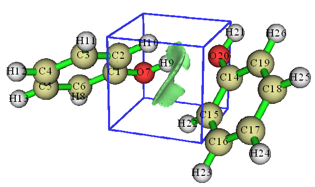
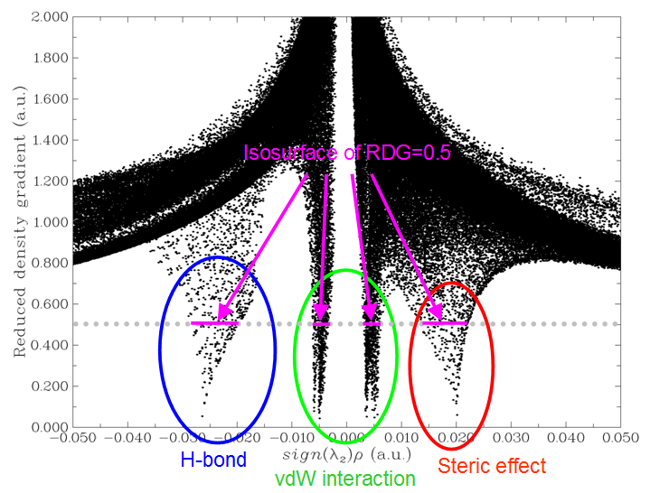
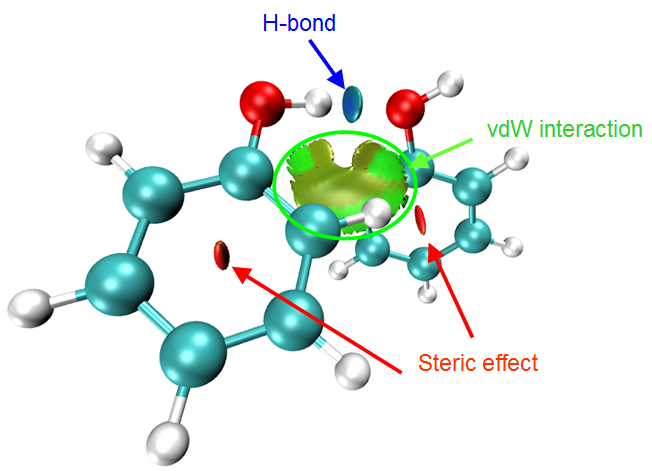
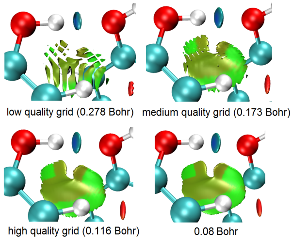
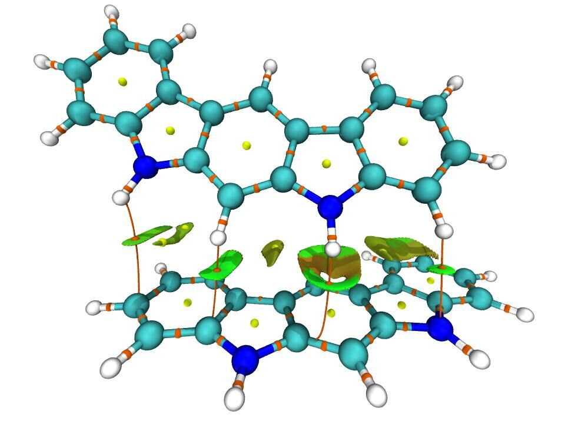
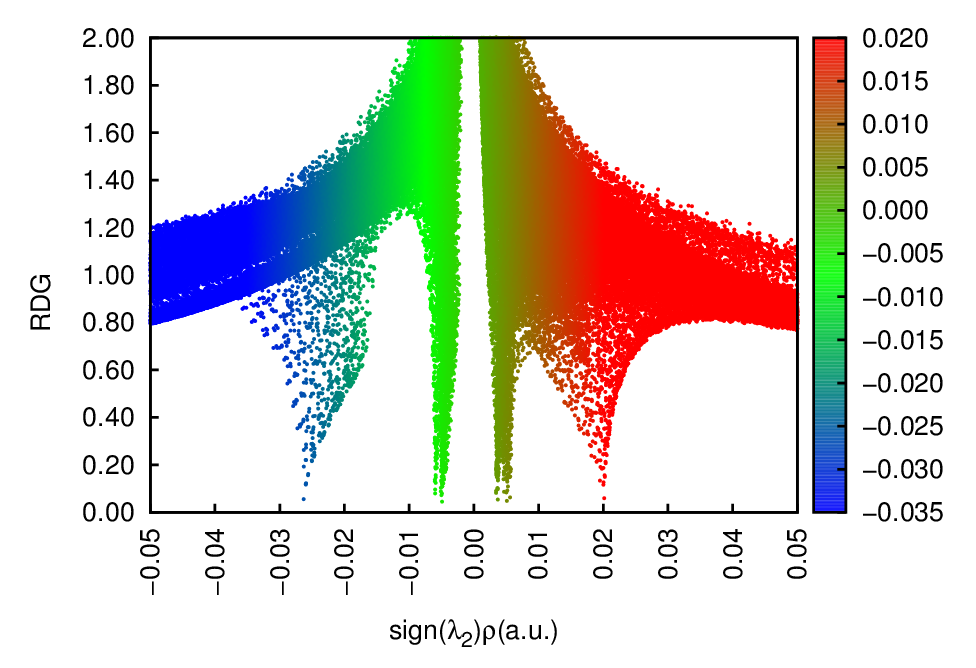
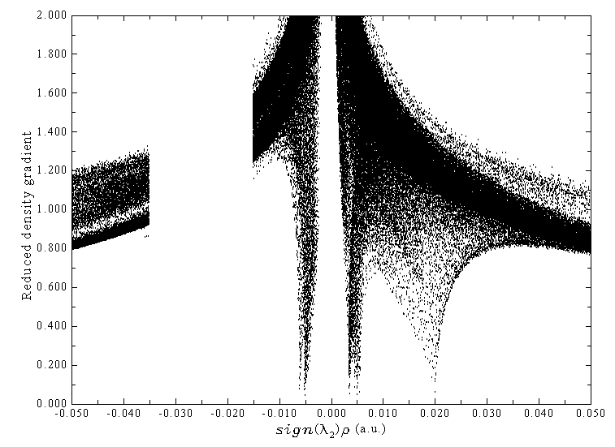
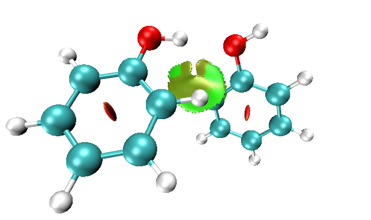
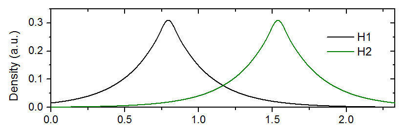
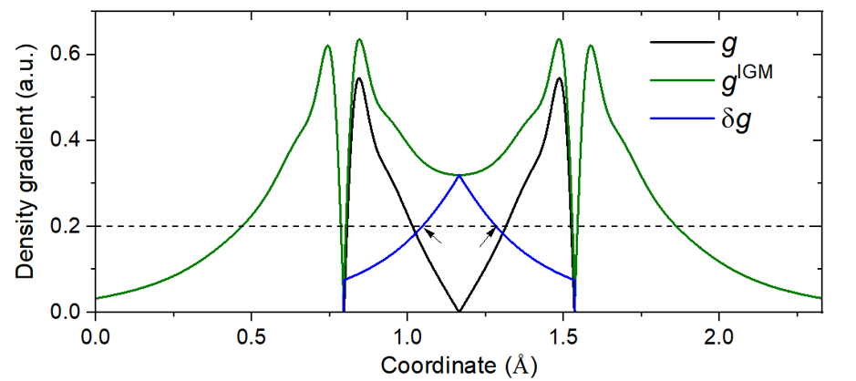

# **3.23 弱相互作用 (weak interaction)的可视化研究 (20)**

弱相互作用 (weak interaction)的可视化研究已变得越来越流行，并且已经提出了许多相关的分析方法。Multiwfn 的主功能 20 就是这些分析方法的集合。

我的文章 *Angew. Chem. Int. Ed.*, **137**, e202504895 (2025) DOI: [10.1002/anie.202504895](https://doi.org/10.1002/anie.202504895) 和 book chapter “Visualization Analysis of Weak Interactions in Chemical Systems” *Comprehensive Computational Chemistry*, Vol. 2 pp. 240-264. Oxford: Elsevier. DOI: [10.1016/B978-0-12-821978-2.00076-3](https://doi.org/10.1016/B978-0-12-821978-2.00076-3) 是对所有弱相互作用可视化研究方法非常全面、详细的综述，强烈建议阅读。

## **3.23.1 非共价相互作用 (noncovalent interaction, NCI)分析 (1)**

非共价相互作用 (noncovalent interaction, NCI)方法也称为约化密度梯度 (reduced density gradient, RDG)方法，是研究弱相互作用的一种非常流行的方法。NCI 方法的理论在其原始论文 *J. Am. Chem. Soc.*, **132**, 6498 (2010) 中有描述。在本节中，我将详细介绍该方法的基本思想，并说明如何在 Multiwfn 中实现它。如果你只想学习如何绘制颜色填充 (color-filled)的 RDG 图，可以直接跳到本节的“Part 3”。同时**强烈建议**观看该视频教程：<https://youtu.be/e4FpVc9ao48>，你将很快学会如何绘制与 NCI 分析相关的各种图形。

> **注**
>
> 如果你能阅读中文，还建议查看我的博客文章“使用 Multiwfn 进行弱相互作用的可视化研究”（中文，见 <http://sobereva.com/68>）和“通过 Multiwfn+VMD 进行 RDG 分析的一些要点和常见问题”（中文，见 <http://sobereva.com/291>）。

### **Part 1：使用 RDG 等值面 (isosurface)揭示弱相互作用区域**

如何可视化弱相互作用？首先要找到一种方法，将弱相互作用区域与其他区域区分开。从下表可以发现，如果只保留约化密度梯度 (reduced density gradient, RDG)函数取值在 0~中等范围内的区域，那么“原子核附近”和“分子边界”区域将被屏蔽掉。

|  | 原子核附近 | 化学键附近 | 弱相互作用区域 | 分子边界 |
|----|----|----|----|----|
| \|∇*ρ*(**r**)\| | 大 | 0 $\sim$ 较小 | 0 $\sim$ 小 | 很小 $\sim$ 小 |
| *ρ*(**r**) | 大 | 中等 | 小 | 0 $\sim$ 小 |
| RDG(**r**) | 中等 | 0 $\sim$ 较小 | 0 $\sim$ 中等 | 中等 $\sim$ 很大 |

RDG 函数的定义如下所示，它本质上是电子密度梯度模函数的一种无量纲形式

$$
\mathrm{RDG}(\mathbf{r}) = \frac{1}{2(3\pi^2)^{1/3}} \frac{\left| \nabla \rho(\mathbf{r}) \right|}{\rho(\mathbf{r})^{4/3}}
$$

对于剩下的区域（“Around chemical bond”和“Weak interaction region”），如果只保留 *ρ*(**r**) 较小的区域，那么就只会显现出弱相互作用区域。

现在我以苯酚二聚体为例说明这一思想，我们将计算 RDG 函数的格点数据 (grid data)，并将其可视化为等值面 (isosurface)。启动 Multiwfn 并输入以下命令

```text
examples\PhenolDimer.wfn  // Any format containing GTF information can be used as input file, see Section 2.5 for detail
5  // Generate grid data
13  // RDG function
7  // Use middle point of two atoms as center of grid data, this way of defining spatial scope is very suitable for weak interaction analysis
1,14  // The indices of the two atoms are set to 1 and 14, because from molecular structure (see the graph below) we can estimate that the weak interaction region occurs between C1 and C14
40,40,40  // The weak interaction region is small, so 40*40*40=64000 grid is fine enough
3,3,3  // Set extension distance (buffer distance) in all X/Y/Z directions to 3 Bohr
-1  // Show the isosurface of RDG
```

请确保 GUI 窗口中的等值面取值 (isovalue)设为 0.5，该取值适合显示弱相互作用区域（如果等值面取值 (isovalue)太小，RDG 等值面 (isosurface)会太薄，因而不好看；如果太大，则会出现不需要的“Around nuclei”和“Around chemical bond”区域）。现在你可以在 GUI 窗口中看到下图：



绿色等值面 (isosurface)非常清楚地表示了苯酚二聚体之间的弱相互作用区域。注意，默认情况下，**在电子密度大于或等于 0.05 的地方，RDG 函数被设为任意大的值 (100.0)**，从而屏蔽掉“around chemical bond”区域的等值面 (isosurface)。该阈值由 *settings.ini* 文件中的“RDG_maxrho”参数决定。默认值 0.05 对大多数情况下弱相互作用区域的可视化都是合适的。如果你因特殊原因不想启用该屏蔽处理，可以将“RDG_maxrho”设为 0。

上图中的蓝色立方体框显示了所计算格点数据 (grid data)的空间范围，只有在 GUI 窗口中勾选“Show data range”时它才可见。因为格点数据 (grid data)中心的外延距离设为 3.0 Bohr，所以边长为 2\*3=6 Bohr。

### **Part 2：通过给 RDG 等值面 (isosurface)填充颜色来区分弱相互作用类型**

在 Bader 的 AIM 理论中，(3,-1) 型临界点 (CP)的出现通常意味着电子密度在局域聚集，它一般出现在键路径上或具有吸引相互作用的原子之间。(3,+1) 型 CP 通常意味着电子密度在局域耗尽并表现出空间位阻效应，它一般出现在环中心。区分 (3,-1) 和 (3,+1) CP 的判据是电子密度 Hessian 矩阵的第二大本征值（以下记为 *λ*₂）。若 *λ*₂ 大于零，则该 CP 为 (3,+1)，否则为 (3,-1)。此外，弱相互作用的强度与相应区域的电子密度 *ρ* 呈正相关。范德华相互作用区域的 *ρ* 总是非常小……


> **注**
>
> 上述带标注色条的高分辨率版本为 *examples\RGB_bar.png*，你可以直接将其嵌入论文插图中。

当前的 Multiwfn 不支持绘制颜色填充 (color-filled)的等值面 (isosurface)图，但我们可以用 Multiwfn 生成 *sign*(*λ*₂)*ρ* 和 RDG 的 cube 文件，然后使用 VMD 的绘制脚本来绘制这种图。VMD 是最好的可视化工具之一，可在 <http://www.ks.uiuc.edu/Research/vmd> 免费下载。这里我以主功能 20 的子功能 1 为例，说明如何对苯酚二聚体进行绘制。这一次我们不仅要研究两个单体之间的弱相互作用区域，还要考察苯酚芳香环内的空间位阻效应，因此格点数据 (grid data)的空间范围应覆盖整个二聚体。

启动 Multiwfn 并输入以下命令

```text
examples\PhenolDimer.wfn
20  // Visual study of weak interaction
1  // NCI analysis
-10  // Set extension distance in all directions with respect to molecular boundary
0  // Because weak interaction regions only appear in internal region of present system, we do not need to leave a buffer region at system boundary, so we set the extension distance to 0 Bohr
2  // Medium-quality grid (about 512000 points). Because the spatial scope of grid data is evidently larger than last example, we need more grid points than last example, otherwise the RDG isosurfaces will look discrete
```

我首先通过散点图 (scatter map/plot)讨论各类区域的特征，我认为这将有助于理解 NCI 方法的本质和思想。在后处理菜单中选择选项 -1，会立即弹出散点图 (scatter map/plot)（你也可以选择选项 1 将该图导出为文件）：



图中 X 轴和 Y 轴分别对应 *sign*(*λ*₂)*ρ* 和 RDG 函数；图中的每个点对应三维空间中的一个格点。图中有四个尖峰，其峰顶处的点正好近似对应 AIM 理论中的 CP 位置。如果在图上画一条水平线如下图所示，那么穿过尖峰的线段正好对应于构建 RDG 等值面 (isosurface)所用的点。因此，NCI 分析方法可视为 AIM 理论在可视化研究中的扩展。这些尖峰可分为三类，我已用蓝色、绿色和红色圆圈标出，如上图所示。

然后关闭散点图 (scatter map/plot)，选择选项 3 将 *sign*(*λ*₂)*ρ* 和 RDG 的格点数据 (grid data)分别导出为当前目录下的 *func1.cub* 和 *func2.cub*，再将这两个文件以及“examples”文件夹中的 *RDGfill.vmd* 文件一起复制到 VMD 安装目录。*RDGfill.vmd* 是我编写的 VMD 绘制脚本。启动 VMD，选择“file”-“Load state”，选中 *RDGfill.vmd*（或者，你也可以直接在 console 窗口输入 `source RDGfill.vmd`），你将在 OpenGL 窗口中看到下图。



默认的 RDG 等值面 (isosurface)为 0.5，颜色范围为 -0.035 至 0.02。你可以手动编辑 *RDGfill.vmd* 以改变默认设置，当前取值适合一般情况。

从颜色填充 (color-filled)的 RDG 等值面 (isosurface)可以只通过观察颜色来识别不同类型的区域。回想我之前展示的颜色标尺，越蓝意味着吸引相互作用越强；在当前图中可以看到，氧原子与氢原子之间的椭圆片显示为浅蓝色，因此可以断定存在氢键，但不是很强。绿色圆圈标出的相互作用区域可判定为 vdW 相互作用区域，因为映射的颜色为绿色或浅棕色，这表明该区域电子密度很低。显然，两个环中心处的区域对应很强的空间位阻相互作用，因为它们被填充为红色。

### **Part 3：生成颜色填充 (color-filled) RDG 图的一般步骤总结**

上面我已经讲了很多关于 NCI 分析的内容。为了让你清楚、快速地理解如何使用 Multiwfn 绘制 *sign*(*λ*₂)*ρ* 映射的 RDG 等值面 (isosurface)图，下面我给出做这件事的最简步骤，它们适合大多数情况。

启动 Multiwfn 并输入

```text
xxx.wfn (or wfx/mwfn/fch/molden... file)  // Load input file
20  // Visual study of weak interaction
1  // NCI analysis
3  // Please properly define the grid points at this step. “High-quality grid” is usually adequate for small and medium sized system
3  // Export func1.cub and func2.cub
```

将这两个 .cub 文件和 *examples\RDGfill.vmd* 移到 VMD 文件夹。启动 VMD 并在 console 窗口输入 `source RDGfill.vmd`，然后你就会看到所需的图形。

### **Part 4：关于格点设置**

这里我再多谈一下计算 RDG 和 *sign*(*λ*₂)*ρ* 格点数据 (grid data)时的格点设置，因为这一点显著影响计算成本和所得 RDG 等值面 (isosurface)图的质量。

计算所花的总时间与格点总数成线性正比，而 RDG 等值面 (isosurface)的质量高度依赖于格点间距。格点间距越小，所得等值面 (isosurface)越光滑。格点间距太大会导致等值面 (isosurface)边缘出现严重的锯齿，或在内部区域出现空洞。这很容易理解，如果盒子尺寸（*即*格点数据 (grid data)的空间范围）保持固定，那么你设置的格点数越多，格点间距就越小。显然，盒子应合理定义，其空间范围不应太宽，否则格点间距会很大，从而降低图形质量；也不应太窄，否则感兴趣的 RDG 等值面 (isosurface)可能被截断。最佳做法是让盒子刚好包住感兴趣的区域。然后，如果你能负担较高的计算成本，就可以使用尽可能多的格点数来提高最终等值面 (isosurface)的质量。

注意，设置格点界面中的“low/medium/high-quality grid”选项是相对于小体系或中等体系而言的。如果体系很大，不得不使用大盒子，即使是“high-quality grid”对应的格点间距也相对较大，因而图形质量不理想。这种情况下，你应使用选项“4 Input the number of points or grid spacing in X,Y,Z, covering whole system”并手动输入合理的格点间距值。

下面展示了苯酚二聚体体系在各种格点设置下的效果，数值表示格点间距。从该图你可以直观地理解格点间距如何影响结果。



### **Part 5：关于 NCI 分析的一些值得一提的要点**

- **生成波函数的理论水平的选择**：完全没有必要使用大基组来进行 NCI 分析。使用中等大小的基组如 def2-SVP 或 6-31G\*\* 对 NCI 分析已完全足够，进一步增大基组只是浪费时间。关于理论方法的选择，使用流行的 DFT 泛函如 B3LYP 或 M06-2X 得到波函数就足够了。虽然已知 post-HF 密度比 DFT 密度更准确，但电子密度质量的提高在最终 NCI 分析结果中几乎察觉不到。你可能已经知道，B3LYP/6-31G\* 之类的计算水平对弱相互作用算得很差，但这绝不意味着用该水平产生的电子密度不足以做 NCI 分析，因为电子密度不像相互作用能那样对计算水平敏感，而且计算的相互作用能质量与电子密度质量之间并没有严格的正相关关系。

  一个经常遇到的恼人问题是，在感兴趣区域周围出现了意外的 RDG 等值面 (isosurface)，从而污染了 NCI 图形，使感兴趣区域弱相互作用的可视化分析变得困难。例如，有一个由三个分子组成的体系，我们只想研究分子 1 和 2 之间的弱相互作用；但在实际生成的 NCI 图中，你可能发现还出现了对应于 1-3 和 2-3 之间相互作用的不需要的等值面 (isosurface)，以及对应于分子内相互作用的等值面 (isosurface)。要屏蔽不感兴趣的等值面 (isosurface)，可以尝试使用 Section [4.13.4](sec-4-13-process-grid-data.md#4134-筛除局域区域的等值面) 中描述的方法；或者，你可以考虑改用 IGM 方法，只要恰当定义片段 (fragment)，该问题可被完全避免，见 Section [3.23.5](#3235-基于前分子-promolecular密度的独立梯度模型-independent-gradient-model-igm分析-10) 中的介绍。

- **RDG 的域分析**：Multiwfn 能够在由任意实空间函数定义的等值面 (isosurface)内对任意实空间函数做积分，这称为“domain analysis”。因此，你可以计算 RDG（或其他相关函数如 IRI、IGM 和 IGMH）等值面 (isosurface)内包围的体积和电子数，以尝试在定量水平上讨论弱相互作用。这类分析的介绍见 Section [3.200.14](sec-3-200-other-functions-part-2.md#320014-域分析求函数等值面内的性质)，示例见 Section [4.200.14](sec-4-200-other-functions-part-2.md#420014-域分析例子)。

- **大体系的 NCI 分析**：如果你想把 NCI 分析用于非常大的体系（*例如*超过 300 个原子），通常成本会极高，因而计算上不可行。最好的解决办法之一是改用前分子 (promolecular)版本的 NCI 分析或 IGM 分析，请分别查看 Section [3.23.2](#3232-基于前分子-promolecular密度的-nci-分析-2) 和 [3.23.5](#3235-基于前分子-promolecular密度的独立梯度模型-independent-gradient-model-igm分析-10)。另一个办法是使用 Grimme 的 xtb 程序，以半经验 DFT 变体快速计算体系，然后以所得 .molden 文件为输入文件进行 NCI 分析，结果应好于前分子 (promolecular) NCI 结果。

- **平均 NCI**：如果你想研究分子动力学过程中分子与环境原子之间的相互作用，应使用平均 NCI 方法，而不是只对单个结构做 NCI 分析，详见 Section [3.23.3](#3233-平均-nci-分析-anci3)。

- **NCI+AIM 图**：也可以在颜色填充 (color-filled)的 RDG 图中同时绘制 AIM 临界点和键路径，从而揭示更多关于弱相互作用的信息，下图就是一位 Multiwfn 用户提供的例子。这种图的绘制方法在 Section [4.20.1](sec-4-20-visual-study-of-weak-interactions.md#4201-用-nci-方法研究-2-吡哆素-2-氨基吡啶中的弱相互作用) 中有示例说明，并在该视频的 part 4 中演示：<https://youtu.be/e4FpVc9ao48>。



- **NCI+ELF 图**：如 Section [2.6](sec-2-6-real-space-functions.md) 中介绍的，以及 Section [4.4](sec-4-4-output-and-plot-various-properties-in-a-plane.md) 和 [4.5](sec-4-5-generate-grid-data-and-view-isosurface-map.md) 相关例子所示，ELF（电子定域函数）是对化学键特征展示非常有用的函数。显然，把 NCI 图和 ELF 等值面 (isosurface)画在一起可以传达更多信息。该视频教程的 Part 5 演示了如何用 Multiwfn 结合 VMD 实现：<https://youtu.be/e4FpVc9ao48>。

### **Special skill 1：生成颜色映射的散点图 (scatter map/plot)**

也可以给散点图 (scatter map/plot)映射颜色，以方便识别尖峰与 RDG 等值面 (isosurface)之间的对应关系。已提供了 gnuplot 程序（<http://www.gnuplot.info>）的绘制脚本 *examples\scripts\RDGscatter.gnu*，可实现该目的。首先，在后处理菜单中选择选项“2 Output scatter points to output.txt in current folder”，将 *output.txt* 导出到当前文件夹，然后将其和 *RDGscatter.gnu* 移到含有 gnuplot 可执行文件的文件夹，再在该文件夹运行命令：*gnuplot RDGscatter.gnu*。过一会儿你就会在该文件夹得到 *RDGscatter.ps*，这是 postscript 格式的图形文件，你可以用诸如 Acrobat、Photoshop 或 Irfanview 打开（机器上必须安装 ghostscript）。你也可以使用在线图片转换器 <https://cloudconvert.com/image-converter> 将其转为常见图片格式。图形应如下所示：



该绘制脚本中默认的颜色范围为 -0.035 至 0.02，如果你想把该图与 RDG 颜色填充 (color-filled)图对应起来，应确保 *RDGscatter.gnu* 和 *RDGfill.vmd* 中的色标设置完全一致。

如果你在复现该图时遇到困难，请按该视频教程的 part 2 操作：<https://youtu.be/e4FpVc9ao48>。

### **Special skill 2：交互式设置 *sign*(*λ*₂)*ρ* 在特定范围内处的 RDG 值**

Multiwfn 允许你交互式地设置 *sign*(*λ*₂)*ρ* 在指定取值范围内处的 RDG 值，利用该功能可以方便地屏蔽不需要的区域。这里我继续以“Part 2”中描述的苯酚二聚体为例，说明如何从图中屏蔽对应于氢键的 RDG 等值面 (isosurface)。从原始散点图 (scatter map/plot)发现氢键区域对应于 *sign*(*λ*₂)*ρ* 范围 -0.035 \~ -0.015，因此可以在后处理菜单输入以下命令

```text
-2  // Set RDG value where sign(λ_2)ρ in within given data range
-0.035,-0.015  // The lower and upper limit of sign(λ_2)ρ
100  // Set RDG value in these regions to an arbitrarily large value to screen RDG isosurface
```

然后，若选择选项 -1 重新绘制散点图 (scatter map/plot)，你将看到



显然对应于氢键的尖峰已不存在。我们也可以导出 cube 文件并用 VMD 重绘颜色填充 (color-filled)图，如下所示，氢键的 RDG 等值面 (isosurface)确实消失了。



注意，格点数据 (grid data)一旦如上例所示被修改就无法恢复原状。

> **所需信息**
>
> 原子坐标、GTFs

## **3.23.2 基于前分子 (promolecular)密度的 NCI 分析 (2)**

为大体系生成波函数并计算 RDG 和 *sign*(*λ*₂)*ρ* 的格点数据 (grid data)非常耗时，这极大地限制了 NCI 分析方法的应用范围。幸运的是，已表明基于前分子 (promolecular)密度的 NCI 分析一般也是合理的。所谓前分子 (promolecular)密度，就是通过叠加处于自由状态的原子的电子密度近似构建的电子密度，这称为“Promolecular approximation”。周期表中几乎所有元素的高质量自由态原子电子密度都是预先算好并内置的，因此 Multiwfn 中基于前分子 (promolecular)密度的 NCI 分析原则上可用于任何体系。

要进行前分子 (promolecular)近似下的 NCI 分析，只需在主功能 20 中选择子功能 2，所有操作步骤与常规 NCI 分析完全相同。由于构建前分子 (promolecular)密度只需要原子坐标信息，任何含有原子坐标信息的文件都可用作输入文件，如流行的 .pdb 和 .xyz 格式。

基于前分子 (promolecular)密度的 NCI 分析的 VMD 绘制脚本为 *examples\RDGfill_pro.vmd*，它与 *examples\RDGfill.vmd* 在色标和等值面取值 (isovalue)的默认设置上略有不同。

默认情况下，使用前分子 (promolecular)近似时，在 *ρ* 大于 0.1 的地方 RDG 值被自动设为 100.0，该阈值在某些情况下可能不合适。你可以通过 *settings.ini* 中的“RDGprodens_maxrho”手动改变该阈值。

基于前分子 (promolecular)密度的 NCI 分析的例子见 Section [4.20.1](sec-4-20-visual-study-of-weak-interactions.md#4201-用-nci-方法研究-2-吡哆素-2-氨基吡啶中的弱相互作用)，并在该视频的 part 3 中演示：<https://youtu.be/e4FpVc9ao48>。

> **所需信息**
>
> 原子坐标

## **3.23.3 平均 NCI 分析 (aNCI，3)**

### **理论**

在 *J. Chem. Theory Comput.*, **9**, 2226 (2013) 中，上节描述的 NCI 方法被扩展到分析动态环境（*例如*分子动力学轨迹），得到了平均 NCI (aNCI)方法。该方法也在 book chapter DOI: [10.1016/B978-0-12-821978-2.00076-3](https://doi.org/10.1016/B978-0-12-821978-2.00076-3) 中有仔细评述。本功能旨在实现 aNCI 分析。

 aNCI 与原始 NCI 方法的唯一区别在于，前者的电子密度 *ρ* 及其梯度模 \|∇*ρ*\| 不是只对一个几何结构计算，而是对轨迹文件中的多个帧计算，再取平均（即 $\bar{\rho}$ 和 $\bar{\mathrm{\nabla }\rho}$）。因此，平均约化密度梯度 (aRDG) 的等值面 (isosurface)

$$
\mathrm{aRDG}(\mathbf{r}) = \frac{1}{2(3\pi^2)^{1/3}} \frac{\left| \nabla \overline{\rho}(\mathbf{r}) \right|}{\left[ \overline{\rho}(\mathbf{r}) \right]^{4/3}}
$$

可直接用于揭示动力学过程的平均弱相互作用区域。

类似地，为了展示平均弱相互作用类型，在 aNCI 方法中，*sign*(*λ*₂)*ρ* 函数中的 *λ*₂ 项取为整个动力学轨迹上平均电子密度 Hessian 矩阵的第二大本征值。

aNCI 方法还定义了一个称为热涨落指数 (thermal fluctuation index, TFI)的新量，用以揭示弱相互作用的稳定性

$$
\mathrm{TFI}(\mathbf{r}) = \frac{std[\rho(\mathbf{r})]}{\overline{\rho}(\mathbf{r})}
$$

其分子是动力学轨迹中电子密度的标准差，可按如下计算

$$
std[\rho(\mathbf{r})] = \sqrt{\frac{\sum_i [\rho_i(\mathbf{r}) - \overline{\rho}(\mathbf{r})]^2}{n}}
$$

其中 $n$ 是考虑的帧数，$ρ_{i}$ 是基于第 $i$ 帧几何结构计算的密度。在 aNCI 的等值面 (isosurface)上映射 TFI 后，通过目视检查颜色即可清楚识别每个弱相互作用区域的稳定性。

aNCI 图形的质量直接取决于所考虑的帧数。帧数很少，例如 50 帧，只能得到不准确且非常不光滑的等值面 (isosurface)图。一般来说，至少应使用 500 帧来生成 aNCI 图。

### **用法**

首先注意，由于基于波函数为大量几何结构计算电子密度非常昂贵，Multiwfn 的 aNCI 分析功能中强制使用前分子 (promolecular)近似。该近似是合理的，并且效果总是很好。

.xyz 文件格式存储的轨迹可作为输入文件。你可以用诸如 VMD 的程序把其他格式的轨迹文件转为 .xyz 轨迹文件。

> **PS**
>
> 多帧 .xyz 文件的结构如下所示
>
> ```text
> Number of atoms in frame 1
> Element, x, y and z of atom 1 in frame 1
> Element, x, y and z of atom 2 in frame 1
> ...
> Element, x, y and z of atom n in frame 1
> Number of atoms in frame 2
> Element, x, y and z of atom 1 in frame 2
> Element, x, y and z of atom 2 in frame 2
> ...
> Element, x, y and z of atom n in frame 2
> Number of atoms in frame 3
> ...
> ```

在所有帧中，感兴趣分子的坐标应固定。例如，如果你想研究溶剂与一个苯分子之间的弱相互作用，那么在整个轨迹中苯的位置必须固定。注意感兴趣的分子应远离盒子边界，使其始终被环境原子包围。

进入本功能后，你将被提示输入要分析的帧范围，例如输入 *140,450* 表示将使用第 140 至 450 帧做 aNCI 分析。然后需要设置格点，盒子的空间范围应恰当包住感兴趣的分子。之后，将对每一帧计算平均电子密度、平均密度梯度和平均密度 Hessian，你需要耐心等待。计算完成后，你可以用相应选项绘制平均 NCI 与平均 *sign*(*λ*₂)*ρ* 之间的散点图 (scatter map/plot)、输出散点、导出它们的 cube 文件等。热涨落指数也可以计算并导出为 cube 文件。

一个例子见 Section [4.20.3](sec-4-20-visual-study-of-weak-interactions.md#4203-用-anci-方法可视化研究体相环境中水的弱相互作用)。

****注**：一般不建议使用 aNCI 方法，因为在大多数情况下 amIGM 方法（Section [3.23.11](#32311-平均修正-igm-amigm分析--12)）是好得多的选择！**这主要是因为 amIGM 允许用户定义片段 (fragment)来专门研究它们之间的相互作用，用户不需要筛除不需要的等值面 (isosurface)。而且 amIGM 的等值面 (isosurface)比 aNCI 更光滑，有时 aNCI 完全失败而 amIGM 仍能给出合理结果。amIGM 分析的成本仅为 aNCI 的两三倍。全面比较见 amIGM 原始论文。aNCI 唯一的优点是 TFI 可映射在 aNCI 等值面 (isosurface)上，而发现在 amIGM 等值面 (isosurface)上映射 TFI 的效果不好（常常两侧有显著不同的颜色）。

> **所需信息**
>
> 多帧原子坐标

## **3.23.4 密度重叠区域指示函数 (Density Overlap Regions Indicator, DORI)分析 (5)**

有时 ELF 和 RDG 联合使用，以同时研究共价和非共价相互作用，见 *J. Chem. Theory Comput.*, **8**, 3993 (2012)。能否用*单个*实空间函数同时研究这两类相互作用？答案是肯定的。在 *J. Chem. Theory Comput.*, **10**, 3745 (2014) 中作者提出了一个称为密度重叠区域指示函数 (density overlap regions indicator, DORI)的函数，发现若恰当选择等值面取值 (isovalue)，DORI 等值面 (isosurface)可同时展示共价和非共价相互作用区域，并且 *sign*(*λ*₂)*ρ* 也可映射到 DORI 等值面 (isosurface)上，以方便分析相互作用的本质。

DORI 的表达式为

$$
\mathrm{DORI}(\mathbf{r}) = \frac{\theta(\mathbf{r})}{1 + \theta(\mathbf{r})}
$$

其中 $\theta(\mathbf{r}) = [\nabla(\nabla \rho(\mathbf{r}) / \rho(\mathbf{r}))^2]^2 / [\nabla \rho(\mathbf{r}) / \rho(\mathbf{r})]^6$。DORI 的取值范围为 \[0,1\]。

要绘制 *sign*(*λ*₂)*ρ* 映射的 DORI 等值面 (isosurface)图，进入主功能 20 的子功能 5，后续操作与 NCI 分析完全相同。在后处理菜单用选项 3 将 *sign*(*λ*₂)*ρ* 和 DORI 的格点数据 (grid data)导出为 cube 文件后，将它们连同 *examples\DORIfill.vmd* 一起复制到 VMD 文件夹，然后启动 VMD 并执行绘制脚本 *DORIfill.vmd*，即可绘制颜色填充 (color-filled)的等值面 (isosurface)图。

我不推荐使用 DORI，因为 Section [3.23.8](#3238-相互作用区域指示函数-interaction-region-indicator-iri与-iri-π-分析-4) 中介绍的相互作用区域指示函数 (interaction region indicator, IRI)不仅定义更简单、因而计算成本更低，而且 IRI 的图形效果显著更好。

进行 DORI 分析的例子见 Section [4.20.5](sec-4-20-visual-study-of-weak-interactions.md#4205-用-dori-分析同时揭示苯酚二聚体中的共价和非共价相互作用)

> **所需信息**
>
> 原子坐标、GTFs

## **3.23.5 基于前分子 (promolecular)密度的独立梯度模型 (independent gradient model, IGM)分析 (10)**

### **前言**

在 *Phys. Chem. Chem. Phys.*, **19**, 17928 (2017) 中，Hénon 等人提出了一种可视化研究片段 (fragment)间和片段 (fragment)内相互作用的有效方法，称为独立梯度模型 (independent gradient model, IGM)。注意目前 IGM 有三个版本：

- (1) 基于前分子 (promolecular)密度的 IGM。这是 2017 年提出的 IGM 原始版本，本节介绍的功能实现的就是这种形式的 IGM，分析中只需要分子结构。

- (2) 基于梯度分区 (gradient-based partitioning, GBP)的 IGM。该版本在 *ChemPhysChem*, **19**, 724 (2018) 中提出，需要实际分子电子密度。Multiwfn 不支持该版本。

- (3) 基于电子密度的 Hirshfeld 分区的 IGM (IGMH)。该版本由我提出，详见 Section [3.23.6](#3236-基于电子密度-hirshfeld-分区的-igm-igmh分析-11)。IGMH 比 IGM 更贵，同时输入文件必须提供波函数，IGMH 的优点是结果更有意义，且图形效果显著好于 IGM。**只要计算成本可负担，我总是建议用 IGMH 代替 IGM**。

### **IGM 的思想**

IGM 方法完整且易懂的概述见 *J. Comput. Chem.*, **43**, 539 (2022) DOI: [10.1002/jcc.26812](https://doi.org/10.1002/jcc.26812) 和 book chapter DOI: [10.1016/B978-0-12-821978-2.00076-3](https://doi.org/10.1016/B978-0-12-821978-2.00076-3)。下面我只概述 IGM 方法的关键思想。先看一个非常简单的体系 H₂ 分子。沿分子轴的每个原子的自由态原子密度如下所示



从上图注意到，两原子的原子密度梯度在原子间区域符号相反。例如，在 X=1.2 处，H1 的密度梯度为负，而 H2 的为正。因此，在前分子 (promolecular)密度的梯度（下图中的曲线 $g$）中，两原子的贡献在两原子之间的区域很大程度上相互抵消。注意在两氢中点处 $g$ 恰为零，该点在前分子 (promolecular)密度下对应于 AIM 理论中的键临界点 (BCP)。



上图中的 $g^{\mathrm{IGM}}$ 是 IGM 型的密度梯度，它按每个原子自由态密度梯度的*绝对值*之和计算；换句话说，忽略了相位，因而来自各原子的密度梯度不会相互抵消。由于该特点，$g^{\mathrm{IGM}}$ 是 $g$ 的上限。

δ $g$ 函数定义为 $g^{\mathrm{IGM}}$ 与 $g$ 之差，在上图中画为深蓝色曲线。可以看到 δ $g$ 在原子间相互作用区域非零，并在键中点取最大值。显然，δ $g$ 可像 IRI 函数一样用于揭示相互作用区域（见 Section [3.23.8](#3238-相互作用区域指示函数-interaction-region-indicator-iri与-iri-π-分析-4)）。此外，如 Section [4.20.10](sec-4-20-visual-study-of-weak-interactions.md#42010-用独立梯度模型-igm-可视化和定量弱相互作用) 的例子所示，δ $g$ 在相互作用区域的数值大小与相互作用强度密切相关。

对于三维情况，$g^{\mathrm{IGM}}$ 和 δ $g$ 可定义如下

$$
\begin{gathered} g(\mathbf{r}) = \left| \sum_i \nabla \rho_i^{\mathrm{free}}(\mathbf{r}) \right| \qquad g^{\mathrm{IGM}}(\mathbf{r}) = \sum_i \left| \nabla \rho_i^{\mathrm{free}}(\mathbf{r}) \right| \\ \delta g(\mathbf{r}) = g^{\mathrm{IGM}}(\mathbf{r}) - g(\mathbf{r}) \end{gathered}
$$

其中 ${\rho}_{i}^{\mathrm{free}}$ 表示原子 *i* 在自由态的球平均密度。几乎所有元素的这种原子密度都可直接在 Multiwfn 中获得，详见 [Appendix 3](sec-6-3-detail-of-built-in-atomic-densities.md)。

基于 $g^{\mathrm{IGM}}$ 和 δ $g$ 的思想，IGM 方法还定义了 δ $g^{\mathrm{inter}}$ 和 δ $g^{\mathrm{intra}}$，分别用于研究片段 (fragment)间和片段 (fragment)内相互作用

$$
\begin{gathered} \delta g^{\mathrm{inter}}(\mathbf{r}) = g^{\mathrm{IGM,inter}}(\mathbf{r}) - g^{\mathrm{inter}}(\mathbf{r}) \\ \delta g^{\mathrm{intra}}(\mathbf{r}) = \delta g(\mathbf{r}) - \delta g^{\mathrm{inter}}(\mathbf{r}) \end{gathered}
$$

其中

$$
\begin{gathered} g^{\mathrm{inter}}(\mathbf{r}) = \left| \sum_A \sum_{i \in A} \nabla \rho_i^{\mathrm{free}}(\mathbf{r}) \right| \\ g^{\mathrm{IGM,inter}}(\mathbf{r}) = \sum_A \left| \sum_{i \in A} \nabla \rho_i^{\mathrm{free}}(\mathbf{r}) \right| \end{gathered}
$$

其中 $A$ 和 $i$ 分别为片段 (fragment)和原子指标。片段 (fragment)可根据实际体系的特征和研究目的任意定义。注意，上述 δ $g^{\mathrm{inter}}$ 和 δ $g^{\mathrm{intra}}$ 表达式是由我提出并在 Multiwfn 中实现的一般形式，在 IGM 原始论文中并未明确给出。

从上述公式很容易理解 δ $g^{\mathrm{inter}}$ 的思想。首先按通常方式计算密度梯度作为 $g^{\mathrm{inter}}$，再计算 $g^{IGM,inter}$，后者因可能相位不同而忽略了各片段 (fragment)密度梯度间的抵消效应；于是 $g^{IGM,inter}$ 与 $g^{\mathrm{inter}}$ 之差，即 δ $g^{\mathrm{inter}}$，必然能揭示片段 (fragment)之间的相互作用。δ $g$ 揭示当前体系中所有种类的相互作用，不论其为片段 (fragment)间还是片段 (fragment)内类型。因此，若从 δ $g$ 中减去 δ $g^{\mathrm{inter}}$，剩余部分，即 δ $g^{\mathrm{intra}}$，必然能揭示片段 (fragment)内相互作用。

在 Section [3.23.1](#3231-非共价相互作用-noncovalent-interaction-nci分析-1) 中已表明，通过绘制 *sign*(*λ*₂)*ρ* 函数着色的 RDG 等值面 (isosurface)图，可同时展示相互作用区域和相互作用类型。类似地，若用各种颜色把 *sign*(*λ*₂)*ρ* 函数映射在 δ $g^{\mathrm{inter}}$ 和 δ $g^{\mathrm{intra}}$ 等值面 (isosurface)上，片段 (fragment)间和片段 (fragment)内相互作用的类型和位置也能生动揭示。

### **原子和原子对的定量指标**

我定义了原子对 δ $g$ 指标 (δ $G^{\mathrm{pair}}$)，以量化原子对对两个片段 (fragment)（$A$ 和 $B$）之间相互作用的贡献

$$
\delta G_{i,j}^{\mathrm{pair}} = \int \delta g_{i,j}(\mathbf{r}) \mathrm{d}\mathbf{r} = \int [g_{i,j}^{\mathrm{IGM}}(\mathbf{r}) - g_{i,j}(\mathbf{r})] \mathrm{d}\mathbf{r} \qquad i \in A, j \in B
$$

其中

$$
\begin{gathered} g_{i,j}(\mathbf{r}) = \left| \nabla \rho_i^{\mathrm{free}}(\mathbf{r}) + \nabla \rho_j^{\mathrm{free}}(\mathbf{r}) \right| \\ g_{i,j}^{\mathrm{IGM}}(\mathbf{r}) = \left| \nabla \rho_i^{\mathrm{free}}(\mathbf{r}) \right| + \left| \nabla \rho_j^{\mathrm{free}}(\mathbf{r}) \right| \end{gathered}
$$

还可定义原子对对片段 (fragment)间相互作用贡献的百分比为

$$
\delta G_{i,j}^{\mathrm{pair}} (\%) = \frac{\delta G_{i,j}^{\mathrm{pair}}}{\sum_{k \in A} \sum_{l \in B} \delta G_{k,l}^{\mathrm{pair}}} \times 100\%
$$

由于 δ $G^{\mathrm{pair}}$ (%) 的定义如此简单，当然不能指望它能准确代表原子对对两个片段 (fragment)间相互作用能的贡献，但 δ $G^{\mathrm{pair}}$ (%) 应能识别出“hot”原子对，它们可能确实对片段 (fragment)间结合有较大的实际贡献。

我还定义了原子 δ $g$ 指标 (δ $G^{\mathrm{atom}}$)，以量化原子对片段 (fragment)间相互作用的重要性

$$
\delta G_i^{\mathrm{atom}} = \sum_{j \in B} \delta G_{i,j}^{\mathrm{pair}}
$$

原子贡献的百分比可定义为

$$
\delta G_i^{\mathrm{atom}} (\%) = \frac{\delta G_i^{\mathrm{atom}}}{\sum_{j \in A} \delta G_j^{\mathrm{atom}}} \times 100\%
$$

绘制分子结构时，若按 δ $G^{\mathrm{atom}}$ 或 δ $G^{\mathrm{atom}}$ (%) 给原子着色，各原子对片段 (fragment)间相互作用的相对重要性可生动展示。

受 Section [3.11.9](sec-3-11-bond-order-analysis.md#3119-本征键强度指数intrinsic-bond-strength-index-ibsi-10) 中介绍的 IBSI（本征键强度指标）的启发，我定义了 IBSIW（用于弱相互作用的 IBSI）如下

$$
IBSIW(i,j) = 100 \times \frac{\delta G_{i,j}^{\mathrm{pair}}}{(d_{i,j})^2}
$$

其中 $d$ *$_{i,j}$* 为原子 *i* 与 $j$ 之间以 Å 为单位的距离。我的初步测试表明 IBSIW 在区分相互作用强度方面能力稍好。显然，IBSIW 越大，相互作用越强。由于 Multiwfn 中 δ $G^{\mathrm{pair}}$ 以 a.u. 给出，IBSIW 的正式单位应为 a.u./Ų。

### **IGM 相对于 NCI 的优势**

根据我的观点和经验，IGM 方法相对流行的 NCI 方法的优势可总结如下：

- 片段 (fragment)间和片段 (fragment)内相互作用可分别研究，从而避免相互干扰

- IGM 方法定义的函数的计算相当快且只依赖于几何结构，因而该方法可用于广泛的体系（注意 NCI 也有前分子 (promolecular)近似版本）。

- 如 Section [4.20.10](sec-4-20-visual-study-of-weak-interactions.md#42010-用独立梯度模型-igm-可视化和定量弱相互作用) 的例子所示，IGM 方法给出的等值面 (isosurface)图比 NCI 图更光滑，因而 IGM 图对格点间距要求较低。相比之下，格点较稀疏时 NCI 图容易出现难看的锯齿和空洞。

- 原子和原子对对片段 (fragment)间相互作用的贡献可被量化，前者可在分子结构上生动渲染，这些特点使识别“hot”原子变得容易。

- 相互作用区域 δ $g$ 函数的值直接反映相互作用强度。特别地，我发现 AIM 理论键临界点处的 δ $g$ 是相应相互作用强度的良好定量指标。

### **Multiwfn 中 IGM 分析的用法**

用 Multiwfn 做 IGM 分析极其容易且灵活。首先，应载入含有原子坐标的文件。最常用的格式如 .xyz、.pdb 和 .mol 都被 Multiwfn 支持（当然，任何波函数文件如 .wfn 和 .fch 也可用）。注意几何结构必须已用合适的理论水平优化过，否则 IGM 结果可能有误导性。

IGM 模块是主功能 20 的子功能 10，进入该模块后，应定义片段 (fragment)。片段 (fragment)的定义相当灵活，你可以定义任意多个片段 (fragment)（至少一个）。任何原子不能同时属于两个或更多片段 (fragment)。所定义片段 (fragment)的并集不强制等于整个体系，只有定义片段 (fragment)中的原子才最终参与计算。

接下来需要设置格点，最好让盒子刚好包住可能出现感兴趣相互作用的区域。关于设置格点的一些建议见 Section [3.23.1](#3231-非共价相互作用-noncovalent-interaction-nci分析-1)。

之后，Multiwfn 开始计算 *sign*(*λ*₂)*ρ*、δ $g$、δ $g^{\mathrm{inter}}$ 和 δ $g^{\mathrm{intra}}$ 的格点数据 (grid data)。假设你定义了 $n$ 个片段 (fragment)，则算得的 δ $g^{\mathrm{inter}}$ 将对应于所有 $n$ 个片段 (fragment)之间的相互作用，而 δ $g^{\mathrm{intra}}$ 将对应于所有 $n$ 个片段 (fragment)内的片段 (fragment)内相互作用。片段 (fragment)中的原子数越多，总成本越高。

格点数据 (grid data)计算完成后，Multiwfn 将显示 δ $g$、δ $g^{\mathrm{inter}}$ 和 δ $g^{\mathrm{intra}}$ 在全空间的积分，然后出现后处理菜单。

后处理菜单中的选项是不言自明的，这里我简要描述它们：

- **-1**：该选项的子选项 1、2 和 3 分别用于绘制 δ $g$、δ $g^{\mathrm{inter}}$、δ $g^{\mathrm{intra}}$ 相对 *sign*(*λ*₂)*ρ* 的散点图 (scatter map/plot)。子选项 4 用于同时以不同颜色绘制 δ $g^{\mathrm{inter}}$ 和 δ $g^{\mathrm{intra}}$ 相对 *sign*(*λ*₂)*ρ* 的图。如 IGM 原始论文所示，这种图有助于讨论相互作用的细节（注意 RDG 相对 *sign*(*λ*₂)*ρ* 的散点图 (scatter map/plot)在 NCI 分析中经常用到）。若想把散点图 (scatter map/plot)直接存为当前文件夹中的图形文件，用选项 1。若默认坐标轴范围不合适，用选项 -2 或 -3 调整。

- **2**：若想用 Origin 和 gnuplot 等第三方软件绘制散点图 (scatter map/plot)，用该选项把 δ $g$、δ $g^{\mathrm{inter}}$、δ $g^{\mathrm{intra}}$ 和 *sign*(*λ*₂)*ρ* 的数据导出为当前文件夹中的纯文本。文件中每列的含义显示在屏幕上。

- **3**：把 *sign*(*λ*₂)*ρ*、δ $g$、δ $g^{\mathrm{inter}}$ 和 δ $g^{\mathrm{intra}}$ 的格点数据 (grid data)输出为当前文件夹中的 cube 文件。导出 cube 文件后，你可以用“examples”文件夹中的 *IGM_inter.vmd* 和 *IGM_intra.vmd* 脚本分别在 VMD 中绘制颜色填充 (color-filled)的 δ $g^{\mathrm{inter}}$ 和 δ $g^{\mathrm{intra}}$ 等值面 (isosurface)图。例子见 Section [4.20.10](sec-4-20-visual-study-of-weak-interactions.md#42010-用独立梯度模型-igm-可视化和定量弱相互作用)。

- **4**：该选项用于在 Multiwfn 中直接可视化 *sign*(*λ*₂)*ρ*、δ $g$、δ $g^{\mathrm{inter}}$ 或 δ $g^{\mathrm{intra}}$ 的等值面 (isosurface)。

- **5**：该选项用于把 *sign*(*λ*₂)*ρ* 不在指定取值范围内的格点处的 δ $g^{\mathrm{intra}}$ 置零。用该选项可从 δ $g^{\mathrm{intra}}$ 散点图 (scatter map/plot)和等值面 (isosurface)图中屏蔽不感兴趣的区域。例如，我们只想研究较弱的片段 (fragment)内相互作用，那么可以输入对应于 *sign*(*λ*₂)*ρ* 相对较小取值的范围。（该选项的目的类似于 NCI 分析中用的“RDG_maxrho”参数）

- **6**：该选项用于计算定量指标。若你定义了多于两个片段 (fragment)，这里需要选择要计算指标的两个片段 (fragment)。Multiwfn 将计算两片段 (fragment)间每对原子的 δ $g$ 格点数据 (grid data)，并对 δ $g$ 函数积分以得到指标。积分用 Becke 多中心积分方法计算，有几种积分格点可选，格点越好结果越准，但成本越高。计算完成后，*atmdg.txt* 将输出到当前文件夹，其中记录所有 δ $G^{\mathrm{atom}}$、δ $G^{\mathrm{atom}}$ (%)、δ $G^{\mathrm{pair}}$ 和 δ $G^{\mathrm{pair}}$ (%)，取值从高到低排序。所有 δ $G^{\mathrm{pair}}$ 之和也在末尾输出。然后程序会问你是否同时在当前文件夹输出 *atmdg.pdb*，其中含有当前体系所有原子的坐标。该文件的“beta”和“occupancy”场（倒数第二和第三列的数据）分别对应于原子 δ $g$ 指标乘以 10 和原子 δ $g$ 指标百分比。显然，若把其中之一载入 VMD 可视化程序并按“beta”或“occupancy”属性给原子着色，则各原子对片段 (fragment)间相互作用的相对重要性可直观识别。

  在输出 *atmdg.txt* 的同时，原子和原子对的 IBSIW 指标也被导出到当前文件夹的 *IBSIW.txt*。

- **7&8**：这两个选项分别用于在相应格点 *sign*(*λ*₂)*ρ* 超出特定范围时设置 δ $g$ 和 δ $g^{\mathrm{inter}}$ 函数的值。显然，当你想从 IGM 等值面 (isosurface)图中屏蔽不需要的区域时，这些选项很有用。例如，你只想在 *sign*(*λ*₂)*ρ* 处于 -0.04 \~ -0.025 a.u. 范围内可视化 δ $g^{\mathrm{inter}}$ 的等值面 (isosurface)，那么可以进入选项 8，输入 *-0.04,-0.025* 再输入 *0*，把这些格点的 δ $g^{\mathrm{inter}}$ 置零；然后，你可以绘制更新后的散点图 (scatter map/plot)或导出 cube 文件以在 VMD 中可视化 IGM 图。

若你的输入文件含有 GTF 或基函数信息（*例如* mwfn、.wfn、.fch、.molden），在做 IGM 分析时，Multiwfn 会让你选择所用 *sign*(*λ*₂)*ρ* 的类型，第一种基于实际电子密度，第二种基于前分子 (promolecular)密度。用前者应给出更有意义的结果，但前者的计算成本明显高于后者（若输入文件只含原子坐标信息，则总是用后者）。

IGM 分析的几个例子见 Section [4.20.10](sec-4-20-visual-study-of-weak-interactions.md#42010-用独立梯度模型-igm-可视化和定量弱相互作用)。更多关于 IGM 方法的讨论和实例见我的博客文章“Investigating intermolecular weak interactions via Independent Gradient Model (IGM)”（中文，<http://sobereva.com/407>）。

> **所需信息**
>
> 原子坐标

## **3.23.6 基于电子密度 Hirshfeld 分区的 IGM (IGMH)分析 (11)**

如 Section [3.23.5](#3235-基于前分子-promolecular密度的独立梯度模型-independent-gradient-model-igm分析-10) 所示，IGM 的原始版本纯粹基于原子自由态的密度计算，即使用了前分子 (promolecular)近似。我提出的一种不同形式的 IGM 称为“基于电子密度 Hirshfeld 分区的 IGM”(IGMH)。详细介绍 IGMH 理论背景并含有非常丰富例子的文章是 *J. Comput. Chem.*, **43**, 539 (2022) DOI: [10.1002/jcc.26812](https://doi.org/10.1002/jcc.26812)。关于实现的一个勘误后来发表为 *ChemRxiv* (2022) DOI: [10.26434/chemrxiv-2022-g1m34](https://doi.org/10.26434/chemrxiv-2022-g1m34)。若你的研究使用了 IGMH 分析，请引用这些论文。IGMH 方法也在我的 book chapter DOI: [10.1016/B978-0-12-821978-2.00076-3](https://doi.org/10.1016/B978-0-12-821978-2.00076-3) 和我的文章 *Angew. Chem. Int. Ed.*, **137**, e202504895 (2025) DOI: [10.1002/anie.202504895](https://doi.org/10.1002/anie.202504895) 中有全面评述。

### **理论**

与 IGM 的关键区别在于，IGMH 中定义 δ $g$、δ $g^{\mathrm{inter}}$ 和 δ $g^{\mathrm{intra}}$ 所用的原子密度基于 Hirshfeld 分区得到，即 ${\rho}_{i}^{\mathrm{Hirsh}}(\mathbf{r})=\rho{(\mathbf{r})w}_{i}(\mathbf{r})$，其中 *ρ* 是基于波函数算得的整个体系的电子密度，原子 *i* 的 Hirshfeld 权重函数表示为

$$
w_i(\mathbf{r}) = \frac{\rho_i^{\mathrm{free}}(\mathbf{r})}{\rho^{\mathrm{pro}}(\mathbf{r})} = \frac{\rho_i^{\mathrm{free}}(\mathbf{r})}{\sum_j \rho_j^{\mathrm{free}}(\mathbf{r})}
$$

其中 ${\rho}_{i}^{\mathrm{free}}$ 为原子 *i* 在自由态的球平均电子密度，${\rho}_{}^{\mathrm{pro}}$ 对应于前分子 (promolecular)密度，指标 $j$ 遍历所有原子。重要的是注意，IGMH 中涉及的 $\mathrm{\nabla }{\rho}_{i}^{\mathrm{IGMH}}$ 项的笛卡尔分量不是按数学上正确的方式

$$
\frac{\partial \rho_i^{\mathrm{IGMH}}}{\partial \mu} = \frac{\partial (\rho w_i)}{\partial \mu} = w_i \frac{\partial \rho}{\partial \mu} + \rho \frac{\partial w_i}{\partial \mu} \qquad (\mu = x, y, z)
$$

计算，而是按以下特殊方式计算（详见 *ChemRxiv* (2022) DOI: [10.26434/chemrxiv-2022-g1m34](https://doi.org/10.26434/chemrxiv-2022-g1m34)）

$$
\frac{\partial \rho_i^{\mathrm{Hirsh}}}{\partial \mu} = w_i \frac{\partial \rho}{\partial \mu} - \rho \frac{\partial w_i}{\partial \mu} \qquad (\mu = x, y, z)
$$

在 IGMH 分析中，*sign*(*λ*₂)*ρ* 函数总是基于实际电子密度而非前分子 (promolecular)密度计算。显然 IGMH 比 IGM 贵得多，因为必须计算实际电子密度的梯度和 Hessian。

### **IGMH 的优势**

IGMH 相对 IGM 的显著优势有三点：

- (1) 等值面 (isosurface)图的图形效果好得多。IGM 定义的 δ $g$ 或 δ $g^{\mathrm{inter}}$ 函数的等值面 (isosurface)常常太臃肿，有时按映射函数 *sign*(*λ*₂)*ρ* 在其上的着色不合理；相比之下，按 IGMH 算得的 δ $g$ 函数形状更薄，因而更易观察和比较，同时误导性着色问题总是能避免。

  > **注**
  >
  > 值得注意的是，IGMH 中 δ*g* 的等值面 (isosurface)接近于 NCI 方法（见 Section [3.23.1](#3231-非共价相互作用-noncovalent-interaction-nci分析-1)）所用的约化密度梯度 (reduced density gradient, RDG)的等值面 (isosurface)。前者的优点是，在相同格点间距下等值面 (isosurface)看起来光滑得多，RDG 等值面 (isosurface)中难看的锯齿边缘被大大避免。

- (2) IGMH 的物理意义比 IGM 更严格，因为体系形成过程中影响电子密度分布的所有因素都已内在考虑。

- (3) 对某些化学键相互作用，IGM 完全不能揭示其真实特征，因为成键过程中电子分布变化显著，而 IGM 完全基于前分子 (promolecular)近似，因而忽略了这一关键效应。相比之下，IGMH 在揭示化学键方面能力明显更好，比较见 IGMH 原始论文。

由于上述原因，**若体系不是很大、因而计算成本可负担，总是强烈建议用 IGMH 代替 IGM**。即使 IGMH 太贵或没有波函数，也强烈建议用 Section [3.23.10](#32310-修正-igm-migm分析--10) 中描述的 mIGM 代替 IGM，因为在大多数情况下 mIGM 的图形效果几乎与 IGMH 一样好，而成本与 IGM 基本相同，且 mIGM 像 IGM 一样只需要原子信息。

### **用法**

本功能，即主功能 20 的子功能 11，用法与 IGM 功能完全相同，各种选项的介绍见 Section [3.23.5](#3235-基于前分子-promolecular密度的独立梯度模型-independent-gradient-model-igm分析-10)。

还值得注意的是，IGMH 的 δ $g^{\mathrm{inter}}$ 也是一个独立函数，对应于第 91 个自定义函数。因此，你可以在拓扑分析模块中方便地查看其在键临界点处的值，在主功能 4 中将其绘制为平面图，等等。使用它之前，必须先进入主功能 1000（隐藏功能）的选项 16 定义两个片段 (fragment)。

使用 IGMH 分析的例子见 Section [4.20.11](sec-4-20-visual-study-of-weak-interactions.md#42011-用-igmh基于-hirshfeld-分割分子密度的-igm研究弱相互作用)。

> **所需信息**
>
> 原子坐标、GTF 信息

## **3.23.7 范德华势的可视化 (6)**

关于范德华 (vdW)势分析的思想、实现和应用，请查看我的论文全文：*J. Mol. Model.*, **26**, 315 (2020) DOI: [10.1007/s00894-020-04577-0](https://link.springer.com/article/10.1007%2Fs00894-020-04577-0)。该分析也在我的综述 *Angew. Chem. Int. Ed.*, **137**, e202504895 (2025) DOI: [10.1002/anie.202504895](https://doi.org/10.1002/anie.202504895) 中有说明。这里我只简要介绍该功能。

注意，两个原子 *A* 和 $B$ 之间的 vdW 相互作用能通常用以下形式的 Lennard-Jones 势表示

$$
E_{AB}^{\mathrm{vdW}}=E_{AB}^{\mathrm{repul}}+E_{AB}^{\mathrm{disp}}=\varepsilon_{AB}\left(\frac{R_{AB}^{0}}{r_{AB}}\right)^{12}-2\varepsilon_{AB}\left(\frac{R_{AB}^{0}}{r_{AB}}\right)^{6}
$$

其中势阱 *ε* 和平衡距离 $R^{0}$ 依赖于原子类型。$E^{\mathrm{vdW}}$ 的两个分量，即 $E^{\mathrm{repul}}$ 和 $E^{\mathrm{disp}}$，分别对应于交换排斥和色散相互作用。

我把化学体系的 vdW 势定义如下

$$
V^{\mathrm{vdW}}(\mathbf{r})=V^{\mathrm{repul}}(\mathbf{r})+V^{\mathrm{disp}}(\mathbf{r})=\sum_{A}\varepsilon_{AB}\left(\frac{R_{AB}^{0}}{\left|\mathbf{R}_{A}-\mathbf{r}\right|}\right)^{12}+\sum_{A}\left[-2\varepsilon_{AB}\left(\frac{R_{AB}^{0}}{\left|\mathbf{R}_{A}-\mathbf{r}\right|}\right)^{6}\right]
$$

其中 $B$ 可视为探针原子。$V^{\mathrm{repul}}$ 和 $V^{\mathrm{disp}}$ 分别表示排斥和色散势。

在 Multiwfn 的实现中，采用了 UFF 力场的 vdW 参数，因为 UFF 支持的元素几乎覆盖整个周期表 (H\~Lr)，且参数只依赖于元素，从而完全避免了指认原子类型的问题。探针原子的元素序号可通过 *settings.ini* 中的“ivdwprobe”设置，默认为碳（*即* ivdwprobe=6）。若“ivdwprobe”设为 0，则进入该功能时会要求你输入探针原子的元素名。

vdW 势可用主功能 20 的子功能 6 方便地计算，结果单位为 kcal/mol。在该功能中，你需要先选择格点设置，然后将计算 $V^{\mathrm{vdW}}$、$V^{\mathrm{repul}}$ 和 $V^{\mathrm{disp}}$ 的格点数据 (grid data)，再用相应选项可视化它们的等值面 (isosurface)或将其导出为 cube 文件。

注意，$V^{\mathrm{vdW}}$、$V^{\mathrm{repul}}$ 和 $V^{\mathrm{disp}}$ 还直接对应于自定义函数 92、93 和 94。

$V^{\mathrm{vdW}}$ 的可视化和分析的例子见 Section [4.20.6](sec-4-20-visual-study-of-weak-interactions.md#4206-范德华势的可视化与分析)。

> **所需信息**
>
> 原子坐标

## **3.23.8 相互作用区域指示函数 (interaction region indicator, IRI)与 IRI-π 分析 (4)**

请阅读我描述相互作用区域指示函数 (interaction region indicator, IRI)与 IRI-π 的原始论文，即 *Chemistry−Methods*, **1**, 231 (2021) DOI: [10.1002/cmtd.202100007](https://doi.org/10.1002/cmtd.202100007)，其中给出了 IRI 的思想、与其他方法的比较以及许多示例。IRI-π 也在该论文中介绍。此外，IRI 和 IRI-π 方法已在 *Angew. Chem. Int. Ed.*, **137**, e202504895 (2025) DOI: 10.1002/anie.202504895 和我的 book chapter DOI: [10.1016/B978-0-12-821978-2.00076-3](https://doi.org/10.1016/B978-0-12-821978-2.00076-3) 中被评述，强烈建议阅读。

### **IRI 的特点**

IRI 定义如下

$$
IRI(\mathbf{r})=\left|\nabla\rho(\mathbf{r})\right|/\left[\rho(\mathbf{r})\right]^{a}
$$

其中 $a$ 对应于 *settings.ini* 中的“uservar”。若“uservar”设为 0，则 $a$ 取推荐值 1.1。

IRI 能通过其等值面 (isosurface)（通常推荐等值面取值 (isovalue)为 1.0）清楚揭示化学键区域和弱相互作用区域，这一点与 Section [3.23.4](#3234-密度重叠区域指示函数-density-overlap-regions-indicator-dori分析-5) 中介绍的 DORI 类似。的确，IRI 和 DORI 的等值面 (isosurface)图有相似特征，但 IRI 总是优于 DORI，原因有两点：

- (1) IRI 的定义简单得多，只需要电子密度及其梯度，而 DORI 还需要电子密度的 Hessian。显然，IRI 的计算因而比 DORI 更便宜。

- (2) IRI 等值面 (isosurface)的图形效果显著好于 DORI。从 IRI 原始论文中 IRI 与 DORI 的对比很容易看出这一点。

值得注意的是，若参数 $a$ 设为 4/3，则 IRI 与 RDG 只差一个常数前因子。差别虽小，但 RDG 等值面 (isosurface)在单个等值面取值 (isovalue)下无法像 IRI 那样同时清楚揭示弱相互作用和化学键区域。

有时会观察到 IRI 等值面 (isosurface)出现在不感兴趣的极低 *ρ* 区域。为在常用等值面取值 (isovalue)（约 1.0）的等值面 (isosurface)图中屏蔽它们，若 *ρ* 等于或小于 *settings.ini* 中的“IRI_rhocut”，IRI 被设为大值 (5)。默认值 0.00005 a.u. 通常效果很好。

### **Multiwfn 中的 IRI 分析**

像 NCI、IGM 和 DORI 分析一样，*sign*(*λ*₂)*ρ* 也可映射到 IRI 等值面 (isosurface)上，以目视区分相互作用的本质。要绘制这种图，你应

- (1) 进入主功能 20 的子功能 4

- (2) 选择合适的格点设置，然后在后处理菜单把格点数据 (grid data)导出为 *func1.cub* 和 *func2.cub*

- (3) 把这两个 cube 文件以及 *examples\IRIfill.vmd* 复制到 VMD 安装文件夹

- (4) 启动 VMD 并在 console 窗口输入 `source IRIfill.vmd` 以运行脚本。

IRI 函数对应于第 24 个实空间函数。你也可以用主功能 4 将其绘制为平面图，用主功能 17 对 IRI 做盆分析以寻找其极小点，等等。

### **关于 IRI-π**

IRI-π 是我研究 IRI 时的副产品，它简单定义为基于 π 电子算得的 IRI。在我上述 *Chemistry−Methods* 论文中，IRI-π 被表明能很好地区分 π 相互作用的类型并揭示 π 相互作用强度。IRI-π 的一个很好的应用例子是我的论文 *Chem. Eur. J.*, **28**, e202103815 (2022) DOI: [10.1002/chem.202103815](https://doi.org/10.1002/chem.202103815)，从中可以看到 IRI-π 能清楚表示 C₁₈(CO)$_{n}$ ($n$ = 2,4,6) 分子中不同 C-C 键的 π 相互作用。

要计算 IRI-π，只需在计算 IRI 之前把其他轨道的占据数置零。

展示如何进行各种 IRI 和 IRI-π 分析的完整详细文档可在此下载：<http://sobereva.com/multiwfn/res/IRI_tutorial.zip>。绘制 *sign*(*λ*₂)*ρ* 着色的 IRI 等值面 (isosurface)图的一个非常简单的例子见 Section [4.20.4](sec-4-20-visual-study-of-weak-interactions.md#4204-用-iri-分析揭示苯酚二聚体中的化学键和弱相互作用区域)。

> **所需信息**
>
> 原子坐标、GTF 信息

## **3.23.9 平均独立梯度模型 (aIGM)分析 (12)**

平均 IGM (aIGM) 由 Tian Lu 提出，它是标准 IGM 分析（Section [3.23.5](#3235-基于前分子-promolecular密度的独立梯度模型-independent-gradient-model-igm分析-10)）向动态环境的扩展。aIGM 已在 *Struct. Bond.*, **190**, 297 (2026) DOI: [10.1007/430_2025_95](https://doi.org/10.1007/430_2025_95) 和综述 DOI: [10.1016/B978-0-12-821978-2.00076-3](https://doi.org/10.1016/B978-0-12-821978-2.00076-3) 中描述，若工作中用了 aIGM 请引用它们。

IGM 与 aIGM 的关系与 mIGM（Section [3.23.10](#32310-修正-igm-migm分析--10)）与 amIGM (3.23.11) 的关系完全相同。所以这里不再详细描述 amIGM，请查看 Section [3.23.11](#32311-平均修正-igm-amigm分析--12)。

amIGM 的图形效果显著好于 aIGM（正如 mIGM 远好于 IGM），而 aIGM 只比 amIGM 稍便宜，所以 aIGM 没用！总是用 amIGM 代替！

aIGM 的用法与 amIGM 完全相同，见 Section [4.20.13](sec-4-20-visual-study-of-weak-interactions.md#42013-用-amigm-揭示动态环境中的弱相互作用) 中的 amIGM 例子。唯一区别是应在主功能 20 中选择子功能 12 而不是 -12。

> **所需信息**
>
> 多帧原子坐标

## **3.23.10 修正 IGM (mIGM)分析 (-10)**

本节介绍 Tian Lu 在 *Struct. Bond.*, **190**, 297 (2026) DOI: [10.1007/430_2025_95](https://doi.org/10.1007/430_2025_95) 中提出的修正 IGM (mIGM)，它是 IGM 的另一种变体。mIGM 的思想非常简单：所有项都与 IGMH 完全一样计算，只是用前分子 (promolecular)密度代替实际分子密度。所以，mIGM 像 IGM 一样只依赖于原子坐标，计算成本与 IGM 基本相同。至少对研究弱相互作用而言，mIGM 的等值面 (isosurface)和着色效果与 IGMH 几乎相同。因此，当因计算成本太高或没有波函数而无法用 IGMH 时，mIGM 是最佳替代。

mIGM 的用法与 IGM 完全相同，唯一区别是应在主功能 20 中选择子功能 -10 而不是子功能 10。

mIGM 分析的例子见 Section [4.20.12](sec-4-20-visual-study-of-weak-interactions.md#42012-用-migm-研究弱相互作用)。

> **所需信息**
>
> 原子坐标

## **3.23.11 平均修正 IGM (amIGM)分析 (-12)**

平均 mIGM (amIGM) 由 Tian Lu 在 *Struct. Bond.*, **190**, 297 (2026) DOI: [10.1007/430_2025_95](https://doi.org/10.1007/430_2025_95) 中提出，它是 mIGM 分析（Section [3.23.10](#32310-修正-igm-migm分析--10)）向动态环境的重要扩展，从而可视化研究分子动力学模拟中两个或更多特定片段 (fragment)之间的平均相互作用。

amIGM 定义了实空间函数 $\delta{\bar{g}}^{\mathrm{inter}}$，它度量一组用户定义片段 (fragment)之间的平均相互作用，定义为

$$
\overline{\delta g}^{\mathrm{inter}}(\mathbf{r})=\left\langle\delta g^{\mathrm{mIGM,inter}}(\mathbf{r})\right\rangle
$$

其中 $\langle\rangle$ 符号表示对所考虑轨迹所有帧的时间平均。

通常，amIGM 分析通过绘制平均 *sign*(*λ*₂)*ρ* 着色的 $\delta{\bar{g}}^{\mathrm{inter}}$ 等值面 (isosurface)图进行，平均 *sign*(*λ*₂)*ρ* 基于对轨迹帧平均的前分子 (promolecular)电子密度及其导数计算。

要进行 amIGM 分析，你应提供记录分子动力学轨迹的多帧 .xyz 文件作为输入文件，然后进入主功能 20 的子功能 -12，再像标准 mIGM/IGM 分析一样为 amIGM 分析定义片段 (fragment)，再选择要考虑的帧范围，最后定义合适的盒子以计算格点数据 (grid data)。之后，将计算各种格点数据 (grid data)，并出现后处理菜单。在该菜单中，你可以把 $\delta{\bar{g}}^{\mathrm{inter}}$ 和平均 *sign*(*λ*₂)*ρ* 的 cube 文件分别导出为 *avgdg_inter.cub* 和 *avgsl2r.cub*。有一个选项 (-1) 可绘制两函数之间的散点图 (scatter map/plot)，这在 amIGM 分析中可能有用。你还可以把平均 RDG（amIGM 分析的副产品）和 Section [3.23.3](#3233-平均-nci-分析-anci3) 中提到的热涨落指数 (TFI)导出为 cube 文件。

要绘制平均 *sign*(*λ*₂)*ρ* 着色的 $\delta{\bar{g}}^{\mathrm{inter}}$ 等值面 (isosurface)图，你应把导出的 *avgdg_inter.cub* 和 *avgsl2r.cub* 以及 *examples\aIGM.vmd* 放到 VMD 文件夹，然后启动 VMD 并在 VMD console 窗口输入 `source aIGM.vmd` 命令以执行绘制脚本，你将立即看到 amIGM 图。

在后处理菜单中，你还可以选择选项 8 以生成 $\delta{g}^{\mathrm{inter}}$ 的标准差和 amIGM 热涨落指数 (TF $I^{\mathrm{amIGM}}$)的格点数据 (grid data)，它们定义如下

$$
\begin{gathered}std(\delta g^{\mathrm{inter}})(\mathbf{r})=\sqrt{\frac{\sum_{i}\left[\delta g_{i}^{\mathrm{inter}}(\mathbf{r})-\overline{\delta g}^{\mathrm{inter}}(\mathbf{r})\right]^{2}}{N}}\\ TFI^{\mathrm{amIGM}}(\mathbf{r})=\frac{std(\delta g^{\mathrm{inter}})(\mathbf{r})}{\overline{\delta g}^{\mathrm{inter}}(\mathbf{r})}\end{gathered}
$$

其中 $\delta{g}_{i}^{\mathrm{inter}}$ 表示第 $i$ 帧的 $\delta{g}^{\mathrm{inter}}$，$N$ 表示考虑的帧数。通过把 TF $I^{\mathrm{amIGM}}$ 或 $std(\delta{g}^{\mathrm{inter}})$ 以恰当选择的颜色范围映射到 $\delta{\bar{g}}^{\mathrm{inter}}$ 的等值面 (isosurface)上，可区分不同区域相互作用的稳定性。

amIGM 分析的例子见 Section [4.20.13](sec-4-20-visual-study-of-weak-interactions.md#42013-用-amigm-揭示动态环境中的弱相互作用)。

> **所需信息**
>
> 多帧原子坐标
