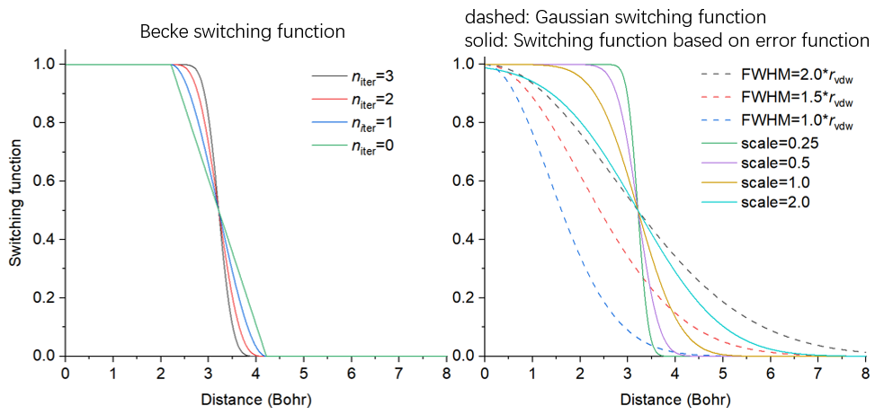
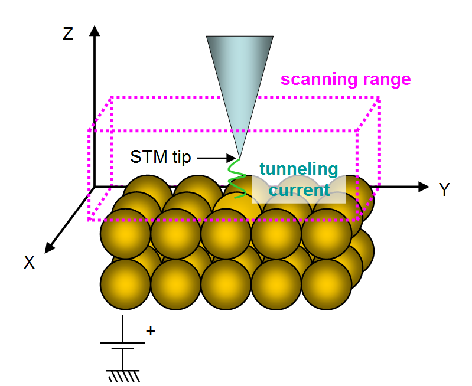
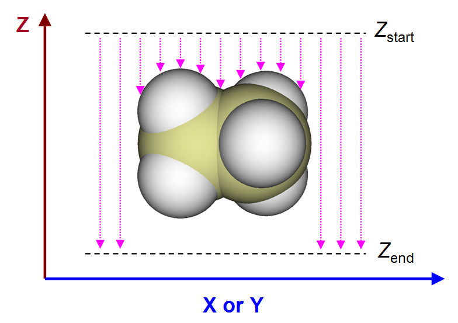

# **3.300 其它功能，第三部分 (300)**

## **3.300.1 查看胞中的自由区域并计算自由体积**

本功能用于可视化分子动力学模拟生成的胞或实验晶体中的自由区域，也可计算自由区域的体积。本功能特别适合表征含孔体系的结构，如多孔材料和煤。

### **算法**

本功能计算以下两种格点数据，其等值面用于图形化展示自由区域，换言之，即未被原子占据的区域。

- (1) 原始格点数据

  所有格点的值初始设为 1，然后遍历所有格点，若某格点与任一原子的距离小于该原子的 Bondi 范德华 (vdW) 半径，则该格点的值为 0，表示已被占据。

  自由区域的体积即自由体积，按占据格点总数乘以格点体积算得。用自由体积除以整个胞的体积即得占据百分比。

- (2) 平滑格点数据

  原始格点数据的等值面总是不光滑，图形效果很差。为绕开此问题，可计算平滑格点数据。想法很简单：每个原子没有明确边界，而表示为一个光滑变化的开关函数，随核间距从 0 到无穷大从 1.0 衰减到 0.0，其衰减行为受相关参数影响。支持三种开关函数：

- 高斯函数（未归一）。高斯函数的原始表达式见 Wikipedia。半高全宽 (FWHM) 越大，函数衰减越慢

- Becke 函数（变换后）。此函数的原始表达式见第 [3.18.0](sec-3-18-fuzzy-atomic-space-analysis.md#3180-基本概念) 节。迭代次数越小，函数衰减越慢

- 误差函数（变换后）。误差函数的原始表达式见 Wikipedia。缩放因子越大，函数衰减越慢

  为直观比较它们，下图将这些函数的特征画在一起。它们等于 0.5 的位置设在碳的 vdW 半径处

  

如所见，高斯函数衰减缓慢，而变换后的 Becke 和误差函数变化相对陡峭，陡峭程度取决于参数。

有了开关函数，平滑格点数据很容易算得：对任一格点，其值初始为 1.0，减去每个原子的开关函数值；然后若值为负，则置零。0.0 和 1.0 分别表示该格点被完全占据和完全自由；而 0.0 与 1.0 之间的值表示该格点被部分占据，值越低占据程度越高。要基于平滑格点数据可视化自由区域，通常等值可设为 0.5，但可适当调整以改善图形效果。

### **用法**

本功能支持任何胞，包括非正交胞。

可用任何含胞信息的文件作输入文件，如 .cif、.gro、带 CRYST1 字段的 .pdb 等，关于此点的完整介绍见第 [2.9.3](sec-2-9-analysis-of-periodic-systems.md#293-周期体系的其它各类分析) 节。其它含原子信息的文件也可用作输入文件，但胞将被假设为正交。

载入输入文件后，应进入主功能 300 的子功能 1，然后可见一个菜单，各选项说明如下

- 1 Set grid and start calculation：选此选项后，Multiwfn 请您定义计算用格点，需输入格点数据的原点坐标、三个方向的长度和格点间距。若输入文件含胞信息，三个方向与胞的三条边一致；若不含，三个方向假设为 X、Y、Z。

  之后，Multiwfn 开始计算上文提到的格点数据，然后输出自由体积和自由区域在整个胞中的百分比。在后处理菜单中，可直接可视化等值面查看自由区域，或将格点数据导出为 cube 文件。

- 2 Toggle considering periodic boundary condition：当此选项状态为 "Yes" 时，计算格点数据时考虑盒子中原子的周期镜像。这使计算昂贵得多，但数据真实得多。

- 3 Toggle calculating smoothed grid data of free regions：默认 Multiwfn 同时生成原始格点数据和平滑格点数据。若此选项状态设为 "No"，则只生成前者，代价也相应降低一部分。

- 4 Set method of smoothing：可在此选项中选择计算平滑格点数据所用的开关函数。默认是缩放因子为 1.0 的误差函数，通常这是合适的选择。

- 5 Toggle making isosurface closed at boundary：当状态设为 "Yes" 时，若盒子边界处有等值面，等值面看起来是闭合的。若状态切为 "No"，则等值面在边界处看起来是开口的。

- 6 Set scale factor of vdW radii for calculating free volume and primitive free region：若此选项的值不是默认 1.0 而设为值 *x*，则计算原始格点数据所用的 vdW 半径缩放 *x* 倍。显然此选项影响原始格点数据的等值面和算得的自由体积。

  本功能的代码效率很高，可用本功能研究含数万个原子的体系。当发现计算代价太高难以承受时，可考虑以下办法：

- (1) 用更好的 CPU。本功能的代码完全并行化，因此 CPU 核越多，计算时间越低。

- (2) 用更大的格点间距。显然，间距越大，等值面图越差，输出的自由体积精度越差。

- (3) 不考虑周期边界条件。代价降低一个量级，但某些边界区域的等值面会不真实，自由体积甚至会误导。

使用本模块的例子见第 [4.300.1](sec-4-300-other-functions-part-3.md#43001-可视化晶胞中的自由区域并计算自由体积的例子) 节。

> **所需信息**
>
> 原子坐标

## **3.300.2 将原子径向密度拟合为多个 STO 或 GTF 的线性组合**

本功能用于将原子径向密度拟合为多个 1*s* 型 Slater 型轨道 (STO) 或 *S* 型 Gaussian 型函数 (GTF) 的线性组合，使原子径向密度之后可解析计算。拟合涉及许多技术细节，将在第 [3.300.2.1](#330021-算法和技术细节) 节介绍，本模块的用法将在第 [4.300.2.2](sec-4-300-other-functions-part-3.md#430022-将溴的径向密度精确拟合为多个-gtf) 节描述。使用本模块进行拟合的实际例子见第 [4.300.2](sec-4-300-other-functions-part-3.md#43002-将原子径向密度拟合为-sto-或-gtf-的例子) 节。

### **3.300.2.1 算法和技术细节**

#### **基本思想**

本功能的目的是进行如下拟合

$$
\begin{gathered}
\rho(r) \approx \rho^{\mathrm{fit}}(r) \quad\quad \forall r \\
\rho^{\mathrm{fit}}(r) = \begin{cases} \sum_{i \in \mathrm{STO}} c_{i} e^{-\zeta r} & \\ \sum_{i \in \mathrm{GTF}} c_{i} e^{-\zeta r^{2}} & \end{cases}
\end{gathered}
$$

其中 {*c*} 为待拟合系数，{*ζ*} 为待拟合指数，*r* 为到原子核位置的径向距离。

#### **拟合类别**

为实现拟合，需定义一套拟合点。拟合本质上对应最小化最小二乘残差，该残差度量拟合点处实际密度与拟合密度间的总体误差。定义残差有三种方式，对应不同的拟合类别：

- (1) 最小化绝对误差：$\sum_{i} \left[ \rho_{i} - \rho_{i}^{\mathrm{fit}} \right]^{2}$

- (2) 最小化相对误差：$\sum_{i} \left[ \frac{\rho_{i} - \rho_{i}^{\mathrm{fit}}}{\rho_{i}} \right]^{2}$

- (3) 最小化径向分布函数 (RDF) 误差：$\sum_{i} \left[ 4\pi r_{i}^{2} \left( \rho_{i} - \rho_{i}^{\mathrm{fit}} \right) \right]^{2}$

上式中，{*i*} 为置于不同径向距离的拟合点，$r_{i}$ 表示点 *i* 的径向距离。$ρ_{i}$ 为基于载入波函数文件算得的球平均（即球形平均）电子密度。在 Multiwfn 中，用 170 个 Lebedev 角向格点做球平均。

通常，拟合类别 2 优于其它，因而为默认，因为这样拟合的密度在整个范围内都能复现实际密度，包括电子密度很小的尾区。用类别 1 拟合的密度只能很好表示很靠近原子核的区域，因为该区域电子密度远大于其它区域。当目视检查拟合密度曲线发现类别 2 效果不好时，改用类别 3 可能得到更好结果。若类别 2 和 3 都不好，有时先用类别 1 再用类别 2（即将类别 1 的拟合参数作类别 2 的初猜）有用，或先用类别 3 再用类别 2。

#### **拟合函数**

STO 和 GTF 是量子化学计算中最重要的函数，本模块支持将其作拟合函数。

拟合质量对拟合函数数目很敏感。显然，原则上拟合函数越多，拟合误差越小，拟合时的时间代价越高。

在 Multiwfn 中，最小二乘拟合用 Levenberg-Marquardt (LM) 算法进行，这是一种迭代法，通过逐步优化参数最小化残差直至达到收敛容差。重要的是注意，该算法本质上是局域最小化方法，因此所得拟合系数和指数可能依赖初猜。

拟合函数的系数总要拟合，但指数可一起拟合，也可固定在初猜以减小参数空间维数从而使收敛更容易。显然，对给定数目的拟合函数，若其指数在拟合中可变，原则上拟合质量应好于指数固定的情形。

当拟合函数数目大时（如 \>20），通常不建议同时拟合指数和系数，因为此时收敛往往很困难，代价很高，有时执行 LM 算法的程序不能正常工作。

#### **删除冗余拟合函数**

为达到好的拟合质量，通常应采用数十个小到大固定指数的拟合函数，这些指数常按等比（even-tempered）方式生成，即 $ζ_{i}$=*a*×$b^{i}$。例如 $ζ_{i}$=0.05×2$^{(}$*$^{i}$*$^{-1)}$，*i*=1, 2, 3 ... 30。此时，有时一个或多个拟合函数是冗余的，因为其指数太大或太小，导致严重数值问题。为识别并删除具不合理指数的有害冗余拟合函数，当选 GTF 作拟合函数时，Multiwfn 默认采用以下三条规则：

- (1) 指数陡但系数相对不显著的拟合函数（*ζ*\>10⁵ 同时 *c*\<5）和指数平但系数可忽略的拟合函数（*ζ*\<3 且 *c*\<10⁻⁴）被删除。

- (2) 显然，拟合密度处处应为正。若在某检测点拟合密度为负，则对该点负贡献最大的拟合函数被删除。检测点包括所有拟合点以及相邻均匀拟合点间的中点。通常太大的指数易在很靠近原子核的区域导致负值，太小的指数易在尾区导致负值。

- (3) 电子密度的变化应随径向距离增加单调减小。用前一半拟合点跨度内双倍密格点检查此要求；若违反，则删除指数最大的拟合函数，因为此问题通常由太大的指数引起。

每次只删除一个冗余函数。删除后 Multiwfn 重做拟合。重复拟合直至找不到冗余拟合函数。

有时从结果中可能发现两个拟合函数指数很接近，表明可去掉其中一个再重拟合，结果不会明显变差。但这类冗余拟合函数不被 Multiwfn 自动删除，可在设置初猜的界面中手动合并它们再重做拟合。

#### **缩放系数**

拟合密度在全空间的积分可能偏离实际电子数 ($N_{\mathrm{elec}}$)，显然这破坏拟合密度的物理意义，使其在许多场景无用。为解决此问题，拟合系数应乘一个因子进行缩放：

$$
\lambda = \frac{N_{\mathrm{elec}}}{\int 4\pi r^{2} \rho^{\mathrm{fit}}(r) \mathrm{d}r}
$$

在 Multiwfn 中，分母的积分用 100 个积分点的第二类 Chebyshev 高斯求积计算。

#### **拟合点的数目和步长**

通常感兴趣的原子径向区域是 *r* = 0-4 Å，因此拟合点应充分覆盖此区域。拟合点间距越小，拟合质量越高。默认 Multiwfn 采用很密的格点，格点间距为 0.001 Å，相应地默认格点数为 4000。拟合点的默认设置很恰当，无特殊理由不应改动。的确，适当增大格点间距并相应减少拟合点数可节约计算时间，但鉴于单原子的电子密度计算通常很便宜，增大格点间距不是好主意。

通常，用小间距的均匀拟合点完全足以达到满意的拟合质量，但 Multiwfn 也支持将第二类 Gauss-Chebyshev 点加入拟合点。这类点在原子核周围采样很密，在长程采样稀疏；换言之，格点间距与径向距离正相关。显然，计入第二类 Gauss-Chebyshev 点会或多或少改善很靠近原子核区域的拟合质量。但只要均匀格点间距足够小（如默认 0.001 Å），改善并不显著，因此默认拟合中不含这类点。

#### **检查拟合质量**

拟合后，检查拟合质量至关重要，以确保输出的系数和指数真正可靠、在实践中有意义。有几种检查方式：

- (1) 检查均方根误差 (RMSE)，定义为

  
$$
\mathrm{RMSE} = \sqrt{\frac{\sum_{i}^{N} \left( \rho_{i} - \rho_{i}^{\mathrm{fit}} \right)^{2}}{N}}
$$

  其中 *N* 为拟合点数。RMSE 越低，总体拟合质量越好。也可用此量比较不同拟合设置间的拟合精度。

- (2) 拟合点处拟合密度与实际密度的 Pearson 相关系数 (*r*) 和 $r^2$。值越接近 1，拟合质量越好。

- (3) 目视比较实际密度和拟合密度曲线。**这是检查拟合质量最严格的方式**。两条曲线应充分接近。

- (4) 检查拟合密度的积分。积分应在不同数目求积点下计算，如 60、80……300。若拟合系数和指数确实合理，所有情形下积分都应非常接近原子的实际电子数。

- (5) 用比拟合点密一倍或两倍的格点在宽范围内检查拟合密度。不应发现负密度，且拟合密度应单调变化。

### **3.300.2.2 用法**

#### **拟合的常用步骤**

用本功能进行拟合，通常应做以下步骤

- (1) 载入原子的波函数文件。文件至少应含 GTF 信息（如 .mwfn/.wfn/.fch/.molden），原子必须在原点。

- (2) 进入主功能 300 的子功能 2。

- (3) 选选项 3 并选一种定义初猜的方式，然后粗略检查屏幕上打印的初猜，再返回上级菜单。

- (4) 选选项 1 开始拟合。

- (5) 仔细检查屏幕上打印的信息，然后可用适当选项进一步检查拟合质量。

#### **拟合前的选项**

本模块界面中选项的含义和细节如下

- Start fitting：选此选项后，Multiwfn 做以下事情（某些过程可按用户要求跳过）

- Print initial guess of fitting functions

- Calculate sphericalized radial atomic density at fitting points

- Use Levenberg-Marquardt algorithm to optimize coefficients/exponents of fitting functions. In this procedure some redundant fitting functions may be deleted

- Sort fitting functions according to their exponents

- Calculate integral of fitted density and correspondingly scale coefficients

- Print final coefficients and exponents of fitting functions

- Print error statistics

然后会看到用于检查拟合质量或导出数据的菜单，各选项后面描述。

- Switch type of fitting functions：可用此选项在 STO 和 GTF 间切换拟合函数类别

- Check or set initial guess of coefficients and exponents：进入此选项后，先显示当前拟合函数的信息。默认未设拟合函数，因此在开始拟合前应用以下选项之一定义它们：

  - 1 Load initial guess from text file：用此选项从给定纯文本文件载入系数和指数，文件格式应如下：

    ````text
    ```text
    4.0 1000
    2.0 100
    1.0 1.5
    ```
    ````

    此文件定义三个拟合函数，第一、二列为初猜系数和指数。显然，这是定义拟合函数数目和初猜参数最灵活的方式。

    以下选项为方便起见采用预置设置（精度 & 函数数：3\>4\>5\>7\>2）：

  - 2 Crude fitting by a few STOs with variable exponents：此选项旨在做粗拟合，只用少数 STO。拟合中优化指数以使拟合质量更好。具体地，元素在周期表第一、二、三四及之后行时分别用 1、2、4、6 个 STO。此选项设的拟合函数初猜参数通常合理，但偶尔因初猜参数不合适拟合失败，此时应改用选项 1 载入手动提供的参数。

  - 3 Ideal fitting by 30 GTFs with fixed exponents：若要在整个范围内准确拟合实际密度，用此选项设的拟合函数通常是最好选择。用 30 个 GTF，为保证数值稳定并显著降低拟合代价，只拟合系数，指数保持初猜值不变，初猜按 $ζ_{i}$=0. 05×2$^{(}$*$^{i}$*$^{-1)}$ 生成，整数 *i* 从 1 到 30。

  - 4 Fine fitting by 15 GTFs with variable exponents：此选项用的 GTF 比选项 3 少，但同时优化指数。尽管指数可变，此选项的拟合质量不如选项 3 完美，同时拟合代价更高，且有 Levenberg-Marquardt 算法迭代不收敛的危险。

  - 5 Fine fitting by 10 GTFs with variable exponents：比选项 4 便宜，拟合精度略降。

  - 7 Relatively fine fitting by no more than 10 GTFs with variable exponents：此选项以最经济的方式用 GTF 拟合，前 18 个元素用 6 个 GTF，更重的用 10 个 GTF。虽便宜，通常已足够满意。

  最后，选项“10 Combine two fitting functions together”能将两个特定拟合函数替换为一个新函数，新函数的指数为两者平均，系数为两者之和。此选项主要用于手动删除线性相关的函数。

- Set fitting tolerance：值越小，拟合的数值精度越好而拟合代价越高。通常默认值能保证高数值精度。

- "Set number of evenly placed fitting points" 和 "Set spacing between fitting points"：默认均匀点数 (4000) 足够大，默认间距 (0.001 Å) 足够密，相应拟合点分布在 *r* = 0.001 到 4.0 Å。若想把更长程的点纳入拟合，或想降低拟合代价（时间代价基本与拟合点数成正比），可适当调整这两个选项。

- Toggle scaling coefficients to actual number of electrons：当此选项状态为 "Yes"（默认）时，算出拟合密度的积分后，拟合函数的系数按上一节所述方式缩放。总建议做缩放。

- Select fitting type：可用此选项选择拟合方式，包括 "Minimizing absolute error"、"Minimizing relative error" 和 "Minimizing radial distribution function (RDF) error"，已在上一节介绍。第二种通常最推荐，故为默认。

- Toggle fixing exponents：当此选项状态设为 "Yes" 时，Multiwfn 在拟合过程中同时优化拟合函数的系数和指数。若想把指数保持在初猜，此选项应切为 "No"。

- Toggle sorting functions according to exponents：当此选项状态为 "Yes"（默认），Multiwfn 重排拟合函数使其指数从低到高排序。

- Toggle removing redundant fitting functions：当此选项状态为 "Yes"（默认），拟合中自动删除冗余拟合函数，如上一节所述。这对保证数值稳定性和结果合理性很重要，通常应开启。

- Set number of second kind Gauss-Chebyshev fitting points：如上一节所述，若想把重采样原子核附近区域的点加入拟合，可将均匀分布点和一些第二类 Gauss-Chebyshev 点组合为实际拟合点。此选项控制所用第二类 Gauss-Chebyshev 点的数目。当值为 0（默认）时，不用这类点。

- Set maximum number of function calls：此选项设误差最小化中函数调用的最大次数。若最小化到此时仍未收敛，最小化停止并报告未收敛结果。

#### **拟合后的选项**

拟合完成出现的菜单中有许多用于检查或导出结果的选项，也有一些用于检查拟合质量的选项。其中多数是自明的，这里只描述少数几个：

- Visualize actual density and fitted density curves using logarithmic scaling：此选项在目视检查拟合质量上很有用，蓝色和黑色曲线分别表示拟合密度和实际密度。显然，两条曲线越接近，拟合质量越好。从此图还可了解哪些区域拟合好、哪些不好。

- Export fitted density from 0 to 10 Angstrom with double dense grid to fitdens.txt in current folder：此选项有助于在宽范围内检查拟合密度的质量。可用此选项导出 *fitdens.txt* 文件，若发现拟合密度变化符合预期（如无负值、光滑单调衰减），则拟合密度应可靠可用。

- Check integral of fitted density：此选项用不同数目求积点（从 40 到 300，步长 20）的高斯积分计算拟合密度的径向积分。若结果都接近实际电子数，意味着拟合密度应可靠。

- Check fitted density at a given radial distance：用此选项可输入径向距离值检查特定径向距离处的拟合密度。这也是论证拟合密度合理性的有用方式。

- Output coefficients and exponents as Fortran code to a .txt file：此选项将拟合系数和指数以 Fortran 代码形式写入导出的文件，然后可将信息从导出文件复制到您的 Fortran 程序中利用。

使用本模块进行拟合的实际例子见第 [4.300.2](sec-4-300-other-functions-part-3.md#43002-将原子径向密度拟合为-sto-或-gtf-的例子) 节。

> **所需信息**
>
> 原子坐标、GTFs

## **3.300.4 模拟扫描隧道显微镜 (STM) 图像**

### **理论**

扫描隧道显微镜 (STM) 是很常用的在原子级别成像化学体系的实验技术，也与样品的电子结构密切相关，更多信息见 [wiki 页面](https://en.wikipedia.org/wiki/Scanning_tunneling_microscope)。在 STM 成像过程中，导电针尖置于样品上方，同时在二者间加偏压 (*V*)。由于量子隧穿效应，针尖与样品在适当间距（通常 4\~7 Å）和 *V* 下形成隧穿电流 (*I*)。在不同位置，因针尖与样品间相互作用不同，*I* 不同，本质上观测的 STM 图像表征函数 *I*(**r**)。STM 实验可用下图示意……



STM 有两种模式：

- 恒高模式：针尖的 *z* 坐标固定在给定值而扫描 *x* 和 *y*。此时的二维 STM 图像对应 *I*(*x*,*y*) 函数。

- 恒流模式：做 *x* 和 *y* 的二维扫描，对每个 (*x*,*y*)，逐步调整针尖的 *z* 坐标直至找到 *I* 等于特定值的 *z* 位置 ($z_{\mathrm{c}}$)。给定电流下此模式的 STM 图像对应 $z_{\mathrm{c}}$ (*x*,*y*) 函数。显然，生成恒流模式 STM 图像比恒高模式更耗时，因为需考虑额外的维度 (*z*)。

尽管有许多计算模拟 STM 图像的方法，唯一常用的是 Tersoff 和 Hamann 导出的模型，见 *Phys. Rev. B*, **31**, 805 (1985) 及书 *Introduction to Scanning Tunneling Microscopy* (2ed, Julian Chen, 2008) 第 6 章。原则上，要确定 *I* 必须知道针尖的真实特征，但通常未知。Tersoff-Hamann 模型的关键点是将针尖替换为点探针，从而推导 *I* 的公式大为简化（Tersoff 和 Hamann 还讨论了针尖局域为特定半径球面的情形，但此处不考虑）。原始 Tersoff-Hamann 模型对应小 *V* 和低温极限……

$$
\begin{aligned}& I(\mathbf{r}) \propto \sum_{i}^{E_{\mathrm{F}}+eV \to E_{\mathrm{F}}} \left| \varphi_{i}(\mathbf{r}) \right|^{2} \quad\quad (V<0) \\ & I(\mathbf{r}) \propto \sum_{a}^{E_{\mathrm{F}} \to E_{\mathrm{F}}+eV} \left| \varphi_{a}(\mathbf{r}) \right|^{2} \quad\quad (V>0)\end{aligned}
$$

其中 *i* 表示能量在 $E_{\mathrm{F}}$ +*eV* 到 $E_{\mathrm{F}}$ 间的占据 MO，*a* 表示能量在 $E_{\mathrm{F}}$ 到 $E_{\mathrm{F}}$ +*eV* 间的非占据 MO。$E_{\mathrm{F}}$ 为 Fermi 能级，对孤立体系没有很好定义，但通常取 $E_{\mathrm{HOMO}}$ 和 $E_{\mathrm{LUMO}}$ 的平均。*e* 为元电荷，是正值 (1.602E-19 C)。当 *V* 为正，针尖中电子隧穿进样品的空态；*V* 为负时，电子从样品的占据态隧穿出到针尖。

> **注**
>
> 一些文献用 -*eV* 而非 +*eV*，因为那些文献中的 *e* 对应电子所带电荷而非元电荷。尽管上式通常被称为 Tersoff-Hamann 模型，严格说并非 Tersoff 和 Hamann 提出的形式。

上式表明 *I*(**r**) 正比于 **r** 处由能量在 $E_{\mathrm{F}}$ +*eV* 到 $E_{\mathrm{F}}$ 间（*V*\<0 时）或 $E_{\mathrm{F}}$ 到 $E_{\mathrm{F}}$ +*eV* 间（*V*\>0 时）的 MO 贡献的局域态密度 (LDOS)（注意，此处的 LDOS 定义与第 [3.12.4](sec-3-12-plotting-density-of-states-pes-and-cohp.md#3124-局域态密度local-dos) 节介绍的不同），因此，若轨道波函数可得从而 LDOS 可算，STM 图像可直接得到。用此方式讨论模拟 STM 图像时，建议将 *I* 的单位写作 LDOS 的单位，在 Multiwfn 中对应 a.u.。

用上述方式模拟的 STM 图像不能与实验严格比较，因为未考虑 STM 针尖的实际特征而简化为点（故模拟 STM 图像有无限高分辨率）。还注意，由于引入近似，本模型无法确定 *I* 的大小，因此只有不同位置间 *I* 的相对差异有意义、可讨论。

### **用法**

要在 Multiwfn 中模拟 STM 图像，推荐用含基函数信息的文件，如 .mwfn、.fch 和 .molden。只含 GTF 信息的格式如 .wfn 也可，但此时不能模拟 *V*\>0 的 STM 图像，因为它们只含占据 MO 信息。

由于 STM 模拟基于分子轨道，理论方法只支持 HF 和 KS-DFT（双杂化泛函除外），MP2 和 CASSCF 等多组态方法不支持。限制闭壳、限制开壳和非限制开壳都支持。

主功能 300 的子功能 4 对应 STM 模拟功能。进入本功能后，请仔细阅读屏幕提示，它告知默认 Fermi 能级和偏压如何确定。在界面中可自定义 $E_{\mathrm{F}}$、*V*、格点数、STM 的空间范围。也可选 STM 图像的模式，恒高（默认）和恒流模式都可用。设置恰当后，选选项 0 开始计算绘制 STM 图用的数据，计算中考虑的 MO 会显示在屏幕上，便于检查 $E_{\mathrm{F}}$ 和 *V* 定义是否恰当。注意，计算代价完全由格点数决定……

恒高和恒流模式模拟 STM 图像的方式略有不同，如下所述：

- 恒高模式：计算前应恰当设定 X 和 Y 范围，默认由边界原子位置向外扩展 3 Bohr 确定。要计算的平面的默认 Z 位置比最高原子（即 Z 坐标最大的原子）高 0.7 Å。选选项 0 算出二维平面每一点的电流后，可见绘制 STM 图像的界面，所有选项都是自明的，此处不再描述（选项与主功能 4 后处理菜单中的很相似）。默认色标下限为 0，上限自动设为平面数据中的最大 *I*。

- 恒流模式：应先选一次选项 1 将模式从默认恒高模式切为恒流模式。然后应恰当定义 X、Y 和 Z 的计算范围。默认 X、Y 范围与恒高模式相同，Z 的默认下限和上限分别为比最高原子高 0.7 和 2.5 Å。选选项 0 后，Multiwfn 开始计算 *I* 的三维格点数据，然后可用相应选项可视化隧穿电流的等值面图、将格点数据导出为 cube 文件，或可视化二维 STM 图像。对后者，需输入隧穿电流值，然后 Multiwfn 估计每 (*x*,*y*) 点处 *I* 等于该值的 *z* 值 ($z_{\mathrm{c}}$)，所得平面数据 $z_{\mathrm{c}}$ (*x*,*y*) 即可经屏幕上相应选项直接绘制为平面图。

模拟 STM 图像的例子见第 [4.300.4](sec-4-300-other-functions-part-3.md#43004-模拟扫描隧道显微镜stm图像的例子) 节。

> **所需信息**
>
> 原子坐标、GTFs

## **3.300.5 计算电偶极/多极矩和电子空间范围**

本功能基于解析计算的积分（或基于原子电荷，见后）计算电偶极、四极、八极和十六极矩以及电子空间范围 \<$r^2$\>。注意，第 [3.18.3](sec-3-18-fuzzy-atomic-space-analysis.md#3183-原子与分子多极矩及--2) 节所述功能也能计算偶极、四极和八极矩，但它是基于积分格点数值计算的，因此明显更慢、精度略低于本功能。本功能打印的信息如下所示。

偶极矩：

$$
\boldsymbol{\mu} = \begin{bmatrix} \mu_{x} \\ \mu_{y} \\ \mu_{z} \end{bmatrix} = \sum_{A} q_{A} \begin{bmatrix} X_{A} \\ Y_{A} \\ Z_{A} \end{bmatrix} - \int \begin{bmatrix} x \\ y \\ z \end{bmatrix} \rho(\mathbf{r}) \mathrm{d}\mathbf{r}
$$

其中 $X_{A}$、$Y_{A}$ 和 $Z_{A}$ 为原子 *A* 的三个笛卡尔坐标。$q_{A}$ 为原子 *A* 的核电荷。*x*、*y* 和 *z* 为电子位置的三个笛卡尔坐标。

四极矩（标准笛卡尔形式）：

$$
\boldsymbol{\Theta} = \begin{bmatrix} \Theta_{xx} & \Theta_{xy} & \Theta_{xz} \\ \Theta_{yx} & \Theta_{yy} & \Theta_{yz} \\ \Theta_{zx} & \Theta_{zy} & \Theta_{zz} \end{bmatrix} = \sum_{A} q_{A} \begin{bmatrix} X_{A}X_{A} & X_{A}Y_{A} & X_{A}Z_{A} \\ Y_{A}X_{A} & Y_{A}Y_{A} & Y_{A}Z_{A} \\ Z_{A}X_{A} & Z_{A}Y_{A} & Z_{A}Z_{A} \end{bmatrix} - \int \begin{bmatrix} x^{2} & xy & xz \\ yx & y^{2} & yz \\ zx & zy & z^{2} \end{bmatrix} \rho(\mathbf{r}) \mathrm{d}\mathbf{r}
$$

四极矩（无迹笛卡尔形式）：

$$
\boldsymbol{\Theta}^{\mathrm{tr}} = \frac{1}{2} \begin{bmatrix} 3\Theta_{xx}-\Theta_{rr} & 3\Theta_{xy} & 3\Theta_{xz} \\ 3\Theta_{yx} & 3\Theta_{yy}-\Theta_{rr} & 3\Theta_{yz} \\ 3\Theta_{zx} & 3\Theta_{zy} & 3\Theta_{zz}-\Theta_{rr} \end{bmatrix}
$$

其中 Θ*$_{rr}$* = Θ*$_{xx}$* + Θ*$_{yy}$* + Θ*$_{zz}$*。

四极矩的大小：$\left| \boldsymbol{\Theta}^{\mathrm{tr}} \right| = \sqrt{(2/3)\left[ \left( \Theta^{\mathrm{tr}}_{xx} \right)^{2} + \left( \Theta^{\mathrm{tr}}_{yy} \right)^{2} + \left( \Theta^{\mathrm{tr}}_{zz} \right)^{2} \right]}$。

注意，由于笛卡尔形式的四极矩是对称矩阵，只有 6 个分量是独立的。

电子空间范围定义为 $\left\langle {r}^{2} \right\rangle=\int ({x}^{2}+{y}^{2}+{z}^{2})\rho(\mathbf{r})\mathrm{d}\mathbf{r}$。本质上，它就是电子贡献的四极矩张量（笛卡尔形式）迹的负值。Multiwfn 不仅打印 $\left\langle {r}^{2} \right\rangle$，还打印它的三个笛卡尔分量，便于了解其来源。关于 $\left\langle {r}^{2} \right\rangle$ 的非常详细的介绍见我的博客文章：<http://sobereva.com/616>（中文）。

四极矩（球谐形式）：

$$
\begin{aligned}& Q_{2,0} = \left( 3\Theta_{zz}-\Theta_{rr} \right)/2 \\ & Q_{2,-1} = \sqrt{3}\Theta_{yz} \quad\quad Q_{2,1} = \sqrt{3}\Theta_{xz} \\ & Q_{2,-2} = \sqrt{3}\Theta_{xy} \quad\quad Q_{2,2} = \left( \sqrt{3}/2 \right)\left( \Theta_{xx}-\Theta_{yy} \right)\end{aligned}
$$

$\mathbf{Q}_{2}$ 的大小：$\left| \mathbf{Q}_{2} \right| = \sqrt{\sum_{m=-2}^{2} \left( Q_{2,m} \right)^{2}}$。

笛卡尔形式的八极矩是 3×3×3=27 分量的三阶张量，但只有 10 个元独立。例如，XYZ 分量按如下计算，其它分量类似

$$
\Theta_{xyz} = \sum_{A} q_{A} X_{A} Y_{A} Z_{A} - \int xyz \rho(\mathbf{r}) \mathrm{d}\mathbf{r}
$$

八极矩的球谐形式：

$$
\begin{aligned}& Q_{3,0} = (1/2)\left( 5\Theta_{zzz}-3\Theta_{rrz} \right) \\ & Q_{3,-1} = \sqrt{3/8}\left( 5\Theta_{zzy}-\Theta_{rry} \right) \quad\quad Q_{3,1} = \sqrt{3/8}\left( 5\Theta_{zzx}-\Theta_{rrx} \right) \\ & Q_{3,-2} = \sqrt{15}\Theta_{xyz} \quad\quad Q_{3,2} = \left( \sqrt{15}/2 \right)\left( \Theta_{xxz}-\Theta_{yyz} \right) \\ & Q_{3,-3} = \sqrt{5/8}\left( 3\Theta_{xxy}-\Theta_{yyy} \right) \quad\quad Q_{3,3} = \sqrt{5/8}\left( \Theta_{xxx}-3\Theta_{yyx} \right)\end{aligned}
$$

其中 $\Theta_{rrx} = \left( \Theta_{xxx} \right)^{2} + \left( \Theta_{yyx} \right)^{2} + \left( \Theta_{zzx} \right)^{2}$，$\Theta_{rry}$ 和 $\Theta_{rrz}$ 类似。

$\mathbf{Q}_{3}$ 的大小：$\left| \mathbf{Q}_{3} \right| = \sqrt{\sum_{m=-3}^{3} \left( Q_{3,m} \right)^{2}}$。

笛卡尔形式的十六极矩是 3×3×3×3=81 分量的四阶张量，但只有 15 个元独立。例如，XYZZ 分量按如下计算，其它分量类似

$$
\Theta_{xyzz} = \sum_{A} q_{A} X_{A} Y_{A} Z_{A} Z_{A} - \int xyzz \rho(\mathbf{r}) \mathrm{d}\mathbf{r}
$$

本功能还打印正电荷中心。*X* 分量定义为

$$
\frac{\sum_{A} q_{A} X_{A}}{\sum_{A} q_{A}}
$$

还打印负电荷中心。例如 *X* 分量按如下计算

$$
\frac{\int x\rho(\mathbf{r})\mathrm{d}\mathbf{r}}{\int \rho(\mathbf{r})\mathrm{d}\mathbf{r}}
$$

### **基于原子电荷计算**

若输入文件是 .chg 或 .pqr，本功能也可用，但偶极和多极矩都基于文件中记录的原子电荷计算。例如此时偶极矩表示为

$$
\boldsymbol{\mu} = \begin{bmatrix} \mu_{x} \\ \mu_{y} \\ \mu_{z} \end{bmatrix} = \sum_{A} q_{A} \begin{bmatrix} X_{A} \\ Y_{A} \\ Z_{A} \end{bmatrix}
$$

其中此语境下 $q_{A}$ 表示原子 *A* 的原子电荷。

本功能的一个简单例子见第 [4.300.5](sec-4-300-other-functions-part-3.md#43005-计算尿嘧啶的电偶极矩多极矩和电子空间分布范围) 节。

> **所需信息**
>
> 原子坐标、GTF 信息或基函数或原子电荷。

## **3.300.6 通过输入 Fock 矩阵计算当前轨道能量**

本功能是主功能 300 的子功能 6，是计算当前轨道（即内存中存储的轨道）能量的通用模块。输入文件必须有基函数信息，进入本功能后，需向 Multiwfn 提供 Fock 或 Kohn-Sham (KS) 矩阵（详见本手册[附录 7](sec-6-7-about-providing-fock-ks-matrix-to-multiwfn.md)），然后轨道能量作为 Fock 或 KS 算符的期望值算出。

本功能计算自然跃迁轨道 (NTO) 能量的应用见第 [4.300.6](sec-4-300-other-functions-part-3.md#43006-计算轨道能量以-nto-轨道为例) 节。

> **所需信息**
>
> 基函数、含 Fock/KS 矩阵的纯文本文件

## **3.300.7 当前体系的几何相关操作**

> **注**
>
> 本节的中文版及丰富例子是我的博客文章“Multiwfn 中非常有用的几何操作和坐标变换功能介绍”(<http://sobereva.com/610>)。

本功能是主功能 300 的子功能 7，旨在对当前体系做各种几何相关操作，可能涉及特殊目的研究。注意，旋转和反演操作导致的轨道系数矩阵变换不被本功能考虑。

在本功能中可做许多几何操作，下面简述。可用多次，效果累积。可随时选选项 0 在 GUI 窗口可视化当前几何。也可用选项 -1、-2、-3 和 -4 分别将当前几何导出为 .xyz、.pdb、.gjf 和 .cif 文件。用选项 -9 可恢复从输入文件载入的初始几何。

- 1 Translate selected atoms according to a translation vector

  将被要求选择一套原子并输入平移矢量，所选原子用该矢量平移

- 2 Translate the system such that the center of selected atoms is at origin

  将被要求选择一套原子并选其中心类别（几何中心、质心或核电荷中心），然后整个体系平移使其中心恰在原点。

- 3 Rotate selected atoms around a Cartesian axis or a bond

  将被要求选择一套原子，将它们绕笛卡尔轴、化学键或矢量旋转您指定的角度。用于坐标变换的旋转矩阵也显示在屏幕上。

- 4 Rotate selected atoms by applying a given rotation matrix

  将被要求选择一套原子并手动输入旋转矩阵（**M**），然后每个所选原子的几何依次经 **v**$_{new}$=**Mv**$_{old}$ 变换，其中 **v** 为由原子的 X、Y、Z 坐标组成的列向量，或经 **w**$_{new}$=**w**$_{old}$**M**，其中 **w** 为由原子的 X、Y、Z 坐标组成的行向量。

- 5 Make a bond parallel to a vector or Cartesian axis

  体系被重取向使由两个所选原子定义的键平行于特定矢量或笛卡尔轴。

- 6 Make a vector parallel to a vector or Cartesian axis

  体系被重取向使原坐标系中的矢量平行于特定矢量或笛卡尔轴。例如，您做了电子激发计算，想使某激发的跃迁偶极矩恰平行于 X 轴，可用本功能。

- 7 Make electric dipole moment parallel to a vector or Cartesian axis

  电偶极矩自动算出，体系被重取向使电偶极矩平行于特定矢量或笛卡尔轴。本功能仅当输入文件含波函数信息时可用。

- 8 Make longest axis of selected atoms parallel to a vector or Cartesian axis

  将被要求选择一套原子，整个体系被重取向使所选原子的最长轴（转动惯量最小的主轴）平行于特定矢量或笛卡尔轴。

- 9 Mirror inversion for selected atoms

  将被要求选择一套原子并选平面（XY、YZ 或 XZ），然后对所选原子做相对该平面的镜面反演。

- 10 Center inversion for selected atoms

  将被要求选择一套原子，然后其 X、Y、Z 坐标变号。

- 11 Make the plane defined by selected atoms parallel to a Cartesian plane

  将被要求选择一套原子，用其坐标拟合平面。然后被要求选笛卡尔平面（XY、YZ 或 XZ），整个体系被重取向使拟合平面平行于所选笛卡尔平面。

- 12 Scale Cartesian coordinates of selected atoms

  将被要求选择一套原子、要缩放的坐标类别（X 或 Y 或 Z 或全部）和缩放因子。然后相应坐标乘以缩放因子。缩放因子也可为负或零。

  若输入文件含胞信息，缩放原子坐标后，还被要求选是否同时缩放胞矢量的相应分量。例如，若之前选缩放 X 坐标，则所有胞矢量的 X 分量也被缩放。

- 13 Reorder atom sequence

  此选项支持不同规则重排原子：(1) 按 X 或 Y 或 Z 坐标值 (2) 非氢原子排在氢前 (3) 按成键，即让每个孤立片段中原子序号连续 (4) 按元素序号 (5) 交换两个特定原子 (6) 输入含所有原子新顺序的文件（格式见屏幕提示）(7) 输入一批原子的序号，它们将排到其它原子前面。在本功能中，还可选选项 -1 反转原子顺序。

- 15 Add an atom：将被要求输入元素和 XYZ 坐标，新增一个原子（作最后一个原子）。

- 16 Remove some atoms：将被要求输入原子列表，它们从当前体系删除。

- 17 Crop some atoms：将被要求输入原子列表，不在列表中的原子被删除。

- 18 Generate randomly displaced geometries

  用本功能可得到许多随机位移的几何，新几何导出到当前文件夹的 *new.xyz*。生成中，每个所选原子的笛卡尔坐标随机位移，位移满足正态分布，标准差由用户输入。位移的考虑方向可由用户设定，如仅 X 方向、Y 和 Z 方向、所有方向等。若只生成一个几何，每个原子的位移矢量显式显示在屏幕上。

以下选项与周期体系相关，仅当输入文件有胞信息时可用，哪些文件能向 Multiwfn 提供胞信息见第 [2.9.3](sec-2-9-analysis-of-periodic-systems.md#293-周期体系的其它各类分析) 节。

- 19 Translate and duplicate cell (construct supercell)

  此选项用于构建超胞。将被要求输入每个方向的重复数，数目可为正或负。例如，在某方向若输入 3，则体系沿正方向复制两次，从而该方向有三个重复；若输入 -3，则体系沿负方向复制三次，最终有四个重复。

- 20 Make truncated molecules by cell boundary whole

  对实验分子晶体文件，胞边界把分子截成单个片段很常见，给可视化分子结构带来很大不便。本功能能让每个被截断的分子完整。

- 21 Scale cell length and atom coordinates correspondingly

  将被要求选方向并输入缩放因子，则该方向的胞长度和原子坐标被缩放。当需手动调整胞密度时此选项特别有用。

- 22 Wrap all atoms outside the cell into the cell

  有时一些原子在胞外，此选项用于把它们包进当前胞；换言之，胞外的原子经胞矢量适当平移使其分数坐标在 0.0\~1.0 范围内。

- 23 Translate system along cell axes by given distances

  将被要求输入每个方向的平移距离（可正可负），然后体系中所有原子相应平移。注意胞不动，因此平移后一些原子可能在胞外，然后可用选项 22 把它们包进胞。

- 24 Translate system to center selected part in the cell

  将被要求输入一批原子的序号，然后整个体系平移使所选原子的几何中心移到胞中心。之后一些原子可能在胞外，然后可用选项 22 把它们包进胞。

- 25 Extract a molecular cluster (central molecule + neighbouring ones)

  将被要求输入一个原子的序号和判据（见下），然后整个分子及其第一层相邻的其它分子被抽出作分子簇。此外，中心分子在簇中的原子序号显示在屏幕上。若想用如 IGMH、IRI 和 Hirshfeld 面分析研究晶体中的分子间相互作用，本功能特别有用。注意，若相邻分子的某原子与所选分子的最近距离小于二者 vdW 半径之和乘以您输入的判据，则该相邻分子被纳入抽取。通常判据 1.2 合适，增大它可能得到更大的簇。

- 26 Set cell information

  用此选项可手动设置当前胞的 *a*、*b*、*c* 大小和 *α*、*β*、*γ* 角值。也可手动定义胞的三个平移矢量。

- 27 Add boundary atoms

  位于胞壁或胞棱的边界原子被检测并作为真实原子加入当前体系。

- 28 Axes interconversion

  可选做 **a** ↔ **b**、**a** ↔ **c** 或 **b** ↔ **c** 互换。所选两分量的原子分数坐标和胞矢量长度被交换。若想改变二维材料的取向，本功能特别有用：若胞正交且材料层当前平行于 XY 平面，而希望使层平行于 YZ 平面，则可用本功能互换 **a** 和 **c** 轴。

> **所需信息**
>
> 原子坐标

## **3.300.8 绘制表面距离投影图**

本功能绘制的表面距离投影图在目视表征分子结构上很直观，在识别位阻效应上特别有帮助。也可用于直观表征固体表面结构。

简言之，本功能绘制 XY 平面的填充色图，值对应体系表面相对给定 Z 层的相对 Z 位置，见下图示意。在每 (x,y) 点，程序从 $Z_{\mathrm{start}}$ 到 $Z_{\mathrm{end}}$ 扫描 Z 坐标直至到达表面，终点相对起点的 Z 值即要绘制的函数值。



在本功能中，一旦用相应选项恰当设好所有参数，可选选项 0 开始计算，然后进入菜单，在其中作图，有许多用于微调图形效果的选项。

显然，要得到有用的分子表面距离投影图，输入文件中的体系必须置于恰当取向，这是用户的责任。本功能也适用于二维材料等周期体系，周期边界条件可恰当考虑。

### **一些细节**

定义体系表面有三种不同方式，可用本功能界面的选项 1 选择：

- (1) promolecular 电子密度的等值面

- (2) 基于波函数信息的电子密度的等值面

- (3) 由缩放的原子 Bondi 范德华半径叠加定义的 vdW 表面，缩放因子可手动输入

若输入文件只含原子信息，可用 (1) 和 (3)；若有 GTF 信息，也可用 (2)。计算代价 (2) \> (1) \> (3)。通常推荐 (1)，因为其表面比 (3) 光滑得多，即使对相当大的体系代价也不高，且任何含原子信息的文件都可用作输入文件。选 (1) 或 (2) 后可输入电子密度的等值，等值的选择很大程度上任意，默认 0.05 a.u. 能显示体系的主要轮廓，而若想展示位阻效应，可用如 0.001 或 0.002 a.u.，对应 Bader 的 vdW 表面定义。

在本功能中，可分别用选项 2 和 3 定义作图平面的 X、Y 轴范围，默认范围自动确定以使图覆盖整个体系。X、Y 的格点数可分别用选项 3 和 4 手动设置，计算代价与二者乘积成正比。格点数越大，所得图越精细。

Z$_{start}$ 和 Z$_{end}$ 可分别用选项 7 和 8 定义。默认它们分别对应 Z 值最大和最小原子的 Z 坐标。Z 扫描的步数可用选项 6 修改，值越小，投影距离越准，但计算代价越高。

默认作图绘制的填充色图附加等值线，在 Z$_{end}$ − Z$_{start}$ 与 0 间自动均匀生成 25 条等值线，分别对应色标默认下限和上限。自动生成的等值线数目可用选项 9 修改。

本功能绝不限于分子体系，也完全兼容周期体系，因此可用本功能生动揭示固体表面各位置的相对 Z 位置。此时输入文件应含胞信息，结构文件和波函数文件哪些能提供胞信息已分别在第 [2.9.3](sec-2-9-analysis-of-periodic-systems.md#293-周期体系的其它各类分析) 节和第 [2.9.2](sec-2-9-analysis-of-periodic-systems.md#292-基于周期性波函数的波函数分析) 节描述。

绘制这类图的例子见第 [4.300.8](sec-4-300-other-functions-part-3.md#43008-为rubpy₃²-配位体绘制表面距离投影图) 节。

> **所需信息**
>
> 原子坐标

## **3.300.9 确定 Fermi 能级**

本功能用于基于指定温度和轨道能量经 Fermi-Dirac 分布确定 Fermi 能级。

### **理论**

按 Fermi-Dirac 分布，在给定温度 (*T*) 下轨道 *i* 的占据可按如下计算

$$
\begin{gathered}\eta_{i} = \frac{n}{1 + \exp\left[ \left( E_{i} - E_{\mathrm{f}} \right) / \left( k_{\mathrm{B}}T \right) \right]}\end{gathered}
$$

其中 $E_{i}$ 为轨道 *i* 的能量，$E_{\mathrm{F}}$ 为 Fermi 能级，$k_{\mathrm{B}}$ 为 Boltzmann 常数，若轨道由限制性和非限制性计算产生 *n* 分别为 2.0 和 1.0。$E_{\mathrm{F}}$ 对应占据概率 50% 的假想能级。

用上述方式指定轨道占据，会发现所有轨道的总电子数依赖 $E_{\mathrm{F}}$ 的选择。显然，物理上有意义的 $E_{\mathrm{F}}$ 是使总电子数与当前体系实际电子数相同的值；所以，在 Multiwfn 的本功能中，$E_{\mathrm{F}}$ 基于此事实确定（这与 CP2K 程序在开启 smearing 时确定 $E_{\mathrm{F}}$ 的方式相同）。具体地，Multiwfn 用二分算法迭代调整 $E_{\mathrm{F}}$ 直至当前与预期总电子数间的偏差小于 1E-6。最大迭代数为 1000，通常迭代能在数十步内收敛……

$E_{\mathrm{F}}$ 与温度有关，因此在本功能中需输入温度。值得注意的是，在 *T* = 0 K 时 $E_{\mathrm{F}}$ 定义不明，因为此时 Fermi-Dirac 函数是阶跃函数，HOMO 与 LUMO 能量间的任何值都可接受。

### **用法**

用本功能，只需载入含占据和非占据轨道的波函数文件（可用如 .mwfn、.fch、.molden 等。.wfn 格式不能用，因为它通常不记录非占据轨道），然后进入主功能 300 的子功能 9，再输入温度。

例如，启动 Multiwfn 并输入

```text
examples\Li6.fch
300   //Other function (Part 3)
9   //Determine Fermi level
3000   //Temperature (K)
```

会看到

```text
 Iter:    1  Nelec:     18.00331025  Dev.:  0.33102D-02  Ef:   -0.09099563 a.u.
 Iter:    2  Nelec:     17.49559527  Dev.: -0.50440D+00  Ef:   -0.10918015 a.u.
 Iter:    3  Nelec:     17.81870305  Dev.: -0.18130D+00  Ef:   -0.10008789 a.u.
...ignored
 Iter:   17  Nelec:     17.99999281  Dev.: -0.71905D-05  Ef:   -0.09117931 a.u.
 Iter:   18  Nelec:     17.99999782  Dev.: -0.21801D-05  Ef:   -0.09117904 a.u.
 Iter:   19  Nelec:     18.00000033  Dev.:  0.32506D-06  Ef:   -0.09117890 a.u.
 Converged! Fermi level is   -0.09117890 Hartree     -2.481104 eV
```

即 $E_{\mathrm{F}}$ 为 -2.481 eV。

Multiwfn 用 HOMO 和 LUMO 能量的平均作初猜。孤立体系通常有相对较大的带隙，因此若指定温度不够高，迭代在 1 步内收敛。例如，若上例中温度只设 500 K，$E_{\mathrm{F}}$ 为 -2.476 eV，恰为 HOMO 和 LUMO 的平均。

### **用纯文本文件作输入文件**

若所用的量子化学或第一性原理程序不能产生 Multiwfn 支持的波函数文件，也可用本功能。只需手动把轨道信息写入纯文本并作输入文件。闭壳情形格式应如下：

```text
5 20
 -19.138047
  -0.997376
  -0.514852
[...ignored]
   3.531811
   3.692553
```

第一行 5 和 20 分别表示占据和非占据 MO 数。文件的其它部分以 Hartree 为单位、自由格式按从低到高记录轨道能量。为方便，也允许把占据和非占据轨道能量写在两行，例如：

```text
5 20
 -19.138047 -0.997376 -0.514852 -0.371177 -0.291987
   0.065333 0.151203 0.756610 [...ignored] 3.307120 3.531811 3.692553
```

开壳情形纯文本文件的格式应如下：

```text
6 13 4 15
-19.33565   //The first alpha orbital
 -1.18124
 -0.66585
[...ignored]
  2.13855
  2.46757
  3.40210   //The last alpha orbital
-19.30115   //The first beta orbital
 -1.09028
 -0.63075
[...ignored]
  2.49486
  3.45566   // The last beta orbital
```

第一行依次记录 alpha 占据、alpha 非占据、beta 占据和 beta 非占据轨道数，后面部分依次记录四类轨道的能量。
