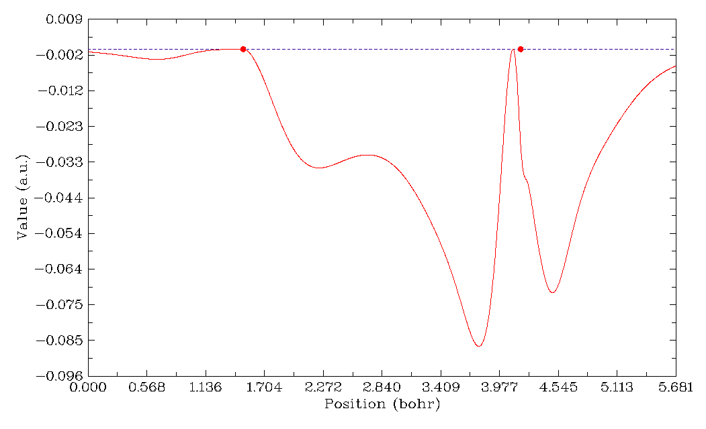

# **3.4 在一条线上输出并绘制特定性质 (3)**

在本功能中，您只需选择一个实空间函数，然后定义一条线即可。定义线有两种方式：

\(1\) 输入两个原子的序号，线会在两侧自动延长一小段距离，延长距离可通过 *settings.ini* 中的 "aug1D" 调整，或通过选项“0 Set extension distance for mode 1”调整，默认值为 1.5 Bohr。

\(2\) 输入两个端点的坐标。

一般而言，计算只需几秒钟，随后会弹出曲线图，如下所示：

灰色虚线表示 Y=0 的位置。若用第二种方式定义线，图中会出现两个 Y=0 的红色圆圈，指示两个原子核的位置。在图上点击右键即可选择下一步操作，可以重新定义 Y 轴范围、将数据导出到当前目录下的 *line.txt*、将图保存为文件、定位极大极小值位置等。注意，寻找驻点和 Y 等于指定值的位置的过程基于您已算出的数据，也就是说，数据点越密，得到的 X 位置越准确。

数据点均匀分布在线上，默认点数为 3000，对多数情况已足够精细。该数量也可通过 *settings.ini* 中的 "num1Dpoints" 参数调整。当然，点越多计算数据所需时间越长。注意，对于 ESP 计算，点数会自动降为六分之一，因为它比其它任务耗时得多。

> **所需信息**
>
> GTFs（基于核/原子电荷的 ESP 以及 RDG 和 *sign*(*λ*₂)*ρ* 的 promolecular 近似版本除外）、原子坐标
