# **3.5 在平面内输出并绘制特定性质 (4)**

使用本功能的基本步骤如下。用户只需按程序提示操作即可完成全部步骤，只有少数关键点需要说明。

1.  选择一个实空间函数

2.  选择图的类别

3.  设定两个维度上的格点数

4.  定义一个平面

5.  查看图形

6.  后处理（调整作图参数、保存图形、将数据导出为纯文本文件等）

> **注**
>
> 值得注意的是，进入本功能后会看到实空间函数选择菜单；若选择选项 111（隐藏选项），则要绘制的实空间函数将是某个原子的 Becke 权重或两个原子间的 Becke 重叠权重。若选择选项 112（另一个隐藏选项），则绘制给定原子或片段的 Hirshfeld 权重。
>
> 若 *settings.ini* 中的 "iplaneextdata" 参数设为 1，则平面内的数据不由 Multiwfn 内部计算，而直接从外部纯文本文件载入。平面内各点的坐标会自动输出到当前文件夹，您可用第三方工具（如 Gaussian 的 cubegen 工具）在这些点上计算函数值。

## **3.5.1 图的类别**

目前 Multiwfn 支持七种展示平面内数据的图类别。

**1 填充色图 (Color-filled map)**。这类图用不同颜色表示不同区域的实空间函数值，下面给出两个例子。

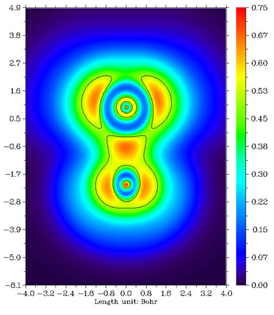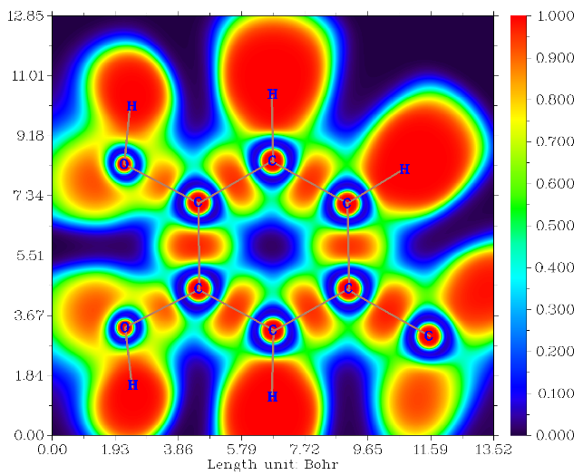

默认采用 "Rainbow" 颜色过渡，若函数值超出色标下限（上限），则该区域填充为黑色（白色）。在后处理菜单中选择 "Set color transition" 可选用其它颜色过渡方式。

在后处理菜单中选择“Enable showing contour lines”，可在图上同时绘制等值线。也可用其它选项控制是否显示原子标签和成键。

**2 等值线图 (Contour line map)**。这类图通常用实线表示正值区域，用虚线表示负值区域。

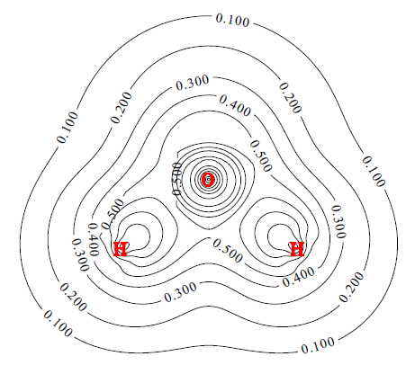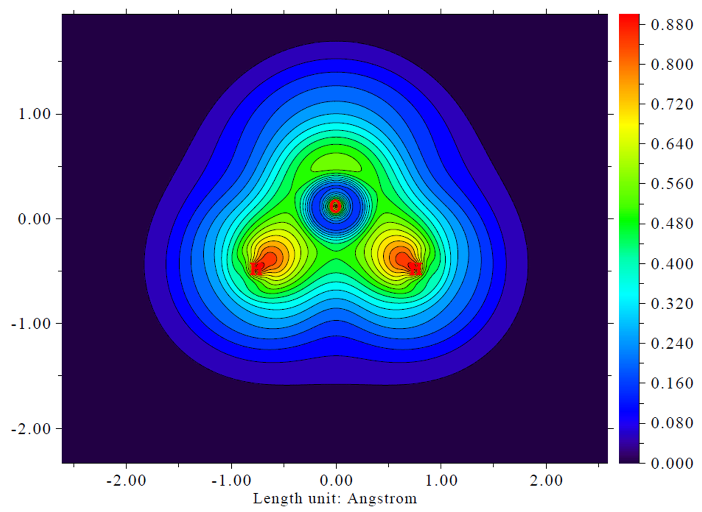

等值线数目可由用户调整（详见第 [3.5.4](#354-等值线的设置) 节），也可用后处理菜单中的选项“2 Enable showing isovalue on contour lines”在等值线上标注数值。

要在等值线间填充颜色（如上右图），可在后处理菜单中选择 "9 Enable filling colors for contour lines"。之后若再次选择选项 9，还可进一步调整填充效果，如色标、颜色过渡等。

仅对等值线图而言，若所选要绘制的实空间函数是轨道波函数，不仅可输入一个轨道序号绘制一个轨道，还可输入两个轨道序号（如 3,5）同时绘制两个轨道，例子见第 [4.4.5](sec-4-4-output-and-plot-various-properties-in-a-plane.md#445-两个轨道波函数的等值线图) 节。

后处理菜单中的选项 4 用于切换是否在图中显示原子标签或参考点（某些实空间函数涉及参考点，如相关穴和源函数）。原子标签的大小和形式（即显示原子序号还是元素名）分别由 *settings.ini* 中的 "pleatmlabsize" 和 "iatmlabtype" 参数设定。参考点在图上以蓝色星号表示。默认仅当原子与平面的距离小于 *settings.ini* 中的 "disshowlabel" 时才显示相应原子标签。要改变此距离阈值，可直接修改 settings.ini 中的该值，或选择后处理菜单中的选项 17。若 "iatom_on_plane_far" 参数在 *settings.ini* 中……

后处理菜单中的选项 8 用于切换是否显示成键。当原子对满足以下两个条件时显示化学键：(1) 两原子间距离小于成键阈值，该阈值可在主功能 0 的 GUI 窗口中用相应滑块调整。(2) 两原子都离作图平面足够近（小于上文提到的 "disshowlabel" 参数）。

后处理中的选项 15 用于绘制对应于 vdW 表面的等值线（电子密度=0.001 a.u.，由 R. F. W Bader 在 *J. Am. Chem. Soc.*, **109**, 7968 (1987) 中定义）。这有助于分析 vdW 表面上静电势的分布。用同一选项也可在梯度线图和矢量场图中绘制这样一条等值线。该等值线的颜色、标签大小和线型可用选项 16 调整。

以上段落的内容同样适用于填充色图、梯度线图和矢量场图（见下文）。

**3 浮雕图 (Relief map)**。用高度表示每一点的数值。若数值太大，会在图中被截断，可选择将数据乘以一个因子进行缩放以避免截断。图显示在交互界面上，可以旋转、放大/缩小。

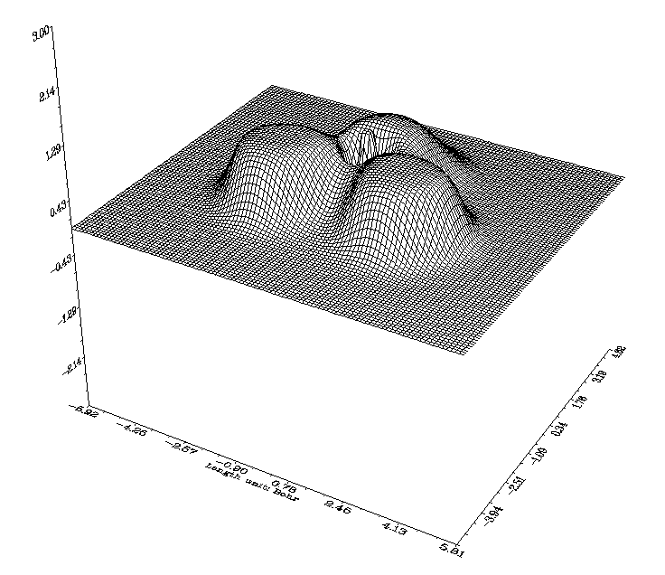

**4 阴影浮雕图 (Shaded relief map)**和**5 带投影的阴影浮雕图 (Shaded relief map with projection)**。这两种类别中浮雕图带有阴影。后者还将一幅填充色图作为投影绘制。表面的网格线可在后处理阶段关闭。

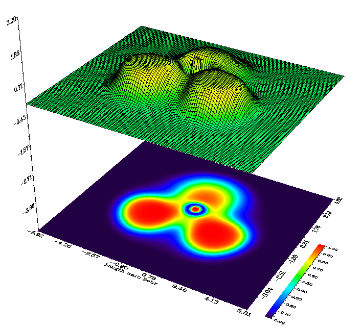

**6 带/不带等值线的梯度线图 (Gradient line map with/without contour lines)**。该图类别表示实空间函数的梯度方向，可决定是否同时在图上显示等值线。注意，由于需要计算实空间函数的梯度，且图形库生成梯度线需要一些时间，计算和作图代价明显高于其它图类别。

在后处理菜单的选项 "11 Set detailed parameters of plotting gradient line" 中可设置各种作图参数：

- 子选项 1：梯度线的积分步长，值越小图越精细

- 子选项 2：梯度线之间的间隔，值越小线越密

- 子选项 3：绘制新梯度线的判据，试着调节它，您就会知道该参数如何影响图形

- 子选项 4：积分方法。RK4 最稳健但最耗时。默认的 RK2 在精度和速度间取得了良好平衡

- 子选项 5 和 6：梯度线的颜色和宽度

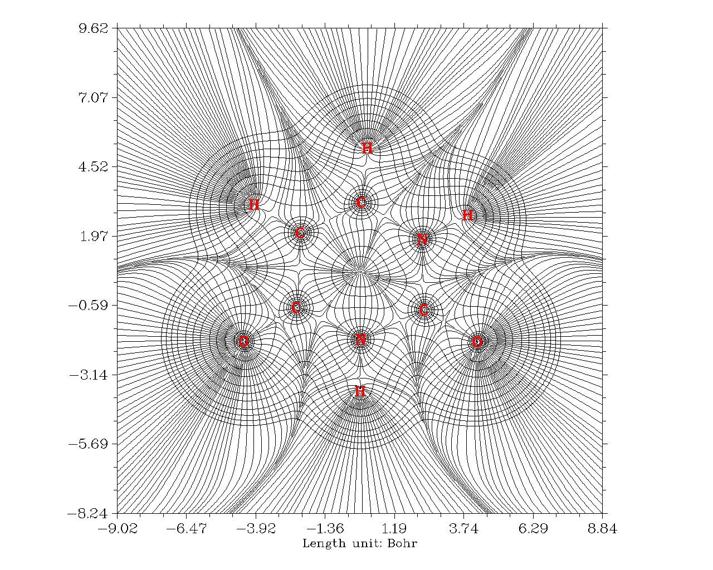

**7 带/不带等值线的矢量场图 (Vector field map with/without contour lines)**。该图类别与上一种很相似，只是梯度线换成了箭头，箭头均匀分布在格点上，表示相应点处的梯度矢量。可以设置箭头颜色，或按函数值大小给箭头映射不同颜色，也可以反转箭头方向。选项 10 值得一提，若用该选项将缩放上限设为 *x*，则当某梯度矢量的模超过此值时，该矢量会被缩放使其模等于 *x*。

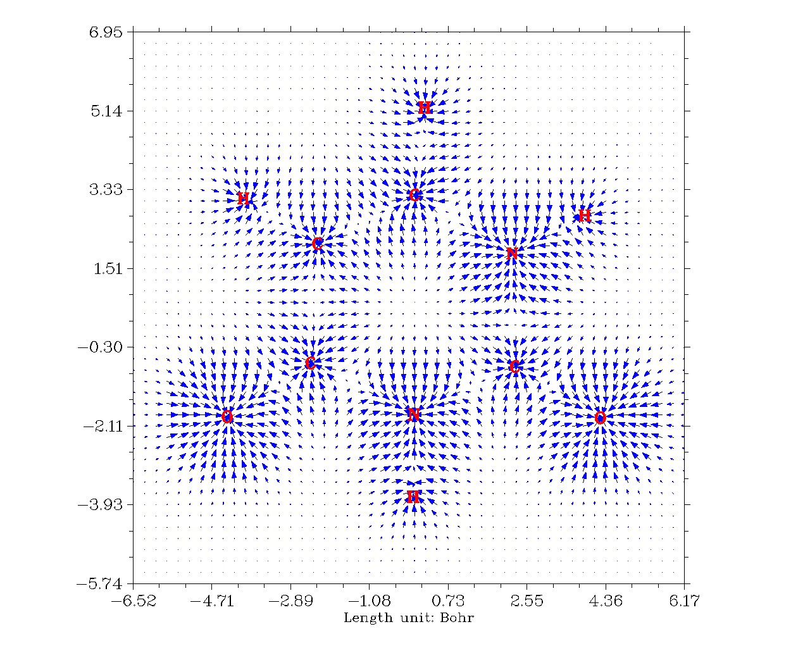

## **3.5.2 格点、平面和作图区域的设置**

当程序询问输入两个维度上的格点数时，可输入如 *100,150*，表示维度 1 和维度 2 上的格点数分别为 100 和 150，总数为 100\*150=15000，均匀分布在作图区域内。对于“Relief map”、“Shaded relief map”和“Shaded relief map with projection”，通常我推荐 *100,100*；若超过此值，图中的线会显得太拥挤。对于其它图类别我推荐 *200,200*。当然，值设得越大图会越漂亮、越光滑，但计算等待时间也越长。注意，总 ESP 计算非常耗时，最好用较少的格点，预览时……

Multiwfn 提供 8 种定义作图平面的模式：

1.  XY 平面：用户输入 Z 值唯一确定一个 XY 平面。

2.  XZ 平面：用户输入 Y 值唯一确定一个 XZ 平面。

3.  YZ 平面：用户输入 X 值唯一确定一个 YZ 平面。

4.  由三个原子定义：输入三个原子的序号，用它们的原子核坐标定义平面。

5.  由三个点定义：输入三个点的坐标定义平面。

6.  输入原点和平移矢量：此方式只适合专家，输入的两个平移矢量必须正交。

7.  定义一个平行于某化学键、同时垂直于由三个原子定义的平面的平面

8.  在特定原子组成的上方或下方

细节描述如下：

### **模式 1 至 5**

对于模式 1\~5，实际作图区域是您定义平面上的一个子区域。Multiwfn 会自动将作图区域设为恰好包住整个分子（模式 1、2 和 3）或覆盖您输入的三个原子核/点（模式 4 和 5），最后作图区域再向外扩展一小段距离，以免截断感兴趣区域。扩展距离默认为 4.5 Bohr，若发现感兴趣区域仍被截断，只需用选项“*0 Set extension distance for plane type 1\~5*”增大该值，也可直接修改默认值，该默认值由 *settings.ini* 中的 "Aug2D" 参数控制。

下图示意当选择模式 4 或 5 定义作图平面时实际作图区域如何确定。图中所示 X、Y 轴对应您最终看到的实际 X、Y 轴。显然，三个点或原子的输入顺序直接影响图形。

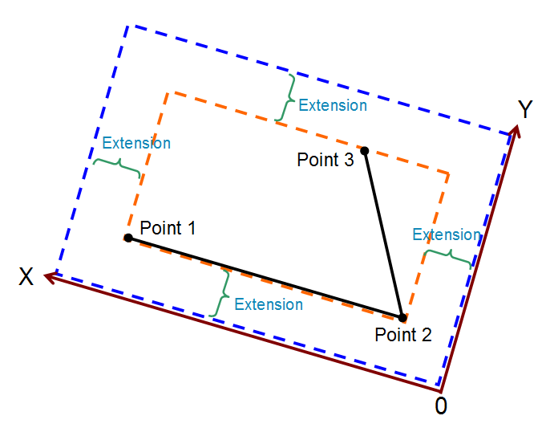

### **模式 6**

对于模式 6，作图区域按如下方式确定，其中每个黑色箭头表示平移矢量 1，每个棕色箭头表示平移矢量 2，蓝色点表示原点。箭头数目即用户设定的格点数。显然，此模式让用户可完全控制作图平面的设置。

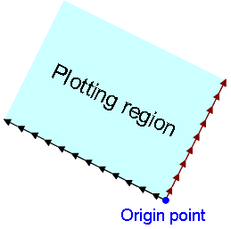

### **模式 7**

当您想定义一个切割某化学键的作图平面时，模式 7 非常有用，见下图示意，紫色矩形即您要绘制的平面：

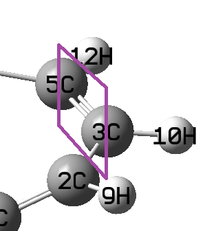

要定义此平面，应选择模式 7，然后输入 *3,5* 以用这两个原子定义作图所平行于的轴，再输入 *2,3,10*（或 *2,5,10* 等）以用它们定义作图平面所垂直于的平面。之后需输入 X、Y 轴长度，*如*分别为 10 和 7 Bohr。

### **模式 8**

用此模式可绘制感兴趣原子上方或下方的局域平面。通常，此模式用于研究环上方/下方的函数分布。见下图例子，半透明蓝色区域对应作图平面。在此模式中应输入原子的序号以定义拟合平面（作图平面将平行于它）和一个几何中心，再输入作图平面与几何中心间的垂直距离（即下图中的 *d*。正负值分别对应拟合平面的上方和下方），再输入作图平面的长度。注意，在此模式中作图平面为正方形，几何中心向该平面的投影点对应平面的中心……

> **注**
>
> 之后，您会在 Multiwfn 命令行窗口中看到三条命令，可将其复制到 VMD 控制台窗口中运行，则作图平面会被画出，如下图所示，便于判断作图平面定义是否正确。

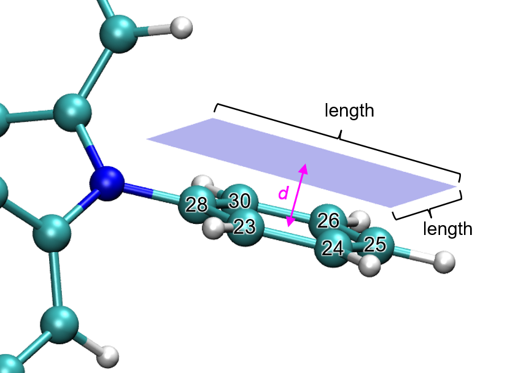

### **关于作图平面的旋转和平移**

对于模式 4、5 和 8，若发现最终图形中内容偏斜，或感兴趣部分不在图的中心，可在选择这些模式之一前选择 "-1: Set translation and rotation of the map for plane types 4, 5 and 8"。例如，若发现先前绘制的图中的内容应平移 (-3,1.5) Bohr 再旋转 35°，则在此选项中先输入 *-3,1.5* 再输入 *35*，所得图形即符合预期。使用此选项的一个实际例子见 <http://bbs.keinsci.com/thread-11037-1-1.html>。

## **3.5.3 后处理界面中的选项**

绘制图形后会看到一个菜单，其中有许多用于调整或改善图形质量的选项。其中许多已在上文介绍过，一些将在下一节提到，还有许多是自明的，这里只提少数几个。

**-9 Only plot the data around certain atoms**：有时图中只有少数区域值得关注；若想屏蔽其它区域，此选项很有用。选择此选项后，假设输入 *2,4,8-10*，则只绘制原子 2,4,8,9,10 周围的实空间函数（此时要绘制的数据实际上是原平面数据乘以您输入片段的 Hirshfeld 权重）。下次再选此选项时，原数据将被恢复。

**-7 Multiply data by a factor**：主要用于缩放平面数据的范围。

**-6 Export the current plane data to plane.txt in current folder**：用此选项导出平面数据后，可很方便地用 Sigmaplot 等第三方作图软件重绘数据。

**-2 Set label interval in X, Y (and color scale) axes**：此选项决定坐标轴上标签的间隔。若图上未显示坐标轴标签，说明当前间隔太大。

**-1 Show the graph again**：调整作图参数后，选择此选项重绘图形以查看效果。

**0 Save the graph to a file**：将图导出为当前文件夹中的图形文件。图形格式和尺寸的确定方法见第 [2.8](sec-2-8-graphic-formats-and-image-size.md) 节。

**19 Enable showing extrema of a function on a contour line**：用此选项可在电子密度的等值线上绘制如静电势的极大极小值。此选项的说明见第 [4.4.12](sec-4-4-output-and-plot-various-properties-in-a-plane.md#4412-在等值线上显示函数的极值点) 节。

## **3.5.4 等值线的设置**

对于图类别 1、2、6 和 7，可绘制等值线（若未显示，在后处理菜单中选择 "2 Enable showing contour lines"）。后处理菜单中还有选项“Change setting of contour lines”。在此界面中先列出当前等值线的值，可用以下子选项修改：

**选项 1：**保存当前设置并返回上级菜单。然后若选择“Show the graph again”，即出现采用新等值线设置的图。

**选项 2：**输入新值替换某条等值线的旧值。

**选项 3：**新增一条等值线并输入其等值。

**选项 4：**删除某些等值线。

**选项 6：**将当前等值线设置导出为纯文本文件，可用此功能为不同体系和实空间函数保存多套常用的等值线设置。

**选项 7：**从外部文件载入等值线设置，格式应与子功能 6 输出的文件相同。

**选项 8：**按等差数列生成等值线，需输入初值、步长和总数。绘制 ELF/LOL 时，我建议输入 *0,0.05,21*，以在 0.0\~1.0 范围内按 0.05 步长生成等值线。可选择是否清除已有等值线，若选 *n*，则新等值线将追加到旧等值线之后。

**选项 9：**与功能 8 类似，但按等比数列生成。

**选项 10：**用此功能加粗某些等值线，默认无加粗。要加粗某些线，选择此功能并输入要加粗几条，再依次输入它们的序号。若已有一些线被加粗，选择此功能将取消所有加粗。

**选项 11：**设置正等值线的颜色，需输入颜色序号。

**选项 12：**设置正等值线的线型，需输入两个整数，第一个表示线段长度，第二个表示线段间空隙长度。例如，10,15 表示正等值线由长度为 10 的线段和长度为 15 的空隙交替组成。

**选项 13、14：**与选项 11、12 类似，但针对负值部分。

**选项 15：**若选此选项，正负线将分别设为“深红、宽度=6、实线”和“蓝色、宽度=6、长虚线”。此时保存的图片非常适合发表；如在所得图形文件中所见，两类线清晰可辨。

## **3.5.5 在平面图上绘制临界点、路径和盆间路径**

临界点 (CP) 和路径可绘制在填充色图、等值线图、梯度线图和矢量场图上。下面是一幅典型的包含临界点、拓扑路径和盆间路径的电子密度梯度线图。

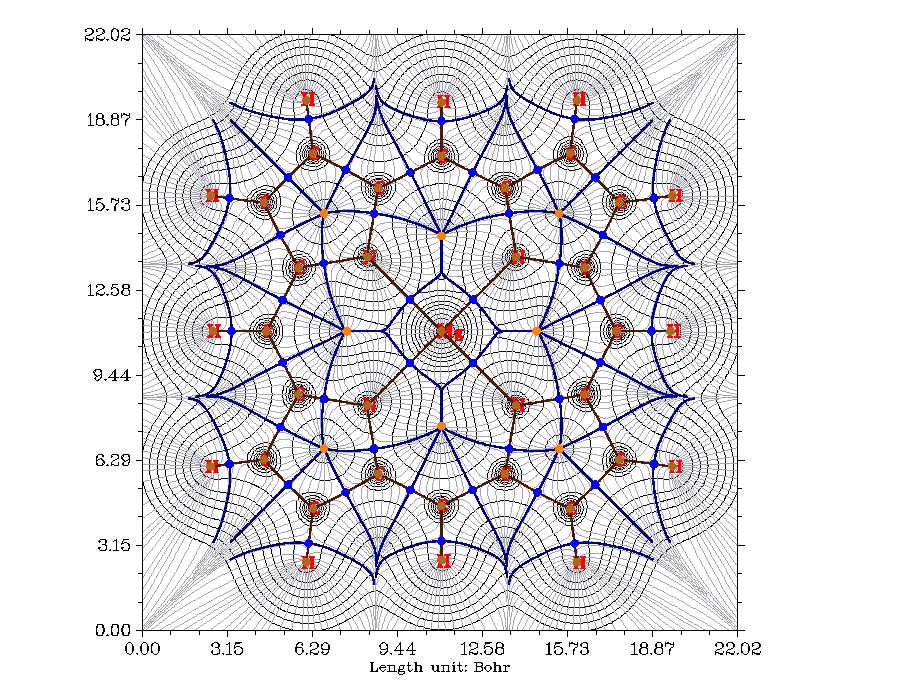

要在平面图上附加 CP 和路径，需先在用主功能 4 绘制平面图之前进入拓扑分析模块（主功能 2），搜索 CP 并生成路径。之后返回主菜单按常规绘制平面图，会发现 CP 和路径已出现在图上。图中棕、蓝、橙、绿色圆点分别表示 (3,-3)、(3,-1)、(3,+1)、(3,+3) 临界点。深棕色粗线为键路径。

在后处理菜单的选项“4 Set details of plotting critical points and paths”中，可选择允许显示哪些类别的 CP，还可设置标记大小、粗细、距离阈值和路径线颜色。默认若某 CP 或路径上一点与作图平面的垂直距离超过 0.5 Bohr，则不显示该 CP 或路径点，阈值可用“8 Set distance threshold for showing CPs”和“9 Set distance threshold for showing paths”修改。

盆间路径 (interbasin path，图中的深蓝色线）由 (3,-1) CP 导出，将整个空间划分成各个原子盆。也可在等值线图、梯度线图和矢量场图上附加盆间路径。要绘制盆间路径，应先确认在拓扑分析模块中已找到至少一个 (3,-1) CP 且它离当前作图平面足够近（小于 *settings.ini* 中的 "disshowlabel"），然后在后处理阶段找到选项 "Generate and show interbasin paths"，选择它，等待盆间路径生成完毕，再重绘平面图，会发现盆间路径已经呈现。

若希望盆间路径变短或变长，在生成盆间路径前在后处理阶段选择选项 "Set stepsize and maximal iteration for interbasin path generation"，按提示输入步长和迭代次数，所得盆间路径的最大长度等于两者乘积。注意，若盆间路径上某点与作图平面的距离超过 *settings.ini* 中的 "disshowlabel"，则平面图上不显示该路径上的相应点。

> **所需信息**
>
> GTFs（取决于所选实空间函数）、原子坐标
