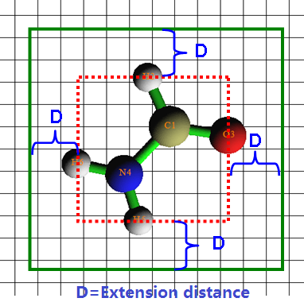
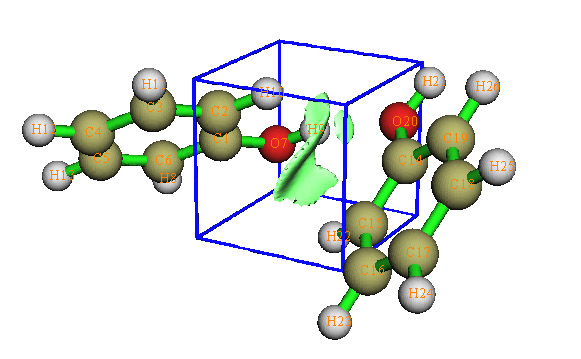
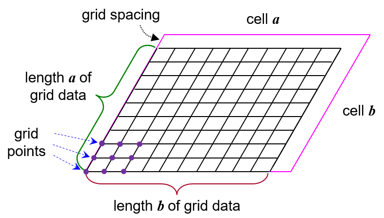
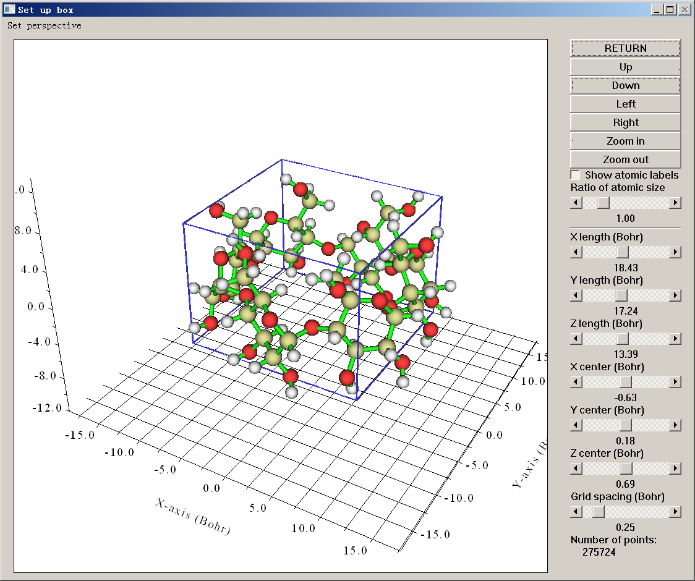

# **3.6 在空间区域内输出并绘制特定性质 (5)**

本功能的主要目的是计算特定实空间函数 (real space function) 的格点数据 (grid data)，或生成 Gaussian 型 cube 文件 (.cub)。许多化学可视化软件都支持 .cub 文件，例如 VMD、GaussView 和 VESTA。生成的格点数据的等值面 (isosurface) 也可以直接在 Multiwfn 中查看。本功能还可用于计算记录在纯文本文件中的一组点的函数值。

使用本功能的基本流程是：

- (1) 选择一个实空间函数

- (2) 设置格点

- (3) 使用后处理选项可视化等值面、修改并导出数据

> **PS**
>
> 在实空间函数选择菜单中，若选择选项 111（一个隐藏选项），则待计算的实空间函数将是某个原子的 Becke 权重或两个原子之间的 Becke 交叠权重。若选择选项 112（另一个隐藏选项），则将计算给定原子或片段的 Hirshfeld 权重。

## **设置格点**

Multiwfn 提供了多种设置格点的方式：

**模式 1 (Mode 1)：** 低质量格点，总共约 125000 个点（假设空间区域为立方体，对应于 50\*50\*50 格点），该模式推荐用于预览。

**模式 2 (Mode 2)：** 中等质量格点，总共约 512000 个点（假设空间区域为立方体，对应于 80\*80\*80 格点）。对于小分子，该质量足以满足大多数分析需求。

**模式 3 (Mode 3)：** 高质量格点，总共约 1728000 个点（假设空间区域为立方体，对应于 120\*120\*120 格点）。

对于模式 1、2 和 3，每个方向上的实际点数由 Multiwfn 自动确定，以使各方向的格点间距 (grid spacing) 近似相等。格点数据的空间范围的确定方法如下以二维情形示意。



首先，Multiwfn 建立一个恰好包围整个分子的盒子（红色虚线），然后在各个维度上对该盒子作适当扩展，以避免等值面的边界部分被截断，下图中绿色矩形即为格点数据的实际空间范围。若扩展距离不合适，可使用选项“-10 Set extension distance of grid range”设置该值，或直接修改 *settings.ini* 中的“Aug3D”来设定默认值。

> **注记**
>
> 所谓“低质量”、“中等质量”和“高质量”分别对应于模式 1、2 和 3，**仅是相对于中等大小体系而言**，因为它们各自对应固定的格点总数。对于大体系，格点数据的空间范围往往很宽，此时模式 3 的格点密度并不算很精细，在此情形下实际应称为“中等质量”，而模式 2 应称为“低质量”。相反，对于微小体系，模式 1 的格点密度对大多数目的而言已经足够精细。

**模式 4 (Mode 4)：** 由用户自行指定 X、Y 和 Z 方向的格点数或格点间距，空间范围如上所示自动确定。

**模式 5 (Mode 5)：** 由用户指定格点设置的全部细节，包括原点、各方向点数以及 X、Y 和 Z 方向的格点间距。该模式适合有经验的用户使用。

**模式 6 (Mode 6)：** 指定中心坐标、各方向点数和扩展距离。例如，你输入的中心坐标为 *2.3,1.0,5.5*，X、Y 和 Z 方向的扩展距离为 *k,k,m*，则两个最远端点的坐标分别为 (2.3-*k*,1.0-*k*,5.5-*m*) 和 (2.3+*k*,1.0+*k*,5.5+*m*)。该模式适用于分析局域性质。

**模式 7 (Mode 7)：** 与功能 6 类似，但输入两个原子的序号而非输入中心坐标，两原子核的中点将被设为中心。该模式对用 RDG 函数进行弱相互作用分析非常有用。例如，我们想研究下图所示二聚体之间的弱相互作用区域，发现 C1 和 C14 可能包围该区域，于是输入 *1,14*，例子见节 [3.23.1](sec-3-23-visual-study-of-weak-interaction.md#3231-非共价相互作用-noncovalent-interaction-nci分析-1)。若两个原子序号相同，则核坐标将被设为中心。



**模式 8 (Mode 8)：** 使用一个已有的 cube 文件的格点设置（原点、点数和格点间距）。程序会提示输入文件名。该模式适用于生成多个格点设置完全相同的 cube 文件。

**模式 9 (Mode 9)：** 仅当输入文件包含晶胞信息时该模式才可见（*即*使用 CP2K 的修改版 .molden 文件作为输入文件，见节 [2.9.2.1](sec-2-9-analysis-of-periodic-systems.md#2921-生成-molden-波函数文件)，或使用其它携带晶胞信息的文件作为输入文件，见节 [2.9.3](sec-2-9-analysis-of-periodic-systems.md#293-周期体系的其它各类分析)）。程序会要求输入原点坐标、盒子边长和格点间距（三个方向共用）。当 Multiwfn 要求设置原点和盒子边长时，若直接按 ENTER 键，则盒子与晶胞的关系将对应于下图所示的情形，其中每个交点对应一个待计算的格点。如你所见，在每个方向上，盒子边长与晶胞边长相差一个格点间距。此时，函数的积分可基于格点数据直接求得，为 $\sum_{i} f\left( i \right)v$ ，其中 *f*(*i*) 为格点 *i* 处的函数值，*v* 为格点体积。注意，输入的格点间距将被自动调整，以使格点数为整数。



**模式 10 (Mode 10)：** 在 GUI 窗口中设置格点数据。该模式十分方便，盒子在图形窗口中清晰可见，可通过拖动相应的标尺直接改变盒子边长、盒子中心和格点间距（X、Y、Z 方向共用同一格点间距）。当前格点设置下的格点总数可直接在窗口右下侧看到。



**模式 11 (Mode 11)：** 程序会要求输入原子序号以定义一个片段，并输入扩展距离，然后盒子将由该片段向外扩展给定距离来确定。程序还会提示输入格点间距，三个方向共用。当你想用 IRI 和 IGMH/mIGM 方法直观研究一个分子（你定义的片段）与周围环境之间的相互作用时，该模式特别有用。

注意，设置的格点数越多，得到的等值面图越精细，但计算格点数据和生成等值面图所需的时间也越多。计算时间随点数的增长近似为线性增长。

设置好格点后，程序开始计算格点数据，计算完成后，所有数据/正值数据/负值数据乘以微元后的总和的最小值/最大值及相应坐标会立即打印在屏幕上。若计算的是电子密度，还会打印基于格点数据求得的分子偶极矩。然后将看到后处理菜单。

## **后处理选项**

在后处理菜单中若选择选项“-1 Show isosurface graph”，将弹出一个显示格点数据等值面的 GUI 窗口，所有控件都是自明的，可通过拖动滑动条（上下限分别为 -5 和 +5）或在文本框中输入精确值（然后按键盘上的“Enter”键）来改变等值面数值；若选中“Show data range”，空间范围将如上图那样以蓝色框标记（若空间范围超出坐标轴范围，则该框不显示）。与当前等值面数值同号和反号的等值面分别为绿色和蓝色。

选项 1 可将等值面图导出为当前目录下的图形文件。选项 2 可将格点数据导出为当前目录下的 .cub 文件。选择选项 3 会将格点数据导出为当前目录下的纯文本文件 *output.txt*。使用选项 4 无需进入 GUI 窗口拖动滑动条即可设置等值面数值，适用于批处理和命令行环境。使用选项 5\~8 可分别对格点数据进行加、减、乘、除运算；之后可用选项 10 恢复为原始格点数据。

若只想可视化某个特定片段的等值面，可在后处理菜单中选择选项 9，然后输入该片段中原子的序号。之后将在每个格点处计算该片段的 Hirshfeld 权重，并乘到原始格点数据上。这样，远离该片段的格点的值将为零，从而不会显示在等值面图中。

## **特殊情形：计算一组任意分布的点的数据**

若想用 Multiwfn 计算一组点（可能是任意分布的）的实空间函数值，在设置格点的界面中应选择“100 Load a set of points from external file”，然后输入记录这些点的纯文本文件的路径。文件中第一行应为记录的点数，后面为所有点的 X/Y/Z 坐标。例如，

```text
1902
   -3.3790050   -2.0484700    0.0274117
   -3.3844930   -1.9472468   -0.2500274
   -3.4064601   -1.9221635   -0.1287148
   -3.4118258   -1.9232203   -0.0003350
   -3.4059106   -1.9218280    0.1351179
....
```

坐标必须以 Bohr 为单位。格式为自由格式，可以有多于四列的数据，但第四列之后的列将被直接忽略。

Multiwfn 将从该文件载入点的坐标，然后计算它们的函数值。最后，所有点的 X/Y/Z 坐标和函数值将被输出到一个纯文本文件，其路径由用户指定。

> **所需信息**
>
> 原子坐标、GTF（取决于实空间函数的选择）
