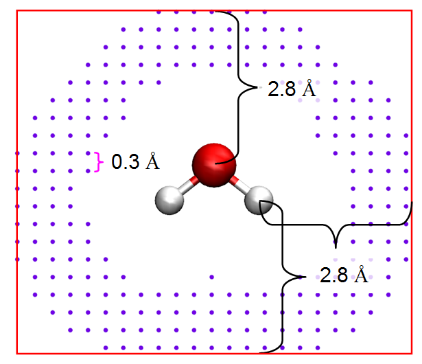

# **3.9 布居分析 (Population analysis)与原子电荷计算 (7)**

本模块用于计算基函数、壳层、原子、碎片的布居数，或原子电荷。有几点需要注意：

无论选择哪个子功能，若想计算碎片电荷/布居（即碎片内各原子电荷/布居之和），都应首先选择选项"-1 Define fragment"并输入原子序号以定义碎片。之后，一旦原子电荷计算完成，碎片电荷将与原子电荷一并打印。如果输入文件为 .chg 或 .pqr 格式，其中含有原子电荷信息，该选项也会自动打印碎片内各原子电荷之和。

在原子电荷计算完成后，你可以选择将原子坐标与计算得到的电荷输出到当前目录下的 *\[载入文件名\].chg* 文件中，关于 .chg 格式的详细介绍见第 [2.5](sec-2-5-input-files-and-wavefunction-types.md) 节。

如果 Multiwfn 启动时载入的文件为 .chg 格式，你可以使用本功能中的选项"-2 Calculate interaction energy between fragments based on atomic charges"，利用该 .chg 文件中的原子电荷，通过经典库仑公式（见下式）计算两个给定碎片之间的静电相互作用能。

$$
E_{\mathrm{Coul-int}}=\sum_{A\in\mathrm{frag1}}\sum_{B\in\mathrm{frag2}}\frac{q_A q_B}{\left|\mathbf{R}_A-\mathbf{R}_B\right|}
$$

该功能可用于研究总分子相互作用能中的静电相互作用分量，以及基于原子跃迁电荷计算分子间激子耦合能（关于如何得到原子跃迁电荷，见第 [4.A.9](sec-4-A-special-topics-and-advanced-tutorials.md#4a9-计算tresp由静电势得到的跃迁电荷电荷并分析激子耦合) 节）。

如果你对原子电荷还不熟悉，**强烈**建议阅读我的综述文章，该文非常全面地介绍了原子电荷的概念、特征、应用和计算方法：

Tian Lu,\* Qinxue Chen, Partial Charges, In Exploring Chemical Concepts Through Theory and Computation. WILEY-VCH GmbH: Weinheim (2024); pp. 161-187. DOI: [10.1002/9783527843435.ch6](https://doi.org/10.1002/9783527843435.ch6).

## **3.9.1 Hirshfeld 原子电荷 (1)**

Hirshfeld 是一种非常流行的基于变形密度 (deformation density)划分的原子布居方法，Hirshfeld 电荷定义为 (*Theor. Chim. Acta (Berl.)*, **44**, 129 (1977))

$$
q_A=-\int w_A^{\mathrm{Hirsh}}(\mathbf{r})\rho_{\mathrm{def}}(\mathbf{r})\mathrm{d}\mathbf{r}
$$

其中

$$
\begin{gathered}\rho^{\mathrm{def}}(\mathbf{r})=\rho(\mathbf{r})-\rho^{\mathrm{pro}}(\mathbf{r})\\ \rho^{\mathrm{pro}}(\mathbf{r})=\sum_A \rho_A^{\mathrm{free}}(\mathbf{r}-\mathbf{R}_A)\end{gathered}
$$

也可以改写成如下形式，以使其物理意义更加清晰

$$
\begin{aligned}&q_A=-\int w_A^{\mathrm{Hirsh}}(\mathbf{r})[\rho(\mathbf{r})-\rho^{\mathrm{pro}}(\mathbf{r})]\mathrm{d}\mathbf{r}\\ &=-\int w_A^{\mathrm{Hirsh}}(\mathbf{r})\rho(\mathbf{r})-\rho_A^{\mathrm{free}}(\mathbf{r}-\mathbf{R}_A)\mathrm{d}\mathbf{r}\\ &=-\int w_A^{\mathrm{Hirsh}}(\mathbf{r})\rho(\mathbf{r})\mathrm{d}\mathbf{r}+\int\rho_A^{\mathrm{free}}(\mathbf{r}-\mathbf{R}_A)\mathrm{d}\mathbf{r}\\ &=-p_A+Z_A\end{aligned}
$$

其中 $p_{A}$ 为实际化学体系中该原子的布居数。*Z* 为核电荷，等于该原子在自由态时所携带的电子数。

Hirshfeld 布居的优点是：

1.  结果与电负性规则等一般化学概念定性一致。

2.  用于空间划分的权重函数 *w* 具有明确的物理意义。

3.  与 AIM 电荷等基于电子密度积分的方法不同，Hirshfeld 电荷反映的是分子形成过程中转移的电子密度量，未转移的密度不参与。

4.  对波函数质量不敏感。

5.  虽然计算 Hirshfeld 电荷需要在实空间积分，但由于被积函数光滑，可直接使用成熟的密度泛函理论 (DFT)格点积分方案，因此 Hirshfeld 布居效率很高。

6.  应用范围广。变形密度数据也可由 X 射线晶体学实验获得。而且，Hirshfeld 布居的适用性不受波函数类型的限制，该方法可直接应用于固体体系，而固体体系的波函数一般用平面波函数描述。

Hirshfeld 布居的缺点是电荷总是太小，且对分子偶极矩和静电势 (ESP)等可观测量复现性差，原因是 Hirshfeld 布居完全忽略了原子偶极矩。

计算完成后，如果打印的所有 Hirshfeld 电荷之和非常接近整数，则说明数值积分是准确的；如果不是，则说明输出的 Hirshfeld 电荷不可靠，你需要将“radpot”和“sphpot”设为更大的值以增加积分点密度，然后重新计算。为兼顾计算时间和精度，“radpot”和“sphpot”的默认值分别为 75 和 434，你可以将它们分别设为 100 和 590 以获得更准确的结果。

第 [4.7.1](sec-4-7-population-analysis-and-atomic-charge-calculation.md#471-计算三氟化氯的hirshfeld和chelpg原子电荷以及片段电荷) 节给出了一个例子。

> **所需信息**
>
> GTF、原子坐标

## **3.9.2 Voronoi 变形密度 (VDD)原子布居 (2)**

VDD 与 Hirshfeld 布居的唯一区别在于权重函数 *w*。VDD 布居采用类似 Voronoi 胞的划分，每个胞对应一个原子，详见 *J. Comput. Chem.*, **25**, 189 (2004)。

一般来说，VDD 布居的结果与 Hirshfeld 布居相似，因为变形密度的量级总是很小，所以采用不同的权重函数时电荷没有显著变化。输出项与 Hirshfeld 布居完全相同。就我个人而言，我建议你使用 Hirshfeld 布居而非 VDD。

注意，如果 VDD 原子电荷之和与分子净电荷明显偏离，则说明数值积分精度不理想，此时应在 *settings.ini* 中增大“sphpot”参数以改善结果。“radpot”参数也会影响结果，但不如“sphpot”显著。

> **所需信息**
>
> GTF、原子坐标

## **3.9.3 Mulliken 原子与基函数布居分析 (5)**

### **理论**

Mulliken 分析是最早的基于轨道波函数的布居方法，几乎所有量子化学软件都支持。

自旋轨道波函数的正交归一条件要求 $1=\int\left|\varphi(\mathbf{r})\right|^2\mathrm{d}\mathbf{r}$ ，若假设轨道为实函数，并将线性组合方程 $\varphi_i(\mathbf{r})=\sum_a C_{a,i}\chi_a(\mathbf{r})$ 代入，可得

$$
1=\int\left(\sum_a C_{a,i}\chi_a(\mathbf{r})\right)^2\mathrm{d}\mathbf{r}=\sum_a C_{a,i}^2+\sum_a\sum_{b\neq a}C_{a,i}C_{b,i}S_{a,b}=\sum_a C_{a,i}^2+2\sum_a\sum_{b>a}C_{a,i}C_{b,i}S_{a,b}
$$

其中 $S_{a,b}=\int\chi_a(\mathbf{r})\chi_b(\mathbf{r})\mathrm{d}\mathbf{r}$ ，推导中利用了基函数的归一性。第一项为“局域项”，表示轨道 *i* 中每个基函数的净布居，第二项为“交叉项”，表示轨道 *i* 中基函数对之间的共享电子。局域项当然应完全归属于相应的基函数，但交叉项的划分方法并不唯一。Mulliken 将自旋轨道 *i* 中基函数 *a* 的布居定义为

$$
\Theta_{i,a}=C_{a,i}^2+\sum_{b\neq a}C_{a,i}C_{b,i}S_{a,b}
$$

即每个交叉项 $2C_{a,i}C_{b,i}S_{a,b}$ 被平均分配给相应的两个基函数。

原子 *A* 的布居数就是所有轨道中归属于原子 *A* 的全部基函数布居数之和。Mulliken 原子电荷定义为

$$
q_A=Z_A-\sum_i n_{i,A}=Z_A-\sum_i\eta_i\sum_{a\in A}\Theta_{i,a}
$$

其中 *η* 为轨道占据数，$n_{i,A}$ 为轨道 *i* 的贡献。

Mulliken 分析由于以下缺点而不太适合实际应用：

1.  对分子偶极矩等可观测性质的复现性差。

2.  交叉项的“平均分配”没有严格的物理意义。

3.  基组依赖性非常强。特别地，**一定不能带有弥散函数，否则结果将产生误导**。

4.  偶尔会出现无意义的结果（布居数为负）。

### **用法**

由于对大体系输出的信息量巨大，在选择以下子功能之前，你可以使用选项 -1 将默认输出目标由屏幕改为指定的纯文本文件。

- **子功能 1**（输出 Mulliken 布居与原子电荷）：打印基函数布居、基函数壳层布居、原子轨道各角动量布居以及原子电荷。

- **子功能 2**（输出总原子布居矩阵并将其分解）：打印总原子布居矩阵，由此可得到每个原子的局域项（对角元）和每对原子之间的交叉项（非对角元乘以 2）。矩阵元定义为

  
$$
\Omega_{A,B}=\sum_i\Omega_{A,B}^i=\sum_i\eta_i\sum_{a\in A}\sum_{b\in B}C_{a,i}C_{b,i}S_{a,b}
$$

  注意，输出矩阵的最后一行是相应列元素之和，即相应原子的总布居数。你还可以选择将矩阵分解为每个占据轨道的贡献，此时 **Ω** 矩阵将输出到当前目录下的 *groatmdcp.txt* 文件中。

  顺便一提，$2{\Omega}_{A,B}^{i}$ 恰为轨道 *i* 对原子 *A* 与 *B* 之间 Mulliken 键级的贡献，见第 [3.11.4](sec-3-11-bond-order-analysis.md#3114-mulliken键级mulliken-bond-order分析4与分解5) 节。

- **子功能 3**（输出总基函数布居矩阵并将其分解）：可用该选项输出总基函数布居矩阵，以进一步分析电子分布细节，矩阵元定义为

  
$$
\Gamma_{a,b}=\sum_i\Gamma_{a,b}^i=\sum_i\eta_i C_{a,i}C_{b,i}S_{a,b}
$$

  同样，在子功能 3 中，输出矩阵的最后一行是相应基函数的总布居数。你还可以选择输出每个占据轨道的贡献，即 ${\Gamma}_{a,b}^{i}$ ，到当前目录下的 *grobasdcp.txt* 文件中（注意，即使对中等大小的体系，该文件也极其庞大）。

- **子功能 4**（将轨道对原子布居的贡献输出到 atmpopdcp.txt）：该选项用于将占据轨道对原子布居的贡献，即全部 $\sum_i\eta_i\sum_{a\in A}\Theta_{i,a}$ 项，输出到当前目录下的 *atmpopdcp.txt* 文件中。

Mulliken 布居分析的一个例子见第 [4.7.0](sec-4-7-population-analysis-and-atomic-charge-calculation.md#470-三重态乙醇的mulliken布居分析) 节。

> **所需信息**
>
> Basis functions

## **3.9.4 Löwdin 原子与基函数布居 (6)**

Löwdin 与 Mulliken 布居分析的唯一区别在于是否先做 Löwdin 正交化 (Löwdin orthogonalization)。在 Löwdin 正交化中，变换矩阵为

$$
\mathbf{X}=\mathbf{U}\mathbf{s}^{1/2}\mathbf{U}^{\mathrm{T}}
$$

其中 *U* 为重叠矩阵的本征向量矩阵，矩阵 *s* 为 *diag*(*λ*₁, *λ*₂...)，其中 {*λ*} 为重叠矩阵的本征值集合。经 Löwdin 正交化后，重叠矩阵变为单位矩阵，新的系数矩阵为 $X^{-1}$ **C**。

表面上看，Löwdin 布居避免了交叉项的划分，因为它们已变为零，但实际上划分步骤只不过隐藏在了正交化之中。由于 Löwdin 正交化本身没有很强的物理意义，因此不能得出 Löwdin 布居优于 Mulliken 的结论。从实际结果来看，也发现 Löwdin 电荷相对于 Mulliken 电荷没有明显优势，尽管有人认为 Löwdin 电荷具有更好的基组稳定性和分子偶极矩复现性。此外，Mayer 等人发现，当使用 Cartesian 型 Gaussian 基函数时，Löwdin 布居在一定程度上具有转动依赖性，但一般来说该依赖性可安全忽略，详情请见 *Chem. Phys. Lett.*, **393**, 209 (1968) 和 *Int. J. Quantum Chem.*, **106**, 2065 (2006)。

> **所需信息**
>
> Basis functions

## **3.9.5 Ros & Schuit 定义的修正 Mulliken 原子布居 (SCPA) (7)**

一些人曾提出几种不同的交叉项划分方法以改进 Mulliken 分析，它们一般称为修正 Mulliken 布居分析 (MMPA)。在 Ros 和 Schuit 提出的方法 (*Theo. Chim. Acta*, **4**, 1 (1966))中，基函数 *a* 在轨道 *i* 中的组成为

$$
\Theta_{i,a}=\frac{C_{a,i}^2}{\sum_b C_{b,i}^2}
$$

公式中只出现了系数的平方，因此该方法也称为平方布居分析 (C-squared Population Analysis, SCPA)。将恒等式

$$
1=\sum_a C_{a,i}^2+\sum_a\sum_{b\neq a}C_{a,i}C_{b,i}S_{a,b}
$$

代入上式最右端，Θ 可改写为

$$
\Theta_{i,a}=C_{a,i}^2+\frac{C_{a,i}^2}{\sum_b C_{b,i}^2}\sum_a\sum_{b\neq a}C_{a,i}C_{b,i}S_{a,b}
$$

显然，在计算基函数 *a* 在轨道 *i* 中的组成时，被划分的不是原子 *a* 与其他原子之间的交叉项，而是所有原子对的总交叉项。利用新定义的 Θ，可按与 Mulliken 电荷相同的方式计算 SCPA 原子电荷。相对于 Mulliken 布居，SCPA 的优点是布居数永远不会出现负值。

> **所需信息**
>
> Basis functions

## **3.9.6 Stout & Politzer 定义的修正 Mulliken 原子布居 (8)**

Stout 和 Politzer 将 Θ 定义为 (*Theor. Chim. Acta*, **12**, 379 (1968))

$$
\Theta_{i,a}=C_{a,i}^2+\sum_{b\neq a}\frac{C_{a,i}^2}{C_{a,i}^2+C_{b,i}^2}2C_{a,i}C_{b,i}S_{a,b}
$$

即交叉项按相应系数的平方比进行划分。表面上看，该定义更多地考虑了交叉项的不平衡性，但在实际应用中结果甚至比 Mulliken 更差，因此该方法现在很少使用。此外，Grabenstetter 和 Whitehead 曾指出，这种 MMPA 定义具有幺正变换依赖性，因此若将分子旋转，结果会改变（该依赖性显著，不可忽略）。

> **所需信息**
>
> Basis functions

## **3.9.7 Bickelhaupt 定义的修正 Mulliken 原子布居 (9)**

*Organometallics*, **15**, 2923 (1996) 中定义的基函数布居数为

$$
\Lambda_a=\sum_i\eta_i C_{a,i}^2+\sum_{b\neq a}w_{a,b}\sum_i 2\eta_i C_{a,i}C_{b,i}S_{a,b}
$$

其中基函数 *a* 在划分所有轨道中 *a* 与 *b* 之间的总交叉项时的权重为

$$
w_{a,b}=\frac{\sum_k\eta_k C_{a,k}^2}{\sum_i\eta_i C_{a,i}^2+\sum_j\eta_j C_{b,j}^2}
$$

本质上，这相当于将 Θ 定义为

$$
\Theta_{i,a}=C_{a,i}^2+\sum_{b\neq a}w_{a,b}2C_{a,i}C_{b,i}S_{a,b}
$$

该方法与 Stout 和 Politzer 定义的 MMPA 类似，区别在于后者中权重 $w_{a,b}$ 只与*当前*轨道中基函数 *a* 和 *b* 的局域项有关，而在本方法中权重与基函数 *a* 和 *b* 的*总*局域项有关。

> **所需信息**
>
> Basis functions

## **3.9.8 含原子偶极矩校正的 Becke 原子电荷 (10)**

在 *J. Chem. Phys.*, **88**, 2547 (1988) 一文中，Becke 提出了一种权重函数，用于将全空间积分转换为多个单中心球面积分，虽然该权重函数并非为布居分析而设计，Multiwfn 仍尝试将其用作原子空间以得到原子电荷。Becke 电荷可定义为

$$
q_A=Z_A-\int w_A(\mathbf{r})\rho(\mathbf{r})\mathrm{d}\mathbf{r}
$$

用于计算 Becke 权重函数（或说 Becke 原子空间）的半径可由用户控制，见屏幕上显示的相应选项。关于 Becke 权重函数的详情请见 *J. Chem. Phys.*, **88**, 2547 (1988) 或第 [3.18.0](sec-3-18-fuzzy-atomic-space-analysis.md#3180-基本概念) 节。根据我的经验，对典型的有机体系，采用默认的“modified CSD”半径时 Becke 电荷是合理的，但对离子体系不太合适。关于“modified CSD”半径的详情，见第 [3.18.0](sec-3-18-fuzzy-atomic-space-analysis.md#3180-基本概念) 节末尾。

算出 Becke 电荷后，会自动进行原子偶极矩校正。校正过程与下一节校正 Hirshfeld 电荷所用的一致。校正后电荷将具有更好的静电势复现性，并能精确复现分子偶极矩。

> **所需信息**
>
> GTF、原子坐标

## **3.9.9 原子偶极矩校正的 Hirshfeld 原子电荷 (ADCH, 11)**

### **基本特征与用法**

Hirshfeld 电荷太小且对可观测量复现性差的主要原因是完全忽略了原子偶极矩。在我提出的 ADCH 方法 ([*J. Theor. Comput. Chem.*](https://www.worldscientific.com/doi/abs/10.1142/S0219633612500113)[, 11, 163 (2012)](https://www.worldscientific.com/doi/abs/10.1142/S0219633612500113))中，每个原子的原子偶极矩被展开为置于邻近原子上的校正电荷，ADCH 电荷就是原始 Hirshfeld 电荷与校正电荷之和。ADCH 原子电荷在化学意义上非常合理，分子偶极矩被精确复现，对 ESP 的复现性接近由拟合 ESP 得到的原子电荷。与另一种改进 Hirshfeld 电荷的方法，即 Hirshfeld-I（见第 [3.9.13](#3913-hirshfeld-i-原子电荷-15) 节）相比，ADCH 电荷的计算代价可忽略不计。由于具有诸多优点，**ADCH 是高度推荐的原子电荷模型**。关于原子电荷模型的广泛比较，见 [*Acta Phys. -Chim. Sin*](http://www.whxb.pku.edu.cn/EN/abstract/abstract27818.shtml)[, 28, 1 (2012)](http://www.whxb.pku.edu.cn/EN/abstract/abstract27818.shtml)。

在做 ADCH 校正之前，会先计算 Hirshfeld 电荷。在汇总栏中，“corrected”与“before”分别对应 ADCH 电荷和 Hirshfeld 电荷。最后阶段的“Error”指由 ADCH 电荷产生的分子偶极矩与由实际电子密度产生的分子偶极矩之差，“Error”总是等于或非常接近零，因为 ADCH 电荷原则上精确复现分子偶极矩。

如果你想得到原子偶极矩校正过程中原子间电荷转移的细节，可将 *settings.ini* 中的“ishowchgtrans”设为 1。

### **关于展开原子偶极矩的算法细节**

ADCH 电荷的完整细节见其原始论文，这里我只说明原子偶极矩校正 (ADC)是如何实现的。

假设我们要将原子 *A* 的原子偶极矩展开为校正电荷，显然，所有校正电荷之和应为零，且基于校正电荷计算的偶极矩应精确等于原子偶极矩，即应满足以下条件

$$
\begin{gathered}\sum_B\Delta q_{A\to B}=0\\ \boldsymbol{\mu}_A=\sum_B\Delta q_{A\to B}\mathbf{R}_B\end{gathered}
$$

其中 $\Delta q_{A\to B}$ 为由原子 *A* 转移到 *B* 的电荷，换言之，它是由于 *A* 而在原子 *B* 上的校正电荷。指标 *B* 遍历体系中所有原子。$R_{B}$ 为原子 *B* 相对于原子 *A* 的相对坐标（列向量）。

校正电荷应只分布在 *A* 的邻近原子周围，这可通过最小化函数 *F* 实现：

$$
F=\sum_B\frac{(\Delta q_{A\to B})^2}{\upsilon_{AB}}+\alpha\sum_B\Delta q_{A\to B}+\beta(\boldsymbol{\mu}_A-\sum_B\Delta q_{A\to B}\mathbf{R}_B)
$$

其中 *α* 和 *β* 为用于满足两个约束条件的拉格朗日乘子，*υ*$_{AB}$ 是随 *A* 与 *B* 间距离增大而迅速减小的函数，其详细形式依赖于 *A* 和 *B* 的原子半径，更多信息见 ADCH 原始论文。显然，*F* 的这种设计抑制了在远离原子 *A* 的原子上出现大的校正电荷。

可以证明，经过一些推导，计算 $\Delta q_{A\to B}$ 的工作方程为

$$
\Delta q_{A\to B}=\frac{\upsilon_{AB}}{\sum_B\upsilon_{AB}}\left[(\mathbf{R}_B-\left\langle\mathbf{R}_B\right\rangle)^{\mathrm{T}}\cdot\Lambda^{-1}\cdot\boldsymbol{\mu}_A\right]
$$

其中上标"T"表示转置，且

$$
\begin{gathered}\Lambda=\left\langle\mathbf{R}_B\cdot(\mathbf{R}_B)^{\mathrm{T}}\right\rangle-\left\langle\mathbf{R}_B\right\rangle\left\langle\mathbf{R}_B\right\rangle^{\mathrm{T}}\\ \left\langle\mathbf{R}_B\right\rangle=\frac{\sum_B\upsilon_{AB}\mathbf{R}_B}{\sum_B\upsilon_{AB}},\quad\left\langle\mathbf{R}_B\cdot(\mathbf{R}_B)^{\mathrm{T}}\right\rangle=\frac{\sum_B\upsilon_{AB}\mathbf{R}_B\cdot(\mathbf{R}_B)^{\mathrm{T}}}{\sum_B\upsilon_{AB}}\end{gathered}
$$

若原子 *A* 处于局域平面区域，**Λ** 矩阵将恰为或几乎为奇异矩阵，此时显然无法得到 **Λ** 的逆矩阵。注意，当前实现中解决该问题的方法与 ADCH 原始论文中介绍的略有不同。在当前的 Multiwfn 中，首先将 **Λ** 矩阵对角化，将绝对值小于 10⁻⁵ 的本征值直接置零（相应的本征向量通常垂直于原子 *A* 的局域平面），其余本征值求逆，此时该矩阵即对应新局域坐标下的 **Λ**⁻¹。然后将 ${\mathbf{R}}_{B}-\left\langle {\mathbf{R}}_{B} \right\rangle$ 和 $\boldsymbol{\mu}_{A}$ 通过左乘 **Λ** 的本征向量矩阵的转置变换到新的局域坐标。最后，用上述公式得到 $\Delta q_{A\to B}$。

计算 ADCH 电荷的例子见第 [4.7.2](sec-4-7-population-analysis-and-atomic-charge-calculation.md#472-计算并比较乙酰胺的adch原子电荷与hirshfeld原子电荷) 节。

> **所需信息**
>
> GTF、原子坐标

## **3.9.10 CHELPG (Charges from electrostatic potentials using a grid-based method) ESP 拟合原子电荷 (12)**

### **理论**

CHELPG (*J. Comput. Chem.*, **11**, 361 (1990)) 是使用最广泛的静电势 (ESP)拟合电荷模型之一。与 CHELP 和 Merz-Kollman 方法相比，CHELPG 电荷具有更好的转动不变性，这主要是因为拟合点以立方格点方式分布。

在 CHELPG 模型中，首先定义一个包围整个分子的盒子，每一侧的扩展距离为 2.8 Å，见下图中的红色盒子



拟合点均匀分布在盒子中，默认间距为 0.3 Å。对任一拟合点，若该点与任一原子核的距离小于该原子的 vdW 半径，或该点与所有原子核的距离都大于 2.8 Å，则该拟合点将被舍弃。上图中紫色圆点即为最终使用的拟合点。

与其他 ESP 拟合方法一样，在 CHELPG 中，最小化如下偏差函数，以使由原子电荷计算的 ESP ($V_{q}$) 与基于波函数计算的 ESP (*V*) 尽可能接近。

$$
F(q_1,q_2\cdots q_N)=\sum_i\left[V_q(\mathbf{r}_i)-V(\mathbf{r}_i)\right]^2
$$

其中 $r_{i}$ 为拟合点 *i* 的坐标。{*q*} 为拟合的点电荷，其位置称为拟合中心。注意 *q* 不一定对应原子电荷，拟合中心可定义在任意位置。

可以证明，对 *F* 的最小化可表述为如下矩阵方程

$$
\mathbf{A}\mathbf{q}=\mathbf{B}
$$

可进一步明确写为

$$
\begin{bmatrix}A_{11}&A_{12}&\cdots&A_{1N}&1\\A_{21}&A_{22}&\cdots&A_{2N}&1\\\vdots&\vdots&\ddots&\vdots&1\\A_{N1}&A_{N2}&\cdots&A_{NN}&1\\1&1&1&1&0\end{bmatrix}\begin{bmatrix}q_1\\q_2\\\vdots\\q_N\\\lambda\end{bmatrix}=\begin{bmatrix}B_1\\B_2\\\vdots\\B_N\\q_{\mathrm{tot}}\end{bmatrix}
$$

其中

$$
\mathbf{A}_{A,B}=\sum_i\frac{1}{r_{iA}r_{iB}}\qquad\mathbf{B}_A=\sum_i\frac{V(\mathbf{r}_i)}{r_{iA}}\qquad q_{\mathrm{tot}}=\sum_A q_A
$$

其中 *A* 和 *B* 为拟合中心指标，*N* 为拟合中心总数。列向量 **q** 即为所求，其前 *N* 个元对应各拟合中心的电荷。**q** 可容易地求得，为 **q**= $A^{-1}$ **B**。

### **用法**

界面中有许多选项，介绍如下。

- 选项 1：若选择该选项，Multiwfn 将开始计算每个拟合点处的 ESP 值，然后在屏幕上输出所有拟合中心的拟合原子电荷。RMSE 和 RRMSE 也会自动输出，它们衡量拟合质量，值越小说明拟合电荷的 ESP 复现性越好。RMSE 和 RRMSE 定义为（其中 *N* 为拟合点数）

  
$$
\begin{gathered}\mathrm{RMSE}=\sqrt{\frac{\sum_i\left[V_q(\mathbf{r}_i)-V(\mathbf{r}_i)\right]^2}{N}}\\ \mathrm{RRMSE}=\sqrt{\frac{\sum_i\left[V_q(\mathbf{r}_i)-V(\mathbf{r}_i)\right]^2}{\sum_i V(\mathbf{r}_i)^2}}\end{gathered}
$$

- 选项 2\~4：这些选项用于设置分布拟合点的参数。默认值是合理的，若无特殊理由不应更改。

- 选项 4：若希望拟合点只分布在某个碎片周围，可选择该选项并输入原子序号，此时仅当离某拟合点最近的原子属于给定的原子列表时，该拟合点才被计入。

- 选项 5：在 ESP 拟合过程中，可计算并使用三种 ESP，即“Nuclear + Electronic”（默认）、“Electronic”和“Transition electronic”。一般不应更改该选项。若想计算所谓的 TrEsp（由静电势得到的跃迁电荷），应选择“Transition electronic”，详情请见第 [4.A.9](sec-4-A-special-topics-and-advanced-tutorials.md#4a9-计算tresp由静电势得到的跃迁电荷电荷并分析激子耦合) 节。

- 选项 6：若将其切换为“Yes”，则计算完成后，所有拟合点的坐标与 ESP 值可导出到当前目录下的 *ESPfitpt.txt* 或 *ESPfitpt.pqr* 文件，前者可读性更好，而后者可直接载入 VMD 程序以可视化拟合点（并可根据记录 ESP 值的“charge”列着色）。此外，精确 ESP 与基于原子电荷计算的 ESP 之间绝对差值较大的拟合点可导出到 *ESPerr.pqr*，以便在 VMD 中可视化各分子区域的 ESP 复现误差。示例见第 [4.7.8](sec-4-7-population-analysis-and-atomic-charge-calculation.md#478-检验原子电荷的静电势再现性) 节。

- 选项 8：若将其切换为“Yes”，则施加额外的约束，使拟合原子电荷精确复现基于波函数计算的电偶极矩。该思想来自 *J. Comput. Chem.*, **11**, 297 (1990)。注意，这类约束通常不重要，因为按通常方式计算的 ESP 拟合电荷复现偶极矩的能力已经很好。

- 选项 10：选择拟合中所用的原子半径。拟合中采用的原子半径影响拟合点的分布，从而影响所得电荷。有三种模式可供选择半径：

  \(1\) 这是默认模式，采用 CHELPG 原始论文中定义的半径。但只定义了前三行的元素，若你的体系含有其他元素，Multiwfn 会依次要求你输入它们的 vdW 半径。若你手头没有合适的半径，可直接按回车键，此时将采用相应元素的 UFF 力场 vdW 半径乘以 1/1.2，这通常是合理的选择。

  \(2\) 对所有元素采用 UFF 半径缩放 1/1.2。UFF 半径见 UFF 原始论文 *J. Am. Chem. Soc.*, **114**, 10024 (1992) 的表 1。

  \(3\) 由外部文件载入体系中涉及的所有元素的半径。拟合过程中 Multiwfn 会要求你输入文件路径，文件格式应如下，半径单位为 Å，体系中的所有元素都必须定义：

  ```text
  H 1.2
  O 1.8
  Cu 2.2
  ```

- 选项 -1：出于灵活性的考虑，该选项允许由外部文件读入拟合点坐标以代替 CHELPG 拟合点。文件格式应为

  ```text
  numdata
  X  Y  Z  [ESPval]                    ← For fitting point 1
  X  Y  Z  [ESPval]                    ← For fitting point 2
  ...
  ```

  其中 *ESPval* 为可选项，表示相应点处预先计算的 ESP 值。若 *numdata* 为负值，则拟合中所用的 ESP 值将由第四列读入，而不由 Multiwfn 计算。

- 选项 -2：若你有特殊理由（*例如*你想在孤对电子或 σ-hole 区域放置额外的拟合中心，以增强对相应区域 ESP 的描述），则可用该选项由外部文件读入额外拟合中心的坐标。文件格式应为

  ```text
  numdata
  X  Y  Z                    ← For additional fitting center 1
  X  Y  Z                    ← For additional fitting center 2
  ...
  ```

  其中 *numdata* 表示该文件中有多少条目。X、Y、Z 为坐标（单位为 Å）。

- 选项 -3：若你只想检验给定原子电荷在拟合点处对 ESP 的复现性，则可用该选项由指定的 .chg 文件载入原子电荷。之后当你选择选项 1 开始 ESP 拟合过程时，将不产生 ESP 拟合电荷，只输出给定原子电荷的 RMSE 和 RRMSE（注意，若你已用选项 -2 载入了额外的拟合中心，则载入的 .chg 文件中的电荷数应与拟合中心总数相同）。若你只想研究特定碎片周围拟合点处 ESP 的复现性，可选择选项 4 并输入原子序号。

例子见第 [4.7.1](sec-4-7-population-analysis-and-atomic-charge-calculation.md#471-计算三氟化氯的hirshfeld和chelpg原子电荷以及片段电荷) 节。

> **所需信息**
>
> GTF、原子坐标

## **3.9.11 Merz-Kollmann (MK) ESP 拟合原子电荷 (13)**

Merz-Kollmann (MK) 电荷是另一种著名的由 ESP 拟合得到的电荷模型，见 *J. Comput. Chem.*, **11**, 431 (1990)。MK 与 CHELPG 的唯一区别在于格点设置。在 MK 中，拟合点均匀分布在各原子 vdW 半径 1.4、1.6、1.8 和 2.0 倍的层上，若某拟合点与任一原子的距离小于其 vdW 半径的 1.4 倍，则该拟合点将被舍弃。

在 Multiwfn 的 MK 模块中，可用选项 2 设置 MK 层上每 Ų 的点密度，可用选项 3 设置层数以及定义层时所用的原子 vdW 半径缩放因子，可用选项 4 设置用于构建 MK 拟合点的原子。关于其他选项和输出的说明，见上一节。

与 CHELPG 模块一样，在 MK 模块中你也可以用选项 10 选择确定拟合中所用原子半径的模式。注意，MK 方法的原始论文没有明确给出原子半径。在 Multiwfn 中，第一、二行以及 P、S、Cl 的默认 MK 半径与 Gaussian 中 MK 代码的一致，而 Na-Si 的默认半径分别定义为 1.57、1.65、1.65、1.80 Å。

在第 [4.7.8](sec-4-7-population-analysis-and-atomic-charge-calculation.md#478-检验原子电荷的静电势再现性) 节的例子中，我示范了如何用 MK 模块考察给定原子电荷在所有 MK 拟合点上以及在特定原子对应的拟合点上对 ESP 的复现性。此外，该例子还展示了如何可视化各分子区域的 ESP 复现误差。

> **所需信息**
>
> GTF、原子坐标

## **3.9.12 AIM 原子电荷 (14)**

AIM (Atoms-in-molecules)（分子中的原子）布居对应于 AIM 盆中的电子数，相应地，由核电荷减去 AIM 布居即得 AIM 电荷，它有时也被不正确地称为 Bader 电荷。AIM 电荷可在盆分析模块中计算，具体做法请见 4.17.1 中的例子。盆分析模块的相关理论与算法见第 [3.20](sec-3-20-basin-analysis.md) 节。然而，在 Multiwfn 中，获得 AIM 电荷最方便的方法是直接使用主功能 7 的子功能 14。此时你只需选择格点质量，之后即会计算并打印 AIM 电荷。程序自动采用原子中心 + 均匀积分格点，并对盆边界做精确修正。

例子见第 [4.7.11](sec-4-7-population-analysis-and-atomic-charge-calculation.md#4711-计算-aim-电荷) 节。

> **所需信息**
>
> GTF、原子坐标

## **3.9.13 Hirshfeld-I 原子电荷 (15)**

Hirshfeld-I (HI) 方法发表于 *J. Chem. Phys.*, **126**, 144111 (2007)，是 Hirshfeld 方法的重要扩展。人们认为 Hirshfeld 定义的原子空间不太理想，因为它对实际分子环境没有响应。在 HI 中，原子空间通过迭代方案逐步优化。收敛后，最终的 HI 原子空间显然比 Hirshfeld 的更具物理意义。

HI 方法有一些变体，包括 *J. Chem. Theory Comput.*, **9**, 2221 (2013) 提出的 Hirshfeld-E、*J. Comput. Chem.*, **32**, 1561 (2011) 提出的 Hirshfeld-Iλ 和 *J. Chem. Theory Comput.*, **7**, 1328 (2011) 提出的分数占据 Hirshfeld-I (FOHI)。还有一种名为迭代 Stockholder 原子 (ISA) 的迭代原子空间方法，与 HI 密切相关，见 *Chem. Commun.*, **2008**, 5909。

### **HI 方法的基本理论**

在 HI 方法中，第 *n* 次迭代时原子 *A* 的权重函数定义为

$$
w_A^{(n)}(\mathbf{r}-\mathbf{R}_A)=\frac{\rho_A^{(n-1)}(\mathbf{r}-\mathbf{R}_A)}{\sum_B\rho_B^{(n-1)}(\mathbf{r}-\mathbf{R}_B)}\equiv\frac{\rho_A^{(n-1)}(\mathbf{r}-\mathbf{R}_A)}{\rho_{\mathrm{pro}}^{(n-1)}(\mathbf{r})}
$$

其中 **r** 和 **R** 分别表示空间坐标和原子核位置。HI 中涉及的原子密度由相邻电荷态的球平均自由态原子密度经线性插值得到：

$$
\rho_A^{(n)}(r)=(q_{\mathrm{up}}-q_A^{(n-1)})\rho_{A,\mathrm{low}}^{\mathrm{free}}(r)+(q_A^{(n-1)}-q_{\mathrm{low}})\rho_{A,\mathrm{up}}^{\mathrm{free}}(r)
$$

其中 $q_{\mathrm{high}}$ 和 $q_{\mathrm{low}}$ 为第 *n*-1 步时原子 *A* 电荷的上取整和下取整整数，而 ${\rho}_{A\mathrm{,up}}^{\mathrm{free}}$ 和 ${\rho}_{A\mathrm{,low}}^{\mathrm{free}}$ 分别为原子 *A* 在这两个带电态的球平均原子密度。例如，若原子 *A* 在第 *n*-1 步带的电荷为 0.2，则其第 *n* 步的径向原子密度将计算为

$$
\rho_A^{(n)}(r)=0.8\times\rho_{A,q=0}^{\mathrm{free}}(r)+0.2\times\rho_{A,q=+1}^{\mathrm{free}}(r)
$$

在 HI 迭代开始前，所有原子的径向密度初始化为其中性态。

基于 HI 原子权重函数，可直接得到 HI 原子电荷。HI 迭代持续进行，直到所有原子电荷收敛到给定标准。

> **注**
>
> 显然，第一次迭代得到的 HI 原子电荷原则上应与 Hirshfeld 电荷完全相同。但在 Multiwfn 中并不严格成立，因为目前 HI 中生成球平均自由态原子密度的规则与 Hirshfeld 中所用的不完全相同，但差别很小，可忽略。直接把 HI 第一次迭代打印的原子电荷当作 Hirshfeld 电荷决不会错。

### **用法**

进入 HI 分析模块后，你会发现许多选项，你可以调整收敛标准和最大循环数，也可以切换实现 HI 迭代的算法（见下文），还可以决定是否打印每次迭代的原子电荷。

若选择选项 0，Multiwfn 将开始 HI 计算。在此之前，Multiwfn 首先检查“atmrad”文件夹中的原子径向密度文件（.rad 文件），若对当前体系的所有元素都可用，则直接开始 HI 计算；若不可用，Multiwfn 会尝试调用 Gaussian 计算原子的 .wfn 文件并将其转换为 .rad 文件，然后开始 HI 迭代。

HI 迭代收敛后，打印 HI 原子电荷以及碎片电荷/布居（若你已定义碎片）。注意，打印的 HI 原子电荷已做过适当的归一化以消除数值积分噪声（*即*使所有原子的 HI 布居之和等于总电子数）。最后，你可以选择是否将所得原子电荷输出为 .chg 文件。

> **注**
>
> 有一个选项“-3 Switch if speeding up calculation using distance cutoff”。默认启用该处理，以大幅降低大体系的计算代价。若你发现 HI 电荷有问题或计算无法正常完成，可选择该选项一次以关闭该处理并重试。或者，你可选择该选项两次，此时会提示你输入该处理的截断值，值越大结果越准确、计算越稳健，但代价是计算量增加。默认截断值为 2.0，对几乎所有情形都应非常安全。

### **关于准备原子径向密度文件（.rad 文件）**

在开始 HI 迭代之前，体系中所有元素在不同带电态的原子径向密度文件（.rad 文件）必须可用。有三种提供方式：

- **使用内置的 .rad 文件**

  提供 .rad 文件最简单的方式是直接将“examples”目录下的“atmrad”文件夹复制到当前目录，之后 HI 计算中 Multiwfn 将直接使用其中的 .rad 文件。该“atmrad”文件夹含有除镧系和锕系外所有元素的所有可能带电态的 .rad 文件，因此此时可直接计算 HI 电荷，无需任何额外步骤。

  > **注**
  >
  > 该文件夹中的 .rad 文件是基于高精度密度精心生成的。具体而言，前三行元素在 PBE0/def2-QZVPP 水平下计算，其他所有主族元素用 PBE0/ANO-RCC 结合 DKH2 相对论哈密顿计算，而所有过渡金属原子用 PBE0/Sapporo-DK3-QZP-2012 结合 DKH2 计算。对每种元素每种带电态，均采用基态自旋多重度，同时做了波函数稳定性测试和波函数优化，以确保波函数稳定，从而所得径向密度真实可靠。

- **让 Multiwfn 自动调用 Gaussian 生成 .rad 文件**

  若在“atmrad”文件夹中找不到所需的 .rad 文件，Multiwfn 将调用 Gaussian 计算原子波函数并生成 .rad 文件，分为以下两步。注意，镧系和锕系无法用这种方式生成 .rad 文件。

  \(1\) 在“atmrad”文件夹中生成原子的 .wfn 文件：Multiwfn 在当前目录下的“atmrad”子目录中生成 Gaussian 输入文件（.gjf），并调用 Gaussian 运行它们，为体系中涉及的所有元素生成原子的 .wfn 文件。考虑 -2 到 +2 的电荷态，同时跳过无意义的电荷态的计算。例如，计算碱金属元素的 -2 和 +2 电荷态是没有意义的，因为在实际体系中碱金属原子的原子电荷不可能介于 -1 到 -2 之间，或介于 +1 到 +2 之间。每种元素每种电荷态的多重度设为基态（这并非在所有情形都能很好保证，例如，不同计算水平下的基态甚至可能不同。但这绝不是重要问题，请不必过分担心）。Gaussian 可执行文件的路径应由 *settings.ini* 文件中的“gaupath”设置，若未正确设置，你会在 Multiwfn 界面中被提示输入。还需要输入用于计算原子 .wfn 文件的 Gaussian 关键词。Gaussian 计算完成后，原子的 .wfn 文件生成在“atmrad”文件夹中，文件名直接对应元素名和电荷态。例如，Be 的 -1、0、+1 和 +2 带电态对应的文件将分别在“atmrad”文件夹中生成为 *Be-1.wfn*、*Be_0.wfn*、*Be+1.wfn* 和 *Be+2.wfn*。若在“atmrad”文件夹中已找到相应文件，则直接使用该文件，不再重新计算。若你发现 Gaussian 计算失败（多为 SCF 不收敛问题），应仔细检查 Gaussian 输出文件并适当调整所用的关键词。

  \(2\) 将原子的 .wfn 文件转换为 .rad 文件：如前所述，HI 计算需要球平均的原子密度。但上一步生成的原子 .wfn 文件对应的电子密度往往不满足该要求。例如，基态中性碳具有 $s^{2}$ $p^{2}$ 组态，因此 *C_0.wfn* 对应椭球形密度分布。为得到原子密度的球平均表示，Multiwfn 自动载入“atmrad”文件夹中的每个原子 .wfn 文件，计算球平均径向密度，并将数据写为 .rad 文件，其名称与其父 .wfn 文件相同。例如，*C_0.wfn* 将被转换为 *C_0.rad*。.rad 文件是纯文本文件，第一行为数据点数，第一列和第二列分别对应相对原子核的径向距离（单位为 Bohr）和相应的电子密度。注意，若“atmrad”文件夹中已有所需的 .rad 文件，则跳过 .wfn→.rad 的转换。

  > **注**
  >
  > 若你使用 Windows 版 Multiwfn 且 Gaussian 无法正常调用，请阅读[附录 1](sec-6-1-setting-up-running-environment-for-gaussian-in-windows.md)以设置 Gaussian 的环境变量。
  >
  > 最好（但绝非强制）用于生成原子 .wfn 文件的计算水平与所研究的分子相同，以使结果具有严格的物理意义。若你想在 HI 分析之前让 Multiwfn 在特定水平下重新生成所有需要的原子 .wfn/.rad 文件，显然应在计算前清空“atmrad”文件夹。

- **手动生成 .rad 文件**

  也可以手动计算 .rad 文件并放入“atmrad”文件夹，HI 计算时会使用它们。对于体系中的元素，至少必须提供以下带电态对应的 .rad 文件，否则 Multiwfn 会尝试用 Gaussian 计算缺失的。

  - IA、VIIIA：-1、0、1

  - IIA：-1、0、1、2

  - IIIA、IVA、VA、VIA：-2、-1、0、1、2

  - VIIA：-1、0、1、2

  - 所有过渡金属：-1、0、1、2

  对镧系和锕系，考虑的带电态由你决定。建议考虑 -1、0、1 和 2。

  举例来说，若你想计算水的 HI 电荷，应在当前目录的“atmrad”文件夹中提供 *O-2.rad*、*O-1.rad*、*O_0.rad*、*O+1.rad*、*O+2.rad*、*H-1.rad*、*H_0.rad* 和 *H+1.rad*。生成 .rad 文件很容易。以生成 *O-1.rad* 为例，你应该用 Gaussian 或其他程序计算带 -1 电荷、自旋多重度为 2 的氧原子。然后将所得波函数文件（*例如* wfn/molden/fch……）载入 Multiwfn，进入主功能 1000 并选择子功能 14，你将立即得到与输入文件同名的 .rad 文件。

  注意，若你的体系含有镧系或锕系，这是准备相应 .rad 文件从而计算 HI 电荷的唯一途径。

### **附录：HI 的两种数值算法**

Multiwfn 提供以下两种算法实现 HI 方法，结果完全相同，仅效率和内存需求不同。

\(1\) 快速但内存需求大（默认）：该算法在开始迭代前尽可能多地计算数据。因此，一旦初始化阶段完成，HI 迭代可迅速完成。该算法的缺点是需要大量内存，所消耗的内存至少为 7× $n_{\mathrm{atm}}$ × $n_{\mathrm{atm}}$ × $n_{\mathrm{rad}}$ × $n_{\mathrm{ang}}$ ，其中 $n_{\mathrm{atm}}$ 为总原子数，$n_{\mathrm{rad}}$ 和 $n_{\mathrm{ang}}$ 对应每个原子的径向和角向积分格点数。显然，除非你有巨大的物理内存，否则该算法无法用于非常大的体系。

\(2\) 慢速但内存需求低：该算法占用内存极少，但每次迭代需要计算的数据比算法 (1) 多得多，因此总计算代价高得多。

对这两种算法，积分格点数越高结果越准确。默认 $n_{\mathrm{rad}}$ 和 $n_{\mathrm{ang}}$ 由 Multiwfn 合理设置。若体系只由前两行元素组成，则 $n_{\mathrm{rad}}$ × $n_{\mathrm{sph}}$ 为 30\*170=5100。若你想手动设置 $n_{\mathrm{rad}}$ 和 $n_{\mathrm{sph}}$ ，可将 *settings.ini* 中的“iautointgrid”设为 0 并修改“radpot”和“sphpot”参数。

计算 HI 电荷的例子见第 [4.7.4](sec-4-7-population-analysis-and-atomic-charge-calculation.md#474-hirshfeld-i原子电荷计算示例) 节。

> **所需信息**
>
> GTF、原子坐标

## **3.9.14 CM5 与 1.2\*CM5 原子电荷 (16, -16)**

CM5 电荷由 Truhlar *等人*发表于 *J. Chem. Theory Comput.*, **8**, 527 (2012)。该电荷与我提出的 ADCH 电荷有些相似，两者都定义为对 Hirshfeld 电荷施加额外的校正。与无经验参数的 ADCH 不同，CM5 方法含有全局参数以及针对各元素的参数。CM5 参数经优化以最好地复现高精度的实验或理论分子偶极矩。

值得注意的是，ADCH 与 CM5 的基本特征有显著区别：ADCH 电荷能精确复现当前计算水平对应的分子偶极矩，这意味着若所用水平非常高（*例如* CCSD/aug-cc-pVTZ），则所得 ADCH 电荷计算的偶极矩必定非常接近真实世界中的分子偶极矩；而若所用水平很差（*例如* HF/6-31G），则 ADCH 电荷几乎无用。相比之下，CM5 电荷并不试图复现当前计算水平的分子偶极矩，而是复现真实的分子偶极矩，因此即使使用 B3LYP/6-31G\* 这样低的水平，它肯定给不出好的偶极矩结果，但用该水平得到的 CM5 电荷通常仍能给出可接受精度的分子偶极矩。

CM5 电荷的表达式为

$$
\begin{gathered}q_i^{\mathrm{CM5}}=q_i^{\mathrm{Hirsh}}+\sum_{j\neq i}T_{ij}B_{ij}\\ B_{ij}=\exp[-\alpha(r_{ij}-R_i-R_j)]\end{gathered}
$$

其中 $r_{\mathrm{ij}}$ 为原子 *i* 与 *j* 之间的距离，$B_{\mathrm{ij}}$ 可视为它们的 Pauling 键级，$R_{i}$ 和 $R_{j}$ 为它们的原子共价半径，定义如下：对 *Z*=1\~96，采用 CSD 半径与 Pyykkö 半径的平均值，而对 *Z*=97-118，采用 Pyykkö 半径。全局参数 *α* 等于 2.474 Å⁻¹。$T_{\mathrm{ij}}$ 定义为：若 *i* 和 *j* 都属于 H、C、O、N，则为 $D_{\mathrm{ij}}$ ，注意当 *i* 和 *j* 属于同一元素时 $D_{\mathrm{ij}}$ =0，且 $D_{\mathrm{ij}}$ =- $D_{\mathrm{ji}}$ 。涉及的全部六个 $D_{\mathrm{ij}}$ 参数（H-C、H-N、H-O、C-N、C-O、N-O）列于原始论文中。对其他情形，$T_{\mathrm{ij}}$ 定义为 $D_{i}$ - $D_{j}$ ，全周期表所有元素的优化 *D* 参数见 CM5 原始论文的支持材料。

与通常的 Hirshfeld 和 ADCH 计算一样，进入该功能后，我建议你选择选项 1 以使用内置的自由态球化原子密度，因为这是最方便的。之后 Multiwfn 开始计算 Hirshfeld 电荷，然后打印 CM5 电荷。若你想在计算过程中得到 CM5 校正过程的详细信息，可将 *settings.ini* 中的“ishowchgtrans”参数设为 1。

如 *J. Phys. Chem. B*, **121**, 3864 (2017) 所示，1.2\*CM5 很适合与 OPLS-AA 力场联用的分子动力学。详情与计算例子见第 [4.7.9](sec-4-7-population-analysis-and-atomic-charge-calculation.md#479-计算-peoe-gasteiger-电荷) 节。

uESE 和 xESE 是基于气相 CM5 电荷的很好的溶剂化模型，有相应的程序基于它们计算溶剂化自由能（Δ $G_{\mathrm{solv}}$ ），见网站 <http://iqcc.udg.edu/\~vybo/ESE/>。在 *J. Comput. Chem.*, **1**, 11 (2021) 中表明，对计算离子的 Δ $G_{\mathrm{solv}}$ ，uESE 平均而言远好于 SMD 溶剂化模型，而对计算中性物种的 Δ $G_{\mathrm{solv}}$ ，xESE 略好于 SMD。Multiwfn 能够生成 uESE 程序的输入文件（xESE 的输入文件与 uESE 相同）。你只需将 *settings.ini* 中的“uESEinp”设为 1。注意，由于 uESE 在气相 B3LYP/def2-TZVP 水平下参数化，CM5 电荷也应在该水平下计算，且建议几何优化也在该水平下进行。

> **所需信息**
>
> GTF、原子坐标

## **3.9.15 电负性均衡方法 (EEM) 原子电荷 (17)**

### **理论**

EEM 方法也称为全轨道电负性均衡 (FEOE)，最早发表于 *J. Am. Chem. Soc.*, **107**, 829 (1985)。EEM 的思想非常清晰。原子 *i* 的电负性可写为

$$
\chi_i=(\chi_i^0+\Delta\chi_i)+2(\eta_i^0+\Delta\eta_i)q_i+\sum_{j\neq i}\frac{q_j}{r_{i,j}}
$$

其中 ${\chi}_{i}^{0}$ 和 ${\eta}_{i}^{0}$ 分别为相应元素的 Sanderson 电负性和 Parr-Pearson 硬度，而 $\Delta {\chi}_{i}$ 和 $\Delta {\eta}_{i}$ 为拟合参数。$q_{i}$ 表示原子 *i* 的原子电荷，$r_{i,j}$ 为原子 *i* 与 *j* 之间的距离。为方便，上式常表示为

$$
\chi_i=A_i+B_i q_i+\kappa\sum_{j\neq i}\frac{q_j}{r_{i,j}}
$$

其中 *κ* 为全局参数，*A* 和 *B* 为元素参数。可见，化学体系中原子的电负性是原子电荷的函数。

EEM 方法假设在化学体系中所有原子具有相等的电负性，因此 EEM 电荷可根据以下条件通过求解线性方程组确定

$$
\begin{gathered}\chi_1=\chi_2=\cdots=\chi_N=\chi_{\mathrm{mol}}\\ \sum_i q_i=Q\end{gathered}
$$

其中 *Q* 代表整个体系的净电荷，*χ*$_{mol}$ 为（未知的）分子电负性，*N* 为原子数。

容易证明，求解 EEM 电荷的工作矩阵方程可写为

$$
\begin{bmatrix}B_1&\frac{\kappa}{r_{1,2}}&\cdots&\frac{\kappa}{r_{1,N}}&-1\\\frac{\kappa}{r_{2,1}}&B_2&\cdots&\frac{\kappa}{r_{2,N}}&-1\\\vdots&\vdots&\ddots&\vdots&\vdots\\\frac{\kappa}{r_{N,1}}&\frac{\kappa}{r_{N,2}}&\cdots&B_N&-1\\1&1&\cdots&1&0\end{bmatrix}\begin{bmatrix}q_1\\q_2\\\vdots\\q_N\\\chi_{\mathrm{mol}}\end{bmatrix}=\begin{bmatrix}-A_1\\-A_2\\\vdots\\-A_N\\Q\end{bmatrix}
$$

由于 EEM 矩阵元非常简单，且上述矩阵方程易于求解，即使对非常大的体系，EEM 电荷也能很快算出。

### **参数**

EEM 电荷的结果直接依赖于 EEM 参数 *κ*、{*A*} 和 {*B*}。确定参数没有唯一的方法，最常用的方法是拟合，使所得 EEM 电荷尽可能接近量子化学原子电荷（*例如* NPA、CHELPG、Mulliken）。许多论文给出了拟合到不同水平下各类原子电荷的 EEM 参数。在 Multiwfn 中，可直接选用以下 EEM 参数：

1.  拟合到 HF/STO-3G 下 Mulliken 电荷的参数，见 *Int. J. Mol. Sci.*, **8**, 572 (2007)。适用于 H、C、N、O、S。

2.  拟合到 B3LYP/6-31G\* 和 HF/6-31G\* 下 MK 电荷的参数，见 *J. Comput. Chem.*, **30**, 1174 (2009)。适用于 H、C、N、O、F、S、Cl、Br、Zn。

3.  拟合到 B3LYP/6-311G\* 下 NPA 电荷的参数，取自 *J. Cheminform.*, **8**, 57 (2016) 的支持信息。适用于 H、C、N、O、F、P、S、Cl、Br。

注意，对某些元素，其 *A* 和 *B* 参数还依赖于多重度，即该原子与其邻近原子之间的最大形式键级，从而可考虑化学环境的影响。

用上述参数，对典型的有机体系，EEM 电荷对目标原子电荷复现得很好，但不要指望 EEM 方法对电子结构复杂的体系也能很好成立，因为常见的 EEM 参数训练集只包含成键典型的有机体系。

### **用法**

由于 EEM 计算涉及形式键级，你必须使用 MDL molfile (.mol) 或 .mol2 作为输入文件，因为在 Multiwfn 支持的所有文件类型中，只有该文件含有原子间连接信息。不要忘记 .mol 格式有一个严重的限制，即原子数不能超过 999，因此对非常大的体系必须使用 .mol2。.mol/.mol2 文件可用许多程序输出，如 GaussView 和 OpenBabel。

载入 .mol/.mol2 文件并进入本功能后，可直接选择选项 0 计算 EEM 电荷，分子电负性也会一并输出。默认的 EEM 参数是为复现 B3LYP/6-31G\* CHELPG 电荷而拟合的那套。

计算前，可选择选项“1 Choose EEM parameters”，屏幕上会显示当前的 EEM 参数，然后你可选择想用的内置参数集。或者，可用子选项 0 由外部文件载入参数，参数文件格式应如下所示：

```text
    0.302000
 H   1  2.38500  0.73700
 C   1  2.48200  0.46400
 C   2  2.46400  0.39200
 N   1  2.59500  0.46800
 N   2  2.55600  0.37700
 O   1  2.82500  0.84400
 O   2  2.78900  0.83400
```

第一行为 *κ*，之后定义每种多重度下每种元素的参数。第二、三、四列分别为多重度、*A* 和 *B*。采用自由格式。用相应的选项，也可将当前参数导出到当前目录下的 *EEMparm.txt*。

若所研究的体系为离子体系，计算前不要忘记用选项“2 Set net charge”将净电荷设为实际状态！

若体系含有芳香环，为指派合适的 EEM 参数，输入的 .mol/mol2 文件中的芳香环必须用单双键交替表示，而不能用连续的芳香键表示（即 .mol 格式的 4 号键型，或 .mol2 格式的“ar”型）。对这类体系，我建议先将结构存为*例如* pdb 或 xyz 格式，然后用 OpenBabel 将其转换为 .mol 格式（用命令 *obabel old.xyz -O new.mol2*），再将其用作 EEM 电荷计算的输入文件，因为此时 OpenBabel 会自动将芳香环表示为单双键交替。

计算 EEM 电荷的例子见第 [4.7.5](sec-4-7-population-analysis-and-atomic-charge-calculation.md#475-计算乙醇-水团簇的eem原子电荷) 节。

> **所需信息**
>
> 含连接信息的原子坐标（.mol 或 .mol2 文件）

## **3.9.16 约束静电势 (RESP) 原子电荷 (18)**

该模块相当强大灵活，它既能计算 Kollman 等人在 *J. Phys. Chem.*, **97**, 10269 (1993) 中提出的标准 RESP 电荷，也能计算各种等价约束与电荷约束下的 ESP 拟合电荷。在第 [3.9.16.1](#39161-理论) 节我首先描述 RESP 电荷的基本思想和相关处理，然后在第 [3.9.16.2](#39162-用法与一些细节) 节介绍该模块的用法。若你对相关理论不感兴趣，可跳过第 [3.9.16.1](#39161-理论) 节。但若你对 ESP 拟合方法还不熟悉，至少应先阅读第 [3.9.10](#3910-chelpg-charges-from-electrostatic-potentials-using-a-grid-based-method-esp-拟合原子电荷-12) 节以获得最基本的知识。

> **注**
>
> 关于该主题的更多讨论见我的博客文章“RESP 电荷原理及其在 Multiwfn 中的计算”（中文，<http://sobereva.com/441>）。

### **3.9.16.1 理论**

#### **理论第一部分：构象依赖性、等价约束与惩罚函数**

第 [3.9.10](#3910-chelpg-charges-from-electrostatic-potentials-using-a-grid-based-method-esp-拟合原子电荷-12) 节和第 [3.9.11](#3911-merz-kollmann-mk-esp-拟合原子电荷-13) 节介绍的由 MK 和 CHELPG 方法产生的 ESP 拟合电荷，对刚性分子的分子建模完全适用，但由于以下原因，它们不太适合柔性分子的建模：

\(1\) 结果高度依赖构象。柔性分子有许多不同的构象，在分子动力学模拟过程中构象经常变化，而 ESP 拟合电荷对构象高度敏感。若只用一种构象计算 ESP 拟合电荷并基于这些电荷做模拟，分子的动力学行为可能是错的，不同构象之间的相对能量也可能严重不正确，因为一套固定的原子电荷无法同等好地描述所有相关构象。

\(2\) 在单一构象下拟合的原子电荷不能忠实反映原子的化学等价性。例如，甲醇甲基上的三个氢是化学等价的。在室温分子动力学模拟中，甲基可频繁旋转，因此三个氢应带有相同的电荷。但无论用哪种构象做 ESP 拟合，计算的电荷都不相同（因为该体系沿甲基键轴没有三重旋转对称性），显然该问题也给模拟现象带来一些不合理性。

\(3\) 包埋原子的拟合电荷质量差。ESP 拟合点分布在范德华表面附近及其外侧。对连接多个原子的原子（如 \*s $p^{3}$ 杂化碳），尤其是大分子内部的原子，由于它们离拟合点较远，其原子电荷拟合质量低、数值不确定性大。而且，随着构象改变，这些包埋原子的电荷涨落往往显著，因此这些原子的存在进一步加剧了 ESP 拟合电荷的构象依赖性。

不解决上述问题，ESP 拟合电荷无法很好地用于柔性分子的建模。

对上述问题 (1)，一个好的解决办法是在 ESP 拟合过程中同时考虑多种构象。首先确定每种构象的权重，然后用各构象异构体的拟合点并考虑构象权重构建 **A** 矩阵和 **B** 向量，则求解的 ESP 拟合电荷至少能很好地复现那些权重较大的构象的 ESP。该思想已在 *J. Am. Chem. Soc.*, **114**, 9075 (1992) 中得到检验。当然，对有许多可旋转键的柔性分子，这种考虑多种构象的方式代价可能非常高，因为构象数随可旋转键增加呈指数增长。

对上述问题 (2)，可在拟合过程中对化学等价的原子施加等价约束，使它们的原子电荷相同（另一种办法是按通常方式算出 ESP 拟合电荷，然后将化学等价原子的电荷平均。但这样得到的电荷不如施加等价约束的理想）。

对上述问题 (3)，Kollman 的 RESP 论文提出的解决办法是给衡量基于波函数的 ESP 复现程度的函数加上双曲惩罚函数 $\chi_{\mathrm{rstr}}^2=a\sum_A\left[(q_A^2+b^2)^{1/2}-b\right]$ ，其中指标 *A* 对应非氢原子的原子序号。惩罚函数涉及紧度参数 *b* 和约束强度参数 *a*。前者一般设为 0.1，而后者可在实际计算中调节。*a* 越大，原子电荷被拉低的趋势越强，同时 ESP 复现性越差。显然，参数 *a* 应适当选取，一般采用小于或等于 0.001 的值。已发现，引入这种形式的惩罚函数显著降低了包埋原子的电荷，而其他原子，特别是极性原子，不受明显影响。Kollman 认为该处理也显著降低了 ESP 拟合电荷的构象依赖性。引入双曲惩罚函数后，ESP 拟合过程不能再一步求解，需迭代直到所有原子电荷的变化足够小。

下面我给出在上述特殊考虑下计算 ESP 拟合电荷的工作方程的详细推导。当采用等价约束时，ESP 拟合过程中用最小二乘法最小化的函数为

$$
F=\left[\sum_i\left(V_i-\sum_A q_A\sum_{a\in A}\frac{1}{r_{ia}}\right)\right]^2+\lambda\left(\sum_A n_A q_A-q_{\mathrm{tot}}\right)
$$

其中 *i* 遍历拟合点，$V_{i}$ 为点 *i* 处基于波函数计算的 ESP，{*q*} 为唯一导出的原子电荷集合，$r_{\mathrm{ia}}$ 表示点 *i* 与原子 *a* 之间的距离，原子 *a* 属于等价约束 *A*。$n_{A}$ 为批次 *A* 中被约束为等价的原子数。若 $n_{A}$ =1，则意味着 *A* 仅对应一个无等价约束的原子。

对变量最小化 *F* 得

$$
\begin{gathered}\frac{\partial F}{\partial\lambda}=0=\sum_A n_A q_A-q_{\mathrm{tot}}\\ \frac{\partial F}{\partial q_B}=0=-2\left(\sum_{b\in B}\frac{1}{r_{ib}}\right)\sum_i\left(V_i-\sum_A q_A\sum_{a\in A}\frac{1}{r_{ia}}\right)+n_B\lambda\end{gathered}
$$

考虑到拉格朗日乘子 *λ* 的值是任意的，第二个方程可进一步整理为如下形式

$$
\begin{gathered}\frac{\partial F}{\partial q_B}=0=\left(\sum_{b\in B}\frac{1}{r_{ib}}\right)\sum_i\left(V_i-\sum_A q_A\sum_{a\in A}\frac{1}{r_{ia}}\right)+\lambda\\ \sum_A q_A\sum_{a\in A}\sum_{b\in B}\sum_i\frac{1}{r_{ia}r_{ib}}+\lambda=\sum_{b\in B}\sum_i\frac{V_i}{r_{ib}}\end{gathered}
$$

该线性方程组可表述为矩阵方程

$$
\begin{bmatrix}A_{11}&A_{12}&\cdots&A_{1N}&n_1\\A_{21}&A_{22}&\cdots&A_{2N}&n_2\\\vdots&\vdots&\ddots&\vdots&\vdots\\A_{N1}&A_{N2}&\cdots&A_{NN}&n_N\\n_1&n_2&\cdots&n_N&0\end{bmatrix}\begin{bmatrix}q_1\\q_2\\\vdots\\q_N\\\lambda\end{bmatrix}=\begin{bmatrix}B_1\\B_2\\\vdots\\B_N\\q_{\mathrm{tot}}\end{bmatrix}\quad\Rightarrow\mathbf{A}\mathbf{q}=\mathbf{B}
$$

其中

$$
A_{A,B}=\sum_{a\in A}\sum_{b\in B}\sum_i\frac{1}{r_{ia}r_{ib}}\qquad B_A=\sum_{a\in A}\sum_i\frac{V_i}{r_{ia}}\qquad q_{\mathrm{tot}}=\sum_A q_A
$$

其中 *A* 和 *B* 为原子序号，共有 *N* 个原子。**A** 和 **B** 构建完成后，电荷向量易得，为 **q**= $A^{-1}$ **B**。

现在考虑在函数 *F* 中加入惩罚函数的情形。已知

$$
\partial\chi_{\mathrm{rstr}}^2/\partial q_A=a q_A(q_A^2+b^2)^{-1/2}
$$

将其代入上述 $\partial F/\partial q_B=0$ 的表达式，最终得

$$
\sum_A q_A\sum_{a\in A}\sum_{b\in B}\sum_i\frac{1}{r_{ia}r_{ib}}+a q_A(q_A^2+b^2)^{-1/2}+\lambda=\sum_{b\in B}\sum_i\frac{V_i}{r_{ib}}
$$

因此 **A** 的对角元应为 $A_{A,A}=\sum_{a,b\in A}\sum_i\frac{1}{r_{ia}r_{ib}}+a(q_A^2+b^2)^{-1/2}$ ，而 **A** 的非对角元保持不变。在实际计算中，初始 **A** 中的 {*q*} 置零，然后通过求解矩阵方程得到更新的 {*q*'}，之后 {*q*'} 用于构建第二次迭代的 **A**。重复迭代，直到所有原子的电荷变化小于给定阈值。

将多种构象纳入 ESP 拟合过程的最简单办法是将其 **A** 矩阵和 **B** 向量替换为加权平均的对应量，如 *J. Am. Chem. Soc.*, **114**, 9075 (1992) 所建议：

$$
\mathbf{A}=\sum_\mu w_\mu\mathbf{A}^\mu\qquad\mathbf{B}=\sum_\mu w_\mu\mathbf{B}^\mu
$$

其中 *µ* 为构象异构体指标，$w_{\mu }$ 为相应权重。权重的确定方式可以不同，常用的办法是计算相对 Gibbs 自由能，然后按 Boltzmann 分布求权重。

#### **理论第二部分：标准 RESP 电荷**

Kollman *等人*在 *J. Phys. Chem.*, **97**, 10269 (1993) 中提出的约束静电势 (RESP) 电荷可能是最适合柔性分子模拟的原子电荷模型。它利用了前面提到的许多思想，很大程度上解决了上述 MK/CHELPG 电荷的问题。RESP 电荷的拟合过程分为以下两步。

- 第一步：在电荷拟合中，用 *a*=0.0005 的双曲惩罚函数对非氢原子施加弱电荷约束。拟合所有原子的电荷，不采用等价约束。这一步允许原子电荷以最大的自由度变化，以使极性原子尽可能好地拟合 ESP。

- 第二步：用 *a*=0.001 的双曲惩罚函数对非氢原子施加能强的约束。这一步只允许拟合 \*s $p^{3}$ 杂化碳、亚甲基碳及其上连接的氢的电荷，而所有其他原子的电荷保持固定在第一步得到的值。对每个 −CH₃、=CH₂、−CH₂− 基团上的氢施加等价约束。

  之所以将 RESP 电荷拟合分为两步，是因为作者发现只有这样，才能在不对 ESP 复现性造成太大损害的前提下，很大程度上解决普通 ESP 拟合电荷在柔性分子建模中的问题。由于 RESP 电荷相当适合分子动力学建模，已被许多著名的力场采用，如 AMBER、GAFF 和 GLYCAM。

  注意，虽然在精心设计的 RESP 拟合过程中构象依赖性已大为减小，但若你想得到一套能同等好地描述所有重要构象的原子电荷，仍需在 RESP 拟合过程中明确计入多种构象。

  RESP 原始论文采用 MK 型的拟合点，但换成 CHELPG 型的拟合点也完全合理。

#### **理论第三部分：带电荷约束的 ESP 拟合**

计算 ESP 拟合电荷时，可经拉格朗日乘子法加入各种约束。其中最重要的应是对特定碎片净电荷的约束。电荷约束可实现许多特殊目的：

\(1\) 生物大分子、聚合物等体系都叫逐个聚合而成。这种大分子的每个组分称为残基。整个体系的原子电荷由各残基的原子电荷组成。显然，每个残基的净电荷应为整数。若想得到给定残基的原子电荷，可用适当的基团或碎片将残基的两端封端，然后在 ESP 拟合过程中对残基片段施加电荷约束，使其净电荷精确对应所需的整数。

\(2\) 一些力场，如 GROMOS，用电荷基团概念以减小经截断法计算的静电相互作用的误差。每个电荷基团含有几个原子，所有原子电荷加和为整数。例如，总羧基电荷应为 0，质子解离后其电荷变为 -1。为得到与电荷基团概念兼容的一套 ESP 拟合电荷，可利用电荷约束使每个片段的电荷保持为指定的整数值。

\(3\) 有时人们想基于二聚体或多聚体的波函数计算 ESP 拟合电荷，并希望每个单体的电荷恰为整数，该目的可通过电荷约束实现。

技术上，经拉格朗日乘子把电荷约束纳入 ESP 拟合很直接，只需适当修改矩阵方程的形式。例如，我们想加入以下约束：

$$
\begin{gathered}q_1+q_N=0.5\\ q_2=-0.2\end{gathered}
$$

则待最小化的函数 *F* 中应加入以下项：

$$
\lambda'(q_1+q_N-0.5)+\lambda''(q_2+0.2)
$$

相应地，出现两个新方程

$$
\frac{\partial F}{\partial\lambda'}=0=q_1+q_N-0.5\qquad\frac{\partial F}{\partial\lambda''}=0=q_2-0.2
$$

和

$$
\frac{\partial F}{\partial q_1}=0=\frac{\partial F_0}{\partial q_1}+\lambda'\qquad\frac{\partial F}{\partial q_2}=0=\frac{\partial F_0}{\partial q_2}+\lambda''\qquad\frac{\partial F}{\partial q_N}=0=\frac{\partial F_0}{\partial q_N}+\lambda'
$$

其中 F₀ 为不带电荷约束的函数 *F*。显然，当前 ESP 拟合问题的矩阵方程形式为

$$
\begin{bmatrix}A_{11}&A_{12}&\cdots&A_{1N}&n_1&1&0\\A_{21}&A_{22}&\cdots&A_{2N}&n_2&0&1\\\vdots&\vdots&\ddots&\vdots&\vdots&0&0\\A_{N1}&A_{N2}&\cdots&A_{NN}&n_N&1&0\\n_1&n_2&\cdots&n_N&0&0&0\\1&0&0&1&0&0&0\\0&1&0&0&0&0&0\end{bmatrix}\begin{bmatrix}q_1\\q_2\\\vdots\\q_N\\\lambda\\\lambda'\\\lambda''\end{bmatrix}=\begin{bmatrix}B_1\\B_2\\\vdots\\B_N\\q_{\mathrm{tot}}\\0.5\\-0.2\end{bmatrix}
$$

在实际编程实现中，当同时考虑多种构象、等价约束、电荷约束和惩罚函数时，ESP 拟合计算按以下过程进行：由于引入了双曲形式的惩罚函数，**A** 和 **q** 应交替更新，直到达到收敛标准。每次迭代中，只构建 **A** 矩阵的前 $N_{\mathrm{atom}}$ × $N_{\mathrm{atom}}$ 块和 **B** 向量的前 $N_{\mathrm{atom}}$ 个元，其中考虑构象权重和惩罚函数，然后根据电荷约束填充 **A** 和 **B** 的其余部分。最后，根据等价约束，将 **A** 的相应行合并（*例如*若原子 3、6、7 被约束为等价，则这三行应加和）以形成临时矩阵，其列再根据等价约束适当合并以形成 $A_{\mathrm{eqv}}$ 矩阵。类似地，**B** 向量的行根据等价约束变换为 $B_{\mathrm{eqv}}$。之后，求解方程 $q_{\mathrm{eqv}}$ = $A_{\mathrm{eqv}}^{-1}$ $B_{\mathrm{eqv}}$ ，并根据给定的等价关系相应更新原子电荷。在下一个循环中，用上一个循环得到的原子电荷更新 **A** 矩阵的对角项，而 **A** 的非对角项和 **B** 向量的所有元无需改变。Multiwfn 直接以零作为待拟合原子的初始电荷。

### **3.9.16.2 用法与一些细节**

#### **RESP 模块中的选项**

任何携带 GTF 信息的输入文件都可用于该模块。载入输入文件并进入该 RESP 模块（主功能 7 的子功能 18）后，你会发现许多选项，说明如下

- 选项 1：若你只想计算 Kollman 等人定义的标准 RESP 电荷，应直接选择该选项，之后即会计算并打印 RESP 电荷。由于该计算包含两步，它被称为**“两步 RESP 拟合”**。

- 选项 2：若你只需计算带/不带特定约束的普通 ESP 拟合电荷，应选择该选项。该过程只包含一步，因此被称为**“一步 ESP 拟合”**。

- 选项 -1：在标准 RESP 电荷以及带/不带额外约束的普通 ESP 拟合电荷的计算中，多种构象可纳入拟合过程。选择该选项后，你会被要求输入含有构象异构体列表的纯文本文件的路径，该文件的每一行由每个构象异构体的文件路径和权重组成。例如：

  ```text
  D:\a\conf1.fch  0.2
  D:\a\conf2.fch  0.75
  D:\b\conf.fch  0.05
  ```

  显然，所有权重之和必须恰为或非常接近 1.0。之后，在电荷计算中，该文件涉及的所有文件将被依次载入和计算（若你使用该功能，Multiwfn 启动时载入的输入文件就不重要了，它甚至可以只含当前体系的结构信息，因此你也可用*例如* .pdb 和 .xyz 作为输入文件）。

- 选项 3：默认采用 MK 型的拟合点，若你想换成 CHELPG 型的拟合点，或想修改分布拟合点的详细设置（如点密度），可用该选项。注意，默认设置下的拟合点密度已经足够高，因此若无特殊理由无需再提高。

- 选项 4：该选项用于设置非氢原子的双曲惩罚函数参数。“一步拟合”所用的 *a*（默认采用 0.0005）、标准 RESP 拟合第一步和第二步各自所用的 *a* 参数以及 *b* 参数都可自定义。此外，该选项还能手动定义 RESP 最大迭代数和电荷变化的收敛阈值。

- 选项 5：该选项用于设置等价约束。你可提供含有等价约束条目的纯文本文件来自定义约束。例如，若文件内容为

  ```text
  4,6,9-11
  5,7
  ```

  则将有两个等价约束，第一个要求原子 4、6、9、10、11 带有相同的电荷，第二个要求原子 5 和 7 带有相同的电荷。以这种方式定义的等价约束对“一步拟合”和“两步 RESP 拟合”的第一步都生效。

  注意，对“一步拟合”，默认每个 CH₃ 和 CH₂ 基团中的氢被约束为等价。你可用该选项修改或直接删除该等价约束设置。

  子选项 10 可生成名为 *eqvcons_H.txt* 的纯文本文件，其中含有“每个 CH₃ 和 CH₂ 基团中的氢相同”的等价约束设置。之后你可手动修改该文件以满足特殊需求。

  子功能 11 可生成含有局域区域或整个体系中对称等价原子的等价约束的纯文本文件。程序将检测所选原子的点群，每类等价原子将被写入当前目录下的 *eqvcons_PG.txt*。该功能在某些情形下非常有用。

- 选项 6：该选项用于在“一步拟合”或“两步 RESP 拟合”的第一步中设置电荷约束（电荷约束不适用于第二步，主要是因为自动确定的等价约束可能与用户定义的电荷约束冲突）。在该选项中你可提供纯文本文件来自定义电荷约束规则。例如，若文件内容为

  ```text
  4,6,9-11 0.8
  5,7  -0.32
  ```

  则拟合中原子 4、6、9、10、11 的电荷之和将被约束为 0.8，而原子 5 和 7 的电荷之和将被约束为 -0.32。

- 选项 7 以及关于连通性判定的细节：要计算标准 RESP 电荷，或计算普通 ESP 拟合电荷但要求每个 CH₃ 和 CH₂ 基团中的氢电荷等价，需要原子间连通性，以自动确定哪些原子电荷应被拟合、哪些氢应被约束为等价。默认若两原子间距离小于它们的 CSD 共价半径之和的 1.15 倍，则视为成键。若你觉得当前的连接关系与预期不符，可选择选项 7 由指定的 .mol 文件读入连通性，.mol 格式含有一个记录连通性信息的字段，可由 GaussView 等许多可视化程序生成。（或者，你可在主功能 0 中修改判定成键的阈值，在其中逐步改变成键阈值，直到图形窗口中显示的成键关系完全符合预期，该阈值将被保留并用于 RESP 模块的计算）。

- 选项 8：该选项使 Multiwfn 直接由 Gaussian 输出文件载入拟合点和相应的 ESP 值。若你选择过该选项一次，则在 ESP 拟合电荷计算过程中，Multiwfn 不再试图确定拟合点位置并计算 ESP 值，而是要求你输入结合 *IOp(6/33=2)* 关键词的 *pop=MK* 或 *pop=CHELPG* 任务的 Gaussian 输出文件的路径。此外，Gaussian 还有关键词 *IOp(6/42=x)*，其中 *x* 为 *pop=MK* 任务每 Ų 的拟合点数。*x* 建议设为 6，对应 Multiwfn 的默认设置。注意，由于 Multiwfn 与 Gaussian 生成 MK 拟合点的代码不同，载入与不载入 Gaussian *pop=MK* 输出文件算得的结果必有轻微偏差。

  一般不需要该选项，但若你喜欢在服务器上做耗时的计算而在配置不佳的 PC 上用 Multiwfn 做分析，该功能就有用了。此外，若你可能多次计算某体系的 ESP 拟合电荷（由于某些原因，如每次计算用不同的设置），则若生成了含拟合点信息的 Gaussian 输出文件，每次 ESP 拟合时可避免 ESP 值的计算，从而节省大量时间。

- 选项 9：该选项用于为 RESP 拟合设置额外的拟合中心，可用于增强*例如*孤对电子和 σ-hole 导致的 ESP 的表示。坐标由给定的文本文件读入，文件格式应如下

  ```text
  numdata
  X  Y  Z                     Additional fitting center 1 of conformer 1
  X  Y  Z                     Additional fitting center 2 of conformer 1
  [blank line]
  X  Y  Z                     Additional fitting center 1 of conformer 2
  X  Y  Z                     Additional fitting center 2 of conformer 2
  [blank line]
  X  Y  Z                     Additional fitting center 1 of conformer 3
  X  Y  Z                     Additional fitting center 2 of conformer 3
  ```

  其中 *numdata* 表示每个构象异构体的额外拟合中心数（对所有构象异构体该数相同）。*X*、*Y*、*Z* 表示坐标，单位为 Å。你可为任意多个构象异构体设置任意多个额外的拟合中心。不同构象异构体之间的额外拟合中心定义应以空行隔开，如上所示。注意，这些拟合中心在 RESP 电荷拟合过程中被视为极性非氢原子，但它们的半径设为零（*即*它们不影响 ESP 拟合点的数目和分布）。利用该功能的例子见第 [4.7.7](sec-4-7-population-analysis-and-atomic-charge-calculation.md#477-推导-resp-电荷和带额外约束的常规-esp-拟合电荷的示例说明) 节的“Example 6”。

- 选项 10：该选项用于设置拟合中所用的原子半径，详情请见 CHELPG 一节（第 [3.9.10](#3910-chelpg-charges-from-electrostatic-potentials-using-a-grid-based-method-esp-拟合原子电荷-12) 节）中的相应说明。注意，默认模式为“automatic”，此时若采用 MK 型的拟合点，则用 MK 半径（Multiwfn 中 MK 半径如何定义见第 [3.9.11](#3911-merz-kollmann-mk-esp-拟合原子电荷-13) 节）；若采用 CHELPG 型的拟合点，则用 CHELPG 半径。

- 选项 11：该选项用于选择你想拟合的 ESP 类型。一般不应更改该选项，默认的 ESP 类型为通常意义下定义的 ESP。但若你想用该 RESP 模块得到原子跃迁电荷，应选择该选项并将 ESP 类型改为“3 Transition electronic”。更多信息和例子请见第 [4.A.9](sec-4-A-special-topics-and-advanced-tutorials.md#4a9-计算tresp由静电势得到的跃迁电荷电荷并分析激子耦合) 节。

#### **关于等价约束与电荷约束的更多信息**

在选项 5 涉及的用户提供的等价约束文件中，原子不能被多个条目共享。例如，若第一条为 2\~7，而第二条为 5、8\~10，则结果将完全无意义，因为两者都涉及原子 5。

不同的电荷约束集合之间允许相交，例如，你可要求原子 5 的电荷为 0.35，同时原子 3\~8 的电荷之和为 1.0。

电荷约束也可与等价约束联用；但任一电荷约束条目与等价约束条目之间不应有交集。例如，要求原子 2、5、9 的电荷相同，同时约束 5、10\~15、17\~19 的总电荷为 0.15，这样的组合绝不可行，因为两者都涉及原子 5。

#### **FAQ：为什么空间等价的原子有时电荷不同？**

你可能经常发现，空间等价的原子电荷常有轻微差异。原因是拟合点的分布不一定恰好符合分子点群。有两种办法解决该问题：

\(1\) 写一个等价约束文件并用选项 5 载入，使空间等价的原子在拟合中带有完全相同的电荷。即使体系很大，写该文件也很容易，因为用选项 5 的子功能 11 可使 Multiwfn 自动识别局域片段或整个体系的点群，并将相应的等价约束设置写入 *eqvcons_PG.txt*。第 [4.7.7](sec-4-7-population-analysis-and-atomic-charge-calculation.md#477-推导-resp-电荷和带额外约束的常规-esp-拟合电荷的示例说明) 节的“Example 6”完整示范了这一点。

\(1\) 选择选项“3 Set method and parameters for distributing fitting points”，选 CHELPG，然后选“1 Set grid spacing”，输入一个远小于默认值的值。格点间距越小，原子电荷满足点群对称性越好。该处理不能彻底解决问题，只能缓解，且由于要计算的点数增加而提高了计算代价。因此，办法 (1) 优于该办法。

计算标准 RESP 电荷和带各种约束的普通 ESP 拟合电荷的许多例子以及一些特殊技巧，见第 [4.7.7](sec-4-7-population-analysis-and-atomic-charge-calculation.md#477-推导-resp-电荷和带额外约束的常规-esp-拟合电荷的示例说明) 节。

RESP2 方法是 RESP 方法的扩展。RESP2 电荷比 RESP 电荷更适合凝聚相的分子动力学模拟，因为它更好地考虑了溶剂效应。如何计算 RESP2 电荷的例子见第 [4.7.7.9](sec-4-7-population-analysis-and-atomic-charge-calculation.md#4779专题resp2-电荷的计算) 节。

> **所需信息**
>
> GTF、原子坐标

## **3.9.17 PEOE (Partial equalization of orbital electronegativity) 或 Gasteiger 电荷 (19)**

### **理论**

PEOE (Partial equalization of orbital electronegativity)（轨道电负性部分均衡）电荷也称为 Gasteiger 电荷或 Gasteiger-Marsili 电荷，其思想最早由 Gasteiger 和 Marsili 发表于 *Tetrahedron Lett.*, **19**, 3181 (1978)，然后成熟于 *Tetrahedron*, **36**, 3219 (1980)。PEOE 电荷根据原子间连通性、化学环境确定，部分基于电负性均衡原理。PEOE 方法的主要优点是能以可忽略的计算代价估计巨大体系的原子电荷。但该方法有几个缺点：(1) 只支持有限的元素 (2) 不考虑实际电子结构，电荷只反映成键类型和连接性 (3) 对偶极矩和静电势等许多可观测量的复现性差。(4) 不能用于带电体系。尽管有许多缺点，PEOE 对粗略估计原子电荷的目的仍很流行，已在分子对接和药物设计领域广泛应用。

PEOE 方法的原理很简单。它将原子电负性定义为

$$
\chi_A=a+b q_A+c q_A^2
$$

其中 $q_{A}$ 为原子 *A* 的原子电荷，而 *a*、*b* 和 *c* 为 Gasteiger 等人基于相应元素在中性和带电态的电离势和电子亲和势得到的参数。参数依赖于原子的杂化态，杂化态可根据成键原子的数目和类型确定。

PEOE 电荷经迭代过程计算。每次迭代中，每对成键原子之间转移一定量的电子。在迭代 *n* 中，原子 *A* 由于其成键原子 *B* 引起的电荷变化计算为：

$$
\begin{gathered}\Delta q_A^{(n)}=f^n[\chi_B^{(n-1)}-\chi_A^{(n-1)}]/\chi_A^{q=1}\qquad\mathrm{when}\ \chi_B^{(n-1)}>\chi_A^{(n-1)}\\ \Delta q_A^{(n)}=f^n[\chi_B^{(n-1)}-\chi_A^{(n-1)}]/\chi_B^{q=1}\qquad\mathrm{when}\ \chi_A^{(n-1)}>\chi_B^{(n-1)}\end{gathered}
$$

*f* 为阻尼因子，通常设为 0.5，${\chi}_{A}^{q=1}$ 为原子 *A* 在 *q*=1 态的电负性，显然 ${\chi}_{A}^{q=1}=a+b+c$ 。但注意，仅对氢，${\chi}_{A}^{q=1}$ 恒等于 20.02 eV。由于 *f* *ⁿ* 项随迭代数 *n* 增大迅速减小，原子间的电子流动被越来越强地抑制。与第 [3.9.15](#3915-电负性均衡方法-eem-原子电荷-17) 节所述的 EEM 方法不同，PEOE 最终不满足电负性均衡条件。PEOE 方法违背该条件的主要原因是 PEOE 方法计算 χ 的公式不太严谨，因此必须引入阻尼因子以作补偿。

显然，原子 *A* 在迭代 *n* 中的电荷改变量总量可写为

$$
\Delta q_A^{(n)}=f^n\left(\sum_K\frac{\chi_K^{(n-1)}-\chi_A^{(n-1)}}{\chi_A^{q=1}}+\sum_L\frac{\chi_L^{(n-1)}-\chi_A^{(n-1)}}{\chi_L^{q=1}}\right)
$$

其中遍历的原子 *K* 和 *L* 分别满足 $\chi_K^{(n-1)}>\chi_A^{(n-1)}$ 和 $\chi_A^{(n-1)}>\chi_L^{(n-1)}$ 。

第 *n* 次迭代的原子电荷更新为

$q_A^{(n)}=q_A^{(n-1)}+\Delta q_A^{(n)}$ ，

然后经上述方程基于 { $q^{(}$ *ⁿ*$^{)}$} 重新计算原子电负性 {*χ*$^{(}$*ⁿ*$^{)}$}。

当电荷改变量的最大值小于给定阈值时迭代停止。在 Multiwfn 中阈值设为 0.0001，此时迭代通常在十几次循环后收敛。在 Multiwfn 中 *f* 参数固定为 0.5。

初始电荷，即 { $q^{(0)}$ }，除极少数种类的原子外默认为零，这些原子的 $q^{(0)}$ 被自动设为特定值。例如，磺酰基中的 =O 原子默认 $q^{(0)}$ 为 -1。所有终态电荷之和等于所有初始电荷之和，因此你应保证所有初始电荷之和等于当前体系的实际净电荷。若你想手动设置初始电荷以覆盖默认值，可在当前目录下准备名为 *PEOEinit.txt* 的文件，每行含原子序号和初始电荷，例如：

```text
32 -0.5
33 -0.5
36 1.0
```

### **用法**

计算 PEOE 电荷很容易。你只需将含有几何信息的输入文件载入 Multiwfn，然后进入主功能 7 的子功能 19，当前体系确定的 PEOE 参数以及算得的电荷将立即打印。

若你想监视每次循环中原子电荷和原子电负性的变化，可在启动 Multiwfn 前将 *settings.ini* 中的“outmedinfo”设为 1。

目前 Multiwfn 的 PEOE 模块支持 H、C、N、P、O、S、F、Cl、Br、I，大多数参数取自 *Tetrahedron*, **36**, 3219 (1980)，另一些补充自 AmberTools 中 Antechamber 工具的参数文件。

PEOE 计算中涉及的原子间连通性根据键长和原子共价半径自动猜测。若输入文件为 .mol 或 .mol2 格式，则直接由输入文件载入连通性。

强烈建议至少用能定性描述体系的最低可接受水平优化几何，以使实际连通性能根据键长被正确猜出。此外，三配位氮原子的杂化态由其相对所连三个原子的位置确定，因此当体系含氮时，提供优化过的几何尤为重要。

PEOE 方法不支持带电体系。

计算 PEOE 电荷的例子见第 [4.7.9](sec-4-7-population-analysis-and-atomic-charge-calculation.md#479-计算-peoe-gasteiger-电荷) 节。

> **所需信息**
>
> 原子坐标

## **3.9.18 最小基迭代 Stockholder (MBIS) 电荷 (20)**

该方法发表于 *J. Chem. Theory Comput.*, **12**, 3894 (2016)，综述见 *J. Phys. Chem. A*, **122**, 17, 4219 (2018)。与 Hirshfeld-I 一样，MBIS 方法经迭代过程优化原子空间，但不需要预先计算不同带电态原子的密度，这使 MBIS 更容易实现。MBIS 还避免了 Hirshfeld-I 方法计算过程中可能涉及非物理原子带电态的问题（例如，MgO 中氧的 Hirshfeld-I 电荷比 -2 还负！）。多数情形下，MBIS 电荷的值与 Hirshfeld-I 电荷相当。

### **理论**

在 MBIS 中，每个原子有不同的壳层，每个壳层表示为具有特定布居和宽度的 Slater 函数。例如，原子 *A* 的 *i* 壳层布居为 $N_{\mathrm{Ai}}$ 、宽度为 $σ_{Ai}$。显然，每个原子的布居等于其所有壳层布居之和。

点 **r** 处壳层 *Ai* 的参考电子密度表示为

$$
{\rho}_{Ai}^{0}\left( \mathbf{r} \right)={N}_{Ai}{f}_{Ai}\left( \mathbf{r} \right)={N}_{Ai}\frac{1}{{{\sigma}_{Ai}}^{3}8\pi}\mathrm{exp}\left( -\frac{|\mathbf{r}-{\mathbf{R}}_{A}|}{{\sigma}_{Ai}} \right)
$$

其中 $f_{\mathrm{Ai}}$ (**r**) 为归一化的 Slater 函数，$R_{A}$ 为原子 *A* 的核位置。原子 *A* 的参考电子密度可直接构建为

$$
{\rho}_{A}^{0}\left( \mathbf{r} \right)=\sum_{i=1}^{{m}_{A}} {\rho}_{Ai}^{0}\left( \mathbf{r} \right)
$$

其中 $m_{A}$ 为原子 *A* 所具有的壳层数。

${N}_{Ai}$ 由下式确定

$$
{N}_{Ai}=\int \rho(\mathbf{r})\frac{{\rho}_{Ai}^{0}\left( \mathbf{r} \right)}{{\rho}_{0}(\mathbf{r})}\mathrm{d}\mathbf{r}
$$

其中总参考密度 ${\rho}_{0}\left( \mathbf{r} \right)=\sum_{A} {\rho}_{A}^{0}\left( \mathbf{r} \right)$ 。

${\sigma}_{Ai}$ 由下式确定

$$
{\sigma}_{Ai}=\frac{1}{3{N}_{Ai}}\int \rho(\mathbf{r})\frac{{\rho}_{Ai}^{0}\left( \mathbf{r} \right)}{{\rho}_{0}(\mathbf{r})}|\mathbf{r}-{\mathbf{R}}_{A}|\mathrm{d}\mathbf{r}
$$

因为 $N_{\mathrm{Ai}}$ 与 { ${\rho}_{Ai}^{0}$ } 相互依赖，因此不能直接确定，需迭代更新。实际中，指派 { $N_{\mathrm{Ai}}$ } 和 {$σ_{Ai}$} 的初始猜测，基于它们计算 { ${\rho}_{Ai}^{0}$ } 和 ${\rho}_{0}$ ，再用其计算下一次迭代的 { $N_{\mathrm{Ai}}$ } 和 {$σ_{Ai}$}。每次迭代按下式计算 MBIS 原子电荷

$$
{q}_{A}={Z}_{A}-\sum_{i=1}^{{m}_{A}} {N}_{Ai}
$$

若 MBIS 电荷的最大变化小于阈值，迭代结束。

{ $N_{\mathrm{Ai}}$ } 的初始值设为相应中性孤立原子每个壳层中的电子数，例如，对 Cl 原子 $N_{A}$ ₁=2、$N_{A}$ ₁=8、$N_{A}$ ₁=7。关于初始 {$σ_{Ai}$}（Bohr 单位），最内壳为 1/(2 $Z_{A}$ )，最外壳为 1/2。对中间壳，其值设为两者之间的几何插值

$$
{\sigma}_{Ai}=\frac{1}{2{Z}_{A}^{1-[(i-1)/({m}_{A}-1)]}}
$$

MBIS 迭代完成后，原子权重函数即已可用，可用于其他分析，如计算原子多极矩。原子 *A* 的权重函数表示如下，其中 ${\rho}_{A}^{0}$ 和 ${\rho}_{0}$ 用收敛的 { $N_{\mathrm{Ai}}$ } 和 {$σ_{Ai}$} 计算

$$
{w}_{A}\left( \mathbf{r} \right)={\rho}_{A}^{0}\left( \mathbf{r} \right)/{\rho}_{0}(\mathbf{r})
$$

显然，属于原子 *A* 的当前体系的密度为 ${\rho(\mathbf{r})w}_{A}\left( \mathbf{r} \right).$

值得注意的是，根据 MBIS 方法的定义，以下条件精确成立

$$
\int {\rho(\mathbf{r})w}_{A}\left( \mathbf{r} \right)\mathrm{d}\mathbf{r}=\int {\rho}_{A}^{0}\left( \mathbf{r} \right)\mathrm{d}\mathbf{r}
$$

### **用法**

进入本功能（主功能 7 的子功能 20）后，通常可直接选择选项 1 开始 MBIS 迭代，最终打印 MBIS 原子电荷。最大迭代数和收敛阈值可用相应选项自定义。

若你想得到收敛的 { $N_{\mathrm{Ai}}$ } 和 {$σ_{Ai}$} 的值，应选择选项 -2 将其状态切换为“Yes”。之后 MBIS 计算完成后，将打印它们。

当前的 MBIS 实现支持到 Rn 的元素。

> **所需信息**
>
> GTF、原子坐标

## **3.9.19 约束 MBIS (cMBIS)、椭球 MBIS (EMBIS)、非对称椭球 MBIS (AEMBIS) (21, 22, 23)**

约束 MBIS (cMBIS)、椭球 MBIS (EMBIS)、非对称椭球 MBIS (AEMBIS) 的代码分别对应主功能 7 的子功能 21、22 和 23。它们由 Frank Jensen 教授 (frj@chem.au.dk) 贡献，关于这些功能的任何细节请联系他。

cMBIS 见：J. E. S. Mikkelsen, F. Jensen "Minimal Basis Iterative Stockholder Decomposition with Multipole Constraints", *J. Chem. Theory Comput.*, **21**, 1179-1193 (2025)

EMBIS 见：A. M. H. Nielsen, F. Jensen "Minimal Basis Iterative Stockholder Decomposition with Ellipsoidal Atoms", *J. Chem. Theory Comput.*, **21**, 8753-8761 (2025)

AEMBIS 尚未发表，但对应于在 EMBIS 的 sqrt(Rt\*alpha\*R) 中加入 beta\*R 项，并优化三个 beta 参数。这可视为给椭球盆加了一个偶极子样的项，从而使椭球非中心对称。可能的引用为：B. L. Wessel, A. M. H. Nielsen, F. Jensen, (unpublished).

cMBIS 和 EMBIS 代码有采用多极矩约束的能力。带约束的 EMBIS 在原始论文中称为 cEMBIS。AEMBIS 中的约束代码只是 EMBIS 的直接复制，因此给出的是 EMBIS 结果。

除信息损失值外，还计算原子体积和键级矩阵。

在 cMBIS 代码中，有可能分别用数值和双重数值计算 Vne 和 Vee 原子贡献。Vee 的积分在数值上（非常）耗时。Vee 只是库仑相互作用，但它允许用 MBIS 原子定义做 IQA 分解为原子-原子能量相互作用，给出至少半定量的相互作用量度。

在这些功能中还有沿方向绘制密度的选项。

进入这些功能后，会要求你选择积分格点。对非球分解和高阶多极矩，要达到 \~10⁻⁴ 精度需要 1 (fine) 和 2 (ultrafine)。

> **所需信息**
>
> GTF、原子坐标
