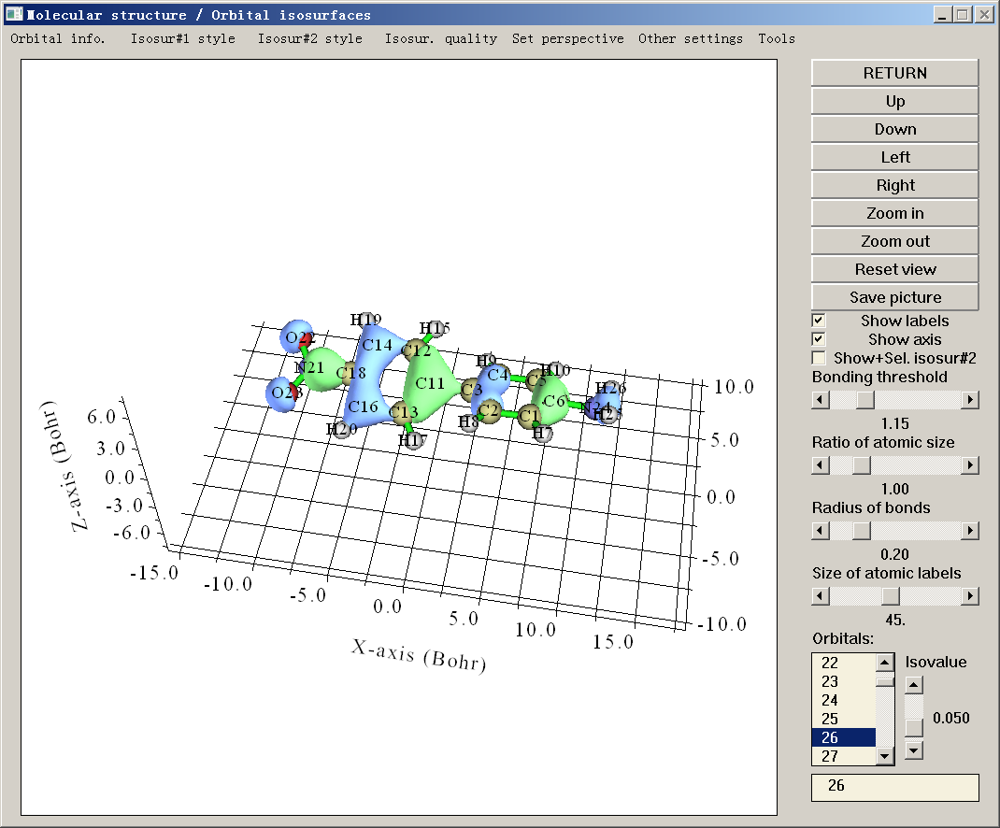
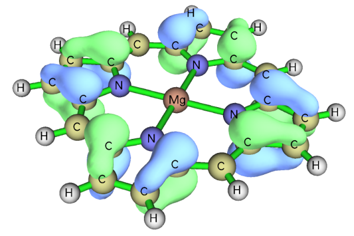
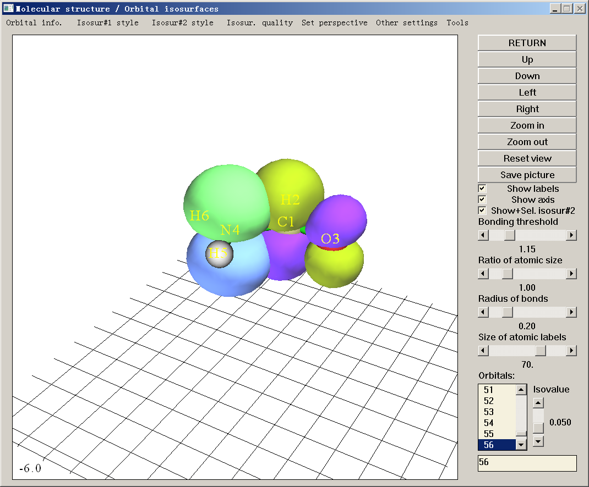
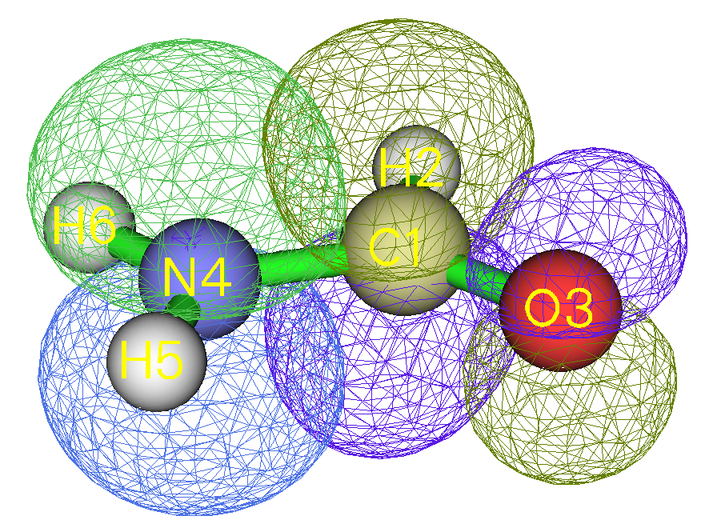
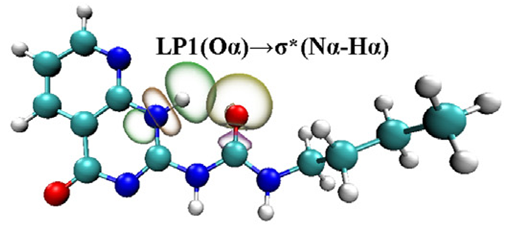
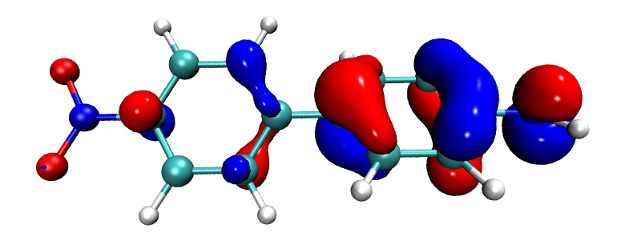
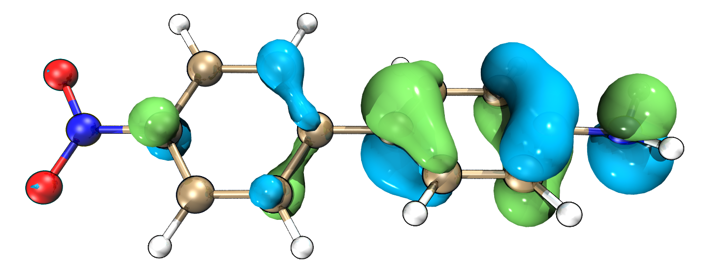

# **4.0 观察轨道与结构**

在本节中，我将首先介绍如何使用内置界面可视化各种轨道，然后在[4.0.3节](#403-用-multiwfn--vmd-快速绘制高质量轨道等值面图)中，我将展示如何将 Multiwfn 与 VMD 联用，轻松快速地绘制出最高水准的轨道图形。

## **4.0.1 查看环庚三烯的分子轨道**

启动 Multiwfn，输入 *examples\cycloheptatriene.fch* 并按回车键，然后选择主功能 0，此时会弹出一个 GUI 窗口，同时所有原子坐标信息以及重要分子轨道的基本信息会打印在 Multiwfn 控制台窗口中。



你可以通过滚动鼠标滚轮放大/缩小体系，也可以通过点击 GUI 右侧的 Up/Down/Left/Right 按钮旋转体系；你也可以在绘图区域内按住鼠标左键拖动以自由旋转体系；你还可以按住 Ctrl 键并用鼠标左键沿水平和竖直方向拖动体系，以分别实现沿屏幕旋转和放大/缩小；此外，你还可以按住 Shift 键拖动体系以平移它。注意，如果你使用的是 Linux 版本，需要先单击一次绘图区域使图标变为手形，上述鼠标拖动操作才会生效。

你还可以通过 GUI 右侧的相应控件调节成键阈值、调节原子球和标签的大小、将图形保存为图片文件等。更多信息参见[3.2节](sec-3-2-showing-molecular-structure.md)。

右下角列表中的数字是轨道序号，你可以通过选择相应序号查看轨道等值面，也可以直接在文本框中输入轨道序号然后按回车键。注意，如果你的体系是非限制性开壳层，若要选择 beta 轨道应输入负序号，例如 -5 对应第 5 个 beta 轨道。在此窗口中也可以同时绘制两个轨道，具体如图见[4.0.2节](#402-查看乙醇的自然键轨道-nbo)。

为方便起见，如果你的输入文件记录的是 R/U/RO(HF/KS) 波函数，你可以直接在右下角文本框中输入轨道标记。例如，输入 *h* 表示选择 HOMO，*l+2* 对应 LUMO+2，*la* 对应 alpha 的 LUMO，*hb-3* 对应 beta 的 HOMO-3，等等。

绿色和蓝色等值面分别对应正值和负值部分。可以通过拖动滑动条调节等值面值，你也可以通过 GUI 顶部“Other settings”下拉列表中的“Set isovalue”选项输入其数值。等值面的风格和颜色可通过“Isosur#1 style”中的相应子选项修改。等值面的质量可通过“Isosur. quality”中的选项设置。

通过选择“Orbital info.”-“Show all”，所有轨道的能量、占据数和类型将显示在 Multiwfn 控制台窗口中。如果你不想显示太多高能虚 MO，可以选择“Show up to LUMO+10”或“Show occupied orbitals”。如果载入的 .mwfn/molden/gms 文件中记录了不可约表示，则它们会显示在最后一列。

菜单栏的“Other settings”和“Tools”中有许多有用的选项，请自行尝试，遇到疑惑时参见[3.2节](sec-3-2-showing-molecular-structure.md)中的解释。其中“Tools”-“Batch plotting orbitals”很值得注意，通过该工具你可以非常方便地将大量选定的轨道分别保存为当前文件夹中的图片文件，视频演示见 <https://youtu.be/SHwrQhqBHZ0>。

如果你想绘制轨道的概率密度而不是其波函数，可以选择“Other settings”-“Choose plotting wavefunction or density”，然后选择“Density”。

要关闭窗口，点击“RETURN”按钮。关于此界面的更详细解释见[3.2节](sec-3-2-showing-molecular-structure.md)。

> **注**
>
> 用 Multiwfn 的主功能 0 可视化 Rydberg 轨道 (Rydberg 轨道)的等值面也是可行的，但由于它们非常弥散，为了避免等值面被截断，应在菜单中选择“Other settings”-“Set extension distance”，然后输入一个相对较大的值，例如 12（单位为 Bohr），再选择轨道进行可视化。延伸距离的默认值由 *settings.ini* 中的“Aug3D”控制。在[4.200.5节](sec-4-200-other-functions-part-2.md#42005-绘制电子密度的径向分布函数)的第二部分给出了一个可视化 Rydberg 轨道的例子。

### **提示：获得美观轨道等值面图的推荐步骤**

- 进入主功能 0，选择要可视化的轨道，适当设置等值面值

- 点击“Show Labels”以关闭坐标轴

- 适当调整视角

- 适当改变原子标签的大小。注意，标签类型可通过菜单栏“Other settings”中的“Set atomic label type”更改

- 如果等值面的渲染效果不太好，用“Other settings”中的“Set lighting”调节光照。

- 在菜单栏中选择“Isosur. quality”，设为“high-quality”（中等大小体系）或“very high-quality”（大体系）。

- 点击“Save picture”。用 Irfanview 或 Photoshop 等程序打开它，将图片文件缩小至 50%（此过程中会自动重采样，从而有效实现抗锯齿效果），然后适当裁剪图形。

  下面是按上述步骤得到的一个例子，质量相当不错



建议使用“face+mesh”绘制风格而非默认的“solid face”，因为此时保存的图片会更有立体感。

## **4.0.2 查看乙醇的自然键轨道 (NBO)**

查看 NBO (自然键轨道)有两种方式，如果你是 Gaussian 用户，方式 2 可能更方便，但如果你还需要查看 NBO 程序产生的自然杂化轨道 (NHO)、自然原子轨道 (NAO)或其它类型的轨道，则必须用方式 1。

### **方式 1：使用 NBO plot 文件**

常规做法是生成 NBO plot 文件（.31\~.40）并载入 Multiwfn。要用 Gaussian 生成这些文件，应在 route 部分加上 *pop=nboread*，这表示输入文件末尾的 NBO 关键词将被传递给 NBO 模块（Gaussian 中的 Link 607），然后在输入文件末尾加上例如 *\$NBO plot file=C:\NH2COH \$END*，其前需有一个空行，可参考“example”目录中的 *NH2COH_NBO.gjf*。用 Gaussian 运行该输入文件后，你会发现 C: 文件夹中已生成 *NH2COH.31*、*NH2COH.32* … *NH2COH.41*。“example”文件夹中已提供了 *NH2COH.31* 和 *NH2COH.37*。现在启动 Multiwfn 并输入以下命令

```text
examples\NH2COH.31  // .31 file contains necessary basis function information for plotting
examples\NH2COH.37  // .37 file contains NBO information. .32~.40 files correspond to PNAO/NAO/PNHO/NHO/PNBO/NBO/PNLMO/NLMO/MO respectively. Hint: You can only input 37, because in present example the .37 and the .31 file share the same name
0  // Enter the GUI
```

你可以从右下角列表中选择相应的 NBO 轨道查看其等值面。Multiwfn 也能同时绘制两个轨道，例如，这里我们将绘制 NBO 12 和 NBO 56，它们分别对应氮原子的占据孤对和碳氧原子间的非占据反 pi 键。首先，我们从轨道列表中选择 12 以绘制 NBO 12，然后点击“Show+Sel. isosur#2”，之后点击列表中的 56，你就会看到 NBO 12 和 NBO 56 同时显示。NBO 56（等值面#2）的黄绿色和紫色部分分别对应正值和负值部分。



从实面图研究两个轨道的重叠程度有些困难，因此我们在“Isosur#1 style”和“Isosur#2 style”中的对应项里选择“Use mesh”，使两个等值面以网格表示，见下图。（也请尝试“transparent face”风格）此时重叠程度变得很明显，可以清楚地看到 NBO 12 与 NBO 56 显著重叠，由此产生的强离域是它们之间二阶微扰能很大的主要原因之一（\~60 kcal/mol）。在[4.4.5节](sec-4-4-output-and-plot-various-properties-in-a-plane.md#445-两个轨道波函数的等值线图)中，你将学习如何得到这两个轨道的等值线图。



> **注**
>
> 注意，对于非限制性计算，Gaussian 中 NBO 3.1 模块输出的 .32 和 .33 文件是不正确的——标题部分缺失，这会导致奇怪的结果，你应参考如 .34 等其它 plot 文件修复它们，这很容易。

关于在其它量子化学软件中向 NBO 模块传递生成 NBO plot 文件关键词的方法，请查阅相应手册。你也可以用独立版 NBO 程序（GENNBO）生成 NBO plot 文件，需先准备一个输入文件（.47）。要生成它，应先将含基函数信息的文件载入 Multiwfn，然后进入主功能 100，选择子功能 2，再选择相应选项导出 .47 文件。之后，在 .47 文件中的“\$NBO”和“\$END”之间手动加上 *plot* 关键词。然后若用 GENNBO 程序运行该 .47 文件，就会得到 NBO plot 文件。

### **方式 2：用 .fch 文件作为 NBO 信息载体**

Gaussian 提供了一个关键词 *pop=saveNBO*，如果你把它加在 Gaussian 输入文件中，NBO 将被存入 checkpoint 文件而非 MO。你可以用相应的 .fch 文件作为 Multiwfn 输入文件查看 NBO。如果任务的理论水平是 HF 或 DFT，应在 .fch 文件第一行加上 *saveNBOene*；如果用的是 post-HF 方法且还指定了 *density* 关键词，应在 .fch 文件第一行加上 *saveNBOocc*，此时 Multiwfn 会在内部做一些特殊处理。不过，如果你的目的只是在主功能 0 中查看 NBO，可以忽略这一步。

注意，Gaussian 将 NBO 存入 checkpoint 文件时可能会自动重排。例如，你可能在 Gaussian 输出文件中看到如下信息：

```text
Reordering of NBOs for storage:     7    8    3    1    2    4    6    5    9   38 ...
```

这表示 .chk/.fch 文件中的第 1、2、3、4 ……个轨道实际上分别对应 NBO 模块产生的第 7、8、3、1 ……个 NBO。

值得一提的是，如果将 Multiwfn 与 VMD 联用，可以绘制非常漂亮的 NBO 等值面图，细节见我的博客文章“Using Multiwfn to plot NBO and related orbitals”（中文，<http://sobereva.com/134>）。下面是由一位 Multiwfn 用户在其工作 *J. Mol. Graph. Model.*, **59**, 31 (2015) 中绘制的图。



## **4.0.3 用 Multiwfn + VMD 快速绘制高质量轨道等值面图**

> **注**
>
> 本教程的中文版是我的博客文章“Using Multiwfn+VMD to rapidly plot high-quality isosurface map of molecular orbitals”（<http://sobereva.com/447>）和“Method of drawing state-of-the-art orbital isosurface map using VMD in combination with Multiwfn”（<http://sobereva.com/449>）。
>
> 本节对应的视频演示见 <https://youtu.be/-3TXfdO8H7s>，千万不要忘记看！！！

### **序言**

如果用 Multiwfn 为感兴趣的轨道导出 cube 文件，然后在 VMD (<http://www.ks.uiuc.edu/Research/vmd/>) 中渲染为等值面图，可以得到非常理想的轨道等值面图，具体流程已在我的博客文章“Using Multiwfn to visualize molecular orbitals”（中文，<http://sobereva.com/269>）中详细介绍。但该文章介绍的流程有些冗长，需要许多手动操作。为了尽量简化流程，这里我展示如何用脚本非常轻松快速地联用 Multiwfn 和 VMD 绘制高质量轨道等值面图。在本节中我只举例说明如何绘制 MO (分子轨道)，但同样的流程也可用于绘制其它种类的轨道，只是需要适当修改输入流文件（见下文）。如果你不知道如何在静默模式下运行 Multiwfn，建议先读[5.2节](sec-5-2-running-multiwfn-in-silent-mode.md)，以便更好地理解本节。这里假设你用的是 Windows 系统，Linux 平台需自行编写相应脚本。这里用的 VMD 程序是 1.9.3 版。

### **准备工作**

把 *showorb.bat* 和 *showorb.txt* 从“examples\scripts”复制到含 Multiwfn 可执行文件的文件夹中。

*showorb.bat* 是一个 Windows 批处理文件，用于调用 Multiwfn 计算所选轨道波函数的格点数据，然后把导出的 cube 文件移到 VMD 文件夹。你应手动编辑此文件，使输入文件路径与输入文件的实际路径一致，并把此文件中的 VMD 文件夹替换为你机器上的实际 VMD 文件夹。

*showorb.txt* 是输入流文件，每一行对应需要在 Multiwfn 交互界面中输入的一条命令。你应手动把第三行设为你想绘制的轨道序号，例如 *10,20-23,28-30*。

“examples\scripts”中的 *showorb.vmd* 是一个 VMD 绘图脚本，你应把它复制到 VMD 文件夹，然后在 VMD 文件夹中的 *vmd.rc* 文件末尾加上 `source showorb.vmd`，这样 VMD 启动时会自动执行该脚本。该脚本定义了三个自定义命令：

- *orb* *i*：用于载入轨道 *i* 的 cube 文件并显示为等值面。默认等值面值是 0.05，你可通过编辑 *showorb.vmd* 修改它

- *orbiso* *x*：用于把等值面值改为 *x*。

- *orbclean*：用于删除 VMD 文件夹中的所有轨道 cube 文件。

### **例子**

这里我们绘制 *examples\excit\D-pi-A.fchk* 的 MO。确保所有准备工作都已完成，然后编辑 *showorb.bat*，把默认输入文件 *1.fch* 换成 *examples\excit\D-pi-A.fchk*，并确保此文件中已正确指定实际 VMD 文件夹。然后打开 *showorb.txt*，把第三行设为 *54-59*，这样我们就可以可视化 54 至 59 的 MO。然后双击 *showorb.bat*，Multiwfn 将被调用以载入输入文件，计算并导出所选轨道波函数的格点数据。例如对于轨道 54，导出的文件将被命名为 *orb000054.cub*。所有轨道 cube 文件随后会被自动移到 VMD 文件夹。之后，启动 VMD，在 VMD 控制台窗口中输入 *orb 56*，然后 *orb000056.cub* 将被载入 VMD 并绘制为等值面：



在上图中，正负相分别用红色和蓝色表示。默认使用“Glossy”材质。如果你想改颜色或材质，应进入“Graphics”-“Representation”修改相应选项。你也可以通过修改 *showorb.vmd* 脚本改变默认颜色和材质。

如果接着你想可视化另一个轨道，例如 MO54，则只需在 VMD 控制台窗口中输入 *orb 5*4。

如果想把等值面值改为例如 0.02，只需输入 *orbiso 0.02*。

如果可视化后想清除 VMD 文件夹中的所有轨道 cube 文件，只需输入 *orbclean*，则所有 *orb??????.cub* 文件都会被删除。

默认用“medium-quality grid”（约 512000 个点）计算轨道波函数，这对中小体系足够。但对大体系，如由一百个或更多原子组成的体系，必须用更多的格点数。如果你想把默认格点改为“high-quality grid”，应把 *showorb.txt* 中的第四行设为 3。此外，如[4.0.1节](#401-查看环庚三烯的分子轨道)所述，可视化 Rydberg 轨道时必须增大格点数据的延伸距离。为此，应在 *showorb.txt* 的第三行和第四行之间加上

```text
-10
12
```

则延伸距离将从默认值增大到 12 Bohr。

### **绘制最高水准的轨道等值面图**

如果你想得到更好的轨道等值面图，只需按以下流程操作（请用 VMD 1.9.3，不要用其它 VMD 版本！）：

- (1) 如上所述在 VMD 中绘制一个轨道

- (2) 把 *examples\scripts\VMDrender.txt* 的全部内容复制到 VMD 控制台窗口以修改绘图设置

- (3) 在 VMD 中选择“File”-“Render”-“Tachyon”，点击“Start Rendering”。然后 VMD 文件夹中会出现 *vmdscene.dat*，它是 Tachyon 渲染器的输入文件。

- (4) 把 *examples\scripts\VMDrender_full.bat* 复制到 VMD 文件夹

- (5) 双击 *VMDrender_full.bat*，则 VMD 文件夹中的 Tachyon 渲染器（*tachyon_WIN32.exe*）将被调用执行渲染。过一会儿，VMD 文件夹中会出现 *full.bmp*，它就是生成的图片文件。

*examples\excit\D-pi-A.fchk* 的 MO56 的渲染图如下所示，图形看起来非常棒！



对大体系渲染时间相当长。为节省时间，可以用 *VMDrender_noshadow.bat* 代替 *VMDrender_full.bat*，此时结果图中没有阴影效果，而渲染开销相应降低。

有时，特别是对大体系，透明轨道等值面投下的阴影会使图形看起来太暗，你可以在 .bat 文件中手动加上 *-shadow_filter_off* 参数以在渲染时关闭这类阴影。
