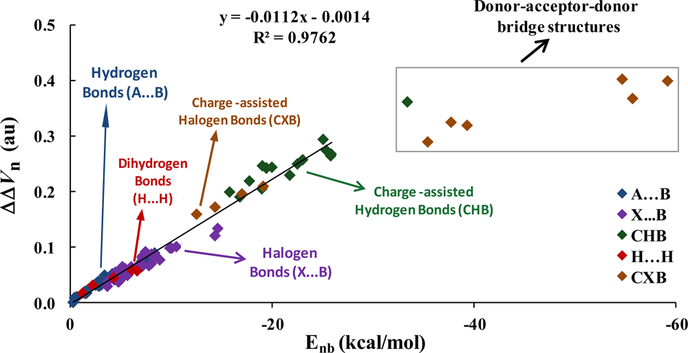

# **4.1 在单点处计算性质**

## **4.1.1 显示给定点处三重态水的全部性质**

在本例中说明如何为三重态水在给定点处计算多种实空间函数 (real space function)。启动 Multiwfn 并输入以下命令

```text
examples\H2O_m3ub3lyp.wfn
1  // Main function function 1, show properties at a point
0.2,2.1,2  // X, Y, Z coordinate of the point
1  // The unit of inputted coordinate is Bohr
```

此时该点处 Multiwfn 支持的所有实空间函数与电子密度梯度 (electron density gradient)/拉普拉斯 (Laplacian)分量、Hessian 矩阵 (Hessian matrix)及其本征值/本征向量 (eigenvalues/eigenvectors)一起打印输出。如果您不能完全理解输出内容，请仔细阅读 [2.6](sec-2-6-real-space-functions.md) 节和 [2.7](sec-2-7-user-defined-real-space-function.md) 节，输出中的所有术语均有非常详细的描述。

```text
Note: Unless otherwise specified, all units are in a.u.
 Density of all electrons:  0.4598301528E-02
 Density of Alpha electrons:  0.2861566387E-02
 Density of Beta electrons:  0.1736735141E-02
 Spin density of electrons:  0.1124831246E-02
 Lagrangian kinetic energy G(r):  0.3365319167E-02
 G(r) in X,Y,Z:  0.1342141336E-03  0.1888713104E-02  0.1342391929E-02
 Hamiltonian kinetic energy K(r):  0.1088761528E-03
 Potential energy density V(r): -0.3474195320E-02
 Energy density E(r) or H(r): -0.1088761528E-03
 Laplacian of electron density:  0.1302577206E-01
 Electron localization function (ELF):  0.1998328717E+00
 Localized orbital locator (LOL):  0.1008002781E+00
 Local information entropy:  0.3533635333E-02
 Interaction region indicator (IRI):  0.3583198766E+01
 Reduced density gradient (RDG):  0.2033111359E+01
 Reduced density gradient with promolecular approximation:  0.2294831921E+01
 Sign(lambda2)*rho: -0.4598301528E-02
 Sign(lambda2)*rho with promolecular approximation: -0.3918852312E-02
 Corr. hole for alpha, ref.:   0.00000   0.00000   0.00000 : -0.1251859403E-03
 Source function, ref.:   0.00000   0.00000   0.00000 : -0.3565867942E-03
 Wavefunction value for orbital       1 :  0.1536978161E-03
 Average local ionization energy (ALIE):  0.4664637535E+00
 van der Waals potential (probe atom: C ):  0.5566195299E+04 kcal/mol
 Delta-g (under promolecular approximation):  0.3210501179E-03
 Delta-g (under Hirshfeld partition):  0.2394976411E-03
 User-defined real space function:  0.1000000000E+01
 ESP from nuclear charges:  0.3453377860E+01
 ESP from electrons: -0.3439063818E+01
 Total ESP:  0.1431404144E-01 a.u. ( 0.3895049E+00 eV, 0.8982204E+01 kcal/mol)

 Note: The following information is for electron density

 Components of gradient in x/y/z are:
 -0.7919856828E-03 -0.6903543769E-02 -0.6651181972E-02
 Norm of gradient is:  0.9618959378E-02

 Components of Laplacian in x/y/z are:
 -0.3809549089E-02  0.1052804857E-01  0.6307272576E-02
 Total:  0.1302577206E-01

 Hessian matrix:
 -0.3809549089E-02  0.1394394193E-02  0.1197923973E-02
  0.1394394193E-02  0.1052804857E-01  0.1008387143E-01
  0.1197923973E-02  0.1008387143E-01  0.6307272576E-02
 Eigenvalues of Hessian: -0.3959672207E-02 -0.1883455778E-02  0.1886890004E-01
 Eigenvectors (columns) of Hessian:
  0.9964397434E+00 -0.2418531975E-01  0.8076452238E-01
 -0.4735415689E-01  0.6320255930E+00  0.7734993430E+00
 -0.6975257409E-01 -0.7745700228E+00  0.6286301443E+00
 Determinant of Hessian:  0.1407217564E-06
 Ellipticity of electron density:    1.102344
 eta index:    0.209852
 Stiffness:    0.099818

 Stress tensor:
 -0.1220815539E-02  0.1483611490E-04  0.1618000275E-04
  0.1483611490E-04 -0.1145414066E-02  0.3494514646E-04
  0.1618000275E-04  0.3494514646E-04 -0.1107965714E-02
 Eigenvalues of stress tensor: -0.1224514565E-02 -0.1166013495E-02 -0.1083667260E-02
 Eigenvectors (columns) of stress tensor:
 -0.9852173517E+00  0.7263017197E-01  0.1551503399E+00
  0.1433520595E+00  0.8453962002E+00  0.5145439259E+00
  0.9379209402E-01 -0.5291787248E+00  0.8433106903E+00
 Stress tensor stiffness:    1.129973
 Stress tensor polarizability:    0.884977
```
所有数据均以科学记数法 (scientific notation)表示，E 后面的值为指数 (exponent)，*e.g.* 0.6307272576E-02 对应于 0.006307272576。

在 "Corr. hole (correlation hole)" 和 "Source function" 行中，所谓的 "ref" 为参考点 (reference point)的位置，其由 *settings.ini* 中的 "refxyz" 参数决定。

默认情况下，输出的波函数值对应于轨道 (orbital) 1，例如可输入 *o6* 以选择轨道 6。

默认情况下，梯度 (gradient)和拉普拉斯 (Laplacian)的分量以及 Hessian矩阵 (Hessian)及其本征值/本征向量 (eigenvalue/eigenvector)均针对电子密度 (electron density)。可输入如 *f10* 以选择编号为 10 的实空间函数 (real space function)（即 ELF），此后所有这些量都将针对 ELF。若要查询所有可用实空间函数的编号，请输入 *allf*。

可继续输入其它坐标，当要返回上级菜单 (upper-level menu)时，输入 *q*；若要退出程序，请按 “CTRL+C” 键或直接关闭命令行窗口。

## **4.1.2 计算核位置处静电势 (ESP)以评估 H₂O∙∙∙HF 的相互作用强度**

> **注**
>
> 这是一个高级示例，如果对弱相互作用 (weak interaction)不感兴趣，可跳过本节。

在 *J. Phys. Chem. A*, **118**, 1697 (2014) 中，Mohan and Suresh 研究了一批静电主导 (electrostatic dominated)的相互作用体系，包括氢键、卤键和双氢键，它们都属于电子给体-受体相互作用 (electron donor-acceptor interaction)，其中给体 (donor)指富电子部分 (electron-rich moiety)（路易斯碱 (Lewis base)），而受体 (acceptor)指缺电子部分 (electron-deficient moiety)（路易斯酸 (Lewis acid)）。他们拟合了一个出乎意料地好的线性方程，用于关联 $\Delta\Delta V_{\mathrm{n}}$ 指标与各类相互作用的相互作用能 (interaction energy)（ $E_{\mathrm{nb}}$ ），*R*² 高达 0.9762。他们的结果可总结为下图



对于静电主导的复合物 (complex)，假设可以获得 $\Delta\Delta V_{\mathrm{n}}$ ，则根据上图所示方程，可以方便地预测相互作用能为

$$
E_{\mathrm{nb}}=-89.2857\times\Delta\Delta V_{\mathrm{n}}-0.125
$$

$\Delta\Delta V_{\mathrm{n}}$ 基于核位置处的 ESP 定义为

$$
\Delta\Delta V_{\mathrm{n}}=\Delta V_{\mathrm{n-D}}-\Delta V_{\mathrm{n-A}}=\left( V_{\mathrm{n-D'}}-V_{\mathrm{n-D}} \right)-\left( V_{\mathrm{n-A'}}-V_{\mathrm{n-A}} \right)
$$

其中 $V_{\mathrm{n-D'}}$ 为复合物环境中给体原子核位置处的 ESP，但忽略了该给体原子自身原子核的贡献。 $V_{\mathrm{n-D}}$ 与 $V_{\mathrm{n-D'}}$ 的唯一区别在于前者在单体 (monomer)状态下计算，因此 Δ $V_{\mathrm{n-D}}$ = $V_{\mathrm{n-D'}} - V_{\mathrm{n-D}}$ 可视为由于另一分子的存在而引起的给体原子核位置处 ESP 的变化，其直接反映了分子间相互作用 (intermolecular interaction)的强度。 $V_{\mathrm{n-A'}}$ 和 $V_{\mathrm{n-A}}$ 的定义分别与 $V_{\mathrm{n-D'}}$ 和 $V_{\mathrm{n-D}}$ 相同，但它们是对受体原子计算的。

在本例中，我们计算 H₂O∙∙∙HF 的 $\Delta\Delta V_{\mathrm{n}}$ ，并检验基于 $\Delta\Delta V_{\mathrm{n}}$ 预测的相互作用能是否真的接近精确计算的相互作用能。在该复合物中，H₂O 的氧为电子给体原子，HF 的氢为电子受体原子。由于 Mohan and Suresh 提出的方程是针对特定计算级别 (calculation level)拟合的，为了正确使用他们的方程，此处采用的计算级别与他们相同。下面使用的 .wfn 文件是在 MP2/6-311++G\*\* 优化几何下于 MP4(SDQ)/aug-cc-pVTZ 水平产生的，这些 .wfn 文件及相应的 Gaussian 输入文件可在 "examples\Vn" 文件夹中找到。
> **注**
>
> 注意，如果你是使用较旧版本的 G09 并采用 post-HF 方法 (post-HF method)，则 "density" 关键词是必不可少的，否则生成的 .wfn 文件中的密度将对应于 Hartree-Fock 密度。此外，在 G09 和 G16 中，在 MP4 级别无法产生密度，因此我们改用 MP4(SDQ) 关键词 (MP4 关键词默认为 MP4(SDTQ)，它比 MP4(SDQ) 更准确，但昂贵得多)。

首先，我们计算 $V_{\mathrm{n-A'}}$ 和 $V_{\mathrm{n-D'}}$。启动 Multiwfn 并输入

```text
examples\Vn\H2O-HF.wfn
1  // Calculate properties at a point
a1  // Nuclear position of atom 1
```

从输出中可以看到

```text
Total ESP without contribution from nuclear charge of atom     1:
-0.2228775074E+02 a.u. ( -0.6064805E+03 eV, -0.1398579E+05 kcal/mol)
```

这意味着 $V_{\mathrm{n-D'}}$ 为 -22.2877 a.u.。然后输入 *a5*，你会发现 $V_{\mathrm{n-A'}}$ 为 -0.9608 a.u.。

接下来我们计算 $V_{\mathrm{n-D}}$。重新启动 Multiwfn 并输入以下命令

```text
?H2O.wfn  // The symbol ? means the folder of the file we last time loaded
1
a1  // In H2O.wfn oxygen is atom 1
```

我们发现 $V_{\mathrm{n-D}}$ 为 -22.3339 a.u.。然后我们计算 $V_{\mathrm{n-A}}$。重新启动 Multiwfn 并输入

```text
?HF.wfn
1
a2  // In HF.wfn hydrogen is atom 2
```

$V_{\mathrm{n-A}}$ 被发现为 -0.9136 a.u.。

$\Delta\Delta V_{\mathrm{n}}$ 因此为 -22.2877-(-22.3339) - $[-0.9608-(-0.9136)]$ = 0.0462 + 0.0472 = 0.0933 a.u.。

使用前面提到的方程，相互作用能 (interaction energy) 可近似预测为 -89.2857×0.0933-0.125 = -8.45 kcal/mol，该值与 Mohan 和 Suresh 在 MP4/aug-cc-pVTZ 级别使用 Counterpoise 校正 (Counterpoise correction) 获得的精确相互作用能 (-8.31 kcal/mol) 非常接近。

> **注**
>
> 在 MP4(SDQ)/aug-cc-pVTZ 生成波函数 (wavefunction) 即使对于像我们这里研究的小复合物也是非常耗时的，因此找到一个能显著节省计算时间但又不牺牲太多精度的计算级别很重要。对于当前体系，基于 MP2/6-311++G\*\* 几何，我尝试使用几个级别来评估 $\Delta\Delta V_{\mathrm{n}}$：
>
> - B3LYP/6-311+G\*\*: 0.1021 a.u.
>
> - MP2/cc-pVTZ: 0.1052 a.u.
>
> - MP2/aug-cc-pVTZ: 0.0955 a.u.
>
> - B3LYP/aug-cc-pVTZ: 0.0985 a.u.
>
> - MP2/aug-cc-pVDZ: 0.0939 a.u.
>
> - B3LYP/aug-cc-pVDZ: 0.0980 a.u.
>
> 在 MP2/aug-cc-pVDZ 产生的 $\Delta\Delta V_{\mathrm{n}}$ (0.0939) 与我们上面在 MP4(SDQ)/aug-cc-pVTZ 获得的值 (0.0933) 非常接近，而计算成本降低了两倍。因此，在实际研究中，使用 MP2/aug-cc-pVDZ 级别来评估 $\Delta\Delta V_{\mathrm{n}}$ 是非常理想的选择。