# **4.10 绘制态密度 (density-of-states, DOS) 图**

在本节中，我将说明如何使用 Multiwfn 轻松绘制各种态密度图。DOS 模块的相关理论和使用介绍见 [3.12](sec-3-12-plotting-density-of-states-pes-and-cohp.md) 节。

> **注**
>
> 更深入的讨论和 DOS 作图示例见我的博客文章 "Plotting density-of-states maps by Multiwfn to study electronic structure" (<http://sobereva.com/482>, 中文)

## **4.10.1 绘制 N-phenylpyrrole 的总态密度、偏态密度和重叠态密度 (total, partial and overlap DOS)**

在本例中，我们将为 N-phenylpyrrole 绘制总态密度、偏态密度和重叠态密度 (TDOS、PDOS 和 OPDOS)，其结构如下所示。本例由六部分组成。如果对 DOS 不熟悉，请先阅读 [3.12.1](sec-3-12-plotting-density-of-states-pes-and-cohp.md#3121-理论theory) 节。

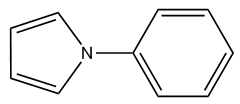

由于绘制 PDOS 和 OPDOS 需要基函数信息，在这些例子中我们使用 .fch 作为输入文件，使用 .mwfn、.molden 或 .gms 文件也可以，但不能使用 .wfn/.wfx，因为它们不包含基函数和虚 MOs 的信息。如果只需要获得 TDOS，也可以简单地使用记录 MO 能级的纯文本文件或带有 *pop=full* 关键词的 Gaussian 输出文件作为输入文件，文件格式见 [3.12.1](sec-3-12-plotting-density-of-states-pes-and-cohp.md#3121-理论theory) 节。

> **注**
>
> 值得注意的是，如果打算基于默认的 Mulliken 轨道组成 (orbital composition) 方法绘制 PDOS 和 OPDOS，必须避免使用弥散函数 (diffuse functions)，因为它们会严重损害由 Mulliken 或 SCPA 方法计算的轨道组成的可靠性。然而，如果让 Multiwfn 通过 Hirshfeld 或 Becke 方法计算轨道组成，则可以安全地使用弥散函数，但在这种情况下无法绘制 OPDOS。当前体系的波函数在 B3LYP/6-31G\* 水平下产生。

### **第 1 部分：绘制总态密度 (TDOS)**

启动 Multiwfn 并输入以下命令

```text
examples\N-phenylpyrrole.fch
10  // Plot various kinds of DOS maps
0  // Plot map
```

由于当前没有定义片段 (fragment)，因此仅绘制 TDOS。TDOS 图立即弹出，如下所示

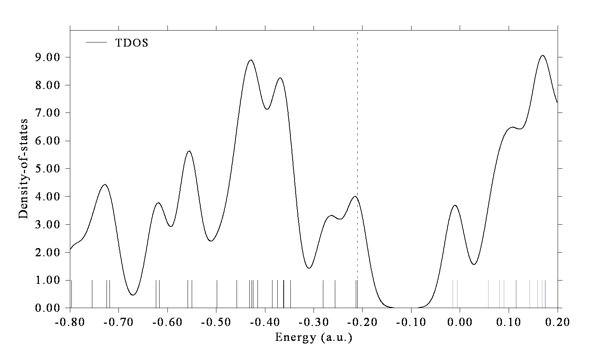

在该图中，曲线是基于 MO 能级分布模拟的 TDOS，每条离散的竖线对应一个分子轨道 (molecular orbital, MO)，虚线标出 HOMO 的位置，黑色和灰色线分别表示占据和非占据 MO 能级的位置。在负值部分，-0.40 a.u. 附近区域的态密度明显大于其他区域。

在图上点击鼠标右键将其关闭，并选择选项 0 返回上一级菜单。

我们还可以更改能量单位和能量范围，并可用线高表示轨道简并度 (orbital degeneracy)。为此，输入以下命令：

```text
8  // Switch the unit from the default a.u. to eV
2  // Set energy range
-30,5,5  // Set lower and upper limits to -30 eV to 5 eV, the spacing between labels is 5 eV
9  // Using line height to show orbital degeneracy
0.05  // If energy difference between two orbitals is less than 0.05 eV, they will be regarded as degenerate
0  // Plot TDOS map again
```

现在得到下图。线高表示简并度，对应右侧坐标轴。可以看到，一些轨道的简并度为 2。
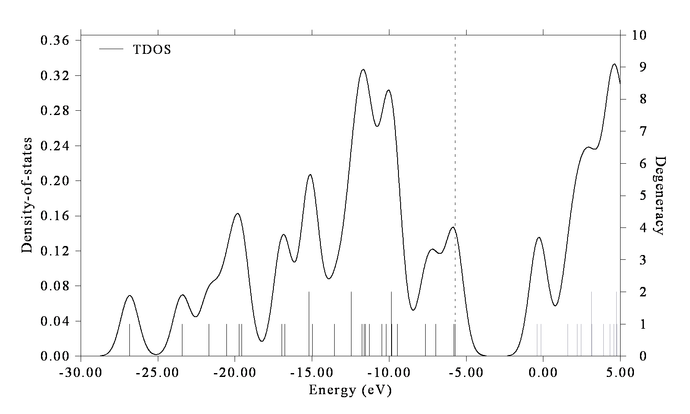

此外，若要在曲线底部绘制竖线，可在后处理菜单 (post-processing menu)中选择选项“22 Toggle drawing lines at bottom of curves”，然后选择选项1重新绘制，将看到

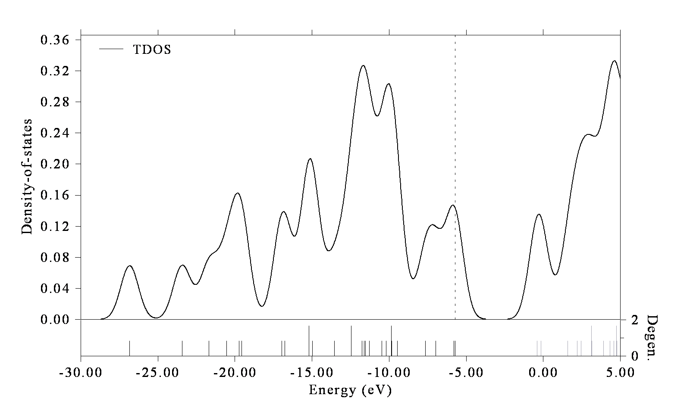

### **第2部分：绘制碎片 (fragment)的偏态密度 (PDOS)和重叠布居态密度 (OPDOS)**

接下来，我们将吡咯部分的重原子定义为碎片1，将苯基部分的重原子定义为碎片2，以查看它们的偏态密度和重叠布居态密度。此外，我们将所有氢定义为碎片3。

启动 Multiwfn 并输入

```text
examples\N-phenylpyrrole.fch
10  // Plot various kinds of DOS maps
-1  // Enter the interface for defining fragments. You can define up to 10 fragments. PDOS will be plotted for all of them, but OPDOS will only be drawn between fragments 1 and 2
1   // Define fragment 1
a 1-5  // Add carbons and nitrogen of pyrrole moiety (atoms 1~5) to the fragment
q  // Save fragment 1
2  // Define fragment 2
a 10-13,15,17  // Add phenyl moiety (atoms 10~13, 15 and 17) to the fragment
q  // Save fragment 2
3  // Define fragment 3
a 6-9,14,16,18-20  // Add all hydrogens to the fragment
q  // Save fragment 3
0  // Return to last menu
2  // Set X-axis
-1.1,-0.1,0.1  // Set the range of X-axis to -1.2 ~ -0.1 a.u., so that all valence MOs can be shown in the graph. The step between labels is set to 0.1 a.u.
0  // Draw TDOS+PDOS+OPDOS
```

当前的图形不是很理想。关闭图形，可看到许多用于自定义图形的选项，如设置曲线颜色、设置图例文本。尝试使用它们，若有疑问可参阅[3.12.3](sec-3-12-plotting-density-of-states-pes-and-cohp.md#3123-绘制态密度dos图的选项与基本用法)节。此处选择选项4并输入 *-2,9,1*，将左侧Y轴 (Y-axis)（对应总态密度和偏态密度）的下限、上限和标签间隔分别设为-2.0、9.0和1.0。选择14并输入缩放因子0.2，则右侧Y轴（对应重叠布居态密度）的范围将被设为-0.4、1.8（因为-2.0\*0.2=-0.4且9.0\*0.2=1.8）。缩小右侧Y轴的范围等价于增大重叠布居态密度曲线的幅度，这使图中重叠布居态密度的变化更清晰。然后选择选项1重新绘制态密度图，将看到

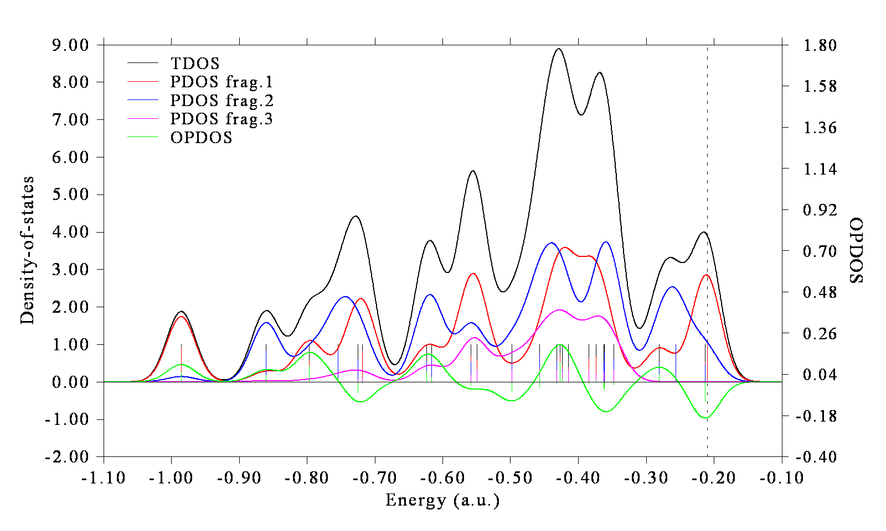

左侧坐标轴对应总态密度和偏态密度，右侧坐标轴对应重叠布居态密度。红色、蓝色和品红色曲线及离散线分别代表碎片1、2和3的偏态密度。可以看到，在大多数价分子轨道 (valence MOs)中，碎片1和2的贡献量相当。碎片3（氢）主要贡献于-0.60 \~ -0.35 a.u.之间的分子轨道。绿色曲线是碎片1与2之间的重叠布居态密度，其正值部分意味着相应能量范围内的分子轨道在两个碎片之间呈现成键特征 (bonding character)（*e.g.*位于-0.8 a.u.处的轨道，其对应于MO14）；也存在重叠布居态密度为负的区域，*e.g.* HOMO-1（-0.213 a.u.）表现为两个碎片之间的反键轨道 (antibonding orbitals)。

### **第3部分：绘制特定原子轨道 (atomic orbital)的偏态密度**

当前分子位于YZ平面内，作为示例，让我们查看氮原子的 $p_{x}$ 原子轨道的偏态密度，它代表该位点上的π电子。选择0返回上一级菜单，然后输入
```text
-1  // Define fragments
-2  // Fragment 2 is not needed, so we input corresponding negative value to unset it
-3  // Also unset fragment 3
1  // Redefine fragment 1
clean  // Clean existing content of the fragment
all  // Print out information of all basis functions
```

与氮原子对应的信息提取如下所示

```text
Basis:    61    Shell:   25    Center:    5(N )    Type: S
Basis:    62    Shell:   26    Center:    5(N )    Type: S
Basis:    63    Shell:   27    Center:    5(N )    Type: X
Basis:    64    Shell:   27    Center:    5(N )    Type: Y
Basis:    65    Shell:   27    Center:    5(N )    Type: Z
Basis:    66    Shell:   28    Center:    5(N )    Type: S
Basis:    67    Shell:   29    Center:    5(N )    Type: X
Basis:    68    Shell:   29    Center:    5(N )    Type: Y
Basis:    69    Shell:   29    Center:    5(N )    Type: Z
Basis:    70    Shell:   30    Center:    5(N )    Type: XX
Basis:    71    Shell:   30    Center:    5(N )    Type: YY
Basis:    72    Shell:   30    Center:    5(N )    Type: ZZ
Basis:    73    Shell:   30    Center:    5(N )    Type: XY
Basis:    74    Shell:   30    Center:    5(N )    Type: XZ
Basis:    75    Shell:   30    Center:    5(N )    Type: YZ
```

当前体系在 6-31G\* 基组 (basis set)下计算，根据基组的定义，每个价层原子轨道 (valence atomic orbital)由两个相应类型的基函数 (basis functions)表示。因此，我们应该将基函数 63 和 67 放入碎片 (fragment)中，它们共同代表氮的 *px* 轨道（对于其他种类的基组，关于如何确定基函数与原子轨道 (atomic orbitals)之间的对应关系，可参阅[4.7.6](sec-4-7-population-analysis-and-atomic-charge-calculation.md#476-通过布居分析确定基函数与原子轨道的对应关系)节）。输入以下命令

```text
b 63,67  // Then you can input command all again, the basis functions added to present fragment are marked by asterisks
q  // Save fragment
0  // Return
0  // Plot TDOS and PDOS
```

请自行分析所得图形。

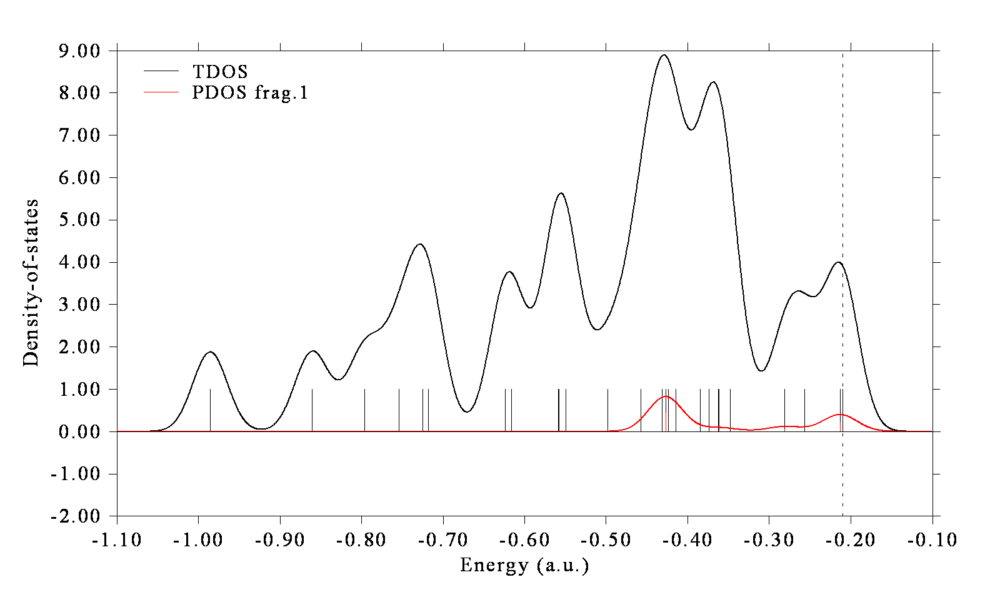

### **第4部分：绘制所有 π 分子轨道 (molecular orbitals)的 PDOS 与 OPDOS**

该分子位于 YZ 平面上，假设我们只打算研究吡咯和苯基部分 (moieties)的 π 轨道的 PDOS/OPDOS，并想排除所有其他 MOs 的影响，虽然在碎片定义界面中可以逐个选择每个 PX 基函数，但由于原子太多，该过程将花费大量时间，因此非常麻烦。使用条件选择命令要好得多。

选择选项 0 返回上一级菜单，然后输入

```text
-1  // Define fragments
1  // Redefine fragment 1
clean  // Clean existing content of the fragment
cond  // Use conditions to select basis functions. You will be prompted to input three conditions, the basis functions simultaneously satisfying the three conditions will be added to current fragment
1-5  // The first condition is that the basis functions must belong to the heavy atoms in pyrrole moiety (atoms 1~5)
[Press ENTER button]  // The second condition is the index range of basis functions. Press ENTER button directly means basis function index is arbitrary
X  // The third condition is that the type of basis function should be PX
q  // Save fragment 1
2  // Define fragment 2
cond  // Use conditions to select basis functions
10-13,15,17  // Atom index of the carbons in the phenyl moiety
```
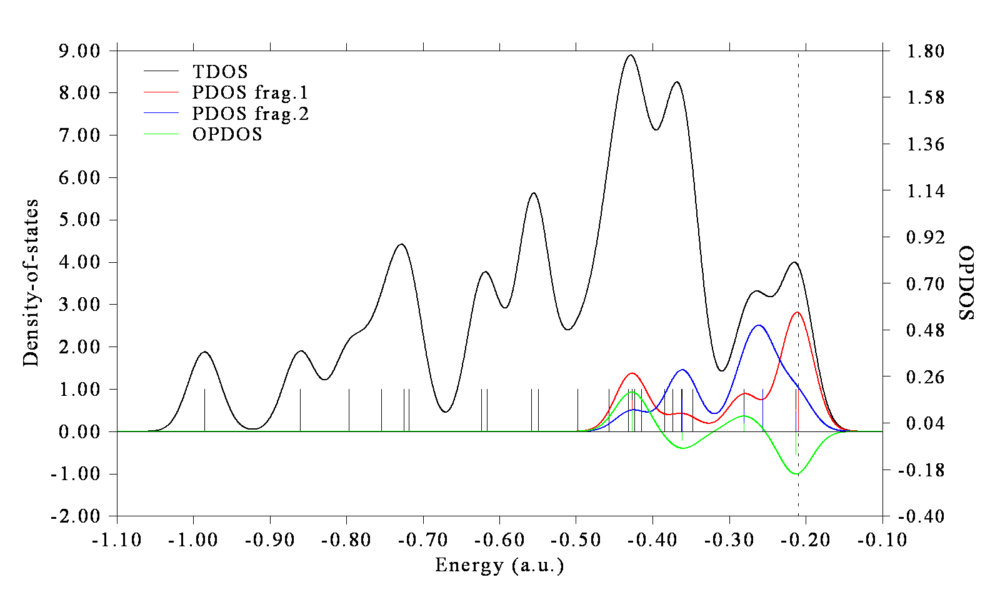

此时部分态密度曲线仅覆盖高能区，这表明当前体系中大多数π分子轨道的能量高于σ分子轨道。请使用Multiwfn的主功能0可视化相应的分子轨道等值面 (isosurfaces)。

### **第5部分：分别单独绘制s、p、d原子轨道 (atomic orbital)的部分态密度**

接下来，我说明如何分别单独绘制*s*、*p*、*d*原子轨道的部分态密度。重新启动Multiwfn，然后输入

```text
examples\N-phenylpyrrole.fch
10  // Plot various kinds of DOS maps
-1  // Define fragments
1  // Define fragment 1
l s  // Add basis functions with angular moment of s to the fragment
q  // Save fragment
2  // Define fragment 2
l p  // Add basis functions with angular moment of p to the fragment
q  // Save fragment
3  // Define fragment 3
l d  // Add basis functions with angular moment of d to the fragment
q  // Save fragment
0  // Return to last menu
0  // Draw TDOS+PDOS+OPDOS
```

然后关闭图形，并输入以下命令以改善图形效果

```text
9  // Disable showing OPDOS curves
10  // Disable showing OPDOS lines
4  // Set range of Y axis
0,10,1  // Lower and upper limits are set to 0 and 10 with label interval of 1.0
16  // Set legends
1  // Set legend of PDOS corresponding to fragment 1
s
2  // Set legend of PDOS corresponding to fragment 2
p
3  // Set legend of PDOS corresponding to fragment 3
d
0  // Exit the interface for setting legends
22  // Toggle drawing lines at bottom of curves,
1  // Replot the map
```

现在可以看到如下的图 (map)

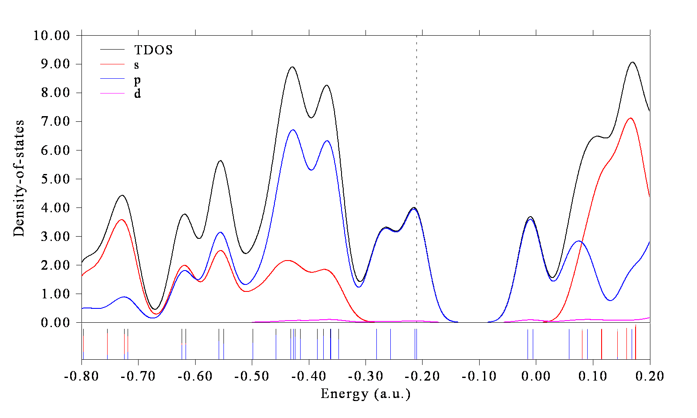

从该图中可以清楚看出，被占据的前线分子轨道（即靠近虚线的那些）仅由*p*轨道贡献。

如果要为特定原子 (atoms)的特定角动量 (angular moment)的轨道绘制部分态密度，也非常容易。例如，通过在碎片定义界面中输入以下命令，可以定义一个对应于吡咯部分 (pyrrole moiety)中四个碳的全部*p*轨道的碎片。

```text
cond  // Use conditions to select basis functions
1-4  // Atoms 1~4
[Press ENTER button]  // No requirement on basis function index
P  // Basis function of P angular moment
```

### **第6部分：基于由Hirshfeld方法 (Hirshfeld method)得到的轨道组成 (orbital compositions)绘制部分态密度**

绘制部分态密度需要轨道组成。在上面的例子中，组成是使用默认的Mulliken方法 (Mulliken method)计算的。该方法速度非常快，然而，它不是很稳健（特别是对于非占据轨道 (unoccupied orbitals)），并且当使用了弥散函数 (diffuse functions)时结果完全无用。在此我还说明如何基于由Hirshfeld方法得到的轨道组成绘制部分态密度，该方法更稳健，且与弥散函数完全兼容。缺点是Hirshfeld方法开销更大，并且它只能评估原子的贡献，即碎片只能定义为原子的集合。

这里我们重复“第2部分”中的例子，但使用由Hirshfeld方法得到的组成。启动Multiwfn并输入以下命令：

```text
examples\N-phenylpyrrole.fch
10  // Plotting DOS
7  // Change the method for calculating orbital compositions
3  // Hirshfeld method. Then Multiwfn calculates orbital compositions for all atoms in all orbitals, for large system you need to wait for a while
-1  // Define fragments
1   // Define fragment 1
1-5  // Set carbons and nitrogen of pyrrole moiety (atoms 1~5) as the fragment
2  // Define fragment 2
10-13,15,17  // Set phenyl moiety (atoms 10~13, 15 and 17) as the fragment
3  // Define fragment 3
6-9,14,16,18-20  // Set all hydrogens as the fragment
0  // Return to last menu
2  // Set X-axis
-1.1,-0.1,0.1
0  // Draw TDOS+PDOS
```
所得图 (graph)与基于默认Mulliken方法 (default Mulliken method)得到的组成绘制的图几乎完全一致（然而，对于由未占据分子轨道 (unoccupied MOs)组成的能量范围，差异通常很明显，显然基于Hirshfeld的部分态密度 (PDOS)更可靠）。注意，当采用Hirshfeld方法计算轨道组成 (orbital composition)时，无法绘制重叠态密度 (OPDOS)。

## **4.10.2 绘制1,3-丁二烯 (1,3-butadiene)的局域态密度 (local DOS)**

如果你不知道局域态密度 (local DOS, LDOS)是什么，请先查看第[3.12.4](sec-3-12-plotting-density-of-states-pes-and-cohp.md#3124-局域态密度local-dos)节。简而言之，总态密度 (total DOS, TDOS)表示整个体系的态密度 (DOS)曲线，部分态密度描述一个原子（或碎片）的态密度曲线，而局域态密度给出一个点的态密度曲线（*即*空间分辨的）。此外，我们可以将构成一条线的一组点的局域态密度绘制为颜色填充图 (color-filled map)，X轴对应能量，而Y轴表示在线中的位置。局域态密度在解释来自扫描隧道显微镜 (scanning tunneling microscope, STM)的数据时很有用，你可以在*例如* *J. Phys. Chem. Lett.*, **5**, 3701 (2014)中找到相关实验数据。

在本例中，我们绘制丁二烯在选定点的局域态密度。首先，我们绘制丁二烯端碳上方1.5 Bohr处的点的局域态密度。启动Multiwfn并输入以下命令：

```text
examples\butadiene.fch
0  // Visualize molecular structure
```

从命令行窗口中的输出可以发现，目标点应为1.137 3.308 1.5（C1上方1.5 Bohr处）。关闭GUI窗口并输入

```text
10  // DOS plotting module
10  // Draw local DOS for a point
1.137,3.308,1.5
```

然后你将看到（你可以将其与总态密度图进行比较）

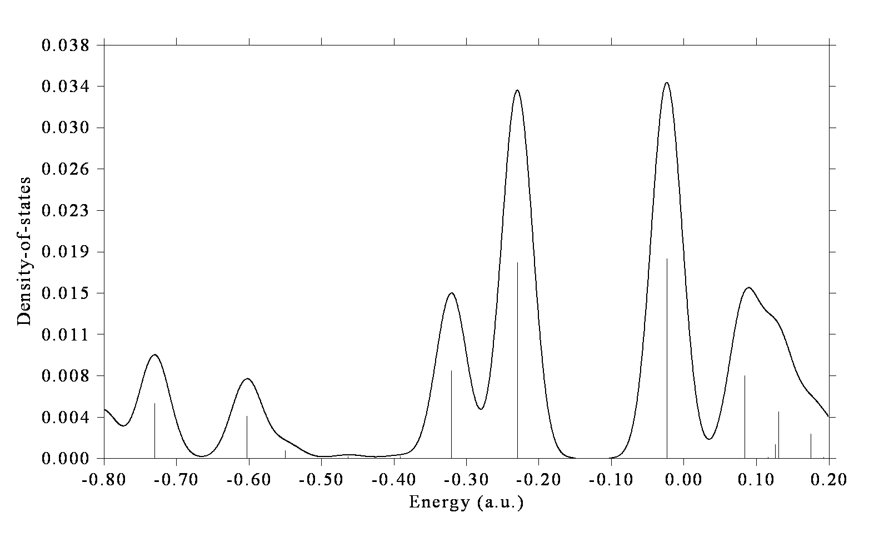

关闭图形并选择0返回上一级菜单。

接下来，我们绘制沿连接两个端碳（C1和C8）上方1.5 Bohr处的两点的直线的颜色填充图，输入以下命令

```text
11  // Draw local DOS along a line
1.137,3.308,1.5
-1.137,-3.308,1.5
200  // Evenly taking 200 points along line
```

然后关闭弹出的图形并输入

```text
4  // Modify the ratio between Y and X axes
0.5  // The length of Y-axis will be half of X-axis
1  // Replot
```

然后你可以看到

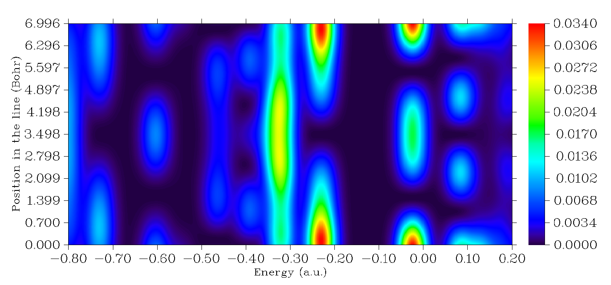

该图中的颜色表示不同三维空间位置（Y轴）和不同能量（X轴）处的状态密度。粉色箭头突出了三个不同空间位置处的能隙。

如果你在理解该图的含义时仍感到困难，请查看下图，其中明确标注了一些重要信息。

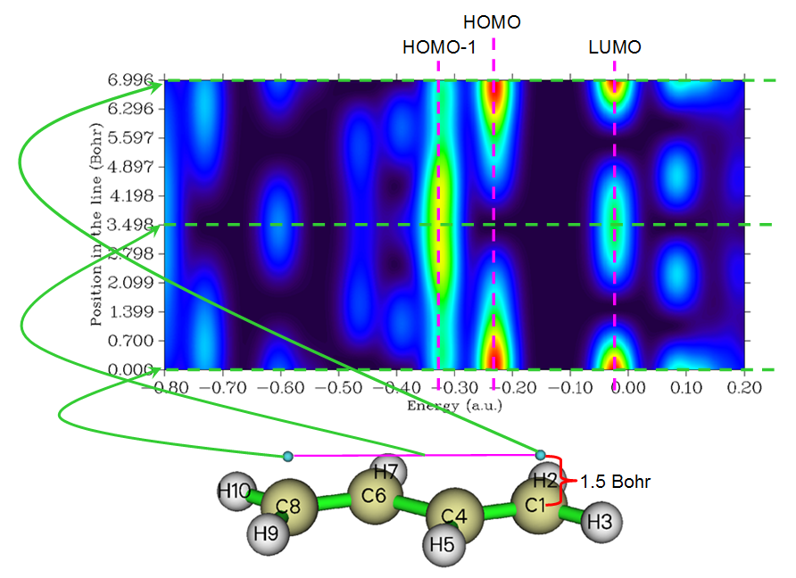

很容易理解，上图中最下面的水平线（*即*Y=0处的绿色虚线）对应于C1上方1.5 Bohr处的局域态密度曲线图，这正是我们之前绘制的。

## **4.10.3 绘制非限制开壳体系的DOS图：Na₃O@Si₁₂C₁₂**

在第[4.10.1](#4101-绘制-n-phenylpyrrole-的总态密度偏态密度和重叠态密度-total-partial-and-overlap-dos)节中，我们绘制了一个闭壳体系 (closed-shell system)，而在本节中，我将说明如何为典型的开壳体系 (open-shell system)Na₃O@Si₁₂C₁₂绘制DOS，该体系在我发表于*J. Comput. Chem.*, **38**, 1574 (2017)的工作中研究过，且为二重态 (doublet)。对于以非限制形式 (unrestricted formalism)计算的开壳情形，存在两种自旋 (spin)，必须同时考虑。.fchk文件可在此处下载：<http://sobereva.com/multiwfn/extrafiles/Na3O-Si12C12.rar>，其对应于优化几何结构下的UM06-2X/6-311G\*波函数。
首先，我们绘制α自旋 (alpha spin)的总态密度 (TDOS)+部分态密度 (PDOS)图，PDOS将对应于Na₃O。启动Multiwfn并输入

```text
Na3O-Si12C12.fchk
10  // DOS plotting module
-1  // Define fragments
1  // Define fragment 1
a 1,4,27,28  // These four atoms correspond to the Na_3O moiety
q  // Save fragment
0  // Return
0  // Plot TDOS+PDOS
```

关闭弹出的图形

```text
22  // Enable drawing lines at bottom of curves
1  // Replot
```

你将看到下图。默认情况下，对于非限制性波函数 (unrestricted wavefunction)，只考虑α分子轨道 (MOs)，因此下图即为α自旋的态密度 (DOS)图。

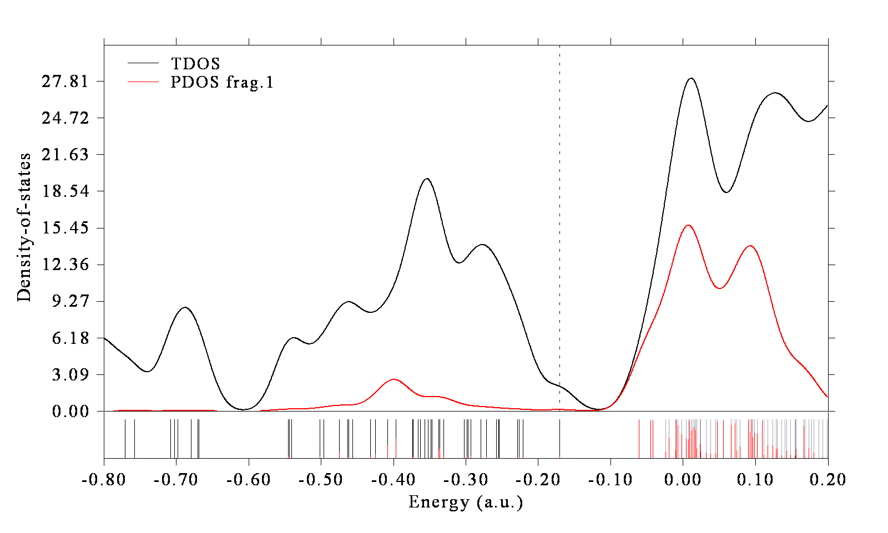

选择选项0返回上一级菜单。如果你想绘制β自旋 (beta spin)的态密度图，应选择“6 Choose orbital spin”，然后选择“2 Beta spin”。如果你不想区分自旋而是想考虑所有分子轨道，应选择“3 Both spins”。请选择β自旋并再次通过选项0重绘该图，你会发现该图与α自旋的图相似，表明在此体系中自旋极化 (spin polarization)并不明显。

为了使α和β态密度图的比较直观，我们可以尝试制作一幅图，其上半部分和下半部分分别对应α自旋和β自旋。这样的图不能由Multiwfn直接生成，但可以通过Multiwfn结合第三方可视化软件（如Origin）轻松制备，如下所示。我使用的Origin版本是9.0

我们首先用Multiwfn以上述方式绘制α总态密度+部分态密度图，在后处理菜单中，选择“3 Export curve and line data to plain text file in current folder”。将*DOS_curve.txt*重命名为*alpha.txt*。返回态密度绘制界面，切换为β自旋，绘制该图，然后再次导出数据集，将*DOS_curve.txt*重命名为*beta.txt*。*DOS_line.txt*可以删除，因为我们不会使用它。

启动Origin，将*alpha.txt*和*beta.txt*都拖入其中以导入它们。当前，在对应于β自旋的工作簿中，B列和C列分别对应总态密度和部分态密度曲线数据。我们对D列（目前为空）选择“Set Column Values”选项，将D的内容设为*-Col(B)*；类似地，我们将E列设为*-Col(C)*。

接下来，我们选择适当的选项以绘制线图。在对应于α自旋的工作表中，我们将A列添加为X数据，将B列和C列添加为两组Y数据。在对应于β自旋的工作表中，我们将A列添加为X数据，而将D列和E列添加为Y数据。经过一些调整后，你将得到下图，它分别很好地展示了α和β自旋的态密度和部分态密度。

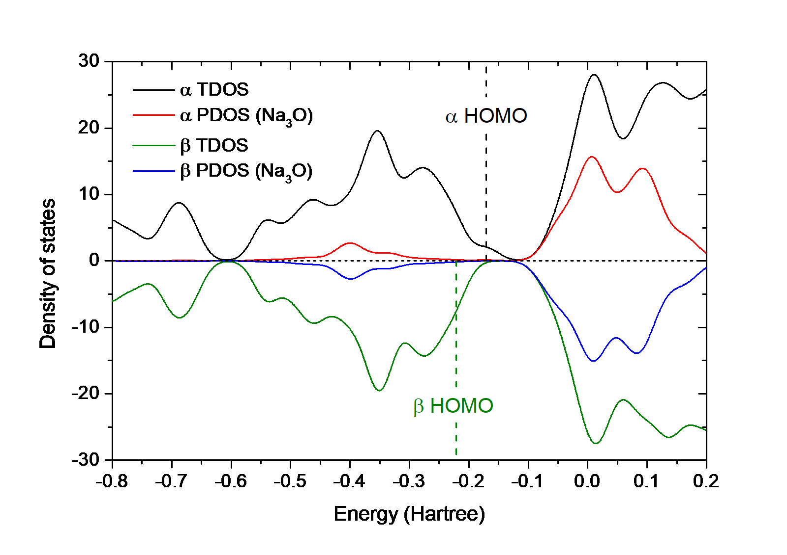

注意，为了绘制对应于DOS=0的水平线以及突出α和β自旋的最高占据分子轨道 (HOMO)水平的 highlights 的两条垂直线，我还创建了第三个工作表并适当地填充了内容。α和β HOMO的值可以直接从在DOS模块中选择选项0绘制该图时的提示中找到，即

```text
Note: The vertical dash line corresponds to HOMO level at    -0.171 a.u.
```

和

```text
Note: The vertical dash line corresponds to HOMO level at    -0.221 a.u.
```

上述*alpha.txt*、*beta.txt*以及该图的Origin .opj文件已提供在"examples\DOS\\"文件夹中。
## **4.10.4 绘制Cr₃Si₁₂⁻团簇的光电子谱 (photoelectron spectrum, PES)**

> **注**
>
> 本节的中文版是我的博客文章 “Using Multiwfn to plot photoelectron spectrum” (<http://sobereva.com/478>)。

在[3.12.5](sec-3-12-plotting-density-of-states-pes-and-cohp.md#3125-光电子能谱photoelectron-spectrum)节中，已介绍了光电子谱的理论和绘制光电子谱的界面，若尚未阅读请先阅读。本节将以Cr₃Si₁₂⁻为例说明如何非常容易地绘制光电子谱，我们将采用广义Koopmans定理 (generalized Koopmans' theorem)绘制光电子谱。该体系已在*J. Phys. Chem. A*, **122**, 9886 (2018)中在PBE/6-311+G\*水平下被研究，值得注意的是该体系计算的第一垂直电离能 (vertical ionization potential, VIP)为2.56 eV。

使用JPCA论文补充材料 (supplemental material)中提供的该体系的优化结构 (optimized structure)，我用Gaussian 16在与论文相同的水平下做了单点任务 (single point task)，所得的*Cr3Si12-.fchk*文件可在此下载：<http://sobereva.com/multiwfn/extrafiles/Cr3Si12-.rar>。

启动Multiwfn并输入

```text
Cr3Si12-.fchk
10  // DOS module
12  // Interface for plotting PES. You will find HOMO level has been shown on the screen, namely -0.77 eV, which is the highest one among alpha HOMO and beta HOMO
3  // Set shift value to meet generalized Koopmans' theorem
1.79  // Should be 1st VIP + E(HOMO). For present case the value is -0.77+2.56=1.79 eV
4  // Set X-axis
1,4.5,0.5  // The energy span is 1.0~4.5 eV, with label step of 0.5 eV
9  // Set width of curve
10  // Make the curve thicker than default
1  // Plot the spectrum
```

所得谱图如下所示。注意Y轴 (Y-axis)的绝对值实际上是没有意义的，你可以选择选项"13 Toggle showing labels and ticks on Y-axis"一次，将其状态切换为"No"，以去掉Y轴上的标签和刻度。

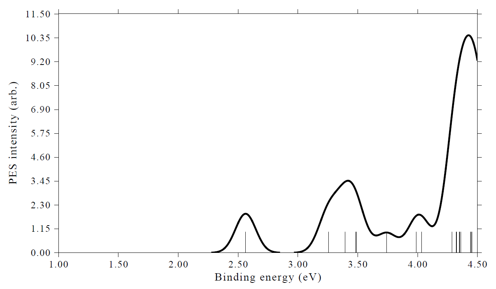

*J. Phys. Chem. A*论文中给出的实验谱图如下所示

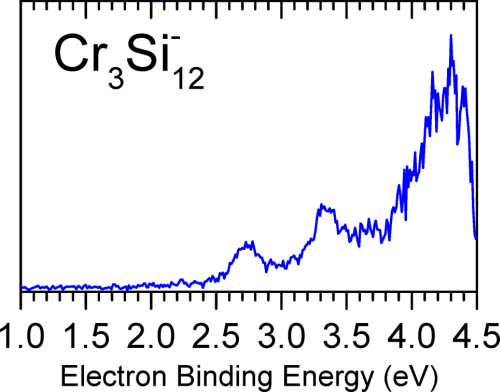

显然，我们模拟的谱图与实验谱图符合得非常好，表明我们的绘图过程和方法是完全合理的。

## **4.10.5 绘制cyclo\[18\]carbon的MO-PDOS图 (MO-PDOS map)以揭示由不同分子轨道 (molecular orbitals, MOs)贡献的投影态密度 (projected density of states, PDOS)**

> **注**
>
> 首次提出MO-PDOS图思想的已发表论文是我的工作：*Carbon*, **165** 461 (2020)，见Fig. 2。如果你的工作中使用了MO-PDOS图，请引用该论文。

本节说明如何绘制和分析MO-PDOS图。所谓“MO-PDOS”指一种特殊的投影态密度，用于揭示由不同组分子轨道贡献的态密度 (density of states, DOS)（而不是像通常意义上的投影态密度那样由原子或基函数贡献），对应于不同组分子轨道的投影态密度曲线和分立线用不同颜色显示。如果需要，分立线的高度可用于反映轨道能级的简并度。

我们将为cyclo\[18\]carbon绘制MO-PDOS图，其在ωB97XD/def2-TZVP水平下优化的结构如下所示，它是一个具有D$_{9h}$点群的完全平面体系。该体系在极小点结构处的ωB97XD/def2-TZVP波函数对应的.fchk文件可在此下载：<http://sobereva.com/multiwfn/extrafiles/C18.zip>。

![cyclo\[18\]carbon的结构](assets/figures/ch4/image1022.png)

该体系的占据价分子轨道由三种类型组成，你可以通过主功能 (main function) 0查看轨道来确定它们的序号：
- (1) σ 分子轨道 (σ MOs)：19-36

- (2) 面内 π 分子轨道 (in-plane π MOs)：37,39,40,45,46,49,50,53,54

- (3) 面外 π 分子轨道 (out-plane π MOs)：38,41,42,43,44,47,48,51,52

在要绘制的 MO 分态密度图 (MO-PDOS map)中，我们将使用不同颜色分别揭示这些轨道能级的位置及其对总态密度 (total DOS)的贡献。

启动 Multiwfn 并输入

```text
C18.fchk
10  // Plot DOS
-2  // Enter the interface for defining MO fragments of MO-PDOS
1  // Define 1st fragment
19-36  // σ MOs
2  // Define 2nd fragment
37,39,40,45,46,49,50,53,54  // in-plane π MOs
3  // Define 3rd fragment
38,41,42,43,44,47,48,51,52  // out-of-plane π MOs
0  // Return
0  // Plot DOS map
```

我们立即看到如下的图

![环\[18\]碳三个碎片的总态密度 (TDOS)和分态密度 (PDOS)](assets/figures/ch4/image1023.png)

在此图中，红色、蓝色和紫色分立线分别表示 σ 分子轨道、面内 π 分子轨道和面外 π 分子轨道的能级位置。σ 分子轨道的能量明显低于 π 分子轨道，而两种 π 分子轨道具有相似的能量分布。从展宽曲线可以识别三类分子轨道各自的贡献，彩色曲线的高度之和正好等于黑色曲线，黑色曲线描述的是总态密度。由于定义的碎片仅由占据分子轨道组成，该图的非占据区与常规总态密度图完全相同。

我们可以进一步改进 MO 分态密度图的设置。关闭图形后，我们输入

```text
0  // Return to last menu from the post-processing menu
8  // Switch the energy unit to eV
2  // Set energy range and step
-28,1,3  // Set lower and upper limits of plotting region to -28~1 eV with step of 3 eV, so that all occupied valence MOs and a few lowest-lying virtual MOs could be displayed in the map
9  // Enabling using height of discrete lines to indicate orbital degeneracy
[Press ENTER button directly]  // Use default threshold to determine degeneracy
0  // Plot DOS map
```

关闭该图，然后在后处理菜单 (post-processing menu)中我们输入

```text
16  // Set the texts in the legends
1  // Set legend for PDOS 1
sigma MOs
2  // Set legend for PDOS 2
in-plane pi MOs
3  // Set legend for PDOS 3
out-of-plane pi MOs
0  // Return to post-processing menu
6  // Disable showing TDOS discrete lines
1  // Redraw the graph
```

你应该能看到下图，该图相当令人满意

![环\[18\]碳σ、面内π和面外π分子轨道的总态密度和分态密度](assets/figures/ch4/image1024.png)

从彩色分立线的高度，你可以清楚地发现大多数占据价轨道都是双重简并的。

### **提示：保存和加载状态**

如果你想把上面图的当前状态 (status)（绘图设置、碎片定义和轨道信息）保存到文件中，以便下次快速恢复该图，现在你可以输入 *0* 退出后处理菜单，然后输入 *s*，然后输入要保存状态的文件路径。

上面图对应的状态文件 (status file)为 *examples\DOS\C18_MO_PDOS.dat*，因此如果你想直接重绘上面的图，在启动 Multiwfn 并加载 *C18.fchk* 后，你应该输入

```text
10  // DOS plotting module
l  // Load status file
examples\DOS\C18_MO_PDOS.dat
0  // Plot the map
```

## **4.10.6 计算过渡金属团簇的 *d* 带中心 (*d*-band center)**

> **注**
>
> 本节中文版及更多讨论见我的博客文章“使用 Multiwfn 计算过渡金属 *d* 带中心”（<http://sobereva.com/582>，中文）
*d*-带中心 (*d*-band center)是指与*d*-轨道 (*d*-orbitals)相对应的分态密度 (PDOS)的中心位置。过渡金属 (transition metals)的*d*-带中心是解释和预测小分子在过渡金属体系上化学吸附 (chemisorption)强度差异的重要量，它也与表面催化 (surface catalysis)的活性密切相关，更多信息见*PNAS*, **108**, 937 (2011)和*Sci. Rep.*, **6**, 35916 (2016)。

Multiwfn的态密度 (DOS)作图模块可用于计算*d*-带中心。由于Multiwfn在绘制DOS图时会自动计算并打印每条分态密度曲线的中心，通过将所关心的过渡金属的所有D型基函数 (basis functions)定义为一个碎片 (fragment)，即可直接获得*d*-带中心。在本节中，我将以Cu₁₃ (二重态 (doublet))为例说明计算。该体系的*d*-带中心也已在*J. Clust. Sci.*, **29**, 867 (2018)中报道。该体系在UPBE/Lanl2DZ水平下通过优化任务生成的Gaussian .fchk文件可在此处直接下载：<http://sobereva.com/multiwfn/extrafiles/Cu13.zip>。该计算水平与*J. Clust. Sci.*论文相同。

启动Multiwfn并输入

```text
Cu13.fchk
10  // Plot DOS map
-1  // Define fragment
1  // Define fragment 1
cond  // Define the fragment using conditions
[Press ENTER button]  // No requirement on atomic indices
[Press ENTER button]  // No requirement on basis function indices
D  // The basis functions must be D-type
q  // Save current fragment
q  // Return to DOS plotting interface
8  // Switch the energy unit from a.u. to eV
2  // Set range of X-axis
-13,0,2  // Lower limit, upper limit and spacing between ticks
0  // Plot DOS map
```

现在你可以看到如下的图。红色曲线对应于*d*-带的分态密度

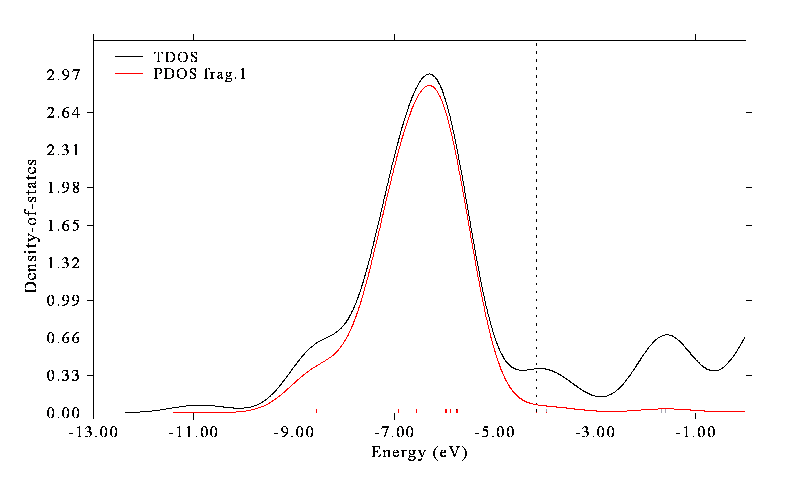

在命令行窗口中，你可以看到

```text
Center of TDOS:   -5.732445 eV
Center of PDOS  1:   -6.510656 eV

Note: The vertical dash line corresponds to HOMO level at  -4.16932 eV
```

通常*d*-带中心是相对于费米能级 (Fermi energy level) ( $E_{\mathrm{f}}$ )报道的。然而，对于分子和团簇 (clusters)等孤立体系， $E_{\mathrm{f}}$ 没有明确定义，但按惯例可将其视为HOMO能级 (HOMO level)。因此，Cu₁₃的*d*-带中心为-6.510656-(-4.16932) = -2.34 eV，与*J. Clust. Sci.*, **29**, 867 (2018)表3中报道的-2.33 eV非常吻合。

注意，对于像本例这样的非限制性开壳层波函数 (unrestricted open-shell wavefunction)，alpha自旋和beta自旋的*d*-带中心是不同的。默认只考虑alpha轨道，如果需要计算beta轨道的情况，应选择选项"6 Choose orbital spin"并选择beta。

X轴范围的选择值得关注。计算分态密度中心的公式可在[3.21.1](sec-3-21-electron-excitation-analysis.md#3211-分析并可视化空穴电子分布跃迁密度和跃迁电磁偶极矩密度-1)节中找到，可以看出只有当前能量范围 (X轴范围)内的分态密度片段被纳入考虑，即-13至0 eV之间的分态密度参与了*d*-带中心的计算。显然，能量范围的不同选择可能导致不同的*d*-带中心值。你必须保证当前能量范围完全包围*d*-带的实际分态密度区域。下限相对任意，因为在-13 eV以下分态密度恰好为零，降低下限不会影响中心位置。上限的选择更为关键，如无特殊情况，我建议像本例一样简单地将其设为零。上限不应设为过高的值，否则缺乏化学意义的分态密度将被包含进计算中。例如，如果你将下限和上限分别设为-20和60 eV，分态密度将为
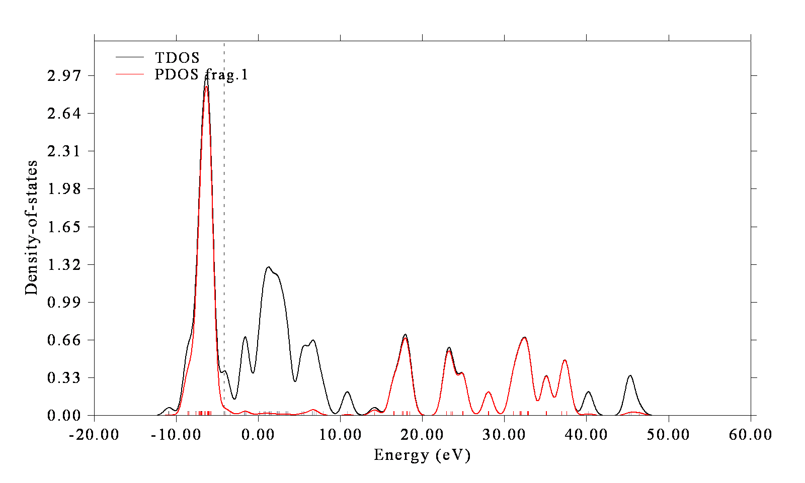

可以看到，对应于D型基函数的片段的分态密度在15\~40 eV之间也非常大，所报道的中心位置甚至是一个非物理的正值。该现象源于Lanl2DZ是一个扩展基组，Cu的每个*d*原子轨道由两个基函数表示。分态密度的高能部分本质上对应于与约-13\~0 eV范围内的价*d*轨道正交的分子轨道 (MOs)。

类似地，*p*带中心 (p-band center)也可以用类似的方式计算。

## **4.10.7 为C₆₀富勒烯 (fullerene)和N-phenylpyrrole绘制晶体轨道哈密顿布居 (COHP)**

如果您对晶体轨道哈密顿布居不熟悉，请先阅读[3.12.6](sec-3-12-plotting-density-of-states-pes-and-cohp.md#3126-cohp)节。在本节中，我们首先为C₆₀富勒烯绘制最近原子间的晶体轨道哈密顿布居，然后为N-phenylpyrrole的两个基团间绘制晶体轨道哈密顿布居。

### **例1：C₆₀富勒烯**

所用的在B3LYP/6-31G\*水平下产生的波函数文件*C60.fch*可在<http://sobereva.com/multiwfn/extrafiles/C60.zip>下载。

启动Multiwfn并输入

```text
C60.fch
10  // DOS, PES and COHP plotting function
-7  // Change to COHP plotting mode
1  // Generate Kohn-Sham matrix based on wavefunction information
2  // Set energy range for plotting COHP
-20,2,2  // Lower and upper limits as well as stepsize of X-axis
0  // Draw COHP between nearest atoms
```

现在将在屏幕上看到晶体轨道哈密顿布居图。关闭该图，在后处理菜单中分别用选项4和-4调整左、右Y轴，然后重绘，您将看到如下图所示，该图对应于Multiwfn原论文*J. Chem. Phys.*，**161**，082503 (2024)中的图S17。

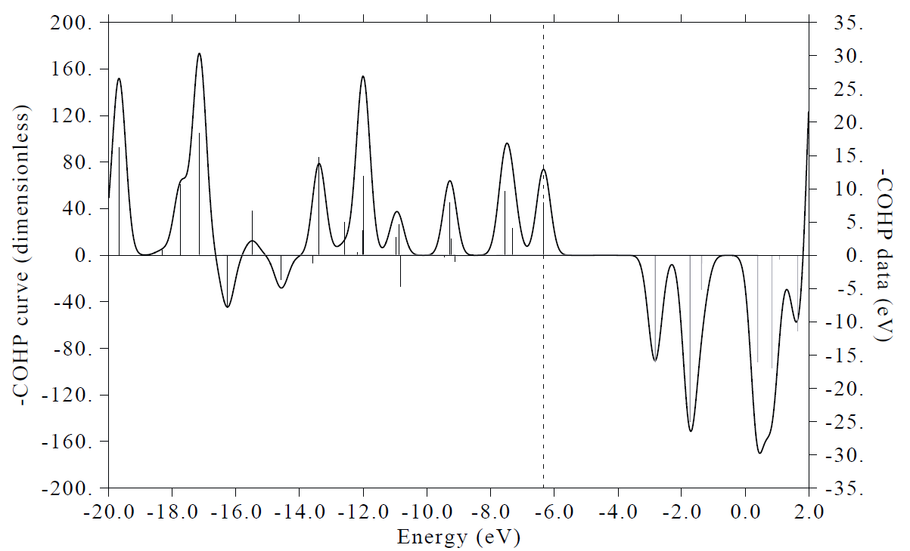

右Y轴对应于尖峰的高度，左轴对应于由尖峰展宽得到的曲线。注意，两个Y轴对应的是晶体轨道哈密顿布居的负值 (-COHP)，而不是晶体轨道哈密顿布居本身。在该图中，所有对曲线贡献为正的分子轨道即所谓成键态 (bonding states)，其占据使体系稳定。相反，所有对曲线贡献为负的分子轨道为反键态 (antibonding states)，其占据会降低总体成键效应，从而使C₆₀不稳定。图中的虚线标出了最高占据分子轨道 (HOMO)，可以看到大多数占据分子轨道属于成键态，C₆₀当然可以稳定存在。

### **例2：N-phenylpyrrole**

在[4.10.1](#4101-绘制-n-phenylpyrrole-的总态密度偏态密度和重叠态密度-total-partial-and-overlap-dos)节第4部分中，我们已绘制了重叠布居态密度 (OPDOS)以研究N-phenylpyrrole中吡咯与苯基基团之间的π相互作用。在本节中，采用完全相同的片段定义，我们绘制片段间的晶体轨道哈密顿布居图。

启动Multiwfn并输入

```text
examples\N-phenylpyrrole.fch
10  // DOS, PES and COHP plotting function
-7  // Change to COHP plotting mode
1  // Generate Kohn-Sham matrix based on wavefunction information
-1  // Define fragments for plotting COHP between fragments
1  // Define fragment 1
cond  // Use conditions to add basis functions to fragment 1
1-5  // The first condition is that the basis functions must belong to the heavy atoms in pyrrole moiety (atoms 1-5)
[Press ENTER button]  // The second condition. Index of basis function is arbitrary
X  // The third condition, the type of the basis functions must be PX (note that the current molecule is in YZ plane. So adding PX basis functions is equivalent to adding the p atomic orbitals directly contributing to the π-interaction)
q  // Save fragment 1
2  // Define fragment 2
cond  // Use conditions to add basis functions to the fragment 2
10-13,15,17  // Atom index of the carbons in the phenyl moiety
```

现在您可以看到如下图所示，它与在[4.10.1](#4101-绘制-n-phenylpyrrole-的总态密度偏态密度和重叠态密度-total-partial-and-overlap-dos)节第4部分中绘制的相应重叠布居态密度曲线非常相似。该例表明晶体轨道哈密顿布居通常传达与重叠布居态密度类似的信息。

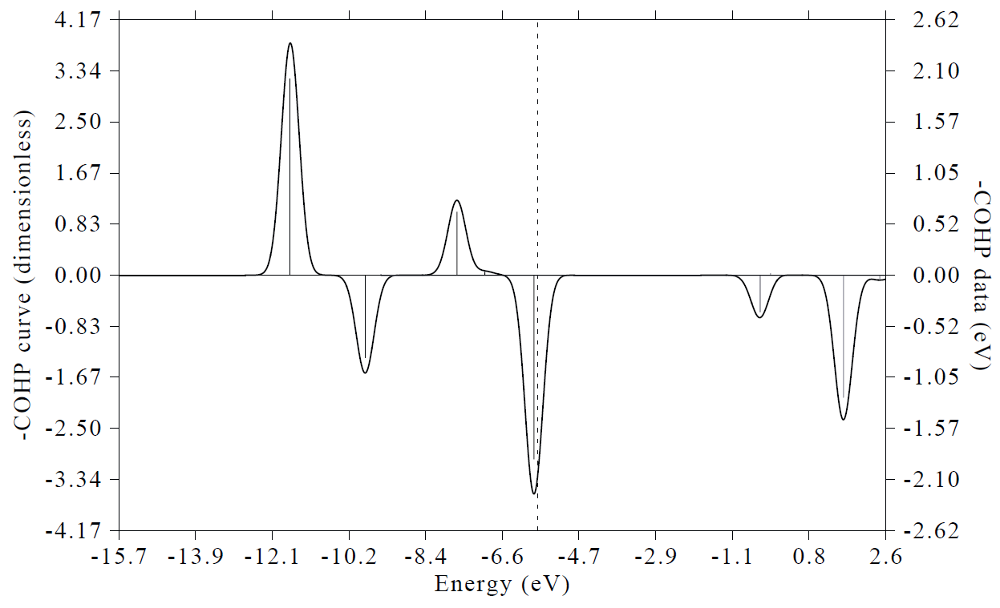