# **4.100 其他功能 (Other functions)（第1部分，Part 1）**

## **4.100.4 通过数值积分 (numerical integration)计算光气 (phosgene)的动能 (kinetic energy)和核吸引势能 (nuclear attraction potential energy)**

建议你先阅读第[3.100.4](sec-3-100-other-functions-part-1.md#31004-在全空间对函数积分integrate-a-function-over-the-whole-space)节，本例的目的是向你展示数值积分的用途和通用性。在量子化学 (quantum chemistry)程序中，动能和核吸引势能积分是解析计算的，解析方法在速度和精度上都有优势。在Multiwfn中，你可以通过通用的数值积分功能计算它们。局域动能（或称“动能密度 (kinetic energy density)”）是一个内置函数 (built-in function)，我们首先在全空间对该函数积分以得到总动能。启动Multiwfn并输入：

```text
examples\COCl2.wfn  // HF/6-31G* wavefunction
100  // Other functions (Part 1)
4  // Integrate a function over the whole space
6  // Hamiltonian kinetic density K(r)
```

结果为1031.1092，与Gaussian输出的值1031.1107非常接近。

由于我不想让实空间函数 (real space function)列表变得冗长，因此很少使用的函数，例如局域核吸引势能，未被选作内置函数，不过你仍可通过修改源代码 (source code)轻松使这些函数可用，请参阅[附录2 (Appendix 2)](sec-6-2-the-routines-for-evaluating-real-space-functions.md)。首先，在*function.f90*中搜索“function userfunc”，将默认内容，即"userfunc=1.0D0"，改为"userfunc = -nucesp(x,y,z)\*fdens(x,y,z)"，然后重新编译Multiwfn，按上述步骤重做，但选择功能100作为被积函数 (integrand)，你将得到核吸引势能-2839.1668，Gaussian输出的值为-2839.1629，显然它们非常接近。如果你想得到来自特定轨道 (orbital)的核吸引势能贡献，使用主功能6的子功能26将其它轨道的占据数 (occupation number)设为零，然后如前进行积分。

为了进一步说明Multiwfn中数值积分功能的灵活性，假设你要计算$r^2$算符 (operator)的期望值 (expectation)，你可以将“userfunc”例程 (routine)的内容修改为"userfunc = (x\*x+y\*y+z\*z)\*fdens(x,y,z)"，然后重新编译Multiwfn并重做积分，你将得到444.6523，这与主功能300的子功能5输出的解析计算的\< $r^2$ \> 444.652363非常一致（详见第[3.300.5](sec-3-300-other-functions-part-3.md#33005-计算电偶极多极矩和电子空间范围)节）。

> **提示 (Tip)**
>
> 你可能已经注意到，上面以蓝色显示的两行代码已出现在"userfunc"例程中，它们分别对应于iuserfunc==12和iuserfunc==3。因此，实际上你不需要修改和重新编译Multiwfn的源代码，只需将settings.ini中的"iuserfunc"参数分别从默认值0改为12和3，用户定义的实空间函数就将等价于这两个函数。关于"userfunc"例程中内置实空间函数的更多内容，见第[2.7](sec-2-7-user-defined-real-space-function.md)节。

## **4.100.8 使用组合的碎片波函数 (fragment wavefunction)进行简单的能量分解 (energy decomposition)**

> **注记 (Note)**
>
> 现在强烈不建议按以下方式进行能量分解！使用sobEDA或sobEDAw能量分解分析 (energy decomposition analysis)（基于Multiwfn和Gaussian）是好得多的选择，不仅可以得到完整的项，而且使用起来容易得多。见*J. Phys. Chem. A*, **127**, 7023 (2023)和非常详细的教程：<http://sobereva.com/soft/sobEDA_tutorial.zip>。
简单能量分解 (simple energy decomposition)的原理已在[3.100.8节](sec-3-100-other-functions-part-1.md#31008-生成以碎片波函数组合为初猜的gaussian输入文件generate-gaussian-input-file-with-initial-guess-combined-from-fragment-wavefunctions)中介绍，请先阅读该节。在此我们尝试使用该方法在B3LYP/6-31G\*水平下分析加合物 (adduct)NH₃BH₃中NH₃与BH₃之间相互作用能 (interaction energy)的组成。本节涉及的Gaussian输入和输出文件可在"examples\EDA\EDA_simple"文件夹中找到。此处使用的Gaussian版本为Gaussian 16 B.01。

- (1) 对NH₃BH₃执行结构优化 (structure optimization)任务，然后用优化后的坐标创建名为*NH3BH3.gjf*的新输入文件。

- (2) 将*NH3BH3.gjf*复制为*NH3.gjf*和*BH3.gjf*，然后删除*NH3.gjf*中的BH₃碎片 (fragment)，删除*BH3.gjf*中的NH₃碎片。在*NH3.gjf*和*BH3.gjf*中均添加*pop=full nosymm*关键词。

- (3) 分别用Gaussian运行两个碎片的输入文件，以生成*NH3.out*和*BH3.out*。

- (4) 启动Multiwfn，输入以下命令

  ```text
  NH3.out  // Fragment 1
  100  // Other functions (Part 1)
  8  // Generate Gaussian input file with initial     guess combined from fragment wavefunctions
  2  // There are two fragments in total
  BH3.out  //Fragment 2
  ```

  Multiwfn在当前文件夹中生成*new.gjf*，这是以碎片组合波函数 (wavefunction)作为初猜 (initial guess)的NH₃BH₃的Gaussian输入文件。

- (5) 确保*new.gjf*中含有*nosymm*关键词。为了在每次迭代 (iteration)中输出SCF能量，将"#"改为"#P"。*pop=full*关键词可删除。

- (6) 用Gaussian运行*new.gjf*以生成*new.out*。

由*NH3.out*和*BH3.out*，可找到它们的单点能 (single point energy)：

```text
E(NH_3) = -56.5477099 a.u.
E(BH_3) = -26.5929634 a.u.
```

加合物的单点能可在*new.out*中找到：

*E*(NH₃BH₃) = -83.2132069 a.u.

由于它是SCF过程最后一次迭代打印的能量，我们也将其称为$E_{\mathrm{SCF,last}}$。

由*examples\EDA\EDA_simple\new.out*的第639行，还可找到SCF过程第一次迭代打印的能量：

$E_{\mathrm{SCF,1st}}$ = -83.12546124 a.u.

根据[3.100.8节](sec-3-100-other-functions-part-1.md#31008-生成以碎片波函数组合为初猜的gaussian输入文件generate-gaussian-input-file-with-initial-guess-combined-from-fragment-wavefunctions)给出的公式，可计算能量项如下

$\Delta E_{\mathrm{tot}}$ = *E*(NH₃BH₃) - *E*(NH₃) - *E*(BH₃)= -0.0725336 a.u.= -190.44 kJ/mol

$\Delta E_{\mathrm{orb}} = E_{\mathrm{SCF,last}} - E_{\mathrm{SCF,1st}}$ = -0.0877456 a.u.= -230.37 kJ/mol

$\Delta E_{\mathrm{steric}} = \Delta E_{\mathrm{tot}} - \Delta E_{\mathrm{orb}}$ = 0.017218 a.u.= 39.93 kJ/mol

即NH₃与BH₃之间的总相互作用能为-190.44 kJ/mol，-230.37 kJ/mol的轨道相互作用能 (orbital interaction energy)显著稳定了加合物；而位阻项 (steric term)（静电相互作用能 (electrostatic interaction energy)、Pauli排斥能 (Pauli repulsion energy)与交换-相关能 (exchange-correlation energy)变化之和）使加合物不稳定了39.93 kJ/mol。

在本体系中，与其它能量组分相比，色散相互作用 (dispersion interaction)可安全地忽略，因此未对其单独讨论。然而，若所研究的体系是由弱相互作用 (weak interaction)结合的配合物 (complex)，由于其重要性，必须对总相互作用能中的色散组分单独研究，关于如何评估它，见[3.100.8节](sec-3-100-other-functions-part-1.md#31008-生成以碎片波函数组合为初猜的gaussian输入文件generate-gaussian-input-file-with-initial-guess-combined-from-fragment-wavefunctions)中的描述。
## **4.100.12 非限制性开壳层波函数 (unrestricted open-shell wavefunction)轨道的双正交化 (biorthogonalization)分析**

> **注**
>
> 本例的中文版及相关介绍见我的博客文章 "Principle and application of biorthogonalization method for unrestricted open-shell wavefunctions" (<http://sobereva.com/448>)。

alpha和beta轨道之间的双正交化算法已在[3.100.12](sec-3-100-other-functions-part-1.md#310012-alpha与beta轨道之间的双正交化biorthogonalization-between-alpha-and-beta-orbitals)节介绍，请先阅读它，此变换使UHF或UKS计算产生的轨道的解释变得容易得多，因为之后只需检查一套轨道。本节将说明此分析的价值，以*examples\ethanol_triplet.fch*为例。

该体系有14个占据 (occupied)的alpha轨道和12个占据的beta轨道，首先让我们看其中的一些：

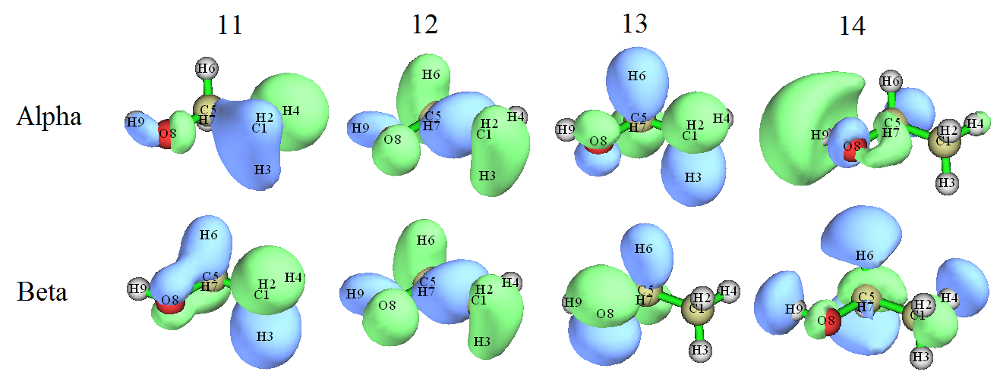

可以看到，仅alpha轨道12与beta轨道12能很好地配对，而其它具有相同编号的alpha和beta轨道彼此并不相似。显然，在讨论该波函数的轨道特征 (orbital characteristic)时很麻烦，因为必须同时检查两套轨道。

现在对该波函数进行双正交化。启动Multiwfn并输入

```text
examples\ethanol_triplet.fch
100  // Other functions (Part 1)
12  // Perform biorthogonalization between alpha and beta orbitals
2  // Do biorthogonalization for all orbitals
0  // Do not evaluate energies of biorthogonalized orbitals
```

对该波函数的双正交化由三个连续步骤组成。例如，第一步输出的信息为

```text
 Doing biorthogonalization for alpha    1 to   14, Beta    1 to   12
 Singular values of orbital overlap matrix:
   1.0000   1.0000   1.0000   1.0000   1.0000   1.0000   1.0000   0.9999
   0.9999   0.9998   0.9995   0.9992
```

如所示，此步骤在alpha轨道1\~14与beta轨道1\~12之间进行双正交化。所得具有相同编号的alpha和beta轨道之间的重叠积分 (overlap integral)均非常接近1.0，表明前12个alpha轨道已与前12个beta轨道近乎完美配对。

当全部三个步骤完成后，将在当前文件夹中生成*biortho.txt*和*biortho.fch*。*biortho.txt*的内容如下所示：

```text
S = Singular value, E = Energy (in eV), O= Occupancy, A=Alpha, B=Beta

 Orb:     1   S= 1.0000   O(A)= 1.0   O(B)= 1.0
...[ignored]
 Orb:    11   S= 0.9995   O(A)= 1.0   O(B)= 1.0
 Orb:    12   S= 0.9992   O(A)= 1.0   O(B)= 1.0
 -----------------------------------------------
 Orb:    13   S= 1.0000   O(A)= 1.0   O(B)= 0.0
 Orb:    14   S= 1.0000   O(A)= 1.0   O(B)= 0.0
 -----------------------------------------------
 Orb:    15   S= 1.0000   O(A)= 0.0   O(B)= 0.0
 Orb:    16   S= 1.0000   O(A)= 0.0   O(B)= 0.0
...[ignored]
```

这些信息很容易理解。由于上面所示的所有轨道的奇异值 (singular value)(*S*)都非常接近1.0，因此alpha轨道与具有相同编号的beta轨道匹配良好。

导出的*biortho.fch*包含双正交化轨道的波函数，这些轨道的“轨道能量 (orbital energy)”信息现在对应于奇异值。接下来，若输入*y*，该文件将被立即加载，此时内存中的轨道即对应于双正交化轨道。这里输入*y*以加载*biortho.fch*，然后进入主功能0以直观查看新生成的11\~14 alpha和11\~14 beta轨道，你将看到
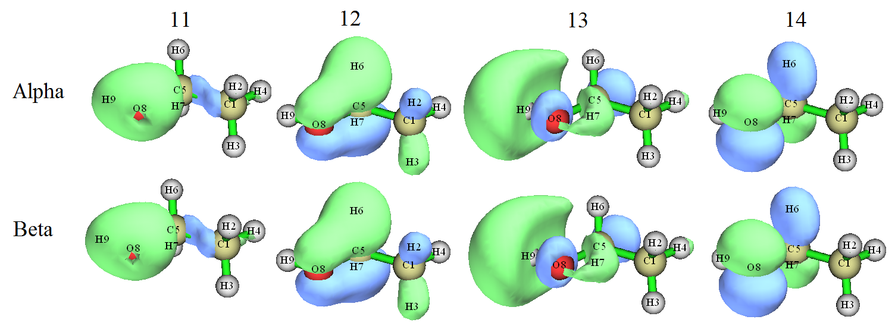

从等值面图 (isosurface map)可以看出，当前的α轨道和β轨道 (alpha and beta orbitals)彼此完美匹配。“单占据分子轨道 (singly occupied molecular orbitals, SOMO)”的概念最初是为限制性开壳层波函数 (restricted open-shell wavefunction)定义的，但现在也可以很好地应用于当前波函数，轨道13和14现在可被视为SOMO。众所周知，非限制性开壳层波函数 (unrestricted open-shell wavefunction)的自旋密度 (spin density)由所有占据分子轨道 (occupied MOs)决定，但在双正交化 (biorthogonalization)之后，自旋密度将仅由SOMO贡献。显然，当前体系的自旋密度直接对应于轨道13和14的密度之和。

在B3LYP/6-31G\*\*水平下计算的单重态乙醇 (singlet ethanol)的最高占据分子轨道 (HOMO)和最低未占据分子轨道 (LUMO)如下所示。通过比较该图和上一张图，可以发现最高占据分子轨道和最低未占据分子轨道分别与双正交化后的α轨道14和13非常相似。因此可以立即理解，乙醇在单重态和三重态之间的跃迁可以很好地表示为最高占据分子轨道→最低未占据分子轨道跃迁，因为在这种轨道跃迁之后，最高占据分子轨道和最低未占据分子轨道都将被一个电子占据，这种电子结构恰好对应于双正交化轨道所表示的电子结构。显然，如果没有双正交化分析，就无法获得这种有价值的信息，这体现了双正交化在开壳层体系实际研究中的重要性。

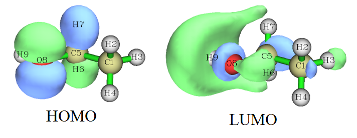

值得强调的是，双正交化不改变体系的任何可观测量性质，如总电子能量、总密度、自旋密度等。由于在上述过程中我们没有要求Multiwfn评估双正交化轨道的能量，因此在双正交化之后轨道能量是无意义的，它们仍然是原始分子轨道的能量，并且双正交化轨道的顺序并不反映其实际能量的顺序。

双正交化也可以应用于自旋极化单重态体系，如双自由基，我的博客文章“非限制性开壳层波函数双正交化方法的原理与应用 (Principle and application of biorthogonalization method for unrestricted open-shell wavefunctions)”（中文，<http://sobereva.com/448>）中给出了一个例子。

### **评估双正交化轨道的能量并对轨道排序**

接下来，我将说明如何让Multiwfn同时评估双正交化轨道的能量，并根据能量对它们排序，仍以三重态乙醇为例。启动Multiwfn并输入

```text
examples\ethanol_triplet.fch
100  // Other functions (Part 1)
12  // Biorthogonalization between alpha and beta orbitals
2  // Perform biorthogonalization for all orbitals
1  // Evaluate energies of the biorthogonalized orbitals using the Fock matrix generated by MO energies and coefficients via F=SCEC^-1 relationship
y  // Ordering the biorthogonalized orbitals according to their energies
```

现在你可以在当前文件夹中找到导出的*biortho.fch*和*biortho.txt*。后者的内容为：

```text
...[ignored]
 Orb:    11   S= 0.9992  E(A)=    -13.057  O(A)= 1.0  E(B)=    -11.821  O(B)= 1.0
 Orb:    12   S= 1.0000  E(A)=    -11.918  O(A)= 1.0  E(B)=    -11.866  O(B)= 1.0
 -------------------------------------------------------------------------------
 Orb:    13   S= 1.0000  E(A)=    -11.439  O(A)= 1.0  E(B)=     -5.806  O(B)= 0.0
 Orb:    14   S= 1.0000  E(A)=     -0.293  O(A)= 1.0  E(B)=      2.817  O(B)= 0.0
 -------------------------------------------------------------------------------
 Orb:    15   S= 0.9992  E(A)=     13.876  O(A)= 0.0  E(B)=     15.431  O(B)= 0.0
 Orb:    16   S= 1.0000  E(A)=     15.057  O(A)= 0.0  E(B)=     15.305  O(B)= 0.0
...[ignored]
```
由于在本例中我们已计算了轨道能量 (orbital energies)，因此能量也明确显示在 *biortho.txt* 中。可以看出，基本配对的 alpha 和 beta 双正交化轨道 (biorthogonalized orbitals)具有可察觉的不同能量，例如 *E*(alpha 11)= -13.057eV，而 *E*(beta 11)= -11.821 eV，这是因为 alpha 和 beta 轨道感受到不同的有效势 (*i.e.* alpha 和 beta Fock 算符不同)。此外，可以发现轨道编号的顺序与轨道能量的顺序一致，因为我们已要求 Multiwfn 根据能量对轨道排序（更具体地，根据具有相同编号的 alpha 和 beta 轨道的平均能量）。注意，*biortho.fch* 中的轨道能量信息现在也对应于双正交化轨道的实际能量。

然后，你可以输入 *y* 以载入刚生成的 *biortho.fch*，以便随后可直接使用主功能 0 来可视化双正交化轨道。具有最高编号的两个占据 alpha 双正交化轨道，即在本体系中形式上被两个未成对电子占据的两个轨道，如下所示。

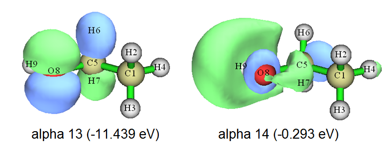

它们的形状与 alpha MO 13 (-10.083 eV) 和 alpha MO 14 (-0.276 eV) 非常接近，同时能量也相差不大。

注意，正如[3.100.12](sec-3-100-other-functions-part-1.md#310012-alpha与beta轨道之间的双正交化biorthogonalization-between-alpha-and-beta-orbitals)节中提到的，每一批中的轨道是单独排序的，因此不同批次中轨道的相对顺序不会因排序而改变。此外，排序基于每个 alpha 轨道及其 beta 对应轨道的平均能量，因此在排序过程中保留了 alpha-beta 轨道对应关系。

> **注**
>
> 顺便提及，也可以基于从外部文件载入的 Fock 矩阵计算双正交化轨道的能量（详见[附录 7](sec-6-7-about-providing-fock-ks-matrix-to-multiwfn.md)），如果不能基于 MO 能量和系数成功生成 Fock 矩阵，这是唯一的选择。例如，Fock 矩阵可从 .47 文件载入。用 Gaussian 运行 *examples\ethanol_triplet_47.gjf*，然后你将在 C: 文件夹中得到 *ETHANOL_TRIPLET.47*（该文件已作为 *examples\ETHANOL_TRIPLET.47* 提供）。如果当 Multiwfn 询问是否计算双正交化轨道能量时你选择选项 “2 Evaluate, loading Fock matrix from a file”，然后输入 .47 文件的路径，则 .47 文件中记录的 Fock 矩阵将被用于计算双正交化轨道能量。

## **4.100.14 计算 LOLIPOP 指数**

在本节中，我说明如何计算 LOLIPOP (Localized Orbital Locator Integrated Pi Over Plane) 指数 (index)。该指数已被证明可用于预测芳香环的 π 堆积强度。简要介绍见[3.100.14](sec-3-100-other-functions-part-1.md#310014-计算lolipopcalculate-lolipop-lol-integrated-pi-over-plane)节，更多信息见 *Chem. Commun.*, **48**, 9239 (2012)。

### **4.100.14.1 平面体系示例：菲 (phenanthrene)**

在本节中，我以完全平面的体系菲为例，我们将考察哪个环具有相对更强的 π 堆积能力。原子编号如下所示


启动 Multiwfn 并输入以下命令

```text
examples/phenanthrene.wfn
100  // Other functions (Part 1)
14  // Calculate LOLIPOP
1  // Choose π orbitals that to be taken into account
36,40,43,44,45,46,47  // Indices of π orbitals. You can manually find out π orbitals by visualizing orbital isosurfaces via main function 0, or let Multiwfn automatically identify π orbitals by subfunction 22 of main function 100
0  // Start the calculation
8,9,11,13,14,15  // The indices of the atoms in the ring that you are interested in. This ring is boundary ring. Note that you should input the indices according to atomic connectivity
```

等待一段时间，从屏幕上可以看到 LOLIPOP 值为 8.23。然后输入

```text
0  // Start the calculation again
7,3,4,8,9,10  // Atoms in the central ring
```

LOLIPOP 值为 6.39。

由于更小的 LOLIPOP 值对应更强的 π 堆积 (π-stacking) 能力，我们可以预期在中央环上方形成 π 堆积的趋势强于在边缘环上方。

注意，在 LOLIPOP 界面中存在选项 6。如果选择一次将其状态切换为 "Yes"，那么在 LOLIPOP 计算完成后，满足过滤条件的点 (*即* LOL-π 被包含在 LOLIPOP 积分中的位置) 的坐标将被导出到当前文件夹中的 *pt.xyz*。然后你可以将该文件载入 VMD 程序，将绘制方法设置为 "Points" 以可视化它们的分布。例如，下图显示了中央环的 LOLIPOP 计算中实际考虑的点，分子结构文件也被载入 VMD 并以 CPK 风格绘制。可以看到，所考虑的点的分布是完全合理的，因此 LOLIPOP 结果应该是有意义的。

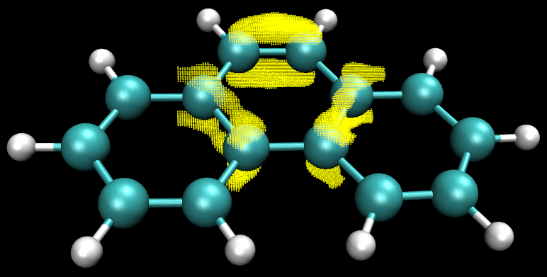

### **4.100.14.2 非平面体系示例：联苯 (biphenyl)**

在本例中，我使用联苯来说明如何计算非平面体系的 LOLIPOP。其结构和原子编号如下所示

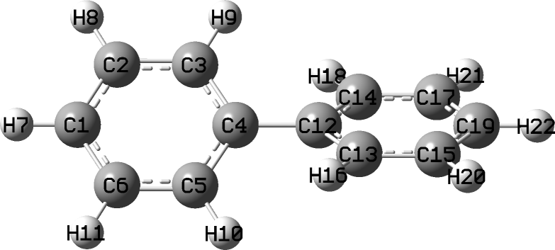

为了使 LOLIPOP 中涉及的 LOL-π 的计算可行，通常我们需要进行轨道定域化 (orbital localization) 以产生定域分子轨道 (localized molecular orbitals, LMOs)，然后使用 Multiwfn 自动识别 π 类型的 LMO 的编号，详见 [4.100.22](#410022-分析非平面体系-non-planar-system的π电子-π-electron特征环庚三烯-cycloheptatriene) 节中的相关示例。注意，为了进行轨道定域化，你必须使用包含基函数信息的文件作为输入文件，例如 .fch、.mwfn、.molden 等，更多信息参见 [2.5](sec-2-5-input-files-and-wavefunction-types.md) 节。

启动 Multiwfn 并输入

```text
examples\biphenyl.fch
19  // Orbital localization
1  // Only localize occupied MOs
100  // Other function (Part 1)
22  // Automatically detect π orbitals
-1  // Current orbitals are in localized form
0  // Start π orbital identification based on default settings
```

现在我们可以看到有 6 个已识别的 π 轨道 (π orbitals)（更具体地说，它们是 π LMO）：

```text
Expected pi orbitals, occupation numbers and orbital energies (eV):
    32      2.000000    -10.110351
    34      2.000000     -9.633443
    38      2.000000     -7.386451
    39      2.000000     -6.768520
    40      2.000000     -6.755193
    41      2.000000     -6.046329
```
然后我们输入

```text
0  // Do not modify orbital occupation numbers
14  // LOLIPOP calculation
1  // Choose π orbitals
32,34,38,39,40,41  // The indices of the π orbitals
0  // Start calculation
1,2,3,4,5,6  // Indices of the atoms in a ring
```

结果为 8.82，略高于菲 (phenanthrene) 的边缘环（见上一节），表明联苯 (biphenyl) 中的环具有显著的形成 π-π堆积 (π-π stacking) 的能力。

#### **只考虑环的一侧**

顺便一提，每个环有两个侧面，如果当前体系相对于环平面不对称，则两侧的 LOL-π分布可能明显不同。为了分别研究两侧的 π堆积能力，在开始计算之前，你可以选择选项 "5 Choose side of the points to be taken into account" 来设置在 LOLIPOP计算期间将考虑哪一侧。默认情况下两侧均被考虑。

以当前分子为例，如果我们选择选项 5 然后输入 *1* 以选择 "Side 1"，并选择选项 6 以允许 Multiwfn 导出 *pt.xyz*，以便我们可以直观地可视化在 LOLIPOP积分中实际考虑的点，那么在 LOLIPOP计算之后，你会发现 LOLIPOP为 4.41，这恰好是我们之前得到的值 (8.82) 的一半，因为 LOL-π分布相对于所选环是对称的。所得 *pt.xyz* 中记录的点如下图所示，正如你所见，它们确实只分布在环的一侧。

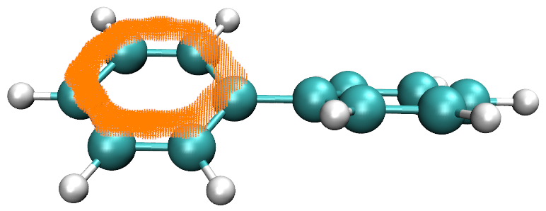

如果你想计算另一侧的 LOLIPOP，你应在选项 5 中选择 "Side 2"。

## **4.100.15 计算 DB-TTF 的分子间轨道重叠积分 (intermolecular orbital overlap integral)**

> **注**
>
> 本节的中文版是我的博客文章“分子间轨道重叠的显示与计算”(<http://sobereva.com/163>)，其中还包含更丰富的讨论。

分子间轨道重叠积分在分子间电荷转移 (intermolecular charge transfer) 的讨论中很重要，介绍见 [3.100.15](sec-3-100-other-functions-part-1.md#310015-计算分子间轨道重叠calculate-intermolecular-orbital-overlap) 节。在本例中，我们计算以下二聚体 (dimer) 中两个 DB-TTF (dibenzotetrathiafulvalene) 单体 (monomer) 之间的 HOMO-HOMO 和 LUMO-LUMO 重叠积分。二聚体结构取自 CSD (Cambridge Structural Database)。我们使用的波函数 (wavefunction) 水平为 B3LYP/6-31G\*，MO78 和 MO79 分别对应于 HOMO 和 LUMO。

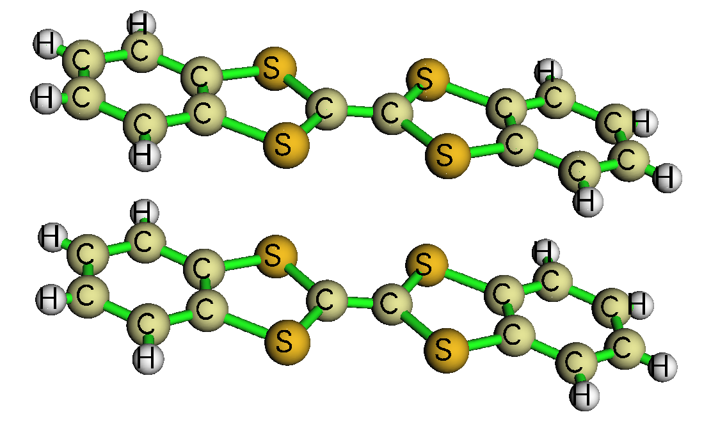

如 [3.100.15](sec-3-100-other-functions-part-1.md#310015-计算分子间轨道重叠calculate-intermolecular-orbital-overlap) 节所述，我们必须为二聚体和两个单体准备包含基函数 (basis function) 信息的波函数文件。例如，你可以使用 Gaussian 生成相应的 .fchk 文件，用于此目的的 Gaussian 输入文件已在 "examples\intermol\\" 文件夹中提供；如果你不想自己用 Gaussian 运行它们，你可以直接从 <http://sobereva.com/multiwfn/extrafiles/intermol.rar> 下载所得的 .fchk 文件。

值得对这三个 .gjf 文件进行说明。两个单体输入文件 *DB-TTF1.gjf* 和 *DB-TTF2.gjf* 中的坐标直接取自二聚体输入文件 *DB-TTFdimer.gjf*，单体 1 的原子在此文件中出现在单体 2 的原子之前。关键词 *nosymm* 在所有这三个文件中使用，它要求 Gaussian 不要自动将输入文件中的坐标置于标准取向，从而使单体 .fchk 文件中的坐标与二聚体 .fchk 文件中的坐标完全相同。因为二聚体 .fchk 文件仅被 Multiwfn 用于生成基函数之间的重叠矩阵 (overlap matrix)，而从不使用二聚体的 MO，因此在二聚体输入文件中使用 *guess(save,only)* 以让 Gaussian 仅生成并保存初始猜测轨道，这不需要任何花费。*pop=none* 一起使用，它抑制了输出文件中无用的大量轨道展开系数的输出。
现在，启动 Multiwfn 并输入以下命令：

```text
DB-TTFdimer.fchk  // Wavefunction file of dimer
100  // Other functions (Part 1)
15  // Function for calculating intermolecular orbital overlap integral
DB-TTF1.fchk  // Wavefunction file of monomer 1
DB-TTF2.fchk  // Wavefunction file of monomer 2
```

之后，如果输入 *i,j*，则将打印单体 (monomer) 1 中的 MO *i* 与单体 2 中的 MO *j* 之间的分子间轨道重叠积分 (intermolecular orbital overlap integral)。为了获得 HOMO-HOMO 之间的积分，我们输入 *78,78*，结果为 -0.01411983；然后输入 *79,79*，我们会发现 LUMO-LUMO 之间的积分为 0.01025897。

## **4.100.18 菲 (phenanthrene) 的 Yoshizawa 电子传输路径分析 (Yoshizawa's electron transmission route analysis)**

在本例中，我们将使用 Yoshizawa 公式 (*Acc. Chem. Res.*, **45**, 1612 (2012)) 来分析菲的有利电子传输路径。相关理论、输入文件要求和程序选项已在[3.100.18](sec-3-100-other-functions-part-1.md#310018-yoshizawa电子输运路径分析yoshizawas-electron-transport-route-analysis)节中介绍。碳的编号方案如下所示。


启动 Multiwfn 并输入以下命令：

```text
examples\phenanthrene_NAOMO.out  //The Gaussian output file containing "NAOMO" matrix
100  // Other functions (Part 1)
18  // Yoshizawa's electron transport route analysis
2  // Select YZ plane, which is the molecular plane
```

然后程序将检测哪个原子具有预期的 $p_{\mathrm{z}}$ 原子轨道，并加载它们在所有 MO 中的展开系数。

现在我们选择 1，并输入 *2,11* 以查看 2 与 11 之间的传输概率。从输出可知传输概率为 0.855879。还显示了每个 MO 的贡献。从输出我们还知道，如果仅考虑 HOMO 和 LUMO，概率将为 2.144432。尽管 Yoshizawa 的论文称通常只需考虑 HOMO 和 LUMO，但该近似在定量水平上似乎并不成立。距离路径 5.674656 Å 是原子 2 与 11 之间的距离。

接下来，我们考察哪些传输路径是最有利的。假设这次我们只想考虑 HOMO 和 LUMO，因此我们选择选项 -1 并输入 *47,48*。然后选择选项 2，你将看到

```text
Note: The routes whose absolute value <  0.010000 will not be shown
Note: The routes whose distance <    0.0000 or > 9999.0000 Angstrom will not be shown
Atom    7 -- Atom   10  Value and distance:    3.743670    1.359562
Atom    6 -- Atom   10  Value and distance:    3.098919    5.081382
Atom    7 -- Atom   14  Value and distance:    3.098919    5.081382
Atom    7 -- Atom   11  Value and distance:   -2.831680    3.720990
Atom    2 -- Atom   10  Value and distance:   -2.831680    3.720990
Atom    6 -- Atom   14  Value and distance:    2.565337    5.765892
...
Atom    6 -- Atom    9  Value and distance:   -0.016585    4.927289
Atom    3 -- Atom   14  Value and distance:   -0.016585    4.927289
Atom    2 -- Atom    4  Value and distance:   -0.014931    2.456189
Atom    8 -- Atom   11  Value and distance:   -0.014931    2.456189
```

这些路径按传输概率（绝对值）排序。如果忽略连接三个碳的原子以及由于对称性而重复的路径，最有利的四条路径为 7-10、6-10、7-11、6-14。这一结论与 Yoshizawa 论文中的下图完全一致！
注意，Yoshizawa指出，根据该规则预计连接9-10（对应于我们编号体系中的7-10）是最佳路径，但由于距离过近，无法构建用于该连接的金属-分子-金属结，因此该路径未在其图上标出。

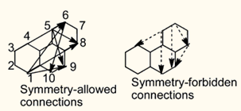

现在我们检查从原子2出发的可行路径。选择选项3，并输入2，你将看到

```text
To atom    10    Value and distance (Angstrom):   -2.831680    3.720990
To atom    14    Value and distance (Angstrom):   -2.344569    6.206600
To atom    11    Value and distance (Angstrom):    2.144432    5.674656
To atom     5    Value and distance (Angstrom):   -1.571512    2.787501
...
```

显然，2-10是最有利的路径。

## **4.100.19 对由片段波函数组合而成的整体波函数的ELF分析**

在阅读本节之前，请先阅读[3.100.19](sec-3-100-other-functions-part-1.md#310019-通过组合碎片波函数生成新波函数generate-new-wavefunction-by-combining-fragment-wavefunctions)节以获得基础知识。

分析前分子波函数 (promolecular wavefunction)的特征通常是很有意义的，它对应于组成体系的片段之间不存在任何电子转移和极化相互作用的状态。通常，我们可以使用主功能3、4和5中的“自定义操作 (custom operation)”来实现这一目的，关于自定义操作的介绍参见[3.7](sec-3-7-custom-operation-promolecular-and-deformation-properties.md)节，一些说明性应用参见[4.5.4](sec-4-5-generate-grid-data-and-view-isosurface-map.md#454-用福井函数和对偶描述符研究苯酚亲电进攻的有利位点)和[4.5.5](sec-4-5-generate-grid-data-and-view-isosurface-map.md#455-绘制电子密度差值图以研究咪唑配位镁卟啉的电子转移)节。例如，我们想要研究复合物*AB*的前分子状态的电子密度 (electron density)分布，通过使用自定义操作，我们可以非常方便地让Multiwfn分别计算*A*和*B*的电子密度，然后将它们加和作为前分子状态的电子密度。然而，这一过程不适用于诸如ELF之类的非线性实空间函数 (non-linear real space functions)；也就是说，*AB*前分子状态的ELF不等于*A*的ELF与*B*的ELF之和，结果是完全没有意义的。对于这种情况，我们应首先将片段波函数合并为前分子波函数，然后对其计算ELF，以获得前分子状态下的ELF分布。

下面我将展示如何使用Multiwfn基于CO和BH₃的片段波函数生成COBH₃的前分子波函数，然后讨论相应的ELF特征。下面使用的.wfn文件以及相应的Gaussian .gjf文件可以在"examples\genpromol"文件夹中找到。

启动Multiwfn，然后输入

```text
examples\genpromol\COBH3\CO.wfn  // The path of wavefunction file of fragment 1
100  // Other functions (Part 1)
19  // Generate promolecular .wfn file from fragment wavefunctions
1  // Output to combine.wfn
2  // Two fragments in total
examples\genpromol\COBH3\BH3.wfn  // The path of wavefunction file of fragment 2
```

现在COBH₃的前分子波函数文件已输出到当前文件夹中的*combine.wfn*。

让我们为该前分子波函数绘制ELF。重新启动Multiwfn并输入
```text
combine.wfn
4  // Draw plane map
9  // ELF
1  // Color-filled map
[Press ENTER button]
2  // XZ plane
0  // Y=0
```

有趣的是，即使在前分子态 (promolecular state)下，从所得图形来看，碳和硼似乎已彼此成键。为了阐明电子分布 (electron distribution)的弛豫 (relaxation)如何影响 COBH₃ 的电子定域函数 (ELF)特征，我们决定绘制实际态与前分子态之间电子定域函数的差值图 (difference map)。

重启 Multiwfn 并输入

```text
examples\genpromol\COBH3\COBH3.wfn  // Wavefunction file of actual state of COBH_3
4  // Draw plane map
0  // Custom operation
1  // Deal with only one file
-,combine.wfn  // Subtracting property of COBH3.wfn by that of combine.wfn
9  // ELF
1  // Color-filled map
[Press ENTER button]  // Use default grid setting
2  // XZ plane
0  // Y=0
```

关闭图形然后输入

```text
1  // Set lower and upper limit of color scale
-0.2,0.4  // Set the color scale from -0.2 to 0.4, since as you can see from the command-line window, in this plane the data range is from -0.248 to 0.436
2  // Enable showing contour lines
4  // Enable showing atom labels
1  // Red
-1  // Show the graph again
```

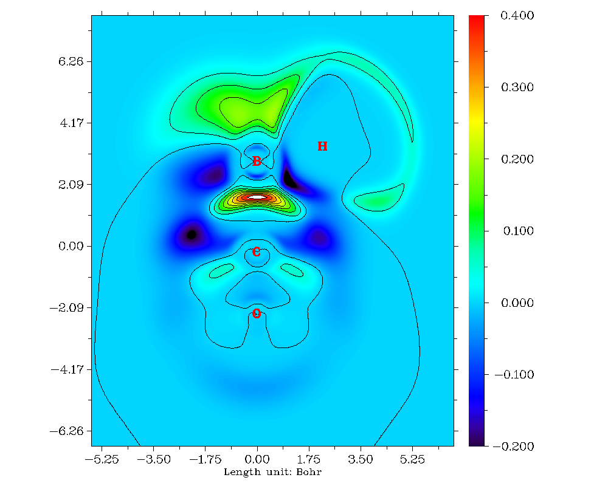

从这张电子定域函数的差值图可以非常清楚地看出，在电子弛豫后，C-B 键之间的电子定域性 (electron localization)特征明显增强。

接下来，我将展示当涉及开壳层碎片 (open-shell fragment)时如何创建前分子波函数 (promolecular wavefunction)。以 CH₃NH₂ 为例，两个碎片为 CH₃ 和 NH₂ 自由基 (free-radical)。启动 Multiwfn 并输入

```text
examples\genpromol\CH3NH2\CH3.wfn
100  // Other functions (Part 1)
19  // Generate promolecular .wfn file from fragment wavefunctions
1  // Output as combine.wfn
2  // There are totally two fragments (including the loaded one)
examples\genpromol\CH3NH2\NH2.wfn  // Wavefunction file of the second fragment
n  // Do not flip spin of orbitals of CH_3
y  // Flip spin of orbitals of NH_2. If you do not understand why the spin should be flipped, you can consult the corresponding CDA example in Section 4.16.2.
```

现在当前文件夹中已有 CH₃NH₂ 的前分子波函数。尝试为其绘制电子定域函数图，并将结果与实际态 (*i.e.* *examples\genpromol\CH3NH2\CH3NH2.wfn*)进行比较。

## **4.100.21 几何结构表征示例**

如第 [3.100.21](sec-3-100-other-functions-part-1.md#310021-基于几何信息计算特定原子的性质calculate-properties-based-on-geometry-information-for-specific-atoms) 节所述，主功能 100 的子功能 21 可用于评估多种仅基于分子几何 (molecular geometry)的结构性质 (structural property)。在本节中我提供几个示例。

### **4.100.21.1 计算 alpha-cyclodextrin 的分子直径和长/宽/高**

主功能 100 的子功能 21 可以计算分子直径和长/宽/高，在本节中我将以 *examples/alpha-cyclodextrin.pdb* 为例说明这一点。请首先阅读第 [3.100.21](sec-3-100-other-functions-part-1.md#310021-基于几何信息计算特定原子的性质calculate-properties-based-on-geometry-information-for-specific-atoms) 节以了解该功能的工作原理。

启动 Multiwfn 并输入

```text
examples/alpha-cyclodextrin.pdb
100  // Other functions (Part 1)
21  // Calculate quantities that are purely based on geometry
size  // Calculate molecular diameter and length/width/height
```

你将在屏幕上看到以下信息
```text
Farthest distance:   44(H )  ---  123(H ):    14.027 Angstrom
vdW radius of   44(H ): 1.200 Angstrom
vdW radius of  123(H ): 1.200 Angstrom
Diameter of the system:    16.427 Angstrom
Radius of the system:     8.213 Angstrom
Length of the three sides:    15.341    14.714     9.511 Angstrom
```

屏幕上输出的直径 (diameter) 16.427 Å是按14.027+2×1.2计算得到的。半径 (radius) 8.213 Å仅为直径的一半。分子的长/宽/高 (length/width/height)，即“Length of the three sides”之后的三个数值，按如下方式计算：Multiwfn首先自动旋转分子，使其三个主轴 (principal axes)恰好平行于三个笛卡尔轴 (Cartesian axes)，同时平移分子，将其几何中心 (geometry center)置于原点。然后根据边界原子 (*i.e.*具有X/Y/Z坐标最大值/最小值的原子)的位置和原子Bondi范德华 (van der Waals)半径，可直接得出分子的长/宽/高。

若要直观描绘长/宽/高，可接着选择option 1，将看到下图（“Ratio of atomic size”已设为4.0，此时原子球的半径恰等于原子范德华半径）。如可见，蓝色盒子紧紧包围分子范德华表面，其三条边的长度即为分子的长/宽/高，*i.e.*分别为15.341、14.714和9.511 Å。

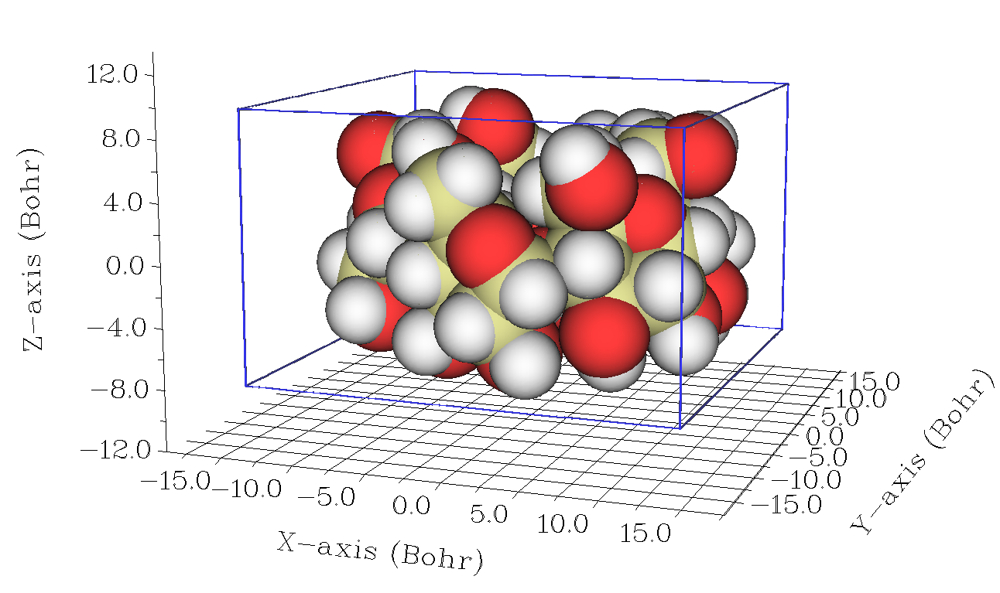

也可选择option 2，将旋转和平移后坐标下的分子导出至当前文件夹中的*new.pdb*。该文件包含“CRYST1”字段，记录晶胞长度。可将该文件直接载入VMD (<http://www.ks.uiuc.edu/Research/vmd/>)可视化程序，然后在VMD控制台窗口中输入*pbc box*命令以显示盒子。对绘制效果稍作调整并手动编辑图形后，将得到下图，该图清晰展示了分子几何特征。

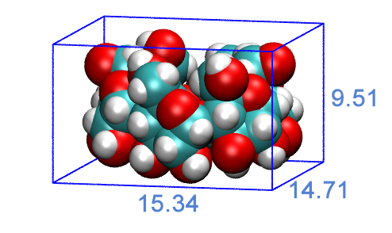

在VMD中也可视化分子主轴。只需将*examples\principal_axes.tcl*的全部内容复制到VMD控制台窗口中，即可见下图，其中红色、蓝色和绿色轴分别代表三个分子主轴。

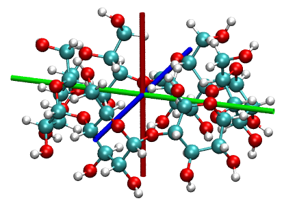

关于该主题的更多讨论见我的博文“使用Multiwfn计算分子的长、宽和高”(中文，<http://sobereva.com/426>)。

### **4.100.21.2 \[14\]annulene分子平面性 (planarity)研究**

> **注**
>
> 本节的中文版是我的博文“使用Multiwfn定量和图形化研究分子的平面性”(<http://sobereva.com/618>)，其中还包含更多扩展讨论和额外示例。

在本节中，我们将研究\[14\]annulene的平面性，由于小环中的空间位阻效应，其并非完全平面。在ωB97XD/def2-TZVP水平下优化后的结构如下所示

![带有原子编号的\[14\]annulene结构](assets/figures/ch4/image1370.png)

请阅读我的论文*J. Mol. Model.*，**27**，263 (2021) DOI: [10.1007/s00894-021-04884-0](https://doi.org/10.1007/s00894-021-04884-0)或[3.100.21](sec-3-100-other-functions-part-1.md#310021-基于几何信息计算特定原子的性质calculate-properties-based-on-geometry-information-for-specific-atoms)节，以了解分子平面性参数 (molecular planarity parameter, MPP)、偏离平面的跨度 (span of deviation from plane, SDP)和到平面的有符号距离 (signed distance to plane, $d^{\mathrm{s}}$)的基本知识，本节将采用这些量来表征\[14\]annulene的分子平面性。
启动 Multiwfn 并输入

```text
examples[14]annulene.xyz  // It contains the optimized structure
MPP  // Enter the function of studying molecular planarity
1-14  // We only use all carbon atoms to determine the planarity. You can also simply input h to choose all non-hydrogen atoms
```

现在你可立即看到以下输出，其中包括为所选原子(*i.e.* 所有碳原子)拟合的平面即拟合平面 (fitting plane)的参数、原子到拟合平面的有符号偏离 (signed deviation)( $d^{\mathrm{s}}$ )及其最正值和最负值。最后，给出了 MPP 和 SDP。

```text
Plane equation: A=   1.00000  B=  -0.00000  C=   0.00233  D=   0.00000

Deviation of atom    1(C ) to the plane:  -0.21768 Angstrom
Deviation of atom    2(C ) to the plane:   0.21768 Angstrom
Deviation of atom    3(C ) to the plane:   0.21430 Angstrom
Deviation of atom    4(C ) to the plane:  -0.21430 Angstrom
Deviation of atom    5(C ) to the plane:  -0.07768 Angstrom
Deviation of atom    6(C ) to the plane:   0.07768 Angstrom
Deviation of atom    7(C ) to the plane:  -0.04457 Angstrom
Deviation of atom    8(C ) to the plane:   0.04457 Angstrom
Deviation of atom    9(C ) to the plane:  -0.02456 Angstrom
Deviation of atom   10(C ) to the plane:   0.02456 Angstrom
Deviation of atom   11(C ) to the plane:   0.09971 Angstrom
Deviation of atom   12(C ) to the plane:  -0.09971 Angstrom
Deviation of atom   13(C ) to the plane:  -0.03585 Angstrom
Deviation of atom   14(C ) to the plane:   0.03585 Angstrom
Maximal positive deviation to the fitted plane is    2(C ):   0.21768 Angstrom
Maximal negative deviation to the fitted plane is    1(C ):  -0.21768 Angstrom

Molecular planarity parameter (MPP) is    0.127145 Angstrom
Span of deviation from plane (SDP) is    0.435354 Angstrom
```

MPP 和 SDP 都不小，即到拟合平面的均方根偏离和到拟合平面的偏离跨度都很明显，清楚地表明\[14\]annulene仅表现出有限的平面性。这与我们早前从所示结构图得到的直观观察完全一致。

接下来，我们通过对原子着色来图形化展示每个原子到拟合平面的偏离，为此我们接着输入

```text
y  // Let Multiwfn to export .pqr file containing d^s values
[Press ENTER button directly]  // Output to [14]annulene.pqr in current folder
```

注意，导出的*\[14\]annulene.pqr*中原子的“charge”属性（倒数第二列）对应于 $d^{\mathrm{s}}$ 值。

启动 VMD 可视化软件 (<http://www.ks.uiuc.edu/Research/vmd/>)，将 .pqr 文件拖到 VMD 主窗口以加载它，然后进入“Graphics” - “Representation”面板，将“Coloring Method”设为“Charge”，将“Drawing Method”设为“CPK”。然后进入“Trajectory”选项卡，在“Color Scale Data Range”标签下的两个文本框中分别输入*-0.4*和*0.4*，然后按 ENTER 键。最后，将背景色改为白色，你将看到

![处于非平面构象的\[14\]annulene分子](assets/figures/ch4/image1371.png)

红色和蓝色清楚地区分了位于拟合平面两侧的碳原子。颜色越深，到拟合平面的偏离越大。显然，通过这种表示方式，可以快速而非常方便地识别分子中哪些原子严重破坏了平面性。

### **4.100.21.3 研究分子动力学轨迹中cyclo\[18\]carbon分子平面性的演化**
在上一个例子中，我们看到在Multiwfn中可以定量且直观地研究分子平面性 (molecular planarity)。Multiwfn也支持用这种分析轻松研究动态过程，输入的轨迹 (trajectory)应记录为多帧 (frame) .xyz文件。

在本例中，我说明如何在分子动力学轨迹中研究cyclo\[18\]carbon的分子平面性的演化。整个2000 fs轨迹是通过在298.15 K下的*ab-initio*动力学模拟生成的，见我在关于cyclo\[18\]carbon及类似体系振动特征的工作，见*Chem. Asian J.*，**16**，56 (2021) DOI: [10.1002/asia.202001228](https://doi.org/10.1002/asia.202001228)。前500 fs的xyz轨迹文件已作为*examples\C18_MD_500.xyz*提供。轨迹每1 fs保存一次，因此共有501帧，第一帧对应优化结构，该结构是完全平面的。

```text
examples\C18_MD_500.xyz
MPP  // Enter the function of studying molecular planarity
a  // Choose all atoms
a  // Choose all frames
```

现在当前文件夹中有*MPP_SDP.txt*，其第1、第2和第3列分别对应所有选定帧的帧序号、MPP和SDP。然后可以用*e.g.* Origin软件将MPP和SDP沿轨迹的变化绘制为曲线图，以便研究平面性在过程中的变化(下图是为包含2001帧的整个轨迹绘制的，可在<http://sobereva.com/multiwfn/extrafiles/C18-MD.xyz>下载)：

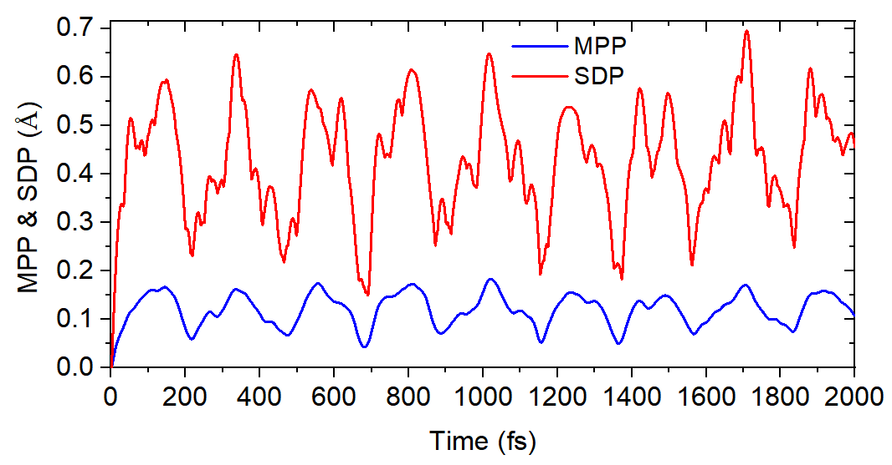

此外，当前文件夹中生成了*ds.pqr*。在此文件中，"atomic charge"列对应每一帧中选定原子的$d^{\mathrm{s}}$值(未选定原子的值为零)。利用此文件和特殊的VMD脚本*examples\scripts\ds.tcl*，我们能够根据$d^{\mathrm{s}}$值以动态原子着色方式可视化轨迹，从而非常生动地展示每个原子对平面性的偏离。现在，将*examples\C18_MD_500.xyz*载入VMD，然后将*ds.pqr*和*examples\scripts\ds.tcl*复制到VMD安装文件夹，启动VMD并在VMD的控制台窗口中输入`source ds.tcl`以运行此脚本，然后此脚本将从*ds.pqr*载入$d^{\mathrm{s}}$数据并设置可视化状态。之后，当在VMD中播放轨迹动画或拖动进度条时，原子将根据对应帧的$d^{\mathrm{s}}$值自动着色。如果有困惑，请看视频演示：<http://sobereva.com/multiwfn/res/ds_color.mp4>(在此视频中，我还使用了VMD中的“RMSD trajectory tool”插件以消除整体分子运动，使观察更容易)。注意，*ds.tcl*脚本设置的默认颜色标尺为从-0.4 (蓝色)到0.4 (红色)。

### **4.100.21.4 评估空腔直径 (cavity diameter)并图形化展示其区域**

> **注记**
>
> 本节的中文版为“Using Multiwfn to calculate cavity in molecule and crystal” <http://sobereva.com/643> (中文)，其中包含更多例子和讨论。

请先查看[3.100.21](sec-3-100-other-functions-part-1.md#310021-基于几何信息计算特定原子的性质calculate-properties-based-on-geometry-information-for-specific-atoms)节的相应部分，以理解评估空腔直径算法的基本思想。在本例中，我们将计算以下体系中富勒烯 (fullerene)部分(以绿色高亮显示)的空腔直径。实验结构为*examples\open_fullerene.pdb*。
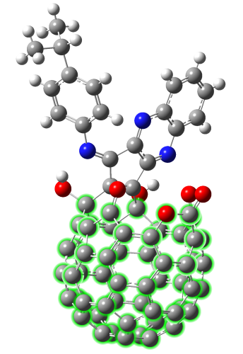

启动Multiwfn并输入

```text
open_fullerene.pdb
cav  // Enter the function for calculating cavity diameter
1,12-20,23-67,101  // Atoms in the fullerene part, they will be used to detect sphere radius
1  // Use the geometric center of the atoms inputted above as initial position of sphere center
1  // Allow automatic adjustment of sphere center to maximize sphere size
```

然后从屏幕上可以看到

```text
 X/Y/Z of initial geometry center are    3.901518    3.594304   11.835946 Angstrom
 Initial sphere radius is    1.677086 Angstrom
[...ignored]
Step    5
 Current coordinate:    3.939857    3.615266   11.899052 Angstrom
 Gradient:        0.009072    0.022419    0.013652  Norm    0.027772
 Displacement:    0.002400    0.005932    0.003612  Norm    0.007348 Angstrom
 Goal: displacement norm <  0.01000000 Angstrom

 Converged after     5 iterations

 Final X/Y/Z of sphere center:    3.942257    3.621198   11.902664 Angstrom
 Radius is    1.707257 Angstrom
 Diameter is    3.414514 Angstrom
 Volume is   20.844205 Angstrom^3
```

如你所见，最初代表空腔的球体 (sphere)中心位于 (3.901518, 3.594304, 11.835946) Å，半径为 1.677 Å。调整经过 5 次迭代 (iteration)后完成，最终球体中心位于 (3.942257, 3.621198, 11.902664) Å，球体半径为 1.707 Å。因此，实际空腔直径 (diameter)为 3.414 Å。

你还可以在屏幕上找到以下命令，它们用于在VMD (<http://www.ks.uiuc.edu/Research/vmd/>)程序中绘制球体，以图形方式展示空腔

```tcl
color Display Background white
draw material Transparent
draw color yellow
draw sphere {    3.942    3.621   11.903 } radius   1.707 resolution 100
```

启动VMD，将*open_fullerene.pdb*载入其中，打开“Graphics”-“Representation”面板并将“Drawing Method”设为“CPK”，然后将“Sphere Scale”减小到 0.7，再复制上述四条命令并将其粘贴到VMD的控制台窗口中执行，你将看到下图，黄色球体清楚地显示了空腔，其直径对应于上述的 3.414 Å。

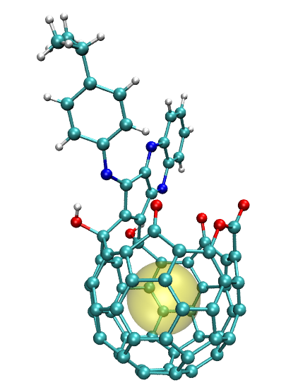

本节所示例的函数非常通用，它还可用于研究形状非常不规则的空腔、研究环体系 (ring systems)的内径，以及研究周期性晶体体系 (periodic crystal systems)的空腔尺寸，相应的例子在我的博客文章<http://sobereva.com/643>中给出。

## **4.100.22 分析非平面体系 (non-planar system)的π电子 (π electron)特征：环庚三烯 (cycloheptatriene)**

> **注记**
>
> 本模块在研究π电子结构方面的更多应用实例在我的这篇论文：[*Theor. Chem. Acc.*](https://link.springer.com/article/10.1007%2Fs00214-019-2541-z)[,](https://link.springer.com/article/10.1007%2Fs00214-019-2541-z)[**139**](https://link.springer.com/article/10.1007%2Fs00214-019-2541-z)[, 25 (2020)](https://link.springer.com/article/10.1007%2Fs00214-019-2541-z)中给出，强烈建议你阅读它。如果你的工作中涉及本模块，请不仅引用Multiwfn原始论文，还要引用这篇论文。

本例的目的是说明如何基于检测到的定域分子轨道 (localized molecular orbitals, LMOs)的π型研究非平面体系的π电子结构，并展示如何评估分子轨道 (molecular orbitals)的π组成 (π composition)。我们将以一个简单的非平面分子环庚三烯为例。如果你尚未阅读[3.100.22](sec-3-100-other-functions-part-1.md#310022-检测π轨道设置占据数并计算π组成detect-π-orbitals-set-occupation-numbers-and-calculate-π-composition)节，请先阅读该节，其中描述了细节和算法。
注意，非平面体系 (non-planar systems)中探测π轨道 (π orbitals)的方式与严格平面体系 (exactly planar systems)截然不同。对于后者的例子我已给出。在[4.5.3](sec-4-5-generate-grid-data-and-view-isosurface-map.md#453-计算-elf-σ-和-elf-π-以研究苯的芳香性)节中，我已提到如何让Multiwfn自动探测严格平面体系的π分子轨道 (π molecular orbitals)，然后通过ELF-σ和ELF-π分别研究σ和π电子结构 (σ and π electron structure)。在[4.4.9](sec-4-4-output-and-plot-various-properties-in-a-plane.md#449-绘制卟啉的-lol-π-图以揭示有利的电子离域路径)节中，我通过绘制LOL-π图 (LOL-π map)说明了如何研究平面体系卟啉 (porphyrin)的π电子离域路径 (π electron delocalization path)。

### **探测π型LMOs**

对于非平面体系，要分别研究σ和π电子，必须首先将分子轨道转化为LMOs。如果您不熟悉LMOs，请参见[3.22](sec-3-22-orbital-localization-analysis.md)节。

启动Multiwfn并输入：

```text
examples\cycloheptatriene.fch
19  // Orbital localization
1  // Localize occupied orbitals
100  // Other functions (Part 1)
22  // Detect π orbitals
-1  // Current orbitals are in localized form
0  // Detect π LMOs under default settings and then set their occupation numbers
```

已识别出三个π LMOs：

```text
Expected pi orbitals, occupation numbers and orbital energies (eV):
    23      2.000000     -8.361389
    24      2.000000     -6.762986
    25      2.000000     -5.798201
 Total number of pi orbitals:     3
 Total number of electrons in pi orbitals:    6.000000
```

假设我们将研究π电子特征，选择选项2将所有其它轨道的占据数 (occupation number)置零。

> **注 (Note)**
>
> **关于弥散函数 (diffuse functions)的重要说明**
>
> 要以上述方式自动确定π轨道，最好去掉弥散函数。如果坚持使用弥散函数，应注意两点：
>
> \(1\) 在执行轨道定域化 (orbital localization)的界面中，应选择"-6 Set localization method"，然后选择"3 Pipek-Mezey based on Becke population"。该定域化方法与弥散函数兼容，但比默认的Pipek-Mezey方法耗时得多。
>
> \(2\) 在探测pi MOs的界面中，应选择"6 Set the method for calculating orbital composition"，然后选择Hirshfeld或Becke方法，这是因为在存在弥散函数时，计算轨道组成 (orbital composition)的默认方法，即Mulliken+SCPA，不能正常工作。

### **基于π型LMOs研究π电子结构**

由于除π轨道之外的其它轨道的占据数已置零，同时密度矩阵 (density matrix)已自动更新，现在可进行任何分析，结果将仅由π电子贡献。例如，以通常方式使用主功能5绘制电子密度等值面图(isovalue=0.03 a.u.)和LOL等值面图(isovalue=0.5)，分别如下面的左图和右图所示。

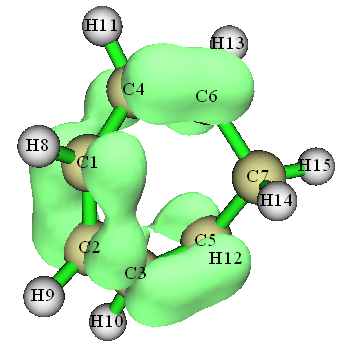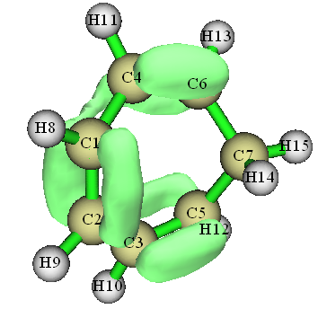

从这两张图可以很容易看出，C4-C6、C1-C2和C3-C5必定强于C1-C4和C2-C3，因为在前者中π电子在相应的两个原子之间离域得明显更充分
> **注 (Note)**
>
> 偶尔，自动π轨道检测算法 (π-orbital detecting algorithm)可能会将一个或多个孤对LMO (lone-pair LMO)错误地归入π轨道，从而污染LOL-π图 (LOL-π map)。最简单的解决方法：在经由主功能 (main function) 19进行轨道定域化 (orbital localization)、然后使用主功能100的子功能 (subfunction) 22自动检测pi轨道之后，请使用主功能0检查每一个占据轨道 (occupied orbital)，以找出仍被占据的孤对LMO并记录其序号。然后进入主功能6并选择子功能26，输入孤对LMO的序号，再输入0使其成为非占据。之后，返回主菜单，像往常一样使用主功能5生成LOL-π的格点数据。

基于π型的LMO，我们还可以进行其它类型的分析，例如Mayer键级 (Mayer bond order)计算。按照[4.9.1](sec-4-9-bond-order-analysis.md#491-乙酰胺的mayer键级与模糊键级分析)节所示计算Mayer键级，结果为

```text
#    1:         1(C )    2(C )    0.70534437
#    2:         1(C )    4(C )    0.18472895
#    3:         1(C )    5(C )    0.10215925
#    4:         2(C )    3(C )    0.18472484
#    5:         2(C )    6(C )    0.10215398
#    6:         3(C )    5(C )    0.80861164
#    7:         4(C )    6(C )    0.80860020
#    8:         5(C )    6(C )    0.07556895
```

π键级的顺序为C4-C6 \> C1-C2 \> C1-C4，此结果与通过可视化ELF-π图 (ELF-π map)的预期完全一致。

本节介绍的功能非常强大，也可以应用于相当大的体系。例如，左下图是使用上述步骤绘制的helicene的LOL-π等值面图 (LOL-π isosurface map)（等值面值(isovalue)=0.55）。此外，使用选项“5 Set constraint of atom range”，可定义识别π LMO的区域约束。例如，右下图显示了位于中央两个六元环 (six-membered ring)的五个π LMO贡献的helicene的电子密度 (electron density)。

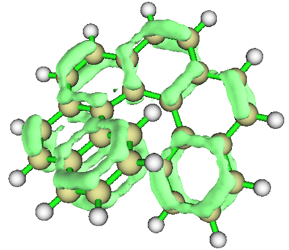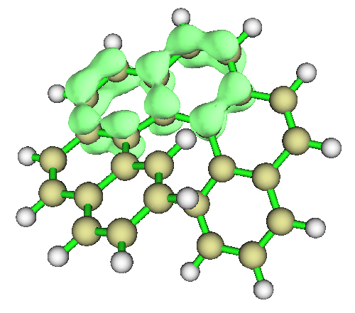

多中心键级计算 (multi-center bond order calculation)在LMO表象 (LMO representation)下也可以正常进行，因此你可以通过此分析轻松识别上述体系中不同环的π共轭 (π conjugation)强度。

### **占据MO的π组成评估 (Evaluating π composition of occupied MOs)**

基于已检测的π LMO，我们可以评估当前体系任意轨道的π组成 (π composition)。让我们检查环庚三烯 (cycloheptatriene)的占据MO (occupied MO)的π组成。当前文件夹中的*new.fch*是在进行 earlier 轨道定域化时自动导出的，所有占据LMO都记录在此文件中。

启动并输入以下命令：

```text
new.fch  // Load it to retrieve occupied LMOs
100  // Other functions (Part 1)
22  // Detect π orbitals
-1  // Current orbitals are in localized form
-1  // Detect π orbitals and then evaluate π composition for orbitals in another file
examples\cycloheptatriene.fch  // This file contains MOs

[Press ENTER button directly to use printing threshold of 50%]
```

现在所有π组成高于50%的占据MO均已显示：

```text
 Orbital    23 (Occ= 2.00000)   pi composition:  65.003%
 Orbital    24 (Occ= 2.00000)   pi composition:  84.466%
 Orbital    25 (Occ= 2.00000)   pi composition:  92.863%
```

在此分析之后，内存中的轨道已被替换为*examples\cycloheptatriene.fch*中记录的轨道。因此，现在你可以返回主菜单，然后进入主功能0以绘制π MO的等值面，如下所示
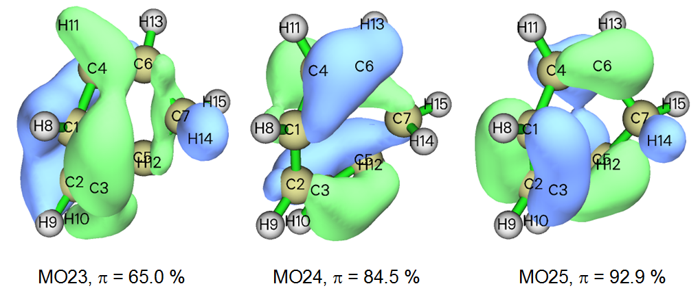

可以看到，所评估的 π 组成 (π composition) 非常合理。例如，在 MO23 中，可以看到在 C6-C7 和 C5-C7 成键区域存在明显的 σ 特征，此外，在 H10、H11 和 H14 周围存在等值面 (isosurface)，这些现象解释了为什么 MO23 的 π 组成不太接近 100%。相比之下，MO25 的轨道等值面的 σ 特征不那么明显，因此 MO25 可被视为准 π 轨道 (quasi-π orbital)。

### **未占据 MO 的 π 组成评估**

也可以评估未占据分子轨道 (unoccupied MO) 的 π 组成。在这种情况下，还需要未占据定域分子轨道 (unoccupied LMO)。现在我们进行这类分析。我们返回主菜单 (main menu)，然后输入

```text
19  // Orbital localization
2  // Localize both occupied and unoccupied orbitals
100  // Other functions (Part 1)
22  // Detect π orbitals
-1  // Current orbitals are in localized form
3  // Switch the LMOs in consideration to "all localized orbitals"
2  // Change the default density threshold for identifying π orbitals. Because current geometry is highly distorted, more loose density threshold must be adopted, otherwise you will find no unoccupied π LMO could be recognized
0.05  // A value much larger (looser) than the default threshold
-1  // Detect π orbitals and then evaluate π composition for orbitals in another file
```

现在已识别出六个 π 定域分子轨道 (π LMO)，如下所示。如果感兴趣，可以将它们可视化

```text
Expected pi orbitals, occupation numbers and orbital energies (eV):
   23      2.000000     -8.361389
   24      2.000000     -6.762986
   25      2.000000     -5.798201
   26      0.000000     -0.739482
   27      0.000000      0.770830
  110      0.000000     74.313859
```

然后我们输入

```text
examples\cycloheptatriene.fch  // The file containing MOs

[Press ENTER button directly to use printing threshold of 50%]
```

结果如下所示

```text
 Orbital    23 (Occ= 2.00000)   pi composition:  65.003%
 Orbital    24 (Occ= 2.00000)   pi composition:  84.466%
 Orbital    25 (Occ= 2.00000)   pi composition:  92.863%
 Orbital    26 (Occ= 0.00000)   pi composition:  84.033%
 Orbital    27 (Occ= 0.00000)   pi composition:  72.481%
 Orbital    29 (Occ= 0.00000)   pi composition:  57.811%
```

可以看到，有三个未占据 MO 的 π 组成大于 50%，而占据 MO 的 π 组成与我们之前得到的结果完全相同。现在我们进入主功能 0 以绘制 MO27 的等值面图 (isosurface map)，MO27 是未占据 MO 之一，其 π 组成为 72.5%。从下图可以清楚看出，该轨道的主要特征确实为 π。

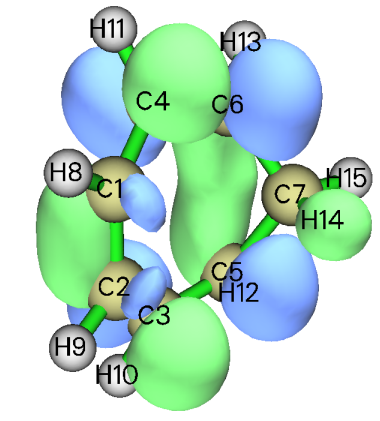

关于分析 π 电子特征的更多讨论和图示，可参见我的博客文章“Separate investigation of π electronic structure in Multiwfn”(中文，<http://sobereva.com/432>)。