# **4.11 绘制各种光谱 (spectrum)**

> **注**
>
> 本节中的大多数例子也可参见我的博客文章“Using Multiwfn to calculate transition electric dipole moment between excited states and electric dipole moment of each excited state”(<http://sobereva.com/224>, 中文)，其中还包含扩展讨论。

Multiwfn具有非常强大而灵活的光谱绘制模块。本模块的基本原理、支持的输入文件和所有选项已在第[3.13](sec-3-13-plotting-spectra.md)节中详细介绍。在接下来的几节中，我将简要举例说明本模块的用法。如果您对相关理论不熟悉，请先仔细阅读第[3.13.1](sec-3-13-plotting-spectra.md#3131-理论theory)节。

值得注意的是，还有一篇文章介绍了如何结合Multiwfn与ORCA模拟UV-Vis和ECD光谱的详细步骤，见<http://sobereva.com/485>。

## **4.11.1 绘制NH₃BF₃的红外 (infrared, IR) 光谱**

本例绘制NH₃BF₃的红外光谱。Multiwfn可以从Gaussian或ORCA振动分析任务的输出文件中读取频率 (frequency)和强度 (intensity)(“freq”关键词)。启动Multiwfn并输入以下命令

```text
examples\spectra\NH3BF3_freq.out  // The output file of optimization and vibrational analysis task of Gaussian at B3LYP/6-31G* level
11  // Plot spectrum
1  // The type of the spectrum is IR
0  // Show the spectrum right now
```

您将得到如下图所示的图形

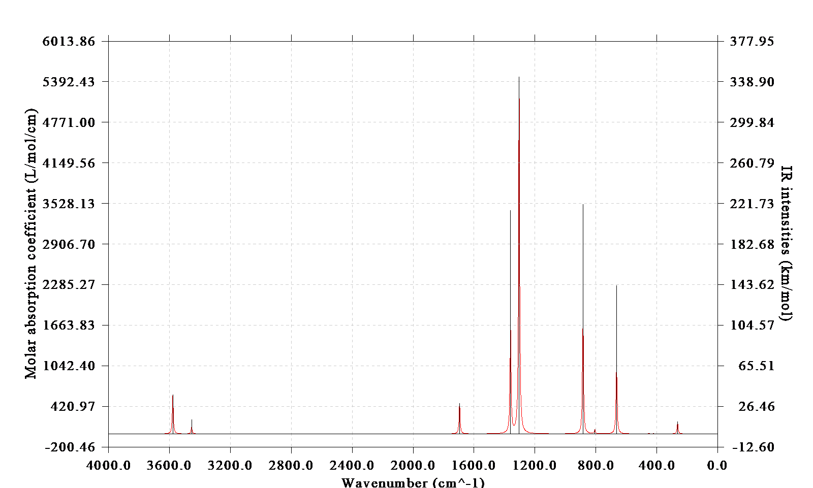

左轴对应于曲线 (curve)(加宽后数据)，右轴对应于分立线 (discrete line)(原始跃迁数据)。诸如半峰全宽 (full width at half maximum, FWHM)、加宽函数 (broadening function)、坐标轴单位和范围等作图参数可通过界面中的相应选项调节。分立线/曲线的图形和X-Y数据集可分别通过选项1和2导出。

注意，在选择选项0绘制光谱后，Multiwfn会在控制台窗口中打印极值 (extrema)信息

```text
 Extrema on the spectrum curve:
 Maximum    1   X:      3578.5262   Value:       585.2897
 Maximum    2   X:      3454.4848   Value:       110.4777
 Maximum    3   X:      1695.2317   Value:       460.3222
 Maximum    4   X:      1359.1197   Value:      1717.7809
 Maximum    5   X:      1303.1010   Value:      5467.1462
...[ignored]
```

从该输出中，您可以获得吸收峰 (absorption peak)的准确位置和高度。如第[4.11.3](#4113-绘制天冬酰胺-asparagine的电子圆二色-electronic-circular-dichroism-ecd光谱)节所示，极大值 (maximum)和极小值 (minimum)甚至可以直接标注在光谱上。

众所周知，在谐振子近似 (harmonic approximation)下得到的频率会系统性偏离实验振动频率。为校正这一问题，应使用基频比例因子 (fundamental frequency scale factor)，这在Multiwfn中可轻松完成。关闭光谱图，然后选择"14 Set scale factor for vibrational frequencies"，接着直接按ENTER键以选择全部振动模式 (vibrational mode)，再次直接按ENTER键以采用针对B3LYP/6-31G\*级别拟合的比例因子，即0.9614，该值可在*J. Phys. Chem.*，**100**，16502 (1996)的表1中找到。此后，若重新绘制光谱，所得光谱即对应于经比例因子校正后的结果。

> **注**
>
> 您可以对不同的振动模式使用不同的比例因子。对一批模式使用比例因子后，您可以再次进入选项14，Multiwfn会询问是否将全部振动频率恢复为原始值。如果输入*n*，则可以为另一批模式输入不同的比例因子，其效果将叠加。
一些实验红外光谱 (IR spectra)测定的是透射率 (transmittance)而不是吸收 (absorption)。为了模拟这种光谱，你可以选择 "4 Set left Y-axis"，然后输入 *e.g.* *6000,0,400*以分别将下限 (lower limit)、上限 (upper limit)和标签间隔 (label interval)设为相应值，然后输入 *y*以自动缩放右Y轴 (right Y-axis)。由于当前下限 (0)高于上限 (6000)，Y轴是反转的。

绘制拉曼 (Raman)、紫外-可见 (UV-Vis)、电子/振动圆二色谱 (electronic/vibrational circular dichroism) (ECD/VCD)和拉曼光学活性 (ROA)光谱的过程与绘制红外光谱非常相似，你只需要在进入主功能 (main function) 11后使用合适的输入文件 (input file)并选择相应选项。如果用于光谱计算的量子化学程序 (quantum chemistry program)不是 Multiwfn直接支持的程序，你可以从相应输出文件 (output file)中手动提取数据，然后按照[3.13.2](sec-3-13-plotting-spectra.md#3132-输入文件input-file)节所示格式将它们写入纯文本文件 (plain text file)，然后该文件即可用作 Multiwfn绘制光谱的输入文件。

## **4.11.2 绘制乙酸 (acetic acid)的紫外-可见光谱及单个跃迁 (individual transitions)的贡献**

Multiwfn的光谱绘制模块 (spectrum plotting module)非常灵活，不仅可以导出总光谱 (total spectrum)，还可以导出单个跃迁的贡献。当你想要确定光谱的性质时，此功能特别有用。在本节中我将展示如何实现这种分析，以乙酸的紫外-可见光谱为例。

启动 Multiwfn并输入

```text
examples\spectra\acetic_acid_TDDFT.out  // Calculated at TD-B3LYP/cc-pVDZ level by Gaussian
11  // Plot spectrum
3  // The type of the spectrum is UV-Vis
15  // Output the spectrum including the contributions from certain individual transitions
0.01  // The criterion of selecting transitions is oscillator strength > 0.01
```

紫外-可见光谱的曲线以及强度绝对值大于 0.01的跃迁的贡献已输出到当前文件夹中的 *spectrum_curve.txt*。前两列对应于能量 (energies)和摩尔吸收系数 (molar absorption coefficients)，其他列与跃迁模式的对应关系已在屏幕上清楚指示：

```text
Column#   Transition#
     3           2                //i.e. transition S0→S2
     4           3                //i.e. transition S0→S3
     5           5                //i.e. transition S0→S5
     6          11                //i.e. transition S0→S11
     7          13                //i.e. transition S0→S13
```

离散线数据已输出到当前文件夹中的 *spectrum_line.txt*。

现在你可以用你喜欢的程序将这两个文件中的数据绘制为单张图中的曲线（如果你使用 Origin绘图，你可以直接将这两个文件拖入 Origin窗口以导入它们）。在这两个文件中，第一列应作为 X轴数据，而其他列应作为 Y轴数据。由 Origin绘制的光谱如下所示，如果你对过程感到困惑，你可以查阅 "examples\spectra"文件夹中提供的 *acetic_acid_TDDFT.opj*，它是 Origin 8的 .opj文件。

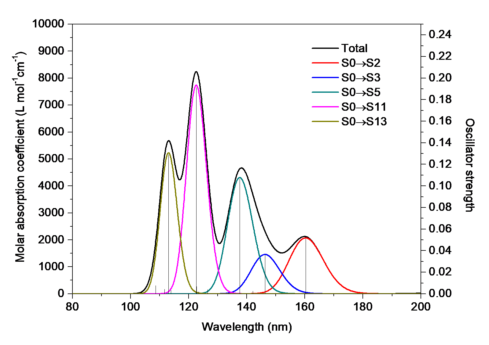

从图中，总紫外-可见光谱（黑色曲线）的内在特征现在非常清楚。尽管 S0→S3跃迁 (146.28nm)的振子强度 (oscillator strength) (0.036)并不很小，但没有吸收峰直接对应于该跃迁，因为其吸收曲线（蓝色曲线）已完全合并到由 S0→S5跃迁（青色曲线）导致的相邻大吸收峰中。
如上一节所述，在选择选项0绘制光谱 (spectrum)后，Multiwfn直接打印光谱曲线 (spectrum curve)的极值 (extrema)。在当前情况下输出的数据为

```text
 Maximum    1   X:       113.0588   Value:      5680.9864
 Maximum    2   X:       122.5085   Value:      8239.4308
 Maximum    3   X:       138.0728   Value:      4667.7944
 Maximum    4   X:       159.7516   Value:      2123.3506
 Maximum    5   X:       213.7324   Value:        48.5312
...[ignored]
```

基于上述输出，我们可以计算不同跃迁 (transition)对给定峰 (peak)的贡献 (contribution)。例如，我们想要研究位于138.0728 nm处峰的组成。在*spectrum_curve.txt*中，移动到对应于138.07278 nm的行，你可以发现总值是4667.79439，而第4列和第5列的值分别为309.47267和4273.59757。因此，S0→S3和S0→S5的贡献可分别计算为309.47267/4667.79439×100% = 6.63%和4273.59757/4667.79439×100% = 91.55%。

在Multiwfn中可以非常容易地获得各种跃迁对给定波长 (wavelength)的主要贡献。例如，我们想要了解对极大值3 (138.0728 nm)贡献最大的跃迁，因此我们输入

```text
15  // Output contributions of individual transitions to the spectrum
0  // Calculate maximal 10 contributions to a given position
138.0728  // The position of interest
```

你将看到

```text
Sum of absolute values of all transitions:          4667.79444
The individual terms are ranked by magnitude of contribution:
   #Transition     Contribution      %
         5          4273.59504     91.555
         3           309.47511      6.630
         4            68.05085      1.458
         6            11.67756      0.250
        11             2.33209      0.050
         8             2.13478      0.046
         7             0.22284      0.005
         2             0.14507      0.003
        10             0.10019      0.002
         9             0.06091      0.001
```

可以清楚地看到，S0→S5对该极大值的贡献最大(91.5%)，而S0→S3的作用不重要但不可忽略(贡献6.6%)。

## **4.11.3 绘制天冬酰胺 (asparagine)的电子圆二色 (electronic circular dichroism, ECD)光谱**

在本例中我们绘制天冬酰胺的电子圆二色光谱。启动Multiwfn并输入

```text
examples\spectra\Asn_TDDFT.out  // Gaussian TDDFT task at PBE0/6-311G* level, 30 lowest excited states were calculated
11  // Plot spectrum
4  // ECD
2  // Read the rotatory strengths in velocity representation
0  // Show the spectrum
```

从所得的光谱中，你会发现X轴 (X-axis)和Y轴 (Y-axis)的标签是小数。为了使图形更美观，建议修改标尺以使每个刻度 (tick)的标签为整数。因此，我们关闭当前图形并输入以下命令：

```text
3  // Set X-axis
120,280,20  // Lower and upper limits, as well as spacing between ticks of X-axis
4  // Set left Y-axis
-90,100,20  // Lower and upper limits, as well as spacing between ticks of left Y-axis
y  // Let program properly adjust right Y-axis to guarantee that zero points of left and right axes are in the same horizontal line
0  // Show the spectrum
```

然后你将看到下图

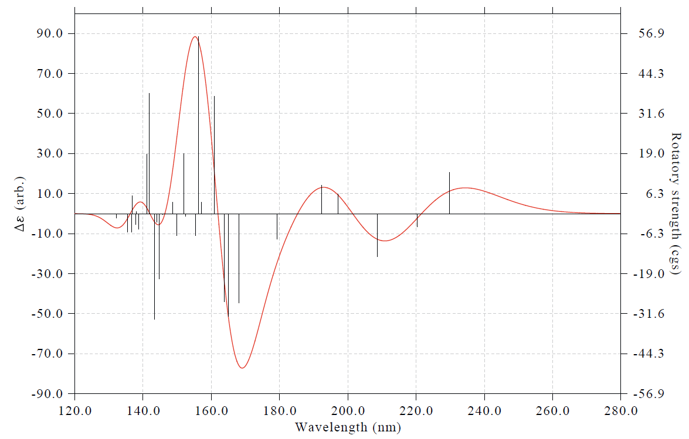

注意，你可以使用与[4.11.2](#4112-绘制乙酸-acetic-acid的紫外-可见光谱及单个跃迁-individual-transitions的贡献)节中所展示完全相同的方式，将总ECD光谱分解为每个跃迁的单独贡献。
从上面的光谱 (spectrum)可以看出，左侧坐标轴的 Δ*ε* 单位标注为 *arb.*，意为 “arbitrary unit”。只有 ECD 的曲线形状值得关注，这就是在这种情况下使用且应该使用 *arb.* 的原因。

### **在光谱上标注极小值 (minima)和极大值 (maxima)标签**

Multiwfn 在绘制光谱方面的一个优势是可以直接在光谱上标注极大值、极小值或同时标注二者。要标注极大值和极小值两者的波长，输入

```text
16  // Enter the interface of setting status of showing labels of spectrum minima and maxima
1  // Change displaying status of labels
3  // Label both maxima and minima on the spectrum
0  // Return
4  // Set left Y-axis
-100,110,20  // Making range of left Y-axis slightly wider, because the labels will be shown
y  // Correspondingly scale right Y-axis
0  // Plot spectrum again
```

现在可以看到下图

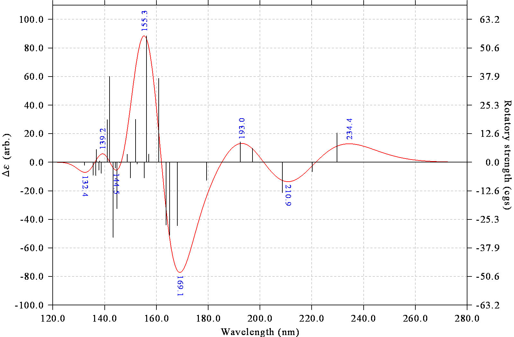

也可以让 Multiwfn 在图上极值处标注 Y 轴值，现在我们这样做，同时自定义一些绘图参数。输入以下命令

```text
16  // Enter the interface of setting status of showing labels of spectrum minima and maxima
6  // Switch the content of the labels to Y-axis value
4  // Do not rotate the labels (this step is optional)
3  // Set decimal digits (this step is optional)
0  // No decimal digits, namely show data as integer
2  // Set label size
50  // Larger text size than default (30)
0  // Return
0  // Plot spectrum again
```

现在可以看到下图

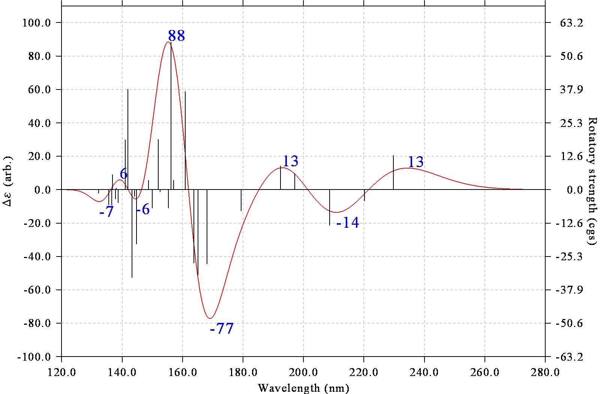

### **提示 (Hint)：保存和加载绘图设置 (plotting settings)**

为了将来快速重绘上图，建议将绘图设置保存到文件，即输入以下命令：

```text
s  // Save plotting settings
Asn_ECD.dat  // Save settings to Asn_ECD.dat in current folder
```

下次，如果想恢复上图，只需输入

```text
examples\spectra\Asn_TDDFT.out
11  // Plot spectrum
4  // ECD
2  // Read the rotatory strengths in velocity representation
l  // Load plotting settings
Asn_ECD.dat  // Save settings to Asn_ECD.dat in current folder
0  // Plot the spectrum
```

注意，上图对应的 *Asn_ECD.dat* 已提供在 *examples\spectra* 文件夹中。

## **4.11.4 绘制 plumericin 的构象加权 (conformational weighted) UV-Vis 和 ECD 光谱**

> **注 (Note)**
>
> 本节的中文版是我的博客文章 “Using Multiwfn to plot conformationally averaged spectrum” (<http://sobereva.com/383>)。

### **准备工作 (Preparation)**

在计算构象加权光谱之前，需要评估这些构象的布居数 (population)，通常使用 Boltzmann 权重。假设 plumericin 有四个可及构象，合理构建它们的初始几何，然后在 B3LYP/6-31G\* 水平下进行优化并做频率分析，零点能标度因子取 0.9806。基于优化后的几何，在 M06-2X/def2-TZVP 水平下计算高精度单点能。最后，将频率分析产生的 Gibbs 热校正加到单点能上，以得到各构象较为准确的 Gibbs 能量。之后，根据 Boltzmann 公式和这些构象之间的相对 Gibbs 能量，计算它们在 298.15 K 下的权重。然后，使用 TD-PBE0/TZVP 水平为这些构象计算最低的 20 个激发态。TDDFT 任务的输出文件已提供在 "examples\spectra\weighted" 文件夹中，为 *a.out*、*b.out*、*c.out* 和 *d.out*（名称是任意的，也可以使用其他文件名）。
现在我们编写一个名为*multiple.txt*的纯文本文件，其内容如下（文件名不应改变，但可添加前缀，例如*plumericin_multiple.txt*）：

```text
examples\spectra\weighted\a.out 0.6046
examples\spectra\weighted\b.out 0.1950
examples\spectra\weighted\c.out 0.1686
examples\spectra\weighted\d.out 0.0317
```

可以看到，在*multiple.txt*中，每行包含一个构象 (conformation)的输出文件的路径，其后是上面计算的Boltzmann权重 (Boltzmann weight)。下文中，四个构象将分别称为*a*、*b*、*c*和*d*。

> **PS**
>
> 如果你使用的是Linux系统，并且路径中存在/符号或空格，不要忘记在路径两端加上双引号，否则Multiwfn无法识别文件路径，例如：
>
> "examples/spectra/weighted/a.out" 0.6046\
> "examples/spectra/weighted/b.out" 0.1950\
> "examples/spectra/weighted/c.out" 0.1686\
> "examples/spectra/weighted/d.out" 0.0317\

### **绘制构象加权UV-Vis光谱 (conformational weighted UV-Vis spectrum)**

启动Multiwfn并输入

```text
examples\spectra\weighted\multiple.txt  // The aforementioned file
11  // Plot spectrum
3  // UV-Vis
0  // Show the spectrum
```

所得图形如下所示

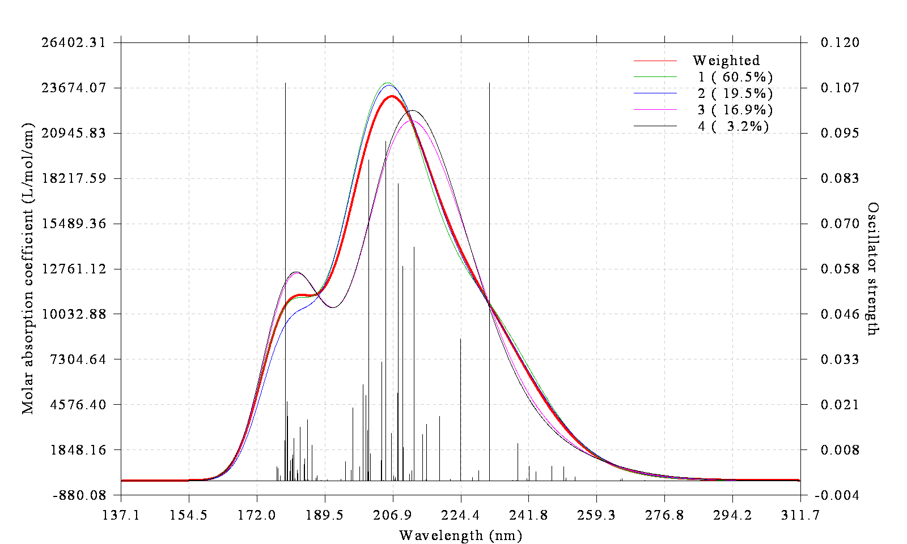

粗红曲线对应于构象加权UV-Vis光谱，而绿色、蓝色、紫色和黑色曲线分别对应于构象*a*、*b*、*c*和*d*的UV-Vis光谱。每个构象的权重也显示在图例 (legend)中。从该图可以非常方便地比较加权光谱与单个构象光谱的特征。

图中的黑色离散线 (discrete lines)代表四个构象的所有跃迁数据 (transition data)，其高度已按构象权重进行了缩放。因此，粗红曲线可视为由图中显示的所有离散线展宽得到。

Multiwfn提供了绘制单个构象光谱的另一种模式。关闭上面的图形，选择"18 Toggle weighting spectrum of each system"一次，然后选择选项0再次查看光谱，将看到

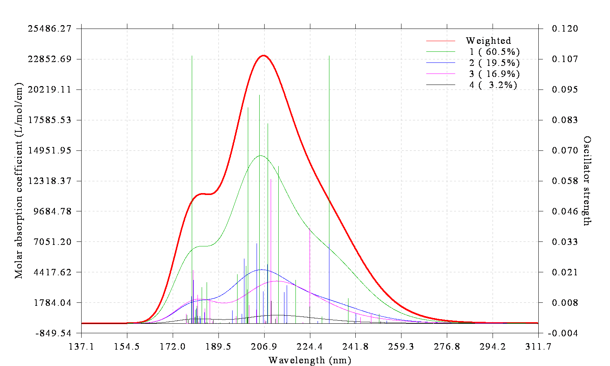

该图上显示的每个构象的光谱曲线已乘以相应权重。显然，该图表示的是每个构象对构象加权光谱的贡献。换句话说，粗红曲线的高度就是所有其它曲线高度之和。可以看出，构象*a* (绿色线)对构象加权光谱有主要贡献，两者轮廓相当相似，这是因为*a*具有高达60.5%的布居 (population)。

上图中的离散线现在具有不同颜色，颜色与右上方所示的图例对应。对于每个构象，由于离散线和曲线目前具有相同颜色，我们可以说，例如，绿色曲线可由绿色离散线直接展宽得到。

### **绘制构象加权ECD光谱 (conformational weighted ECD spectrum)**

使用上一节所述的相同步骤，我们绘制构象加权ECD光谱和所有四个构象的ECD光谱。

启动Multiwfn并输入

```text
examples\spectra\weighted\multiple.txt
11  // Plot spectrum
4  // Plot ECD
2  // Read rotatory strengths in velocity representation
0  // Show the spectrum
```
你将看到

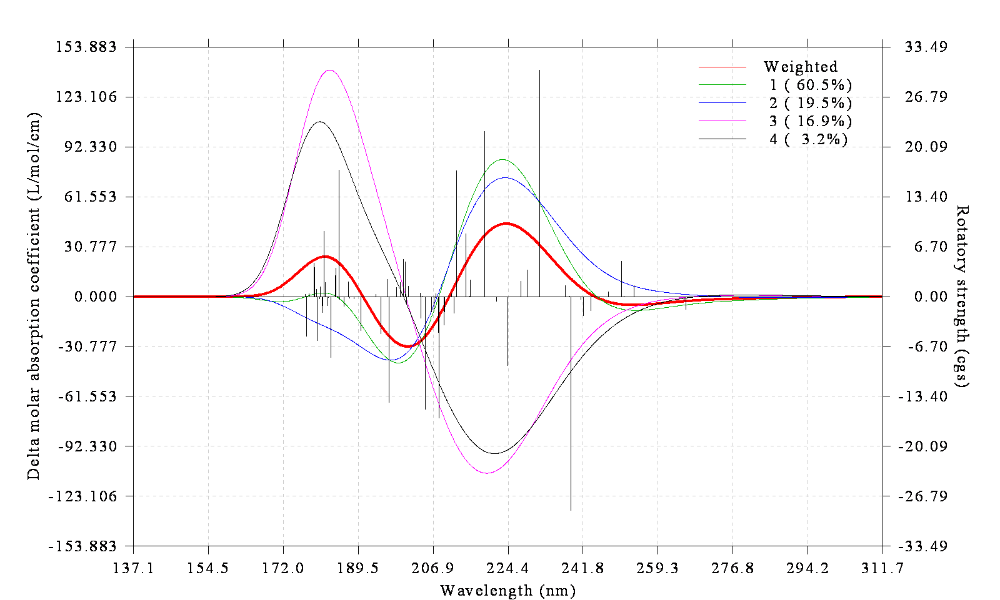

从该图中可以看到构象加权ECD谱 (conformationally weighted ECD spectrum)（粗红色曲线）以及各构象的ECD谱（其他曲线）。

然后选择 "18 Toggle weighting spectrum of each system" 选项一次并再次绘制光谱，你将看到

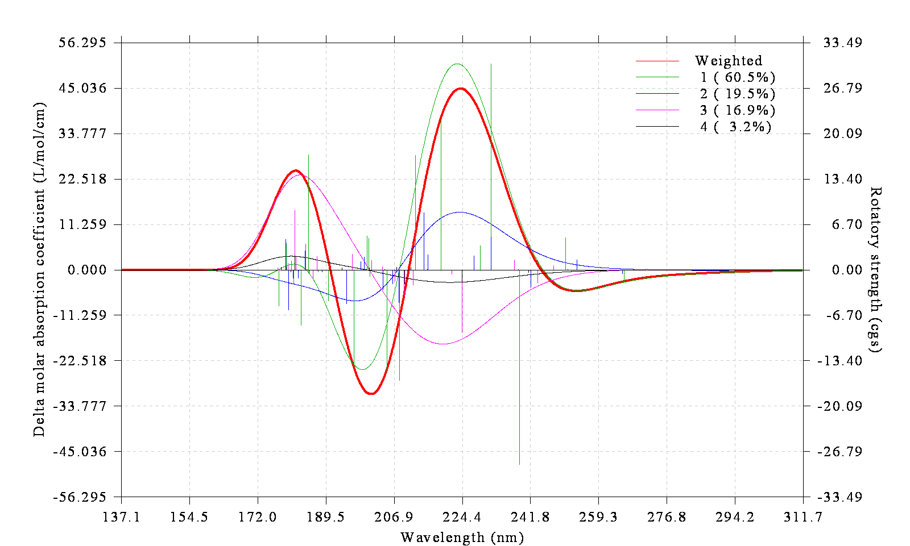

该图将最终加权ECD谱分解为各构象的贡献。同样，由于构象 *a*（绿色）具有很高的布居 (population) 并因此主导最终加权曲线，这两条曲线的大多数特征相似。然而，来自其他构象的影响不能简单忽略。从图中容易发现，如果缺失构象 *c*（紫色），则在约180 nm处将不会有明显的ECD峰，因为在此波长处只有 *c* 的ECD具有显著信号。

## **4.11.5 绘制2-methyloxirane的拉曼光谱 (Raman spectrum)和预共振光谱 (pre-resonance spectra)**

绘制拉曼光谱的步骤与绘制红外光谱 (IR spectrum)非常相似，唯一建议你多做的步骤是在绘制光谱之前，将量子化学程序的Raman任务直接输出的拉曼活性 (Raman activities)转换为拉曼强度 (Raman intensities)，以使所得光谱可与实验光谱相比。拉曼强度依赖于入射光源的波长和环境温度，而拉曼活性则不依赖。这一点已在第[3.13.1](sec-3-13-plotting-spectra.md#3131-理论theory)节中强调。在本节中，我以(2S)-2-methyloxirane为例说明如何正确绘制拉曼光谱。

启动Multiwfn并输入

```text
examples\spectra\2-methyloxirane_Raman.out  // Output file of Raman task calculated at B3LYP/6-31G* level by Gaussian 09
11  // Plot spectrum
2  // Raman spectrum
14  // Apply frequency scale factor
[Press ENTER button]  // Select all frequencies
[Press ENTER button]  // Employ the fundamental scale factor 0.9614, which is suitable for B3LYP/6-31G* level
19  // Convert Raman activities to intensities
15000  // Wavenumber (cm^-1) of incident light. This value should be consistent with the actual experimental condition, the value we inputted here is arbitrarily chosen
298.15  // Assume that experimental temperature is 298.15 K (You can also press ENTER button directly, 298.15 K will be used as default)
```

然后输入 *0* 以绘制光谱，你将看到如下拉曼光谱

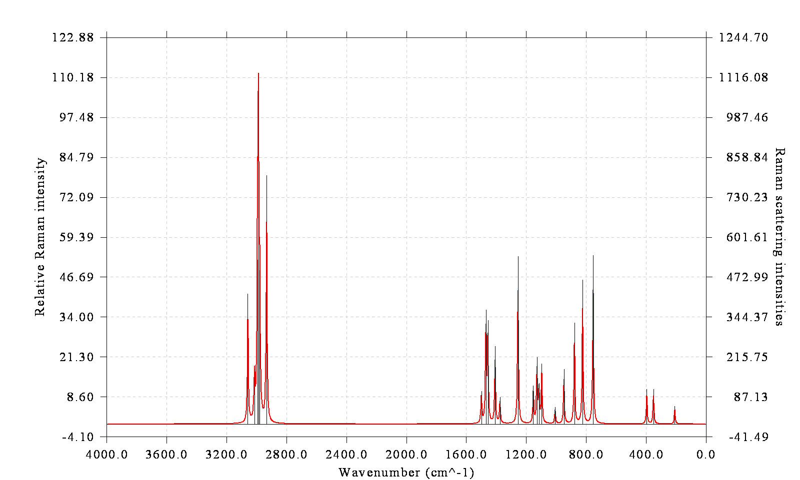

Multiwfn也能绘制预共振拉曼光谱。Gaussian预共振Raman任务的一个示例输出文件为 *examples\spectra\2-methyloxirane_Raman.out*，相应的输入文件(.gjf)也已给出。该任务计算了入射波长为150 nm和140 nm时的拉曼活性，它们接近相同计算水平下的S0→S1和S0→S2 TDDFT激发能（在TD-B3LYP/6-31G\*水平下分别为147.36 nm和138.81 nm）。你可以将该输出文件载入Multiwfn并像往常一样绘制拉曼光谱。唯一区别在于，在进入光谱绘制界面之前，Multiwfn会要求你选择将载入其拉曼活性的入射频率。如果你选择2或3，你最终得到的光谱将是相应频率处的预共振拉曼光谱；如果你选择" 1: 0.00000000"，即静态极限情形，所得光谱将与我们之前得到的光谱完全相同。
## **4.11.6 同时绘制多个体系**

在 Multiwfn 中，同时绘制多个体系 (system)的光谱 (spectrum)非常容易，这些体系可对应于不同构象 (conformation)、不同构型 (configuration)、不同分子 (molecule)或不同计算条件。在本节中给出两个例子。

### **比较不同理论方法 (theoretical method)和基组 (basis set)产生的光谱**

在 "examples\spectra\indigo" 文件夹中，可以找到在不同水平下完成的电子激发态任务的 Gaussian 输出文件。在此例中，我们将它们放在一起绘制，以便于比较它们的结果。

我们首先需要准备一个名为 *multiple.txt* 的文件，其中包含各个体系的路径及其图例 (legend)，该文件已作为 *examples\spectra\indigo\multiple.txt* 提供，其内容为：

```text
examples\spectra\indigo\ZINDO.out ZINDO
examples\spectra\indigo\TD-PBE0.out TD-PBE0/6-31G*
examples\spectra\indigo\TD-PBE0_TZVP.out TD-PBE0/def-TZVP
```

注意，图例不能仅仅是数字，否则它将被解释为相应体系的权重 (weight)（见第 [4.11.4](#4114-绘制-plumericin-的构象加权-conformational-weighted-uv-vis-和-ecd-光谱) 节）。此外，在 Linux 系统中，如果文件路径包含 / 符号，不要忘记在路径两端加上双引号。

启动 Multiwfn，载入 *multiple.txt*，然后像往常一样绘制 UV-Vis 光谱，将看到下图

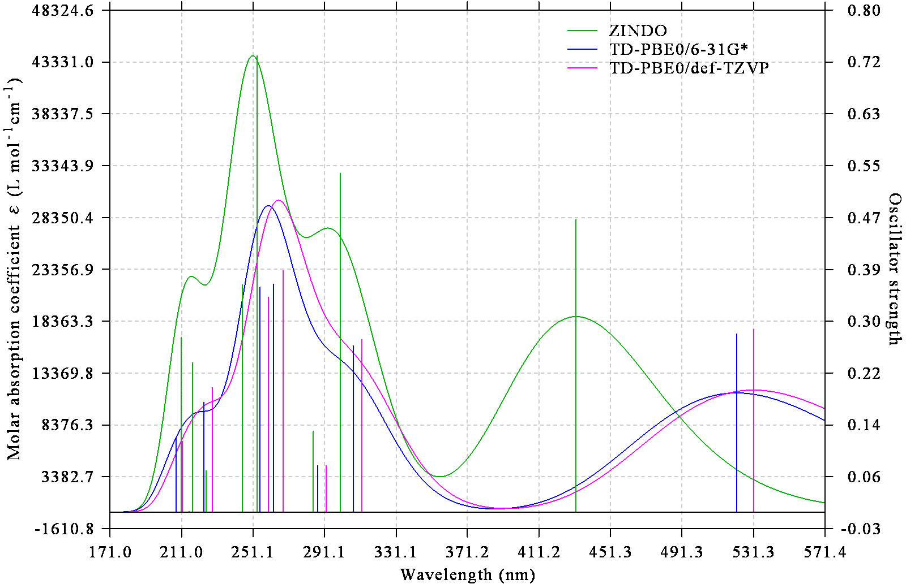

从图中可以清楚地看出，基组对所得光谱只有很小的影响，而 ZINDO 的光谱轮廓与 TD-PBE0 的显著不同。所有体系的曲线可通过选项 2 导出为 *curveall.txt*，然后用第三方程序如 Origin 重新绘制。

在 "examples\spectra\indigo" 文件夹中还可以找到 *ZINDO_30.out*，它对应于产生了 30 个激发态 (excited state)的 ZINDO 计算。也可以将其包含到 *multiple.txt* 中。

### **比较包含与不包含自旋-轨道耦合 (spin-orbit coupling, SOC)效应的光谱**

ORCA 程序能够在 TDDFT 计算中考虑自旋-轨道耦合效应，这里我们绘制并比较考虑与不考虑 SOC 的 UV-Vis 光谱。请下载 <http://sobereva.com/multiwfn/extrafiles/SOC-TDDFT_ORCA.zip>，它是针对 Ir(ppy)₃ 坐标的 TDDFT 任务的 ORCA 输出文件，在计算中已通过 %tddft 段中的 *dosoc true* 关键词启用了 SOC 处理。在输出信息中，有 SOC 校正前后两者的激发能 (excitation energy)和振子强度 (oscillator strength)。

解压 .zip 包，将 .out 文件放在当前文件夹中，然后创建一个内容如下的 *multiple.txt*

```text
Ir_ppy3.out with SOC
Ir_ppy3.out without SOC
```

启动 Multiwfn 并输入

```text
multiple.txt
11  // Plot spectrum
3  // Plot UV-Vis
y  // For the first spectrum, let Multiwfn use the data with SOC consideration
n  // For the second spectrum, let Multiwfn use the data without SOC consideration
```

然后将进入设置光谱的界面。稍稍调整设置后，将得到下图。显然，SOC 效应对当前体系的光谱有不可忽略的影响。

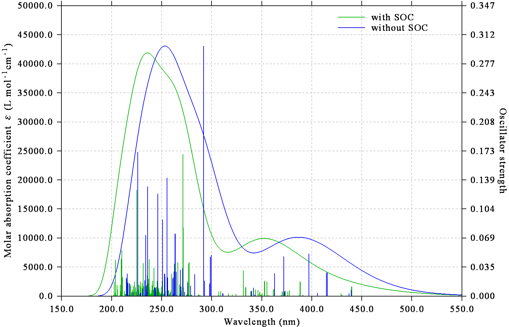

值得注意的是，含 SOC 的态 (state)数目远大于不含 SOC 的数目。因为 SOC 效应将每个原本简并 (degenerate)的三重态 (triplet state)分裂为三个子能级 (sublevel)。例如，假设 TDDFT 计算了 50 个单重态 (singlet)和 50 个三重态，则在考虑 SOC 校正后，将有 50+3\*50=200 个态。由于 SOC-TDDFT 对应的态数目高于常规 TDDFT 对应的态数目，当将两组（或更多组）数据模拟为理论光谱时，*multiple.txt* 中的第一个图例必须对应于 SOC-TDDFT 情形，并且在载入第一个光谱的数据时，必须选择 *y* 以让 Multiwfn 载入经 SOC 校正的 TDDFT 数据，如上文所示。
## **4.11.7 为手性分子 S-methyloxirane 绘制 VCD 和 ROA 光谱**

振动圆二色 (Vibrational circular dichroism, VCD)和拉曼光学活性 (Raman optical activity, ROA)是手性分子的重要振动光谱类型，只有手性分子才有 VCD 和 ROA 信号，详情见第[3.21](sec-3-21-electron-excitation-analysis.md)节。在本例中，我将说明如何为典型手性分子 S-methyloxirane 绘制这些光谱。

### **绘制 VCD 光谱**

相应的 Gaussian 输入和输出文件分别是*S-methyloxirane_VCD.gjf*和*S-methyloxirane_VCD.out*，位于*examples\spectra*文件夹中。如你所见，使用了*freq=VCD*关键词，计算水平为 B3LYP/6-31G\*。

启动 Multiwfn 并输入

```text
examples\spectra\methyloxirane_VCD.out
11  // Plot spectrum
5  // VCD
14  // Scale frequencies by a scale factor
[Press ENTER button]  // Select all frequencies
0.9614  // Employ fundamental scale factor prefitted for B3LYP/6-31G* level
0  // Show the spectrum
```

你将看到

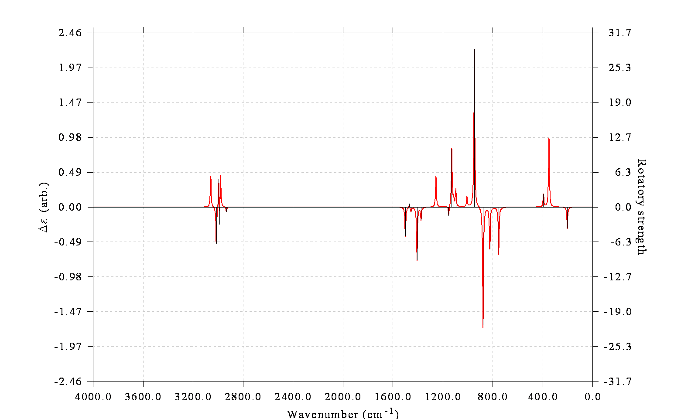

右轴对应尖峰的高度，其代表旋光强度。左轴对应由尖峰展宽得到的 VCD 曲线，其代表左、右圆偏振光吸收的差值。“arb.”表示单位是任意的，因为绝对数值的大小没有化学意义。

### **绘制 ROA 光谱**

此绘制基于 Gaussian *freq=ROA*任务的输出文件。Gaussian 输入和输出文件分别是*S-methyloxirane_ROA.gjf*和*S-methyloxirane_ROA.out*，位于*examples\spectra*文件夹中。从输入文件可以看出，此计算考虑了三种入射光频率(500、532 和 600 nm)。众所周知，弥散函数对于获得准确的 ROA 数据很重要，因此此处使用 aug-cc-pVDZ。

启动 Multiwfn 并输入

```text
examples\spectra\S-methyloxirane_ROA.out
11  // Plot spectrum
6  // ROA
2  // Three incident light frequencies are detected, here we select the 532nm case
2  // There are totally six kinds of data can be selected, here we select the commonly studied "ROA SCP(180)", namely backscattered circular polarization ROA spectrum
14  // Scale frequencies by a scale factor
[Press ENTER button]  // Select all frequencies
0.97  // Employ fundamental scale factor of 0.97, which is suitable for B3LYP/aug-cc-pVDZ level
19  // Convert the ROA data outputted by Gaussian to "real" ROA intensities
532nm  // Wavelength of incident light. This value should be consistent with actual experimental condition
```

现在你可以看到如下 ROA 光谱：

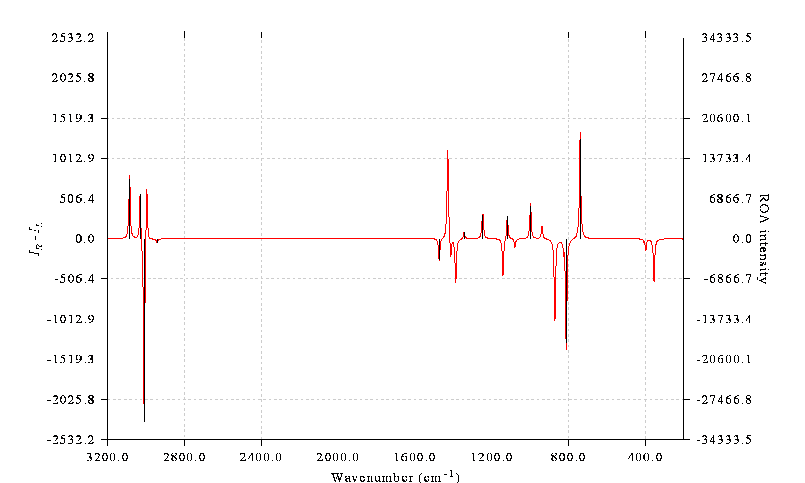

如果你打算在出版物中使用此光谱，我建议去掉左右纵坐标上的标签，因为绝对数值没有意义，只有曲线的形状才具有化学意义。为此，选择 "17 Other plotting settings"，然后选择子选项 2 和 3，当你重新绘制光谱时，你会发现标签已消失。

## **4.11.8 技巧：通过 shell 脚本为一批文件绘制光谱**

**注**：本节有对应的说明视频：<https://youtu.be/x6jp40DR24k>。

在本节中，我将展示如何通过 shell 脚本为一批输入文件绘制光谱。通过这种方式，只需一条命令即可将当前文件夹中的所有输入文件立即转换为各自的光谱图像文件！
假设您正在使用 Windows 系统，并且想要将 examples\spectra\indigo 文件夹中的所有 Gaussian TDDFT .out 文件转换为 UV-Vis 光谱 (spectrum)，您应该执行以下操作：

- 将 .out 文件复制到 Multiwfn 文件夹

- 将 *examples\spectra\UV-Vis.txt* 和 *examples\spectra\batchspec.bat* 复制到 Multiwfn 文件夹

- 将 *settings.ini* 中的 "isilent" 设为 1 并保存文件

- 双击 *batchspec.bat*

现在批处理脚本 (batch script)将调用 Multiwfn，根据 *UV-Vis.txt* 中的命令处理当前文件夹中的所有 .out 文件。几秒钟后，您会发现所有光谱图像文件已在当前文件夹中生成，其名称与 .out 文件相同。

如果您想要为当前文件夹中的一批文件绘制 IR 光谱，将 *examples\spectra\IR.txt* 复制到当前文件夹，并将 .bat 脚本中的 "UV-Vis.txt" 替换为 "IR.txt"，然后运行 .bat 文件。

如果您已经知道如何在静默模式 (silent mode)和批处理模式 (batch mode)下运行 Multiwfn，*UV-Vis.txt* 和 *IR.txt* 的内容就非常容易理解。如果您尚未阅读 [5.2](sec-5-2-running-multiwfn-in-silent-mode.md) 和 [5.3](sec-5-3-running-multiwfn-in-batch-mode.md) 节，在阅读之后您将完全理解该脚本的工作原理。通常，在将其用于为您自己的体系生成光谱之前，您应该适当地修改 .txt 文件中的设置（坐标轴范围）。

通过同样的方式，您也可以使用 Multiwfn 为一批输入文件绘制其他种类的光谱，您需要手动编写包含适当命令的 .txt 文件。

在 Linux 环境中，您也可以使用 shell 脚本 (shell script)来实现批量绘图。*examples\spectra\batchspec.sh* 是一个 Bash 脚本，其功能与上文所示的 *batchspec.bat* 完全相同。

## **4.11.9 技巧：使用尖峰 (spikes)指示跃迁能级 (transition levels)的位置**

在 Multiwfn 中，可以在模拟光谱的底部绘制一组尖峰，以突出显示特定跃迁能级的位置。在 [4.11.1](#4111-绘制nh₃bf₃的红外-infrared-ir-光谱) 节中，我们已经为 NH₃BF₃ 绘制了 IR 光谱，其中有一些特征振动模式 (vibration modes)。这一次我们将使用不同颜色的尖峰在图上突出显示两种模式的位置：(1) B-N 键的伸缩振动 (stretching vibration) (2) N-H 键的伸缩振动。这些模式的序号可以通过在 GaussView 中查看振动动画来确定。

启动 Multiwfn 并输入以下命令

```text
examples\spectra\NH3BF3_freq.out
11  // Plot spectrum
1  // The type of the spectrum is IR
23  // Set status of showing spikes to indicate transition levels
1  // Set the first set of spikes. We want to use black spikes to reveal all vibrations
a  // Select all modes
5  // Black
2  // Set the second set of spikes
16-18  // Indices of stretching vibration mode of the three N-H bonds
1  // Red
3  // Set the third set of spikes
4  // Index of vibration mode of B-N bond stretching
2  // Green
0  // Return
4  // Modify Y-axis at left side
0,6000,600  // Set lower and upper limits as well as label spacing
y  // Correspondingly scale Y-axis at right side
0  // Plot the graph
```

您将看到以下图形

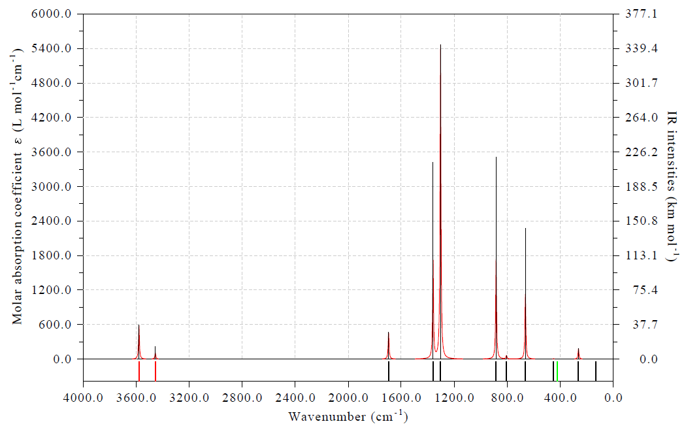

该图中的红色尖峰清楚地表明 N-H 伸缩模式具有最高频率，而 B-N 伸缩振动模式（绿色尖峰）的频率约为 400 cm⁻¹。所有其他振动模式均用黑色尖峰突出显示。
> **注**
>
> 值得注意的是，尽管第一组尖峰 (spikes) 为黑色并包含所有振动模式 (vibration modes)，第二组和第三组尖峰绘制在其之后，因此 N-H 和 B-N 伸缩振动模式分别显示为红色和绿色，而不是黑色。

恰当使用尖峰指示特征跃迁 (transitions) 可使图形信息量大增。例如，当绘制 UV-Vis 图 (UV-Vis map) 时，可以使用不同颜色的尖峰来区分不同的跃迁类型 (transition types)（*e.g.* π→π\* 和 n→π\*，或局域激发 (local excitation) 与电荷转移激发 (charge transfer excitation)）。

如果某些跃迁是简并的 (degenerate)，可以让 Multiwfn 以尖峰高度 (spike height) 体现简并 (degeneracy)。为此，在 option 23 中定义尖峰后，选择其子选项 "-3 Toggle considering degenerate"，并输入判定简并的阈值 (threshold)。如果两个或多个跃迁之间的能量跨度小于该阈值，则这些跃迁将被视为简并，只有能量最低者将以简并度 (degenerate degree) 为高度绘制为尖峰，而其余者将不可见。例如，下图为 cyclo\[18\]carbon 的 IR 光谱 (IR spectrum)，绿色和蓝色尖峰分别揭示面内 (in-plane) 和面外 (out-plane) 振动跃迁的位置。大多数跃迁的简并度为二（全高），而少数是非简并的，因此尖峰高度仅为一半。

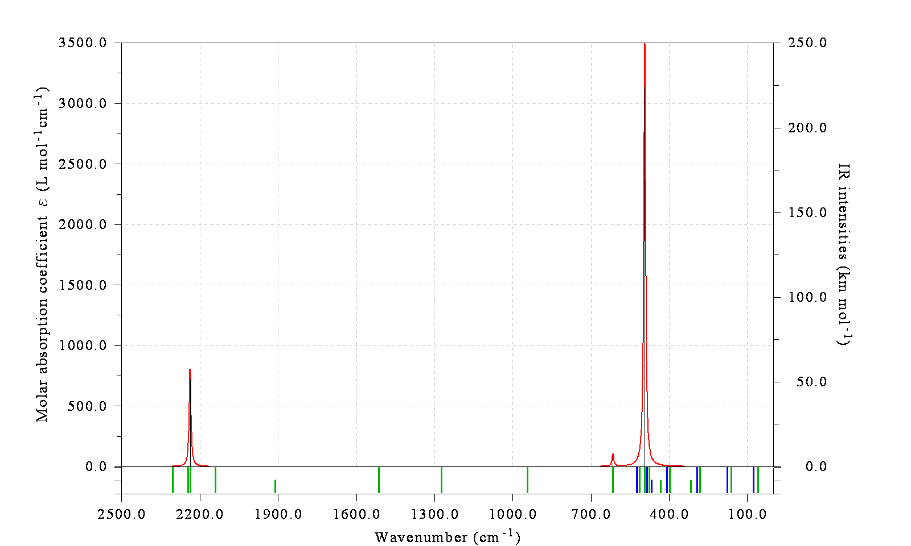

## **4.11.10 绘制 NMR 谱 (NMR spectrum)**

> **注**
>
> 本节中文版是我的博客文章 “Using Multiwfn to plot NMR spectra” (<http://sobereva.com/565>)，其中还包含扩展讨论。

请首先阅读 [3.13.5](sec-3-13-plotting-spectra.md#3135-绘制nmr光谱plotting-nmr-spectrum) 节，以获得关于绘制 NMR 谱模块的基本知识。本节将给出几个例子，展示如何在 Multiwfn 中轻松灵活地绘制 NMR 谱。

### **4.11.10.1 绘制乙醛 (acetaldehyde) 的 ¹H 和 ¹³C NMR 谱**

在本例中，我们绘制乙醛的 ¹H 和 ¹³C NMR 谱，其结构如下所示。

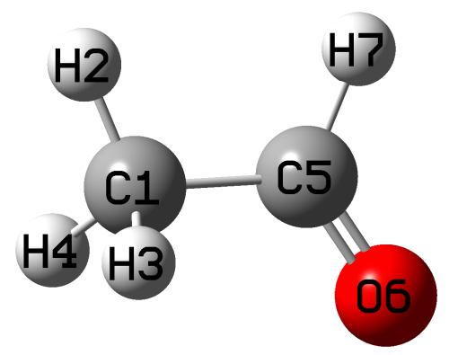

*examples\spectra\NMR\Acetaldehyde.out* 是 Gaussian 09 的 NMR 任务输出文件。几何结构在真空下使用 B3LYP/def2-SVP 水平优化，而 NMR 任务在由 SMD 溶剂化模型 (SMD solvation model) 表征的氯仿 (chloroform) 环境下以 B97-2/def2-TZVP 水平进行。已证明 B97-2 是理论评估 NMR 的良好选择，至少对 ¹H 和 ¹³C 而言，基准测试见 *J. Chem. Theory Comput.*, **10**, 572 (2014)。在相同计算水平下计算的四甲基硅烷 (tetramethylsilane) (TMS) 的 NMR 输出文件是 *examples\spectra\NMR\TMS.out*，从第 355 行和第 360 行可见，C 和 H 的各向同性磁屏蔽值 (isotropic magnetic shielding value) 分别为 186.8707 和 31.5143 ppm，它们稍后将用作参考值 (reference values)。

我们首先绘制 ¹³C NMR 谱。启动 Multiwfn 并输入

```text
examples\spectra\NMR\Acetaldehyde.out
11  // Plot various spectrum
7  // NMR
```

从界面中的 option 6 可以看到，当前考虑的元素 (element) 是碳。现在如果直接选择 option 0，将看到 ¹³C 谱，然而，X 轴对应的是绝对屏蔽值 (absolute shielding value)。为了使 X 轴对应化学位移 (chemical shifts)，应输入

```text
7  // Set how to determine chemical shifts
1  // Using reference shielding value to derive chemical shifts
186.8707  // Reference value of carbon in TMS (see above). Since this value is a built-in data, in this step you can also directly input a to employ it
0  // Plot NMR spectrum
```
现在可以看到

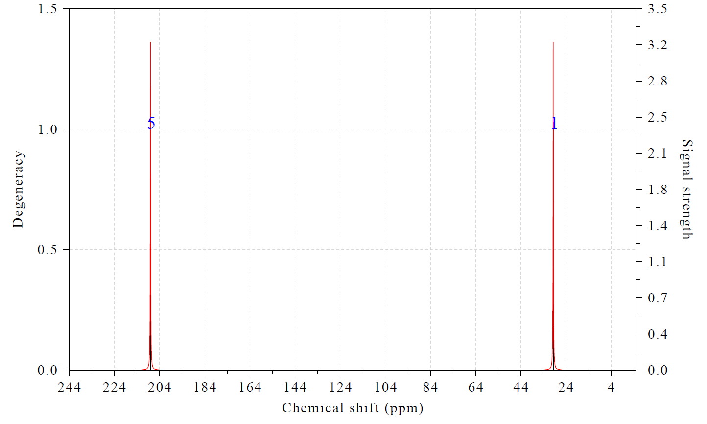

在上图中，黑色尖峰的高度对应“简并度 (Degeneracy)”轴，而红色曲线由尖峰展宽得到，其数值对应“信号强度 (signal strength)”轴。蓝色文本表示峰对应原子的编号。

在Multiwfn控制台窗口中还可以看到以下信息

```text
 Term:    1   Chemical shift:    29.657 ppm   Atom:    1(C )
 Term:    2   Chemical shift:   208.011 ppm   Atom:    5(C )
```

在核磁共振绘图界面中有许多选项用于调整各种绘图设置，例如X和Y轴的范围、原子标签的样式、尖峰和曲线的颜色与粗细、展宽的半高宽 (FWHM)参数等，请根据实际需求尝试使用它们以改善谱图。

接下来，我们绘制¹H核磁共振谱图。输入以下命令

```text
6  // Choose the element considered in plotting
H  // Hydrogen
7  // Set how to determine chemical shifts
1  // Using reference shielding value to derive chemical shifts
a  // As mentioned above, this input corresponds to using built-in reference data of TMS evaluated at B97-2/def2-TZVP level under chloroform
```

需要注意的是，必须对甲基 (methyl group)中三个氢的屏蔽值 (shielding value)取平均，因为在实际环境中甲基很容易旋转，因此该基团中的氢只有一个核磁共振峰。因此我们输入

```text
10  // Average shielding values of specific atoms
2-4  // H2, H3 and H4 are the hydrogens in the methyl group
0  // Plot the spectrum
```

现在可以看到

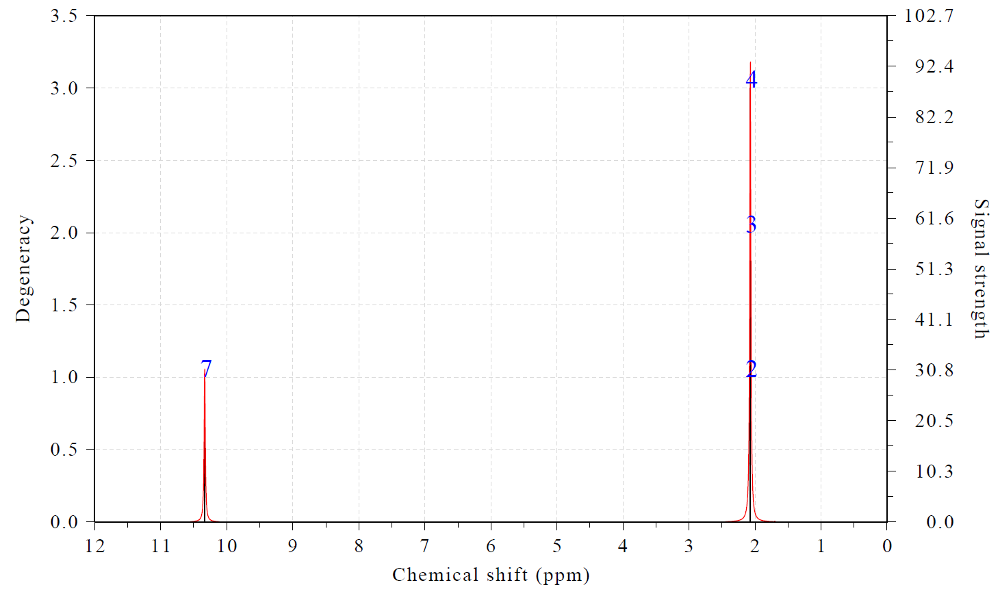

可以看到，绘图效果相当令人满意。控制台窗口中当前显示的信息为：

```text
 Term:    1   Chemical shift:     2.070 ppm   Atom:    2(H )    3(H )    4(H )
 Term:    2   Chemical shift:    10.333 ppm   Atom:    7(H )
```

### **4.11.10.2 基于缩放法的吡啶核磁共振谱图绘制**

如[3.13.5](sec-3-13-plotting-spectra.md#3135-绘制nmr光谱plotting-nmr-spectrum)节所介绍，确定¹H和¹³C化学位移 (chemical shift)还有另一种方法，即缩放法。通过该方法，我们不需要计算参考值，即使使用较低成本的计算水平也能获得较好的化学位移，因为预拟合的缩放参数消除了大部分系统误差。在本节中，我们基于缩放法绘制吡啶的核磁共振谱图。*examples\spectra\NMR\pyridine_scale.out*是Gaussian在B3LYP/6-31G\*水平下计算的核磁共振任务的输出文件，其中氯仿环境由SMD溶剂化模型表示，而几何结构是在真空中以B3LYP/6-31G\*水平优化得到的。<http://cheshirenmr.info>中给出的各种水平的误差统计表明，该水平是应用缩放法最好的水平之一。

启动Multiwfn并输入

```text
examples\spectra\NMR\pyridine_scale.out
11  // Plot various spectrum
7  // NMR
7  // Set how to determine chemical shifts
2  // Set slope and intercept to determine chemical shifts by scaling method
a  // Use built-in slope and intercept parameters prefitted for B3LYP/6-31G* with SMD(chloroform) level, namely slope of -0.9449 and intercept of 188.4418 for ^13C NMR
0  // Plot NMR spectrum
```

现在可以看到

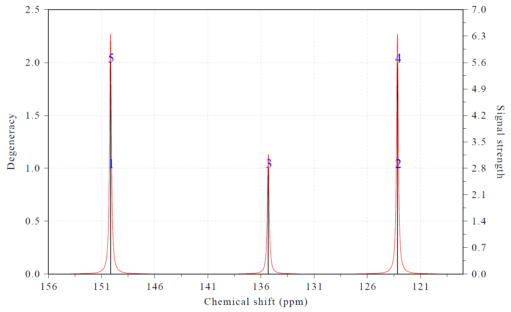
由于吡啶 (pyridine) 的对称性，有两个峰呈现双重简并特征 (double degenerate character)。

类似地，你可以通过定标方法 (scaling method) 绘制 ¹H NMR 谱 (spectrum)，即输入

```text
6  // Choose the element considered in plotting
H
7  // Set how to determine chemical shifts
2  // Set slope and intercept to determine chemical shift by scaling method
a
0  // Plot the spectrum
```

### **4.11.10.3 绘制缬氨酸 (valine) 的构象加权 NMR 谱 (conformation weighted NMR spectrum)**

在本节中，我将说明如何绘制构象加权 NMR 谱。缬氨酸是一种必需氨基酸 (essential amino acid)，在水环境 (aqueous environment) 中它有两种构象异构体 (conformer)，如下所示。括号中的数值是我在水中理论估计的构象权重 (conformation weight)。

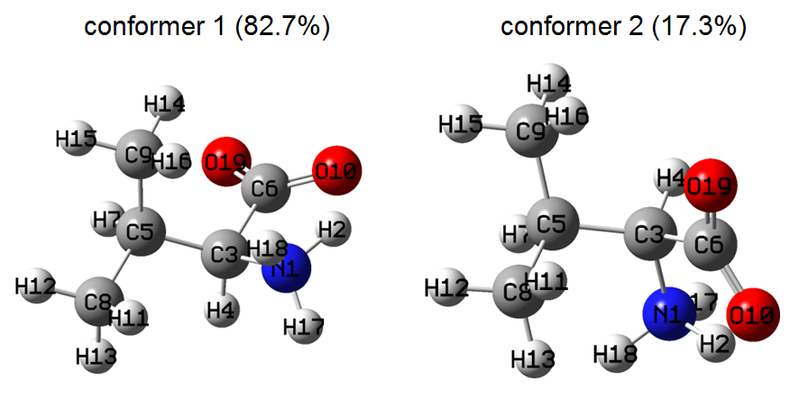

在本节中我们将模拟水中缬氨酸的 ¹H NMR 谱，并将其与在 D₂O 溶剂 (solvent) 中测得的实验谱 (experimental spectrum) 进行比较。注意，由于在重水环境 (heavy water environment) 中质子化氨基 (protonated amino group) 中的三个氢被氘 (deuterium) 完全取代，我们需要从谱中消除它的贡献。此外，我们需要对两个甲基 (methyl group) 中每个甲基的氢的屏蔽值 (shielding value) 取平均。

在 "examples\spectra\NMR\valine" 文件夹中的 *conf1.out* 和 *conf2.out* 是 Gaussian 16 的 NMR 任务的输出文件 (output file)，NMR 计算在 B97-2/def2-TZVP 水平上进行，几何结构 (geometry) 在 B3LYP-D3(BJ)/6-311G\*\* 水平上优化，在这两个计算中均采用 IEFPCM 模型 (model) 表示水环境。

我们首先创建一个名为 *multiple.txt* 的文本文件 (text file)，内容如下（可在文件名中添加前缀，如 *valine_multiple.txt*）：

```text
examples\spectra\NMR\valine\conf1.out 0.825
examples\spectra\NMR\valine\conf2.out 0.175
```

如可见，我们已指定了两个带有相应构象权重的输入文件 (input file)。注意，如果你使用的是 Linux 版本，内容必须如下书写，否则路径无法被识别，下同

```text
"examples/spectra/NMR/valine/conf1.out" 0.825
"examples/spectra/NMR/valine/conf2.out" 0.175
```

现在启动 Multiwfn 并输入

```text
multiple.txt
11  // Plot various spectrum
7  // NMR
6  // Choose the element considered in plotting
H
7  // Set how to determine chemical shifts
1  // Set reference shielding value to determine chemical shift
31.8294  // The TMS reference value that comes from examples\spectra\NMR\valine\TMS.out, which was calculated via exactly the same way as current system
10  // Average shielding values of specific atoms
11-13  // Three methyl group hydrogens
10  // Average shielding values of specific atoms
14-16  // Three methyl group hydrogens
11  // Set strength of specific atoms
2,17,18  // The three hydrogens in the amino group
0  // Making them fully invisible in the spectrum
0  // Plot the NMR spectrum
```

现在你看到以下谱图

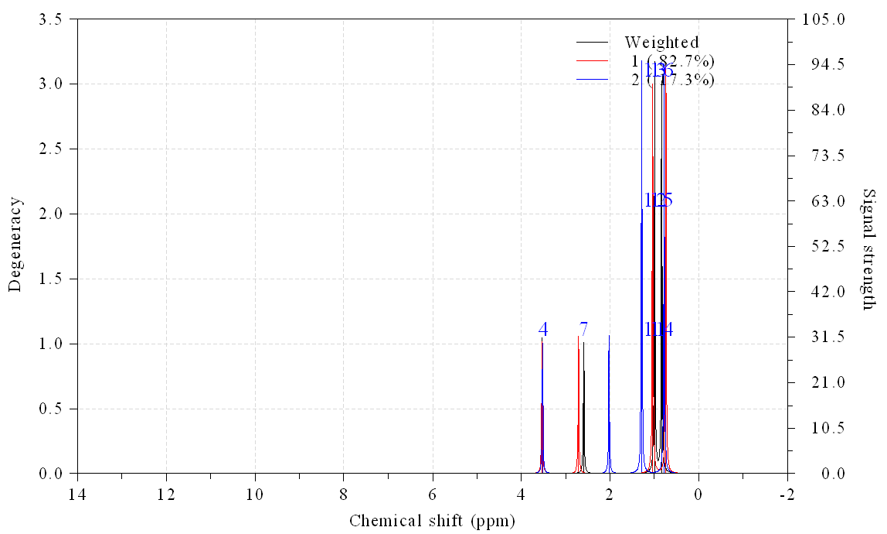

为了改善图的效果，我们关闭图形然后输入

```text
3  // Set lower and upper limits of X-axis
4,0,0.5  // From 4.0 to 0.0 ppm with label spacing of 0.5 ppm
12  // Do not show spikes to make the spectrum clearer
18  // Other plotting settings
5  // Set X position of legends
1300  // Moving the position of the legends more left than default position
0  // Return
```

现在我们选择选项 0 重新绘制，当前的谱图已经相当令人满意
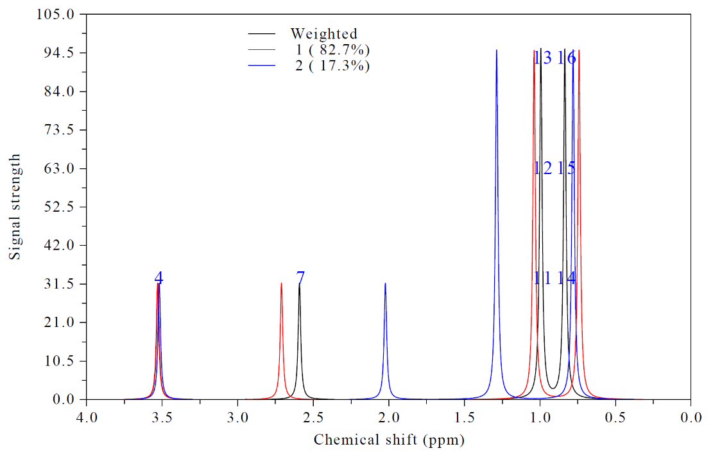

水中缬氨酸的实验 ¹H 核磁共振谱见 <https://hmdb.ca/spectra/nmr_one_d/1582>，将上图与之比较可以发现，我们模拟的核磁共振谱是合理的，并涵盖了实验谱的所有主要特征。

注意，如果只想绘制加权谱 (weighted spectrum)或只绘制两种构象体的谱，可以在选项 17 中选择相应的子选项。

### **4.11.10.4 同时绘制多个体系**

Multiwfn 能够轻松地在同一张图上绘制多个体系的核磁共振谱，如下例所示，前提是所有体系必须具有相同的原子数。在本例中，我们将缬氨酸的两种构象体视为两个独立的体系。

创建一个名为 *multple.txt* 的文件（可在文件名上添加额外前缀），文件内容如下，每行包含一个输入文件的路径和相应的图例 (legend)

```text
examples\spectra\NMR\valine\conf1.out conformer 1
examples\spectra\NMR\valine\conf2.out conformer 2
```

启动 Multiwfn，载入 *multiple.txt*，然后依次运行记录在 *examples\spectra\NMR\valine\drawmulti.txt* 文件中的所有命令，你将看到下图。根据屏幕上的提示，每条命令的含义都很容易理解。

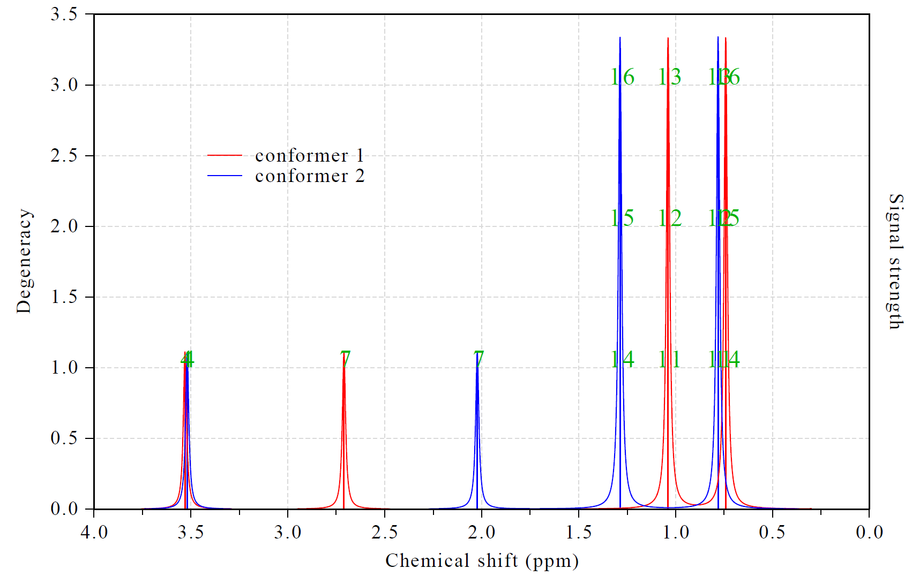

## **4.11.11 绘制 BODIPY 的荧光光谱**

在本例中，我说明如何绘制荧光光谱 (fluorescence spectrum)。绘制荧光光谱与绘制紫外-可见吸收光谱 (UV-Vis absorption spectrum)的区别有两点：

- (1) 若要绘制荧光光谱，应使用发射态 (emission state)（发射光子的激发态 (excited state)）的优化几何结构 (optimized geometry)。而若要绘制吸收光谱，应使用基态 (ground state)的优化几何结构。

- (2) 若要绘制荧光光谱，应手动将除发射态之外的所有已计算激发态的振子强度 (oscillator strength)置零，以消除无关态对光谱的贡献。

几乎所有分子都满足 Kasha 规则 (Kasha’s rule)，即荧光发射仅对应于 S1→S0 跃迁。因此，发射态通常为 S1 态。

接下来，我们将为著名的 BODIPY 分子绘制荧光发射谱：

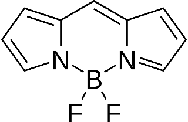

假设 Kasha 规则对该体系成立，因此我们应对 S1 态进行几何优化。该任务在 TD-B3LYP/6-311G\* 水平下 Gaussian 16 A.03 的输出文件为 *examples\excit\BODIPY_S1_opt.out*，同时还进行了频率分析，因为我们要检查是否存在虚频 (imaginary frequency)（未发现虚频）。注意，“TD”关键词在未加额外选项的情况下使用，此时将求解最低的三个激发态 S1、S2 和 S3，感兴趣的态（要优化的态）默认为第一激发态（S1）。默认设置非常适合优化 S1 态。

启动 Multiwfn 并输入

```text
examples\excit\BODIPY_S1_opt.out
11  // Plot spectrum
3  // UV-Vis
```

之后，所有激发态在最终几何结构（S1 几何结构）下的激发能 (excitation energy)和振子强度均已载入 Multiwfn。然后通过输入以下命令清除 S2 和 S3 态的振子强度：

```text
20  // Modify oscillator strengths
2,3  // Select S2 and S3
0  // New oscillator strength
```
现在可以输入选项 0 来绘制光谱 (spectrum)，但默认的坐标轴设置并不理想。因此输入以下命令

```text
3  // Set lower and upper limit of X-axis,
300,750,50  // Lower limit, upper limit and step size in nm
4  // Set left Y-axis
0,1100,100  // Lower limit, upper limit and step size
y  // Correspondingly scale the right Y-axis
```

选择选项 0 后，你将看到荧光光谱 (fluorescence spectrum)

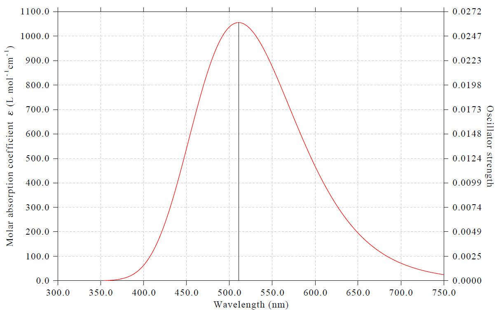

如控制台窗口所示，我们模拟光谱的峰位置为 510.7 nm，与实验峰位置 512 nm 非常接近（见 <https://en.wikipedia.org/wiki/BODIPY>）。

### **关于绘制磷光谱 (phosphorus spectrum)**

值得注意的是，如果你是 Gaussian 用户，无法使用上述步骤绘制磷光谱（根据 Kasha’s rule 对应于 T1→S0 发射），因为如果不考虑自旋-轨道耦合 (spin-orbit coupling, SOC)，由于自旋禁阻，振子强度 (oscillator strength)必定严格为零，而 Gaussian 无法在 TDDFT 计算中考虑 SOC 效应。要绘制磷光谱，我建议的步骤为：

- (1) 使用你喜欢的量子化学程序优化 T1 几何结构

- (2) 基于 T1 几何结构，使用 Dalton 程序，利用考虑 SOC 的 TDDFT 理论计算 T1 态的振子强度和激发能 (excitation energy)

- (3) 从 Dalton 输出文件中提取 T1 的振子强度和激发能，并手动将其写入 Multiwfn 可识别格式的纯文本文件，关于该格式见节 [3.12.2](sec-3-12-plotting-density-of-states-pes-and-cohp.md#3122-输入文件input-file)。

- (4) 将纯文本文件载入 Multiwfn，然后进入主功能 11，选择 “UV-Vis”，再直接选择选项 0 绘制光谱，该光谱即对应于磷光谱。

## **4.11.12 绘制部分振动谱 (partial vibrational spectrum, PVS)和部分振动能态密度 (partial vibrational density-of-states, PVDOS)**

部分振动谱 (partial vibrational spectrum, PVS)的概念已在节 [3.13.6](sec-3-13-plotting-spectra.md#3136-部分振动光谱-partial-vibrational-spectrum-pvs和部分振动态密度-partial-vibrational-density-of-states-pvdos)中描述，如果缺乏相关知识请先仔细阅读。在接下来的几节中，我将说明如何使用 Multiwfn 绘制它，以直观理解各种振动光谱的本质。你会发现 PVS 是一种非常通用而灵活的分析方法。同时，还将说明部分振动能态密度 (partial vibrational density-of-states, PVDOS)的绘制，这是一种以图形方式揭示全部（包括光谱非活性）振动模式组成的实用方法。

### **4.11.12.1 C₁₈⋅⋅⋅B₉N₉复合物红外光谱 (IR spectrum)的 PVS-NC 分解分析**

在本例中，我们使用 PVS-NC 方法直观理解分子复合物 C₁₈⋅⋅⋅B₉N₉的红外光谱所对应振动模式的组成，其优化几何结构如下所示

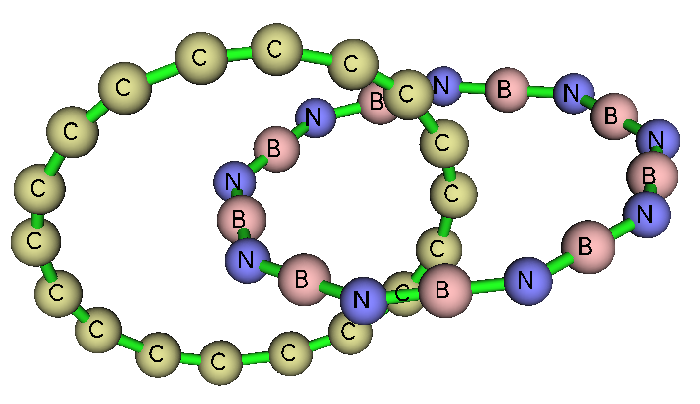

在 ωB97XD/6-311G\*水平下 Gaussian 16 程序频率分析任务的输出文件将用作绘制红外光谱和 PVS-NC 曲线的输入文件，该文件为 *examples\spectra\C18-B9N9.out*。注意，在 “freq”关键词中指定了 “intmodes”选项，其要求 Gaussian 打印每个振动模式中冗余内坐标 (redundant internal coordinates, RICs)的组成，添加该选项的原因是，在后续示例之一中我将说明如何基于由 RICs 构成的片段绘制 PVS-NC 图。如果你只想将片段定义为一组原子，则不需要该选项。
#### **绘制普通红外光谱 (common IR spectrum)**

我们首先绘制 C₁₈⋅⋅⋅B₉N₉ 复合物的普通红外光谱。启动 Multiwfn 并输入

```text
examples\spectra\C18-B9N9.out
11  // Plot various kinds of spectrum
1  // IR
0  // Plot spectrum on screen
```

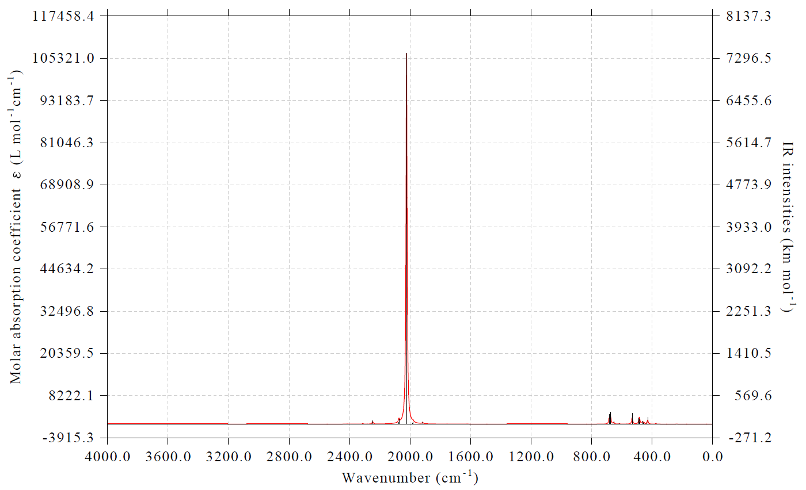

从上图中可以看到许多峰，*它们本质是什么*？通过部分振动光谱-简正坐标曲线 (PVS-NC curves)，你可以很容易地理解哪个分子片段 (molecular fragment)在上图中可观测的振动模式 (vibration modes)的振动运动 (vibrational motions)（由相应的简正坐标 (normal coordinates)表示）中有显著参与。而通过部分振动光谱-强度 (PVS-I)，你可以直观地理解分子片段是否对上图中各峰的红外吸收强度 (IR absorption intensities)有明显贡献。因此，PVS-NC 和 PVS-I 分别侧重于揭示光谱活性振动模式 (spectral active vibrational modes)不同方面的特征。在本节剩余部分，我将说明 PVS-NC 曲线的绘制，而在下一节中，将举例说明 PVS-I 的绘制。更具体地说，本节绘制的 PVS-NC 是 PVS-NC(atom)，因为我们将把每个片段定义为一组原子。

#### **绘制 PVS-NC(atom) 图**

假设我们想研究 C₁₈ 原子和 B₉N₉ 原子的运动如何对上述红外光谱对应的振动产生贡献，我们应在光谱绘制界面 (spectrum plotting interface)中输入以下命令

```text
24  // Set partial vibrational spectra (PVS) or vibrational DOS (VDOS)
1  // Define PVS fragment 1
1-18  // Atoms in C_18
2  // Define PVS fragment 2
19-36  // Atoms in B_9N_9
l  // Set legends of PVS curves
1  // Set legend for PVS
cyclo[18]carbon  // Full name C_18
2  // Set legend for PVS
B9N9
q  // Save and return
q  // Generate PVS data and return to spectrum plotting interface
```

从屏幕上你可以找到我们刚才定义的两个片段在每个振动模式中的组成：

```text
Vibrational mode     1 (      7.20 cm^-1 )
   Fragment  1   Composition:   62.1646 %
   Fragment  2   Composition:   37.8354 %
 Vibrational mode     2 (     10.65 cm^-1 )
   Fragment  1   Composition:   39.3017 %
   Fragment  2   Composition:   60.6983 %
...[ignored]
```

选择选项 *0* 以绘制光谱，然后你可以在屏幕上看到如下图

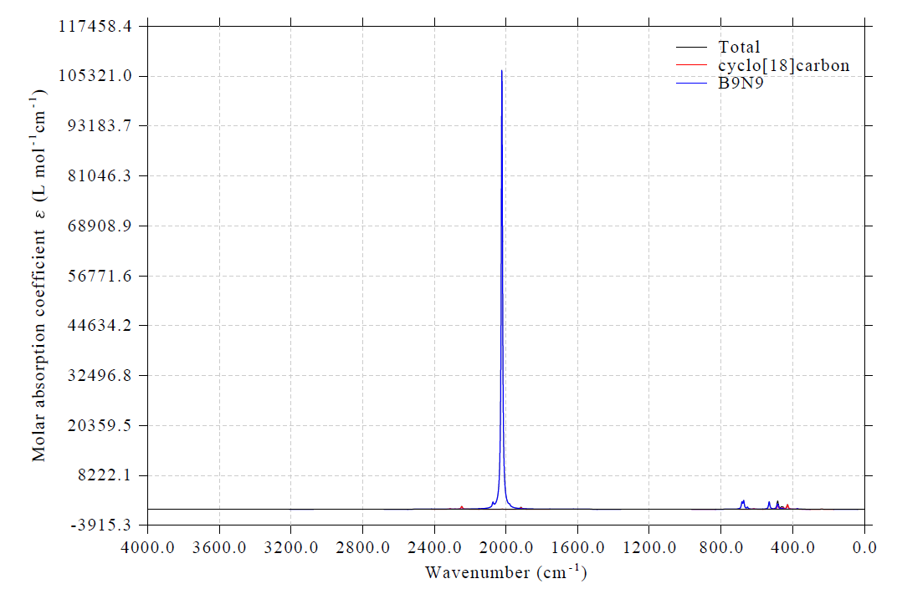

事实上，图中存在三条曲线，总红外光谱（黑色）、片段 1（C₁₈，红色）的 PVS 和片段 2（B₉N₉，蓝色）的 PVS，后两者之和对应于前者。然而，从当前图中我们只能清楚地看到在约 2000 cm⁻¹ 处存在一个异常强的吸收。由于该峰完全为蓝色，我们可以得出结论，该吸收必定纯粹对应于 B₉N₉ 的振动。

从上图可以看到在低频区存在许多中等强度的红外吸收。为了查看其细节，我们输入以下命令

```text
3  // Set lower and upper limit of X-axis
750,350,50  // Lower limit, upper limit and interval of X-axis
4  // Set left Y-axis
0,3000,300  // Lower limit, upper limit and interval of left Y-axis
y  // Correspondingly scale right Y-axis
16  // Set status of showing labels of spectrum minima and maxima
1  // Change displaying status of labels
1  // Show maxima on the spectrum
0  // Return
0  // Plot spectrum
```

现在你可以看到如下图

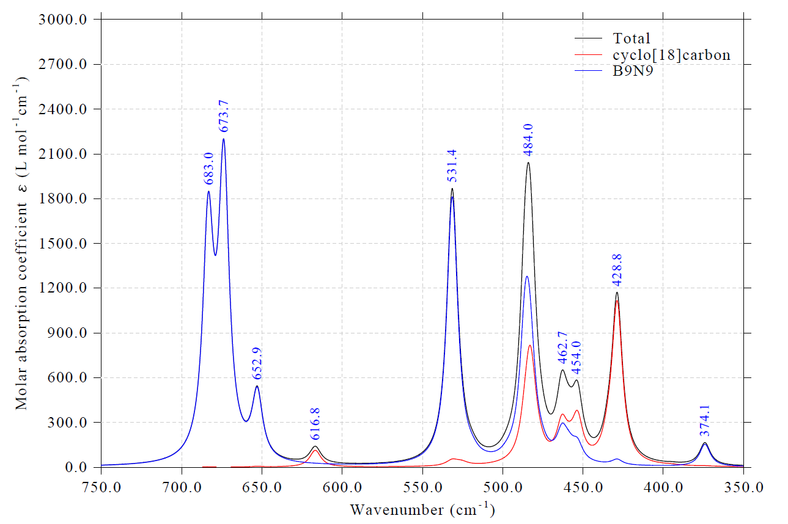

该图信息量很大。例如，可以清楚地看到，位于 428.8 cm⁻¹ 处的峰几乎完全来自 C₁₈ 的振动，位于 531.4 cm⁻¹ 处的峰几乎仅对应于 B₉N₉ 的振动，位于 484.0 cm⁻¹ 处的峰显示出明显的耦合振动特征。与上述峰最大对应的模式的简正坐标如下所示，这与我们通过检查 PVS 图所得的预期一致。
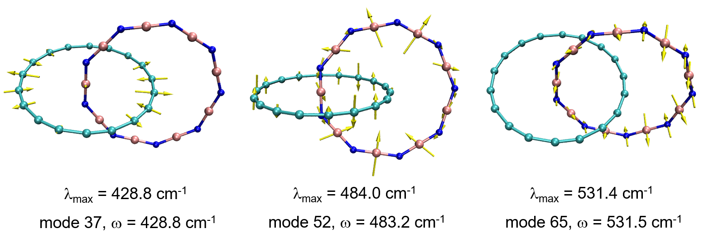

虽然在本节中我仅示例了定义两个片段 (fragment)，但在 Multiwfn 中实际上最多可定义 10 个片段，所有 PVS 曲线可一起显示。片段的并集不一定对应于整个体系。

值得强调的是，PVS 曲线仅展示各个片段对各个振动模式 (vibrational mode) 的简正坐标 (normal coordinate) 的贡献，它们并不直接反映片段对吸收强度 (absorption intensity) 的贡献。换言之，一个片段对某振动模式的简正坐标的百分比贡献与其对该振动模式强度的贡献不成正比。在讨论 PVS/OPVS 曲线时应正确认识这一点。例如，从一个非极性基团 (nonpolar group) 的 PVS 曲线上，你可能会观察到一个明显的 IR 活性模式在其简正坐标中含有该基团振动的很大成分，但不应据此得出该非极性基团的振动是强 IR 吸收来源的结论。

#### **绘制原子定义的片段间的 OPVS 图**

我们还可以绘制两个片段之间的 OPVS 曲线，以非常方便地考察它们在不同波数 (wavenumber) 范围内的集体振动 (collective vibration) 的贡献。为了绘制 C₁₈ 与 B₉N₉ 之间的 OPVS，我们输入

```text
24  // Set partial and overlap vibrational spectra
0  // Set OPVS
1,2  // OPVS will be drawn between fragments 1 and 2
d  // Set display status of PVS/OPVS curves
1  // Disable showing PVS of fragment 1 for clarity
2  // Disable showing PVS of fragment 2 for clarity
q  // Return
q  // Return to spectrum plotting interface
0  // Plot spectrum again
```

现在你可以看到总 IR 光谱以及 OPVS 曲线

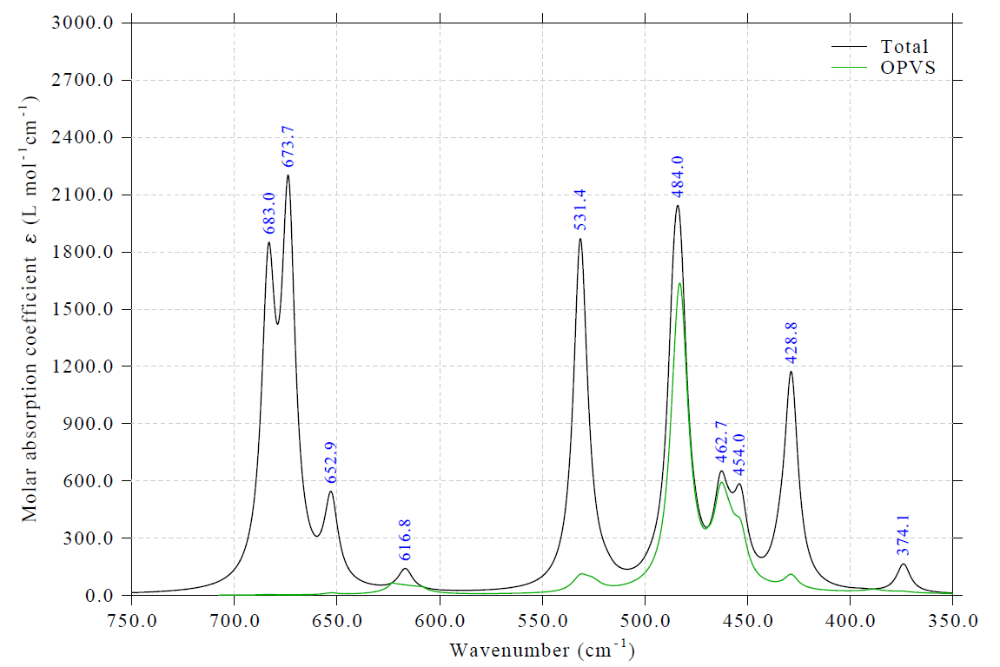

此 OPVS 图生动地显示了对各个 IR 峰的耦合 (coupling) 贡献。在 450 至 500 cm⁻¹ 之间的区域，耦合效应很强；特别是在 462.7 cm⁻¹ 处，绿色曲线与黑色曲线非常接近，因此，根据第 [3.13.6](sec-3-13-plotting-spectra.md#3136-部分振动光谱-partial-vibrational-spectrum-pvs和部分振动态密度-partial-vibrational-density-of-states-pvdos) 节中描述的 OPVS 定义，我们知道相应的 IR 活性模式应完全且几乎均等地由 C₁₈ 和 B₉N₉ 部分的振动贡献。从这两个片段在此波数处的 PVS 曲线可以证实这一点。相比之下，在大于 650 cm⁻¹ 的波数区域，绿色曲线可忽略不计，因此，652.9、673.7 和 683.0 cm⁻¹ 处的峰必定仅由两个片段中的某一个贡献。此例表明 OPVS 对于快速理解不同波数范围内各个片段之间的振动耦合非常有帮助。

### **4.11.12.2 C₁₈⋅⋅⋅B₉N₉ 复合物 IR 光谱的 PVS-I 分解分析**

待编写

### **4.11.12.3 C₁₈⋅⋅⋅B₉N₉ 复合物振动光谱的 PVDOS 分析**

本节待编写

简言之，振动态密度 (VDOS) 与假设所有振动模式强度等于 1 时的振动光谱非常相似。PVDOS/OPVDOS 与 VDOS 之间的关系等同于 PVS/OPVS 与实际振动光谱之间的关系。

在本节中我举例说明如何绘制 VDOS、片段的部分 VDOS (partial VDOS, PVDOS) 以及片段间的重叠 PVDOS (overlap PVDOS, OPVDOS)。仍以上一节使用的 C₁₈⋅⋅⋅B₉N₉ 复合物为例，将两个分子定义为两个片段。
启动 Multiwfn 并输入

```text
examples\spectra\C18-B9N9.out
11  // Plot various kinds of spectrum
1  // IR
24  // Set partial and overlap vibrational spectra
1  // Define PVS fragment 1
1-18  // Atoms in C_18
2  // Define PVS fragment 2
19-36  // Atoms in B_9N_9
l  // Set legends of PVS curves
1  // Set legend for PVS
cyclo[18]carbon  // Full name C_18
2  // Set legend for PVS
B9N9
q  // Return
0  // Set OPVS
1,2  // Plot between fragments 1 and 2
v  // Toggle plotting vibrational DOS instead of spectrum. Then PVS will correspond to PVDOS, and OPVS will correspond to OPVDOS
q  // Generate PVS data and return to spectrum plotting interface
3  // Set lower and upper limit of X-axis
2400,0,300  // Lower limit, upper limit and interval between ticks
17  // Other plotting settings
11  // Set position of legends
8  // Upper left corner
0  // Return to spectrum plotting interface
0  // Plot spectrum
```

现在你可以看到如下的图

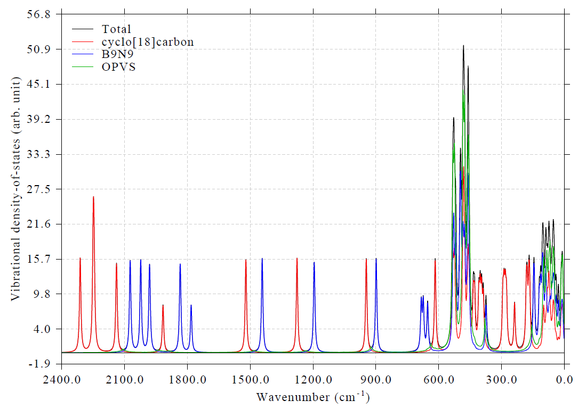

从该图中可以发现振动模式 (vibrational modes)在 600 cm⁻¹ 以上稀疏分布，而在 600 cm⁻¹ 以下振动模式的分布要密集得多。此外，发现 600 cm⁻¹ 以上的振动模式在 C₁₈ 和 B₉N₉ 之间没有显示出可察觉的耦合运动，强的片段间耦合模式密集地出现在 500 cm⁻¹ 附近和 100 cm⁻¹ 以下。如果你将 X轴 (X-axis)的范围调整为仅绘制 0\~600 cm⁻¹ 区域，这一点可以看得更清楚，如下所示。总光谱 (total spectrum)的峰位置 (peak positions)也通过选项 16 进行了标注。

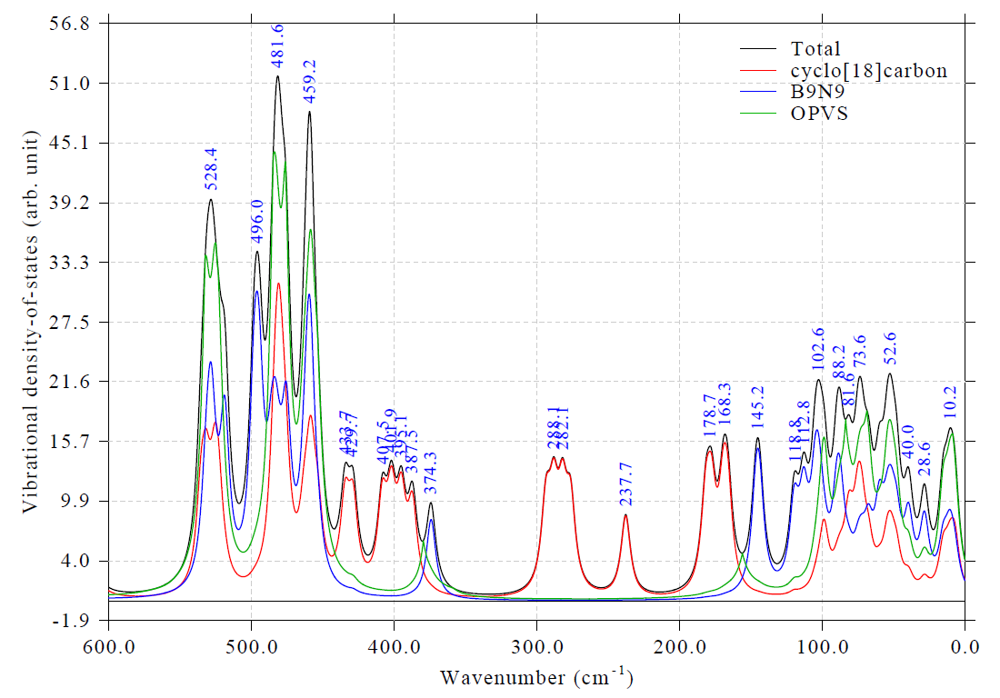

振动态密度 (VDOS)与振动光谱 (vibrational spectrum)之间的一个很大不同点在于，在前者中，所有模式对曲线具有同等贡献，换句话说，你可以观察到所有模式；而在后者中，只有具有不可忽略强度的模式才对曲线有贡献，因而在视觉上可辨。

### **4.11.12.4 苯丙氨酸 (phenylalanine)VCD光谱 (VCD spectrum)的PVS-NC分解分析 (PVS-NC decomposition analysis)**

待编写

### **4.11.12.5 绘制定向IR光谱 (directional IR spectrum)**

待编写

## **4.11.13 绘制定向UV-Vis光谱 (directional UV-Vis spectrum)**

> **注 (Note)**
>
> 本主题的中文版是我的博客文章“Simulating UV-Vis absorption spectrum in specific directions using Multiwfn”(<http://sobereva.com/648>)。

如 [3.13.1](sec-3-13-plotting-spectra.md#3131-理论theory)节所述，可绘制定向UV-Vis光谱以研究体系与沿特定方向振荡的电场 (electric field)相互作用引起的光吸收 (optical absorption)，如果你对光谱特征 (spectral character)的各向异性 (anisotropy)感兴趣，这特别有价值。

在本节中，我们研究具有以下结构和取向的碳纳米管片段 (carbon nanotube fragment)：

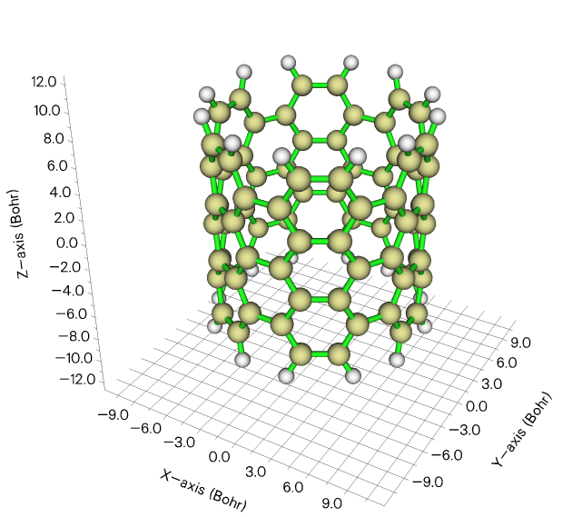

首先，我们绘制该体系对应于与平行于XY平面振荡的电场相互作用的UV-Vis光谱 (UV-Vis spectrum)。现在，启动 Multiwfn 并输入

```text
examples\spectra\CNT66_TDDFT.out  // TDDFT output file of Gaussian at PBE0/6-31G* level, 100 excited states were calculated
11  // Plotting spectra
-3  // Plotting directional UV-Vis spectrum
4  // XY direction
0  // Plot spectrum
```

关闭屏幕上显示的图形并输入以下命令以调整绘图设置 (plotting settings)

```text
3  // Adjust X-axis
200,800,50  // Lower and upper limits, as well as label interval
3  // Adjust left Y-axis
200,800,50  // Lower and upper limits, as well as label interval
y  // Correspondingly scale right Y-axis
```
通过选择 option 0 重绘图像 (map)，然后你将看到

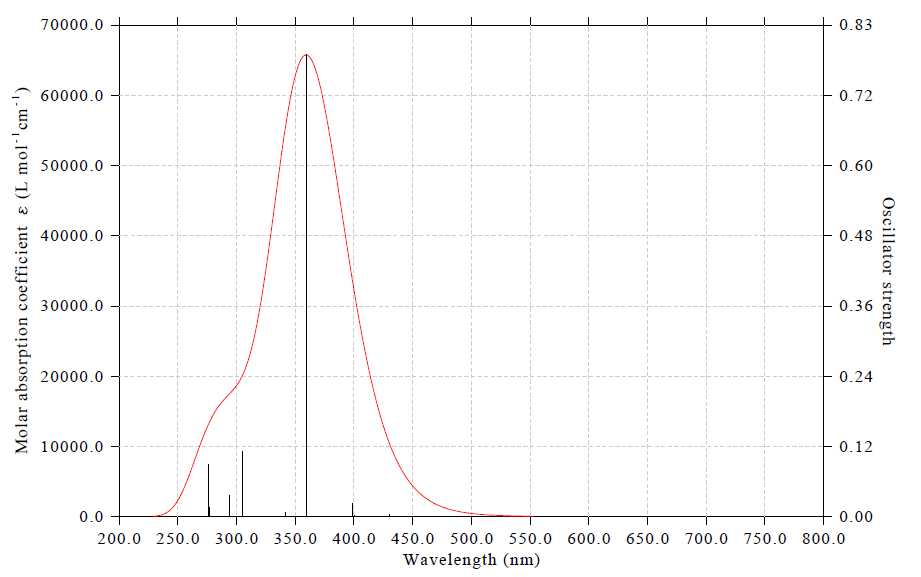

类似地，你可以绘制与沿Z方向振荡的电场相互作用对应的紫外-可见光谱。

在绘制了上述XY和Z光谱之后，如果你通过 option 2 将曲线数据和直线数据导出到 .txt 文件，然后你可以将它们一起导入第三方软件，例如 Origin，并绘制包含总体、XY和Z数据的图像，如下所示，其中“Total”曲线对应于XY和Z曲线之和，也对应于通常意义上的紫外-可见光谱。

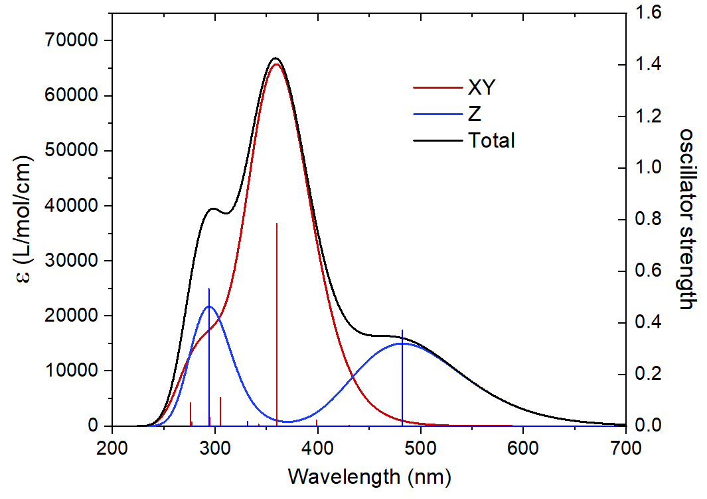

在上面的图像中，可以看到，370 nm附近的最强吸收完全来自体系与在XY平面内振荡的电场的相互作用。由于电场的振荡方向垂直于光的传播方向，XY曲线可以理解为沿Z方向传播的光的吸收曲线。上面图像中的Z曲线对300和480 nm附近的吸收贡献最大，它对应于在XY平面上传播且偏振沿Z方向的光的吸收。这一观察还表明，只有这些波长处的电子激发具有显著的Z方向跃迁偶极矩 (transition dipole moment)。

本例表明，对于具有显著各向异性特征 (anisotropic features)的体系，绘制特定方向的紫外-可见光谱有助于清楚地理解其吸收光谱的内在本质。

## **4.11.14 靛蓝 (indigo)和诱惑红 (allura red)颜色的预测**

> **注**
>
> 本例的中文版为“Prediction of color of chemical substances by quantum chemical calculations and Multiwfn program” (<http://sobereva.com/662>)，其中还包含更多讨论。

请阅读 3.13.7 节以了解 Multiwfn 中颜色预测功能的基木特征。在本节中，我们将基于理论计算预测靛蓝的颜色，然后基于实验测得的紫外-可见光谱预测诱惑红的颜色。

### **4.11.14.1 基于理论计算预测靛蓝的颜色**

```text
examples\spectra\indigo_TD-B3LYP_water.out is output file of Gaussian of calculating electronic excited states at TD-B3LYP/def2-TZVP level in water environment represented by IEFPCM solvation model. The geometry was optimized for ground state at B3LYP/6-311G* level. Boot up Multiwfn and load this file, then input
11  // Plotting spectrum
3   // UV-Vis
25   // Evaluate color based on the spectrum in visible range
```

Multiwfn 首先显示360-830 nm范围内的紫外-可见光谱，见下图（PS：可见光范围为380-760 nm，或400-700 nm。360-830 nm的范围对应于三刺激值函数 (tristimulus functions)有定义的范围，其在内部参与颜色预测过程）：

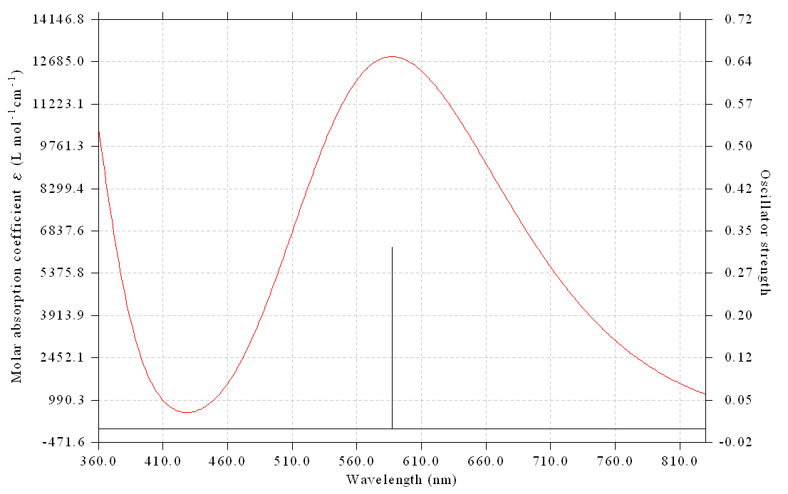

关闭窗口后，Multiwfn显示基于光谱曲线预测的颜色：

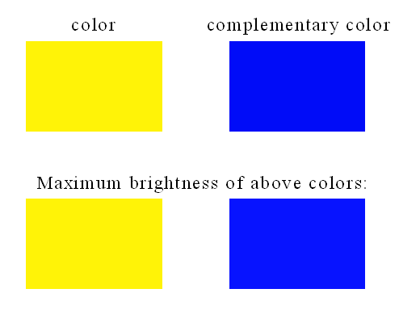

在“color”标签下显示的颜色是与紫外-可见光谱对应的颜色，而在“complementary color”下方显示的颜色对应于靛蓝的透射光和反射光的颜色。窗口底部显示的两种颜色是通过平移RGB值 (RGB values)使颜色中数值最大的分量等于255（sRGB色彩空间 (sRGB color space)的上限）而得到的窗口上部显示的两种颜色的对应颜色。简而言之，如窗口右下角所示的深蓝色可视为靛蓝水溶液实际呈现的颜色。这一预测的颜色与靛蓝的实际颜色完全一致，是极为成功的预测！
从 Multiwfn 的文本窗口 (text window)中，你还可以找到图形窗口 (graphic window)上显示的四种颜色 (colors)的参数 (parameters)以及一些中间数据 (intermediate data)：

```text
CIE1931 XYZ:              1077992.509       1123653.902        188673.482
Fractional CIE1931 XYZ:      0.9593634718      1.0000000000      0.1679106720
CIE1931 xy:              0.4509825283      0.4700851571
Note the R,G,B values shown below correspond to standard RGB (sRGB) color space
RGB (0-1):    1.487926  0.953110  0.026876
RGB (0-255):   379   243     7
Note: The color exceeds sRGB color space! Now the R,G,B values are scaled into
alid range:
RGB (0-1):    1.000000  0.953110  0.026876
RGB (0-255):   255   243     7
RGB of complementary color:     0    12   248
RGB of original color (maximum brightness):        255   243     7
RGB of complementary color (maximum brightness):     7    19   255
```

### **4.11.14.2 基于实验 UV-Vis 光谱 (experimental UV-Vis spectrum)预测 allura red 的颜色**

*examples\spectra\Allura_red_UV-Vis.txt* 是著名染料 (dye) allura red 的实验 UV-Vis 光谱的 X-Y 曲线数据 (X-Y curve data)。在本例中，我们基于该光谱预测 allura red 的颜色。

启动 Multiwfn 并载入 *examples\spectra\Allura_red_UV-Vis.txt*，然后输入

```text
11  // Plotting spectrum
0   // Predicting color based on UV-Vis spectrum recorded in text file
```

现在你可以在屏幕上看到如下的图 (map)：

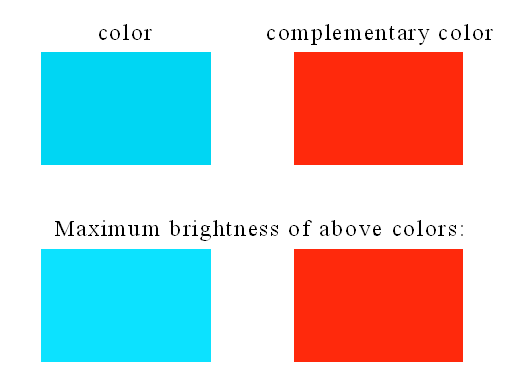

从下方显示的颜色可以看出，allura red 的颜色为红色，这正是实际观察到的该物质的颜色。该图还表明 allura red 吸收青色 (cyan color)的光。