# **4.12 分子表面的定量分析 (Quantitative analysis of molecular surface)**

## **4.12.1 苯酚分子表面的静电势 (Electrostatic potential)分析**

下面将以苯酚为例介绍分子表面的定量分析。第[3.15.1](sec-3-15-quantitative-analysis-of-molecular-surface.md#3151-理论)节中已记载了理论基础，因此此处不再重复。本节仅分析苯酚vdW表面上的静电势 (electrostatic potential, ESP)，下一节将分析苯酚表面上的平均局部电离能 (average local ionization energy)。

启动Multiwfn并输入以下命令

```text
examples\phenol_631Gxx.wfn  // Phenol wavefunction produced at B3PW91/6-31G** level. For most systems this level can give acceptable result of ESP analysis. For better accuracy, def-TZVP is recommended, while more expensive def2-TZVP basis set is able to give ideal result
12  // Quantitative analysis of molecular surface
0  // Start the analysis under default settings. By default, the mapped function is ESP
```

此时计算开始。由于计算ESP耗时较长，需要等待一段时间。计算过程中会打印一些中间信息，大多数用户无需关注它们。计算最终完成后，屏幕上将打印以下结果：

```text
Global surface minimum: -0.041203 a.u. at   1.455097   3.343708  -0.007902 Ang.
Global surface maximum:  0.085761 a.u. at  -1.936645   3.093464   0.021360 Ang.

Number of surface minima:     3
   #       a.u.         eV      kcal/mol           X/Y/Z coordinate(Angstrom)
     1 -0.03046066   -0.828877  -19.112843       0.150202  -1.011077  -1.882004
     2 -0.03045989   -0.828856  -19.112362       0.192185  -0.985412   1.877656
*    3 -0.04120321   -1.121196  -25.853368       1.455097   3.343708  -0.007902

Number of surface maxima:     5
   #       a.u.         eV      kcal/mol           X/Y/Z coordinate(Angstrom)
     1  0.02275520    0.619200   14.277975      -3.344441  -2.281045   0.047286
*    2  0.08576096    2.333674   53.811572      -1.936645   3.093464   0.021360
     3  0.01935782    0.526753   12.146259       0.066223  -4.286661   0.040555
     4  0.01980285    0.538863   12.425498       3.340574  -2.325727   0.021485
     5  0.01583741    0.430958    9.937340       3.419218   1.225375  -0.019326

      ================= Summary of surface analysis =================
Volume:   835.71041 Bohr^3  ( 123.83953 Angstrom^3)
Overall surface area:         476.05682 Bohr^2  ( 133.30951 Angstrom^2)
Positive surface area:        231.09186 Bohr^2  (  64.71232 Angstrom^2)
Negative surface area:        244.96497 Bohr^2  (  68.59719 Angstrom^2)
Overall average value:   -0.00020233 a.u. (  -0.12695332 kcal/mol)
Positive average value:   0.01877643 a.u. (  11.78145591 kcal/mol)
Negative average value:  -0.01810626 a.u. ( -11.36095315 kcal/mol)
Overall variance (sigma^2_tot):  0.00041488 a.u.^2 ( 163.34165024 (kcal/mol)^2)
Positive variance:        0.00031106 a.u.^2 ( 122.46642148 (kcal/mol)^2)
Negative variance:        0.00010382 a.u.^2 (  40.87522876 (kcal/mol)^2)
Balance of charges (nu):   0.18762182
Product of sigma^2_tot and nu:   0.00007784 a.u.^2 (  30.6464578 (kcal/mol)^2)
Internal charge separation (Pi):   0.01842642 a.u. (  11.56183883 kcal/mol)
Molecular polarity index (MPI):   0.50154872 eV (     11.56600 kcal/mol)
Nonpolar surface area (|ESP| <= 10 kcal/mol):     67.26 Angstrom^2  ( 50.45 %)
Polar surface area (|ESP| > 10 kcal/mol):         66.05 Angstrom^2  ( 49.55 %)
```
上述信息包含与静电势 (ESP)相关的各种量，它们的含义和定义见第[3.15.1](sec-3-15-quantitative-analysis-of-molecular-surface.md#3151-理论)节。现在在后处理界面 (post-processing interface)中选择 option 0 以查看分子结构和表面极值点 (surface extrema)（红色和蓝色小球分别对应极大值点和极小值点）：

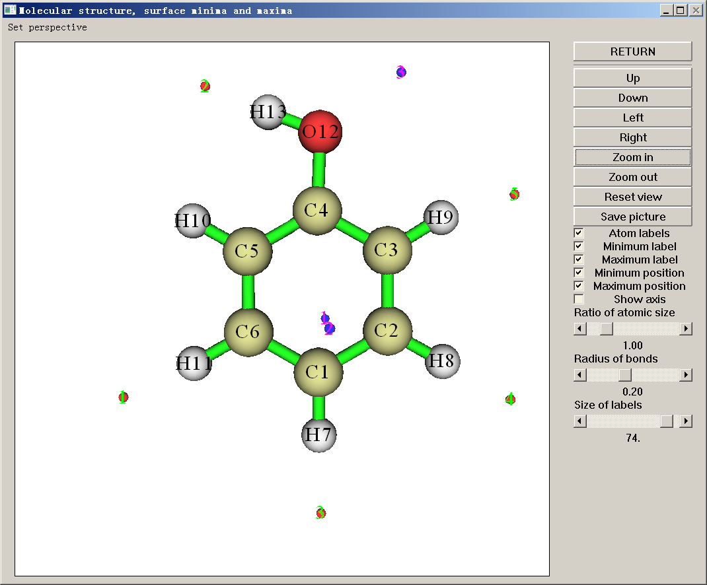

侧视图：

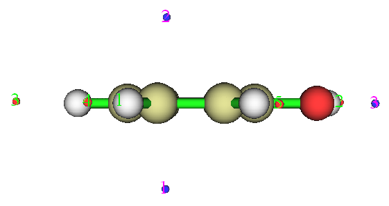

极小值点 3（-25.85 kcal/mol）是表面上的全局最小点 (global minimum)，其很大的负值源于氧的孤对电子 (lone pair)。极大值点 2（53.81 kcal/mol）是全局最大点 (global maximum)，源自带正电的 H13，该点处的静电势远大于其他极大值点处的静电势（其他极大值点处的静电势在 10 至 15 kcal/mol 范围内）。这是由于氧的存在，它从 H13 吸引了大量电子。在复合物中，假设仅存在静电相互作用，单体 (monomer)总是以静电势最大程度互补的方式彼此接触。因此，我们可以预期，在苯酚二聚体中，一个单体中的 H13 和极大值点 2 与相邻单体中的 O12 和极小值点 3 将位于一条直线上（形成氢键 (hydrogen bonding)），这正是苯酚二聚体实际几何构型中的情形，见下图。注意，在二聚体中，上面所示的极大值点 2 和极小值点 3 已相互抵消。

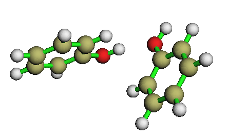

极小值点 1 和 2（均为 -19.11 kcal/mol）是表面上的局域最小点 (local minimum)，主要源于环上方和下方丰富的 π 电子。众所周知，亲电试剂 (electrophiles)总是优先进攻周围静电势很低的原子，因此 C1 应是亲电反应的理想反应位点。该结论与羟基是邻对位定位基的一般认识部分一致。然而，尽管全局最小点最靠近 O12，O12 却不是亲电反应位点；这一矛盾揭示了静电势分析方法的内在局限性。

> **注 1**
>
> 由于该分子具有 C$_{s}$ 对称性，原则上极小值点 1 和 2 应具有相同的 X 和 Y 坐标。然而，在数值过程中这一点无法被精确满足，因为散布在分子表面上的点不具有分子对称性，详情见第[3.15.1](sec-3-15-quantitative-analysis-of-molecular-surface.md#3151-理论)节。因此，极小值点 1 和 2 的 X 和 Y 坐标彼此略有偏离。如果想要改进结果，选择 option 3 "Spacing of grid data for generating molecular surface" 并输入一个比默认值更小的值。更小的格点间距会得到更精确的结果，但会带来更高的计算负担。

> **注 2**
>
> 由于 Multiwfn GUI 的限制，有时难以查询感兴趣的静电势极值点的序号，在这种情况下推荐改用 VMD，参见该视频的 Part 6 <https://youtu.be/QFpDf_GimA0>。

> **注 3**
>
> 也可以在平面图 (plane map)中特定等值 (isovalue)的等值线 (contour line)上绘制静电势极值点，见第[4.4.12](sec-4-4-output-and-plot-various-properties-in-a-plane.md#4412-在等值线上显示函数的极值点)节。

### **互穿距离 (Mutual penetration distance)**

在分子中的原子 (atoms in molecule, AIM)理论框架下定义的非键半径 (non-bonded radius)是原子核与 *ρ* = 0.001 a.u. isosurface 之间的最短距离。让我们计算 O12 和 H13 的非键半径。在后处理界面中选择 option 10 并输入 12，可以看到 O12 的非键半径为 1.701 Å。选择 10 并输入 13，H13 的非键半径为 1.172 Å。在苯酚二聚体中，氢键的 H---O 为 1.937 Å，因此所谓的互穿距离为 1.701+1.172-1.937=0.936 Å。这是一个不可忽略的值，表明该氢键很强。
### **分子表面 (molecular surface)上的静电势 (ESP)统计分布**

作为静电势分析的最后一步，我们考察每个静电势区间内的分子表面积，这有助于定量讨论整个分子表面上的静电势分布。我们在后处理界面 (post-processing interface)中选择选项 9，然后输入：

```text
all  // All atoms are taken into the statistics (alternatively, if you input for example 2-4, then only the local surfaces corresponding to atom 2, 3 and 4 will be taken into account, see Section 4.12.3 for illustration of the concept of local molecular surface)
-30,55  // The ESP range you are interested in. Since we have already known that the minimum and the maximum ESP on the surface are -25.85 and 53.81 kcal/mol respectively, here we input a slightly larger range to enclose them
15  // The number of intervals
3  // Both the inputted and outputted units are in kcal/mol
```

然后你将看到每个连续静电势区间内的表面积（单位为 Ų）及其占整个表面积的百分比。

```text
     Begin        End       Center       Area         %
   -30.0000    -24.3333    -27.1667      1.8192      1.3647
   -24.3333    -18.6667    -21.5000      6.0284      4.5221
   -18.6667    -13.0000    -15.8333     20.9732     15.7327
   -13.0000     -7.3333    -10.1667     19.0390     14.2818
...
    43.6667     49.3333     46.5000      1.2690      0.9519
    49.3333     55.0000     52.1667      1.0457      0.7844
Sum:                                   133.3095    100.0000
```

利用这些数据，你可以使用你喜欢的程序绘制直方图 (histogram)。例如，我们选择 "center" 列作为X轴、"Area" 列作为Y轴，绘制下图

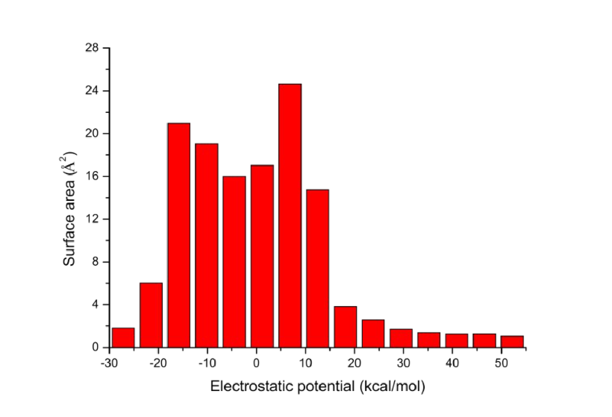

从图中可以看出，分子表面的很大一部分具有较小的静电势值，即从-20到20 kcal/mol。在这些区域中，负值部分主要对应于六元环上方和下方的表面，显示了丰富的π电子云的效应；正值部分主要源于带正电的C-H氢；近中性部分代表负、正部分之间的边界区域。还有小面积区域具有显著的正、负静电势值，分别对应于接近全局静电势最小值和最大值附近的区域。

### **绘制静电势着色的分子表面**

借助VMD程序，可以基于Multiwfn的输出，为各种实空间函数 (real space functions)绘制非常美观的、带有表面极值点 (surface extrema)的颜色填充分子表面图。下面是这样一幅静电势图，曾在笔者关于benzoapyrene diol epoxide的研究中展示，见*Struct. Chem.*，**25**，1521 (2014)。其中蓝色、白色和红色对应于从-30到35 kcal/mol变化的静电势，绿色和橙色小球分别对应于静电势表面最小值和最大值

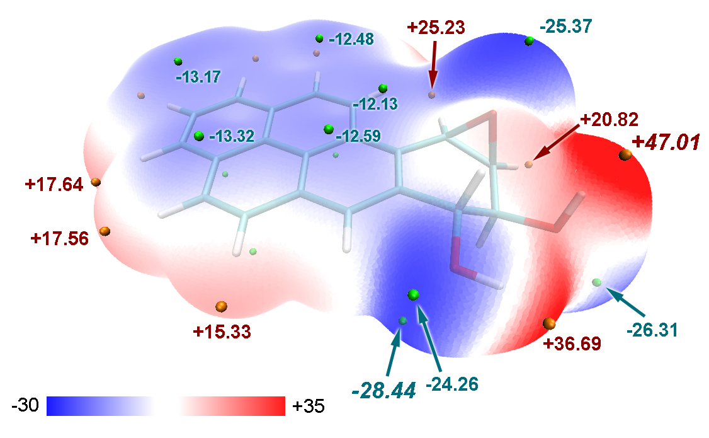

如果你想绘制类似的图形，请下载并参考本教程：<http://sobereva.com/multiwfn/res/plotESPsurf.pdf>。然而，本教程中有很多步骤，如果你想以简单得多的方式绘制具有类似甚至更好效果的图，请参见**第[4.A.13](sec-4-A-special-topics-and-advanced-tutorials.md#4a13-绘制静电势着色的范德华表面图和范德华表面穿透图)节**或本视频教程：<https://youtu.be/QFpDf_GimA0>。本节和视频还说明了如何绘制不同分子的范德华表面 (van der Waals surface)的穿透图 (penetration map)，这有助于讨论分子间相互作用 (intermolecular interactions)。
> **注**
>
> **提示**：如果你的 CPU 核心 (CPU cores)数量非常有限（少于 10 个核心），Gaussian 软件包中 cubegen 工具计算静电势 (ESP)的速度明显快于 Multiwfn。如果你的机器上安装了 Gaussian 且输入文件为 .fch/fchk 格式，建议将 *settings.ini* 文件中的 "cubegenpath" 参数设为 cubegen 的实际路径，以便 Multiwfn 在分析过程中自动调用 cubegen 计算静电势。详情请参见[5.7](sec-5-7-make-use-of-cubegen-utility-in-gaussian-package.md)节。
>
> 如果你是 ORCA 用户，同时无法使用 Gaussian，当 CPU 核心数量非常有限时，你可以使用 ORCA 软件包中的 "orca_vpot" 工具来尝试降低分子表面 (molecular surface)上静电势分析的开销，详情见 <http://sobereva.com/wfnbbs/viewtopic.php?pid=937>。

### **FAQ：为什么某些表面静电势极小值 (minima)（极大值 (maxima)）具有正（负）值？**

一些 Multiwfn 用户问我为什么他们观察到某些表面静电势极小值（极大值）具有正（负）值。事实上，这种现象非常常见，它绝不是问题或程序错误。在数学上，极小值（极大值）是指其值低于（高于）周围各点的值的点，显然这绝不意味着该点必须具有负（正）值。如果你仍有困惑，请见下面的示意图

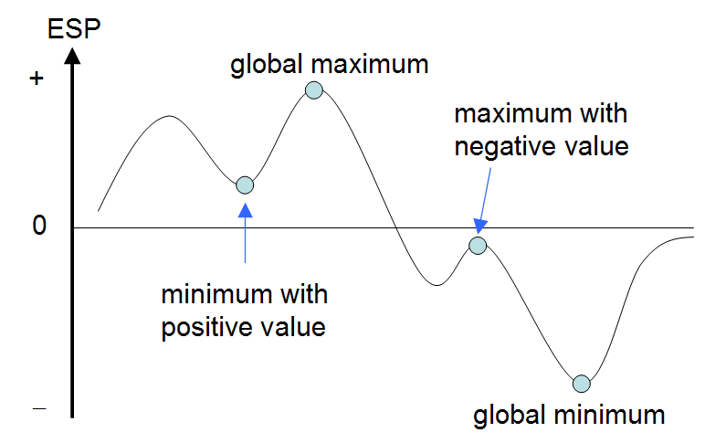

对于中性体系 (neutral system)，通常具有正（负）值的表面静电势极小值（极大值）在化学上并不重要，你在讨论中可以直接忽略它们。如果你想删除这些不重要的极小值（极大值），你可以在后处理菜单 (post-processing menu)中选择选项 3 (4)，然后输入 *d*。然后你会发现这些不需要的极值 (extrema)已经消失了。

还值得注意的是，对于阳离子 (cation)（阴离子 (anion)）体系，通常所有表面极值都具有正（负）值，因为表面静电势极值的总体值总是很大程度上由体系所带净电荷 (net charge)决定。

### **技巧：重用先前分析中生成的映射函数 (mapped function)数据**

在这里我介绍一个技巧。也许你已经注意到，在范德华表面 (vdW surface)上计算静电势非常耗时，特别是对于使用高质量基组 (basis set)的大体系。如果你已经对一个体系进行过静电势分析，之后还需要再次分析该体系，实际上你可以将静电势数据导出到纯文本文件 (plain text file)中，以便下次分析同一体系时可以直接利用已导出的数据。对于其他类型的映射函数，该技巧同样适用。

让我们看一个例子。我们首先像往常一样在范德华表面上进行静电势分析，输入以下命令：

```text
examples\N-phenylpyrrole.fch
12  // Quantitative molecular surface analysis
0  // Start the analysis
```

计算完成后，选择选项 7 将带有静电势值的表面顶点 (surface vertices)导出到当前文件夹中名为 *vtx.txt* 的纯文本文件。之后选择 -1 返回上一级菜单。

假设我们想再次进行该分析。这次我们可以直接使用记录在纯文本文件中的静电势数据。输入以下命令

```text
5  // Loading mapped function values from external file during analysis
1  // Loading mapped function at all surface vertices from a plain text file
0  // Start the analysis
```

一旦分子表面构建完成，Multiwfn 将提示你输入记录了所有表面顶点处映射函数值的纯文本文件的路径，此时你只需输入 *vtx.txt* 即可。
由于此时映射函数 (mapped function)值，即ESP值，不是计算得到的，而是直接从 *vtx.txt* 加载的，因此分析结果会立即显示在屏幕上。

### **技巧：仅基于cube文件在分子表面 (molecular surface)上进行ESP分析**

一些量子化学和第一性原理程序，例如Quantum ESPRESSO、ADF、Dmol3和FHI-aims，无法产生Multiwfn支持的波函数文件 (wavefunction file)，但在这种情况下，只要你能用这些程序为你的体系生成电子密度 (electron density)和ESP的cube文件，仍然可以在分子表面上进行ESP分析。一旦生成了cube文件，在启动Multiwfn后可以输入以下命令：

```text
density.cub  // Load cube file of electron density first
12  // Quantitative molecular surface analysis
1  // Select the way to define surface
11  // Isosurface of the grid data in memory
0.001  // Use ρ = 0.001 a.u. to define the isosurface
2  // Select mapped function
1  // ESP
5  // Set if loading mapped function values from external file
3  // The mapped function will be interpolated from an external cube file
0  // Start calculation
ESP.cub  // The cube file recording ESP
```

注意，用于生成 *density.cub* 和 *ESP.cub* 的网格设置必须完全相同，且网格间距不应太大（不大于0.25 Bohr），否则分析结果将不准确。

## **4.12.2 苯酚分子表面上的平均局部离子化能 (average local ionization energy, ALIE)分析**

下面我们将在苯酚vdW表面 (vdW surface)上分析平均局部离子化能 $\bar{I}$。启动Multiwfn并输入

```text
examples\phenol_631Gxx.wfn  // Produced at B3PW91/6-31G** level
12  // Quantitative molecular surface analysis
2  // Reselect mapped function
2  // Choose I as mapped function
0  // Start the surface analysis.
```

由于 $\bar{I}$ 的计算比ESP简单得多，计算很快完成。与ESP的表面分析不同，此时除了极值信息外，仅输出vdW体积、表面积以及vdW表面上 $\bar{I}$ 的平均值和方差。

选择0以可视化极值。为了使极值与原子之间的对应关系更清楚，我们将“Ratio of atomic size”滑动条拖至4.0，这对应于vdW表面，并关闭表面极大值的显示，然后我们将看到：

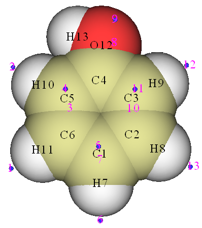

侧视图

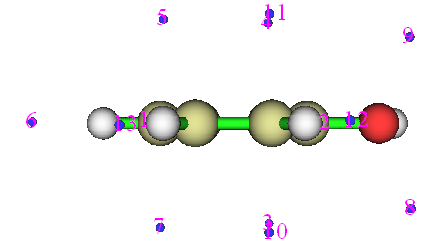

$\bar{I}$ 值低表明该位置的电子束缚不紧，vdW表面上 $\bar{I}$ 最低的位点通常被认为是最易受亲电攻击或自由基攻击的位点。所有高极化性的位点，如π电子和孤对电子区域，通常都有相应的 $\bar{I}$ 表面极小值。在本例中，极小值8和9对应于O12的孤对电子，从屏幕输出可以发现它们的 $\bar{I}$ 值均为10.59 eV。极小值4、5、11以及3、7、10对应于π电子，它们的 $\bar{I}$ 值均约为8.9 eV，可视为简并的全局极小值。值得注意的是，共轭环上方和下方的极小值仅出现在 *ortho-* 和 *para-*碳上。这些观察结果完美地解释了羟基作为 *ortho-para*- 定位基的效应。由于极小值8和9处的 $\bar{I}$ 明显大于碳环周围极小值处的 $\bar{I}$，氧不应是亲电反应的易反应位点。
### **绘制以平均局域电离能 (average local ionization energy) 着色的分子表面 (molecular surface) 图**

> **注 1**
>
> 本部分有对应的视频演示，请查看！<https://youtu.be/-1sBa0lKhp8>。

> **注 2**
>
> 本部分的中文版是我的博客文章“使用Multiwfn和VMD绘制以平均局域电离能 (ALIE) 着色的分子表面图” (<http://sobereva.com/514>)。

为了更完整地展示 $\bar{I}$ 在分子表面上的分布，最好绘制根据 $\bar{I}$ 着色的分子表面图。这可以通过脚本和VMD程序 (<http://www.ks.uiuc.edu/Research/vmd/>) 极其容易地实现。下面展示在Windows环境下如何实现，仍以苯酚 (phenol) 为例。请依次执行以下步骤：

- 将 *ALIE.vmd* 从 "examples\scripts\\" 复制到VMD文件夹

- 将 *ALIE_isoext.bat* 和 *ALIE_isoext.txt* 从 "examples\scripts\\" 文件夹复制到包含 *Multiwfn.exe* 的文件夹

- 编辑 *ALIE_isoext.bat*，将默认输入文件改为 *examples\phenol_631Gxx.wfn*，将VMD文件夹改为你机器上的实际VMD文件夹

- 双击 *ALIE_isoext.bat* 图标以执行它。此脚本将调用当前文件夹中的 *Multiwfn.exe* 进行一些计算，然后 *avglocion.cub*、*density.cub* 和 *surfanalysis.pdb* 将出现在VMD文件夹中

- 启动VMD，在控制台窗口中输入 `source ALIE.vmd`，你将立即看到下图（为了获得更好的效果，我使用Tachyon渲染生成了该图像）

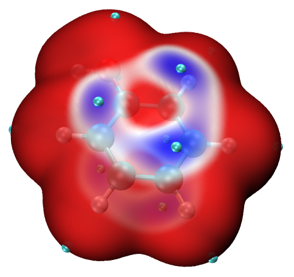

在上图中，显示的表面是 *ρ* = 0.0005 a.u. 等值面 (isosurface)。不采用常用的 *ρ* = 0.001 a.u. 等值面作为表面的定义的原因是，如果采用它，则表面上 $\bar{I}$ 的分布几乎无法区分。青色小球对应于 $\bar{I}$ 的表面极小点 (surface minimum)。颜色过渡为蓝-白-红 (Blue-White-Red)，因此蓝色突出了具有相对较低 $\bar{I}$ 值的区域，这些区域是亲电进攻 (electrophilic attack) 的有利位点。

默认情况下，$\bar{I}$ 的颜色标尺 (color scale) 为 0.32\~0.36 a.u.，如果你发现颜色标尺不适合当前体系，你可以在VMD控制台窗口中输入例如 *mol scaleminmax 0 1 0.31 0.38*，将下限和上限分别改为0.31和0.38。

## **4.12.3 丙烯醛 (acrolein) 的原子局域分子表面分析**

众所周知，丙烯醛（见下图）倾向于在羰基碳和β碳处发生亲核进攻 (nucleophilic attack)；特别是，前者是硬亲核试剂的主要位点。所谓硬是指亲核试剂的电子云难以极化；这种情况下反应位点的选择性通常由ESP主导。

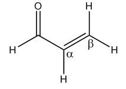

在本例中，我们将尝试通过分析其范德华表面 (vdW surface) 上的ESP来解释丙烯醛的位点选择性。注意，平均局域电离能仅对研究亲电进攻有用，但对分析亲核进攻完全无用。

启动Multiwfn并输入：

```text
examples\acrolein.wfn  // Optimized and produced at B3LYP/6-31G** level
12  // Quantitative analysis of molecular surface
0  // Start the analysis for ESP
```
计算完成后，选择 0 以可视化表面极值点 (surface extrema)：

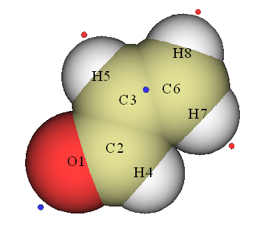

可以看到，在 α 碳边界处存在一个静电势 (ESP)表面最小值，且它非常靠近 β 碳。该现象间接表明 α 碳的核电荷被电子云屏蔽得更严重，因此不太可能成为亲核攻击 (nucleophilic attack)位点。然而，对整个丙烯醛表面上的静电势的定量分析 (quantitative analysis)并不能对反应位点 (reactive sites)的偏好给出直接而明确的解释，因为在羰基碳和 β 碳上未发现表面最大值，因此我们无法直接研究羰基碳和 β 碳的特征。

在 Multiwfn 中，定量分析不仅可应用于整个分子表面 (molecular surface)，也可应用于局部分子表面 (local molecular surface)以揭示原子或片段的特征，介绍见第 [3.15.2.2](sec-3-15-quantitative-analysis-of-molecular-surface.md#31522-局域分子表面上的分析) 节。在此，我们在后处理界面中选择选项“11 输出每个原子的表面性质”以计算并输出与每个原子对应的局部表面的性质。部分结果如下所示

```text
Note: Average and variance below are in kcal/mol and (kcal/mol)^2 respectively
 Atom#    All/Positive/Negative average       All/Positive/Negative variance
     1   -24.35251        NaN  -24.35251           NaN        NaN   72.72766
     2     4.65672    5.74594   -1.45401       9.79575    9.01495    0.78080
     3     1.30965    2.36405   -0.88391       2.70896    2.45972    0.24925
     4     8.37174   10.35813   -6.00120      36.74187   17.22299   19.51888
     5     7.07040    8.67973   -6.35468      49.99108   25.33899   24.65209
     6     2.21578    3.02322   -0.73880       5.15593    4.95305    0.20288
     7    15.34251   15.34251        NaN           NaN   22.85377        NaN
     8    14.68486   14.68486        NaN           NaN   25.92230        NaN
```

可以看到，羰基碳（原子 2）、α 碳和 β 碳的局部表面上的静电势平均值分别为 4.657、1.310 和 2.216 kcal/mol。该结果清楚地解释了位点选择性；羰基碳是最有利的位点，因为其局部表面上的静电势平均值最正，因此亲核试剂（特别是硬亲核试剂）倾向于被吸引到该位点。相反，与另外两个碳相比，α 碳的局部表面上的静电势平均值最小，因此 α 碳吸引亲核试剂的能力较弱。

注意，输出的部分数据为 NaN (Not a Number)，这并非程序错误，而是可以理解的。例如，原子 1 的静电势正值部分的平均值为 NaN，这是因为氧具有较大的电负性，因此在原子 1 的局部表面上静电势完全为负，所以无法计算正静电势的平均值。

如果你对什么是“原子的局部表面”感到困惑，或者你想将其可视化，在选择选项 11 后，你可以选择 "y" 将表面面元 (surface facets)输出到当前文件夹中的 *locsurf.pqr* 文件。该文件中的每个原子对应一个表面面元，残基序号 (residue index)对应其归属。通过该文件你可以可视化整个分子是如何划分的，方法是：启动 VMD 程序并将 pqr 文件拖入 VMD 主窗口，在 "Graphics"-"Representation" 中将 "Drawing method" 设为 "Points"，将点尺寸设为 4，并将 "Coloring Method" 设为 "ResID"。在 VMD 主窗口中，选择 "Display"-"Orthographic" 并取消选择 "Display"-"Depth Cueing"。然后将丙烯醛的分子结构文件载入 VMD 并以 CPK 模式渲染，你将看到如下图所示
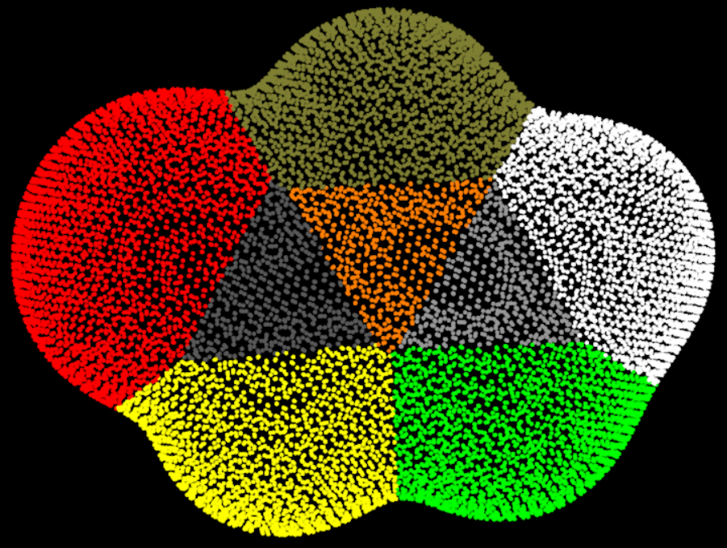

图中，每个点代表一个表面面元 (surface facet)；不同颜色代表不同的局部表面区域 (local surface region)，且每一区域对应一个原子。

注意，*settings.ini*中的"imolsurparmode"参数直接影响局部表面分析 (local surface analysis)的结果，当前我们使用imolsurparmode=1。

## **4.12.4 苯酚 (phenol)分子表面 (molecular surface)上福井函数 (Fukui function)的定量分析**

我已通过可视化其等值面 (isosurface)（[4.5.4](sec-4-5-generate-grid-data-and-view-isosurface-map.md#454-用福井函数和对偶描述符研究苯酚亲电进攻的有利位点)节）以及通过布居分析 (population analysis)将其凝聚为原子值（[4.7.3](sec-4-7-population-analysis-and-atomic-charge-calculation.md#473-计算凝聚fukui函数和凝聚对偶描述符)节）举例说明了如何研究福井函数。在本节中，我将说明如何在分子表面上对福井函数 $f^-$ 进行定量分析，包括三个方面：(1) 获取 $f^-$ 的极小值和极大值 (minima and maxima)的位置和数值 (2) 研究对应于各原子的局部分子表面上 $f^-$ 的平均值 (3) 绘制带有表面极值 (surface extrema)的 $f^-$ 颜色映射分子表面。我仍以苯酚为例：

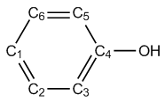

> **注**
>
> 如果你无法成功复现下述第1和第2部分中的步骤，请查看视频演示：<http://sobereva.com/multiwfn/extrafiles/Molecular_surface_Fukui.mp4>。

### **第1部分：获取*f*⁻极小值和极大值的位置和数值**

启动Multiwfn（称为Multiwfn *A*）并输入以下命令

```text
examples\phenol.wfn
12  // Quantitative molecular surface analysis
2  // Select the mapped real space function on the molecular surface
0  // The function value will be loaded from an external file
1  // Set the way to define the surface
1  // Use electron density isosurface as molecular surface
0.01  // Because magnitude of Fukui function on default isosurface ρ = 0.001 is often too small, enlarging the isovalue to 0.01 a.u. makes following analyses more significant
0  // Start the surface analysis
```

Multiwfn将生成电子密度 (electron density)的网格数据 (grid data)，然后生成表面顶点 (surface vertices)。这些顶点的坐标被自动输出到当前文件夹中的*surfptpos.txt*后，Multiwfn *A*暂停。不要终止Multiwfn *A*，我们现在启动另一个Multiwfn（称为Multiwfn *B*），然后在Multiwfn *B*中输入以下命令

```text
examples\phenol.wfn
5  // We use this module to generate Fukui function on the points recorded in surfptpos.txt
0  // Set custom operation
1
-,examples\phenol_N-1.wfn  // Subtract a property of phenol_N-1.wfn from that of phenol.wfn, namely Fukui function f^- will be calculated
1  // Electron density
100  // Load the coordinate of the points to be calculated from an external file
surfptpos.txt
t.txt  // Output the coordinate and calculated function values (Fukui function) of the points (surface vertices) to this file
```

接下来，我们终止Multiwfn *B*，并返回到Multiwfn *A*，然后输入

```text
t.txt  // Load the Fukui function values at the surface vertices from this file
```

现在你可以在屏幕上找到分子表面上 $f^-$ 的极小值和极大值信息（在此情形下*ρ* = 0.01 a.u.）：
```text
The number of surface minima:    16
   #             Value           X/Y/Z coordinate(Angstrom)
     1          0.0005211     -2.128861  -0.802735  -0.931871
     2          0.0005205     -2.076117  -0.773086   0.974712
     3          0.0005075     -1.359761  -2.550410  -0.046948
[ignored...]

 The number of surface maxima:    12
   #             Value           X/Y/Z coordinate(Angstrom)
     1          0.0015297     -2.922801   1.103604   0.049305
     2          0.0015567     -2.878717  -2.081768  -0.010490
     3          0.0015093     -1.538685   2.959157  -0.031439
*    4          0.0024437     -0.034784  -1.889426  -1.367278
     5          0.0024425     -0.047988  -1.899397   1.366144
[ignored...]
```

您还可以选择选项 0 以可视化表面极值 (surface extrema)的分布：

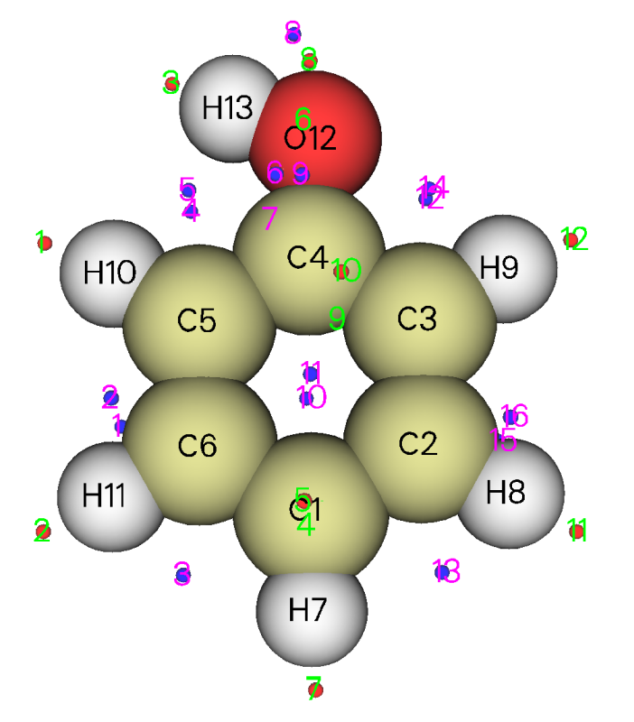

### **第2部分：在局域分子表面 (local molecular surfaces)上研究 *f*⁻ 的平均值 (average value)**

在后处理菜单 (post-process menu)中，我们选择选项 11 以输出分布在与每个原子 (atom)相对应的局域vdW表面 (local vdW surface)上的福井函数 $f^-$ 的定量统计数据 (quantitative statistical data)，然后您可以在屏幕上找到以下信息

```text
Atom#   All/Positive/Negative average
    1  1.88921E-03  1.88921E-03          NaN
    2  8.30558E-04  8.30558E-04          NaN
    3  1.20307E-03  1.20307E-03          NaN
    4  1.28067E-03  1.28067E-03          NaN
    5  1.06720E-03  1.06720E-03          NaN
    6  9.43611E-04  9.43611E-04          NaN
[ignored...]
```

NaN表示在局域分子表面上不存在 $f^-$ 的负值 (negative value)。从结果可以清楚看出，与*邻位 (ortho)* (C3和C5)和*对位 (para)* (C1)碳 (carbon)相对应的局域分子表面上的福井函数的平均值大于与*间位 (meta)*碳 (C2和C6)相对应的局域分子表面上的平均值，这一观察正确反映了羟基 (hydroxyl)是*邻对位 (ortho-para-)导向基*这一事实。

### **第3部分：绘制带有表面极值的 *f*⁻ 颜色映射分子表面 (color-mapped molecular surface)**

在主功能 (main function)12的后处理菜单中，选择选项“2 Export surface extrema as surfanalysis.pdb in current folder”，然后您会找到 *surfanalysis.pdb*。

接下来，为了经由VMD获得 $f^-$ 颜色映射分子表面 (可从<http://www.ks.uiuc.edu/Research/vmd/>免费下载)，我们需要准备两个分别包含电子密度 (electron density)和 $f^-$ 的cube文件 (cube files)。为此，我们重新启动Multiwfn并输入

```text
examples\phenol.wfn
5  // Calculate grid data
0  // Set custom operation
1
-,examples\phenol_N-1.wfn
1  // Electron density
3  // High-quality grid
2  // Export grid data
```

现在将刚导出的 *density.cub* 重命名为 *mapped.cub*。然后输入

```text
0  // Return to main menu
5  // Calculate grid data
1  // Electron density
3  // High-quality grid
2  // Export grid data
```

现在当前文件夹 (current folder)中有 *density.cub*。

将 *density.cub*、*mapped.cub*、*surfanalysis.pdb* 移动到VMD文件夹 (VMD folder)。同时将“examples\scripts\\”文件夹中的VMD作图脚本 (VMD plotting script)*molsurfmap.vmd*复制到VMD文件夹。之后，启动VMD并在VMD控制台窗口 (VMD console window)中运行 `source molsurfmap.vmd` 以执行该脚本，然后您将看到如下图 (map)，其中青色和红色球 (sphere)分别对应于 *ρ* = 0.01 a.u. 等值面 (isosurface)上的极大值和极小值 (maxima and minima)。当前着色方法 (coloring method)为红-白-蓝 (red-white-blue)，对应于映射函数 (mapped function)从0.0到0.002变化。

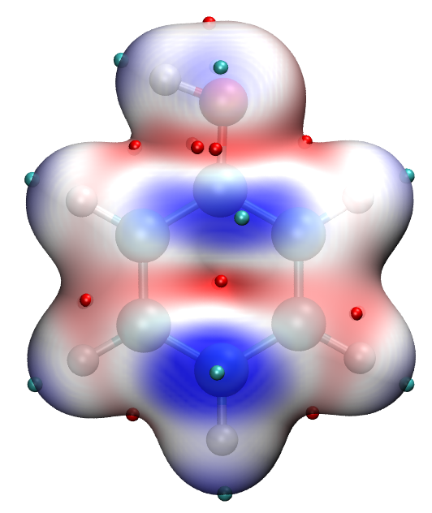
你可以自行编辑 *molsurfmap.vmd* 以更改各种默认绘图设置，包括色标 (color scale)范围、等值面值 (isovalue)等。它们也可以在VMD的“Graphics” - “Representation”界面中更改。

## **4.12.5 鸟嘌呤-胞嘧啶碱基对的Becke表面 (Becke surface)分析**

Hirshfeld表面 (Hirshfeld surface)和Becke表面分析的概念已在第[3.15.5](sec-3-15-quantitative-analysis-of-molecular-surface.md#3155-专题hirshfeld-和-becke-表面分析)节中介绍，请先阅读它们。在本节中，我将举例说明如何对鸟嘌呤-胞嘧啶 (guanine-cytosine, GC)碱基对进行Becke表面分析，以展示两个单体 (monomer)之间的弱相互作用 (weak interaction)。注意，Hirshfeld表面分析更常用，见下一节。

启动Multiwfn并输入

```text
examples\GC.wfn  // Generated at M06-2X/6-31+G** level, optimized at PM7 level
12  // Quantitative molecular surface analysis
1  // Change the definition of surface
6  // Use Becke surface. You can also select 5 to use Hirshfeld surface
1-13  // The index range of the atoms you are interested in (cytosine in present case)
0  // Start calculation
```

Multiwfn找到了许多表面极小值 (surface minima)，在本例中它们没有意义，同时找到了三个表面极大值 (surface maxima)

```text
The number of surface maxima:     3
   #             Value           X/Y/Z coordinate(Angstrom)
     1          0.0213498     -1.005651   2.428125   0.009227
     2          0.0251293      0.533238   0.687258   0.007815
*    3          0.0261531      1.861601  -1.067696  -0.009615
```

你可以选择0来可视化它们，见下图(未显示极小值)

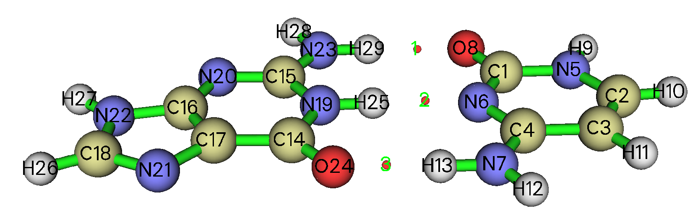

由于在这些极大值处的电子密度 (electron density)大小顺序为3≥2\>1，可以预期氢键 (H-bond)强度顺序为O24⋅⋅⋅H13 ≥ H25⋅⋅⋅N6 \> H29⋅⋅⋅O8。该结论与AIM键临界点 (AIM bond critical point)分析(第[4.2.1](sec-4-2-topology-analysis.md#421-2-吡哆醇-2-氨基吡啶的分子中的原子-aim-拓扑分析与芳香性分析)节)完全一致。

如果你想可视化Becke表面，只需选择选项-3。如果你想绘制由映射函数 (mapped function)值着色的Becke表面，你需要使用VMD，有两种方法：(1)将Becke表面绘制为许多点(表面顶点 (surface vertices))，如下所示 (2)将Becke表面以等值面 (isosurface)的形式绘制，将在下一节中说明

选择选项8以将所有表面顶点导出到当前文件夹中的 *vtx.pqr*。此文件中的每个原子对应一个表面顶点，其“Charge”属性对应映射函数的值(在本例中为电子密度)。

将 *examples\GC.pdb*(与 *GC.wfn* 具有相同几何结构的pdb文件)拖入VMD程序的主窗口。选择"Graphics" - "Representation"，将绘制方式改为"Licorice"并将键半径减小到0.2。然后将 *vtx.pqr* 拖入VMD主窗口，选择"Graphics" - "Representation"，将绘制方式改为"Points"，将着色方式设为"Charge"，适当增大点的尺寸，在VMD控制台窗口中运行命令 *color scale method BWR*(该命令将着色方式改为蓝-白-红)。现在你应该看到

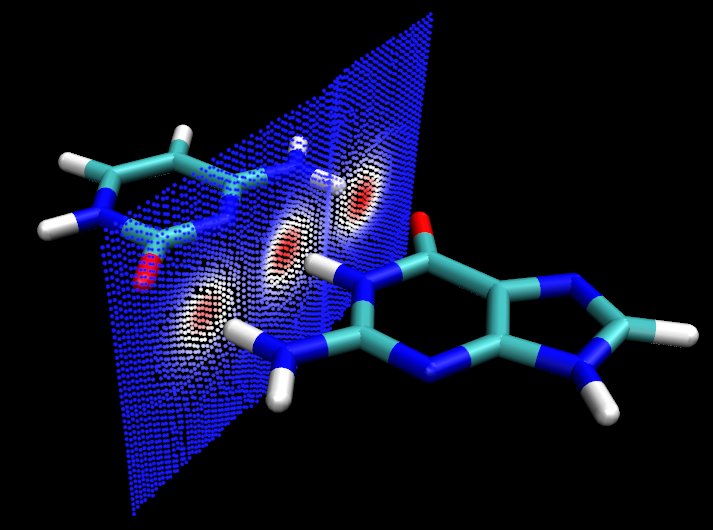

在上图中，Becke表面由点表示，三个红色区域对应高电子密度区域，它们源于氢键的存在。该例表明Becke表面分析有助于揭示分子间相互作用 (intermolecular interaction)显著的区域。
本分析也可通过Hirshfeld表面分析 (Hirshfeld surface analysis)实现，见下一节，当原子数较多时计算成本较低。

## **4.12.6 尿素晶体的Hirshfeld表面分析和指纹图分析 (fingerprint plot analysis)**

在本节中，我们对尿素晶体进行Hirshfeld表面分析，以理解晶体中的分子间相互作用 (intermolecular interaction)。

> **注**
>
> “使用Multiwfn进行Hirshfeld表面分析以直观显示分子晶体和配合物中的相互作用”(<http://sobereva.com/701>，中文)是一篇极其详细的博文，全面介绍了Multiwfn中的Hirshfeld/Becke分析并给出了非常丰富的实例，强烈推荐阅读！如果你已读过它，就不需要阅读本节了。

### **分析用结构的准备**

你可以直接使用尿素晶体的.cif文件作为输入文件，需要构建足够大的超胞 (supercell)（可通过主功能300的子功能7中的选项19完成），以使我们关注的分子能够完全浸没在环境分子中。你也可以基于分子团簇 (molecular cluster)进行分析（这是更好的方式），它包含一个中心分子 (central molecule)和一批包围它的分子，Multiwfn直接提供了基于晶体结构构建团簇的功能。你只需启动Multiwfn并输入

```text
urea.cif  //.cif file of urea, please find it from Internet. PS: DO NOT manually extend it to supercell, otherwise computational cost will significantly increase
300  // Main function 300
7  // Geometry operation
25  // Extract a molecular cluster (central molecule + surrounding ones)
1  // The whole molecule containing atom 1 is taken as the central molecule, this molecule and all surrounding ureas close to it will be extracted
[Press ENTER button]  // Use recommended criterion of 1.2 to detect contact
```

现在团簇已被提取出来，中心尿素的原子序号显示在屏幕上，请记录它，因为后面会用到。然后你可以使用选项0可视化团簇结构，如果发现合理，就可以使用相应选项将其导出为结构文件。

### **尿素团簇的Hirshfeld表面分析**

在本例中，我们使用下图所示的尿素团簇模型，其可按上述方式构建。相应的几何文件*examples\Urea_crystal.pdb*包含11个尿素，中心的一个将在我们的Hirshfeld表面分析中被定义为片段 (fragment)。

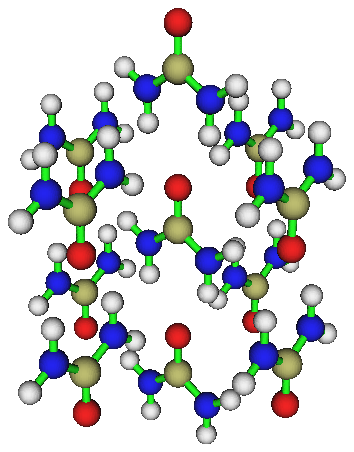

启动Multiwfn并输入

```text
examples\Urea_crystal.pdb
12  // Quantitative molecular surface analysis
1  // Change surface type
5  // Use Hirshfeld surface
16,36,58,2,77,55,34,13  // The index of the atoms in the central urea
0  // Start calculation. Note that the default mapped function d_norm is used here
```

计算完成后，你可以选择选项8将带有映射电子密度的表面顶点导出到*vtx.pqr*，然后按上一节所述方式在VMD中绘制它们。

接下来，我们绘制指纹图。输入以下命令

```text
20  // Fingerprint plot analysis
0  // Start fingerprint analysis
1  // Save fingerprint plot to an image file
```

你会发现当前文件夹中已生成一个.pdf文件，打开后你将看到下图

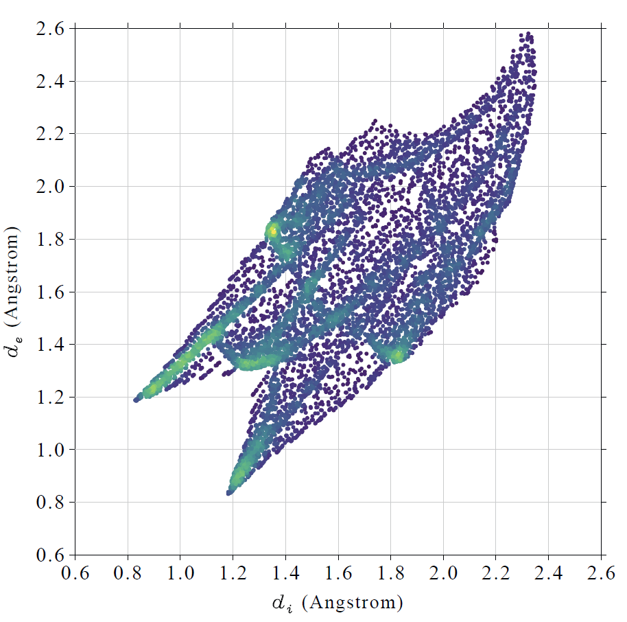
在此图中，X轴和Y轴分别对应 $d_{\mathrm{i}}$ 和 $d_{\mathrm{e}}$ 。Hirshfeld表面 (Hirshfeld surface)上的每个顶点对应图中一个点。可以看到该图左下方有两个尖峰，这一现象表明尿素同时充当氢键受体 (H-bond acceptor)（底部的尖峰，$d_{\mathrm{i}}$ \> $d_{\mathrm{e}}$ ）和氢键供体 (H-bond donor)（左侧的尖峰，$d_{\mathrm{i}}$ \< $d_{\mathrm{e}}$ ）。黄色、绿色和紫色分别表示相应区域的点密度为高、中和低。

### **局域接触面的指纹图 (Fingerprint plot for local contact surface)**

在 Multiwfn 中，指纹图 (fingerprint plot)不仅可为整体Hirshfeld表面绘制，也可为局域接触面 (local contact surface)绘制（详见[3.15.5](sec-3-15-quantitative-analysis-of-molecular-surface.md#3155-专题hirshfeld-和-becke-表面分析)节）。让我们查看中央尿素中的四个氢与周围尿素中所有原子之间局域接触面的指纹图。

关闭显示指纹图的窗口后，选择选项 -1 返回上一级菜单。现在，我们需要定义“内部原子 (inside atoms)”和“外部原子 (outside atoms)”，在指纹图分析中将仅考虑这两组原子之间接触面上的顶点。我们选择选项 1 定义“内部原子”。将依次要求输入两个条件，它们的交集将定义该集合。我们首先直接按 ENTER 键以使用默认原子范围，即中央尿素中的所有原子，然后输入 *H* 以仅从中选择所有氢。从屏幕上可以看到，中央尿素中的四个氢现在均已被定义为“内部原子”。由于默认的“外部原子”就是周围尿素中的所有原子，因此我们无需修改它。

现在，选择选项 0 再次启动指纹图分析。可在屏幕上看到以下信息：

```text
The area of the local contact surface is    65.639 Angstrom^2
The area of the total contact surface is    94.511 Angstrom^2
The local surface occupies   69.45% of the total surface
```

该信息表明我们定义的局域接触面所占面积为 65.6 Ų。显然，通过恰当利用该功能，可以获得中心分子与周围分子之间任何特定接触对应的面积。

之后，选择选项 1 将相应的指纹图保存为 .pdf 文件，然后打开它将看到

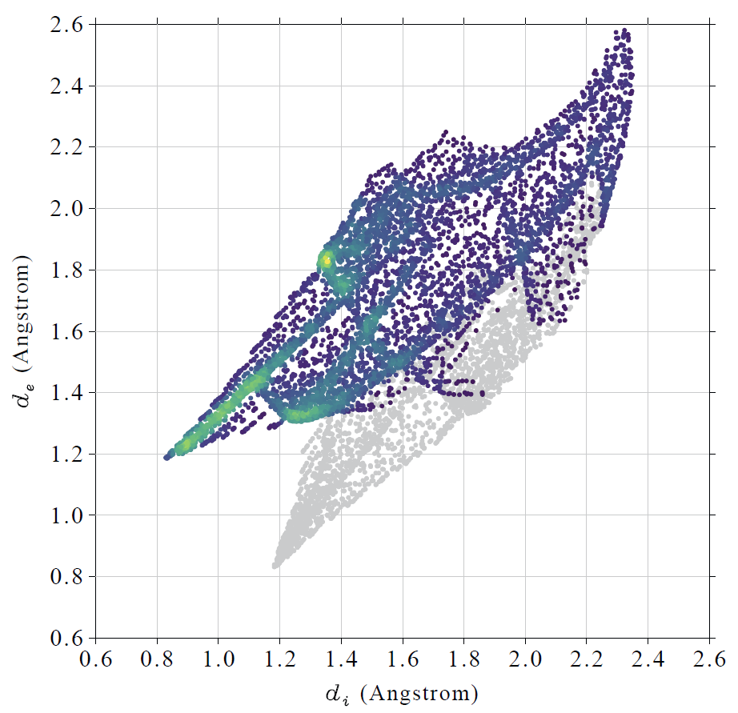

由于这次我们仅考虑了中央尿素中的四个氢，它们纯粹充当氢键供体，因此在该图左侧仅可观察到一个尖峰。上图中的灰色点对应于整个Hirshfeld表面上但不在当前局域接触面上的点。

查看局域接触面的形状很有意义。为此，在关闭指纹图后，我们选择选项 4 将局域接触面上的所有点导出到当前文件夹中的 *finger.pqr*。按照[4.12.5](#4125-鸟嘌呤-胞嘧啶碱基对的becke表面-becke-surface分析)节所述方法在 VMD 中绘制它们，将看到

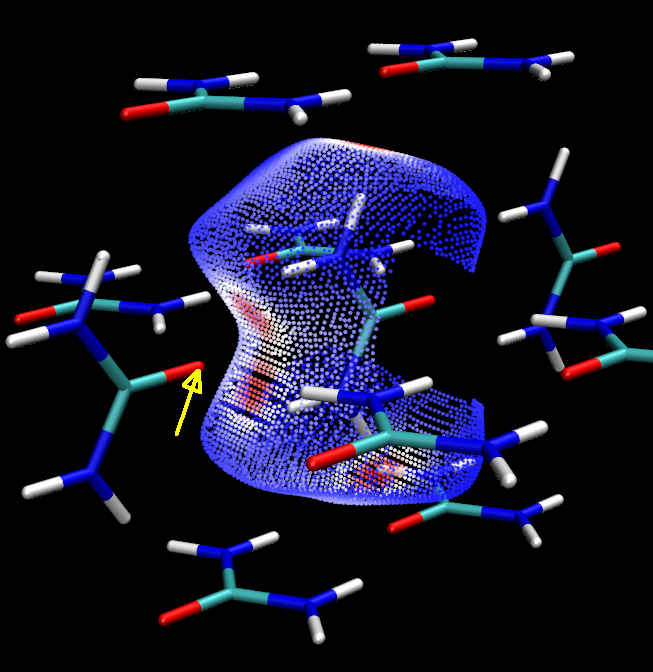

显然，该表面很好地展示了中央尿素中的氢与周围尿素中原子之间的接触。表面上有四个红色区域，对应于四个氢键，其中中央尿素中的H原子充当氢键供体。
接下来，我们检查中央尿素 (urea)中的氢与上图中黄色箭头标记的氧原子之间的指纹图 (fingerprint plot)。输入以下命令

```text
-1  // Return to upper level of menu
1  // Set the inside atoms to consider
[Press ENTER button]  // Do not set constraint for atomic indices
H  // The inside atoms must be hydrogen
2  // Set the outside atoms to consider
76  // The index of the oxygen in one of surrounding urea
```

从屏幕上输出的信息中，可以发现本次产生的局部接触面 (local contact surface)为 6.8 Ų，占总接触面面积的 7.2%。然后我们绘制指纹图和相应的表面顶点，如下所示

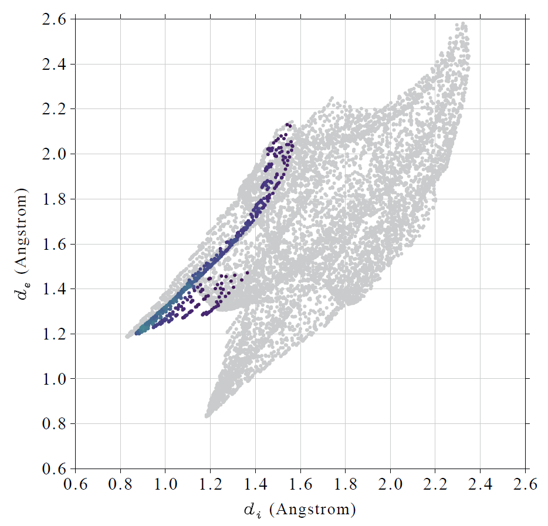 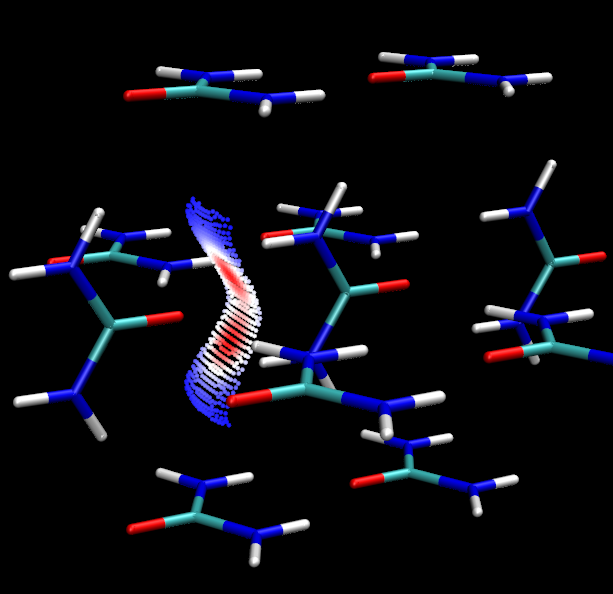

在指纹图中可以看到，表面点的分布范围较窄，且尖峰非常明显，表明由于 H 和 O 的接触而具有很强的氢键 (H-bond)特征。

指纹图对于比较不同晶体中的分子间相互作用 (intermolecular interactions)特别有用，相关讨论见 *CrystEngComm*, **11**, 19 (2009)。

### **获取每种元素对之间的接触面积**

Multiwfn 还能够同时打印每种元素对之间的接触面积，并获得其占总接触面积的百分比。为此，在进入选项“20 Fingerprint plot and local contact analyses”后，选择选项“3 Calculate contact area between different elements”，随后将立即打印以下信息：

```text
Inside element, outside element, their contact area (Angstrom^2) and percentage (%)
 H-H        42.602      45.076
 H-C         3.355       3.550
 H-N         4.101       4.339
 H-O        15.581      16.486
 C-H         4.943       5.230
 N-H         7.156       7.572
 O-H        16.774      17.748

The same as above, but do not distinguish inside and outside elements
 H-H              42.602      45.076
 H-C/C-H           8.298       8.780
 H-N/N-H          11.257      11.910
 H-O/O-H          32.355      34.234

Area of total contact surface is    94.511 Angstrom^2
```

这些信息易于理解。例如，以黄色突出显示的为例，内部 H 原子与外部 O 原子之间的接触面积为 15.581 Ų，内部 O 原子与外部 H 原子之间的接触面积为 16.774 Ų，分别占总接触面积 (94.511 Ų)的 16.486% 和 17.748%。它们的总百分比贡献为 16.486% + 17.748% = 34.234%。

为了更直观地检查，可以复制 Multiwfn 打印的数据并将其导入到*e.g.* Origin 软件中，然后绘制如下饼图 (pie chart)：

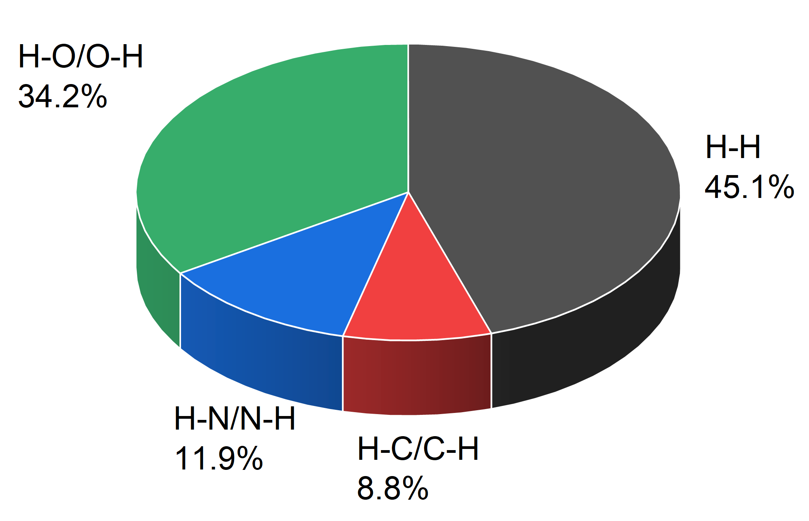

显然，H-N/N-H 和 H-O/O-H 类型的接触对应于典型的分子间氢键，从饼图中可以看到，近一半的接触面积与氢键有关。虽然 H-H 接触占 Hirshfeld表面高达 45.1%，但它显然不对应于有利的分子间相互作用，因为氢显正电性，因此 H-H 接触是静电排斥的。

### **使用 VMD 绘制 Hirshfeld/Becke 表面的颜色映射等值面 (color-mapped isosurface)**

这里我描述如何轻松绘制由 promolecular近似 (promolecular approximation)下电子密度 (electron density)映射的非常美观的 Hirshfeld表面，该图看起来比上面所示的那些要好得多。仍以尿素团簇为例。
启动 Multiwfn 并输入

```text
examples\Urea_crystal.pdb
12  // Quantitative molecular surface analysis
1  // Change surface definition
5  // Use Hirshfeld surface
16,36,58,2,77,55,34,13  // The index of the atoms in the central urea
0  // Start calculation
-2  // Export the grid data used to define Hirshfeld surface as surf.cub in current folder
13  // Calculate grid data of mapped function and export it to mapfunc.cub in current folder
```

现在当前文件夹中有 *surf.cub* 和 *mapfunc.cub*，将它们移动到 VMD 文件夹。然后将 *examples\scripts\hirsh_rho.vmd* 文件复制到 VMD 文件夹。启动 VMD，在 VMD 控制台窗口中输入 `source hirsh_rho.vmd` 以运行此脚本。对于当前情形，最好还在控制台窗口中输入 *material change diffuse Translucent 0.8* 以使表面更亮。最后，可以看到下图。注意绘图脚本将颜色过渡设为 Blue-White-Red，其对应于电子密度 (electron density) 从 0.0 到 0.015 a.u. 变化。显然，从图中可以容易地辨认出明显的分子间相互作用区域。

> **注**
>
> 顺便提一下，有时需要微调颜色标尺。默认值可在 *hirsh_rho.vmd* 中修改。在 VMD 中也可以按如下方式直接定义：进入 “Graphics” - “Representation”，选择与等值面相对应的 representation，然后点击 “Trajectory” 选项卡，在两个文本框中输入下限和上限，然后按 ENTER 按钮使其生效。

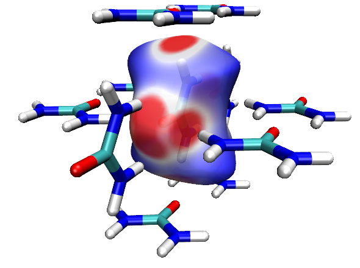

基于在 [4.12.5](#4125-鸟嘌呤-胞嘧啶碱基对的becke表面-becke-surface分析) 节中使用的 *GC.wfn*，可以使用与上述相同的方法绘制电子密度映射的 Hirshfeld表面，见下图。

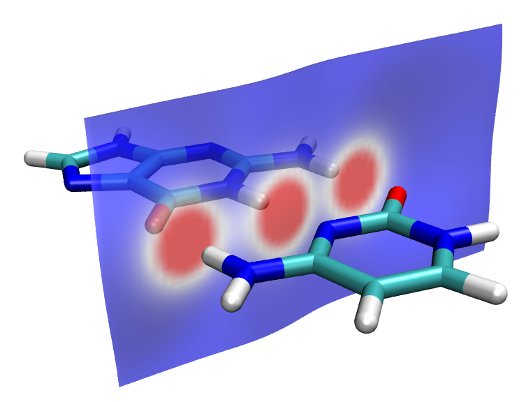

通过非常类似的步骤，也可以绘制 $d_{\mathrm{norm}}$ 映射的 Hirshfeld 或 Becke表面 (Becke surface)，与上述情形相比只有两点不同：(1) 在主功能 12 中，在选择选项 1 切换到 Hirshfeld 或 Becke表面后，需要选择选项 2 并选择 $d_{\mathrm{norm}}$ 作为映射函数 (mapped function) (2) 应使用 *examples\scripts\hirsh_dnorm.vmd* 脚本代替上面使用的 *hirsh_rho.vmd*。

有关 Hirshfeld/Becke 分析的更多示例及相关技巧可在我的博客文章 <http://sobereva.com/701>（中文）中找到。

## **4.12.7 预测 FOX-7 分子晶体 (molecular crystal) 的密度**

如 [3.15.1](sec-3-15-quantitative-analysis-of-molecular-surface.md#3151-理论) 节中所介绍，基于静电势 (electrostatic potential, ESP) 定量分子表面分析 (quantitative molecular surface analysis) 的结果可以预测分子的许多凝聚相性质 (condensed phase properties)。例如，在 *Mol. Phys.*，**107**，2095 (2009) 中，Politzer 等人证明仅含 C、H、N、O 的分子的晶体密度 (crystal density) 可预测为

$$
\rho=\alpha\left(\frac{M}{V_{\mathrm{m}}}\right)+\beta\left(\nu\sigma_{\mathrm{tot}}^{2}\right)+\gamma
$$

其中 *α* = 0.9183、*β* = 0.0028 和 *γ* = 0.0443，当波函数 (wavefunction) 在 B3PW91/6-31G\*\* 水平下产生，且 $M/V_{\mathrm{m}}$ 和 $\nu{\sigma}_{\mathrm{tot}}^{2}$ 的单位分别为 g/cm³ 和 (kcal/mol)² 时。

在本节中，我说明如何使用上述公式预测 FOX-7 (1,1-diamino-2,2-dinitroethene) 分子晶体的密度，FOX-7 是一种不敏感高能炸药化合物。有关性质预测的更多说明可在我的博客文章“使用 Multiwfn 预测晶体密度、汽化热、沸点和溶剂化自由能”（中文，<http://sobereva.com/337>）中找到。
首先，在B3PW91/6-31G\*\*水平下优化FOX-7的几何构型并得到波函数文件，该水平是Politzer等人在其*Mol. Phys.*论文中使用的水平。得到的FOX-7.wfn已作为*examples\FOX-7.wfn*提供。

启动Multiwfn并输入以下命令：

```text
examples\FOX-7.wfn
12  // Quantitative molecular surface analysis
0  // Start analysis for default real space function (ESP) on default surface (0.001 a.u. isosurface of electron density)
```

过一会儿，你将在屏幕上看到以下输出

```text
 Volume:   942.48700 Bohr^3  ( 139.66220 Angstrom^3)
 Estimated density according to mass and volume (M/V):    1.7606 g/cm^3
...[ignored]
 Product of sigma^2_tot and miu:   0.00020164 a.u.^2 (   79.40119 (kcal/mol)^2)
 Internal charge separation (Pi):   0.03740373 a.u. (     23.47121 kcal/mol)
```

从输出中，我们发现$M/V_{\mathrm{m}}$ =1.7606 g/cm³且$\displaystyle \nu\sigma_{\mathrm{tot}}^{2}$ =79.40119 (kcal/mol)²，因此密度可预测为0.9183\*1.7606+0.0028\*79.40119+0.0443=1.883 g/cm³。FOX-7晶体的实验密度为1.885 g/cm³，可在相应的wiki页面(<https://en.wikipedia.org/wiki/FOX-7>)找到。显然，我们的预测极为成功，误差仅为-0.002 g/cm³！然而，这一出奇好的结果在很大程度上是偶然的，因为根据*Mol. Phys.*论文中的测试，使用上述预测公式的RMS误差为0.047 g/cm³。

## **4.12.8 硫代甲酸分子表面上轨道重叠距离函数 (orbital overlap distance function) D(r)的定量分析**

> **注**
>
> 本节内容由Arshad Mehmood友情提供，并由Tian Lu稍作改编。

本例是第[4.5.7](sec-4-5-generate-grid-data-and-view-isosurface-map.md#457-研究硫代甲酸的轨道重叠距离函数-dr)节的延续。这里我说明在硫代甲酸分子电子密度等值面上轨道重叠长度函数*D*(**r**)的定量分析。

启动Multiwfn并输入以下命令：

```text
examples\ThioformicAcid.wfn  // Thioformic acid optimized at B3LYP/6-311++G(2d,2p)
12  // Quantitative analysis of molecular surface
2  // Select mapped function
6  // Orbital overlap distance function D(r), which maximizes EDR(r;d) with respect to d
2  // Use default value of total number, start and increment of EDR exponents. Please consult Section 4.5.7 for more information.
0  // Start analysis now!
```

现在分析开始。此步骤需要一些时间。计算完成后，将在屏幕上打印以下结果以及其它信息：

```text
Global surface minimum:  2.789918 a.u. at   1.983402  -0.346198   1.757884 Ang
Global surface maximum:  3.541349 a.u. at  -2.861073  -1.074395  -0.095237 Ang

 The number of surface minima:     4
   #             Value           X/Y/Z coordinate(Angstrom)
     1          3.296958      -1.622302   2.055665   0.423383
     2          3.218284       0.950838   2.841231   0.010991
*    3          2.789918       1.983402  -0.346198   1.757884
     4          2.790103       2.078805  -0.344424  -1.731277

 The number of surface maxima:    10
   #             Value           X/Y/Z coordinate(Angstrom)
*    1          3.541349      -2.861073  -1.074395  -0.095237
     2          3.401958      -0.539716   2.324441   0.014652
     3          3.502485       0.041422  -2.239222  -0.308278
     4          3.502696       0.089030  -2.257271   0.004859
     5          3.494004       0.207205  -2.075594  -0.673828
     6          3.496480       0.164501  -2.070255   0.707373
     7          3.359381       0.542328   1.465019  -1.650518
     8          3.358980       0.496994   1.456262   1.657761
     9          3.311711       2.030429   1.904600   0.023877
    10          2.918240       2.847314  -1.370280   0.021275
```
现在选择 0 以查看表面极小点和极大点 (surface minima and maxima)：

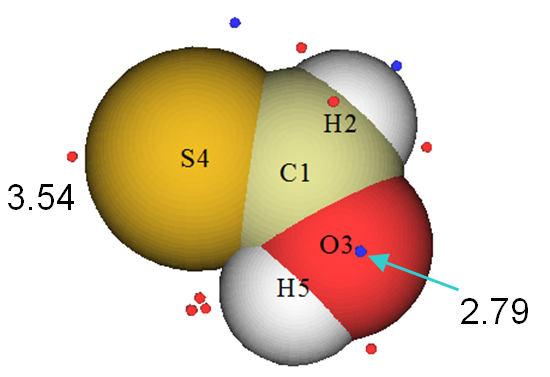

该图显示了分子结构 (molecular structure)和表面极值 (surface extrema)（红色和蓝色小球分别对应表面极大点和极小点）。可以看出，由于紧缩的孤对电子 (lone pair)，氧原子上存在表面极小点，而由于其更弥散且束缚较弱的孤对电子，表面极大点位于硫原子上。

## **4.12.9 计算整个体系以及单个碎片 (fragment)的vdW表面积**

> **注记**
>
> 本节的中文版是我的博客文章“使用Multiwfn和VMD计算分子表面积和碎片表面积”(<http://sobereva.com/487>，中文)，其中还包含更多讨论。

在读完第[4.12.1](#4121-苯酚分子表面的静电势-electrostatic-potential分析)节之后，你一定已经知道如何计算分子vdW表面的面积。在本节中，我将就该主题作更多讨论。将以多巴胺 (dopamine)为例，其经合理优化的几何结构如下所示

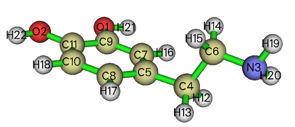

### **计算对应于凝聚相 (condensed phase)的多巴胺vdW表面积**

根据Bader的论文*J. Am. Chem. Soc.*，**109**，7968 (1987)，*ρ* = 0.001和0.002 a.u.的等值面 (isosurface)可分别定义为气相 (gas phase)和凝聚相中的vdW表面。后者的体积小于前者，因为在凝聚相中由于分子间相互作用 (intermolecular interaction)，vdW表面的穿透必然很明显。这里我们将计算多巴胺对应于凝聚相的vdW表面积。启动Multiwfn并输入

```text
examples\dopamine.wfn  // Generated using B3LYP/6-31G* level. Commonly the quality of density at this level is absolutely adequate
12  // Quantitative analysis of molecular surface
1  // Select the way to define surface
1  // Isosurface of electron density
0.002  // Isovalue (a.u.)
6  // Start analysis without consideration of mapped function
```

你只需关注输出中的下面一行：

```text
Overall surface area:         648.64293 Bohr^2  ( 181.63855 Angstrom^2)
```

这意味着，整个分子的面积为181.6 Ų。

### **计算多巴胺中氨基 (amino group)的表面积**

接下来，我说明如何计算特定碎片的表面积，以多巴胺中的氨基为例。在后处理菜单中，我们输入

```text
12  // Output surface properties of specific fragment
3,19,20  // The indices of the atoms in the amino group
```

你将看到

```text
Overall surface area:          99.67659 Bohr^2  (  27.91229 Angstrom^2)
```

氨基对整个vdW表面的贡献因此可计算为27.9/181.6\*100%=15.4%。

如果你想可视化归属于氨基的vdW表面，我们应输入*y*以让Multiwfn在当前文件夹中导出*locsurf.pqr*。然后将该文件载入VMD可视化程序(<http://www.ks.uiuc.edu/Research/vmd/>)，在"Graphics" - "Representation"中将"Drawing method"设为"Points"，将"Coloring method"设为"ResID"，然后将本体系的结构文件(*examples\dopamine.xyz*)也载入VMD以在图中同时绘制分子几何结构，经过微调后你将看到

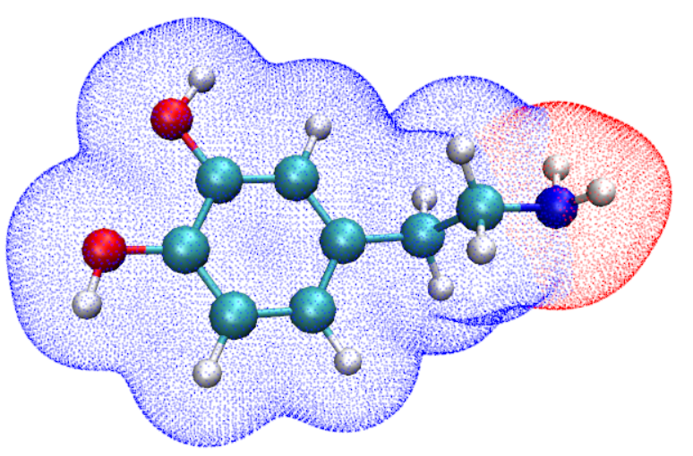

在上图中，每个点表示构成0.002 a.u.电子密度 (electron density)等值面的一个顶点，蓝色区域对应于属于氨基的局域区域。显然，整个vdW表面的划分非常合理，因此Multiwfn输出的氨基面积必定是可靠且有意义的。
### **无波函数 (wavefunction)信息时范德华 (vdW)表面积的评估**

有时由于各种原因难以生成波函数文件，此时我们仍可使用Multiwfn评估范德华表面积。此时所用的电子密度 (electron density)应为前分子密度 (promolecular density)，即根据分子中原子的坐标，将处于孤立状态的每个原子的电子密度简单叠加而近似构建的分子电子密度。

例如，手头只有*examples\dopamine.xyz*，可以启动Multiwfn并载入该文件，然后输入

```text
12  // Quantitative analysis of molecular surface
1  // Select the way to define surface
2  // Isosurface of a specific real space function
1  // Promolecular electron density
0.002  // Isovalue (a.u.)
6  // Start analysis without consideration of mapped function
```

计算结果为

```text
Overall surface area:         697.18104 Bohr^2  ( 195.23060 Angstrom^2)
```

显然该结果是合理的，195.2 Ų的值与我们此前基于B3LYP/6-31G\*波函数计算的181.6 Ų定性一致。

若接着计算氨基 (amino group)部分的面积，结果为31.5 Ų，这也与基于DFT密度计算的27.9 Ų接近。特别地，该基团的占比31.5/195.2\*100%=16.1%甚至与我们此前计算的15.4%近乎定量一致。

## **4.12.10 σ洞 (sigma-hole)与π洞 (pi-hole)面积的定量化**

### **引言**

σ洞和π洞分别对应于因σ电子 (σ-electron)和π电子 (π-electron)耗尽而在范德华表面上呈现明显正静电势 (electrostatic potential, ESP)的局域区域。这些洞对应的区域可作为电子受体 (electron acceptor)（局域Lewis酸 (local Lewis-acid)），形成以静电吸引为主导的非共价相互作用 (non-covalent interaction)，例如卤键 (halogen bond)。若对这两个概念不熟悉，建议阅读综述文章*J. Comput. Chem.*, **39**, 464 (2017)。文献中，通常通过分析范德华表面上的静电势极值来揭示σ洞和π洞，相应极值处的静电势值常用作作为电子受体潜力强度的定量度量。

在本节中，我将展示还可以使用Multiwfn计算选定σ洞和π洞对应的表面积，同时基于输出的文件，可在VMD中直接可视化相应的局域表面。建议阅读[3.15.2.2](sec-3-15-quantitative-analysis-of-molecular-surface.md#31522-局域分子表面上的分析)节第2部分，其中描述了本分析所用的算法。此处以ClPO₂为例，其在氯原子末端含有σ洞，在磷原子上下方含有π洞。

### **范德华表面上静电势的定量分析**

首先，对范德华表面上的静电势进行常规定量分析。启动Multiwfn并输入

```text
examples\ClPO2.fch  // Geometry and wavefunction were produced at PBE0/def2-TZVP
12  // Quantitative molecular surface analysis
0  // Start analysis, the mapped function is default to ESP
```

从输出中可以看到，在范德华表面上找到了三个静电势极大值，其静电势值和坐标如下所示：

```text
   #       a.u.         eV      kcal/mol           X/Y/Z coordinate(Angstrom)
     1  0.07562734    2.057924   47.456909      -1.949844  -0.043516  -0.320257
     2  0.04258971    1.158925   26.725470       0.015842  -0.054525   3.395121
*    3  0.07568641    2.059532   47.493977       1.945305   0.044502  -0.234288
```
现在输入选项 0 以查看编号并直观检查表面静电势 (ESP)极大值的位置，见下图的左侧（所有表面极小值均已隐藏）。如果按照第 [4.A.13](sec-4-A-special-topics-and-advanced-tutorials.md#4a13-绘制静电势着色的范德华表面图和范德华表面穿透图) 节所述方法绘制静电势着色的范德华表面 (vdW surface)以及表面极值点 (surface extrema)，可得到下图的右侧，其中红色和蓝色分别对应于正和负静电势。

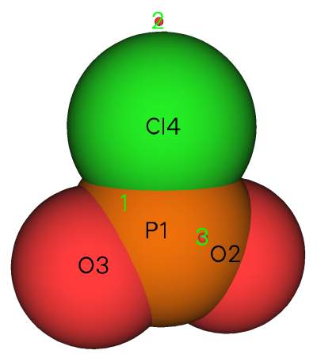 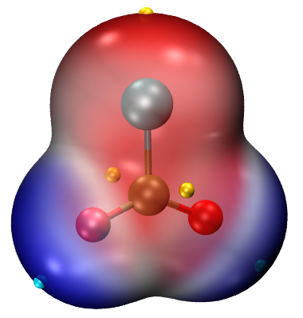

从上图可以看出，表面极大值点 1 和 3 对应于两侧的π-空穴 (π-hole)，而极大值点 1 对应于σ-空穴 (σ-hole)。

### **检查对应于正静电势值的表面区域**

由于σ-空穴和π-空穴对应于明显为正的静电势值，自然可以预期表面极大值点周围正静电势区域的面积是σ/π-空穴尺寸的直接量度。现在假设我们要测量对应于极大值点 3 的π-空穴的面积，在后处理菜单 (post-processing menu)中应输入以下命令

```text
14  // Calculate area and function average in a region around a surface extreme
2  // Surface maximum
3  // Select maximum 3 (corresponding to one of π-holes)
0  // Set criterion as 0 a.u.
```

现在可以看到以下输出

```text
Number of surface vertices in selected surface region:      4307
Area of selected surface region:    55.946 Angstrom^2
Average value of selected surface region:     0.02650 a.u.
Product of above two values:         1.48230 a.u.*Angstrom^2
```

输出表明，有 4307 个与极大值点 3 直接或间接相连且静电势值大于 0 的表面顶点 (surface vertices)(*i.e.* 正静电势)，该局域表面的面积为 55.94 Ų，平均静电势为 0.0265 a.u.。根据化学直觉，计算得到的面积与预期的π-空穴面积相比明显过大，原因是什么？

在当前文件夹中，可以找到一个名为 *selsurf.pqr* 的文件，其中包含所有选定的表面顶点的坐标，其 "Charge" 列对应于以 a.u. 为单位的静电势。现在将该文件载入 VMD 程序中。另外，在 Multiwfn 的后处理菜单中，选择选项 5 以导出包含分子几何的 pdb 文件，然后也将该文件载入 VMD。在 VMD 的 "Graphics" - "Representation" 面板中，将分子的 "Drawing Method" 设为 "Licorice"，并将 "Bond Radius" 设为 0.2，然后将表面顶点的 "Drawing Method" 设为 "Point"，并将 "Size" 设为 16，再将 "Coloring Method" 设为 "Charge"。当前图形应如下所示

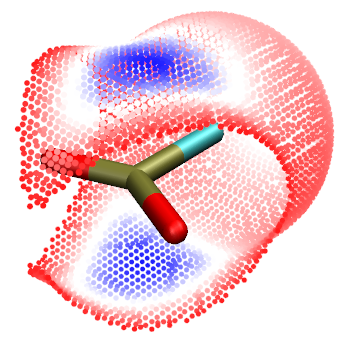

在该图中，点越蓝，静电势值越高。显然，我们当前选择的局域表面不仅对应于一个π-空穴，而是对应于整个正静电势表面区域。

### **计算对应于 π-空穴的表面积**

显然，如果只想研究对应于一个π-空穴的区域，静电势判据应设为大于 0 但小于π-空穴表面极大值点处的静电势值（0.0756 a.u.，见上文）的值。为了找到合适的判据，在 "Graphics" - "Representation" 面板中，将 "Selected Molecule" 切换到对应于 *selsurf.pqr* 的条目，然后在 "Selected Atoms" 文本框中输入 *charge \> 0.04*，此时图形窗口变为：
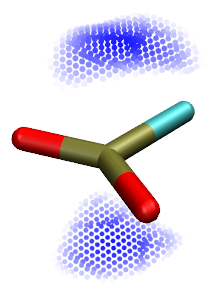

从图中可以看出，0.04 a.u. 的判据适合用于定义当前体系π洞对应的局域表面。上图包含两个蓝色局域表面，因为磷原子每一侧都有一个π洞。要计算每个π洞的面积，输入

```text
14  // Calculate area and function average in a region around a surface extreme
2  // Surface maximum
3  // Select maximum 3 (corresponding to one of π-holes)
0.04  // Set criterion as 0.04 a.u.
```

结果为

```text
 Number of surface vertices in selected surface region:       271
 Area of selected surface region:     3.570 Angstrom^2
 Average value of selected surface region:     0.05772 a.u.
 Product of above two values:         0.20608 a.u.*Angstrom^2
```

计算得到的 3.57 Ų 是典型π洞非常合理的面积。如果用 VMD 显示生成的 *selsurf.pqr* 以查看选定的局域表面，你会发现该区域恰好对应于上面表面图中所示的两个π洞之一。显然，当前体系中π洞的总面积应为 2\*3.57=7.14 Ų。

### **计算对应于σ洞 (σ-hole)的表面积**

接下来，我们用类似方法计算氯原子末端的σ洞的面积。在这种情况下不应使用 0.04 a.u. 作为判据，因为σ洞的表面极大点 (surface maximum)处的静电势 (ESP)值仅为 0.0425 a.u.。在 VMD 中，可以通过输入 *charge \> xxx* 尝试不同的判据，直到找到最能代表σ洞的值。经过几次尝试，发现 0.03 a.u. 是一个合理的值，因此在后处理菜单中输入以下命令

```text
14  // Calculate area and function average in a region around a surface extreme
2  // Surface maximum
2  // Select maximum 2 (corresponding to the σ-hole)
0.03  // Set criterion value as 0.03 a.u.
```

测得面积为 4.88 Ų，而该区域内平均静电势值为 0.03617 a.u.，明显小于π洞的值。如果在 VMD 中将导出的 *selsurf.pqr* 以点形式绘制，并将颜色标尺设为 0.0\~0.05（在 "Representation" 面板中选择 "Trajectory" 选项卡，然后设置 "Color Scale Data Range"），你将看到如下图，选定的表面区域确实很好地表现了预期的σ洞特征。

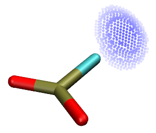

需要指出的是，计算得到的面积直接取决于判据的选择，而不存在确定完美判据的唯一方法。在实际研究中，可以尝试将判据定义为*例如*相应表面极大点处静电势值的 60%，或考虑将判据定义为比表面极大点低*例如* 10 kcal/mol 的值。

值得注意的是，选项 14 不仅能测量表面极大点周围的面积，还能计算表面极小点 (surface minimum)周围的面积。因此，你可以尝试用此功能定量各种孤对电子 (lone pair)对应的面积。

## **4.12.11 静电势分子表面的类盆分析 (basin-like analysis)**

正如整个三维分子空间可以基于*例如*电子密度 (electron density)和电子定域函数 (electron localization function)划分为盆 (basin)，从而讨论局域区域的特征，也可以采用类似思想基于特定的映射函数将整个分子表面划分为各自独立的局域表面，从而获得有化学意义的信息。在本例中，我们将把 ClPO₂ 的整个范德华表面 (vdW surface)分解为源自其表面静电势极小点和极大点的贡献。请阅读[3.15.2.2](sec-3-15-quantitative-analysis-of-molecular-surface.md#31522-局域分子表面上的分析)节第 3 部分，以了解本分析所用算法的基本知识。ClPO₂ 已在[4.12.10](#41210-σ洞-sigma-hole与π洞-pi-hole面积的定量化)节中通过分子表面分析进行过研究，如果你还没有读过，请先阅读。
启动 Multiwfn 并输入

```text
examples\ClPO2.fch  // Geometry and wavefunction were produced at PBE0/def2-TZVP
12  // Quantitative molecular surface analysis
0  // Start analysis, the mapped function is default to ESP
15  // Basin-like partition of surface and calculate areas
```

然后你可在屏幕上看到以下输出

```text
Minimum   1  N_vert:  1596,  19.615 Angstrom^2  Avg. value:   -0.023076 a.u.
Minimum   2  N_vert:  1613,  19.874 Angstrom^2  Avg. value:   -0.022824 a.u.

Maximum   1  N_vert:  1312,  16.689 Angstrom^2  Avg. value:    0.028729 a.u.
Maximum   2  N_vert:  1753,  21.539 Angstrom^2  Avg. value:    0.023524 a.u.
Maximum   3  N_vert:  1244,  16.040 Angstrom^2  Avg. value:    0.029336 a.u.
```

上述输出给出了对应于不同表面极值点的“表面盆地 (surface basins)”(*i.e.* 局域分子表面 (local molecular surfaces))的信息。“N_vert”表示属于该表面盆地的表面顶点 (surface vertices)的数量，同时还给出了该表面盆地中的面积以及映射函数 (mapped function)的平均值。Multiwfn 还在当前文件夹中导出了一个名为 *surfbasin.pdb* 的文件，其中包含所有表面顶点，它们的 B因子 (B-factors)对应于该顶点所属表面盆地的编号（正和负的 Beta 值分别对应表面极大值 (surface maxima)和极小值 (surface minima)的编号）。表面盆地的编号与相应表面极值点 (surface extreme)的编号相同，每个表面盆地包含且仅包含一个表面极值点。请注意，具有正值的表面极小值和具有负值的表面极大值没有伴随的表面盆地，如果你已正确理解第 [3.15.2.2](sec-3-15-quantitative-analysis-of-molecular-surface.md#31522-局域分子表面上的分析) 节中描述的算法，这一点很容易理解。

为了直观地查看表面盆地，你可将 *surfbasin.pdb* 载入 VMD，然后将绘制方式 (drawing method)设为 "Points"，而将着色方式 (coloring method)设为 "Beta"。另外，我们在 Multiwfn 中选择相应选项以导出分子结构 (molecular structure)的 pdb 文件（选项 5）和表面极值点（选项 2），然后在 VMD 中显示它们。最终，你可得到下图，其中还标注了计算数据

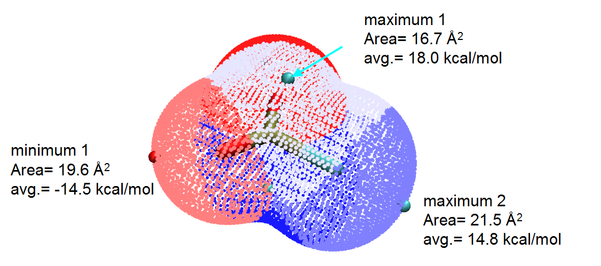

在当前图中，极小值 1 周围的红色点共同显示了表面盆地 1 的区域，而灰色和冰蓝色点分别显示了对应于极大值 1 和 2 的表面盆地。显然，通过我们目前采用的分析，我们能够阐明不同极值点对整体正表面区域 (positive surface region)或负表面区域 (negative surface region)的内在贡献。例如，由氯原子 (chlorine atom)的 σ-hole 引起的极大值 2 对正表面区域的百分比贡献为 21.539/(16.689+21.539+16.040)×100%=39.7%。

> **注记**
>
> 所有极大值（极小值）的面积之和与 "Summary of surface analysis" 部分中输出的正（负）表面积并不完全相同，因为存在一些边界表面三角面片 (boundary surface facets)，其三个顶点的归属并不相同。在计算表面盆地的面积和函数值平均值期间忽略了这些面片。

顺便提一下，你还可以使 VMD 仅显示特定的表面盆地。例如，通过在 VMD 的 "Graphics" - "Representation" 面板的 "Selected Atoms" 文本框中输入 *beta=-1* 和 *beta=2*，然后将颜色设为橙色，你将分别观察到对应于极小值 1 和极大值 2 的表面盆地：
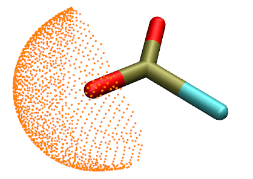 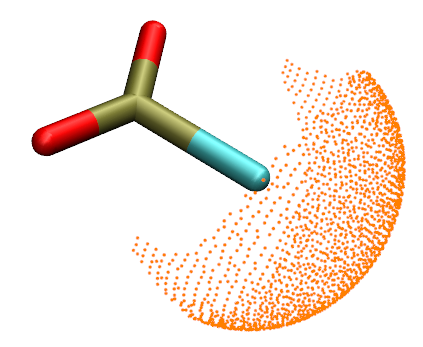

值得注意的是，由于C$_{2v}$分子对称性 (molecular symmetry)，极小值点 (minima)1和2应具有相同的值，极大值点 (maxima)1和3也应具有相同的值。如上计算数据所示的等价性的轻微破坏是由于数值方面的原因。当你报告对应于π-空穴 (π-hole)的表面盆 (surface basins)（极大值点1和3）的数据时，取它们的平均值是合理的，即每一侧的面积应为(16.040+16.689)/2=16.4 Ų。

## **4.12.12 估计小分子的动力学直径 (kinetic diameter)**

> **注**
>
> 本节的中文版以及更多讨论见我的博客文章“Using Multiwfn to calculate dynamic diameter of molecules” (<http://sobereva.com/503>)。

动力学直径是气体分离 (gas separation)研究中的一个重要量。小分子的动力学直径的最常用引用值取自Breck的著作*Zeolite Molecular Sieves; Structure, Chemistry and Use*，该书出版于1974年。在*J. Phys. Chem. A*，**118**，1150 (2014)中，作者提出了一种纯粹基于电子密度等值面 (isosurface of electron density)计算动力学直径的通用方法。如下例所示（改编自*J. Phys. Chem. A*论文），由两个黑色箭头所夹的距离可用于定义动力学直径

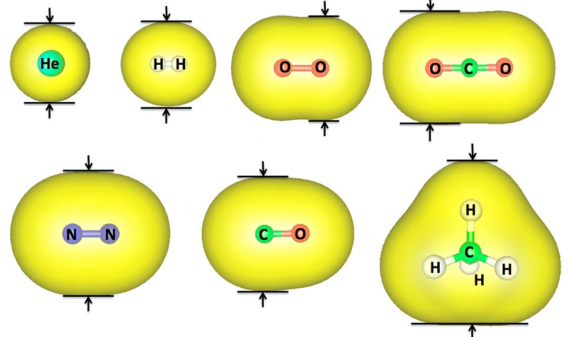

在该论文中发现，如果在波函数 (wavefunction)生成中使用PBE0/def2-TZVP，且电子密度的等值 (isovalue)设为0.0015 a.u.，则计算值与Breck值符合得最好。

在本节中，我将展示如何使用定量分子表面分析模块 (quantitative molecular surface analysis module)来实现上述方法，以计算典型分子CO的动力学直径。由PBE0/def2-TZVP水平下的优化任务得到的.fch文件已作为*examples\CO.fch*提供。

在进行计算之前，我们应使用主功能 (main function)0检查*CO.fch*中分子的取向，如下所示

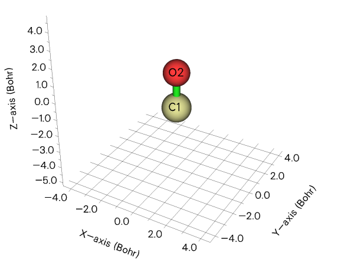

显然，分子轴与Z轴完全平行，因此动力学直径可计算为具有最大正X值的表面顶点 (surface vertex)与具有最大负X值的表面顶点之差（表面定义为电子密度0.0015 a.u.等值面）。

现在我们进行计算。启动Multiwfn并输入

```text
examples\CO.fch
12  // Quantitative analysis of molecular surface
1  // Select the way to define surface
1  // Isosurface of electron density
0.0015  // Isovalue
6  // Start analysis without consideration of mapped function
```

适当上翻后，你可以找到以下输出：

```text
Among all surface vertices:
Min-X:     -1.7527  Max-X:    1.7528 Angstrom
Min-Y:     -1.7527  Max-Y:    1.7528 Angstrom
Min-Z:     -2.5093  Max-Z:    2.0951 Angstrom
```

这意味着动力学直径可计算为1.7528-(-1.7527)=3.505 Å。根据*J. Phys. Chem. A*论文的表2，拟合的斜率为1.025，因此最终估计值应为3.505/1.025=3.42 Å，这与Breck值（3.76 Å）在定性上一致。

CO是一个非常简单的情况，而对于复杂得多的分子，你必须使用VMD (<http://www.ks.uiuc.edu/Research/vmd/>)来测量两个适当表面顶点之间的距离以估计动力学直径。仍以CO为例，在后处理菜单 (post-processing menu)中，选择选项6以在当前文件夹中导出*vtx.pdb*，其中记录了所有表面顶点。然后将此文件载入VMD，在"Graphics" - "Representation"中，将"Drawing method"设为"Points"。然后在VMD主窗口中，选择"Display" - "Orthographic"。之后，激活VMD图形窗口，按键盘上的按钮2，然后点击适当位置处的两个顶点。从下图中，你可以发现两个顶点之间的距离为3.47 Å，这与上文给出的值3.505 Å非常接近。
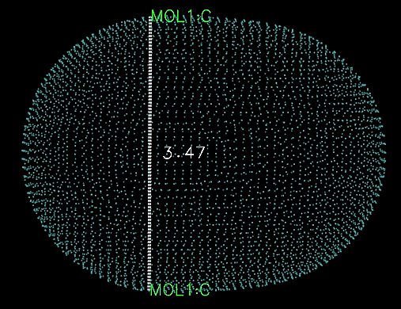

选择合适的表面顶点 (surface vertices)并不太容易，请耐心操作。如果误选了顶点，你可以进入 "Graphics" - "Labels"，然后删除不需要的原子标签和键标签。

## **4.12.13 使用局域电子亲和能 (local electron affinity)和局域电子附着能 (local electron attachment energy)揭示亲电区域 (electrophilic regions)**

> **注 (Note)**
>
> 参见我的博客文章“Using Multiwfn to investigate preferential site and difficulty of nucleophilic reactions as well as weak interactions through local electron attachment energy (LEAE)”(<http://sobereva.com/676>，中文)，以了解关于该主题的更多讨论和示例。

我们已在[4.12.2](#4122-苯酚分子表面上的平均局部离子化能-average-local-ionization-energy-alie分析)节研究了平均局域电离能 (average local ionization energy)($IE_{\mathrm{L}}$)，如果你还没有阅读，请先阅读该节，因为本节可视为该节的扩展。与$IE_{\mathrm{L}}$密切相关的有两个函数，即局域电子亲和能($EA_{\mathrm{L}}$)和局域电子附着能($E_{\mathrm{att}}$)，本节将对它们进行描述和举例说明。

### **局域电子亲和能**

$IE_{\mathrm{L}}$在 *J. Mol. Model.*，**9**，342 (2003)中提出，定义为

$$
EA_{\mathrm{L}}(\mathbf{r})=\frac{-\sum_{i\in\mathrm{vir}}\left|\varphi_i(\mathbf{r})\right|^2\varepsilon_i}{\sum_{i\in\mathrm{vir}}\left|\varphi_i(\mathbf{r})\right|^2}
$$

其中 *ε* 表示轨道能量 (orbital energy)，$\varphi$是轨道波函数 (orbital wavefunction)。$EA_{\mathrm{L}}$对应于 Multiwfn 中的用户自定义函数 (user-defined function) 27。

$EA_{\mathrm{L}}$基于 Koopmans 近似 (Koopmans' approximation)近似揭示给定点处的电子亲和能 (electron affinity)。预计某点处的$EA_{\mathrm{L}}$越正，该区域的亲电性越强。显然，这一性质使$EA_{\mathrm{L}}$在揭示亲核攻击 (nucleophilic attack)的有利位点方面具有一定的能力。

展示$EA_{\mathrm{L}}$分布的最佳方式应该是通过不同颜色将其映射到分子表面 (molecular surface)上。在[4.12.2](#4122-苯酚分子表面上的平均局部离子化能-average-local-ionization-energy-alie分析)节中，我已说明了如何基于 Multiwfn 输出文件、通过 VMD 程序的脚本绘制$IE_{\mathrm{L}}$映射的分子表面，下面我将说明如何用几乎相同的方式绘制$EA_{\mathrm{L}}$的这类图。

将以*examples\CH3Cl.fchk*为例，它是在 B3LYP/6-31G\*水平下生成的。请注意，仅当未使用弥散函数 (diffuse functions)时$EA_{\mathrm{L}}$才有意义。此外，你必须使用包含虚轨道 (virtual orbitals)的文件作为输入文件，例如 .mwfn、.fch 和 .molden，因为$EA_{\mathrm{L}}$计算涉及虚轨道。

要绘制该图，你应执行以下操作（以下流程仅适用于 Windows 平台，对于 Linux 平台，你应自行编写类似脚本）

- 从 "examples\scripts\local_EA" 文件夹复制 *LEA_isoext.bat* 和 *LEA_isoext.txt* 到当前文件夹。用文本编辑器编辑 .bat 文件，将 VMD 路径设置为你机器上实际的 VMD 文件夹，并将 Multiwfn 输入文件的路径设置为其实际路径，即 *examples\CH3Cl.fchk*。

- 从 "examples\scripts\local_EA" 文件夹复制 *LEA_isoext.vmd* 到 VMD 文件夹

- 双击 *LEA_isoext.bat* 运行它。然后将调用 Multiwfn 生成 *density.cub*(*ρ*的 cube 文件 (cube file))、*userfunc.cub*($EA_{\mathrm{L}}$的 cube 文件)和 *surfanalysis.pdb*(包含 *ρ* = 0.01 a.u. 等值面 (isosurface)上 $EA_{\mathrm{L}}$ 的表面极值 (surface extrema))，然后它们将被自动移动到 VMD 文件夹
启动 VMD，并在 VMD 控制台窗口 (VMD console window)中输入 `source LEA_isoext.vmd` 以运行此脚本，然后你将看到如下图

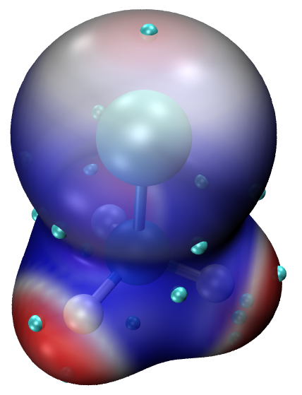

该图展示了映射有 $EA_{\mathrm{L}}$ 的 *ρ* = 0.01 a.u. 等值面 (isosurface)，色标 (color scale)范围为 -0.80（蓝色）至 -0.30（红色）a.u.，青色小球对应于该表面上 $EA_{\mathrm{L}}$ 的极大值。如可见，氢周围区域具有最正的 $EA_{\mathrm{L}}$，表明它们是该分子亲电性 (electrophilic)最强的部分。这些区域的存在源于氢带有正电荷这一事实。在 Cl 原子末端也存在一个 $EA_{\mathrm{L}}$ 相对更正的区域，这表明了 Cl 原子的 σ洞 (σ-hole)的存在。

要查询表面极值 (surface extrema)的精确数值，你应激活 VMD 的 OpenGL 窗口 (OpenGL window)，然后点击键盘上的按键 0 以进入查询模式 (inquire mode)，再点击一个表面极值点的中心，例如上图中顶部的极值点，你将在 VMD 控制台窗口中找到它的序号 (index 9)。然后在 VMD 控制台窗口中输入 *\[atomselect top "index 9"\] get beta*，你将发现其数值为 -12.49，它以 eV 为单位给出，对应于 -12.49/27.2114 = -0.46 a.u.。

值得注意的是，最合适的 $EA_{\mathrm{L}}$ 色标通常因体系而异。如果发现整个等值面呈单色，或不同区域的颜色无法清晰区分，你应适当调节色标的下限和上限。例如，若在 VMD 控制台窗口中输入 *mol scaleminmax 0 1 -1.0 -0.4*，则色标将被改为 -1.0 \~ -0.4 a.u.。

顺便提一下，为了充分理解该脚本的工作原理，建议你将记录在 *LEA_isoext.txt* 中的命令逐条手动输入到 Multiwfn 窗口中。

### **局域电子附着能 (Local electron attachment energy)**

该函数在 *J. Phys. Chem. A.*, **120**, 10023 (2016) 中定义为

$$
E_{\mathrm{att}}(\mathbf{r})=\frac{n\sum_{i=\mathrm{LUMO}}^{\varepsilon_i<0}\left|\varphi_i(\mathbf{r})\right|^2\varepsilon_i}{\rho(\mathbf{r})}
$$

其中 *i* 遍历所有具有负能量的未占据轨道 (unoccupied orbitals)。对于限制性和非限制性波函数 (restricted and unrestricted wavefunctions)，*n* 分别等于 2 和 1。$E_{\mathrm{att}}$ 对应于 Multiwfn 中的自定义函数 (user-defined function) -27，你可以通过 Multiwfn 中的多种方式研究它。

该函数的特征与 LEA 高度类似，但由于高能量的未占据 MOs（完全缺乏化学意义）不参与计算，该函数比 LEA 更稳健，且允许存在弥散函数 (diffuse functions)。然而，要使用该函数，必须保证至少 LUMO 具有负能量，否则该函数将处处严格为零。在原文中发现 $E_{\mathrm{att}}$ 在 B3LYP/6-31+G(d,p) 波函数下表现合理。因此，我们将使用在该水平下产生的波函数来说明 $E_{\mathrm{att}}$ 的分析。值得注意的是，在 B3LYP/6-31G\* 水平下，即使 LUMO 也具有正能量，因此至少在这种情况下添加弥散函数是必需的！

我们将像上面的 $EA_{\mathrm{L}}$ 例子一样，为 CH₃Cl 绘制着色有 $E_{\mathrm{att}}$ 的分子表面 (molecular surface)。分子表面将定义为 0.004 a.u.，这是因为 $E_{\mathrm{att}}$ 的原文建议在此表面上研究 $E_{\mathrm{att}}$。你应进行以下操作（在 Windows 下）
- 将 *LEAE_isoext.bat* 和 *LEAE_isoext.txt* 从 "examples\scripts\local_EA" 文件夹复制到当前文件夹。用文本编辑器打开 .bat 文件，将 VMD 路径设为你机器上实际的 VMD 文件夹，并将 Multiwfn 输入文件的路径设为其实际路径，即 *examples\CH3Cl_631+Gxx.fch*，该文件由 Gaussian 16 经 B3LYP/6-31+G(d,p)//B3LYP/6-31G(d) 计算得到。

- 将 *LEAE_isoext.vmd* 从 "examples\scripts\local_EA" 文件夹复制到 VMD 文件夹。

- 双击 *LEAE_isoext.bat* 运行它。随后将调用 Multiwfn 生成 *density.cub* (*ρ* 的 cube 文件)、*userfunc.cub* ($E_{\mathrm{att}}$ 的 cube 文件) 和 *surfanalysis.pdb* (包含在 *ρ* = 0.004 a.u. 等值面 (isosurface) 上的 $E_{\mathrm{att}}$ 表面极值点 (surface extrema))，然后它们将被自动移至 VMD 文件夹

启动 VMD 并在 VMD 控制台窗口中输入 `source LEAE_isoext.vmd` 以运行此脚本。然而，在默认颜色标尺 (color scale)(从 -0.03 到 0.0 a.u.)下，分子表面 (molecular surface)不同区域的特征无法清晰区分。因此，我们在 VMD 控制台窗口中输入此命令将颜色标尺改为 \[-0.015,0\] a.u.：*mol scaleminmax 0 1 -0.015 0*，然后你将看到如下图所示，显示了两个视角

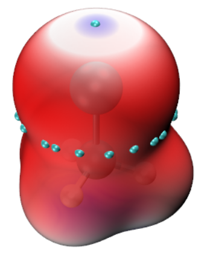 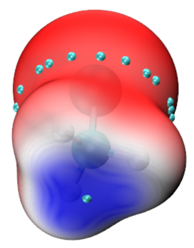

在此图中，颜色按蓝-白-红变化，区域越蓝($E_{\mathrm{att}}$ 越负)，相应区域的亲电性 (electrophilicity)越强。该图传达的信息与 $EA_{\mathrm{L}}$ 基本相同，即 -CH₃ 基团末端亲电性最强，而 Cl 原子的 σ空穴 (σ-hole)也显示出弱亲电性。

表面上的青色小球对应于 $E_{\mathrm{att}}$ 的表面极值点。用与上例相同的方法查询它们的数值，你会发现 Cl 原子末端的表面极值点为 -0.29 eV，而 -CH₃ 一侧的为 -0.5 eV。