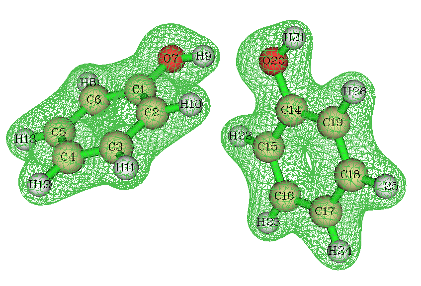
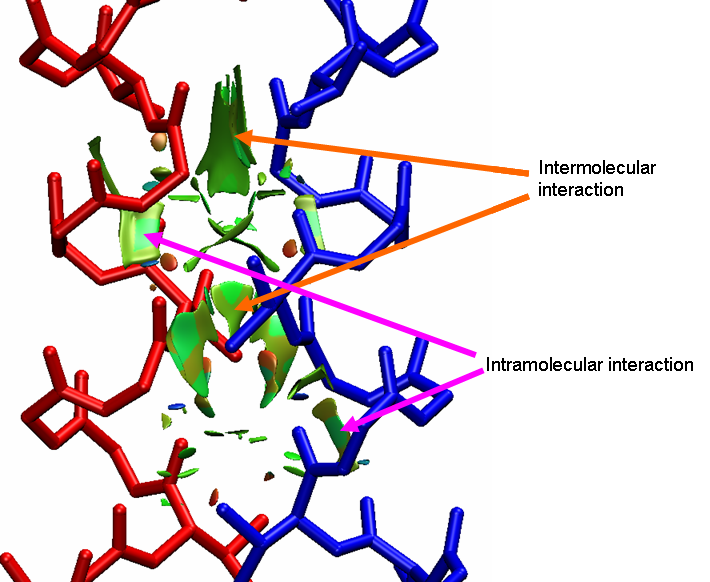
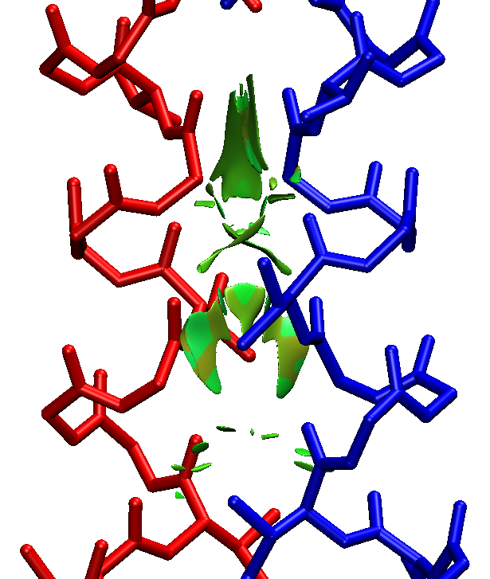
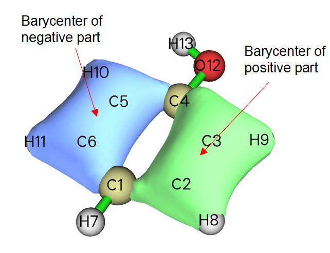
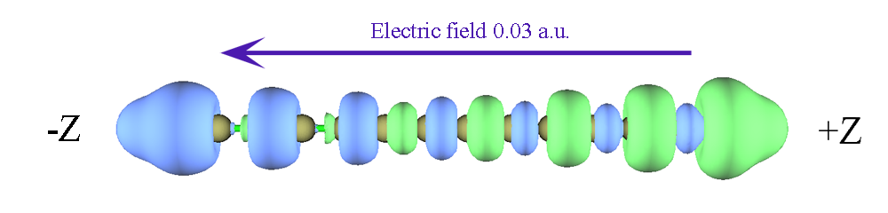
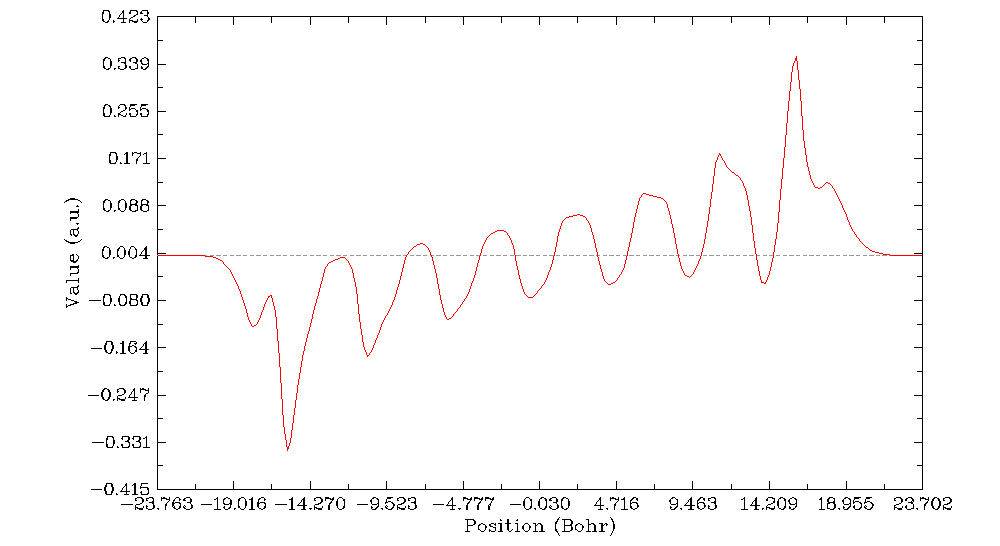
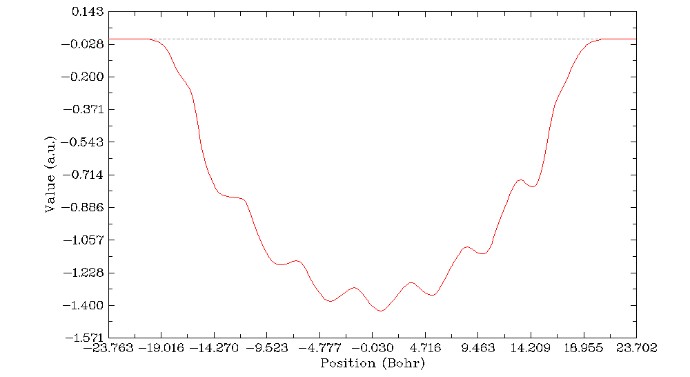
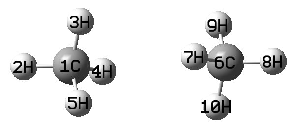
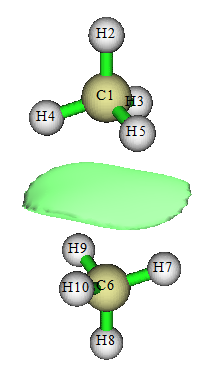
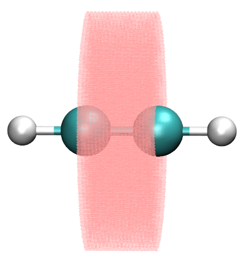

# **4.13 处理格点数据 (Process grid data)**

主功能 13 包含一系列子功能，利用它们可以处理从 Gaussian 型 cube 文件 (.cub)、DMol3 格点文件 (.grd)、ParaView VTK Image Data 文件 (.vti) 载入的格点数据，或直接由 Multiwfn 的主功能 5 等生成的格点数据。本节介绍几个简单的应用，其余子功能请自行尝试。

## **4.13.1 提取平面内的数据点**

本例将 Z=28 到 Z=32 Å 之间 XY 平面的平均数据提取到纯文本文件中。

```text
dens.cub  // A cube file generated by Multiwfn or by some external programs, since cube file is generally large, it is not provided in "example" folder. You can also use the grid data generated internally by Multiwfn instead, that is use main function 5 to calculate grid data first and then choose 0 to return to main menu (the just generated grid data is present in memory)
13  // Process grid data
5  // Extract average plane data
28,32  // Range of Z (in Å)
```

现在数据点已导出到当前文件夹的 *output.txt* 中，包括 X、Y 坐标和数值。可将此文件导入 Sigmaplot 等作图软件绘制平面图。

再举一例，提取由原子 4、6、2 定义的平面上的数据点。

```text
dens.cub
13  // Process grid data
8  // Output data in a plane by specifying three atom indices. This function is commonly used to extract a tilted plane, if the plane is parallel to XY, YZ or XZ, you should use functions 1, 2 or 3 instead, respectively
0  // Use automatically determined tolerance distance. If vertical distance between any point and the plane you defined is smaller than tolerance distance, then the point will be outputted.
1  // Project the data points in the plane you defined to XY plane, so that you can directly import the outputted file to plotting software to draw plane graphs
```

现在数据值连同坐标已导出到当前文件夹的 *output.txt* 中。

注意，在提取平面数据时 Multiwfn 不做插值，因此若格点数据质量不够精细（即点间距较大），提取出的平面数据会比较稀疏（对于不平行于 XY、YZ 或 XZ 平面的平面尤为严重）。

## **4.13.2 对格点数据做数学运算**

### **例 1**

假设有两个 cube 文件 *A.cub* 和 *B.cub*，本例求二者的差值 cube 文件（即 *A.cub* 减 *B.cub*）。

启动 Multiwfn 并输入以下命令：

```text
A.cub  // Load the first cube file into memory
13  // Process grid data
11  // Grid data calculation
4  // Subtract the grid data in memory by another grid data
B.cub  // The cube file containing another grid data. Notice that this cube file must have identical grid setting as the first cube file
```

此时内存中的格点数据已更新，选择 0 即可将其导出为新的 cube 文件，即为所需结果。

### **例 2**

假设有两个 cube 文件 *MO1.cub* 和 *MO2.cub*，各自记录了一个轨道的波函数值。本例将生成一个 cube 文件，其中为这两个轨道贡献的总电子密度。根据 Born 的概率诠释，轨道波函数值的平方即其密度概率，因此我们需要的是两套格点数据平方之和。

启动 Multiwfn 并输入以下命令：

```text
MO1.cub
13  // Process grid data
11  // Grid data calculation
10  // Perform A^2+B^2=C operation, where A is present grid data (MO1.cub), B is another cube file (MO2.cub), C is the new grid data
MO2.cub  // Load another cube file
```

计算完成后，内存中的格点数据已更新为 C。

```text
0  // Output the updated grid data
totdes.cub  // Filename of the new cube file, which contains total electron density of the two orbitals
```

## **4.13.3 缩放格点数据的数值范围**

ELF 函数的数值范围是 \[0,1\]，本例将其数值范围缩放到 \[0,65535\]（即无符号 16 位整数的取值范围）。首先按[4.5.1 节](sec-4-5-generate-grid-data-and-view-isosurface-map.md#451-三氟化氯的电子定域函数)所述在 Multiwfn 中计算 ELF 格点数据，然后输入：

```text
0  // Return to main menu from post-processing interface of grid data calculation
13  // Process grid data
16  // Scale data range
0,1  // Original data range
0,65535  // The range after scaling. Please read Section 3.16.12 for the detail of scaling algorithm.
```

此时格点数据已被缩放。可选择功能 0 将更新后的格点数据导出为 Gaussian cube 文件，或用相应功能将平面数据提取为纯文本文件。

## **4.13.4 筛除局域区域的等值面**

有时我们不希望显示全空间的所有等值面，因为过多的等值面会干扰观察。本节展示如何筛除不感兴趣的等值面。

### **4.13.4.1 筛除某个区域内/外的等值面**

本节以苯酚二聚体的电子密度为例。首先，按如下步骤生成格点数据（也可直接载入 .cub/.grd 文件再进入主功能 13）：

```text
examples\phenoldimer.wfn
5  // Calculate grid data
1  // Electron density
2  // Medium-quality grid
-1  // Visualize isosurface
```

可以看到，两个苯酚分子上都出现了等值面。



假设只希望显示右侧苯酚周围的等值面，就需要把靠近左侧苯酚的格点的值设为很小的值，例如零。

关闭 Multiwfn 图形窗口并输入：

```text
0  // Return to main menu
13  // Process grid data
13  // Set value of the grid points that far away from / close to some atoms
-0.7  // That means we will set the value of the grid points inside 0.7 times of vdW radius of the atoms. If input 0.7, then the value of the grid points outside 0.7 times of the vdW radius will be set
0  // Set the value to 0
2  // Defining mode. 2 means inputting atomic indices by hand (if choose 1, external file containing atomic index list will be used to define fragment, see Section 3.16.9 for the format or the next example)
1-13  // Range of atomic indices of the left phenol
```

此时格点数据已更新，选择选项 -2 查看当前格点数据的等值面。可以看到，左侧苯酚的等值面已经消失。

### **4.13.4.2 筛除两个片段交叠区之外的等值面**

用 NCI 方法（[4.20.1 节](sec-4-20-visual-study-of-weak-interactions.md#4201-用-nci-方法研究-2-吡哆素-2-氨基吡啶中的弱相互作用)）分析分子间相互作用时，我们只关心分子间区域的等值面。为了筛除其他区域的等值面，可将两个分子缩放 vdW 区域的叠加区之外的格点的值设为很大的值（至少大于当前格点数据中的最大值）。本节给出一个实际例子。

所谓“缩放 vdW 区域 (scaled vdW regions)”是指片段中所有原子的缩放 vdW 球的叠加区。而“缩放 vdW 球”是指与缩放后的 vdW 半径对应的球。

下面是用 VMD 程序绘制的一段二聚蛋白（[4.20.2 节](sec-4-20-visual-study-of-weak-interactions.md#4202-基于前分子密度的-nci-方法研究-dna-中的弱相互作用)会讲如何绘制类似图形），红色和蓝色分别代表两条链的主链结构。约化密度梯度的等值面展示了弱相互作用区域。但这些等值面同时包含分子内和分子间部分，相互交织，给两条链之间弱相互作用的可视化研究带来困难。



为了筛除分子内的等值面，我们使用 Multiwfn 主功能 13 的子功能 14。首先，为两条链各准备一个原子序号文件（每条链对应一个片段）。*atmlist1.txt* 记录链 1 的原子序号，文件头尾为：

```text
159   <--- Total number of atoms in chain 1
1   <--- Atom index of the first atom in chain 1
2   <--- Atom index of the second atom in chain 1
...
159   <--- Atom index of the last atom in chain 1
```

类似地，*atmlist2.txt* 定义链 2 的原子列表，其头尾为：

```text
159   <--- Chain 2 has 159 atoms too
160   <--- Atom index of the first atom in chain 2
161   <--- Atom index of the second atom in chain 2
...
318   <--- Atom index of the last atom in chain 2
```

然后启动 Multiwfn 并输入：

```text
RDG.cub  // The cube file of reduced density gradient corresponding to the graph above
13  // Process grid data
14  // Set value of the grid points outside overlap region of the scaled vdW regions of the two fragments
1.8  // The value for scaling vdW radius. In your practical studies, you may need to try this value many times to find a proper value
1000  // Set value of those grid points to 1000, this value is large enough
1  // Defining mode, 1 means using external file to define the fragment
atmlist1.txt  // The name of the atom list file for chain 1
atmlist2.txt  // The name of the atom list file for chain 2
```

等待片刻，格点数据即更新。然后选择功能 0 将其导出为 cube 文件。用这个新 cube 文件重绘上图，会发现所有分子内的等值面都消失了，图形变得非常清晰。



事实上，当体系不太复杂时（如本例），无需准备原子序号文件，可选择定义模式 2，直接输入原子序号（即链 1 用 *1-159*，链 2 用 *160-318*）。

## **4.13.5 求分子轨道的重心**

本例计算分子轨道的重心。用类似方法也可求其他实空间函数的重心。重心的定义见[3.16.13 节](sec-3-16-processing-grid-data.md#31613-显示特定空间与数值范围内格点的统计数据-17)。下图是苯酚第 10 个分子轨道的等值面。



计算该轨道重心之前，需先得到该轨道的格点数据，可在 Multiwfn 中完成，即启动 Multiwfn 并输入以下命令：

```text
examples/phenol.wfn
5  // Calculate grid data
4  // Choose orbital wavefunction
10  // The 10th orbital
2  // Medium-quality grid. Finer quality of grid will give more accurate barycenter positions
0  // Return back to main menu
```

此时格点数据已存于内存，下面开始分析：

```text
13  // Process grid data
17  // Show statistic data
1  // Select all points
```

从输出中可知，该轨道正部分的重心的 X、Y、Z 分量（Bohr）分别为 2.629、-0.408、0.000，负部分分别为 -2.603、-0.702、0.000。总重心目前没有意义，因为该轨道的总积分为零。但该轨道绝对值的总重心是有用的，尤其对大分子，由此可了解轨道主要分布于何处。为此输入：

```text
11  // Grid data calculation
13  // Get absolute value
17  // Show statistic data
1  // Select all points
```

可得该轨道总重心的 X、Y、Z 分别为 -0.043、-0.558、0.000 Bohr。由于现在没有负区域，负部分的重心显示为 NaN（Not a Number）。

## **4.13.6 绘制电荷位移曲线**

Multiwfn 能够计算并绘制格点数据的积分曲线，见[3.16.14 节](sec-3-16-processing-grid-data.md#31614-绘制-xyz-方向的局域积分曲线与平面平均曲线-18)的介绍。若格点数据选为电子密度差，则积分曲线通常称为电荷位移曲线 (charge displacement curve, CDC)，可直观、定量地研究电荷转移，非常适合线性体系。本例借助 CDC 研究外加沿分子轴 0.03 a.u. 电场导致的聚炔 (*n*=7) 中的分子间电荷转移。

"example" 文件夹中的 *polyyne.wfn* 和 *polyyne_field.wfn* 文件分别对应孤立态的聚炔和施加 0.03 a.u. 外电场的情形。计算用 B3LYP/6-31G\*，两种情形均采用孤立态优化的几何。在 Gaussian 程序中，可通过关键词 *field=z+300* 施加电场。

绘制 CDC 之前，必须先计算这两个文件之间的电子密度差格点数据。启动 Multiwfn 并输入以下命令：

```text
examples\polyyne_field.wfn
5  // Calculate grid data
0  // Custom operation
1
-,examples\polyyne.wfn  //Subtract the property of polyyne.wfn from polyyne_field.wfn
1  // Electron density
2  // Medium-quality grid
```

先查看电子密度差的等值面。选择 -1 并将等值设为 0.004，可看到如下图形：



绿色和蓝色部分分别代表施加外电场后电子密度增加和减少的区域。可以看到，尽管绿色和蓝色部分相互交错，但总体趋势是电子转移到了 Z 轴正侧（即朝向电场源）。下面绘制 CDC，它能定量刻画不同区域的电子转移。

点击图形界面中的 "Return" 按钮，然后输入：

```text
0  // Return to main menu
13  // Process grid data
18  // Calculate and plot integral curve
Z  // The curve will be plotted in Z direction
[Press ENTER button]  // Select the entire range
```

在菜单中，先选择选项 2 绘制电子密度差格点数据的局域积分曲线，可看到：



此图展示了不同 Z 坐标对应的 XY 平面内电子密度差的积分。Z 坐标和数值分别对应图的 X 轴和 Y 轴。可将此曲线与上图等值面直接对比，低于和高于零（虚线）的峰分别对应蓝色和绿色等值面。注意，此时命令行窗口中可找到曲线所有极小值和极大值的位置和数值。

在图上点击鼠标右键关闭图形，再选选项 1，即显示 CDC：



此图由上一图中的曲线沿分子轴积分得到。在其左半部分，尽管有些起伏，CDC 逐渐变得越来越负，在 X 轴中点（对应聚炔中心）达到最小值 1.4，即由于外电场，聚炔左半部分失去了 1.4 个电子。在图的右半部分，CDC 从 -1.4 逐渐增大，最终回到零，表明 1.4 个电子转移到了聚炔右半部分；由于整个分子空间内电子的增减恰好相互抵消，电子总数没有变化（换言之，全空间电子密度差的积分为零）。

## **4.13.7 计算电子密度交叠**

本例以甲烷二聚体为例，考察两个单体的电子密度在何处明显交叠。甲烷二聚体的结构为：



首先为二聚体获得任意实空间函数的格点数据。启动 Multiwfn 并输入：

```text
examples\rho_overlap\dimer.pdb
5  // Grid data calculation
100  // User define function, by default this function does not take any computational time
-10  // Set grid extension distance
2  // Decrease the distance to 2 Bohr to avoid waste of grid at system boundary
2  // Medium-quality grid
2  // Export grid data as userfunc.cub
```

再用 Gaussian 为两个单体计算波函数文件，输入文件为 *examples\rho_overlap* 文件夹中的 *monomer1.gjf* 和 *monomer2.gjf*。最终得到 *monomer1.wfn* 和 *monomer2.wfn*。注意 Gaussian 计算中必须用 *nosymm* 关键词，以避免自动重定向和平移。

然后在全空间计算单体 1 的电子密度格点：

```text
monomer1.wfn
5  // Grid data calculation
1   // Electron density
8
userfunc.cub   // Use this cube file to define the grid, which corresponds to the whole space
2   // Export grid data
```

将得到的 *density.cub* 改名为 *density1.cub*。对单体 2 重复上述步骤得到 *density2.cub*。

现在计算 min(rho(1),rho(2)) 的格点数据，即处处取两套电子密度的最小值。启动 Multiwfn 并输入：

```text
density1.cub
13  // Process grid data
11  // Mathematical operation on grid data
21  // Take min(rho(1),rho(2))
density2.cub
0  // Export resulting grid data
overlap.cub
```

用文本编辑器打开 *overlap.cub* 和 *density2.cub*，把后者的原子坐标复制到前者，同时修改原子数。此时 overlap.cub 的文件头应如下所示（高亮文字为修改部分）：

```text
Generated by Multiwfn
 Totally       531846 grid points
   10   -3.693194   -3.955866   -7.444301
   63    0.119334    0.000000    0.000000
   67    0.000000    0.000000    0.119334
  126    0.000000    0.000000    0.119334
    6    6.000000    0.000000    0.000000    3.371271
    1    1.000000    0.000000    0.000000    5.444301
    1    1.000000    0.000000    1.955867    2.677742
    1    1.000000   -1.693195   -0.976988    2.677742
    1    1.000000    1.693195   -0.976988    2.677742
    6    6.000000    0.000000    0.000000   -3.371271
    1    1.000000    1.693195    0.976988   -2.677742
    1    1.000000    0.000000    0.000000   -5.444301
    1    1.000000   -1.693195    0.976988   -2.677742
    1    1.000000    0.000000   -1.955867   -2.677742
```

启动 Multiwfn 并载入 *overlap.cub*，进入主功能 0，把等值改为较小的值如 0.0005，即可清楚看到密度交叠区：



值得一提的是，若接着进入主功能 13，选子功能 17 再输入 *1*，即可得到密度交叠函数在全空间的积分值，即 "Integral of all data"。显然积分越大，单体密度交叠程度越高。

顺便说，若觉得上述步骤太繁琐，可利用 Multiwfn 的静默模式显著减少操作步骤，见[5.2 节](sec-5-2-running-multiwfn-in-silent-mode.md)。

## **4.13.8 在圆柱区域内积分电子密度**

Multiwfn 能给出特定空间和数值范围内格点数据的统计信息（积分、体积、最大最小值等）。为演示此功能，本例先计算乙炔的电子密度，再在 C-C 键周围的圆柱区域内积分电子密度。

启动 Multiwfn 并输入：

```text
examples\C2H2.wfn
5  // Calculate grid data
1  // Electron density
3  // High-quality grid
0  // Return to main menu
13  // Process grid data
17  // Show statistic data of grid points
2  // Obtain statistic data for grid points in specific spatial and value ranges
[Press ENTER button directly]   // Do not set constraint condition of value range
2  // Cylindrical region
0.000000   0.000000   0.602676   // Coordinate (in Å) of C1 as the 1st terminal of the cylinder
0.000000   0.000000  -0.602676   // Coordinate (in Å) of C3 as the 2nd terminal of the cylinder
2   // Radius of the cylinder is set to be 2 Å
```

此时可得到定义区域内格点数据的统计信息：

```text
The minimum value:  0.27234472E-17 at   -6.000000   -6.000000   -9.152823 Bohr
The maximum value:  0.70592762E+02 at   -0.013983   -0.013983   -1.094723 Bohr
Differential element:   0.0015254705 Bohr^3
Average value:  0.24053135E-02
Root mean square (RMS):  0.11805020E+00
Standard deviation:  0.11800212E+00

Volume of positive value space:                103.2133362853 Bohr^3
Volume of negative value space:                  0.0000000000 Bohr^3
Volume of all space:                           103.2133362853 Bohr^3

Summing up positive values:               4242.9729279471
Summing up negative values:                  0.0000000000
Summing up all values:                    4242.9729279471

Integral of positive data:                  6.4725301753
Integral of negative data:                  0.0000000000
Integral of all data:                       6.4725301753

X,Y,Z of barycenter (in Bohr)
Positive part:         -0.00015137         -0.00015137         -0.00320043
Negative part:                 NaN                 NaN                 NaN
Total:                 -0.00015137         -0.00015137         -0.00320043
```

如黄色高亮所示，当前格点数据（即电子数）在圆柱区域内的积分为 6.472。此时 Multiwfn 会询问是否把参与统计的格点导出为当前文件夹下的 *grid.xyz*，我们选 *y*。再用 VMD 程序同时显示 *grid.xyz* 和分子结构。调整图形效果使格点显示为粉色小点，即可看到下图。显然格点确实分布在预期区域内。


