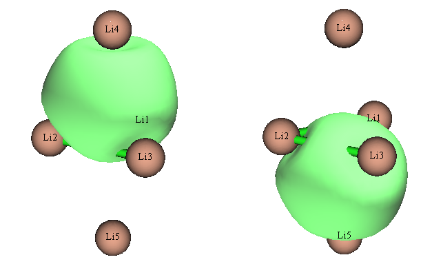
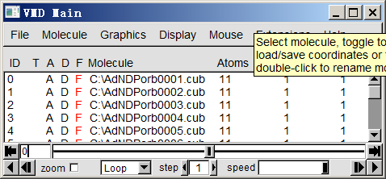
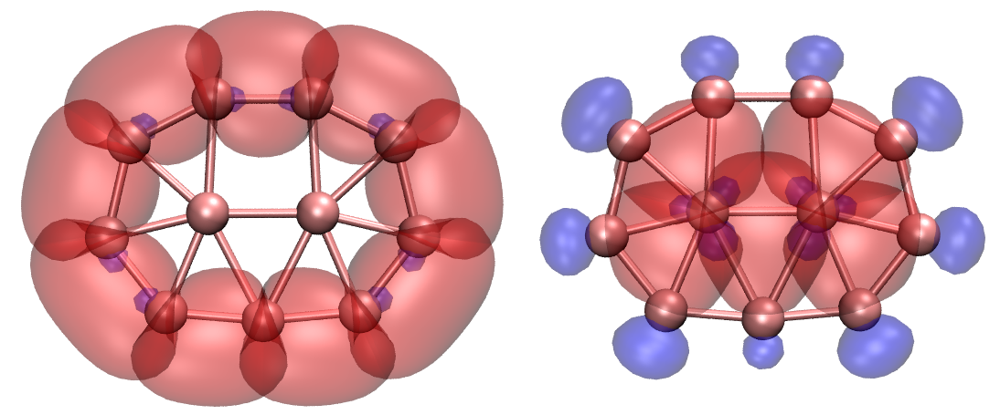
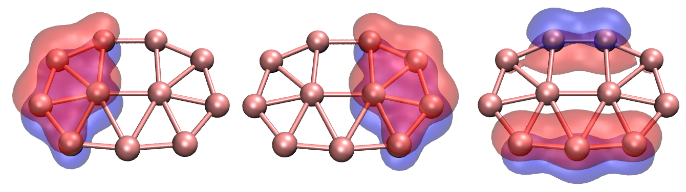
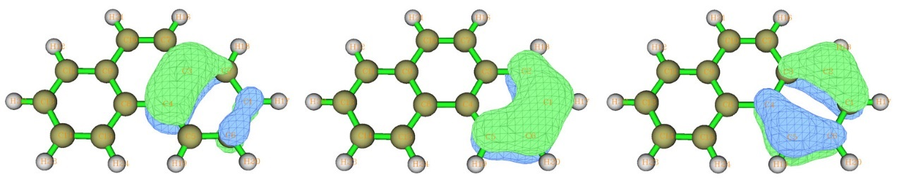
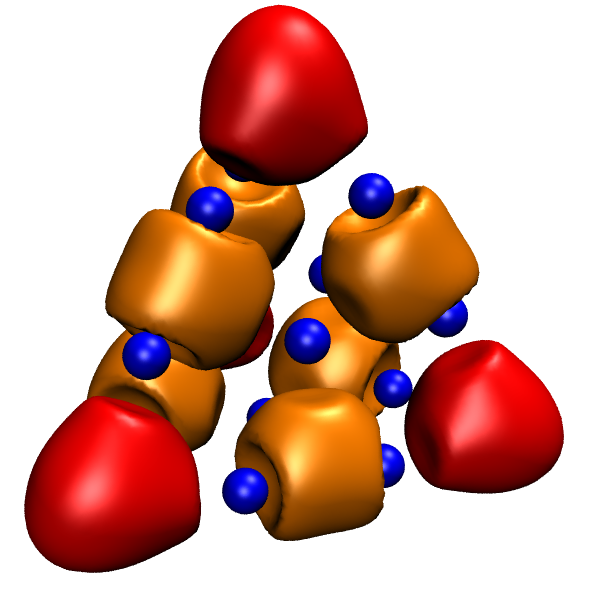

# **4.14 自适应自然密度划分 (Adaptive natural density partitioning, AdNDP) 分析**

AdNDP 分析的理论基础已在[3.17.1 节](sec-3-17-adaptive-natural-density-partitioning-analysis.md#3171-理论)介绍，请先阅读。下面展示如何用 AdNDP 方法研究几个实际分子的多中心轨道。关于 AdNDP 分析的更详细讨论见我的博文“通过 AdNDP 方法研究多中心键以及 ELF/LOL 和多中心键级”（中文，<http://sobereva.com/138>）。

> **注**
>
> 注意：在 AdNDP 分析中强烈不建议使用弥散函数，因为它们常引起数值问题（有时导致 Multiwfn 载入输入文件时崩溃），而对 AdNDP 结果从无改善！

## **4.14.1 分析 Li₅⁺ 团簇**

在 *Chem. Eur. J.*, **6**, 2982 (2000) 中，作者通过考察 ELF 等值面指出 Li₅⁺ 团簇有两个 4 中心 2 电子 (4c-2e) 键。本例用 AdNDP 方法研究该团簇以验证其说法。首先在 B3LYP/6-311G\* 水平优化 Li₅⁺ 团簇，再编写 Gaussian 单点任务输入文件。路线部分必须指定 *pop=nboread* 关键词，文件末尾必须加 *\$NBO AONAO DMNAO \$END*。用 Gaussian 运行此文件，再把 checkpoint 文件转为 .fch 格式。输入文件、输出文件和 .fch 文件已放在 "examples\AdNDP" 文件夹中。

启动 Multiwfn 并输入 *examples\AdNDP\Li5+.out*，再选主功能 14。Multiwfn 载入必要信息后出现菜单。由于该团簇很小，可直接用穷举方式依次搜索所有可能的 1c-2e、2c-2e、3c-2e、4c-2e 和 5c-2e 轨道。先选选项 2 搜索 1c-2e 轨道（即孤对），但因所有尝试的 1c 轨道的占据数都低于默认阈值（该值接近 2.0，可用选项 4 调整），菜单前的候选轨道列表仍为空。再选两次选项 2，依次搜索 2c-2e 和 3c-2e 轨道，仍找不到占据数高的轨道。再选选项 2 搜索 4c-2e 轨道，此时候选轨道列表不再为空，其中有两个轨道：

```text
#   2 Occ:  1.9966  Atom:   1Li   2Li   3Li   4Li
#   1 Occ:  1.9966  Atom:   1Li   2Li   3Li   5Li
```

因其占据数很高，显然是理想的 4c-2e 轨道，因此选选项 0 并输入 *2*，把它们从候选列表中取出存为 AdNDP 轨道。之后可用选项 5 打印 AdNDP 轨道列表。

可注意到菜单顶部显示的剩余价电子数已更新为 0.020，已非常接近零，表明继续搜索 5c-2e 轨道没有意义，因为不可能再找到。

现在可选选项 7 查看这两个 4c-2e AdNDP 轨道。为计算轨道波函数，Multiwfn 需先从相应的 .fch 文件载入基组信息。由于 *Li5+.fch* 与 *Li5+.out* 在同一文件夹且同名，.fch 文件会被直接载入。载入完成后弹出与主功能 0 完全相同的图形界面，在右下列表中选相应编号即可绘制 AdNDP 轨道。两轨道的 0.05 等值面如下所示。



AdNDP 轨道的格点数据可用选项 9 导出为 Gaussian cube 文件，以便用 VMD、Molekel 等第三方可视化程序绘制。需输入轨道序号范围，假设要输出刚找到的两个 4c-2e AdNDP 轨道，应输入 *1,2* 并选合适的格点设置，它们将作为当前文件夹下的 *AdNDPorb0001.cub* 和 *AdNDPorb0002.cub* 导出。

用选项 3 可设置下一次穷举搜索的多中心轨道的中心数。所以，若已知体系中有两个 4c-2e 轨道，可直接选选项 3，输入 4，再选选项 2 开始 4c-2e 轨道的穷举搜索，从而跳过 1c-2e、2c-2e 和 3c-2e 轨道的穷举搜索。

### **计算 AdNDP 轨道能量**

也可以得到已取出的 AdNDP 轨道的能量。为此，需额外提供一个纯文本文件，其中按下三角序列记录当前体系的 Fock 矩阵，以便经变换后得到轨道能量。Fock 矩阵也可从 .47 文件载入。最直接的做法是：把 *examples\AdNDP\Li5+.gjf* 复制为 *examples\AdNDP\Li5+\_47.gjf*，将其最后一行改为 *\$NBO archive file=C:\Li5+ \$END*。用 Gaussian 运行此文件后得到 *C:\Li5+.47*，它是 GENNBO 程序的输入文件，包含我们需要的 Fock 矩阵。然后在 AdNDP 分析界面选选项“16 Output energy of picked AdNDP orbital”，输入 *Li5+.47* 的路径（"examples\AdNDP\\" 文件夹中已提供），Multiwfn 即载入并立刻打印 AdNDP 轨道能量，如下所示：

```text
Energy of picked AdNDP orbitals:
Orbital:     1  Energy (a.u./eV):   -0.325776     -8.8648
Orbital:     2  Energy (a.u./eV):   -0.325776     -8.8648
```

如预期，两轨道能量简并，因为形状完全等价。

> **注**
>
> 当然，若在 .gjf 文件最后一行写 *\$NBO DMNAO AONAO archive file=C:\Li5+ \$END*，运行后不仅输出文件可用作 AdNDP 分析的输入文件，同时还会得到用于求 AdNDP 轨道能量的 .47 文件。

## **4.14.2 分析 B₁₁⁻ 团簇**

这次重现 AdNDP 原始论文（*Phys. Chem. Chem. Phys.*, **10**, 5207 (2008)）中 B₁₁⁻ 团簇的 AdNDP 分析结果。

本例所需文件 *B11-.out* 和 *B11-.fch* 在 "examples\AdNDP" 文件夹中。几何在 B3LYP/6-311+G\* 下优化，波函数在 HF/STO-3G 水平产生。你可能会怀疑这么低的基组水平下结果是否有意义；实际上 AdNDP 分析对基组质量相当不敏感，即使 STO-3G 也能给出至少定性合理的结果。此外，用大基组会在 AdNDP 分析阶段带来额外开销。

启动 Multiwfn 并输入 *examples\AdNDP\B11-.out*，再选 14 进入 AdNDP 模块。照例先选 2 搜索 1c-2e 轨道，但一无所获（这是常见情形）。再选 2 从 11 个原子穷举搜索 2c-2e 轨道，Multiwfn 共尝试 11!/(11-2)!/2!=55 种组合，最终候选列表中有九个 2c 轨道（按占据数从大到小排序）：

```text
#   9 Occ:  1.9727  Atom:   6B   10B
#   8 Occ:  1.9727  Atom:   5B   11B
#   7 Occ:  1.9742  Atom:   7B    9B
#   6 Occ:  1.9742  Atom:   7B    8B
#   5 Occ:  1.9869  Atom:   2B    6B
#   4 Occ:  1.9869  Atom:   3B    5B
#   3 Occ:  1.9871  Atom:   9B   11B
#   2 Occ:  1.9871  Atom:   8B   10B
#   1 Occ:  1.9942  Atom:   2B    3B
```

它们的占据数都接近 2.0，看似可直接全部取出作为 AdNDP 轨道，但不建议这么做，因为相邻轨道可能共享部分密度。例如第 1 和第 4 个候选轨道共享部分密度，因为都与原子 3 有关。为避免电子重复计数，应先选选项 0 并输入 3 取出前三个轨道，此时这三个轨道的密度将从密度矩阵中扣除，其余候选轨道的波函数和占据数会自动更新。之后候选列表变为：

```text
#   6 Occ:  1.9538  Atom:   6B   10B
#   5 Occ:  1.9538  Atom:   5B   11B
#   4 Occ:  1.9556  Atom:   7B    8B
#   3 Occ:  1.9556  Atom:   7B    9B
#   2 Occ:  1.9750  Atom:   2B    6B
#   1 Occ:  1.9750  Atom:   3B    5B
```

由于部分密度已被扣除，剩下六个候选轨道的占据数略有下降。现在选选项 0 并输入 *4* 取出前四个候选轨道。虽然第 3 和第 4 个轨道都与原子 7 有关，这里不得不忽略轻微的电子重复计数，否则二者的简并会被破坏，最终 AdNDP 图像将不再符合分子对称性（决定取出前可用选项 8 仔细检查候选轨道）。最后取出剩下两个轨道（即 6B-10B 和 5B-11B）。此时剩余价电子数为 16.307，表明很可能找到几个占据近 2 个电子的更高中心数的轨道。

现在选选项 2 开始搜索 3c-2e 轨道，当前候选轨道列表为：

```text
#   9 Occ:  1.7399  Atom:   1B    6B   10B
#   8 Occ:  1.7399  Atom:   4B    5B   11B
#   7 Occ:  1.7502  Atom:   1B    3B    4B
#   6 Occ:  1.7502  Atom:   1B    2B    4B
#   5 Occ:  1.8504  Atom:   1B    2B    6B
#   4 Occ:  1.8504  Atom:   3B    4B    5B
#   3 Occ:  1.8603  Atom:   1B    4B    7B
#   2 Occ:  1.8673  Atom:   4B    9B   11B
#   1 Occ:  1.8673  Atom:   1B    8B   10B
```

依次取出两个轨道（1B-8B-10B 和 4B-9B-11B）、一个轨道（1B-4B-7B）和两个轨道（3B-4B-5B 和 1B-2B-6B）后，剩余候选轨道的最高占据数只有 1.41，明显太低，不能视为 3c-2e 轨道，不再考虑。此时剩余价电子数为 7.03。

然后可开始搜索更高中心数的轨道，注意这绝非易事，如何合理取出候选轨道也没有绝对规则，不同的取法得到不同的 AdNDP 图像。可能需要尝试多次才能得到最优的 AdNDP 图像。建议用选项 11 把当前密度矩阵和 AdNDP 轨道列表存入内存，这样就不必担心取错候选轨道，因为随时可选选项 12 恢复保存的状态。

现在选选项 2 开始搜索 4c-2e 轨道，最高占据数只有 1.71，都不能取出。

再选选项 2 搜索 5c-2e 轨道，会找到很多 5c 候选轨道，前两个占据数为 1.89，把它们都取出。

再选选项 2 搜索 6c-2e 轨道，找不到好的候选，最高占据数只有 1.84。再选选项 2 搜索 7c-2e 轨道，取出占据最高的那个 (1.90)。此时剩余价电子只有 1.34，远小于 2.0，表明不可能再找到新的 2 电子 AdNDP 轨道，至此可结束 AdNDP 搜索。剩余电子量反映了当前 AdNDP 图像无法完全描述的电子（类似于 NBO 框架中的非 Lewis 电子）。

选选项 5 可打印所有 AdNDP 轨道的信息：

```text
#    1 Occ:  1.9942 Atom:   2B    3B
#    2 Occ:  1.9871 Atom:   8B   10B
#    3 Occ:  1.9871 Atom:   9B   11B
#    4 Occ:  1.9750 Atom:   2B    6B
#    5 Occ:  1.9750 Atom:   3B    5B
#    6 Occ:  1.9556 Atom:   7B    9B
#    7 Occ:  1.9556 Atom:   7B    8B
#    8 Occ:  1.9337 Atom:   6B   10B
#    9 Occ:  1.9337 Atom:   5B   11B
#   10 Occ:  1.8673 Atom:   4B    9B   11B
#   11 Occ:  1.8673 Atom:   1B    8B   10B
#   12 Occ:  1.8533 Atom:   1B    4B    7B
#   13 Occ:  1.8451 Atom:   3B    4B    5B
#   14 Occ:  1.8451 Atom:   1B    2B    6B
#   15 Occ:  1.8908 Atom:   1B    2B    6B    8B   10B
#   16 Occ:  1.8908 Atom:   3B    4B    5B    9B   11B
#   17 Occ:  1.9036 Atom:   2B    3B    5B    6B    7B    8B    9B
Total occupation number in above orbitals:   32.6607
```

### **用 VMD 脚本同时绘制一批 AdNDP 轨道**

现在可用选项 7 查看所有取出的 AdNDP 轨道。但这次展示如何经由 VMD 绘制 AdNDP 轨道，这样可同时绘制一批轨道，且图形质量好。VMD 可在 <http://www.ks.uiuc.edu/Research/vmd/> 免费获取。

选选项 9，选 "Medium-quality grid"，再输入 *1-17* 把全部 17 个 AdNDP 轨道导出为当前文件夹下的 cube 文件，文件名格式为 *AdNDPorb\[index\].cub*。假设已把它们都移到 C: 盘，应编辑 *examples\AdNDP\plotAdNDP.vmd*，把这一行：

```tcl
set name "D:\\CM\\my_program\\Multiwfn\\AdNDPorb$idx.cub"
```

改为：

```tcl
set name "C:\\AdNDPorb$idx.cub"
```

还要确保脚本中 "set istart" 和 "set iend" 后的值已分别设为 1 和 17，这样 *AdNDPorb0001.cub* 到 *AdNDPorb0017.cub* 都会被载入。轨道等值面正负相的颜色由 "set posclr" 和 "set negclr 0" 后的值决定，轨道等值由 "set isoval" 决定。

现在启动 VMD，把 *plotAdNDP.vmd* 的全部内容复制到 VMD 命令窗口，所有 AdNDP 轨道的 cube 文件都会载入 VMD。此时 VMD 主窗口如下所示：



每个条目对应一个 AdNDP 轨道。当前 17 个轨道全部显示。若双击 "D" 标签，相应轨道即在图形窗口中隐藏。为显示分子结构，把 *examples\AdNDP\B11-.xyz* 拖入 VMD 主窗口载入，再进入 "Graphics" - "Representation"，把绘制方式改为 CPK。

若让 VMD 只显示全部九个 2c-2e 和全部五个 3c-2e 轨道，可看到下图左右两部分：



两个 5c-2e 和一个 7c-2e 轨道如下所示（图中 7c-2e 轨道看起来像 5c 轨道，主要原因是绘图脚本中的等值较高，即 0.06）。



## **4.14.3 分析菲**


菲 (C₁₄H₁₀，见上图) 的 AdNDP 分析已在 *J. Org. Chem.*, **73**, 9251 (2008) 中给出，本节重复其结果，你将学会如何使用用户导向搜索。本例所用文件在 *examples\AdNDP* 文件夹中，以 "phenanthrene" 开头。

首先载入 *examples\AdNDP\phenanthrene.out* 并进入主功能 14。与前例一致，先选两次选项 2，搜索 1c 轨道再搜索 2c 轨道。找不到 1c-2e 轨道，而候选 2c 轨道有 31 个。其中十个对应 C-H σ 键且彼此无交叠，可先取出，即选选项 0 输入 *8-15*，再选选项 0 输入 *9,10*。接着依次取出对应 C-C σ 键的十六个 2c 候选轨道。最稳妥的取法是输入 *0 2 0 1 0 2 0 1 0 2 0 2 0 2 0 2 0 2*，其中空格表示按一次回车。

此时只剩五个轨道：

```text
 #   5 Occ: 1.7182 Atom:   5C    6C
 #   4 Occ: 1.7182 Atom:  14C   15C
 #   3 Occ: 1.7192 Atom:   11C   13C
 #   2 Occ: 1.7192 Atom:   1C    2C
 #   1 Occ: 1.8033 Atom:   7C   10C
```

占据数为 1.80 的第一个轨道对应 C7 和 C10 之间的 π 键，现在取出。剩下四个轨道占据数约 1.72，不是理想的 2c-2e 键，暂不考虑。

虽然可用选项 2 像往常一样穷举搜索 3c、4c、5c……轨道，但对当前体系这未必是好办法，用户导向搜索往往更有效。先选选项 13 查看每个原子上的剩余电子布居，见下，此信息通常有助于指导用户合理设置穷举搜索列表。（注意：选项 2 触发的穷举搜索只针对穷举搜索列表中的原子，默认包含当前体系所有原子。）

```text
 1C :  1.0250       2C :  1.0370       3C :  1.0280       4C :  1.0414
 5C :  1.0339       6C :  1.0262       7C :  0.1322       8C :  1.0414
 9C :  1.0280      10C :  0.1322      11C :  1.0370      12H :  0.0117
13C :  1.0250      14C :  1.0262      15C :  1.0339      16H :  0.0121
17H :  0.0113      18H :  0.0117      19H :  0.0111      20H :  0.0111
21H :  0.0121      22H :  0.0113      23H :  0.0111      24H :  0.0126
```

从上数据清楚看到，氢上几乎没有剩余布居，搜索时可忽略。C7 和 C10 同理也可忽略。其余原子占据数约 1.03，是分子两侧两个六元环上的碳。可预期这两个环可能类似苯环，在菲中呈现局域芳香性。

基于此考虑，选选项 1 并输入 *1-6*，在由原子 1、2、3、4、5、6 组成的片段上搜索 AdNDP 轨道，得到：

```text
...ignored
 #   5 Occ: 0.2157 Atom:   1C    2C    3C    4C    5C    6C
 #   4 Occ: 0.2998 Atom:   1C    2C    3C    4C    5C    6C
 #   3 Occ: 1.8214 Atom:   1C    2C    3C    4C    5C    6C
 #   2 Occ: 1.9850 Atom:   1C    2C    3C    4C    5C    6C
 #   1 Occ: 2.0000 Atom:   1C    2C    3C    4C    5C    6C
```

显然前三个轨道适合作为 6c-2e AdNDP 轨道取出，现在取出。它们的 0.03 等值面如下所示，很像苯的 π 分子轨道，表明边缘六元环具有与苯相当的强芳香性。



接着用同样方法在另一边缘环上搜索 6c-2e 轨道，即再选选项 1 并输入 *8,9,11,13-15*，再取出占据最高的三个轨道。

此时剩余价电子只有 1.15，已经很小，显然 AdNDP 搜索应到此结束。最终共找到 33 个轨道（27 个 2c-2e，6 个 6c-2e）。

> **注**
>
> 在由原子 1~6 组成的环上搜索 6c-2e 轨道时，其实还有另一种做法（虽更麻烦），即选选项 -1 进入定义穷举搜索列表的界面，输入 *clean* 清空默认内容，再输入 *a 1-6* 把环原子 1、2、3、4、5、6 加入列表，然后输入 *x* 保存退出。之后选选项 3 并输入 *6*，把下一次穷举搜索的原子数设为 6，再选选项 2 在该环上搜索 6 中心轨道。

### **计算 AdNDP 轨道能量**

用与[4.14.1 节](#4141-分析-li₅-团簇)类似的步骤计算 AdNDP 轨道能量。含当前分子 Fock 矩阵的 NBO .47 文件已作为 *examples\AdNDP\phenanthrene.47* 提供，由 *examples\AdNDP\phenanthrene_47.gjf* 产生。选选项 16 并输入此文件路径，Multiwfn 即从中载入 Fock 矩阵并输出轨道能量：

```text
...(ignored)
 Orbital:    25  Energy (a.u./eV):   -0.685803    -18.6616
 Orbital:    26  Energy (a.u./eV):   -0.685803    -18.6616
 Orbital:    27  Energy (a.u./eV):   -0.260794     -7.0966
 Orbital:    28  Energy (a.u./eV):   -0.348201     -9.4750
 Orbital:    29  Energy (a.u./eV):   -0.255535     -6.9535
 Orbital:    30  Energy (a.u./eV):   -0.264372     -7.1939
 Orbital:    31  Energy (a.u./eV):   -0.348201     -9.4750
 Orbital:    32  Energy (a.u./eV):   -0.255535     -6.9535
 Orbital:    33  Energy (a.u./eV):   -0.264372     -7.1939
```

可见，对应 π 轨道的 28-33 号轨道能量远高于 σ 轨道。左侧六元环的三个 π 轨道 (28-30) 与右侧六元环的对应轨道 (31-33) 对称。每侧能量最高的两个轨道（如 32 和 33）近乎简并且明显高于最低的那个（如 31），与孤立苯的占据 π 轨道情形非常相似。

### **计算 AdNDP 轨道组成**

有时 AdNDP 轨道的组成也很有意思。在 AdNDP 模块中可直接选选项 15 用 NAO 方法分析轨道组成，NAO 方法已在[3.10.4 节](sec-3-10-orbital-composition-analysis.md#3104-用自然原子轨道方法做轨道成分分析-7)介绍，特别适合分析 AdNDP 轨道。

选选项 15，再输入一个已取出的 AdNDP 轨道序号，如 *31*，可看到（默认只显示绝对贡献大于 0.5% 的项）：

```text
    NAO#   Center   Label      Type    Composition
      67    8(C )    px       Val( 2p)     2.247%
      76    9(C )    px       Val( 2p)     1.929%
      94   11(C )    px       Val( 2p)    13.276%
     105   13(C )    px       Val( 2p)    32.846%
     114   14(C )    px       Val( 2p)    34.484%
     123   15(C )    px       Val( 2p)    15.204%

 Condensed NAO terms to shells:
   Atom:     8(C )  Shell:    39( 2p Val)     2.247%
   Atom:     9(C )  Shell:    44( 2p Val)     1.929%
   Atom:    11(C )  Shell:    54( 2p Val)    13.276%
   Atom:    13(C )  Shell:    61( 2p Val)    32.846%
   Atom:    14(C )  Shell:    66( 2p Val)    34.484%
   Atom:    15(C )  Shell:    71( 2p Val)    15.204%

 Condensed NAO terms to atoms:
   Center   Composition
     8(C )     2.251%
     9(C )     1.932%
    11(C )    13.276%
    13(C )    32.849%
    14(C )    34.487%
    15(C )    15.204%
```

如预期，这个 π 型的 6c-2e 轨道纯粹由 $p_{\mathrm{x}}$ 自然原子轨道组成，其轴垂直于菲平面。该轨道离域于整个环，但主要分布在原子 13 和 14 上。

注意还有另一种计算 AdNDP 轨道组成的方法，即用选项 14 把 AdNDP 轨道导出为当前文件夹下的 *AdNDP.mwfn*，再以此文件为 Multiwfn 输入文件，像往常一样做轨道组成分析（如 Mulliken 分析、Hirshfeld 分析等，见[4.8 节](sec-4-8-molecular-orbital-composition-analysis.md)的例子）。对本例，此 .mwfn 文件含 146 个轨道，因为原本有 146 个自然原子轨道，但只有前 33 个轨道对应 AdNDP 轨道因而有意义。

## **4.14.4 分析 Au₂₀ 团簇**

本节对 Au₂₀ 团簇做 AdNDP 分析，所需文件可从 <http://sobereva.com/multiwfn/extrafiles/Au20.rar> 下载。

启动 Multiwfn 并输入：

```text
Au20.out  // Generated at B3PW91/Lanl2DZ level based on optimized geometry
14  // AdNDP analysis
2  // Search 1-center AdNDP orbitals. 100 candidates are found, whose occupation numbers are very close to 2.0 and thus can be picked out
0  // Pick out orbitals
100  // Pick out all 100 candidate orbitals
2  // Perform exhaustive search of 2-centers orbitals. Nothing can be found
2  // Perform exhaustive search of 3-centers orbitals. Again nothing can be found
2  // Perform exhaustive search of 4-centers orbitals. Now you can see four candidates with 1.84 e and six candidates with 1.7589 e
0  // Pick out orbitals
4  // Pick out first four orbitals. The remaining orbitals now have occupancy of 1.6913, which, although is not quite high, it is still worth to be picked out in current circumstance
0  // Pick out orbitals
6  // Pick out remaining six orbitals.
```

### **绘制 AdNDP 轨道**

下面用绘图脚本经 VMD 绘制全部十个取出的 4c 轨道。先导出它们的 cube 文件，输入以下命令：

```text
9  // Export cube file of picked AdNDP orbitals
2  // Medium-quality grid, which is adequate for producing smooth orbital isosurface for present system
101-110  // The index range of the picked 4c-orbitals
```

稍候，当前文件夹下得到十个 cube 文件，第一个是 *AdNDPorb0101.cub*，最后一个是 *AdNDPorb0110.cub*。我们打算把轨道 101-104 (occ=1.84) 用红色绘制、105-110 (occ=1.69) 用橙色绘制，以便清楚区分。

编辑 *examples\AdNDP\plotAdNDP.vmd*，把 "istart" 和 "iend" 设为 101 和 104。再修改 "set name" 后的路径，使其对应 cube 文件实际所在路径。另外，在两个 "mol modmaterial..." 行前加 \# 符号注释掉，使等值面画成不透明。之后启动 VMD，把 VMD 脚本全部内容复制到 VMD 命令窗口运行，可见前四个 4c 轨道已在 VMD 图形窗口中显示为等值面。

还需在图上绘制 105-110 号轨道。把脚本中的 "istart" 和 "iend" 设为 105 和 110；把 "posclr" 设为 3，使正相的等值面颜色为橙色（注意这些 4c 轨道只有正相）；把 "idinit" 设为 4，因为显示轨道 101、102、103 和 104 的体系在 VMD 中已被分配为 ID=0、ID=1、ID=2 和 ID=3，故下一个载入的轨道对应的 ID 必须为 4。再把脚本内容复制到 VMD 命令窗口运行，可见其余六个 4c 轨道也已显示。

最后，选 "Graphics" - "Representations"，点 "Create Rep"，把 "Drawing method" 改为 "CPK"。此时应看到下图，每个红色和橙色等值面分别代表团簇每个顶点和每条棱处的 4c-2e 轨道。


