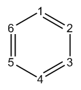
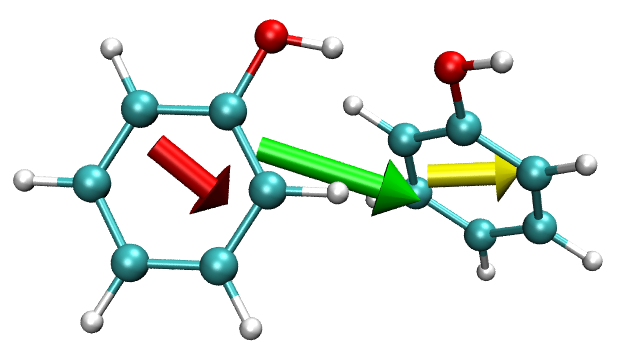
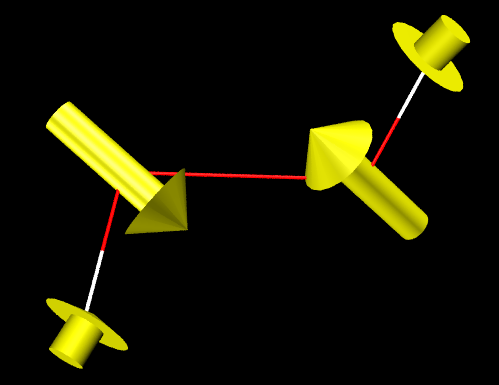
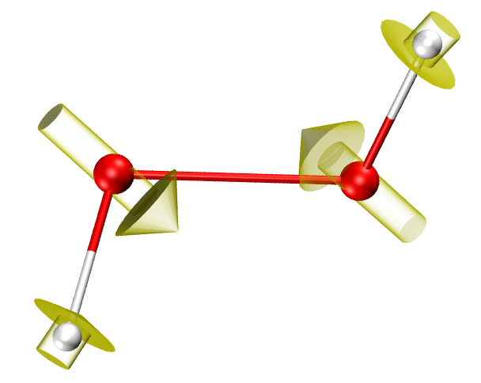
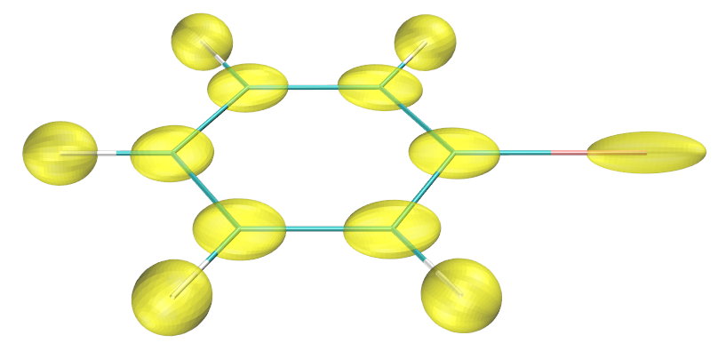
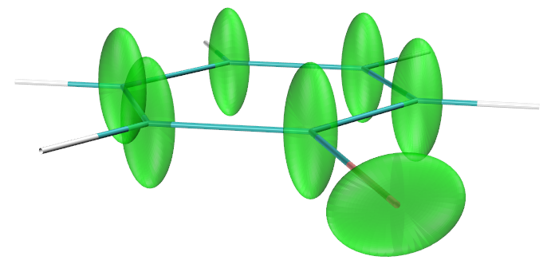

# **4.15 模糊原子空间 (Fuzzy atomic space) 分析**

模糊原子空间的基本概念已在[3.18.0 节](sec-3-18-fuzzy-atomic-space-analysis.md#3180-基本概念)介绍。本节给出几个例子，展示模糊原子空间分析模块的一些功能。多数情况下采用默认的 Becke 定义的模糊原子空间，因为它计算简便，且对多数情形合理。但 Hirshfeld-I 和 MBIS 原子空间更稳健，在某些情形明显更好，只是需要迭代优化原子空间，对大体系开销较大。可用选项 -1 选择模糊分析模块所用的原子空间定义。

## **4.15.1 研究苯的离域指数**

离域指数 (delocalization index, DI) 的定义已在[3.18.5 节](sec-3-18-fuzzy-atomic-space-analysis.md#3185-定域化指数-li与离域化指数-di-4-44)详细介绍。DI 最初是针对 AIM 原子空间提出的，而研究表明，若在模糊原子空间中计算 DI，计算成本显著降低，结果仍有意义。本例在 Becke 模糊原子空间中计算 DI，研究苯中不同原子对之间电子离域的程度。

启动 Multiwfn 并输入以下命令：

```text
examples\benzene.wfn  // Generated under B3LYP/6-311G*
15  // Fuzzy atomic space analysis
4  // Calculate localization index (LI) and DI. Multiwfn first makes use of DFT numerical quadrature scheme to calculate atomic overlap matrix (AOM) in each fuzzy atomic space, and then convert AOM to DI and LI.
n  // Do not output LI and DI to plain text file
```

> **注**
>
> Multiwfn 会自动检查并输出 AOM 的误差，本次计算的误差小于 0.001，完全可忽略。若误差大到不可接受，可把 *settings.ini* 中的 "iautointgrid" 设为 0，并把 "radpot" 和 "sphpot" 设为较大值。当 "iautointgrid" 为 1 时，Multiwfn 用 (40,230) 格点计算 AOM，其精度直接影响 LI、DI 以及 PDI 和 FLU 的精度。

从屏幕输出的 DI 矩阵可见，相邻两碳原子（如 1-2）与相邻 C-H 原子（如 1-7）之间的 DI 较大（分别为 1.467 和 0.877），即成键原子间电子离域很强，主要源于 σ 键的共享电子。相比之下，非键连碳原子之间的 DI 很小，约 0.1，但明显不为零，反映了 π 电子高度离域的特征。

模糊原子空间中计算的 DI 实质就是 Mayer 提出的模糊键级。根据 DI 数据，可说苯中 C-C 键和 C-H 键的键级分别为 1.467 和 0.877，前者对应单 σ 键加“半个”π 键，后者对应典型的单 σ 键。

由于苯是严格平面分子，可把 DI 分解为 DI-σ 和 DI-π。下面计算后者。输入 *0* 回到主菜单，再输入以下命令：

```text
6  //Modify wavefunction
26  //Modify occupation number
0  // Select all orbitals
0  // Make occupation number of all orbitals to zero
17,20,21  // MO 17,20,21 correspond to π orbitals.
2  // Set their occupation numbers to 2 (closed-shell orbitals)
q  // Return to upper level of menu
-1  //Return to main menu
```

再像之前一样计算 DI，由于除 π 轨道外所有轨道的占据数都已置零，结果即 DI-π。



C1-C6、C1-C5 和 C1-C4 之间的 DI-π 分别为 0.438、0.055 和 0.093，显然对位碳之间的 π 电子离域大于间位碳。

## **4.15.2 用 PDI、FLU、FLU-π 和 PLR 研究菲的芳香性**

PDI、FLU、FLU-π 和 PLR 是有用的芳香性指标，定义已在[3.18.6 节](sec-3-18-fuzzy-atomic-space-analysis.md#3186-对位离域化指数-pdi-5)、[3.18.7 节](sec-3-18-fuzzy-atomic-space-analysis.md#3187-芳香涨落指数-flu与-flu-π-67)和[3.18.9 节](sec-3-18-fuzzy-atomic-space-analysis.md#3189-对位线性响应指数-plr-10)介绍。本例在 Becke 模糊原子空间中计算它们，研究菲不同环的芳香性。


### **计算 PDI**

先计算 PDI。启动 Multiwfn 并输入以下命令：

```text
examples\phenanthrene.wfn  // Optimized at B3LYP/6-31G* level
15  // Fuzzy atomic space analysis
5  // Calculate PDI
```

然后 Multiwfn 开始计算原子交叠矩阵 (atomic overlap matrix, AOM)，这是计算密集的工作。之后 AOM 被转换为离域指数 (DI)，DI 矩阵输出到屏幕。最后会提示输入所关心的环的原子序号，输入顺序应与原子连接顺序一致。先算中间环的 PDI，即输入 *4,8,9,10,7,3*，结果为：

```text
Delocalization index of     4(C )   --   10(C ):    0.052992
Delocalization index of     8(C )   --    7(C ):    0.052992
Delocalization index of     9(C )   --    3(C ):    0.036334
PDI value is    0.047439
```

PDI 值即 C4-C10、C8-C7 和 C9-C3 之间 DI 的平均。再输入 *8,9,11,13,14,15* 计算边缘环的 PDI，结果为 0.0817。可见边缘环的电子离域强于中间环，故边缘环芳香性更大。下面用 FLU 和 FLU-π 研究芳香性，看能否得到同样结论。

### **计算 FLU**

输入 *q* 回到上一级菜单，再输入 *6* 计算 FLU，然后依次输入 *4,8,9,10,7,3* 和 *8,9,11,13,14,15*。中间环和边缘环的 FLU 分别为 0.025289 和 0.007499，此结果表明边缘环更像典型的芳香体系（苯），因而芳香性大于中间环。注意 AOM 在算 PDI 时已算过，所以这次自动跳过 AOM 的计算过程。

### **计算 FLU-π**

再输入 *q* 回到上一级菜单，输入 *7* 计算 FLU-π。首先需输入 π 轨道的序号。通过查看所有轨道的等值面（或利用主功能 100 的选项 22）可知 36、40、43、44、45、46 和 47 是 π 轨道，此处输入 *36,40,43,44,45,46,47*，然后输出 π 电子的 DI。之后提示输入环中的原子序号，依次输入 *4,8,9,10,7,3* 和 *8,9,11,13,14,15*。中间环和边缘环的 FLU-π 分别为 0.149238 和 0.034904。显然 FLU-π 分析也证实边缘环芳香性更强。

### **计算 PLR**

最后计算对位线性响应指数 (para linear response index, PLR)。PLR 基于线性响应核，依赖虚轨道信息；但 .wfn 文件只含占据轨道，故必须用 .mwfn/.fch/.molden/.gms 文件做输入。重启 Multiwfn 并输入以下命令：

```text
examples\phenanthrene.fch  // Obtained at the same level as phenanthrene.wfn
15  // Fuzzy space analysis
10  // Calculate PLR
```

Multiwfn 会计算凝聚线性响应核 (condensed linear response kernel, CLRK) 矩阵，之后依次输入 *4,8,9,10,7,3* 和 *8,9,11,13,14,15*，结果分别为 0.248030 和 0.489560。前者远小于后者，PLR 同样验证了边缘环芳香性大于中间环的结论。

注意 PDI 和 PLR 都可分为 α 和 π 部分，分别考察 α 和 π 芳香性，细节见[3.18.6 节](sec-3-18-fuzzy-atomic-space-analysis.md#3186-对位离域化指数-pdi-5)和[3.18.9 节](sec-3-18-fuzzy-atomic-space-analysis.md#3189-对位线性响应指数-plr-10)。

## **4.15.3 计算片段偶极矩以展示局域极性**

> **注**
>
> 本主题的中文版是我的博文“使用 Multiwfn 计算分子片段的偶极矩以及复合物中单体的偶极矩”（<http://sobereva.com/558>，中文），其中有额外例子和扩展讨论。

片段的偶极矩可定义为：

$$
\mathbf{D}_{F}=\sum_{A\in F}\left[Z_{A}\mathbf{R}_{A}-\int w_{A}(\mathbf{r})\rho(\mathbf{r})\mathbf{r}\,\mathrm{d}\mathbf{r}\right]
$$

其中 *A* 为片段 *F* 中的原子序号，$Z_{A}$ 和 $\mathbf{R}_{A}$ 分别为原子 *A* 的核电荷和位置，$w_{A}$(**r**) 为原子 *A* 的原子权重函数。

如[3.18.3 节](sec-3-18-fuzzy-atomic-space-analysis.md#3183-原子与分子多极矩及--2)所述，Multiwfn 能计算原子和分子的偶极/多极矩；若定义一个原子列表，则输出的分子的偶极和多极矩即对应片段的矩。本计算利用此功能计算苯酚二聚体中两个单体各自的偶极矩，采用 Hirshfeld 权重函数，因其计算简便且物理意义较清楚。

启动 Multiwfn 并输入以下命令：

```text
examples\phenoldimer.wfn  // Wavefunction file of optimized phenol dimer
15  // Fuzzy atomic space analysis
-1  // Select method for defining atomic space
3  // Hirshfeld based on built-in spherically averaged atomic densities
2  // Calculate atomic and molecular multipole moments
1  // Output result on screen
```

然后 Multiwfn 开始计算每个原子的布居数、偶极和多极矩，最后打印全体系（此处的“分子”即当前整个体系）的数据：

```text
              *****  Molecular dipole and multipole moments  *****
 Total number of electrons:    100.000331   Net charge: -0.000331
 Molecular dipole moment (a.u.):       1.227306     -0.128087      0.650833
 Molecular dipole moment (Debye):      3.119501     -0.325563      1.654252
 Magnitude of molecular dipole moment (a.u.&Debye):      1.395088      3.545959
 Molecular quadrupole moments (Standard Cartesian form):
 XX=  -56.973177  XY=    3.413050  XZ=    4.769915
 YX=    3.413050  YY=  -58.109370  YZ=    4.188508
 ZX=    4.769915  ZY=    4.188508  ZZ=  -57.714457
 Molecular quadrupole moments (Traceless Cartesian form):
 XX=    0.938737  XY=    5.119575  XZ=    7.154872
 YX=    5.119575  YY=   -0.765553  YZ=    6.282762
 ZX=    7.154872  ZY=    6.282762  ZZ=   -0.173184
 Magnitude of the traceless quadrupole moment tensor:    0.999096
 Molecular quadrupole moments (Spherical harmonic form):
 Q_2,0 =  -0.173184   Q_2,-1=   7.254708   Q_2,1=   8.261735
 Q_2,-2=   5.911576   Q_2,2 =   0.983972
 Magnitude: |Q_2|=   12.523257
 Molecular electronic spatial extent <r^2>:     3515.944316
 Components of <r^2>:  X=    2590.720451  Y=     631.865745  Z=     293.358120
 Molecular octopole moments (Cartesian form):
 XXX=   27.1548  YYY=  -34.6763  ZZZ=   12.9803  XYY=   31.5970  XXY=  -32.1231
 XXZ=   11.3712  XZZ=   18.8632  YZZ=   -6.4625  YYZ=   25.0005  XYZ=   21.8843
 Molecular octopole moments (Spherical harmonic form):
 Q_3,0 =   -41.5772  Q_3,-1=    25.0762  Q_3,1 =    10.2272
 Q_3,-2=    84.7574  Q_3,2 =   -26.3932  Q_3,-3=   -48.7725  Q_3,3 =   -53.4710
 Magnitude: |Q_3|=    124.8215
```

可见二聚体的偶极矩为 (1.227306,-0.128087,0.650833) a.u.。

下面计算第一个苯酚的偶极矩，输入：

```text
-5  // Define the atoms to be calculated
1-13  // Atom indices of the first phenol
2  // Calculate atomic and molecular multipole moments
1  // Output result on screen
```

可看到：

```text
Total number of electrons:     50.095624   Net charge: -0.095624
Molecular dipole moment (a.u.):       0.570356     -0.356257      0.284025
Molecular dipole moment (Debye):      1.449701     -0.905516      0.721919
Magnitude of molecular dipole moment (a.u.&Debye):      0.729997      1.855468
...[ignored]
```

表明第一个苯酚的偶极矩为 (0.570356,-0.356257,0.284025) a.u.，该苯酚带 -0.096 的净电荷。

再输入：

```text
-5  // Define the atoms to be calculated
14-26  // Atom indices of the second phenol
2  // Calculate atomic and molecular multipole moments
1  // Output result on screen
```

可得第二个苯酚的偶极矩为 (0.656950 0.228171 0.366808) a.u.。

汇总，现在有三个偶极矩：

- 二聚体：(1.227306,-0.128087,0.650833) a.u.

- 第一个苯酚：(0.570356,-0.356257,0.284025) a.u.

- 第二个苯酚：(0.656950,0.228171,0.366808) a.u.

为便于直观查看，在 VMD 可视化程序中把偶极矩画成箭头，VMD 可在 <http://www.ks.uiuc.edu/Research/vmd/> 免费获取。我用的版本是 VMD 1.9.3。由于 VMD 无法载入 .wfn 文件，需把当前体系转为 .xyz 文件。为此回到主菜单，进入主功能 100 并选子功能 2，可找到导出 .xyz 文件的相应选项。把当前体系导出为 *phenoldimer.xyz*。

启动 VMD 并载入 *phenoldimer.xyz*。把 *examples\scripts\drawarrow.tcl* 脚本文件的所有内容复制到 VMD 命令窗口运行，即定义了一个新命令 "drawarrow"，用于画箭头。然后在 VMD 命令窗口输入以下命令：

```tcl
draw color green
drawarrow all 1.227306 -0.128087 0.650833 2
draw color red
drawarrow "serial 1 to 13" 0.570356 -0.356257 0.284025 2
draw color yellow
drawarrow "serial 14 to 26" 0.656950 0.228171 0.366808 2
```

即全体系（用 "all" 选择）的偶极矩用绿色箭头绘制，第 1 个和第 2 个苯酚分子的偶极矩分别用红色和黄色箭头绘制。"serial 1 to 13" 和 "serial 14 to 26" 是 VMD 中的选择语法。命令末尾的参数 "2" 使箭头长度加倍，以便清楚显示偶极矩。

适当调整图形效果后（如在 "Graphics" - "Representation" 界面把绘制方式设为 "licorice"），可看到下图。红、黄、绿箭头的中心分别位于两个苯酚和二聚体的几何中心，箭头长度对应偶极矩的模（乘以 2）。



由于两个单体的偶极矩矢量近乎平行，其矢量和即二聚体的偶极矩明显大于单体偶极矩。

注意，若片段净电荷不为零，片段偶极矩依赖于原点选取。本例中，由于两苯酚分子间有轻微电荷转移，单体偶极矩必然略依赖于原点。但这不是大问题，因为单体净电荷很小，且当前原点合适（位于二聚体的核电荷中心）。

## **4.15.4 计算原子有效体积、自由体积、原子极化率和原子 *C*₆ 系数：以环氧乙烷和 SiH₄ 为例**

> **注**
>
> 更多讨论和例子见我的博文“使用 Multiwfn 计算分子中的原子极化率”（<http://sobereva.com/600>，中文）和“使用 Multiwfn 计算原子 C6 色散系数”([http://sobereva.com/709](http://sobereva.com/600)，中文）。

若不知原子有效体积 ($V^{\mathrm{eff}}$)、原子自由体积 ($V^{\mathrm{free}}$)、原子静态极化率 ($\alpha^{\mathrm{eff}}(0)$) 和原子 $C_6$ 系数 ( $C_{6,AA}$) 是什么，请先读[3.18.12 节](sec-3-18-fuzzy-atomic-space-analysis.md#31812-原子有效体积自由体积极化率与-c₆-系数-13)。本节为两个常见分子计算它们。

### **第一部分：环氧乙烷的原子有效体积/自由体积/极化率**

本例着重计算环氧乙烷 (C₂OH₄) 中原子的 $V^{\mathrm{free}}$ 和 $\alpha^{\mathrm{eff}}(0)$。其波函数文件 *examples\oxirane.fchk* 由 Gaussian 16 在 B3LYP/6-31G\* 水平产生。

用 Multiwfn 计算上述量之前，需按与分子计算相同的水平手动产生体系中所有元素 (C、O、H) 的波函数文件。可用你喜欢的量子化学程序完成这步。Gaussian 16 在 B3LYP/6-31G\* 水平产生的 .wfn 格式原子波函数文件（*H.wfn*、*C.wfn* 和 *O.wfn*）可直接在此下载：<http://sobereva.com/multiwfn/extrafiles/oxirane_atmvol.zip>，Gaussian 输入文件也一并提供。原子波函数文件不一定是 .wfn 格式，可以是 Multiwfn 支持的任何格式，如 .mwfn、.fch 和 .molden。

启动 Multiwfn 并输入：

```text
examples\oxirane.fchk
15  // Fuzzy analysis
13  // Calculate atomic effective volume, free volume, polarizability and C_6 coefficient
H.wfn  // Path of wavefunction file of hydrogen atom in isolated state
C.wfn  // Path of wavefunction file of carbon atom in isolated state
O.wfn  // Path of wavefunction file of oxygen atom in isolated state
```

输出为：

```text
Atom    1(C )  Effective V:    21.536  Free V:    30.181 a.u.  Ratio: 0.714
Atom    2(C )  Effective V:    21.536  Free V:    30.181 a.u.  Ratio: 0.714
Atom    3(O )  Effective V:    21.858  Free V:    19.915 a.u.  Ratio: 1.098
Atom    4(H )  Effective V:     2.170  Free V:     6.680 a.u.  Ratio: 0.325
Atom    5(H )  Effective V:     2.170  Free V:     6.680 a.u.  Ratio: 0.325
Atom    6(H )  Effective V:     2.170  Free V:     6.680 a.u.  Ratio: 0.325
Atom    7(H )  Effective V:     2.170  Free V:     6.680 a.u.  Ratio: 0.325
Calculation took up       0 seconds wall clock time

Atomic polarizabilities estimated using Tkatchenko-Scheffler method:
   1(C ):   8.063 a.u.  Contribution: 29.01 %  (Ref. data:  11.300 a.u.)
   2(C ):   8.063 a.u.  Contribution: 29.01 %  (Ref. data:  11.300 a.u.)
   3(O ):   5.817 a.u.  Contribution: 20.92 %  (Ref. data:   5.300 a.u.)
   4(H ):   1.464 a.u.  Contribution:  5.27 %  (Ref. data:   4.507 a.u.)
   5(H ):   1.464 a.u.  Contribution:  5.27 %  (Ref. data:   4.507 a.u.)
   6(H ):   1.464 a.u.  Contribution:  5.27 %  (Ref. data:   4.507 a.u.)
   7(H ):   1.464 a.u.  Contribution:  5.27 %  (Ref. data:   4.507 a.u.)
Sum of atomic polarizabilities:    27.800 a.u.
...[ignored]
```

可见多数原子的 $V^{\mathrm{eff}}$ 相对 $V^{\mathrm{free}}$ 明显减小，意味着在分子环境中这些原子的极化率相对自由态下降，因为体积与极化率之间众所周知近似正相关。

原子自由态的极化率 ($\alpha^{\mathrm{free}}(0)$) 是 Multiwfn 内置数据，在上面输出中作为“Ref. data”打印。用 Tkatchenko-Scheffler 方法估计的环氧乙烷中原子极化率 $\alpha^{\mathrm{eff}}(0)$ 即 $V^{\mathrm{eff}}$ / $V^{\mathrm{free}}$ 与 $\alpha^{\mathrm{free}}(0)$ 的乘积。如所示，所有 $\alpha^{\mathrm{eff}}(0)$ 之和为 27.8 a.u.，与基于当前几何在 MP2/aug-cc-pVTZ 水平估计的环氧乙烷分子极化率 (28.8 a.u.) 符合很好。

所有 $\alpha^{\mathrm{eff}}(0)$ 之和不一定总是接近分子极化率，偏差对原子权重函数的选择很敏感。例如，若在模糊分析界面选选项 -1，改用 Hirshfeld 划分而非默认的 Becke 划分，所有 $\alpha^{\mathrm{eff}}(0)$ 之和会高达 37.9 a.u.。此时 Multiwfn 打印的“Contribution”（$\alpha^{\%}$，即某原子的 $\alpha^{\mathrm{eff}}(0)$ 占所有 $\alpha^{\mathrm{eff}}(0)$ 之和的比例）更有用，因其敏感性较低，可直观分析分子极化率的主要来源。例如，根据 Multiwfn 打印的原子百分比贡献，可发现碳原子贡献很大（每个贡献分子极化率的 29%）。

值得一提的是，若原子间相互作用极弱，$V^{\mathrm{eff}}$ 应非常接近 $V^{\mathrm{free}}$。例如，Ar₂ 二聚体中 Ar 原子的 $V^{\mathrm{eff}}$ 与 Ar 的 $V^{\mathrm{free}}$ 几乎相同。

在实际化学环境中计算原子体积还有另一种方法，即对电子密度做盆分析。该思想来自分子中的原子 (atoms-in-molecules, AIM) 理论。例子见[4.17.1 节](sec-4-17-basin-analysis.md#4171-hcn-和-li₆-的-aim-流域分析)。

### **第二部分：SiH₄ 的 *C*₆ 系数**

本例着重计算 SiH₄ 的原子 $C_6$ 系数和同分子 $C_6$ 系数。根据 MBIS 原始论文（*J. Chem. Theory Comput.*, **12**, 3894 (2016)）第 5 节的 benchmark，MBIS 原子空间与 B3LYP/6-311+G(2df,p) 水平联用，用 Tkatchenko-Scheffler 方法计算分子 $C_6$ 系数效果最好。所以本例也采用此方案。SiH₄ 的 .fch 文件以及在 B3LYP/6-311+G(2df,p) 水平计算的 Si 和 H 原子的 .wfn 文件已在“examples\SiH4_C6\\”文件夹中提供。

启动 Multiwfn 并输入：

```text
examples\SiH4_C6\SiH4.fch
15  // Fuzzy analysis
-1  // Select the method for partitioning atomic spaces
5  // MBIS
1  // Start calculation. Then MBIS atomic spaces will be constructed
13  // Calculate atomic effective volume, free volume, polarizability and C_6 coefficient
examples\SiH4_C6\H.wfn  // Wavefunction file of H atom in isolated state
examples\SiH4_C6\Si.wfn  // Wavefunction file of Si atom in isolated state
```

可看到以下输出以及：

```text
Atomic C6 coefficients estimated using Tkatchenko-Scheffler method:
   1(Si):  118.31 a.u. (Ref. data:   305.0 a.u.)
   2(H ):    3.83 a.u. (Ref. data:     6.5 a.u.)
   3(H ):    3.83 a.u. (Ref. data:     6.5 a.u.)
   4(H ):    3.83 a.u. (Ref. data:     6.5 a.u.)
   5(H ):    3.83 a.u. (Ref. data:     6.5 a.u.)

Note: Reference data denotes the built-in value of free-state atom
Homomolecular C6 coefficient:    347.07 a.u.
```

可见 SiH₄ 中每个原子的 $C_6$ 系数。从大小看，显然 Si 原子对比色散效应的贡献远大于 H 原子。“Ref. data”指孤立态原子的 $C_6$ 系数，取自文献。可见 Multiwfn 还计算并打印了 SiH₄ 的同分子 $C_6$ 系数，即计算两个 SiH₄ 分子间色散相互作用所用的 $C_6$ 系数。当前值 347.07 a.u. 与 *J. Chem. Phys.*, **123**, 024101 (2005) 表 I 给出的 343.9 a.u. 符合非常好！但应注意，这样算出的分子 $C_6$ 系数不总是很准，有时相对误差可能接近 10% 甚至更大。另外应认识到，MBIS 并非在所有情形都最好；对某些分子，用 Hirshfeld 划分可能得到更好结果。

## **4.15.5 可视化原子电偶极矩和四极矩**

请先看[3.18.3 节](sec-3-18-fuzzy-atomic-space-analysis.md#3183-原子与分子多极矩及--2)，了解原子电偶极矩 ($\boldsymbol{\mu}^{A}$) 和原子电四极矩 ($\boldsymbol{\Theta}^{A}$) 的定义。这两个量在给定原子空间划分方案下传达了原子核周围电子密度分布的重要信息。下面两节的例子中，我们将在 VMD 程序中计算并经由专门脚本可视化它们，你会发现它们对理解实际化学环境中原子的状态非常直观、重要。

### **4.15.5.1 绘制原子偶极矩**

这里以 H₂O₂ 分子为例，展示如何在 VMD 程序中计算并绘制原子偶极矩。VMD 可在 <http://www.ks.uiuc.edu/Research/vmd/> 免费获取，本例用的版本是 1.9.3。

启动 Multiwfn 并输入：

```text
examples\H2O2.fch
15  // Fuzzy atomic space analysis module
2  // Calculate atomic and molecular multipole moments and <r^2>
2  // Output result to a plain text file
```

此时当前文件夹下有 *multiple.txt* 和 *atom_moment.txt*。前者含原子多极矩（从单极到八极）的详细信息，后者含原子偶极矩以及原子四极矩张量的本征值和本征矢量。

为在 VMD 中把原子偶极矩矢量与分子结构一起绘制，需把从 *H2O2.fch* 载入的几何导出为 *H2O2.xyz*，输入以下命令：

```text
0  // Return to main menu
100  // Other functions (Part 1)
2  // Export file
2  // Output current structure to .xyz file
[Press ENTER button]  // Use default file name
```

此时当前文件夹下有 *H2O2.xyz*。

启动 VMD，载入 *H2O2.xyz*。再把 *atom_moment.txt* 和“examples\scripts\\”文件夹中的 VMD 绘图脚本 *atomdip.tcl* 都移到 VMD 文件夹。接着在 VMD 命令窗口输入以下命令，第一条执行脚本（定义绘图函数），第二条以默认参数运行绘图函数：

```text
source atomdip.tcl
atomdip
```

此时在 VMD 命令窗口可看到原子偶极矩信息（a.u.）：

```text
Information of atom 1
Atomic dipole moment:  -0.198   -0.245    0.080  Norm:   0.325

 Information of atom 2
Atomic dipole moment:   0.066   -0.045   -0.043  Norm:   0.090
...[ignored]
```

在 VMD 图形窗口可看到：



黄色箭头对应每个原子的 $\boldsymbol{\mu}^{A}$ 矢量，从相应原子空间的负电荷中心指向正电荷中心，长度正比于 $\boldsymbol{\mu}^{A}$ 的大小。图中氧原子上箭头的方向容易理解。众所周知，H₂O₂ 中的氧有明显的孤对电子，孤对区带密集负电荷，而原子空间中的正电荷只来自核电荷，所以箭头必然大致从孤对区指向原子核。

#### **调整图形效果**

图形效果可调。例如，在 "Graphics" - "Representation" 面板把绘制方式设为 CPK 并适当定义键粗和原子球半径。然后在 VMD 命令窗口输入以下命令，改变背景色和所绘物体的材质：

```text
color Display Background white
draw material GlassBubble
```

此时可看到下图：



注意 "atomdip" 命令有一些可选参数，控制箭头的颜色、长度、粗细以及考虑的原子范围，请看 *atomdip.tcl* 文件开头。作为例子，若输入 *atomdip “serial 1 to 2 4” orange 5 0.05*，则只为原子 1、2、4 以橙色绘制箭头，箭头长度比默认长、粗细比默认小。

#### **使用不同的原子空间划分方案**

某些化学环境中一些原子的偶极矩对原子空间划分的选择高度敏感。也可用默认 Becke 定义之外的原子空间定义。在模糊原子空间分析模块中，可用选项 -1 改变划分定义。

如[4.17.1 节](sec-4-17-basin-analysis.md#4171-hcn-和-li₆-的-aim-流域分析)所述，若对电子密度产生盆（即 AIM 划分），则盆分析模块的子功能 8 能计算原子多极矩，若计算后输入 *y*，即导出 *atom_moment.txt*，基于它可用上述步骤绘制 AIM 划分下的原子偶极矩。你会发现 H₂O₂ 中氧上箭头的方向变化很大（在我看来，不如 Becke 划分理想）。

### **4.15.5.2 绘制原子四极矩**

本例在 VMD 中可视化 C₆H₅Br 的原子四极矩，数据像上一节一样在 Becke 划分下计算。相应的波函数文件 *examples\C6H5Br.mwfn* 在 B3LYP/def-TZVP 水平产生。

启动 Multiwfn 并载入 *examples\C6H5Br.mwfn*，再用与上一节完全相同的步骤产生 *atom_moment.txt* 和 *C6H5Br.xyz*。把 *atom_moment.txt* 以及“examples\scripts\\”文件夹中的 *atomquad.tcl* 移到 VMD 文件夹。启动 VMD，载入 *C6H5Br.xyz*，再在 VMD 命令窗口运行以下两条命令，激活绘图脚本并运行绘图命令：

```text
source atomquad.tcl
atomquad
```

适当调整图形效果后，可看到：



每个原子上的黄色椭球直观刻画了无迹笛卡尔原子电四极矩张量 $\boldsymbol{\Theta}^{A}$。椭球形状由三个主轴方向（$\boldsymbol{\Theta}^{A}$ 的本征矢量）和半轴长决定，运行 "atomquad" 命令后打印在 VMD 命令窗口中：

```text
Information of atom 1
Principal axis 1:   1.000    0.000    0.000  Semi-axis length:    0.162
Principal axis 2:   0.000   -0.880    0.475  Semi-axis length:    0.405
Principal axis 3:   0.000    0.475    0.880  Semi-axis length:    0.432
...[ignored]
```

椭球半轴长 {*l*} 按我提出的方法确定。已知 $\boldsymbol{\Theta}^{A}$ 的本征值 {*v*} 可能为负，为使可视化可行，先经下式把它们变换为等于或大于 1 的值：

$$
t_{i}=1+v_{i}-v_{\mathrm{min}}\qquad i=1,2,3
$$

其中 $v_{\mathrm{min}}$ 是最负的本征值。再按下式计算 {*l*}：

$$
l_{i}=s\frac{t_{i}}{t_{1}+t_{2}+t_{3}}\qquad i=1,2,3
$$

显然三个半轴长之和等于 *s*，它是控制椭球大小的缩放因子，可用 "atomquad" 命令的可选参数设置，默认值 *s*=1 适合多数情形。

根据 $\boldsymbol{\Theta}^{A}$ 的物理意义（见[3.18.3 节](sec-3-18-fuzzy-atomic-space-analysis.md#3183-原子与分子多极矩及--2)），容易理解：椭球在某方向越短，该方向电子密度分布越伸展，反之亦然。因此，从上图椭球形状可容易得出结论：碳原子的电子分布在垂直于六元环的方向高度拉长，可能源于丰富的 π 电子。对 Br 原子，电子密度沿 C-Br 键明显收缩，此现象对应著名的 σ-hole 特征。

"atomquad" 命令有很多控制绘图效果的可选参数，请看 *atomquad.tcl* 文件开头的注释。

上例用的是 "atomquad" 命令的模式 1，而用模式 2 时，所绘椭球的形状可直观表现原子空间内电子密度的伸展趋势。例如，在 VMD 命令窗口运行 *atomquad noh green 1 2 50*，即以模式 2 在所有非氢原子上绘制绿色椭球，缩放因子为 1、分辨率为 50，可看到下图：



上图中椭球半轴长与原子空间内相应方向电子分布的伸展程度正相关。具体地，半轴长按与前面相同的方法计算，只是 {*t*} 的定义不同，即：

$$
t_{i}=\frac{1}{1+v_{i}-v_{\mathrm{min}}}\qquad i=1,2,3
$$

上图实质传达的信息与前图完全相同，但显然此图更便于电子分布的可视化分析。例如，可清楚看到 Br 原子的空间中，电子密度在垂直于 C-Br 键轴的平面内更伸展。
