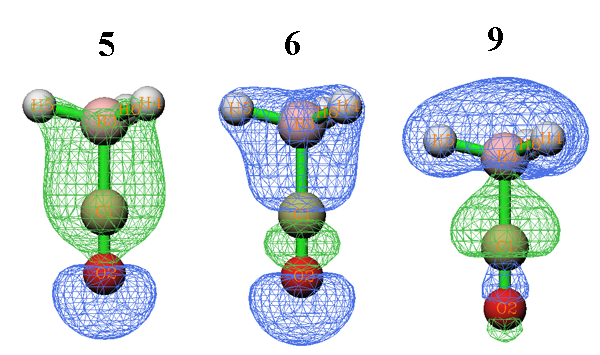
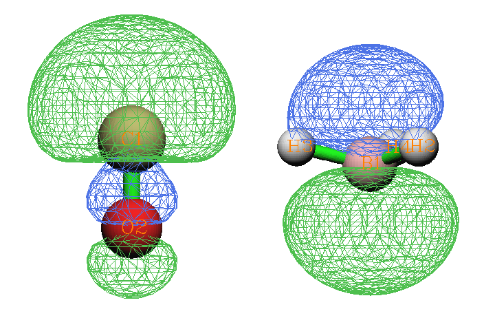
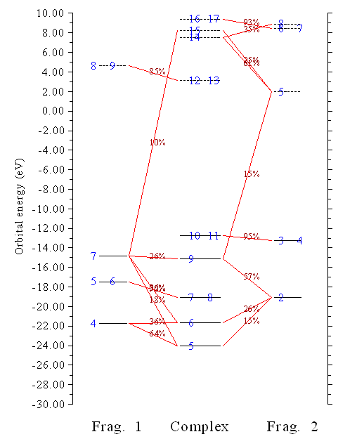
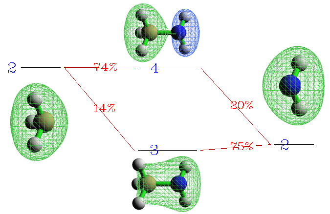
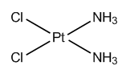
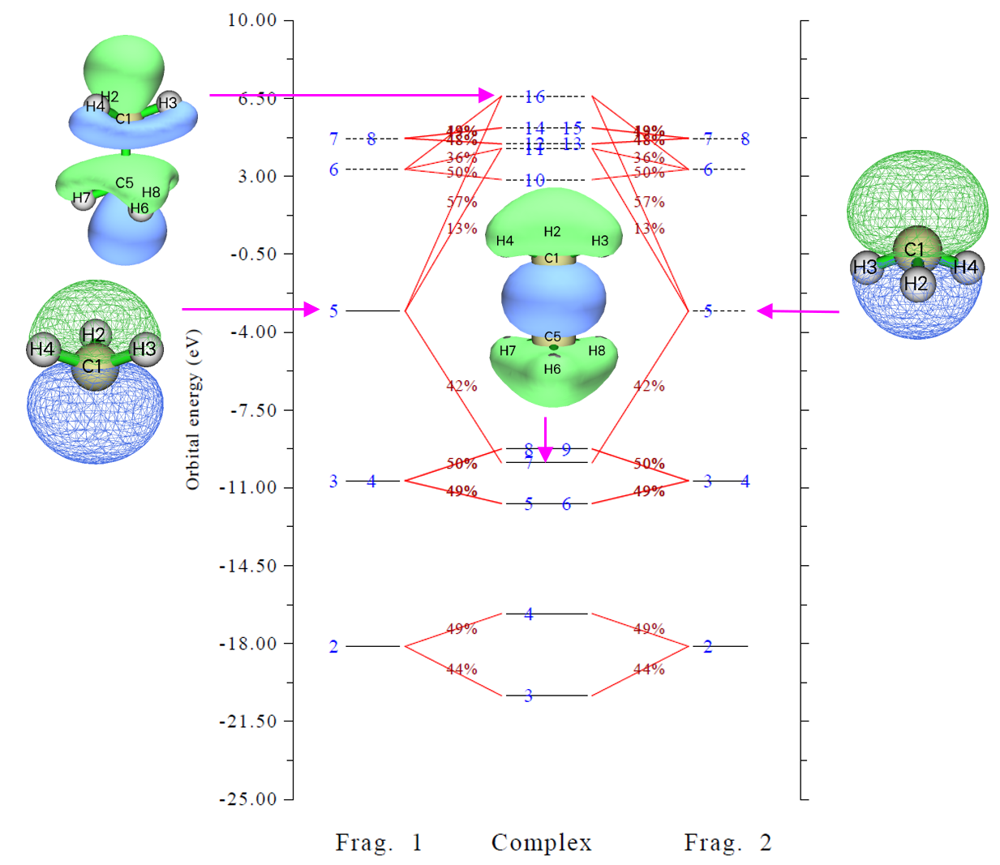

# **4.16 电荷分解分析与绘制轨道相互作用图**

> **注**
>
> 本节的中文是我的博文“使用 Multiwfn 做电荷分解分析 (CDA) 和绘制轨道相互作用图”（<http://sobereva.com/166>，中文），其中还有更多讨论。

电荷分解分析 (charge decomposition analysis, CDA)、扩展 CDA (ECDA) 和广义 CDA (GCDA, *J. Adv. Phys. Chem.*, **4**, 111-124 (2015) DOI: [10.12677/JAPC.2015.44013](http://dx.doi.org/10.12677/JAPC.2015.44013)) 的理论以及 CDA 模块的用法，已在[3.19 节](sec-3-19-charge-decomposition-analysis-and-orbital-interaction-diagram.md)详细介绍。本节给出几个实际例子。

CDA 模块支持 .fch、.mwfn、.molden、GAMESS-US 输出文件 (.gms) 和 Gaussian 输出文件做输入。下面几节只用 Gaussian .fch 文件示例 CDA 模块的用法。

## **4.16.1 闭壳层相互作用情形：COBH₃**

COBH₃ 中，CO 用其孤对与缺电子体系 BH₃（Lewis 酸）形成配位键。因此，配合物形成过程中电子从 CO 转移到 BH₃。本例用 CDA 方案深入考察电子转移。

首先，为 CO（片段 1）、BH₃（片段 2）和 COBH₃（配合物）产生 Gaussian 输出文件。.fch 文件和相应输入文件已在 "examples\CDA\COBH3" 文件夹中提供。计算在 HF/6-31G\* 水平进行。CDA 输入文件的准备方法见[3.19.2 节](sec-3-19-charge-decomposition-analysis-and-orbital-interaction-diagram.md#3192-输入文件)。

现在启动 Multiwfn 并输入以下内容：

```text
examples\CDA\COBH3\COBH3.fch  // Gaussian .fch file of the complex
16  // Enter CDA module
2  // We define two fragments
examples\CDA\COBH3\CO.fch  // Gaussian .fch file of fragment 1
examples\CDA\COBH3\BH3.fch  // Gaussian .fch file of fragment 2
```

屏幕上立刻输出以下 CDA 结果：

```text
   Orb.      Occ.          d           b        d - b          r
      1    2.000000   -0.000004   -0.000000   -0.000004   -0.000001
      2    2.000000    0.001119   -0.000023    0.001141    0.000326
      3    2.000000   -0.000002   -0.000471    0.000469    0.000313
      4    2.000000   -0.013250   -0.000704   -0.012546   -0.005676
      5    2.000000    0.041648   -0.003309    0.044957    0.232262
      6    2.000000    0.037385   -0.020136    0.057521    0.212422
      7    2.000000   -0.000543    0.000647   -0.001190    0.022166
      8    2.000000   -0.000543    0.000647   -0.001190    0.022166
      9    2.000000    0.171353    0.026952    0.144401   -0.741381
     10    2.000000   -0.000569    0.043713   -0.044281   -0.038916
     11    2.000000   -0.000569    0.043713   -0.044282   -0.038916
     12    0.000000    0.000000    0.000000    0.000000    0.000000
     13    0.000000    0.000000    0.000000    0.000000    0.000000
     14    0.000000    0.000000    0.000000    0.000000    0.000000
     15    0.000000    0.000000    0.000000    0.000000    0.000000
 ......
-------------------------------------------------------------------
Sum:      22.000000    0.236023    0.091027    0.144996   -0.335233
```

"Orb." 指配合物轨道的序号；"occ." 为相应占据数。"d(i)" 代表经相应配合物轨道从片段 1 施舍 (donate) 到片段 2 的电子量，"b(i)" 代表经相应配合物轨道从片段 2 反施舍 (back donate) 到片段 1 的电子量。"r(i)" 对应相应配合物轨道中两片段占据片段轨道 (FO) 之间的交叠布居；其正负号分别意味着，在此配合物轨道中，占据 FO 的电子累积到两片段之间的交叠区和从交叠区耗散（主要因 Pauli 排斥）。r(i) 之和即 -0.335，表明排斥效应在占据 FO 之间的总相互作用中占主导，致使相应电子从交叠区移向非交叠区。

d(i) 与 b(i) 之差在一定程度上可视为因相应配合物轨道形成而从片段 1 向片段 2 净转移的电子数。但注意，此值还包含电子极化效应的贡献。

从数据可见，前三个配合物轨道的 *b*、*d* 和 *r* 值几乎为零，因为它们分别是 O、C 和 B 的核轨道，预期不参与成键。虚配合物轨道的 *b、d* 和 *r* 项恰为零，因为其占据数恰为零。轨道 9 使 0.171 个电子从 CO 施舍到 BH₃，是施主-受主成键的主要来源，并导致高达 0.741 个电子从 CO 与 BH₃ 之间的交叠区移出，因减小电子排斥而稳定了配合物。轨道 5 和 6 对电子施舍有小贡献，同时使各自占据 FO 的电子明显累积到交叠区，必然有利于两片段间的成键。轨道 10 和 11 是 π 轨道且能量简并，呈现 π 反施舍特征。

轨道 9、5 和 6 的等值面如下所示。可见，轨道 9 在 CO 与 BH₃ 之间的交叠区出现节面，而轨道 5 和 6 的等值面均匀覆盖交叠区。这些现象很大程度上解释了为何 r(9) 是大的负值，而 r(5) 和 r(6) 是明显的正值。



注意 Multiwfn 用的 CDA 定义是我提出的广义版本，使 CDA 也适用于后 HF 和开壳层情形，细节见[3.19.1 节](sec-3-19-charge-decomposition-analysis-and-orbital-interaction-diagram.md#3191-理论)相应部分。对原始 CDA 适用的情形（即配合物轨道用 MO 或自然轨道、FO 用 MO），广义 CDA 给出的 *d* 和 *b* 项与原始定义完全相同，而 *r* 项恰为原始定义的两倍。

> **注**
>
> COBH₃ 的例子在 CDA 原始论文中也给出，其中 *d*、*b* 和 *r* 公式虽正确，但例子中的数据都不对：所有数据都应除以二。我还发现 Dapprich 和 Frenking 写的 CDA 程序以及 AOMix 程序的结果都应除以二。所以，若要把 Multiwfn 算的 CDA 结果与它们比较，应先把 d 和 b 项乘以二。但 r 项不要这样做，因为 Multiwfn 算的 r 项相对原始定义已被加倍。

两片段间的净电子转移量可用 *b*-*d* 项表征，但有人认为 ECDA 是计算净电子转移量更合理的方法，因为电子极化效应 (PL) 的贡献被完全排除。CDA 结果之后输出 ECDA 结果：

```text
     ========== Extended Charge decomposition analysis (ECDA) ==========
  Contribution to all occupied complex orbital:
Occupied, virtual orbitals of fragment  1:     680.4194%         8.0593%
Occupied, virtual orbitals of fragment  2:     390.3988%        21.1226%
  Contribution to all virtual complex orbital:
Occupied, virtual orbitals of fragment  1:      19.5806%      2291.9407%
Occupied, virtual orbitals of fragment  2:       9.6012%      1678.8774%
PL( 1) + CT( 1-> 2) =    0.3916      PL( 1) + CT( 2-> 1) =    0.1612
PL( 2) + CT( 1-> 2) =    0.4225      PL( 2) + CT( 2-> 1) =    0.1920
The net electrons obtained by frag. 2 = CT( 1-> 2) - CT( 2-> 1) =    0.2304
```

通常只需关注最后一行。数据显示，从片段 1 向片段 2 净转移的电子数为 0.2304。

在屏幕出现的菜单中，用选项 2 可输出特定配合物轨道中 FO 的组成。这里选此选项并输入 *9*，配合物轨道 9 的组成如下所示：

```text
Occupation number of orbital     9 of the complex:  2.00000000
Orbital     7 of fragment  1, Occ: 2.00000    Contribution:   25.8560%
Orbital    13 of fragment  1, Occ: 0.00000    Contribution:    1.0798%
Orbital     2 of fragment  2, Occ: 2.00000    Contribution:   57.2921%
Orbital     5 of fragment  2, Occ: 0.00000    Contribution:   14.5640%
```

只显示对该配合物轨道贡献不小于 1% 的 FO（阈值可用 *settings.ini* 中的 "compthresCDA" 修改）。如前所述，从 CO 到 BH₃ 的电子转移主要源于配合物轨道 9，故从上数据可推断，CO→BH₃ 电子转移的本质很大程度上可解释为 CO 的 FO 7（占据轨道）与 BH₃ 的 FO 5（虚轨道）之间的混合。对比这两个 FO 的形状（见下）与上图配合物轨道 9 的形状，也可印证此观点。



> **注**
>
> 有时少数 FO 的贡献可能为负，这是 Mulliken 分析（CDA 模块计算配合物轨道组成所用方法）众所周知的缺点。由于负值的幅度通常很小，可直接忽略。

也可把某配合物轨道的 *d*、*b*、*r* 项直接分解为 FO 对的贡献，以配合物轨道 9 为例。现在输入 *0* 回到上一级菜单，选选项 6 并输入 *9*，再输入阈值如 *0.005*，则对 d、b、r 任一项贡献大于 0.005 的 FO 对都打印出来：

```text
FragA Orb(Occ.)  FragB Orb(Occ.)      d           b        d - b          r
   4( 2.0000)       2( 2.0000)    0.000000    0.000000    0.000000   -0.009969
   7( 2.0000)       1( 2.0000)    0.000000    0.000000    0.000000   -0.005759
   7( 2.0000)       2( 2.0000)    0.000000    0.000000    0.000000   -0.723845
   7( 2.0000)       5( 0.0000)    0.176503    0.000000    0.176503    0.000000
   7( 2.0000)       8( 0.0000)    0.006221    0.000000    0.006221    0.000000
   7( 2.0000)      11( 0.0000)    0.005846    0.000000    0.005846    0.000000
   7( 2.0000)      12( 0.0000)   -0.023941    0.000000   -0.023941    0.000000
  13( 0.0000)       2( 2.0000)    0.000000    0.021958   -0.021958    0.000000
```

从输出清楚看到，CO 的 FO 7 与 BH₃ 的 FO 5 之间的混合贡献了配合物轨道 9 的绝大部分 d 项。

最后绘制轨道相互作用图。输入 *0* 回到上一级菜单，再选 5 进入绘制轨道相互作用图的菜单。选选项 3 并输入 -30,10，把图的能量下限和上限分别设为 -30eV 和 10eV。再选选项 1 以默认设置绘图，屏幕弹出图形：



上图中，占据和虚轨道分别用实线和虚线短棒表示。轨道序号用蓝色文字标注。若同一短棒出现两个或更多标注，如 7 和 8，即这些轨道能量简并。若某 FO 在配合物轨道中的组成大于 10%，则相应两短棒用红线连接，组成标注在线上。只看此图即可直接理解 COBH₃ 的分子轨道如何由 CO 和 BH₃ 的 FO 构成。例如，配合物轨道 7 和 8 在图中只连到 CO 的 FO 5 和 6，故立刻知道这两个轨道在配合物形成过程中基本未受扰动。事实上，它们是 CO 的 π 轨道，当然不能参与 CO 与 BH₃ 之间的 σ 型施主-受主相互作用。

有很多选项可调绘图参数（如标签大小、短棒绘制和连接规则、组成标签位置、能量范围），请自行尝试，重新绘图查看效果。

## **4.16.2 开壳层相互作用情形：CH₃NH₂**

本例用 CH₃NH₂ 说明如何对两片段以共价方式（开壳层相互作用）结合的配合物做 CDA。

首先，为 CH₃（片段 1）、NH₂（片段 2）和 CH₃NH₂（配合物）产生 Gaussian 输出文件。片段 1 和 2 在本例用非限制 B3LYP 方法；配合物是闭壳层体系，用限制 B3LYP 方法（也可用非限制 B3LYP，CDA 结果相同）。.fch 文件和相应输入文件在 "examples\CDA\CH3NH2" 文件夹中，几何已在 B3LYP/6-31G\*\* 水平预优化。

注意 CH₃ 和 NH₂ 都有 5 个 alpha 和 4 个 beta 电子，而 CH₃NH₂ 有 9 个 alpha 和 9 个 beta 电子。显然，两片段的 alpha 和 beta 电子总数即 5+5 和 4+4，与配合物的不符。所以，必须把一个片段（CH₃ 或 NH₂）的电子自旋翻转。本例翻转 NH₂ 的电子自旋，即交换其 alpha 和 beta 电子的全部信息。

启动 Multiwfn 并输入以下内容：

```text
examples\CDA\CH3NH2\CH3NH2.fch  // Gaussian output file of the complex
16  // Enter CDA module
2  // We define two fragments
examples\CDA\CH3NH2\CH3.fch  // Gaussian output file of fragment 1
examples\CDA\CH3NH2\NH2.fch  // Gaussian output file of fragment 2
n  // Do not flip electron spin of fragment 1
y  // Flip electron spin of fragment 2, then NH_2 will have 4 alpha and 5 beta electrons.
```

屏幕分别对 alpha 电子和 beta 电子计算并打印 CDA 和 ECDA 结果。可见，对 alpha (beta) 部分，d - b 和 CT(1-\>2) - CT(2-\>1) 项都为正（负），表明 alpha (beta) 电子从 CH₃ 转移到 NH₂（从 NH₂ 转移到 CH₃）。这主要是因为 CH₃ 的 alpha 电子 (5) 多于 beta 电子 (4)，而翻转电子自旋后 NH₂ 的 beta 电子 (5) 多于 alpha 电子 (4)，故二者结合成 CH₃NH₂ 时，CH₃ 倾向于把 alpha 电子施舍给 NH₂ 并从 NH₂ 接受 beta 电子。

总电子的结果即 alpha 和 beta 结果之和也被输出。下面分别是 CDA 和 ECDA 的总结果：

```text
d=  0.044335  b=  0.145181  d - b = -0.100847  r= -0.172318
CT( 1-> 2) - CT( 2-> 1) for all electrons:    0.1252
```

显然电子应从 CH₃ 转移到 NH₂，因为氮的电负性明显更大。总的 ECDA 结果符合预期，表明从 CH₃ 向 NH₂ 转移的电子量为 0.1249。但 d - b 项与预期矛盾，转移方向完全反了。此例说明，对开壳层相互作用，d - b 项不如 ECDA 可靠，不能很好反映净电子转移总量，尽管 d 和 b 项对把电子转移分解为轨道贡献仍很有用。

若载入两片段的 Gaussian 输出文件时选择翻转 CH₃ 而非 NH₂ 的电子自旋，可见 CDA 和 ECDA 的 alpha 和 beta 结果互换，但总电子的结果不变。

现在选 2 并输入 *6*，可看到配合物的第 6 个 alpha 轨道和第 6 个 beta 轨道的组成都打印到屏幕。配合物是闭壳层体系，故两轨道实质相同，但因两片段中的 alpha 和 beta FO 不等价，打印的组成略有差别。再输入 *0* 返回。

选选项 5 进入绘制轨道相互作用图的菜单。用此菜单的选项 5 可切换作图所用的轨道自旋。选一次切换状态为 "Beta"，再选选项 3 并输入 -30,10，把图的下限和上限改为 -30 和 10 eV。再选选项 1 绘制轨道相互作用图。从图中非常清楚看到，CH₃NH₂ 的 beta 轨道 3 和 4 由 CH₃ 的 beta FO 2 与 NH₂ 的 beta FO 2 混合而成。为更直观说明此点，从整图中截取相应部分并附上轨道等值面，见下：



可见 beta 配合物轨道 3 呈成键特征（这就是 r(3) 为正值即 0.103 的原因），由 CH₃ 的 beta FO 2 以相同波函数相位少量混入 NH₂ 的 beta FO 2 构成。Beta 配合物轨道 4 是反键轨道（解释了为何 r(4) 为负值即 -0.056），源于 NH₂ 的 beta FO 2 以不同相位混入 CH₃ 的 beta FO 2。

## **4.16.3 多于两个片段的情形：Pt(NH₃)₂Cl₂**

本节以顺铂（见下）为例，展示如何对多于两个片段的体系做 CDA 分析。



我们把 Pt²⁺ 阳离子、(Cl₂)²⁻ 阴离子和 (NH₃)₂ 分别定义为片段 1、2 和 3。此片段定义对当前体系是最佳选择。注意 Pt²⁺ 阳离子是 3d⁸ 低自旋组态，故所有片段都是闭壳层状态，无需分 alpha、beta 自旋分析。

相关的 Gaussian 输入文件和所得 .fch 文件已在 *examples\CDA\Pt(NH3)2Cl2* 文件夹中提供。Pt 用 Lanl2DZ 赝势基组，其他原子用 cc-pVDZ。理论方法选 B3LYP。配合物的几何已优化。在 Pt²⁺ 的输入文件中用了 "scf=xqc" 关键词解决不收敛问题，但一般不需要。

> **注 1**
>
> 对某些基组，如 Pople 系列基组（如 6-31G\*），Gaussian 默认用笛卡尔型而非球谐型基函数，可能导致配合物与片段计算之间的基组不一致问题。若对 Gaussian 不很熟悉，强烈建议在配合物计算用混合基组时，在所有 Gaussian 输入文件中都加 *5d* 关键词。

> **注 2**
>
> 片段的顺序至关重要。因为配合物输入文件中的原子顺序是 Pt--Cl₂--(NH₃)₂，就不应把 Pt²⁺、(NH₃)₂ 和 (Cl₂)²⁻ 分别定义为片段 1、2 和 3。

现在启动 Multiwfn 并输入：

```text
examples\CDA\Pt(NH3)2Cl2\Pt(NH3)2Cl2.fch  // Complex
16  // CDA module
3  // Define three fragments
examples\CDA\Pt(NH3)2Cl2\Pt.fch  // Fragment 1
examples\CDA\Pt(NH3)2Cl2\Cl2.fch  // Fragment 2
examples\CDA\Pt(NH3)2Cl2(NH3)2.fch  // Fragment 3
```

然后选选项 0 并输入 *1,2*，输出片段对 1-2 的 CDA 分析结果。同样得到片段对 1-3 和 2-3 的 CDA 结果。当前体系得不到 ECDA 结果，因为 ECDA 只适用于两片段情形。总的 CDA 结果汇总如下：

|         | 1-2     | 1-3     | 2-3     |
|---------|---------|---------|---------|
| *d*     | 0.0017  | 0.0077  | 0.0538  |
| *b*     | 0.5156  | 0.0368  | 0.0071  |
| *d*-*b* | -0.5139 | -0.0291 | 0.0467  |
| *r*     | 0.0581  | -0.0579 | -0.1415 |

表格表明，分别有 0.5156 和 0.0368 个净电子从 (Cl₂)²⁻ 和 (NH₃)₂ 转移到 Pt²⁺。Pt²⁺ 基本不向配体施舍电子。此结果符合化学直觉，因为按经典理论，配位键的电子纯粹由配体贡献。(Cl₂)²⁻ 与 (NH₃)₂ 之间的电荷转移微不足道，主要因二者没有直接化学相互作用。注意片段 2 和 3 之间的 *r* 项是小但不可忽略的负值，表明配体间有可察觉的电子排斥效应。

对此体系的更深入分析留给你。可基于 CDA 分析的详细输出讨论电荷转移的轨道贡献，用选项 2 研究配合物轨道在片段轨道基下的组成，用选项 5 绘制轨道相互作用图。

## **4.16.4 基于限制性开壳层波函数的 CDA 分析：乙烷**

通常 CDA 分析中对开壳层体系（配合物和/或片段）用非限制 (U) 形式，因为 U 比限制性开壳层 (RO) 形式便宜、快。但用 RO 波函数做 CDA 分析的优点是无需显式区分 alpha 和 beta 轨道，因为 RO 只产生一套轨道；换言之，alpha 和 beta 轨道形状相同。本节以乙烷为例说明如何正确地基于 RO 波函数做 CDA 分析，两个甲基选为两个片段。

首先在 (R)B3LYP/6-31G\* 水平优化乙烷，相应的 Gaussian 输入文件为 *examples\CDA\CH3CH3\ethane.gjf*，输出文件也已提供，相应的 .fch 文件（经 formchk 转换）为同一文件夹下的 *ethane.fch*。从优化的乙烷中取出两个甲基的坐标，分别存为 Gaussian 输入文件，即“examples\CDA\CH3CH3\\”文件夹下的 *CH3_1.gjf* 和 *CH3_2.gjf*；可见其计算水平为 ROB3LYP/6-31G\*。运行这两个 .gjf 文件并经 formchk 转换 .chk 文件，得到 *CH3_1.fch* 和 *CH3_2.fch*。

虽然可直接用 *ethane.fch*、*CH3_1.fch* 和 *CH3_2.fch* 像往常一样做 CDA 分析（因为都不是非限制波函数，CDA 以闭壳层形式进行），但会发现 CDA 结果不正确，因为两个甲基片段都被视为有 5 个 alpha 和 4 个 beta 电子。

为正确地基于 RO 波函数做 CDA 分析，应手动把 RO 波函数转为 U 波函数；换言之，把 RO 轨道拆为 alpha 和 beta 轨道。以 *CH3_1.fch* 为例做此转换。启动 Multiwfn 并输入：

```text
examples\CDA\CH3CH3\CH3_1.fch
6  // Modify wavefunction
37  // Split spatial orbitals (RO orbitals in the current context) as alpha and beta spin orbitals
-1  // Return
100  // Other functions (Part 1)
2  // Export current wavefunction to a file
7  // Export to .fch file
CH3_1_UKS.fch  // Name of new file
```

*CH3_1_UKS.fch* 记录 UKS 波函数，包含形状和能量相同但占据不同的 alpha 和 beta 轨道。同样，请把 *CH3_2.fch* 转为 *CH3_2_UKS.fch*。

现在可做 CDA 分析了。启动 Multiwfn 并输入：

```text
examples\CDA\CH3CH3\ethane.fch
16  // CDA
2  // Two fragments
examples\CDA\CH3CH3\CH3_1_UKS.fch
examples\CDA\CH3CH3\CH3_2_UKS.fch
n  // Do not flip spin of fragment 1
y  // Flip spin of fragment 2
```

结果为：

```text
                     **** Result for alpha electrons ****

    Orb.      Occ.          d           b        d - b          r
       1    1.000000   -0.000018   -0.000036    0.000018   -0.000201
       2    1.000000    0.000406    0.000237    0.000169    0.000750
[ignored]
      13    0.000000    0.000000    0.000000    0.000000    0.000000
  ......
 -------------------------------------------------------------------
 Sum:       9.000000    0.154365   -0.001225    0.155589   -0.137034

                     **** Result for beta electrons ****

    Orb.      Occ.          d           b        d - b          r
       1    1.000000   -0.000036   -0.000018   -0.000018   -0.000201
       2    1.000000    0.000237    0.000406   -0.000169    0.000750
[ignored]
      13    0.000000    0.000000    0.000000    0.000000    0.000000
  ......
 -------------------------------------------------------------------
 Sum:       9.000000   -0.001225    0.154365   -0.155589   -0.137034
```

按关于化学键的常识，第一个 CH₃ 用其 alpha 单电子与另一个 CH₃ 的 beta 单电子形成 C-C 键。从 CDA 角度看，如上所示，C-C 键形成过程中，第一个 CH₃ 向第二个 CH₃ 的空 alpha 轨道转移了 0.155 个 alpha 电子，而第二个 CH₃ 向第一个 CH₃ 的空 beta 轨道转移了 0.155 个 beta 电子。此结果合理，符合化学直觉。

再绘制轨道相互作用图，输入以下命令：

```text
5  // Plot orbital interaction diagram
3  // Set the energy range to be plotted
-25,10  // From -25 to 10 eV, which was found to be suitable for present case
1  // Plot the diagram now
```

此时可看到（还附了部分分子轨道图）：



从上图可清楚辨认成键轨道如何由两片段的分子轨道混合产生。此图当前是对 alpha 自旋绘制的，而由于当前 alpha 和 beta 分子轨道实质相同（片段的两套自旋轨道如前所述由 ROKS 轨道等同拆分，配合物的两套自旋轨道在 CDA 分析中自动由 RKS 轨道等同拆分产生），对 beta 自旋绘制的图与上图相同；唯一的细微差别是，在 beta 自旋的图中，可发现片段 1 的轨道 5 的短棒是虚线（未占据）而片段 2 的是实线（占据）。事实上，无需把 alpha 和 beta 轨道相互作用图看作两幅不同的图，可认为实际只有一幅轨道相互作用图，其中片段 1 和 2 的轨道 1~4 双占据，而片段 1 的轨道 5 是单占据 alpha 电子轨道，片段 2 的轨道 5 是单占据 beta 电子轨道。

值得一提的是，若基于 ROKS 片段轨道绘制此轨道相互作用图，会发现对每种自旋，尽管两个甲基化学等价，配合物轨道并不总是被两片段的片段轨道同等贡献，因为 alpha 和 beta ROKS 轨道的能量和形状不相同。显然，基于 ROKS 轨道的分析比基于 UKS 轨道的讨论明显更容易，后者必须分别研究 alpha 和 beta 自旋的相互作用图。
