# **4.17 流域 (Basin) 分析**

> **注**
>
> 本节部分例子也可见我的博客文章“使用 Multiwfn 对电子密度、ELF、静电势、密度差等函数做流域分析”(<http://sobereva.com/179>，中文)。

下面我将展示如何用 Multiwfn 的流域分析模块对几个分子、多种实空间函数做流域分析。相关理论、数值算法和该模块的用法已在[3.20 节](sec-3-20-basin-analysis.md)中详细介绍。若不熟悉流域的概念，请先参阅[3.20.1 节](sec-3-20-basin-analysis.md#3201-理论)。若想了解流域分析的更多细节，请参阅[3.20.2 节](sec-3-20-basin-analysis.md#3202-数值方面)和[3.20.3 节](sec-3-20-basin-analysis.md#3203-用法)。

你应知道，Multiwfn 采用基于格点的方法(具体是近格点法)寻找吸引子、生成并积分流域；换言之，流域分析模块中实现的大多数任务都依赖格点数据。这就是为什么下面各节频繁提到“格点数据”。

## **4.17.1 HCN 和 Li₆ 的 AIM 流域分析**

本例分析 HCN 分子的电子密度流域(也称 AIM 流域)，HCN 是非常有代表性的分子。只在本节最后部分，我还将展示如何对 Li₆ 原子簇做电子密度流域分析，因为这是特殊情形，其中存在一些“赝原子”。

仔细读完本节后，相信你会理解 Multiwfn 流域分析模块的大多数基本操作。

### **生成流域并寻找吸引子**

启动 Multiwfn 并输入以下命令

```text
examples\HCN.wfn
17  // Basin analysis
1  // Generate basins and locate attractors
1  // The grid data to be calculated and thus analyzed is for electron density
2  // Medium-quality grid. This is enough for most cases, if you want to obtain a better result, you can choose "High-quality grid", but much more computational time will be spent
```

Multiwfn 现在开始计算电子密度的格点数据，然后基于格点数据生成流域并寻找吸引子；很快你会看到吸引子信息，如下所示(注意，若开启了并行模式，吸引子顺序可能与你的实际情况不同，下同)：

```text
Attractor       X,Y,Z coordinate (Angstrom)                Value
    1   -0.02645886   -0.02645886   -1.52058663          0.33959944
    2    0.02645886    0.02645886   -0.51514986         49.48609717
    3   -0.02645886   -0.02645886    0.64904009         76.55832377
```

从现在起，你可以随时用选项 -3 查看找到的吸引子的信息。

### **流域和吸引子的可视化**

现在选择选项 0 可视化流域和吸引子。紫色标号表示找到的吸引子的编号。由于电子密度的吸引子非常靠近原子核，若想看到它们，应先取消勾选“Show molecule”复选框。这里我们在右下角的流域列表中选择 1，对应吸引子 1 的流域会立即显示。默认只显示流域的流域间部分，若想查看整个流域，应勾选“Show basin interior”复选框。勾选后，GUI 界面如下所示：

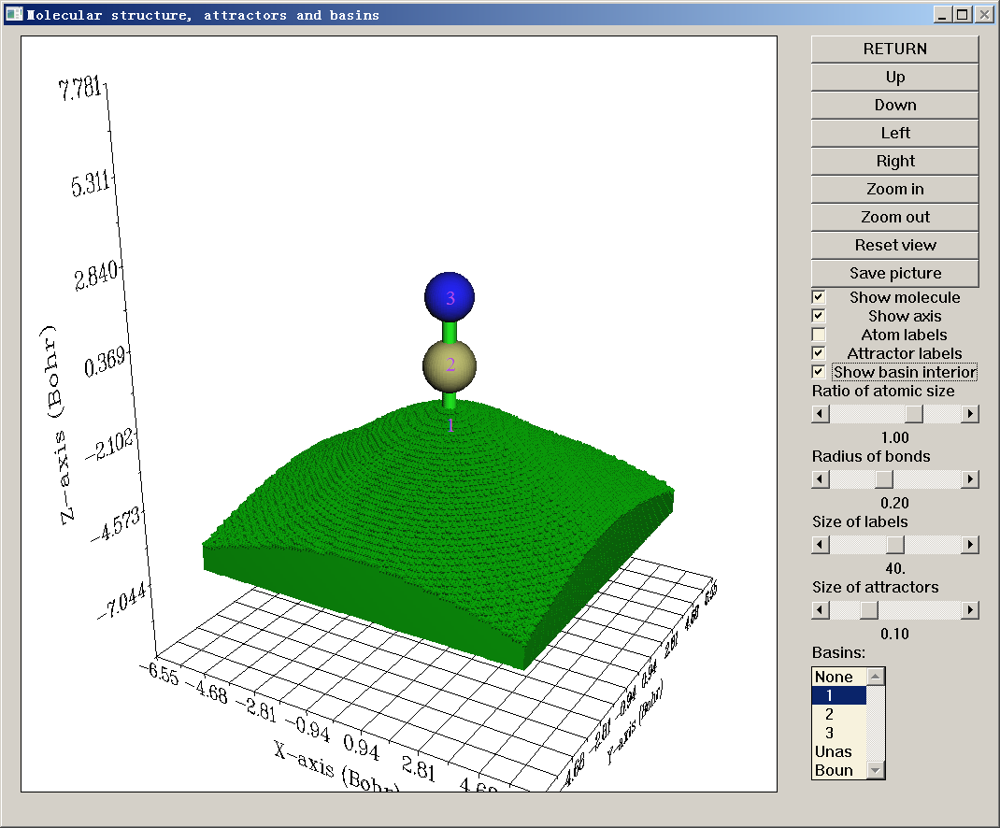

若只想在 vdW 表面(此处定义为 *ρ*=0.001 a.u.)内可视化原子流域的区域，可以选择“Set basin drawing method”-“rho\>0.001 region only”，然后可以看到：

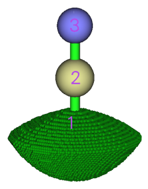

现在点击“RETURN”按钮关闭 GUI。

你可能已注意到命令行窗口中的以下信息

```text
The number of unassigned grids:           0
The number of grids travelled to box boundary:           0
```

通常这两类格点的数目应为零，只在极少数情况下不为零；这种情况下，可以在 GUI 的流域列表中分别选择“Unas”和“Boun”来可视化它们。这些格点不属于任何流域，一般没有物理意义；要理解它们何时出现、为何出现，请参阅[3.20.2 节](sec-3-20-basin-analysis.md#3202-数值方面)。

### **积分流域**

接下来计算这些流域中电子密度的积分(电子布居数)。选择功能 2，会看到许多选项。序号 ≥ 1 的每个选项对应一个实空间函数；选择其中之一，就会在生成的流域中积分相应的实空间函数。本例可选择选项 1，即电子密度。但由于我们已经算过电子密度的格点数据，且电子密度的格点数据已存于内存，可以直接使用它而不必重新计算以节省时间，因此这里选择选项 0，即使用“内存中存储的格点数据的值”。由于格点处的电子密度不需要重新计算，积分会立即输出：

```text
  #Basin        Integral(a.u.)      Volume(a.u.^3)
      1          0.7356142812        441.70000000
      2          5.3511723358        566.84900000
      3          7.9020047534        829.72600000
Sum of above values:         13.98879137
```

当前体系总共应有 1+6+7=14 个电子；遗憾的是，电子密度积分之和为 13.98879，明显偏离理想值！

由于我们研究的流域是 AIM 流域，**获得流域积分的最佳选择是用功能 7 而非功能 2**。在功能 7 中使用原子中心与均匀格点混合的格点，而功能 2 只用均匀格点积分。我们输入：

```text
7  // Integrate real space functions in AIM basins with mixed type of grids
1  // Integrate a specific function with atomic-center + uniform grids
1  // Select electron density as the integrand
```

结果为

```text
   #Basin        Integral(a.u.)      Vol(Bohr^3)    Vol(rho>0.001)
       1          0.7356461300         441.710          34.884
       2          5.3552275427         566.347         102.832
       3          7.9086499057         830.218         134.228
 Sum of above integrals:         13.99952358
 Sum of basin volumes (rho>0.001):     271.944 Bohr^3
```

可见，电子密度积分之和 (13.999) 几乎恰好等于期望值 14.0，明显比用功能 2 的结果好得多。同时输出了流域体积。“vol(Bohr^2)”项没有明确物理意义，因为它们直接受格点设置空间范围的影响。但“vol(rho\>0.001)”项是有用的，它们表示被电子密度 \> 0.001 等值面 (Bader vdW 表面)包围的流域体积，因而可视为原子尺寸。

同时输出了这些原子的原子电荷 (AIM 电荷) 和体积

```text
Normalization factor of the integral of electron density is    0.999966
The atomic charges after normalization and atomic volumes:
     1 (C )    Charge:    0.644590     Volume:   102.832 Bohr^3
     2 (N )    Charge:   -0.908919     Volume:   134.228 Bohr^3
     3 (H )    Charge:    0.264329     Volume:    34.884 Bohr^3
```

注意以上 AIM 电荷还不够准确！要在 AIM 流域中获得更准确的积分，应在功能 7 中选择选项 2 或 3；与选项 1 相比，它们会细化流域边界的归属以显著提高积分精度，但要付出额外计算代价。这里我们试一下，在功能 7 中选择选项 2，再输入 *1*，结果为

```text
Normalization factor of the integral of electron density is    0.999967
The atomic charges after normalization and atomic volumes:
     1 (C )    Charge:    0.748980     Volume:   100.160 Bohr^3
     2 (N )    Charge:   -1.003918     Volume:   136.304 Bohr^3
     3 (H )    Charge:    0.254938     Volume:    35.480 Bohr^3
```

可见原子电荷发生了变化(比之前更准确)。

为进一步提高积分精度，生成流域时应选择比“medium-quality grid”更好的格点设置，如“High-quality grid”甚至“Lunatic quality grid”。但要记住，对大体系，高质量格点可能消耗大量计算时间和内存，而 lunatic 质量格点需要更多。

虽然如我们所见功能 7 (均匀 + 原子中心积分格点)的积分精度比功能 2 (纯均匀积分格点)好得多，但前者只适用于积分 AIM 流域，而后者可用于任何类型的流域(如 ELF 流域)。

> **注**
>
> 若在功能 7 中用了选项 2 或 3，在边界格点细化过程中，流域边界的归属将被永久更新，这意味着后续分析(如计算 LI/DI、电多极矩)的结果也会变得更准确。

**总之，进入流域分析模块后获得可靠 AIM 电荷的常用步骤是**

```text
1  // Generate basin
1  // Electron density
2  // Medium-quality grid. Select high-quality grid if you wish to get more accurate result
7  // Integrate real space functions in AIM basins with mixed type of grids
2  // Integrate and meantime refine basin boundary
1  // Electron density
```

在 Multiwfn 中计算 AIM 电荷最方便的方法是直接选主功能 7 的子功能 14，如[4.7.11 节](sec-4-7-population-analysis-and-atomic-charge-calculation.md#4711-计算-aim-电荷)所示！它会自动完成上述所有步骤。

### **计算流域的电多极矩**

现在进入功能 8，用混合格点计算 AIM 流域的电多极矩(也可用功能 3 基于均匀格点做，但精度明显更差)。下面只粘贴碳的结果

```text
*****  Result of atom     1 (C ), corresponding to basin     2
Basin monopole moments (from electrons):   -5.250848
Atomic charge:    0.749152
Basin dipole moments:
X=    0.000003  Y=    0.000000  Z=    1.095848  Norm=    1.095848
Basin electron contribution to molecular dipole moment:
X=    0.000003  Y=    0.000000  Z=    6.026238  Norm=    6.026238
Basin quadrupole moments (Traceless Cartesian form):
XX=   -0.759567  XY=    0.000000  XZ=   -0.000002
YX=    0.000000  YY=   -0.759565  YZ=   -0.000005
ZX=   -0.000002  ZY=   -0.000005  ZZ=    1.519132
Magnitude of the traceless quadrupole moment tensor:    1.519132
Basin quadrupole moments (Spherical harmonic form):
Q_2,0 =   1.519132   Q_2,-1=  -0.000006   Q_2,1=  -0.000002
Q_2,-2=   0.000000   Q_2,2 =  -0.000001
Magnitude: |Q_2|=    1.519132
Basin electronic spatial extent <r^2>:        8.542655
Components of <r^2>:  X=       3.353930  Y=       3.353928  Z=       1.834797
```

计算这些量的公式与[3.18.3 节](sec-3-18-fuzzy-atomic-space-analysis.md#3183-原子与分子多极矩及--2)给出的基本相同，只是原子核位置要换成吸引子位置，积分的空间范围是流域而非模糊原子空间。

电单极矩 (-5.251 a.u.) 就是流域中电子布居数的负值。流域电偶极矩的 Z 分量为正值 (1.096 a.u.)，表明在流域 2 中，大多数电子分布在 Z 坐标比吸引子 2 更负的区域。流域电四极矩的 ZZ 分量为正 (1.519 a.u.)，而其他对角分量为负，表明相对于吸引子 2，该流域中的电子云在 Z 方向收缩而在其他方向伸展。

$\langle r^2\rangle$ 表示原子流域中电子分布的空间范围。从输出可以看出该值的顺序为 N2 (14.37) \> H3 (1.04) \> C1 (8.54)，表明氮和氢分别具有最宽和最窄的电子空间范围。

### **计算流域的定域化指数和离域指数**

离域指数 (delocalization index, DI) 定量衡量在两个区域间离域(或说共享)的电子数，而定域化指数 (localization index, LI) 定量衡量定域在某区域的电子数。关于 LI 和 DI 的细节见[3.18.5 节](sec-3-18-fuzzy-atomic-space-analysis.md#3185-定域化指数-li与离域化指数-di-4-44)。与该节所述唯一不同的是，这里基于流域而非模糊原子空间计算 LI 和 DI。

选择功能 4，再选选项 2 用混合格点计算流域重叠矩阵，随后也会算出 LI 和 DI。从屏幕可以看到，先按流域编号输出 LI 和 DI 矩阵，之后 Multiwfn 识别原子编号与流域编号的对应关系，再按原子编号打印 LI 和 DI 矩阵，如下所示

```text
Detecting correspondence between basin and atom indices (criterion: <0.3 Bohr)
Basin     2 corresponds to atom     1 (C )
Basin     3 corresponds to atom     2 (N )
Basin     1 corresponds to atom     3 (H )

************** Total delocalization index matrix (atom index) **************
              1             2             3
    1    3.49274177    2.59233062    0.90041116
    2    2.59233062    2.66486431    0.07253370
    3    0.90041116    0.07253370    0.97294485

Total localization index (atom index):
   1:  3.50427    2:  6.67098    3:  0.25855
```

由于当前分子是闭壳层体系，只输出总 LI 和 DI，不分别输出 α 和 β 电子的 LI 和 DI。可见 C1 与 N2 原子流域之间的 DI 为 2.592，表明两原子有效共享 2.592 个电子。DI 在某种程度上可视为共价键级，DI 值 2.592 确实与 HCN 中 C-N 的形式键级 (3.0) 相当。对角项是相应行/列元素之和，对闭壳层情形可在某种程度上视为原子价。所以可以说 HCN 中 N2 原子的原子价为 2.665。

H3 的 LI 只有 0.256，明显偏离流域电子布居数。这一观察反映在 HCN 中氢 AIM 原子空间中的电子很容易离域出去。

### **特殊情形：存在赝原子时的流域分析**

赝原子也称电子密度的非核吸引子 (non-nuclear attractor, NNA)，指不在原子核位置的电子密度极大。有多种原因可导致 NNA，例如金属键的存在或波函数质量太差。这里以 Li₆ 团簇为例说明存在 NNA 时如何处理。

启动 Multiwfn 并输入

```text
examples\Li6.fch
17  // Basin analysis
1  // Generate basins and locate attractors
1  // Electron density
1  // For illustration purposes, here we only use low-quality grid for saving time
0  // Visualize attractors and basins
```

下图左半部分显示该团簇的几何构型，三个绿色小球表示三个 NNA 的位置；右半部分显示其中一个 NNA 对应的流域。可见吸引子 2、4、8 是 NNA。

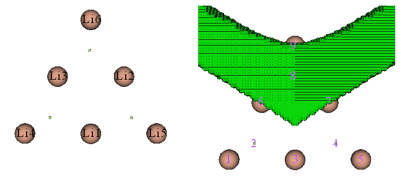

若按[4.6.2 节](sec-4-6-modify-and-check-wavefunction.md#462-价层电子密度分析去掉某些轨道对实空间函数贡献的例子)所示步骤绘制 Li₆ 的价电子密度填色图，会立即明白为什么在边界 Li 三角形中心存在 NNA。从下图可以清楚看到，每个边界三角形中心确实存在电子密度极大，这一观察也意味着三中心键的存在

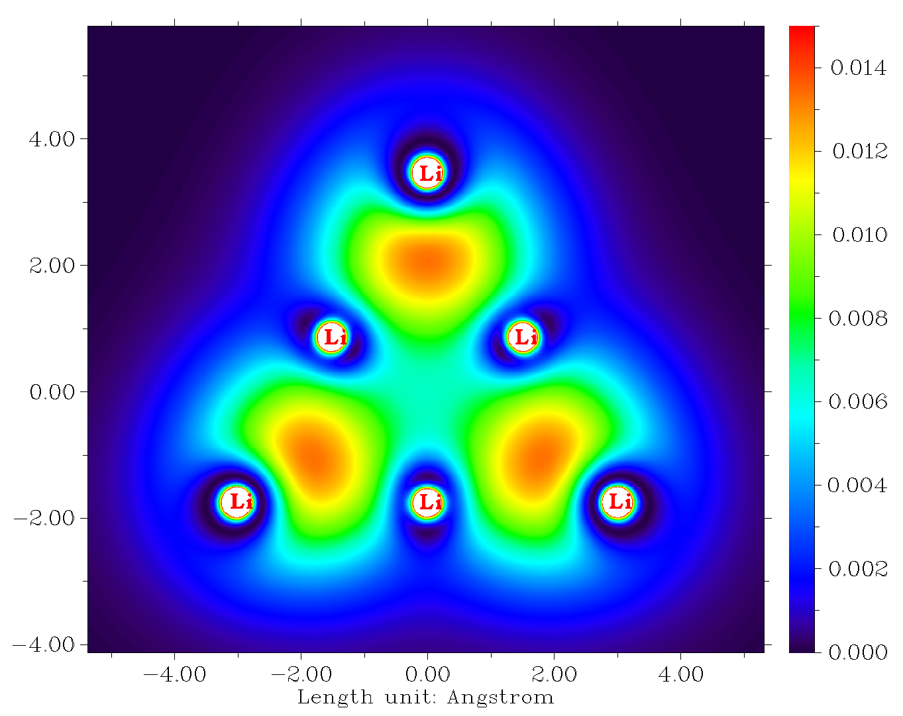

接下来计算 AIM 流域的布居数。输入以下命令

```text
7  // Integrate real space functions in AIM basins with mixed type of grids
2  // Integrate and meantime refine basin boundary
1  // Electron density
```

在积分流域过程中，计算会暂停三次，同时会在屏幕上看到如下提示。这是因为程序不知道如何妥善处理三个 NNA，即吸引子 2、4、8：

```text
Warning: Unable to determine the attractor     2 belongs to which atom!
 If this is a non-nuclear attractor, simply press ENTER button to continue. If you used pseudopotential and this attractor corresponds to the cluster of all maxima of its valence electron, then input the index of this atom (e.g. 9). Else you should input q to return and regenerate basins with smaller grid spacing
```

既然已知吸引子 2、4、8 是正常的 NNA，按提示要做的就是直接按回车键继续计算。最后会看到以下输出

```text
Normalization factor of the integral of electron density is    0.999992
The atomic charges after normalization and atomic volumes:
     2 (NNA)   Charge:   -1.249592     Volume:   273.680 Bohr^3
     4 (NNA)   Charge:   -1.249536     Volume:   273.680 Bohr^3
     8 (NNA)   Charge:   -1.249079     Volume:   274.048 Bohr^3
     1 (Li)    Charge:    0.757502     Volume:    69.792 Bohr^3
     2 (Li)    Charge:    0.756323     Volume:    70.000 Bohr^3
     3 (Li)    Charge:    0.756331     Volume:    70.000 Bohr^3
     4 (Li)    Charge:    0.492816     Volume:   139.296 Bohr^3
     5 (Li)    Charge:    0.492759     Volume:   139.296 Bohr^3
     6 (Li)    Charge:    0.492477     Volume:   139.392 Bohr^3
```

可见每个 NNA 流域带有 1.249 个电子，因此流域电荷为 -1.249。存在 NNA 时显然无法严格定义 AIM 原子电荷，因为所有 AIM 原子电荷之和不等于整个体系的净电荷。这是 AIM 原子电荷的严重局限之一。

### **经由 VMD 程序绘制流域**

展示流域时，借助 VMD 程序可轻松获得好得多的图形效果。见视频演示：“在 Multiwfn 和 VMD 中绘制 AIM 流域(原子流域)”(<https://youtu.be/9D5do80XcbI>)。

简单说，需要做的是在流域分析模块中选选项 -5，输入感兴趣流域的编号，再选“3 Output all basin grids where electron density \> 0.001 a.u.”将流域导出为各自的 cube 文件。然后载入 VMD 并以等值面值 0.5 绘制等值面，可得到如下图形 (*examples\acrolein.wfn* 的氧流域)：

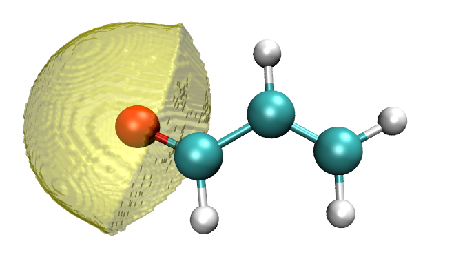

如上述视频教程所示，甚至可以在 VMD 中同时绘制多个流域并显示临界点 + 键径。例如下图表示丙烯醛四个非氢原子的原子流域，橙色和紫色小球分别对应键临界点和核临界点，黄色粗线是键径。

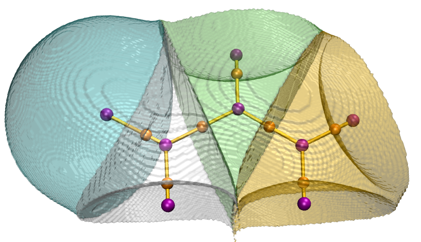

## **4.17.2 ELF 流域分析例子**

Multiwfn 在 ELF 流域分析方面非常强大。作为例子，本节分析典型小分子乙炔的 ELF 流域。启动 Multiwfn 并输入

```text
examples\C2H2.wfn
17  // Basin analysis
1  // Generate basins and locate attractors
9  // ELF
2  // Medium-quality grid
```

流域生成完成后，可以进行各种可视化和分析，见下。

### **第一部分：可视化吸引子和流域**

我们进入选项 0 可视化 ELF 吸引子和流域，会看到下图。吸引子以绿色小球表示，紫色文字是流域编号。可以发现有许多紧密排列的吸引子环绕 C-C 键，它们 ELF 值基本相同，共同代表环状 ELF 吸引子。这些吸引子已被 Multiwfn 自动聚类在一起，因此它们具有相同的吸引子编号，即 2；换言之，吸引子 2 是简并吸引子，包含许多成员吸引子(或原始吸引子)。相应地，流域 2 由所有成员流域组成。

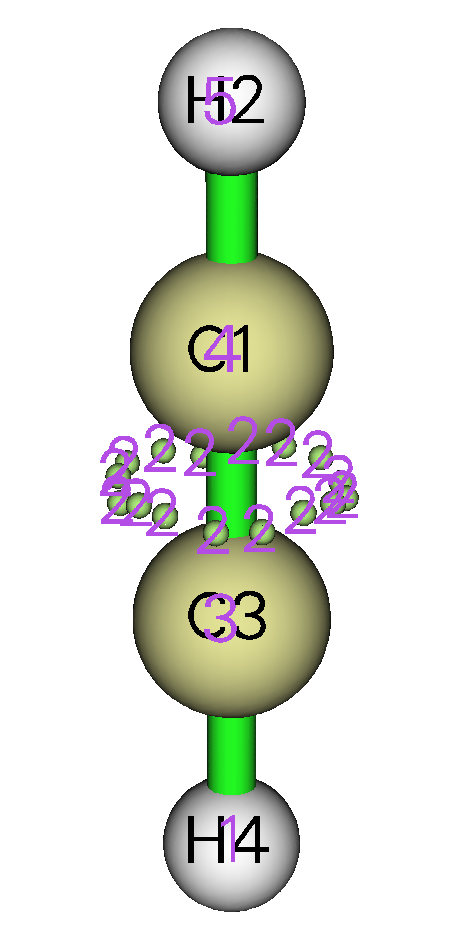

可以在 GUI 右下列表中选 2 可视化流域 2，可以看到

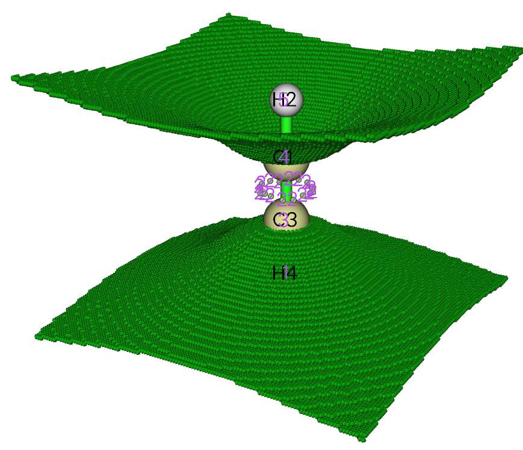

有时只可视化电子密度高于 0.001 a.u. 的流域区域更好。为此，在菜单栏选“Set basin drawing method”再选“rho\>0.001 region only”，然后勾选 GUI 右侧的“Show basin interior”复选框，会看到

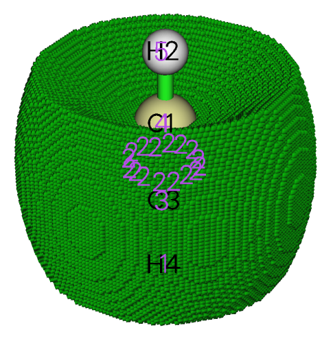

对 C1-C3 键有贡献的所有电子都位于上图所示的流域 2 中。

吸引子 2 的存在标志着被两个碳共享的 π 电子。按熟知的 ELF 符号体系，流域 2 应记为 V(C₁,C₃)，意思是该流域由 C1 和 C3 的价电子组成并对 C1-C3 键的存在有贡献。

吸引子 3 和 4 对应核型 ELF 吸引子，它们的流域应分别记为 C(C₃) 和 C(C₁)，其中括号外的字母 C 代表“Core(核)”。若取消勾选“Show molecule”复选框并在流域列表中选相应项，就可可视化这些流域。下图描绘了 C(C₃) 流域

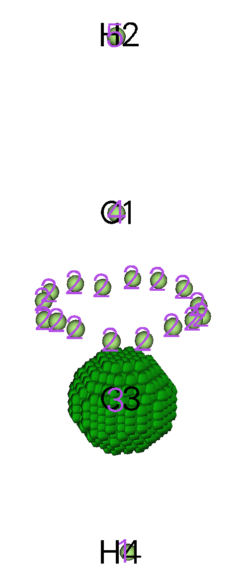

虽然流域 1 和 5 覆盖 H4 和 H2 的原子空间，但应分别记为 V(C₃,H₄) 和 V(C₁,H₂)，而非 C(H₄) 和 C(H₂)。这是因为氢没有核电子，且这两个流域中的电子直接对 C3-H4 和 C1-H2 键有贡献。

现在点击 GUI 右上方的“RETURN”按钮关闭 GUI 窗口。

### **第二部分：自动指定 ELF 流域标号**

当体系相对较大，或有大量结构要研究时(例如在键演化理论分析中需要研究一批 IRC 点)，手动给 ELF 流域指定标号相当麻烦。幸运的是，只要所选实空间函数是 ELF，Multiwfn 能自动指定流域标号。

我们选选项“12 Assign ELF basin labels”，会立即看到

```text
The following information is printed according to basin indices
Basin indices, populations (e), volumes (Angstrom^3) and assigned labels
Basin    1  Pop.:  2.2160  Vol.:  113.865  Label: V(C3,H4)
Basin    2  Pop.:  5.3670  Vol.:  144.158  Label: V(C1,C3)
Basin    3  Pop.:  2.0949  Vol.:    0.123  Label: C(C3)
Basin    4  Pop.:  2.0949  Vol.:    0.123  Label: C(C1)
Basin    5  Pop.:  2.2160  Vol.:  113.884  Label: V(C1,H2)

Sum of core basin populations:         4.1898
Sum of valence basin populations:      9.7990
Sum of all basin populations:         13.9888

Sorting basins according to labels...
The following information is printed according to order of basin labels
Basin indices, populations (e), volumes (Angstrom^3) and assigned labels
#    1  Basin    4  Pop.:  2.0949  Vol.:    0.123  Label: C(C1)
#    2  Basin    3  Pop.:  2.0949  Vol.:    0.123  Label: C(C3)
#    3  Basin    5  Pop.:  2.2160  Vol.:  113.884  Label: V(C1,H2)
#    4  Basin    2  Pop.:  5.3670  Vol.:  144.158  Label: V(C1,C3)
#    5  Basin    1  Pop.:  2.2160  Vol.:  113.865  Label: V(C3,H4)

Number of core basins is     2, their indices:
3,4
Number of  2-synaptic basins is     3, their indices:
1,2,5
```

如上所示，数据输出了两次。首先按流域编号顺序打印流域布居数、体积和标号。然后按标号对流域排序，再次输出数据。从标号可快速清楚地认出每个流域的物理意义。

注意，对使用赝势的原子，ELF 流域标号可能无法被正确指定。

### **第三部分：估算流域性质**

Multiwfn 能计算任何实空间函数在生成的流域中的积分。例如，我们计算每个流域中电子密度的积分，现在输入

```text
2  // Integrate a real space function in the basins
1  // Electron density
```

很快得到积分，即每个流域中的平均电子布居数：

```text
  #Basin        Integral(a.u.)      Volume(a.u.^3)
      1          2.2159821094        768.40000000
      2          5.3670483807        972.85100000
      3          2.0949016050          0.83200000
      4          2.0949016050          0.83200000
      5          2.2159826437        768.49900000
Sum of above values:         13.98881634
```

C(C₁) 和 C(C₃) 平均都含 2.095 个电子，与碳有两个核电子的事实相符。而且 V(C₃,H₄) 和 V(C₁,H₂) 中的平均布居数接近 2，近似反映平均有一对电子在 C 与 H 间共享。

按经典化学键理论，两个碳间共享三对电子即六个电子，但在 V(C₁,C₃) 流域中积分只有 5.37。虽然偏差相对较大，但这是正常情况。指望 ELF 流域分析的结果必定能重现经典 Lewis 图像是没有意义的，实际上 ELF 分析更高级、更接近真实物理图像。

### **第四部分：流域的电多极矩**

ELF 流域的电多极矩能表征特征区域中的电子分布。要计算它们，进入选项“3 Calculate electric multipole moments and \<r^2\> for basins”。假设需要所有流域的结果，按屏幕提示输入 *-1*。依次输出每个流域的结果，对应 C(C₁) 的流域 4 的数据如下

```text
***** Basin       4
Basin monopole moment:   -2.094902
Basin dipole moment:
X=   -0.104745  Y=   -0.104745  Z=    0.020728  Norm=    0.149575
Basin electron contribution to molecular dipole moment:
X=   -0.000000  Y=    0.000000  Z=   -2.388409  Norm=    2.388409
Basin quadrupole moment (Traceless Cartesian form):
XX=   -0.003034  XY=   -0.007856  XZ=    0.001555
YX=   -0.007856  YY=   -0.003034  YZ=    0.001555
ZX=    0.001555  ZY=    0.001555  ZZ=    0.006067
Magnitude of the traceless quadrupole moment tensor:    0.006067
Basin quadrupole moments (Spherical harmonic form):
Q_2,0 =   0.006067   Q_2,-1=   0.001795   Q_2,1=   0.001795
Q_2,-2=  -0.009071   Q_2,2 =   0.000000
Magnitude: |Q_2|=    0.011205
Basin electronic spatial extent <r^2>:        0.196110
Components of <r^2>:  X=       0.067392  Y=       0.067392  Z=       0.061325
```

首先应注意，虽然本例中由于对称性，流域电偶极矩的 X 和 Y 分量应为零，但实际值并不太接近零，意味着积分精度不高。这就是为什么做电多极矩分析时常需要“high-quality grid”。但当前结果仍可用于定性分析。流域中电四极矩的大小定量表示流域中电子分布偏离球对称的明显程度。该值对 C(C₁) 很小 (0.0061)，表明碳的核电子分布在成键过程中基本保持不受扰动。

现在输入 *0* 返回流域分析模块。

> **注**
>
> 若感兴趣的流域只是价流域，做电多极矩分析时“medium-quality grid”就够了，因为价电子密度不如核电子密度高，因而不需要很高的积分精度。

### **第五部分：定域化指数 (LI) 和离域指数 (DI)**

Multiwfn 能计算每个流域的 LI 和每对流域间的 DI。现在我们选选项 4 研究 LI 和 DI，结果如下

```text
********************* Total delocalization index matrix *********************
              1             2             3             4             5
    1    1.31231709    1.03496562    0.16085935    0.02291204    0.09358009
    2    1.03496562    2.71090548    0.32048710    0.32048709    1.03496568
    3    0.16085935    0.32048710    0.51131492    0.00705643    0.02291205
    4    0.02291204    0.32048709    0.00705643    0.51131492    0.16085937
    5    0.09358009    1.03496568    0.02291205    0.16085937    1.31231718

Total localization index:
   1:  1.55970    2:  4.01124    3:  1.83397    4:  1.83397    5:  1.55970
```

C(C₁) 与 C(C₃) 之间的 DI，即 DI(3,4)，微不足道，反映了原子核区之间电子离域相当困难的一般规律。DI(1,3) 和 DI(2,3) 是很小但不接近零的值，表示 C(C₃) 中的电子有一定几率与 V(C₃,H₄) 和 V(C₁,C₃) 中的电子交换，这两个流域是与 C(C₃) 相邻的仅有的两个流域。

DI(2,1) 和 DI(2,5) 约为 1.0，这么大的值表明 C-C 键区与 C-H 键区之间电子离域很容易。虽然 C(C₁) 和 C(C₃) 中的平均电子布居数都是 2.095，但它们的 LI 值高达 1.834，表明碳的核电子高度倾向于留在核区而不向内外离域。相比之下，对 V(C,H) 而言，它们的 LI 值明显小于其平均电子布居数，揭示这些流域中的电子没有表现出很强的定域特征。

在 ELF 流域分析中，一些研究者更喜欢用方差 (variance, σ²) 和协方差 (covariance, Cov) 而非 LI 和 DI 讨论问题。电子对涨落的协方差就是 DI 负值的一半，例如 Cov(2,5) = -DI(2,5)/2 = -1.035/2 = -0.518。电子涨落的方差可算作 Multiwfn 输出的 DI 矩阵相应对角项的一半，例如 σ²(2) = DI(2,2)/2 = 2.710/2 = 1.355 (注意如前所述，Multiwfn 输出的 DI 矩阵的对角项是相应行/列元素之和)。

### **第六部分：关于在 VMD 和 GaussView 中可视化吸引子的提示**

Multiwfn 找到的吸引子可经第三方软件可视化。要在 VMD (<http://www.ks.uiuc.edu/Research/vmd/>) 中可视化，应选“-4 Export attractors as pdb/pqr/txt/gjf file”并选相应选项将所有吸引子导出为 .pdb 或 .pqr 文件，载入 VMD 绘制即可(注：在 .pqr 文件中，原子电荷列对应吸引子处的函数值)。也可用子选项 4 将原子和吸引子导出为 .gjf 文件，再用 GaussView 轻松可视化吸引子。将 .gjf 文件载入 GaussView 后，建议选“File”-“Preference”-“View”-“Display Format”-“Molecule”，再将 low layer 设为“Tube”风格。吸引子记录为鬼原子 (Bq)，它们在 GaussView 中的编号减去真实原子数即为流域分析模块中的吸引子编号。下图展示了用这种方式显示的 CH₃NO₂ 的 ELF 吸引子，未显示标号：

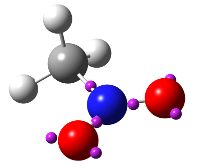

## **4.17.3 H₂O 的静电势流域分析**

本例说明对静电势 (electrostatic potential, ESP) 做流域分析，以非常简单的 H₂O 分子为例。虽然这类分析目前在文献中不常见，但你会看到该分析确实有用；特别是，该分析能很好揭示孤对电子的出现区域。

值得注意的是，与前面分析过的电子密度和 ELF 不同，ESP 同时有正部和负部。对这类实空间函数，Multiwfn 会自动为正部寻找吸引子(极大)，为负部寻找“排斥子”(极小)，但在 Multiwfn 中它们统统记录为“吸引子”。在 GUI 中可通过颜色轻松区分它们。

不仅流域分析模块，Multiwfn 的拓扑分析模块也能寻找 ESP 极小，且后者确定的 ESP 极小准确得多。因此比起本节介绍的方法，更推荐用拓扑分析模块。ESP 拓扑分析的例子见[4.2.9 节](sec-4-2-topology-analysis.md#429-静电势-esp-的拓扑分析)。

> **注**
>
> 用 Gaussian 包中的 cubegen 工具计算 ESP 格点数据的速度比 Multiwfn 内部代码快得多。若你的系统装有 Gaussian 且输入文件是 .fch/fchk，强烈建议将 *settings.ini* 中的 "cubegenpath" 参数设为 cubegen 的实际路径，这样在流域分析中计算 ESP 格点数据时，Multiwfn 会自动调用 cubegen 计算 ESP。关于调用 cubegen 的更多信息见[5.7 节](sec-5-7-make-use-of-cubegen-utility-in-gaussian-package.md)。

### **进行 ESP 流域分析的基本步骤**

启动 Multiwfn 并输入以下命令：

```text
examples\H2O.fch  // Optimized and produced at B3LYP/6-31G** level
17  // Basin analysis
1  // Select real space function used to partitioning basins
12  // ESP
2  // Medium-quality grid
```

ESP 格点数据计算和流域生成完成后，找到五个吸引子。注意这次走到盒子边界的格点数又不为零(约 1954 个)，但这完全不要紧。

选选项 0 打开 GUI，可以看到吸引子 1、2、3 对应由核电荷导致的 ESP 极大。孤对电子的出现常使相应区域的 ESP 为负，吸引子 4 和 5 显然表现了该效应。吸引子 4 和 5 显示为浅蓝色，因为它们位于负值区，实际上它们不是 ESP 的吸引子而是“排斥子”(极小)。在流域列表中点击“4”并勾选“Show basin interior”框，会看到下图，展示了相应的流域区域。

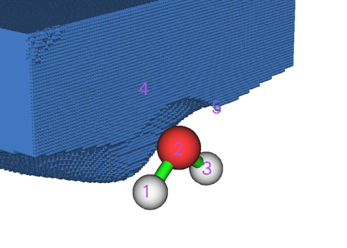

若想可视化流域生成过程中哪些格点走到了盒子边界，可以在流域列表中选“Boun”，见下图。显然这些格点没有物理意义，可直接忽略。它们只出现在远离原子的区域。

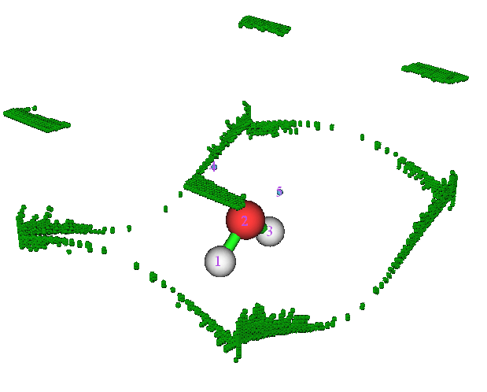

现在点击“RETURN”按钮关闭 GUI。

### **测量几何**

有时需要获得吸引子与原子核之间的几何信息。例如，我们进入功能 -2，输入 *a1 c4*，屏幕会显示原子 1 (即氧) 的原子核与吸引子 4 之间的距离，值为 2.272 Bohr。接下来输入 *c4 a1 c5*，会输出“吸引子 2 -- 原子 1 -- 吸引子 3”的夹角，值为 86.01 度，在某种意义上可视为两孤对电子之间的夹角。

输入 *q* 退出几何测量界面。

### **聚类吸引子**

假设想把吸引子 4 和 5 聚为简并吸引子，使它们共同代表两孤对电子，可以输入

```text
-6  // Set parameter for attractor clustering or manually perform clustering
3  // Cluster specified attractors
4,5  // Attractors 4 and 5 will be clustered as a single one
0  // Return
```

选选项 0 打开 GUI，如下所示，可以发现所有吸引子的编号都变了，对应氧孤对电子的两个吸引子现在共享同一编号，即 4。

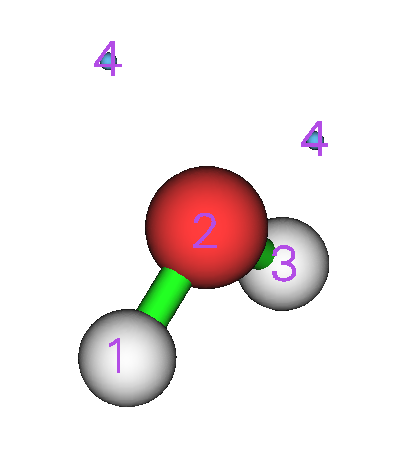

### **积分流域**

点击“RETURN”按钮关闭 GUI，选选项 2 再选 1，在 ESP 流域中积分电子密度，结果为

```text
   #Basin        Integral(a.u.)      Volume(a.u.^3)
       1          0.8776693902        390.34100000
       2          7.5388327160         26.52400000
       3          0.8776693895        390.28300000
       4          0.6822297997        654.32200000
 Sum of above values:          9.97640130
 Integral of the grids travelled to box boundary:          0.00000007
```

由于当前流域 4 就是整个 ESP 负值区，结果表明负 ESP 区平均有 0.682 个电子。确实该值不大(可能有人预期由于两孤对电子应有约四个电子)，这是因为分子空间大多数区域的 ESP 由核电荷主导因而为正。

### **同时显示 ESP 极小点和等值面**

在 *J. Comput. Chem.*, **39**, 488 (2018) 中，作者表明将 ESP 极小点和等值面画在同一图中，能非常清楚地展示孤对电子的区域。等值面值选为比 ESP 全局最小值高 10 kcal/mol。这里我们画这种图。

回想刚完成流域生成时，每个 ESP 极小的值都打印在屏幕上(也可随时选选项“-3 Show information of attractors”再次显示)：

```text
Attractor       X,Y,Z coordinate (Angstrom)                Value
     1   -0.02645886   -0.76730701   -0.48343728         17.61230000
     2    0.02645886   -0.02645886    0.09865769         79.16270000
     3    0.02645886    0.76730701   -0.48343728         17.61230000
     4   -0.82022474    0.02645886    0.99825901         -0.09222160
     5    0.82022474    0.02645886    0.99825901         -0.09222160
```

显然全局最小值为 -0.09222\*627.51 = -57.9 kcal/mol，等值面值应设为 -0.09222+10/627.51 = -0.07628 a.u.。

进入选项 0，在 GUI 窗口中取消勾选“Attractor labels”，然后输入

```text
-10  // Return to main menu
13  // Process grid data
-2  // Visualize isosurface of the grid data in memory
```

在 GUI 中，在“Isosurface value”框输入 -0.07628，取消勾选“Show both sign”，选“Isosurface style”-“Use mesh”，确保已激活“Show atomic labels”，选“Other settings”-“Set atomic label type”-“Element symbol”。最后点击“Save picture”按钮将图片保存到当前目录，会看到以下效果(数值是手动标注的)

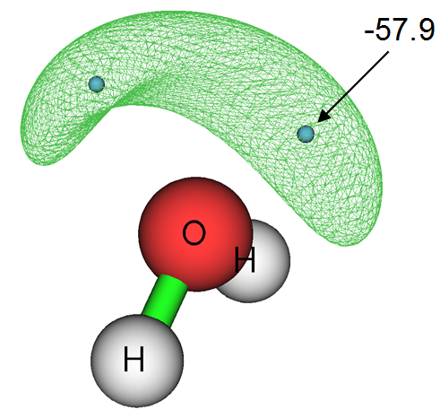

### **用外部 cube 文件做流域分析**

Multiwfn 能完全基于格点数据做流域分析，因此被分析的实空间函数可以不是 Multiwfn 形式上支持的任何函数，例如诱导电流密度各向异性 (Anisotropy of the Induced Current Density, *Chem. Rev.*, **105**, 3758 (2005))，可用 AICD 或 GIMIC 程序计算。为说明这一重要特性，现在我们用 Gaussian 的 cubegen 工具直接生成的格点数据重做上面展示的部分分析。

在系统控制台窗口运行以下命令产生 *density.cub* 和 *ESP.cub*。

```text
cubegen 0 fdensity H2O.fch density.cub 0 h
cubegen 0 potential H2O.fch ESP.cub 0 h
```

然后启动 Multiwfn 并输入

```text
ESP.cub  // This file contains ESP grid data. After loading it, the grid data will be stored in memory
17  // Basin analysis
1  // Select real space function used to partitioning basins
2  // Generate the basins by using the grid data stored in memory
```

现在在选项 0 中可视化找到的吸引子：

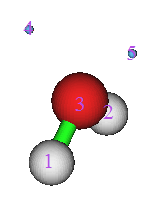

退出 GUI，再输入以下命令

```text
2  // Integrate real space functions in the basins
-1  // Use the grid data stored in external file as integrand
density.cub  // This file contains electron density grid data
```

结果与本节第一部分得到的结果非常接近。例如，这里得到的 ESP 负值区的电子布居数为 0.339\*2=0.678，而之前得到的是 0.682。

最后选选项 3 计算流域的电多极矩。由于 cube 文件不含 GTF (Gaussian 型函数)信息，会提示输入含当前体系 GTF 信息的文件路径，以便计算电多极矩。我们输入 *H2O.fch* 文件的路径，再输入 *-1*，所有流域的电多极矩会立即输出到屏幕。

## **4.17.4 H₂O 的电子密度差流域分析**

本例分析 H₂O 的电子密度差流域，以定量研究分子形成过程中电子密度的变形。

做流域分析之前，需要先用主功能 5 生成电子密度差的格点数据，所有相关元素的波函数文件必须 available。这里直接用 Multiwfn 包中提供的原子波函数文件集，即把 "example" 文件夹中的 "atomwfn" 子文件夹拷贝到当前目录，则在生成电子密度差格点数据时 Multiwfn 会自动使用它们。准备原子波函数文件有几种不同方法，请回顾[4.4.7 节](sec-4-4-output-and-plot-various-properties-in-a-plane.md#447-乙酰氯电子密度的变形图)并参阅[3.7.3 节](sec-3-7-custom-operation-promolecular-and-deformation-properties.md#373-原子波函数的生成-generation-of-atomic-wavefunctions)。

之后启动 Multiwfn 并输入：

```text
examples\H2O.fch  // Generated at B3LYP/6-31G** level
5  // Calculate grid data
-2  // Obtain deformation property
1  // Electron density
3  // High-quality grid. Because the variation of electron density difference is complicated, using relatively high quality of grid is compulsory. Note that the "high-quality grid" we selected here only defines the total number of grids, and hence has different meaning to the one involved in function 1 of basin analysis module
0  // After the calculation is finished, return to main menu
17  // Basin analysis module
1  // Generate basins and locate attractors
2  // Generate the basins by using the grid data stored in memory (namely the grid data we just calculated by main function 5)
```

进入功能 0 可视化结果，会看到下图左半部分。取消勾选“Show molecule”后，图形如右半部分

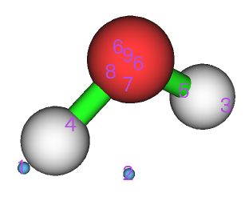 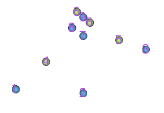

电子密度差的正(负)部对应分子形成后电子密度增加(减少)的区域。浅绿小球表示正部的极大，浅蓝小球表示负部的极小。

若难以想象极大极小为何如此分布，建议绘制电子密度差的平面图。下图左半部分是垂直于分子平面的电子密度差图，右半部分是分子平面内的图。

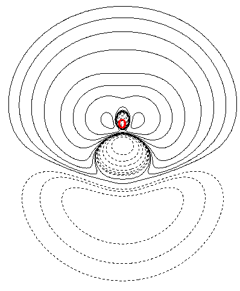 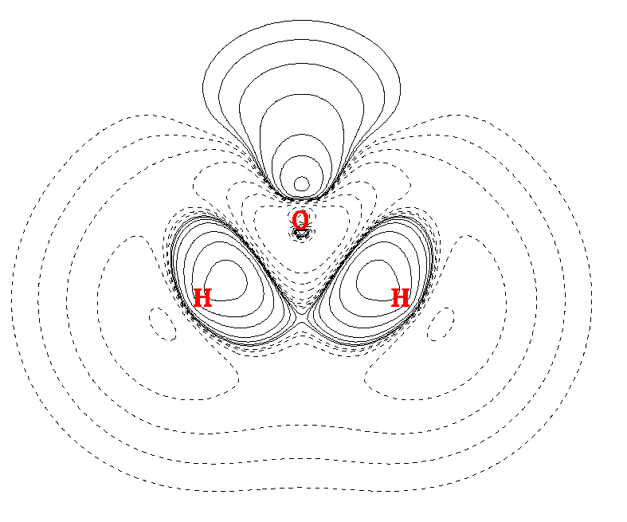

对照吸引子和平面图，显然吸引子 4 和 5 是 O-H 键形成导致电子密度增强区的极大。而吸引子 6 的出现源于孤对电子形成导致的电子聚集。

> **注 1**
>
> 吸引子 6 是二重简并的，即如你所见，它对应两个吸引子。这是因为这两个吸引子取值相同且位置非常靠近。

> **注 2**
>
> 吸引子 8 在对称平面另一侧没有对应物。出现该问题的原因是所用格点质量相对于电子密度差的复杂特征不够高。

考察 C 与 H 间因成键聚集了多少电子很有意思。测量该量有许多方法；对当前情形最合理的是在流域 4 或流域 5 中积分电子密度差。现在就来做。选功能 2，再选选项 0 以电子密度差格点数据为被积函数。从输出可知积分为 0.102 e。

若想对照吸引子查看电子密度差等值面，只需选选项 -10 回到 Multiwfn 主菜单，再选主功能 13 的子选项 -2 绘制内存中格点数据的等值面，找到的吸引子会一同显示，如下所示(等值面值=0.05)，其中绿部和蓝部分别对应正区和负区。

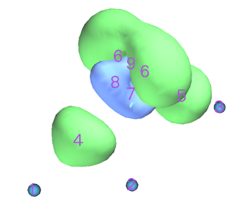

## **4.17.5 在 AIM 流域中研究源函数**

源函数 (source function) 已在[2.6 节](sec-2-6-real-space-functions.md)第 19 部分简介。讨论成键问题时通常取键临界点 (bond critical point, BCP) 为源函数的参考点。本例计算乙烷在 AIM 流域中的源函数；特别地，基于源函数将得到甲基对其 C-H 键 BCP 处电子密度的贡献。计算源函数之前，应先做拓扑分析找出 BCP 的位置。

启动 Multiwfn 并输入：

```text
examples\ethane.wfn  // Optimized and produced at B3LYP/6-31G*
2  // Topology analysis
2  // Search nuclear critical points
3  // Search BCPs
0  // Visualize result, see below
```

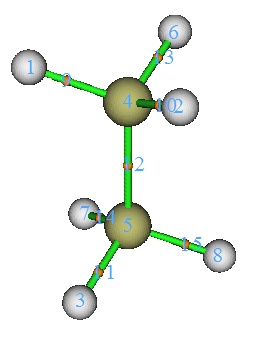

临界点 11 将选作源函数的参考点。当然选哪个 BCP 完全任意。现在关闭拓扑分析模块的 GUI

最好选选项 7 再输入 *11* 查看该临界点处的电子密度，因为理论上源函数在全空间的积分应等于其参考点处的电子密度，因此该值对检验源函数积分是否足够准确很重要。CP11 处的电子密度为 0.276277。

从命令行窗口显示的信息可知 CP11 的坐标为 (0.0,-1.199262548,-1.909104063)，把它从窗口拷贝到剪贴板(若不知怎么做，请参阅[5.4 节](sec-5-4-copy-outputs-from-command-line-window-to-clipboard.md))。接下来我们将 CP11 设为源函数的参考点。虽然可用 *settings.ini* 中的 "refxyz" 参数定义参考点，但有个技巧能做同样的事，且无需重启 Multiwfn 使参数生效！

输入以下命令

```text
-10  // Return to main menu from topology analysis module
1000  // A hidden interface
1  // Set reference point
```

把 CP11 的坐标粘贴到窗口并按回车，再输入：

```text
17  // Basin analysis
1  // Generate basins and locate attractors
1  // Electron density
2  // Medium-quality grid
```

选功能 0 进入 GUI，会看到

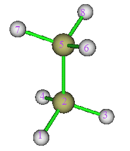

现在在 AIM 流域中积分源函数。输入以下命令

```text
7  // Integrate real space functions in AIM basins with mixed type of grids
1  // Integrate a specific function with atomic-center + uniform grids
19  // Source function
```

结果为

```text
    Atom       Basin       Integral(a.u.)   Vol(Bohr^3)   Vol(rho>0.001)
     1 (C )       5          0.00361772       149.307        70.392
     2 (H )       8          0.00289355       468.732        50.058
     3 (H )       6          0.00280041       443.982        50.097
     4 (H )       7          0.00280276       418.343        50.095
     5 (C )       2          0.12224052       150.514        70.396
     6 (H )       1          0.12040142       475.383        50.054
     7 (H )       4          0.01051821       424.105        50.095
     8 (H )       3          0.01051742       450.072        50.097
Sum of above integrals:             0.27579202
Sum of basin volumes (rho>0.001):     441.284 Bohr^3
```

积分之和非常接近 CP13 处的电子密度 (0.276277)。流域 1、2、3、4 中积分之和为 0.1204+0.1222+0.0105\*2=0.2636，代表甲基空间中的积分，占总积分值的 0.2636/0.2758\*100%=95.6%，表明甲基是其 C-H 键 BCP 电子密度的主要来源。

## **4.17.6 聚炔的局域区域流域分析**

有时所研究体系的几何构型相当伸展，例如聚炔 C₁₄H₂，可形式地表示为

H1−C2≡C3−C4≡C5−C6≡C7−C8≡C9−C10≡C11−C12≡C13−C14≡C15−H16

若只对该体系局域区域的电子结构特征感兴趣，通过适当设置格点，可只对感兴趣区域而非整个体系做流域分析以节省计算时间。作为例子，本节将以最小计算代价获取 V(C₇,C₈) 和 V(C₈,C₉) ELF 流域中的电子布居数。

启动 Multiwfn 并输入以下命令：

```text
examples\polyyne.wfn  // Optimized and produced under B3LYP/6-31G*
17  // Basin analysis
1  // Generate basins and locate attractors
9  // ELF
8  // Set the grid by inputting center coordinate, grid spacing and box length
a8  // Take the position of atom 8 as box center
0.08  // Grid spacing (Bohr)
10,10,8  // Box length in X, Y and Z directions (Bohr). Note that current molecule is aligned in Z-axis. Obviously, the larger the box, the longer the computational time must be spent. While the box should not be too small, otherwise the basins of interest may be truncated. Choosing appropriate box size highly relies on users' experience
```

计算完成后选选项 0 进入 GUI，会看到下图。显然只找到了 C8 附近的几个吸引子。流域 5 和流域 21 分别对应 V(C₇,C₈) 和 V(C₈,C₉)。注意虽然也找到了吸引子 1 和 6，但由于它们对应的流域不仅大而且靠近盒子边界，可预期流域 1 和 6 被严重截断，因而研究它们没有意义。

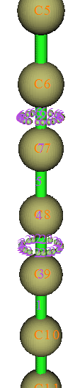

以上述方式研究局域区域时，总会发现有许多格点走到了盒子边界。本例中，如命令行窗口所示，此类格点数为 60668。可在 GUI 流域列表中选“Boun”可视化它们，见下图

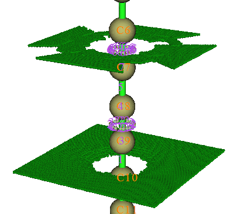

现在关闭 GUI，选选项 2 再选 1，结果表明 V(C₇,C₈) 和 V(C₈,C₉) 中电子密度的积分分别为 2.78 和 5.02。显然 C8-C9 间的成键比 C7-C8 强得多，这就是前者键长 (1.236Ǻ) 短于后者 (1.338Ǻ) 的原因。注意乙炔 V(C,C) 中的电子布居数为 5.37 (见[4.17.2 节](#4172-elf-流域分析例子))，因此可预期 C8-C9 弱于典型 C-C 三键，主要由于聚炔中电子的全局共轭。

感兴趣的读者可用相同格点间距 (0.08 Bohr) 对整个体系重做流域分析，计算量会比本例大得多。对 V(C₇,C₈) 和 V(C₈,C₉)，会发现结果与上面得到的没有可察觉的差别。

## **4.17.7 计算 ELF 流域布居数的原子贡献**

本节以 CH₃NH₂ 为例，展示如何基于原子空间的 AIM 划分获得 C 和 N 对 V(C,N) ELF 键流域布居数的贡献，这对考察键极性有用。也可用类似方法获得原子对任何其他种类流域(如 LOL 流域、ESP 流域)布居数的贡献。

首先需要生成名为 *basin.cub* 的 cube 文件，其格点值对应 ELF 流域的编号。启动 Multiwfn 并输入

```text
examples\CH3NH2.wfn
17  // Basin analysis
1  // Generate basins and locate attractors
9  // ELF
2  // Medium-quality grid
```

现在进入选项 0 查看流域编号

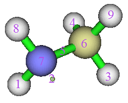

显然流域 5 对应 V(N,C)，正是我们要研究的。然后关闭 GUI 并输入

```text
-5  // Export basin as cube file
a  // Export basin.cub in current folder
```

接下来像往常一样生成 AIM 流域，格点设置必须与 *basin.cub* 完全相同

```text
1  // Regenerate basins
1  // Select real space function
1  // Electron density
9  // Use grid setting of another cube file, this is the safest way to ensure the grid data to be generated has the same grid setting as basin.cub
basin.cub
0  // Check attractors
```

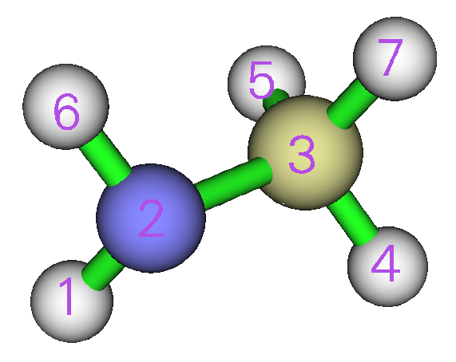

清楚看到对应 N 和 C 的吸引子编号分别为 2 和 3。然后计算原子对 *basin.cub* 中定义的流域布居数的贡献

```text
9  // Then program loads basin.cub in current folder
2  // The index of the attractor corresponding to N
5  // The 5th ELF basin, i.e. V(N,C) basin
```

结果为 1.15866，即 N 对 V(N,C) 流域贡献 1.159 个电子。再输入

```text
3  // The index of the attractor corresponding to C
5  // The 5th ELF basin, i.e. V(N,C) basin
```

从结果可知 C 对 V(N,C) 流域贡献 0.463 个电子。

由于 N 比 C 对它们 ELF 键流域贡献多得多的电子，可得出 C-N 是具有显著极性的键。

## **4.17.8 计算高 ELF 定域域布居数和体积 (HELP、HELV)**

高 ELF 定域域布居数和体积 (high ELF localization domain population and volume, HELP 和 HELV) 在 *ChemPhysChem*, **14**, 3714 (2013) 中提出，已表明它们是表征孤对电子的有用物理量，且与孤对电子相关的分子性质(如电离势、前线分子轨道能量)密切相关，细节见该 *ChemPhysChem* 文章。HELP 和 HELV 的定义在下图中清楚展示，以 PH₃ 为例。

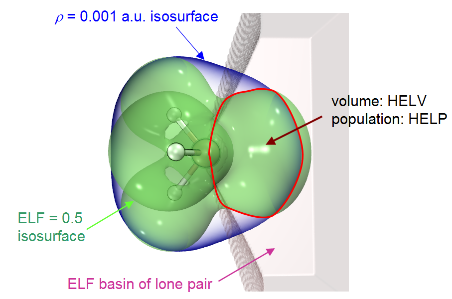

从上图可见，该方法定义了名为高 ELF 定域域 (high ELF localization domain, HEL) 的区域，它同时满足三个条件：

- (1) 电子密度大于 0.001 a.u.

- (2) 电子定域化函数 (ELF) 大于 0.5

- (3) 每一点属于对应孤对电子的 ELF 流域

HEL 的体积和电子布居数分别记为 HELV 和 HELP。据信该定义比 (3) 更能代表孤对电子区域，因为排除了不重要的区域(即 vdW 表面之外，对应 *ρ* = 0.001 a.u.)和没有明确化学意义的区域(即 ELF \< 0.5)。

现在用 Multiwfn 计算 PH₃ 的 HELV 和 HELP。启动 Multiwfn 并输入

```text
examples\PH3.wfn  // Generated at M06-2X/def2-TZVPP level, optimized at the same level
17  // Basin analysis
1  // Generate basins and locate attractors
9  // ELF must be chosen to define basins if you intend to calculate HELP and HELV
2  // Medium-quality grid
```

现在选选项 0 查看吸引子编号：

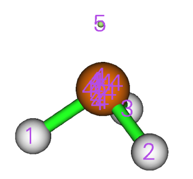

从上图可知吸引子 5 对应 P 原子的孤对电子。

接下来输入

```text
10  // Calculate HELP and HELV
0  // Select basins and calculate their HELP and HELV
5  // The basin index corresponding to the lone pair of the P atom
```

过一会儿会看到：

```text
Basin information: (constraints are not taken into account)
Population:  2.0719   Volume: 1561.1570 Bohr^3

High ELF localization domain population (HELP):    1.4858
High ELF localization domain volume (HELV):       80.5500 Bohr^3
```

可见 HELP 和 HELV 分别为 1.4858 和 80.55 Bohr³，与原文值即 1.50 和 80 Bohr³ 非常接近。微小差异来自所用计算水平与原文不完全相同，此外数值设置的细节肯定也与原文有些不同。

从以上输出还可看到该 ELF 流域的布居数和体积，它们也可用流域分析模块的选项 2 计算。

## **4.17.9 计算体系电子能量的原子贡献**

### **背景知识**

整个体系的电子能量可视为所有原子的电子能量之和，原子电子能量对应电子能量密度 *E*(**r**) 在原子流域中的积分。这种体系能量的分解对深入理解不同化学环境中原子的状态很有帮助，对揭示不同构型或构象间相对能量的主要影响因素很重要。广泛讨论和应用例子见 *Russ. Chem. Rev.*, **78**, 283 (2009)。

存在关系 *E*(**r**) = -*K*(**r**)，其中 *K*(**r**) 是哈密顿动能。*E*(**r**) 和 *K*(**r**) 在原子流域 Ω 中的积分分别记为 $E_{\Omega}$ 和 $T_{\Omega}$，显然 $E_{\Omega}$ = $-T_{\Omega}$。所有 $E_{\Omega}$ 和 $T_{\Omega}$ 之和分别记为 *E* 和 *T*，分别对应整个体系的电子能量和电子动能。但这样得到的 *E* 实际上与量子化学程序报出的电子能量 ( $E_{\mathrm{QC}}$ ) 有差别，因为实际中维里比总有或多或少的偏离，若用 KS-DFT 方法，*T* 只是无相互作用粒子模型对应的动能，而其对相互作用粒子的修正吸收在交换相关泛函中。因此，实际的 $E_{\Omega}$ 应按下式缩放，使所有 $E_{\Omega}$ 之和恰等于 $E_{\mathrm{QC}}$：

$$
E_{\Omega}=\frac{E_{\mathrm{QC}}}{T}\times T_{\Omega}
$$

重要的是不能用赝势，因为它使维里定理严重偏离。此外，几何构型应充分优化以减小对维里定理的偏离。

### **例子**

本例计算 H₂CO 的原子能量。启动 Multiwfn 并输入

```text
examples\H2CO.wfn  // Yielded by B3LYP/6-31G* calculation at corresponding minimum structure
17  // Basin analysis
1  // Generate basins
1  // Electron density
2  // Medium-quality grid
7  // Integrate real space functions in AIM basins with mixed type of grids
2  // Exact refinement of basin boundary
6  // Hamiltonian kinetic energy K(r)
```

结果为

```text
    Atom       Basin       Integral(a.u.)   Vol(Bohr^3)   Vol(rho>0.001)
     1 (C )       2         36.98331415       243.914        67.166
     2 (H )       4          0.59352399       554.936        49.848
     3 (O )       1         75.30251602       887.039       127.096
     4 (H )       3          0.59369956       567.076        49.832
Sum of above integrals:           113.47305372
Sum of basin volumes (rho>0.001):     293.942 Bohr^3
```

量子化学计算给出的电子能量可在 *H2CO.wfn* 末尾手动找到，即 -114.50047 a.u.，载入该文件后 Multiwfn 也会打印。注意 *T* 为 113.47305 a.u.，故 O3 的原子能量可算为 75.30252\*(-114.50047)/113.47305 = -75.98433 a.u.，其他原子类似。还可把一些原子的原子能量手动加起来得到片段能量。

值得注意的是，*H2CO.wfn* 的实际维里比为 2.009，可在该文件末尾找到，Multiwfn 载入该文件后也会打印。由于它对精确维里比 2.0 的偏离不明显，我们对 $E_{\Omega}$ 的缩放处理是合理可接受的。

显然更方便更好的获得原子能量贡献的方法是选用户自定义函数 -11 为被积函数，它是涉及维里比的缩放电子能量密度，其在全空间的积分恰等于量子化学程序给出的电子能量，定义见[2.7 节](sec-2-7-user-defined-real-space-function.md)相应部分。现在重做上面的例子。打开 *settings.ini* 将“iuserfunc”设为 -11，再启动 Multiwfn 并输入

```text
examples\H2CO.wfn
17  // Basin analysis
1  // Generate basins
1  // Electron density
2  // Medium-quality grid
7  // Integrate real space functions in AIM basins with mixed type of grids
2  // Exact refinement of basin boundary
100  //User-defined function, which now corresponds to the scaled electron energy density
```

结果为

```text
    Atom       Basin       Integral(a.u.)   Vol(Bohr^3)   Vol(rho>0.001)
     1 (C )       2        -37.32041642       244.279        67.166
     2 (H )       4         -0.60162114       554.745        49.848
     3 (O )       1        -75.97660985       887.040       127.096
     4 (H )       3         -0.60179889       566.901        49.832
Sum of above integrals:          -114.50044630
```

可见积分 -114.50044630 a.u. 基本恰好等于 .wfn 文件中记录的电子能量 -114.50047 a.u.。O3 对总电子能量的贡献为 -75.97661 a.u.，与前面方法得到的 -75.98433 a.u. 非常接近。

## **4.17.10 绘制按流域类型着色的 ELF 等值面图**

许多论文通过绘制 ELF 等值面图并按流域类型(单突触、双突触等)给等值面着色来研究 ELF。在[4.5.1 节](sec-4-5-generate-grid-data-and-view-isosurface-map.md#451-三氟化氯的电子定域函数)我已提到可以用 ChimeraX 软件基于 Multiwfn 导出的 .cub 文件轻松绘制这种图，但有一些局限，即着色随等值面值改变而改变，且整个等值面不能在对应不同类型流域的子区域着不同颜色。本节将展示如何用 Multiwfn 的流域分析模块结合 VMD (免费见 <http://www.ks.uiuc.edu/Research/vmd/>) 绘制没有这些局限的按流域类型着色的 ELF 等值面图。以简单分子环氧乙烷为例，其波函数文件为 *examples\oxirane.fchk*。我用的 VMD 版本是 1.9.3。

启动 Multiwfn 并输入

```text
examples\oxirane.fchk
17  // Basin analysis
1  // Generate basins
9  // ELF
2  // Medium-quality grid
```

现在可选选项 0 可视化找到的吸引子：

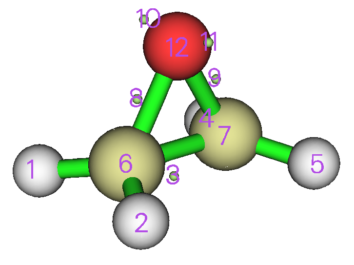

关闭 GUI 窗口，选选项“12 Assign ELF basin labels”，会看到

```text
Basin indices, populations (e), volumes (Angstrom^3) and assigned labels
#    1  Basin    7  Pop.:  2.0953  Vol.:    0.125  Label: C(C1)
#    2  Basin    6  Pop.:  2.0953  Vol.:    0.125  Label: C(C2)
#    3  Basin   12  Pop.:  2.1351  Vol.:    0.043  Label: C(O3)
#    4  Basin   11  Pop.:  2.6773  Vol.:   33.139  Label: V(O3)
#    5  Basin   10  Pop.:  2.6773  Vol.:   33.143  Label: V(O3)
#    6  Basin    9  Pop.:  0.9741  Vol.:    1.471  Label: V(C1,O3)
#    7  Basin    3  Pop.:  1.8936  Vol.:    9.852  Label: V(C1,C2)
#    8  Basin    5  Pop.:  2.1096  Vol.:   82.164  Label: V(C1,H4)
#    9  Basin    4  Pop.:  2.1096  Vol.:   82.154  Label: V(C1,H5)
#   10  Basin    8  Pop.:  0.9741  Vol.:    1.477  Label: V(C2,O3)
#   11  Basin    2  Pop.:  2.1096  Vol.:   83.498  Label: V(C2,H6)
#   12  Basin    1  Pop.:  2.1095  Vol.:   83.498  Label: V(C2,H7)

Number of core basins is     3, their indices:
6,7,12
Number of  1-synaptic basins is     2, their indices:
10,11
Number of  2-synaptic basins is     7, their indices:
1-5,8,9
```

对照自动指定的流域标号和 GUI 窗口中的图，可以确认流域确实被正确标记。

然后输入

```text
-5  // Export basins as cube file
b  // A special mode designed for plotting basin type colored ELF isosurfaces in VMD
10,11  // Indices of the monosynaptic basins, corresponding to the highlighted text above
1-5,8,9  // Indices of the disynaptic basins, corresponding to the highlighted text above
```

现在当前目录下导出了 *basinsyn.cub* 和 *basinfunc.cub*。在 *basinsyn.cub* 中，单突触和双突触流域区域内的值分别为 -1 和 1，其他区域值均为 0。*basinfunc.cub* 记录用于生成流域的实空间函数，即当前情形的 ELF。

把 *basinsyn.cub*、*basinfunc.cub* 和绘图脚本 *examples\scripts\basinsyn.vmd* 移到 VMD 目录。然后启动 VMD，输入 `source basinsyn.vmd` 执行脚本，会看到下图。默认等值面为 0.8，单突触和双突触流域对应的区域分别着绿色和红色，其他流域(本例对应核流域)着白色。

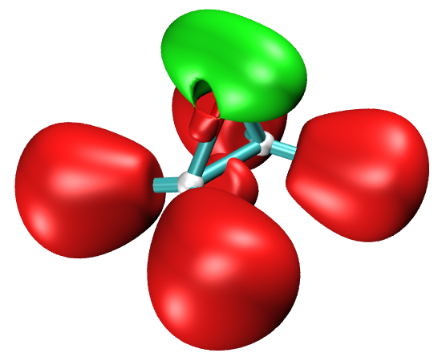

可进入“Graphics”-“Representation”改等值面值，在“Isovalue”文本框输入期望值。在该面板还可调整等值面的材质。若想改不同类型流域的颜色，进入“Graphics”-“Colors”-“Color Scale”改相应选项。

以上展示的绘图方法绝不限于 ELF，可类似用于其他函数，如 LOL、IRI 等。

接下来假设想把上图中的 V(C,H) 流域着为黄色，怎么做？只需让 Multiwfn 导出相应流域的函数值格点数据，画成等值面并直接指定颜色。我们来做，输入以下命令

```text
-5  // Export basins as cube file
c  // Export grid data of function value in the region of specific basins as basinsel.cub file in current folder
1,2,4,5  // Indices of the four V(C,H) basins
0  // In the exported .cub file, if a grid does not belong to the selected basins, its value will be the value you specified here
```

现在当前目录下已生成 *basinsel.cub*。载入 VMD，选“Graphics”-“Representation”，“Drawing Method”设为“Isosurface”，“Coloring Method”改为“Color ID”并选“4 yellow”。再把“Isovalue”改成略小于已有等值面的值以保证覆盖它们(例如本例 0.795，略小于 *basinsyn.vmd* 设的 0.8)，现在可以看到下图，相当满意！

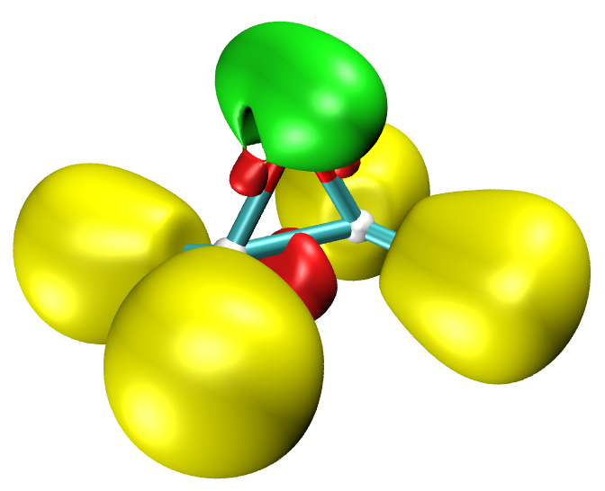
