# **4.18 电子激发分析**

Multiwfn 的主功能 18 非常强大，它是电子激发分析方法的集合，能对电子跃迁特征的方方面面提供非常深入的洞察。本节用实际例子说明其中大多数方法。跟随下面的例子之前，请至少先读[3.21 节](sec-3-21-electron-excitation-analysis.md)开头以了解对输入文件的要求。**虽然所有分析都基于 Gaussian 产生的文件说明，但这些分析绝不限于 Gaussian 用户！**本节说明的大多数分析(如空穴-电子分析)需要参考态的轨道波函数和组态系数，若是 ORCA 用户并想做这些分析，强烈建议读我的博客文章“结合 ORCA 的 TDDFT 计算经由 Multiwfn 做空穴-电子及相关分析的方法”(<http://sobereva.com/758>，中文)。

## **4.18.1 用空穴-电子分析完整表征电子激发**

Multiwfn 的空穴-电子分析模块相当强大，能对各类电子激发给出非常全面的表征。若不熟悉空穴-电子分析的基本理论和思想，请读[3.21.1 节](sec-3-21-electron-excitation-analysis.md#3211-分析并可视化空穴电子分布跃迁密度和跃迁电磁偶极矩密度-1)。空穴-电子分析对输入文件的要求已在[3.21 节](sec-3-21-electron-excitation-analysis.md)开头描述，请仔细核对。下面用两个体系说明空穴-电子分析的用法，第一个是典型的给体-π-受体体系，第二个是典型的配合物。本节的中文版是我的博客文章“使用 Multiwfn 做空穴-电子分析以完整考察电子激发特征”(<http://sobereva.com/434>)，其中还有一个额外例子，即研究 H₂CO 的 Rydberg 激发。

若在工作中用了空穴-电子分析，请不仅引用 Multiwfn 原文，还**要**引用我的工作：*Carbon*, **165**, 461 (2020) DOI: [10.1016/j.carbon.2020.05.023](https://doi.org/10.1016/j.carbon.2020.05.023)，其中在补充信息中简述了空穴-电子分析。

### **4.18.1.1 例子 1：NH₂-biphenyl-NO₂**

本节的例子相当长，请仔细耐心阅读。本节以 NH₂-biphenyl-NO₂ 为例，其几何构型如下。

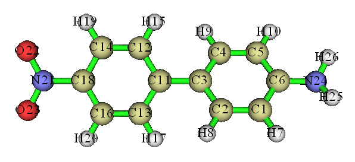

该体系中联苯部分起 π 桥的作用，众所周知硝基和氨基在电子激发中分别起电子受体和给体的作用，因此预期必定有一些电荷转移 (charge-transfer, CT) 态对应电子从氨基一侧到硝基一侧的整体位移。

#### **准备**

这里假设你是 Gaussian 用户(其他量子化学程序的用户也能利用空穴-电子分析)。我们在 B3LYP/6-31G\* 水平优化几何，再用以下设置做 TDDFT 计算(输入文件已提供为 *examples\excit\D-pi-A.gjf*)，计算五个最低单重激发态。注意必须指定 *IOp(9/40=4)*，原因已在[3.21 节](sec-3-21-electron-excitation-analysis.md)开头清楚说明。这里用 CAM-B3LYP 因为它能忠实描述 CT 激发。

```text
%chk=D-pi-A.chk
# CAM-B3LYP/6-31g(d) TD(nstates=5) IOp(9/40=4)
```

计算后把 .chk 文件转为 .fch/fchk 文件，所得 .fchk 文件已提供为 *examples\excit\D-pi-A.fchk*。该任务的输出文件已提供为 *examples\excit\D-pi-A.out*。

#### **考察空穴-电子分析框架中定义的定量指标**

启动 Multiwfn 并输入以下命令

```text
examples\excit\D-pi-A.fchk
18  // Electron excitation analysis
1  // Hole-electron analysis
examples\excit\D-pi-A.out  // In fact you can also press ENTER button directly, because the name of the .out file is identical to the .fchk file and they are in the same folder
1  // Study excitation between ground state (S0) and the first excited state (S1)
1  // Calculate distribution of hole, electron and so on as well as various indices
2  // Medium-quality grid (this is suited for small and medium sized systems. For large systems, you should use at least "high-quality grid", or manually input a proper grid spacing)
```

计算完成后，会在屏幕上看到以下信息。除激发能外的数据都由基于格点的积分算得。显然对同一体系，格点数越多数据精度越好。

```text
 Integral of hole:        1.000343
 Integral of electron:    0.999793
 Integral of transition density:   -0.000033
 Transition dipole moment in X/Y/Z:   0.444063  -0.000186  -0.001753 a.u.
 Sm index (integral of Sm function):   0.27369 a.u.
 Sr index (integral of Sr function):   0.51896 a.u.
 Centroid of hole in X/Y/Z:       -4.531729    0.000425    0.003252 Angstrom
 Centroid of electron in X/Y/Z:   -4.010033    0.001760    0.002643 Angstrom
 D_x:   0.522  D_y:   0.001  D_z:   0.001    D index:   0.522 Angstrom
 Variation of dipole moment with respect to ground state:
 X:   -0.985930  Y:   -0.002523  Z:    0.001150    Norm:    0.985934 a.u.
 RMSD of hole in X/Y/Z:       1.443   1.160   0.437   Norm:   1.902 Angstrom
 RMSD of electron in X/Y/Z:   1.596   0.974   0.634   Norm:   1.974 Angstrom
 Difference between RMSD of hole and electron (delta sigma):
 X:  0.153  Y: -0.186  Z:  0.197    Overall:  0.072 Angstrom
 H_x:  1.520  H_y:  1.067  H_z:  0.536  H_CT:  1.520  H index:  1.938 Angstrom
 t index: -0.998 Angstrom
 Hole delocalization index (HDI):      22.68
 Electron delocalization index (EDI):  17.11
 Ghost-hunter index:    -18.831 eV, 1st term:  8.771 eV, 2nd term:    27.601 eV
 Excitation energy of this state:     3.907 eV
```

输出中，“Integral of hole”和“Integral of electron”分别是空穴和电子在全空间的积分，原则上应恰为 1.0。但由于不可避免的数值积分误差，算得的值与 1.0 有轻微偏离。由于偏离极小，可以说对当前体系的当前激发态，所用格点设置完全足够。

> **注**
>
> 若发现空穴或电子的积分明显偏离 1.0，则输出的指标可能不可靠。有三种可能：(1) 忘了用 *IOp(9/40=3 or 4)* (2) 格点质量太低 (3) 延展距离不够大，因而格点空间区域没有完全覆盖空穴或电子的主要分布区(研究 Rydberg 激发时，总应增大默认延展距离)。

以上输出的其余项依次为：跃迁密度在全空间的积分(理想值为 0)、跃迁电偶极矩、$S_{\mathrm{m}}$ 和 $S_{\mathrm{r}}$ 指标、空穴和电子的质心坐标、$D_{λ}$ 和 *D* 指标、激发态偶极矩相对基态的变化的 X/Y/Z 分量和模、空穴和电子的 RMSD (*σ*)、Δ$σ_{λ}$ 和 Δ*σ* 指标、$H_{λ}$/$H_{\mathrm{CT}}$/*H* 指标、*t* 指标、空穴和电子离域指标、Ghost-hunter 指标、激发能(直接从 Gaussian 输出文件载入)。

> **注**
>
> 注意以上输出的“Ghost-hunter index”与原文定义略有不同，Multiwfn 的实现必定更合理，细节见[3.21.7 节](sec-3-21-electron-excitation-analysis.md#3217-计算-ghost-hunter-指数-7)。第一项表示依赖组态系数和分子轨道能量的部分，第二项对应 1/*D*。ghost-hunter 指标即两项之差。
>
> 以上输出的跃迁偶极矩由跃迁偶极矩密度的均匀分布格点积分得到。也可直接从 Gaussian 输出文件读出，X/Y/Z 分量为 0.4427、-0.0005、-0.0012 a.u.，与 Multiwfn 输出的 0.444063、-0.000186、-0.001753 非常接近。这一观察进一步反映所用格点设置是合适的。

对当前研究的 S0→S1 激发，从以上输出可见 *D* 指标仅 0.522 Å，显然非常小，甚至不到典型 C-C 键长的一半。$S_{\mathrm{r}}$ 指标达 0.519 (理论上限为 1.0)，是很大的值，意味着约一半空穴和电子完美重合。所以，仅考察 $S_{\mathrm{r}}$ 和 *D* 指标就能得出该激发应是典型局域激发 (local excitation, LE)。再看 *t* 指标，总值为 -0.998，远小于 0，意味着空穴和电子分布没有明显分离，进一步意味着该激发应归为 LE 型。

#### **空穴-电子框架中各种实空间函数的可视化研究**

现在屏幕上应能看到后处理菜单。每个选项的含义是不言自明的。请仔细读每个选项。这里选选项 3，会同时看到空穴和电子的分布：

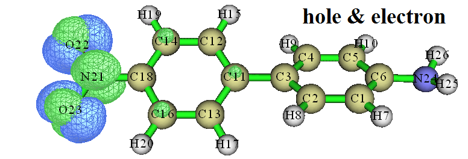

上图中绿色代表电子分布，蓝色代表空穴分布，等值面值设为 0.005。空穴和电子几乎都只出现在硝基，毫无疑问 S0→S1 是 LE 激发，很好验证了基于 *D*、$S_{\mathrm{r}}$ 和 *t* 指标的结论。此外，按以上空穴分布图，空穴看起来由氧的孤对电子轨道组成，因为每个氧每侧有一瓣。电子分布沿硝基有节面，因此可推断电子分布应由 π\* 轨道组成。现在可得出结论，S0→S1 是具有 n→π\* 特征的 LE 激发。

关闭图形窗口并选选项 8 可视化 $C_{\mathrm{hole}}$ 和 $C_{\mathrm{ele}}$，它们分别由空穴和电子分布变换而来以使分布行为更平滑。等值面图如下(为看清楚用了透明风格)。

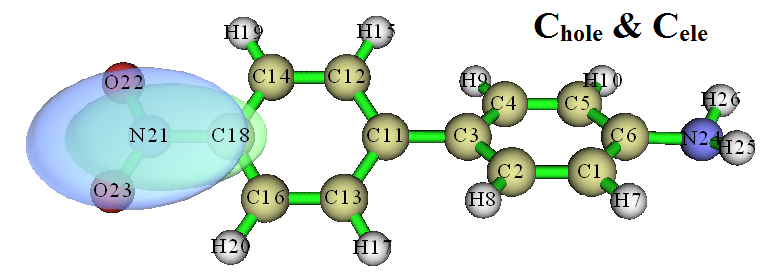

可见 $C_{\mathrm{hole}}$ 和 $C_{\mathrm{ele}}$ 的图明显更直观，非常光滑，不像空穴和电子那样有节面特征。因此很多情况下用 $C_{\mathrm{hole}}$/$C_{\mathrm{ele}}$ 图代替空穴/电子图是好选择。(注：若 GUI 窗口中看不到 $C_{\mathrm{hole}}$ 和 $C_{\mathrm{ele}}$ 的等值面，意味着当前等值面值太大，应逐渐小心减小直到等值面可见)

接下来看看空穴和电子的重叠函数，即 $S_{\mathrm{r}}$ 函数。关闭当前图形窗口，在后处理菜单选选项 4，再选选项 2 显示 $S_{\mathrm{r}}$ 函数，会看到下图(等值面值设为 0.005)

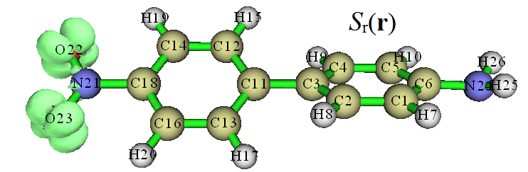

从图可清楚找到空穴和电子显著重叠的位置。可见每个氧周围有四个空穴和电子高度重叠的区域。对照前面展示的空穴和电子等值面，很容易理解 $S_{\mathrm{r}}$ 图为什么长这样。

关闭窗口并选选项 7，会显示激发态与基态间的电荷密度差 (charge density difference, CDD)，见下。该图中，等值面值设为 0.005，绿和蓝分别对应激发态密度相对基态密度的增加和减少。

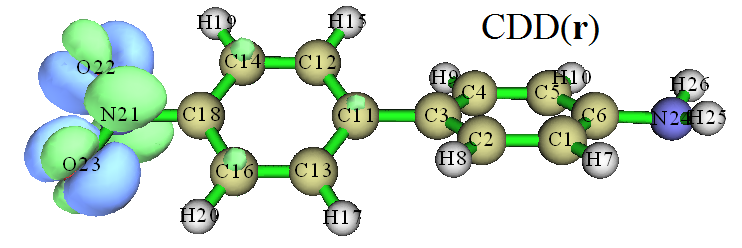

CDD 图与同时显示空穴和电子分布的图(后文称“hole&electron 图”)相似，但也有差别。关键差别是 CDD 图中空穴和电子在其重叠区已大部抵消；相比之下，hole&electron 图中空穴和电子的重叠能被忠实展示。我认为 hole&electron 图比 CDD 图对研究电子激发的内在特征更有用，因为它直接展示空穴和电子的原始分布。

顺便一提，若在后处理菜单选选项 18，程序开始计算空穴和电子间的库仑吸引能(也称激子结合能)。即使对中等体系计算也相当耗时，请耐心等待。最终输出为：

```text
Coulomb attractive energy:    0.287031 a.u.  (    7.810524 eV )
```

**重要提示**：用 VMD 软件只需几步就能绘制质量好得多的上述函数图。强烈建议看[4.A.14 节](sec-4-A-special-topics-and-advanced-tutorials.md#4a14-用vmd脚本将cube文件渲染为最先进水平的等值面图)给出的例子学习怎么做。

#### **考察对空穴和电子的定量贡献**

接下来演示如何计算分子轨道对空穴和电子的贡献。在后处理菜单选选项 0 回到空穴-电子分析界面，选子功能 2 并输入输出阈值。这里输入 *1*，则对空穴或电子贡献高于 1% 的分子轨道会显示在屏幕上：

```text
 MO   52, Occ:   2.00000    Hole:   96.207 %    Electron:    0.000 %
 MO   56, Occ:   2.00000    Hole:    3.415 %    Electron:    0.000 %
 MO   57, Occ:   0.00000    Hole:    0.000 %    Electron:   85.411 %
 MO   59, Occ:   0.00000    Hole:    0.000 %    Electron:   12.222 %
 MO   61, Occ:   0.00000    Hole:    0.000 %    Electron:    2.163 %
 Sum of hole:  100.001 %    Sum of electron:  100.001 %
```

从数据可见 MO52 对空穴绝对主导，高达 96.2%，而电子主要由 MO57 组成，贡献 85.4%。该观察意味着若仅基于 MO52 和 MO57 讨论电子激发，虽然本例电子激发能被定性描述，但仍有不可忽略的偏差。上面显示的“Sum of hole”和“Sum of electron”分别是所有轨道对空穴和电子贡献之和(包括未输出的项)，这两个值原则上应恰为 100%，但目前有 0.001% 误差。这么小的误差完全可忽略，它来自 Gaussian 并非打印了所有组态系数(在 Gaussian 计算中经 *IOp(9/40=4)* 只要求输出大于 0.0001 的组态系数)。

再查看原子或片段对空穴和电子的贡献。在空穴-电子分析界面选子功能 3，再选类 Mulliken 划分，会看到

```text
 The number of non-hydrogen atoms:        16
 Contribution of each non-hydrogen atom to hole and electron:
    1(C )  Hole:  0.19 %  Electron:  0.02 %  Overlap:  0.07 %  Diff.:  -0.17 %
    2(C )  Hole:  0.18 %  Electron:  0.48 %  Overlap:  0.30 %  Diff.:   0.30 %
    3(C )  Hole:  0.59 %  Electron:  0.13 %  Overlap:  0.28 %  Diff.:  -0.46 %
    4(C )  Hole:  0.18 %  Electron:  0.49 %  Overlap:  0.30 %  Diff.:   0.32 %
    5(C )  Hole:  0.19 %  Electron:  0.02 %  Overlap:  0.06 %  Diff.:  -0.18 %
    6(C )  Hole:  0.31 %  Electron:  0.37 %  Overlap:  0.34 %  Diff.:   0.06 %
   11(C )  Hole:  0.15 %  Electron:  4.17 %  Overlap:  0.78 %  Diff.:   4.03 %
   12(C )  Hole:  0.41 %  Electron:  0.14 %  Overlap:  0.24 %  Diff.:  -0.26 %
   13(C )  Hole:  0.37 %  Electron:  0.14 %  Overlap:  0.23 %  Diff.:  -0.23 %
   14(C )  Hole:  0.94 %  Electron:  5.03 %  Overlap:  2.18 %  Diff.:   4.09 %
   16(C )  Hole:  0.92 %  Electron:  5.01 %  Overlap:  2.15 %  Diff.:   4.09 %
   18(C )  Hole: -0.01 %  Electron:  1.16 %  Overlap:  0.00 %  Diff.:   1.17 %
   21(N )  Hole:  2.39 %  Electron: 33.90 %  Overlap:  9.00 %  Diff.:  31.52 %
   22(O )  Hole: 46.18 %  Electron: 24.38 %  Overlap: 33.55 %  Diff.: -21.80 %
   23(O )  Hole: 46.12 %  Electron: 24.39 %  Overlap: 33.54 %  Diff.: -21.73 %
   24(N )  Hole:  0.46 %  Electron:  0.15 %  Overlap:  0.26 %  Diff.:  -0.32 %
```

由于氢原子一般不参与有化学意义的电子激发，只输出非氢原子的信息，包括原子对空穴、电子、空穴-电子重叠、电子-空穴差(即 CDD)的贡献。硝基中原子的编号为 21、22、23，从数据可见硝基的两个氧对空穴贡献最大，两者之和为 2×46.1≈92%。电子的空间离域相对更强，硝基三个原子总共贡献 2×24.4+33.9≈83%，电子的其余部分基本由联苯部分的原子贡献。

虽然空穴和电子的分布特征可通过可视化空穴和电子的等值面图考察，但看到的等值面明显依赖等值面值的选择。所以，仅用一张图不可能完整展示所有区域的空穴和电子分布。相反，上面给出的定量原子贡献是非常确定的。

N21、O22 和 O23 的“Diff.”之和约为 -12%，表明硝基中密度差 (CDD) 的积分值为 -0.12，揭示电子激发中硝基部分失去 0.12 个电子，其中一些转移到联苯部分(若想考察特定片段间的电荷转移量，建议用 IFCT 方法，如[4.18.8 节](#4188-用-ifct-方法和电荷转移矩阵热图研究电子激发中的片段间电荷转移)所示)。

#### **以热图显示原子对空穴和电子的贡献**

也可把原子贡献画成热图，以便立即轻松抓住主要特征。在当前菜单选“4 Set interval between labels in X axis”再输入 *1* 把横坐标步长改为 1，再选“1 Plot hole/electron composition as heat map”，会立即看到下图

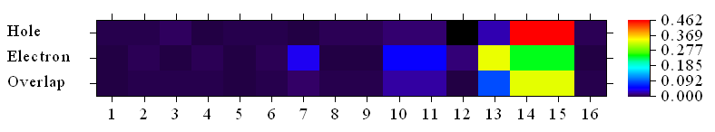

图中横坐标数字是非氢原子的编号。该图用颜色描述每个非氢原子对空穴、电子及其重叠的贡献(如 0.4 对应 40%)。例如，基于前面展示的非氢原子对空穴/电子贡献列表，可知图中横坐标位置 16 实际对应原子 N24。为更方便找到横坐标编号与实际原子编号的对应，可用 GaussView 打开相应 .fch/.gjf/.out 文件，选“Edit”-“Atom List”，再选“Edit”-“Reorder”-“All atoms: Hydrogens Last”，会在 GaussView 看到下图，其中所有氢原子的编号已排到非氢原子编号之后。显然此时分子结构中的原子编号直接对应热图横坐标的编号。

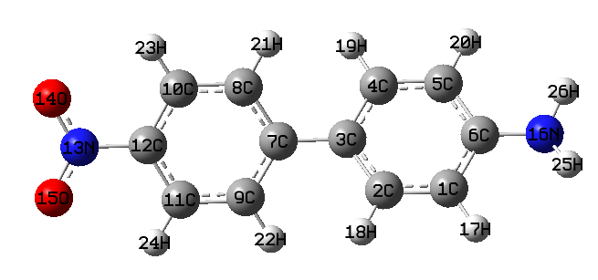

从上图的编号可知热图中位置 13、14、15 对应硝基中的两个氧和一个氮，位置 16 对应氨基中的氮，其余是联苯部分的碳。在热图中，对应空穴的行清楚揭示空穴几乎完全由硝基中的两个氧贡献，因为相应矩阵元为红色(大值)。电子也主要由硝基贡献，但分子其他区域也有不可忽略的贡献，这就是为什么在对应电子的行中，除位置 13\~15 外的矩阵元出现蓝色。对应重叠的行的颜色传达的信息是，硝基氧上空穴和电子有显著重叠，而体系其他区域的重叠远没这么显著。

空穴/电子成分分析界面有许多选项，可用于调整热图的绘制效果、把热图存为图片文件、切换是否把氢原子纳入热图，以及把数据导出到当前目录下的 *he_atm.txt* 以便在 Origin 等其他程序中自己画热图。这些选项这里不一一解释，请自己尝试。

#### **考察片段对空穴和电子的贡献**

上述空穴/电子成分分析界面中的选项“-1 Load fragment definition”很重要，用于载入片段定义，随后显示片段对空穴和电子的贡献，并可画基于片段的热图，使讨论方便得多。这里把体系按以下方式分为四个片段。

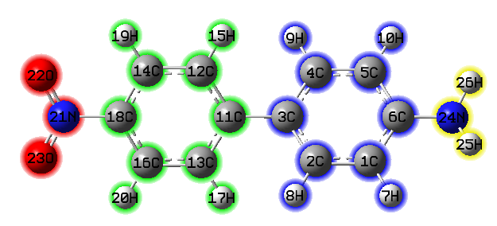

选选项“-1 Load fragment definition”，再输入

```text
4  // Define four fragments
21-23  // The atomic indices of fragment 1 (the nitro group)
11-20  // The atomic indices of fragment 2 (the benzene neighbouring to nitro group)
1-10  // The atomic indices of fragment 3 (the benzene neighbouring to amino group)
24-26  // The atomic indices of fragment 4 (the amino group)
```

会立即看到以下输出

```text
 Contribution of each fragment to hole and electron:
 #  1   Hole: 94.68 %  Electron: 82.67 %  Overlap: 88.47 %  Diff.: -12.01 %
 #  2   Hole:  3.20 %  Electron: 15.67 %  Overlap:  7.09 %  Diff.:  12.47 %
 #  3   Hole:  1.64 %  Electron:  1.53 %  Overlap:  1.59 %  Diff.:  -0.12 %
 #  4   Hole:  0.47 %  Electron:  0.13 %  Overlap:  0.25 %  Diff.:  -0.34 %
```

数据显示 94.68% 的空穴位于硝基，而 82.67% 和 15.67% 的电子分别位于硝基和相邻苯环。硝基上空穴和电子的重叠度约为 90%。由于硝基的“Diff.”为 -12.01%，且当前考察的激发是单电子激发，因此可以说电子激发过程中硝基上的电子减少 0.1201，而与硝基相邻的苯环得到 0.1247 个电子。再者，若想把以上数据表示得更直观，可选选项 1 画基于片段的热图。此时的横坐标对应片段编号，如下所示：

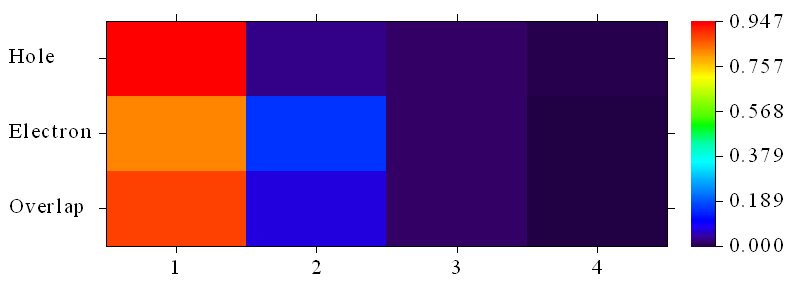

从图可见电子的空间分布范围比空穴大。

#### **所有电子激发的总体比较**

至此，NH₂-biphenyl-NO₂ 体系 S0→S1 激发在空穴-电子框架下的各种分析已全部完成。若还想分析其他激发态，应经选项 0 回到主功能 18 的菜单，重新进入空穴-电子分析功能，再选相应的激发态。这里把该体系计算的五个激发态的 *D*、$S_{\mathrm{r}}$、*H*、*t* 指标和空穴-电子库仑吸引能放在一起。前面没讨论过的空穴离域指标 (HDI) 和电子离域指标 (EDI) 也一并给出：

|       | *D*(Å) | *S*$_{r}$ | *H*(Å) | *t*(Å) | *E*$_{coul}$(eV) | HDI  | EDI  |
|-------|--------|------------|--------|--------|----------------|------|------|
| S0→S1 | 0.52   | 0.52       | 1.94   | -1.00  | 7.81           | 22.7 | 17.1 |
| S0→S2 | 3.48   | 0.65       | 3.15   | 0.56   | 4.71           | 7.2  | 9.5  |
| S0→S3 | 0.57   | 0.55       | 1.70   | -0.68  | 8.54           | 19.7 | 17.2 |
| S0→S4 | 0.97   | 0.87       | 2.88   | -1.55  | 5.56           | 7.0  | 7.0  |
| S0→S5 | 0.54   | 0.87       | 2.93   | -2.06  | 5.56           | 6.9  | 7.1  |

下面是五个激发的 hole&electron 图、$C_{\mathrm{hole}}$ & $C_{\mathrm{ele}}$ 图和 $S_{\mathrm{r}}$ 函数图。等值面值都设为 0.003 a.u.。可见 $C_{\mathrm{hole}}$ & $C_{\mathrm{ele}}$ 图总能以更清楚直观的方式显示 hole&electron 图的主要分布特征。但变换中丢失了许多细节；例如，仅基于 $C_{\mathrm{hole}}$ & $C_{\mathrm{ele}}$ 图不可能确定电子激发的具体类型(如 n-π\*、π-π\*)。

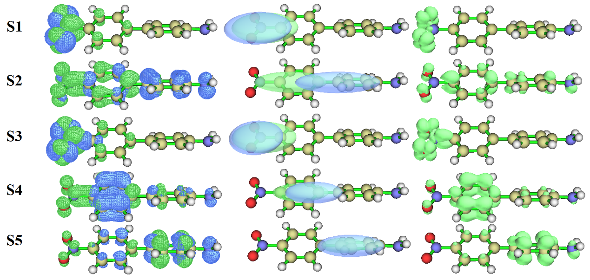

现在对照等值面图一起看这些指标。对 *D* 指标，只有 S0→S2 的值非常大 (3.48 Å)，所以显然可视为 CT 激发。确实，从上图可见蓝色和绿色等值面的中心(即 $C_{\mathrm{hole}}$ 和 $C_{\mathrm{ele}}$ 的质心)距离很大。而其他激发蓝绿等值面中心靠得很近，因而应视为 LE 激发。

再考察 $S_{\mathrm{r}}$ 指标。发现所有激发态的 $S_{\mathrm{r}}$ 指标都相对较大。特别是 S0→S4 和 S0→S5 的值相当大，达 0.87，主要原因是这两个激发是苯环上高度定域的 π-π\* 型激发。值得一提的是，虽然 S0→S1 也是高度定域的激发，但它的 $S_{\mathrm{r}}$ (0.52) 甚至比 CT 激发 S0→S2 的 $S_{\mathrm{r}}$ (0.65) 还小。S0→S1 的 $S_{\mathrm{r}}$ 指标没有预期那么大的原因不难理解。如前所述，S0→S1 表现 n→π\* 特征，孤对电子的主体在 NO₂ 平面上，而 π\* 轨道在 NO₂ 平面有节面，因而空穴和电子的重叠应受限。

接下来看 *H* 指标，它反映空穴和电子平均分布的宽度。从 hole&electron 图可见 S0→S1 和 S0→S3 的空穴和电子都分布在局域区域，这就是为什么它们的 *H* 指标不大。由于 S0 到 S2、S4、S5 激发对应的空穴和电子分布明显比 S0→S1 宽，它们的 *H* 指标明显更大。

可见只有 S0→S2 的 *t* 指标是略正的值，表明空穴和电子分离明显，所以把 S0→S2 视为 CT 激发更合理。S0 到其他激发态对应的 *t* 指标是明显的负值，表明它们的空穴和电子分离程度很低。

对照空穴和电子等值面图，可发现 HDI 和 EDI 指标确实很好量化了空穴和电子空间分布的均匀性(即离域程度)。可见 S0→S1 和 S0→S3 的空穴和电子都高度定域，对应算得的 HDI 和 EDI 大值。相比之下，S0→S2/S4/S5 的空穴和电子分布明显更离域，这点被它们相对小的 HDI 和 EDI 值忠实揭示。

表中给出的空穴-电子库仑吸引能与电子激发特征密切相关，影响最大的因素应是 *D* 指标。很容易理解 *D* 指标越大，空穴和电子主要分布区距离越远，库仑吸引能越弱。从数据确实发现 S0→S2 (唯一的 CT 激发) 的库仑吸引能是五个电子激发中最小的。而 S0→S1 和 S0→S3 激发，由于 *D* 指标很小且按 *H* 指标其空穴和电子的空间范围很窄，不难想象相应的库仑吸引应很强。确实，从前表可见它们的空穴-电子库仑吸引能最负 (-7.81 和 -8.54 eV)。

结合以上等值面图和定量数据，可明确判断五个激发的特征：

- S0→S1：硝基上 n-π\* 型的 LE 激发

- S0→S2：从氨基朝硝基的 π-π\* 型 CT 激发

- S0→S3：与 S0→S1 相同

- S0→S4：发生在与硝基相连苯环上的 π-π\* LE 激发

- S0→S5：发生在与氨基相连苯环上的 π-π\* LE 激发

这里一并给出五个激发所有片段对空穴、电子和重叠贡献的热图。为便于平行比较，所有激发态的颜色标尺统一设为 0.0\~1.0。

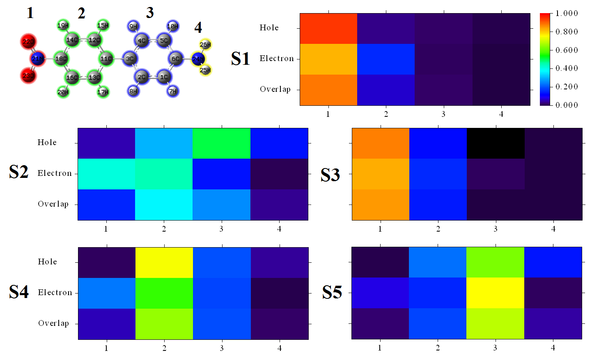

从这些热图，看矩阵元的颜色可立即弄清激发电子从哪来、到哪去。例如，从 S0→S2 的图容易认出激发电子主要来自片段 3 (与氨基相连的苯)，大部分转移到片段 1 (硝基)，较小部分转移到片段 2 (与硝基相连的苯)。再如，从 S0→S4 图可发现激发电子来自片段 2，激发后大部分留在片段 2，但少数转移到片段 1，且片段 2 上空穴和电子的重叠明显高于其他区域。

值得注意的是，电子激发中片段间电荷转移的详细特征用 IFCT 方法能揭示得更好，例子见[4.18.8 节](#4188-用-ifct-方法和电荷转移矩阵热图研究电子激发中的片段间电荷转移)。

#### **在 VMD 中绘制格点数据**

空穴、电子、$C_{\mathrm{ele}}$、$C_{\mathrm{hole}}$ 等的格点数据可经后处理菜单相应选项导出为 cube 文件，再在 VMD 程序中渲染以获得更好的可视化效果。若不知怎么做，请参阅[4.18.3 节](#4183-基于电子密度差分析电子激发中的电荷转移)末尾 VMD 中操作的描述。再者，可先用 VMD 对 $C_{\mathrm{ele}}$ 和 $C_{\mathrm{hole}}$ 画等值面图，再输入如下命令把空穴和电子的质心画成紫色和橙色小球使图形信息更丰富

```tcl
draw color purple
draw sphere {1.411500   -0.007015   -0.025494} radius 0.25 resolution 20
draw color orange
draw sphere {-2.069784   -0.000346   -0.000830} radius 0.25 resolution 20
```

对 S0→S2 激发，以上法在 VMD 中画的图如下

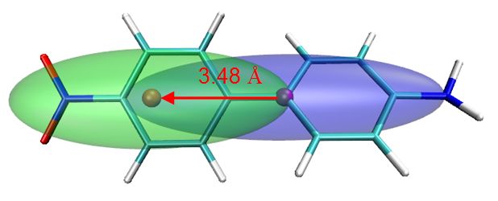

为便于理解，图上加了箭头突出 CT 方向，还标出 *D* 指标使图信息更丰富。

#### **技巧：经脚本一次性获得一系列激发态的各种指标**

用 Linux shell 脚本可一次性获得一系列激发态的各种指标。例如，想获得 S0→S1、S2、S3 激发的全部指标，应把输入文件 *D-pi-A.fchk* 和 *D-pi-A.out* 以及 "examples\excit" 文件夹中的 *all_index.sh* 拷贝到合适文件夹，再在 Linux 终端进入该文件夹，运行 `chmod +x ./batch.sh` 加可执行权限，再运行 *./all_index.sh* 执行脚本。每个激发依次被分析，状态显示在屏幕上直到出现“Finished!”。再打开当前目录下所得的 *result.txt* 文件，会看到

```text
     1  Sr index (integral of Sr function):   0.51896 a.u.
     2  Sr index (integral of Sr function):   0.64906 a.u.
     3  Sr index (integral of Sr function):   0.54538 a.u.

     1  D_x:   0.522  D_y:   0.001  D_z:   0.001    D index:   0.522 Angstrom
     2  D_x:   3.481  D_y:   0.007  D_z:   0.025    D index:   3.481 Angstrom
     3  D_x:   0.574  D_y:   0.001  D_z:   0.001    D index:   0.574 Angstrom

     1  RMSD of hole in X/Y/Z:       1.443   1.160   0.437   Norm:   1.902 Angstrom
     2  RMSD of hole in X/Y/Z:       3.055   0.826   0.740   Norm:   3.251 Angstrom
     3  RMSD of hole in X/Y/Z:       0.984   1.032   0.416   Norm:   1.486 Angstrom
[ignored...]
```

这是所有指标的汇总。可轻松修改脚本满足实际需要，若不熟悉这点，请看[5.3 节](sec-5-3-running-multiwfn-in-batch-mode.md)。

### **4.18.1.2 例子 2：水中的 Ru(bpy₃)²⁺ 阳离子**

下面基于 TDDFT 输出用空穴-电子分析考察水中 Ru(bpy₃)²⁺ 配合物的几个激发态。

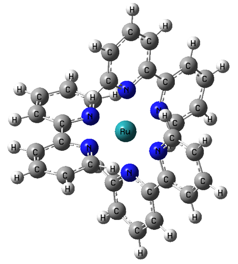

相应的 Gaussian 输入文件已提供为 *examples\excit\Ru(bpy3)2+.gjf*，请用 Gaussian 计算。若想直接获得所得输出文件和 .fchk 文件，可在 <http://sobereva.com/multiwfn/extrafiles/Ru_bpy3_2+_TDDFT.zip> 下载。从 .gjf 文件可见关键词为 *B3LYP/genecp TD(nstates=50) scrf IOp(9/40=3)*，其中 *scrf* 要求 Gaussian 用 IEFPCM 溶剂化模型表示水环境。由于该体系不小，且计算多达 50 个激发态，为避免空穴-电子分析计算时间过高和 Gaussian 输出文件过大，用 *IOp(9/40=3)* 代替上节用的 *IOp(9/40=4)*，此时分析精度仍完全足够。

任意选三个激发态做空穴-电子分析，结果为

|        | *D* (Å) | *S*$_{r}$ | *H* (Å) | *t* (Å) | hole (Ru%) | ele (Ru%) | MLCT(%) |
|--------|---------|------------|---------|---------|------------|-----------|---------|
| S0→S24 | 0.30    | 0.71       | 2.73    | -1.35   | 77.3       | 19.6      | 57.7    |
| S0→S37 | 0.11    | 0.84       | 3.52    | -2.10   | 16.9       | 8.8       | 8.1     |
| S0→S40 | 0.13    | 0.71       | 2.00    | -1.05   | 80.3       | 42.4      | 38.0    |

表中所有 *D* 指标都很小，而所有 $S_{\mathrm{r}}$ 指标都相当大。主要原因是当前分子是对称体系，因而 CT 跃迁是多方向的。表中的 MLCT(%) 表示金属到配体电荷转移特征的百分比，可用空穴中金属的百分比(即 hole(Ru%))减电子中金属的百分比(即 ele(Ru%))轻松算得。注意，严格说得到的是净 MLCT 百分比，它已与 LMCT (配体到金属电荷转移) 有所抵消。

下面是等值面值 0.002 的 S0→S24 激发的 hole&electron 图。由于空穴和电子分布重叠很大，为清楚起见，空穴和电子的等值面分别给出。

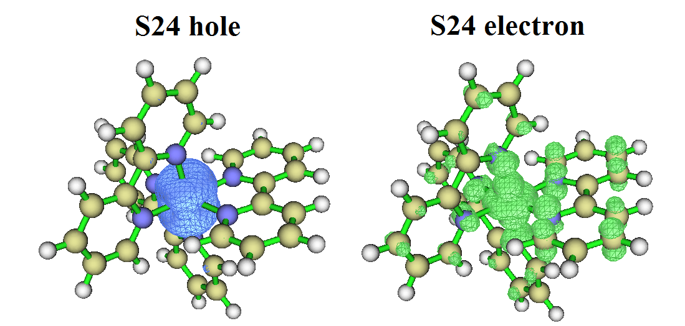

结合图形和表中的定量数据，清楚看到 S0→S24 激发不仅有金属中心 (metal-centered, MC) 特征，即金属的电子激发到金属自身的空轨道，还有明显的 MLCT 特征。如空穴-电子等值面图所示，空穴和电子的主体都在金属上，可见电子的等值面在配体上也有很大部分。算得 MLCT 特征的百分比为 77.3-19.6 = 57.7%，该值应说与空穴-电子等值面图传达的信息非常一致。注：空穴在配体上也有不可忽略的分布，为 100%-77.3% = 22.7%。配体上看不到空穴等值面的原因是该区域其分布非常弥散，只有把等值面值降到更小如 0.0005 才能清楚看到配体上的空穴。

再看 S0→S37 激发。从下图所示空穴-电子等值面图可见空穴和电子的主体都位于其中一个配体，毫无疑问这是 LC (配体中心) 激发，对应电子从配体激发到其自身 π\* 轨道的情形。由于金属上也有空穴和电子分布，该激发也表现一些 MLCT 特征，算得为 16.9% - 8.8% = 8.1%。

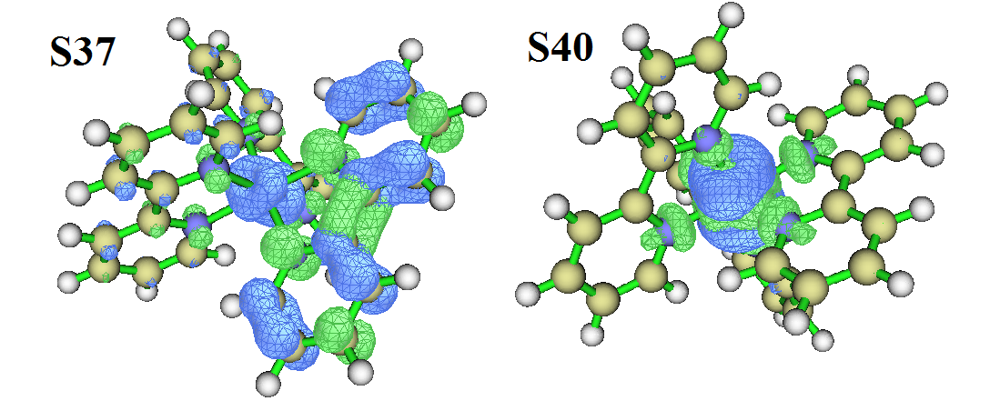

最后看 S0→S40 激发，其空穴和电子等值面在上图右半部分。从空穴等值面和前表所示金属上空穴的百分比 (16.9%) 可知其空穴分布特征与 S0→S24 很相似，但配体上的电子量明显不如 S0→S24，只有极小部分分布在与 Ru 直接配位的四个氮上，所以 S0→S40 的 MLCT 特征明显弱于 S0→S24。相比之下，它的 MC 特征肯定高于 S0→S24。

顺便一提，对配位体系，若想分别获得 MLCT、LMCT、LLCT、MC、LC，应求助于[4.18.8 节](#4188-用-ifct-方法和电荷转移矩阵热图研究电子激发中的片段间电荷转移)说明的 IFCT 分析。

已知 S0 到 S24 和 S40 激发的电子主要来自 Ru 原子，但如何揭示电子从哪些原子轨道激发？虽然从空穴的等值面图多少能判断，但仍有主观性。为弄清，可计算基函数对空穴和电子的贡献。例如，进入空穴-电子分析功能并选第 40 个激发态后，选“4 Show basis function contribution to hole and electron”再输入输出阈值如 *2*，则对空穴或电子贡献高于 2% 的基函数的信息会被打印：

```text
   Basis  Type    Atom    Shell     Hole      Electron     Overlap      Diff.
    22    D 0      1(Ru)   12     23.81 %      0.00 %      0.33 %    -23.81 %
    23    D+1      1(Ru)   12      8.90 %     13.63 %     11.01 %      4.72 %
    24    D-1      1(Ru)   12      9.06 %     25.12 %     15.09 %     16.05 %
    25    D+2      1(Ru)   12     13.96 %      6.94 %      9.84 %     -7.02 %
    26    D-2      1(Ru)   12     14.06 %     15.57 %     14.80 %      1.51 %
    27    D 0      1(Ru)   13      3.66 %      0.00 %      0.06 %     -3.66 %
    30    D+2      1(Ru)   13      2.32 %     -0.01 %      0.00 %     -2.32 %
    31    D-2      1(Ru)   13      2.33 %     -0.03 %      0.00 %     -2.35 %
 Sum of above printed terms:      78.10 %     61.22 %                 16.88 %
```

从数据可见对空穴的主要贡献是 Ru 原子的 D 基函数。当前用的 SDD 赝势基组对 Ru 只描述 4*s*、4*p*、4*d* 和 5*s* 电子，所以 S0→S40 激发的激发电子必定来自 4*d* 原子轨道。对电子有贡献的 Ru 基函数也是 D 型。因此，现在知道 S0→S40 中的 MC 成分对应 Ru 上的 *d*-*d* 跃迁。

> **注**
>
> 注意这不是确定激发电子从哪些轨道来、到哪些轨道去的唯一方法，例如也可用 Multiwfn 做 NTO 分析并查看本征值最大 NTO 对的形状。但若所研究的电子激发不能被任何 NTO 对很好描述，该方法就行不通。相比之下，空穴-电子分析没有任何局限。

## **4.18.2 跃迁密度(矩阵)与跃迁偶极矩密度(矩阵)分析的说明**

跃迁密度和跃迁偶极矩密度是电子激发分析涉及的非常重要物理量，它们可用空穴-电子模块以实空间函数形式研究，或以着色矩阵图(也称热图)形式在 Hilbert 空间研究。[4.18.2.1 节](#41821-在实空间分析跃迁密度和跃迁偶极矩密度)、[4.18.2.2 节](#41822-绘制并分析跃迁密度矩阵-tdm)和[4.18.2.3 节](#41823-绘制并分析跃迁偶极矩矩阵) 的例子将说明这些分析。此外，虽然通常研究的跃迁是从基态到激发态，但两激发态之间的这些量在一些特殊研究中也有用，[4.18.2.4 节](#41824-研究激发态之间的跃迁密度和跃迁密度矩阵)将提到如何实现。

关于这些话题的更多讨论见我的博客文章：“使用 Multiwfn 绘制跃迁密度矩阵和电荷转移矩阵研究电子激发特征”(中文，<http://sobereva.com/436>)。

### **4.18.2.1 在实空间分析跃迁密度和跃迁偶极矩密度**

跃迁密度的实空间函数形式即 *T*(**r**) 的理论已作为[3.21.1.1 节](sec-3-21-electron-excitation-analysis.md#32111-理论)的“理论 4”介绍，*T*(**r**) 的等值面图能揭示空穴和电子间明显的相干区。而跃迁电偶极矩密度的实空间函数形式即 $T_{\mathrm{x}}(\mathbf{r})$、$T_{\mathrm{y}}(\mathbf{r})$ 和 $T_{\mathrm{z}}(\mathbf{r})$ 能展示各区域对跃迁电偶极矩 ( $D_{\mathrm{x}}$、$D_{\mathrm{y}}$、$D_{\mathrm{z}}$ ) 的贡献，这点已作为[3.21.1.1 节](sec-3-21-electron-excitation-analysis.md#32111-理论)的“理论 5”介绍。本节以 N-苯基吡咯为例说明这类分析，所用文件与[4.18.1 节](#4181-用空穴-电子分析完整表征电子激发)例子用的完全相同。

启动 Multiwfn 并输入

```text
examples\excit\N-phenylpyrrole.fch  // The .fch file yielded by Gaussian TDDFT task
18  // Electron excitation analysis
1  // hole-electron analysis module
examples\excit\N-phenylpyrrole.out  // The output file of Gaussian TDDFT task with IOp(9/40=4) keyword
1  // Analyze electron transition from ground state to the 1st excited state (S0→S1)
1  // Visualize and analyze hole, electron, transition density and so on
2  // Medium-quality grid
```

现在在输出中找到以下信息，它们是基于格点数据积分算得的 $D_{\mathrm{x}}$、$D_{\mathrm{y}}$ 和 $D_{\mathrm{z}}$

```text
Transition dipole moment in X/Y/Z:  -0.000021  -0.000045   1.767332 a.u.
```

值得注意的是，这些值与 Gaussian 输出文件中打印的非常接近，如下(*N-phenylpyrrole.out* 第 773 行)，表明当前所用格点质量足够好

```text
       state          X           Y           Z        Dip. S.      Osc.
         1         0.0000      0.0000      1.7813      3.1729      0.3935
...[ignored]
```

在后处理菜单选选项 5 显示跃迁密度的等值面，会看到下图所示图像中的左图，它展示实空间表象的跃迁密度。若把跃迁密度乘以 Z 坐标变量的负值，就得到跃迁偶极矩密度的 Z 分量即 $T_{\mathrm{z}}(\mathbf{r})$。为可视化它，关闭当前 GUI 窗口并选“6 Show isosurface of transition dipole moment density”再选“3: Z component”，会看到下图右图

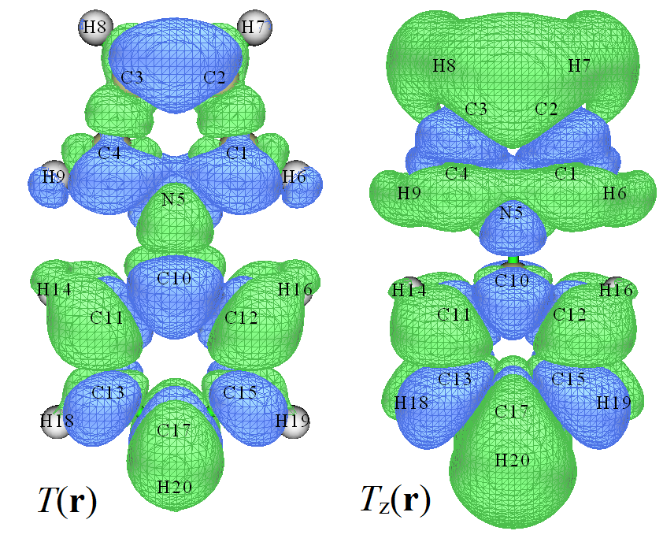

从以上 *T*(**r**) 图可见空穴和电子处处有强相干，意味着空穴和电子的分布都覆盖整个分子(这可通过可视化空穴和电子分布进一步轻松确认，如[4.18.1 节](#4181-用空穴-电子分析完整表征电子激发)所示)。从上图右图可见其正部(绿)明显大于负部(蓝)，回想 $T_{\mathrm{z}}(\mathbf{r})$ 在全空间的积分恰为跃迁电偶极矩的 Z 分量 ( $D_{\mathrm{z}}$ )，该观察解释了为什么 S0→S1 的 $D_{\mathrm{z}}$ 是很大的正值 (1.7813 a.u.)。若有兴趣，可试画 $T_{\mathrm{x}}(\mathbf{r})$ 或 $T_{\mathrm{y}}(\mathbf{r})$ 图以解释所研究的电子激发为什么 $D_{\mathrm{x}}$ 和 $D_{\mathrm{y}}$ 为零。

重要的是注意，当前体系的 S0→S1 比较特殊，即其跃迁电偶极矩矢量 (**D**) 恰指向 Z 轴。但对大多数实际情况，**D** 不平行于三个笛卡尔轴中任何一个，此时不能直接用 $T_{\mathrm{x}}(\mathbf{r})$、$T_{\mathrm{y}}(\mathbf{r})$ 或 $T_{\mathrm{z}}(\mathbf{r})$ 中任何一个的可视化研究其来源。幸运的是，把分子重新取向使 **D** 恰指向选定的笛卡尔轴相当容易，从而使以上分析可行。做法见[4.A.7 节](sec-4-A-special-topics-and-advanced-tutorials.md#4a7-直观揭示不同区域的电子相关)的[附录 2](sec-6-2-the-routines-for-evaluating-real-space-functions.md)。

接下来查看 S0→S4 激发的 $T_{\mathrm{z}}(\mathbf{r})$ 等值面。先回到主功能 18 的菜单，再重复以上步骤，最后会看到

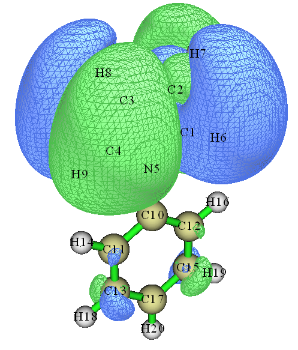

绿蓝等值面占据同样大小的空间，表明对 $D_{\mathrm{z}}$ 的正负贡献恰相同，这就是为什么 S0→S4 的 $D_{\mathrm{z}}$ 为零。注意 $T_{\mathrm{z}}(\mathbf{r})$ 几乎只分布在吡咯区，这是因为该电子激发对应吡咯部分的局域激发(如[4.18.1 节](#4181-用空穴-电子分析完整表征电子激发)所示)。

你可能已觉得跃迁偶极矩密度的可视化研究有趣有用；确实，经由该方法可清楚识别分子不同区域对跃迁偶极矩的贡献。*T*(**r**) 以及 $T_{\mathrm{x}}(\mathbf{r})$、$T_{\mathrm{y}}(\mathbf{r})$ 和 $T_{\mathrm{z}}(\mathbf{r})$ 的 cube 文件可经后处理菜单导出，以便用 VMD 等其他可视化软件绘制([4.A.14 节](sec-4-A-special-topics-and-advanced-tutorials.md#4a14-用vmd脚本将cube文件渲染为最先进水平的等值面图))，或用流域分析模块([3.20 节](sec-3-20-basin-analysis.md))或域分析模块([3.200.14 节](sec-3-200-other-functions-part-2.md#320014-域分析求函数等值面内的性质))进一步定量其分布，或经主功能 4 画成平面图(用基于载入格点数据的插值函数，即用户自定义函数 -1)。

#### **可视化跃迁磁偶极矩密度**

上面讨论的跃迁偶极矩是跃迁**电**偶极矩。还有其他种类的跃迁偶极矩，如跃迁**速度**偶极矩和跃迁**磁**偶极矩。Multiwfn 也能计算跃迁磁偶极矩并绘制相应密度的等值面图，相关知识见[3.21.1 节](sec-3-21-electron-excitation-analysis.md#3211-分析并可视化空穴电子分布跃迁密度和跃迁电磁偶极矩密度-1)的“理论 5”。由于该量不如跃迁电偶极矩重要，我不深入讨论，只给简单例子。用 N-苯基吡咯的 .out 和 .fch 文件，先进入空穴-电子模块并选第二个激发态，再输入

```text
-1  // By default, transition magnetic dipole moment density is not calculated by option 1 of hole-electron module for saving time, we select this option now to make option 1 also calculate this quantity
1  // Visualize and analyze hole, electron, transition density and so on
2  // Medium-quality grid
```

计算完成后，从屏幕可知基于格点数据算得的跃迁磁偶极矩：

```text
      Transition magnetic dipole moment in X/Y/Z: -0.503315  0.000119 -0.000177 a.u.
```

再选选项 9 并选感兴趣的跃迁磁偶极矩密度分量，之后会看到相应的等值面图。下图是在等值面值 0.005 下画的跃迁磁偶极矩密度的 X 分量。与绿色区域相比蓝色区域相对更大，解释了为什么跃迁磁偶极矩的 X 分量是负值 (-0.503 a.u.)。

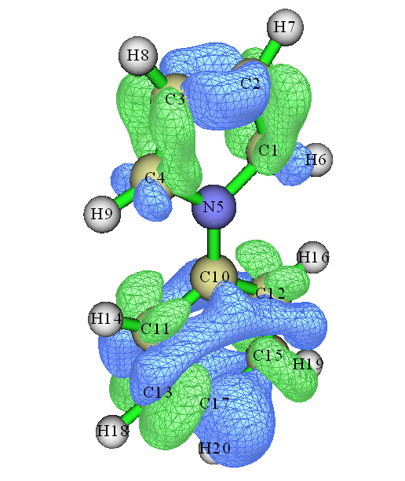

### **4.18.2.2 绘制并分析跃迁密度矩阵 (TDM)**

> **注**
>
> 有视频演示用 Multiwfn 和 Origin 绘制跃迁密度矩阵的步骤，见 <https://youtu.be/JPlZk4Aa6bQ>。

跃迁密度矩阵 (transition density matrix, TDM) 已在[3.21.2 节](sec-3-21-electron-excitation-analysis.md#3212-把各种原子片段跃迁矩阵绘制为热图-2)仔细介绍，TDM 热图对理解电子激发的本质特别有用，请先读[3.21.2 节](sec-3-21-electron-excitation-analysis.md#3212-把各种原子片段跃迁矩阵绘制为热图-2)。本节用给体-π-受体型线形体系的 TDM 热图分析其跃迁特征。分子结构如下。

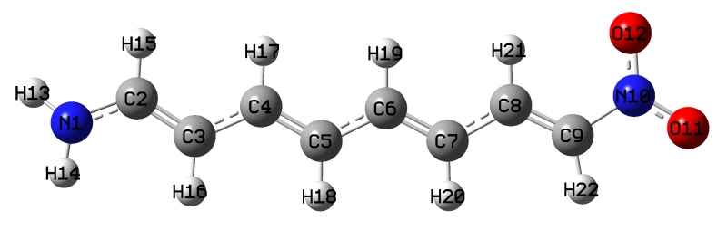

Gaussian 输出文件和 .fchk 文件在 "examples\excit\NH2_C8_NO2" 文件夹，关键词为 *CAM-B3LYP/6-31G\* IOp(9/40=4) TD(nstates=10)*。

值得注意的是，TDM 与空穴-电子分析框架中定义的电荷转移矩阵密切相关。绘制电荷转移矩阵热图的例子在[4.18.8.2 节](#41882-画电荷转移矩阵热图以直观理解电子激发的本质)给出。通常 TDM 和电荷转移矩阵的热图彼此非常相似，传达基本相同的信息。

#### **原子跃迁密度矩阵**

首先绘制“原子 TDM”热图，即 TDM 的编号对应原子编号。通常这种图只适合研究当前分子这类链状体系，否则热图中的编号很难映射到分子中的实际原子。对形状更复杂的体系，一般应画“片段 TDM”，后面会讲。

注意在“原子 TDM”中通常忽略氢，因为它们很少对有化学意义的激发有贡献。因此，在当前分子的激发态计算之前，氢的编号已移到重原子之后。从上图所示分子结构图可见重原子的范围是 1\~12，氢的范围是 13\~22。

这里先研究该体系的 S0→S1 跃迁。下面用的 fchk 和 .out 文件用 *CAM-B3LYP/6-31G\* IOp(9/40=4) TD(nstates=10)* 关键词产生。启动 Multiwfn 并输入

```text
examples\excit\NH2_C8_NO2\NH2_C8_NO2.fchk
18  // Electron excitation analysis
2  // Plot heat map of transition matrix
examples\excit\NH2_C8_NO2\NH2_C8_NO2.out
1  // Study transition between ground state to the 1st excited state. Then Multiwfn will calculate corresponding TDM
n  // Do not diagonalize the newly generated TDM, because TDM in original form carries more useful information
1  // As mentioned in Section 3.21.2, there are several ways that can contract the TDM (represented in basis functions) to atom TDM. Here we use way 1. Way 2 and way 3 can also be used and can result in similar maps, while way 4 is usually deprecated
1  // Plot heat map
```

下图立即显示在屏幕上，粉色线是手动加的以突出对角线，“hole”和“electron”文字也是手动标注的。默认颜色标尺下限为 0，上限为最大矩阵元。

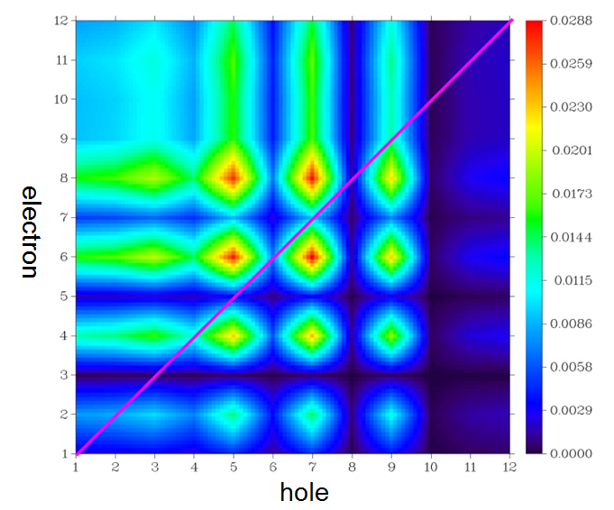

电子激发可视为空穴→电子跃迁。如[3.21.2 节](sec-3-21-electron-excitation-analysis.md#3212-把各种原子片段跃迁矩阵绘制为热图-2)介绍的，TDM 热图的对角项可反映空穴和电子在哪些原子同时有大分布。对非对角元，应先看 X 轴(对应空穴位置)再看 Y 轴(对应电子位置)，就能认出电子在不同位置间如何转移。在本例 TDM 图中，对角大多数元被绿或红色包围，因此该激发必是全局激发，即激发电子分布在整个体系。矩阵元关于对角线不对称，可清楚看到图左上部分大于右下部分，特别是对角线附近的元相对较大。该观察揭示非氢原子上的电子转移到相邻原子，更具体说，编号小的原子上的电子倾向于转移到编号大的原子。由于非氢原子的编号从氨基端排到硝基端，因而可推断该 S0→S1 激发使电子整体从氨基端移向硝基端。

若觉得以上文字难理解，可把 TDM 图与下面的 hole&electron 等值面图比较(怎么画见[4.18.1 节](#4181-用空穴-电子分析完整表征电子激发))。可发现 TDM 热图和等值面图传达相似信息，可确认基于 TDM 图得出的所有结论。

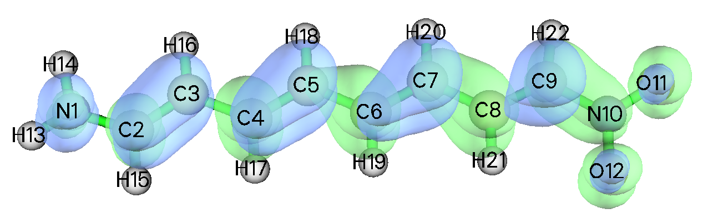

若想画其他激发态的 TDM 热图，可退出热图绘制功能，再重新进入该功能并选要研究的态。值得注意的是，若选选项“4 Toggle if taking hydrogens into account”一次把状态切换到“Yes”再重画，会看到下图

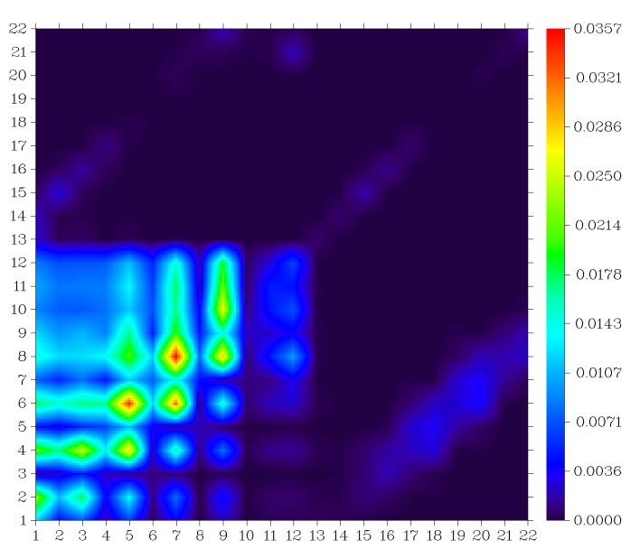

氢的编号范围是 13-22，上图表明氢确实不明显参与电子激发，因为它们的元很小(显示为紫色)，显然把氢纳入 S0→S1 TDM 热图没有意义。

再看另一个激发 S0→S2。热图和 hole&electron 等值面图如下。

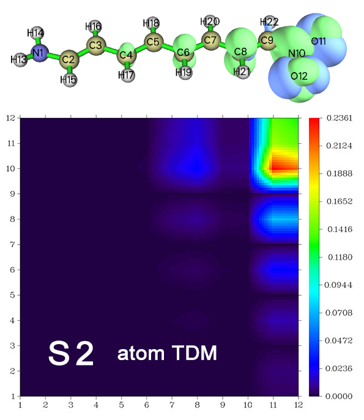

热图右上角有大值区，对应体系末端的硝基，因此空穴和电子必定在该区域同时有大分布。此外，图像最右列的非对角元的值不是很小，所以可认为硝基向体系中部转移了一定量电子，这与 hole&electron 等值面图看到的现象一致。该观察也可描述为 S0→S2 激发中硝基部分与体系中间区域存在所谓“相干”。

#### **片段跃迁密度矩阵**

下面绘制基于片段的 TDM 热图，即图的编号对应自定义片段的编号。这种 TDM 图的优点是所研究的体系不一定是线形的，任何形状的体系(如环形、星形)也能轻松考察。

接下来要考察的体系如下，分子分为五个片段，用不同颜色表示。Gaussian 输入、输出和 fchk 文件以及下文涉及的其他文件可在 <http://sobereva.com/attach/436/file.rar> 下载。

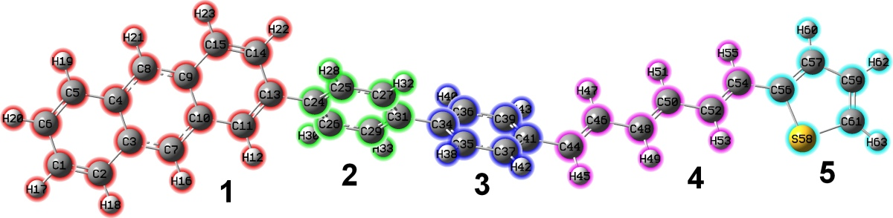

先研究 S0→S1 激发。启动 Multiwfn 并输入

```text
tdmat.fchk
18  // Electron excitation
2  // Plot heat map of transition matrix
tdmat.out
1  // Study S0→S1 excitation
n  // Do not symmetrize the newly generated TDM
1  // Use the way 1 to contract the TDM represented in basis functions to atom TDM
```

现在可选选项 1 画原子 TDM。但目前的目的是画片段 TDM。为此，可创建纯文本文件(已在 *file.rar* 包中提供为 *tdmfrag.txt*)，其每行定义一个片段，本例文件内容为

```text
1-23
24-33
34-43
44-55
56-63
```

注意也可用如 2,5-8,12-15,20 把一批编号不连续的原子定义为一个片段。

再输入以下命令

```text
-1  // Define fragments
0  // Load fragment definition from an external file (as prompted, you can also directly input atom indices)
tdmfrag.txt  // The file containing fragment definition
5  // Modify range of color scale
0,0.4  // Lower and upper limit
1  // Plot heat map
```

现在看到下图，其编号对应片段编号，hole&electron 等值面图也一并给出以便比较。蓝框标出的区域是第 4 片段(己三烯)。

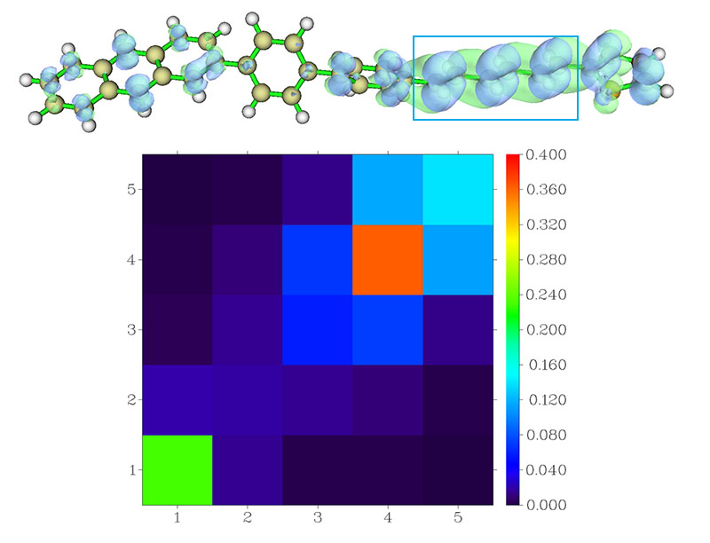

按热图中的颜色可知电子和空穴主要分布在片段 4，但片段 1 和 5 上也同时出现一些，这些发现与等值面展示的情况一致。由于图中没有相当大的非对角元，当前电子激发没有导致各片段间明显的电子转移。粗略说，该激发的主要特征是片段 4 上的局域激发。

类似地，绘制基态与 S2\~S7 激发态之间的片段 TDM，所得图一起展示如下

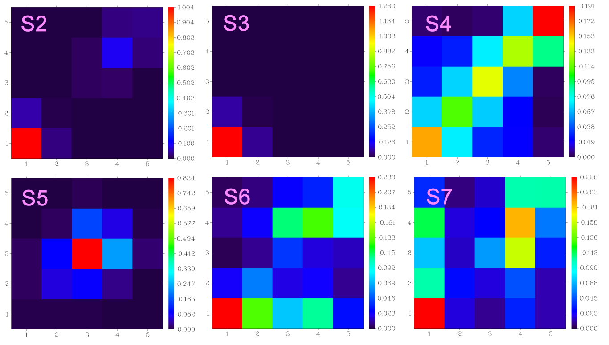

S0→S2\~S5 图中非对角元的值相对其对角元不显著，因此片段间电子转移应不明显。按对角项可发现 S0→S2 和 S0→S3 的跃迁主要发生在片段 1，而 S0→S2 还略涉及片段 4。一般两个跃迁都可视为局域激发。S0→S4 显然是全局激发，因为所有对角项都很显著。S0→S5 的主要特征是片段 3 (对应苯环) 上的局域激发，但其相邻片段也多少参与。S0→S6 和 S0→S7 某种程度互为镜像，从图可见几乎每个片段都在电子激发中参与，要么被空穴分布占据，被电子分布占据，或两者兼有。对 S0→S6，可推测片段 2、3、4 向片段 1 转移了一定量电子，因为 (1,2)、(1,3) 和 (1,4) 元很大，同时片段 3 和 5 也向片段 4 转移了一些电子。

上图和讨论明显表明，写文章时若想同时讨论从基态到大量激发态的跃迁特征，直接给出包含所有激发 TDM 热图的图非常直观。

#### **技巧：用 shell 脚本批量绘制一批激发态的 TDM 热图**

若想用 TDM 热图研究一批激发态，而觉得逐个画图费力，可用 Linux shell 脚本把该过程全自动化。

一次性生成指定范围激发态的片段 TDM 热图的脚本是 *examples\scripts\allTDM.sh*。例如，把上例用的 *tdmat.fchk*、*tdmat.out*、*tdmfrag.txt* 和 *allTDM.sh* 放到 Multiwfn 目录再进入该文件夹，运行 `chmod +x allTDM.sh` 加可执行权限，再运行 *./allTDM.sh*，该脚本会自动调用 Multiwfn 在当前目录生成 *1.png*、*2.png*……直到 *7.png*，它们分别对应 S0→S1、S0→S2……到 S0→S7 的 TDM 热图。整个过程转眼完成，显然用脚本极方便。

### **4.18.2.3 绘制并分析跃迁偶极矩矩阵**

事实上，上节说明的热图绘制功能是通用模块，也能绘制其他种类的原子或片段矩阵。在[3.21.11 节](sec-3-21-electron-excitation-analysis.md#32111-把跃迁电磁偶极矩分解为基函数和原子贡献-11)引入了原子跃迁偶极矩矩阵 (atom transition dipole moment matrix, atom TDMM) 的概念。该矩阵有 X、Y、Z 三个分量。例如，X 分量矩阵所有元之和恰对应跃迁偶极矩的 X 分量。因此，把 TDMM 画成热图，就能弄清哪些原子或片段对跃迁偶极矩有显著贡献。
下面仍用[4.18.2.2 节](#41822-绘制并分析跃迁密度矩阵-tdm)的给体-π-受体为例展示如何把 TDMM 画成热图。Multiwfn 既能画跃迁电偶极矩矩阵也能画跃迁磁偶极矩矩阵，本节限于前者。

首先需要生成含原子 TDMM 的文件。启动 Multiwfn 并输入

```text
examples\excit\NH2_C8_NO2\NH2_C8_NO2.fchk
18  // Electron excitation analysis
11  // Decompose transition dipole moment as basis function and atom contributions
examples\excit\NH2_C8_NO2\NH2_C8_NO2.out
1  // Study S0→S1 excitation
1  // The transition dipole moment to be studied is "electric"
y  // Export atom TDMM
```

如屏幕所示，矩阵已导出到当前目录下以 "AAtrdip" 为前缀的 .txt 文件，其中 *AAtrdipX.txt* 含原子 TDMM 的 X 分量。接下来基于该矩阵画热图。

重启 Multiwfn 并输入

```text
o  // Load the file last time loaded
18  // Electron excitation analysis
2  // Plot heat map of transition matrix
AAtrdipX.txt
```

现在屏幕上看到以下信息

```text
 Sum of all elements (including hydrogens):     -4.38875223
 Maximum and minimum (including hydrogens):      0.65818572     -0.82543408
 Sum of all elements (without hydrogens):       -2.86353889
 Maximum and minimum (without hydrogens):        0.65818572     -0.82543408
```

其中 -4.38875223 即 S0→S1 激发的跃迁电偶极矩的 X 分量，与 Gaussian 输出文件中能找到的值相同。

如以上提示所示，该矩阵的最小值是负值 -0.825，但当前功能颜色标尺的下限默认为 0，因此必须改颜色标尺，最好使下限和上限绝对值相同。可反复尝试找到使图像最能反映矩阵特征的值。若范围太窄，超出颜色标尺上下限的部分分别显示为白和黑，不美观。若范围太宽，矩阵元的差别很难用颜色区分。

现在在 Multiwfn 输入以下命令

```text
5  // Modify range of color scale
-0.7,0.7  // Lower and upper limits
1  // Plot heat map
```

立即看到下图。为更好理解热图，还一同展示 X 分量的跃迁偶极矩密度的等值面(怎么画见[4.18.2.1 节](#41821-在实空间分析跃迁密度和跃迁偶极矩密度))

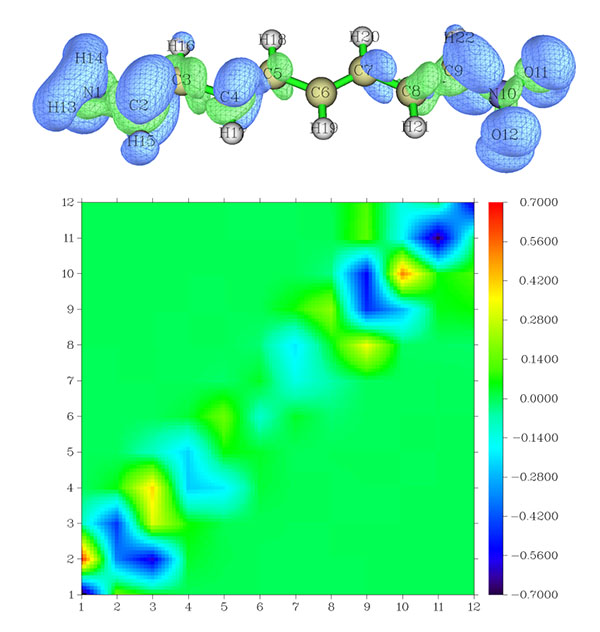

该热图越蓝(越红)的矩阵元对 X 分量跃迁偶极矩的负(正)贡献越大。由于热图大多数部分是蓝色，所有矩阵元之和必为负，解释了为什么跃迁偶极矩的 X 分量是显著的负值 (-4.388 a.u.)。由于远离对角线的所有矩阵元都非常接近 0 (显示为绿色)，原子间的长程耦合对 X 分量跃迁偶极矩没有实质贡献。图中有几处显示非常蓝的区域，如 (2,2) 和 (9,9) 附近，表明相应原子及相邻原子有显著的负贡献，这点在跃迁偶极矩密度的等值面图中也清楚反映。有些位置如 (1,2) 明显为正，意味着两原子间的耦合对 X 分量跃迁偶极矩有显著的正贡献，这也是为什么等值面图中原子 1 和 2 之间有绿色等值面。图的中部基本是绿色，表明该值很小；相应地，等值面图中分子中部没有等值面。

可见把跃迁偶极矩密度和跃迁偶极矩矩阵结合起来有助于阐明跃迁偶极矩的内在特征。

也可基于片段编号画 TDMM，这很简单，不再进一步说明。要做的只是在热图绘制功能中定义片段再画图(请回顾[4.18.2.3 节](#41823-绘制并分析跃迁偶极矩矩阵))。

### **4.18.2.4 研究激发态之间的跃迁密度和跃迁密度矩阵**

前几节说明了如何用跃迁(偶极矩)密度实空间函数和跃迁(偶极矩)密度矩阵研究基态与激发态之间的跃迁特征。事实上，这类研究也可用于分析两激发态之间的跃迁，此类分析在特殊应用中可能有用，如瞬态吸收光谱和双光子过程。本节展示如何实现这些分析。

#### **激发态之间跃迁密度的实空间函数分析**

如[4.18.2.1 节](#41821-在实空间分析跃迁密度和跃迁偶极矩密度)所示，Multiwfn 能轻松生成基态与选定激发态之间跃迁密度的格点数据。事实上，两激发态之间的跃迁密度也能生成。为此，应先生成两态之间的跃迁密度矩阵 (TDM)，但由于 Multiwfn 中所有与实空间函数相关的分析都基于轨道，还需把 TDM 变换为相应的自然轨道。最后，基于这些自然轨道算得的电子密度直接对应跃迁密度。

这里以 N-苯基吡咯的 S2→S3 跃迁为例，下述步骤生成相应跃迁密度的 cube 文件。启动 Multiwfn 并输入

```text
examples\excit\N-phenylpyrrole.fch
18  // Electron excitation analysis
9  // Generate and export transition density matrix
2  // Generate transition density matrix between (TDM) two excited states
examples\excit\N-phenylpyrrole.out
2,3  // Assume that you want to analyze S2→S3 transition
[Press ENTER button directly to use default threshold]
y  // Symmetrize the resulting TDM in usual way
y  // Export present wavefunction information including the newly generated TDM to TDM.fch in current folder
```

重启 Multiwfn 并输入

```text
TDM.fch
200  // Other function, part 2
16  // Generate natural orbitals based on the density matrix in .fch/.fchk file
SCF  // We input this because the "Total SCF Density" field in the TDM.fch currently correspond to S2→S3 TDM
y  // Export new.mwfn, which contains natural orbitals corresponding to S2→S3 TDM, and then let Multiwfn directly load it
0  // Return to main menu
5  // Calculate grid data
1  // Electron density
2  // Medium-quality grid
2  // Export cube file
```

现在当前目录下生成的 *density.cub* 记录 S2 与 S3 之间的跃迁密度，也可直接选选项 -1 可视化等值面。

也可能生成激发态之间跃迁偶极矩密度的格点数据。例如，若把 *settings.ini* 中的“iuserfunc”参数设为 22，即把用户自定义函数设为 $-x\rho(\mathbf{r})$，则用前面生成的 *new.mwfn* 为输入文件时，用户自定义函数对应 S2→S3 跃迁的跃迁偶极矩密度的 X 分量。显然，接下来要做的就是计算用户自定义函数的格点数据。

#### **激发态之间跃迁密度矩阵的热图**

这里用[4.18.2.2 节](#41822-绘制并分析跃迁密度矩阵-tdm)的 *NH2-C8-NO2.fchk* 和 *NH2-C8-NO2.out* 为例说明如何绘制任意选定的两激发态 S1 和 S2 之间跃迁密度矩阵的热图。

启动 Multiwfn 并输入

```text
examples\excit\NH2_C8_NO2\NH2_C8_NO2.fchk
18  // Electron excitation analysis
9  // Generate transition density matrix
2  // For two excited states
examples\excit\NH2_C8_NO2\NH2_C8_NO2.out
1,2  // The states are chosen as S1 and S2
[Press ENTER button to use default threshold]
0  // Do not symmetrize the resulting TDM
n  // Do not yield TDM.fch
```

现在当前目录下有 *tdmat.txt*，记录 S1→S2 的 TDM。

重启 Multiwfn 再输入

```text
o  // Load the file last time loaded
18  // Electron excitation analysis
2  // Plot heat map for transition matrix
tdmat.txt  // Matrix data will be loaded from this file
1  // Construct atom transition matrix in terms of way 1
1  // Plot heat map
```

所得图如下，还一并给出 S2 密度减 S1 密度所得密度差的等值面图(怎么画见[4.18.13 节](#41813-研究单个激发态的电子结构和两激发态之间的差别))。

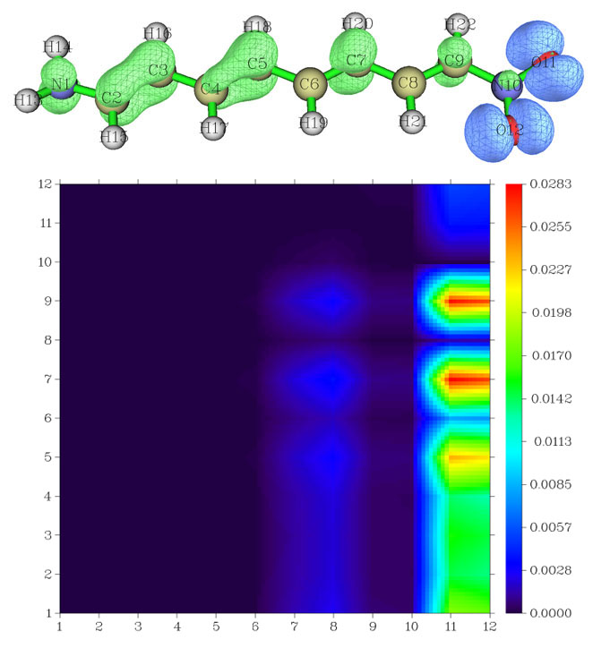

由于热图右侧 (X=11 和 12) 对应原子 1\~9 的区域有大值，可推测 S1→S2 激发中大量电子从原子 11 和 12 转移到原子 1\~9。从密度差等值面图也能得到完全相同的结论。该例子表明密度矩阵热图不仅对分析从基态到激发态的跃迁有用可靠，对各激发态之间的跃迁也有用。

## **4.18.3 基于电子密度差分析电子激发中的电荷转移**

> **注**
>
> 博客文章“使用 Multiwfn 基于电子密度差描述符分析电荷转移”(中文，<http://sobereva.com/776>)包含比本节多得多的信息。

本例分析乙醇溶剂中下图所示分子第一单重激发态与基态之间的电荷转移 (CT)，该分子称为 P2。相关理论已在[3.21.3 节](sec-3-21-electron-excitation-analysis.md#3213-基于密度差格点数据分析电荷转移-3)介绍。本例的讨论与[4.18.1 节](#4181-用空穴-电子分析完整表征电子激发)涉及的有些相关，但本节用的方法纯粹基于电子密度差，因而更普适，可用于任何能产生基态和激发态波函数的理论方法(如 CCSD 结合 EOM-CCSD)。

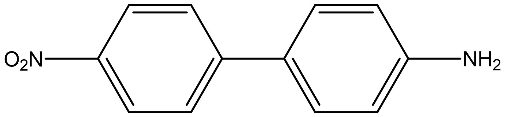

由于对应激发态和基态的 .wfn 文件很大，不提供。改为在“examples\excit”文件夹提供产生两个 .wfn 文件的 Gaussian 输入文件 (*extP2.gjf* 和 *basP2.gjf*)。假设相应的 .wfn 文件产生在当前目录的 "CT" 子文件夹。再提醒一次，两态波函数文件中的几何构型必须完全相同，否则结果没有意义！若手头没有 Gaussian，也可直接从 <http://sobereva.com/multiwfn/extrafiles/extP2_basP2.zip> 下载 *extP2.wfn* 和 *basP2.wfn*。

首先计算激发中电子密度变化 Δ*ρ* 的格点数据。启动 Multiwfn 并输入：

```text
CT\extP2.wfn  // Excited state wavefunction file
5  // Generate grid data
0  // Set custom operation
1  // Only one file will be dealt with
-,CT\basP2.wfn  // Ground state wavefunction file. Corresponding density will be subtracted from the excited one to generate Δρ
1  // Electron density
2  // Medium-quality grid. If the system is much larger than present one, more grid points is required (e.g. using high-quality grid)
```

计算正常完成后，可选选项 -1 查看电子激发中的电子密度变化(默认等值面值对显示密度差太大，本例推荐 0.005)。绿区和蓝区分别对应正部和负部，代表激发导致的电子密度增加和减少。

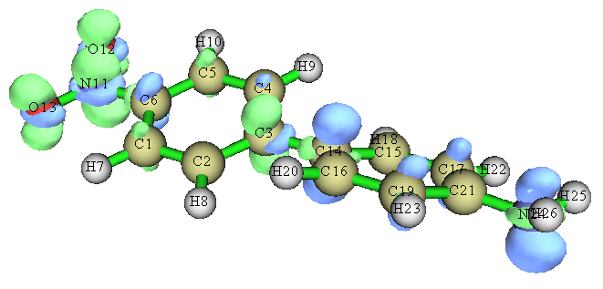

但该密度差图不太直观，因为正负部交织在一起且有许多节点。会看到 $C_+$ 和 $C_-$ 函数使图像清楚得多。

```text
0  // Return to main menu
18  // Electron excitation analysis
3  // Analyzing CT based on electron density difference grid data
```

立即显示以下信息。注意若 $q_{\mathrm{CT}}$ 的正负部明显不等，意味着产生 Δ*ρ* 用的格点设置太粗，需用更细格点设置重新计算。

```text
 q_CT (positive and negative parts):   0.844  -0.844 a.u.
 Barycenter of positive part in x,y,z (Angstrom):  -2.659  -0.001  -0.000
 Barycenter of negative part in x,y,z (Angstrom):   2.294  -0.009  -0.029
 Distance of CT in x,y,z (Angstrom):   4.953   0.009   0.029  D index:   4.953
 Dipole moment variation (a.u.) :   7.896  -0.014  -0.046 Norm:   7.896
 Dipole moment variation (Debye):  20.070  -0.035  -0.117 Norm:  20.070
 RMSD of positive part in x,y,z (Angstrom):  2.993  1.250  0.821 Total:   3.346
 RMSD of negative part in x,y,z (Angstrom):  3.290  1.144  0.881 Total:   3.593
 Difference between RMSD of positive and negative parts (Angstrom):
 X:  -0.297  Y:   0.106  Z:  -0.060  delta_sigma index:  -0.247
 H_x:  3.141  H_y:  1.197  H_z:  0.851  H_CT:  3.141  H index:  3.469 Angstrom
 t index:   1.811 Angstrom
 Overlap integral between C+ and C- (i.e. S+- index):  0.742365
```

以上信息是不言自明的，若困惑请参阅[3.21.3 节](sec-3-21-electron-excitation-analysis.md#3213-基于密度差格点数据分析电荷转移-3)。*t* 指标的明显正值意味着强 CT 使 Δ*ρ* 的正负分布明显分离。大 *D* 指标 (4.95 Å) 表明 CT 距离相当长。显然该体系的 S0→S1 跃迁应判断为典型 CT 激发。激发导致偶极矩显著变化，如数据所示，高达 20.07 Debye。Δ*ρ* 正负部的分布空间宽度相似，因此输出的 Δ*σ* 指标仅 -0.247 Å，它度量两者 RMSD 之差。

选选项 1 可显示 $C_+$ (绿) 和 $C_-$ (蓝) 函数的等值面。下图的等值面值为 0.0015。

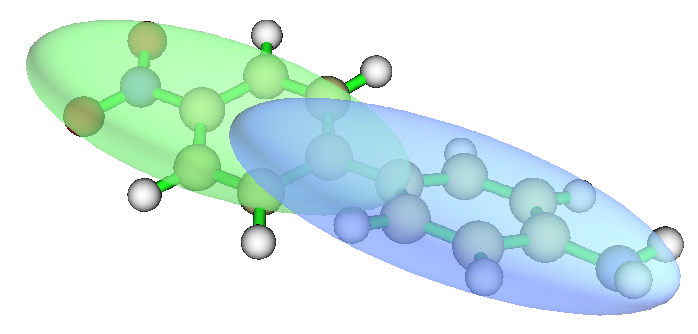

若把等值面值增至 0.0024，可近似定位质心的位置 ($C_+$ 和 $C_-$ 的质心恰对应它们等值面的中心)。

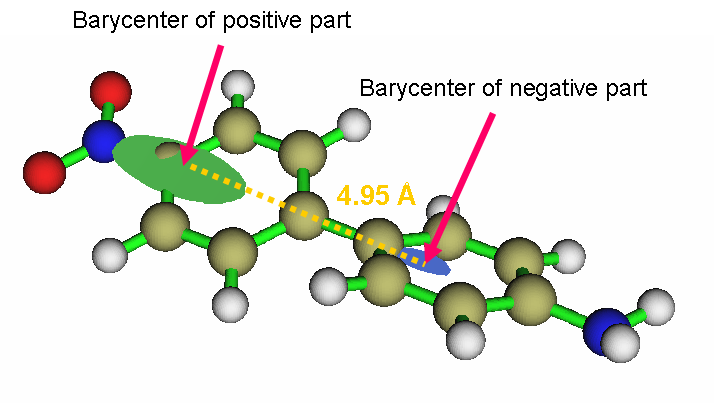

从图显然看到电子转移的方向是从氨基一侧(电子给体)到硝基一侧(电子受体)。但质心并不恰位于两取代基，提示该电子激发实际的电子给体不只是氨基还有苯撑。该发现与苯基是弱电子给体的事实相平行。

> **提示**
>
> 若想获得更好的 C₊ 和 C₋ 等值面显示效果，可用 VMD 程序(免费见 <http://www.ks.uiuc.edu/Research/vmd/>)显示，步骤为：先启动 VMD，把 *Cpos.cub* 拖入 VMD 主窗口，再把 *Cneg.cub* 拖入。选“Graphics”-“Representations”，在“Selected Molecule”选第一项，点击“Create Rep”按钮创建新表象(已有表象用于显示分子结构)，把“drawing method”改为“isosurface”，“Draw”设为“solid surface”，等值面值改为 0.0015，“coloring method”设为“ColorID”并选“7 green”。现在 Cpos 的等值面已正确显示。接下来，在“Selected Molecule”选第二项，用类似方法设各选项，但在“ColorID”选“0 blue”，等值面值用 -0.0015。最后图形如上图所示。还可把“Material”设为“transparent”以便清楚区分 C+ 和 C- 的重叠区。

## **4.18.4 计算 ∆r 和 Λ 指标表征 N-苯基吡咯的各种电子激发**

本节说明如何计算 *J. Chem. Theory Comput.*, **9**, 3118 (2013) 提出的 Δ*r* 指标和 *J. Chem. Phys.*, **128**, 044118 (2008) 提出的 Λ 指标以表征 N-苯基吡咯的电子激发。若不熟悉这两个指标，请分别看[3.21.4 节](sec-3-21-electron-excitation-analysis.md#3214-计算-r-指数衡量电荷转移长度-4)和[3.21.14 节](sec-3-21-electron-excitation-analysis.md#32114-计算-λ-指数表征电子激发-14)。

在我个人看来，用空穴-电子框架中定义的 *D*、$S_{\mathrm{r}}$ 等量表征电子激发已绝对足够，如[4.18.1 节](#4181-用空穴-电子分析完整表征电子激发)所示。理论上 Δ*r* 和 Λ 指标可视为 *D* 和 $S_{\mathrm{r}}$ 的近似。Δ*r* 和 Λ 唯一的优点是在 Multiwfn 中可同时对所有选定激发态输出，并可分解为轨道对贡献。此外，Δ*r* 指标的计算代价几乎可忽略。

本节用的文件是 "examples\excit" 文件夹中的 *N-phenylpyrrole.fch* 和 *N-phenylpyrrole.out*，由 Gaussian 产生，关键词为 *CAM-B3LYP/6-31+G(d) TD(nstates=5) IOp(9/40=4)*。由于计算用的是优化过的基态几何，因此分析结果可视为对应垂直吸收过程。

### **计算 Δ*r* 指标**

Δ*r* 指标是度量电子激发电荷转移 (CT) 长度的定量指标，Δ*r* 指标越大意味着 CT 距离越长。

启动 Multiwfn 并输入

```text
examples\excit\N-phenylpyrrole.fch
18  // Electron excitation analysis
4  // Calculate Δr index
examples\excit\N-phenylpyrrole.out
1-5  // Assume that we want to calculate Δr index for all the five calculated singlet excited states
```

结果立即打印在屏幕上：

```text
 Excited state    1:   Delta_r =    1.499249 Bohr,    0.793368 Angstrom
 Excited state    2:   Delta_r =    3.489064 Bohr,    1.846333 Angstrom
 Excited state    3:   Delta_r =    4.641132 Bohr,    2.455982 Angstrom
 Excited state    4:   Delta_r =    5.869424 Bohr,    3.105966 Angstrom
 Excited state    5:   Delta_r =    7.091127 Bohr,    3.752463 Angstrom
```

Δ*r* 指标意味着从基态 (S0) 到第 3、4、5 激发态的激发因 Δ*r* 大而具强 CT 特征，而 S0→S1 和 S0→S2 激发因 Δ*r* 指标不太大应基本视为 LE 激发 (Δ*r* 原文建议用 2.0 Å 为区分 LE 和 CT 激发的标准)。记住，只有用 Multiwfn 的空穴-电子分析模块可视化空穴和电子分布后，才能对激发特征下确定结论。

在 Multiwfn 中可把 Δ*r* 指标分解为轨道对跃迁的贡献。例如，想对 S0→S4 激发这么做，应先进入 Δ*r* 指标计算界面再输入

```text
4  // Only calculate Δr index for a single excitation (S0→S4), in this case the result can be decomposed
y  // Print orbital pair contributions
0.01  // Only the orbital pairs having contribution larger than 0.01 Å will be printed
```

会立即看到以下信息

```text
Note: The configuration coefficients shown below have combined both excitation
and de-excitation parts
 Sum of square of configuration coefficients:    0.497953
    #Pair     Orbitals      Coefficient     Contribution (Bohr and Angstrom)
     378     37     41       0.5004500          3.7301590       1.9739153
     379     37     43       0.4452400          1.8477898       0.9778083
     381     37     47      -0.1067900          0.0929645       0.0491947
     382     37     49      -0.0782100          0.0700060       0.0370456
     383     37     53      -0.0639300          0.0285116       0.0150877
     389     37     72       0.0436900          0.0215865       0.0114231
```

可见 MO37→MO41 跃迁对 S0→S4 的 Δ*r* 指标 (3.11 Å) 有主导贡献 (1.97 Å)，而 MO37→MO43 跃迁也有不可忽略的贡献 (0.97 Å)。

### **计算 Λ (lambda) 指标**

Λ 指标本质上度量电子激发的空穴和电子重叠程度。这里计算 N-苯基吡咯五个激发的 Λ。

启动 Multiwfn 并输入

```text
examples\excit\N-phenylpyrrole.fch
18  // Electron excitation analysis
14  // Calculate Λ index
examples\excit\N-phenylpyrrole.out
1-5  // Analyze all the five calculated singlet excited states
```

结果立即打印在屏幕上：

```text
 Excited state    1:   lambda =    0.684853
 Excited state    2:   lambda =    0.563804
 Excited state    3:   lambda =    0.530928
 Excited state    4:   lambda =    0.198710
 Excited state    5:   lambda =    0.235255
```

从以上输出可发现 Λ 指标与 Δ*r* 指标近乎成反比，因为空穴-电子重叠范围越大，通常空穴-电子分离距离越短(但记住，该关系并非总是成立)。

再分解第四个激发的 Λ 指标。输入以下命令

```text
y  // Do the Λ index analysis again
4  // The fourth excitation
y  // Decompose analysis on Λ index
0.01  // Printing threshold
```

会看到对 Λ 指标贡献大于 0.01 的所有分子轨道对：

```text
Sum of square of configuration coefficients:    0.497953
    #Pair     Orbitals      Coefficient     Contribution
     378     37     41       0.5004500          0.0865190
     379     37     43       0.4452400          0.0915297
```

数据表明只有占据 MO 37 与非占据分子轨道有不可忽略的重叠；具体说，只有 MO37-MO41 之间和 MO37-MO43 之间的重叠相对可察觉。

## **4.18.5 计算 4-硝基苯胺各激发态的偶极矩和所有态之间的跃迁偶极矩**

本例用[3.21.5 节](sec-3-21-electron-excitation-analysis.md#3215-计算所有态之间的跃迁电磁偶极矩和每个态的偶极矩-5)描述的功能，请先读它以获得相关知识。本例用 4-硝基苯胺说明如何计算各态的电偶极矩，再说明如何计算所有态之间的跃迁磁偶极矩。此处的态指 TDDFT 计算得到的基态和激发态。产生本例用的 .fch 和 .out 文件的相应 Gaussian TDDFT 输入文件是 *examples\excit\4-nitroaniline.gjf*。

启动 Multiwfn 并输入

```text
examples\excit\4-nitroaniline.fch
18  // Electron excitation analysis
5  // Calculate transition electric/magnetic dipole moments between all states and for each state
examples\excit\4-nitroaniline.out
4  // Obtain electric dipole moment of each state
```

现在当前目录下有 *dipmom.txt*，可看到基态和各激发态的电偶极矩。

```text
 Note: The electric dipole moments shown below include both nuclear charge and electronic contributions
 Ground state electric dipole moment in X,Y,Z:    0.326322   -2.792165    0.000000 a.u.

 Excited state electric dipole moments (a.u.):
  State         X             Y             Z        exc.(eV)    exc.(nm)
     1      0.334929     -1.219854      0.000000      4.0557      305.70
     2      0.251666     -7.797482      0.000000      4.2762      289.94
     3      0.334065     -1.439663      0.000000      4.5846      270.44
```

接下来计算所有态之间的跃迁磁偶极矩。启动 Multiwfn 并输入

```text
examples\excit\4-nitroaniline.fch
18  // Electron excitation analysis
5  // Calculate transition electric/magnetic dipole moments between all states and for each state
examples\excit\4-nitroaniline.out
0  // Choose type of (transition) dipole moment to be calculated
2  // Magnetic
1  // Output (transition) dipole moments on screen
```

现在可以看到

```text
Transition magnetic dipole moment between ground state (0) and excited states (
a.u.)
     i     j         X             Y             Z        Diff.(eV)
     0     1    -0.0005545    -0.6041898    -0.0000000     4.05570
     0     2     0.0000000    -0.0000000     0.0137951     4.27620
     0     3     0.0000000    -0.0000000     1.0423466     4.58460

 Transition magnetic dipole moment between excited states (a.u.):
     i     j         X             Y             Z        Diff.(eV)
     1     1    -0.0000000    -0.0000000    -0.0113149     0.00000
     1     2     0.0060715     0.1120542     0.0000000     0.22050
     1     3    -0.2144702     0.0000589     0.0000000     0.52890
     2     2    -0.0000000    -0.0000000    -0.0099328     0.00000
     2     3    -0.0000000    -0.0000000    -0.1215811     0.30840
     3     3    -0.0000000    -0.0000000    -0.0074159     0.00000
```

从以上输出可知基态与激发态之间以及各激发态之间的跃迁磁偶极矩。

类似地，可计算各态之间的跃迁电偶极矩。

## **4.18.6 产生并分析尿嘧啶的自然跃迁轨道 (NTO)**

> **注**
>
> 本节的中文版是我的博客文章“使用 Multiwfn 做自然跃迁轨道 (NTO) 分析”(<http://sobereva.com/377>)，其中有扩展讨论。

本节以尿嘧啶为例说明如何用 Multiwfn 做非常流行的自然跃迁轨道 (natural transition orbital, NTO) 分析。请先读[3.21.6 节](sec-3-21-electron-excitation-analysis.md#3216-产生自然跃迁轨道-ntos-6)掌握 NTO 的基本知识。虽然本例用 Gaussian 输出的文件为输入文件，事实上 ORCA 输出的文件也完全支持，输入文件的详细要求见[3.21.1.2 节](sec-3-21-electron-excitation-analysis.md#32112-用法与功能)。

在展示怎么做 NTO 分析之前，我想让你理解为什么 NTO 分析有意义。例如，用 Gaussian 在 PBE0/6-31G\* 水平对尿嘧啶的单重激发态做 TDDFT 计算，会看到以下信息

```text
Excited State   3:      Singlet-A"     6.0180 eV  206.02 nm  f=0.0000  <S**2>=0.000
      26 -> 30         0.54135
      26 -> 31        -0.20634
      28 -> 30        -0.15424
      28 -> 31         0.36715
```

显然，在 S0→S3 激发中没有主导的分子轨道跃迁，单个分子轨道对的最大贡献仅 0.541^2\*2\*100%=58.5%，因此仅看一个分子轨道对不可能判断该激发的本质。在这种困难情形 NTO 分析常有用，因为把分子轨道变换为 NTO 后，通常能找到只有一个 NTO 对的本征值非常接近 1，该对中两 NTO 之间的跃迁忠实代表电子激发的真实特征。

NTO 分析需要的文件已在[3.21 节](sec-3-21-electron-excitation-analysis.md)开头提到。简单说，假设你是 Gaussian 用户，想在 TD-PBE0/6-31G\* 水平研究尿嘧啶从基态到最低三个单重激发态的电子激发，要做的是用这些关键词做正常的 TDDFT 计算：*\# PBE1PBE/6-31G\* TD IOp(9/40=4)*，还要让 Gaussian 产生相应的 .fch 文件。输入文件、输出文件和 .fch 文件已在 "examples\excit\NTO" 文件夹提供。关键词 *IOp(9/40=4)* 非常重要，没有它 NTO 结果会明显不准，该 IOp 的含义已在[4.18.1 节](#4181-用空穴-电子分析完整表征电子激发)提到。

现在开始做 NTO 分析。启动 Multiwfn 并输入

```text
examples\excit\NTO\uracil.fch
18  // Electron excitation analysis
6  // Generate NTOs
examples\excit\NTO\uracil.out  // Gaussian calculated three lowest excited states, you can analyze any one of them
3  // Study transition from ground state (S0) to the 3rd excited state (S3)
```

现在 Multiwfn 从 Gaussian 输出文件载入 S0→S3 的跃迁信息并产生 NTO，NTO 对的本征值如下

```text
The highest 10 eigenvalues of NTO pairs:
   0.865529    0.134025    0.000582    0.000121    0.000063
   0.000024    0.000016    0.000015    0.000007    0.000006
Sum of all eigenvalues:  1.000387
```

可见最大本征值为 0.8655，意味着该 NTO 对贡献 S0→S3 跃迁高达 86.55%。所以，若想表征该跃迁的本质，只需研究该 NTO 对中的占据 NTO 和空 NTO。

现在可选择是否输出含 NTO 的 .fch/.mwfn/.molden 文件。我们选“3 Output NTO orbitals to .mwfn file”并输入输出路径如 *C:\S3.mwfn*。成功产生 .mwfn 后，可重启 Multiwfn 并载入 *S3.mwfn*，在主功能 0 可视化 NTO，此时轨道能量对应 NTO 本征值。要画贡献 86.55% 的 NTO 对对应的占据和空 NTO，在主功能 0 的 GUI 中选菜单 "orbital info."-"Show up to LUMO+10"，在文本窗口看到如下输出

```text
Orb:    27 Ene(au/eV):     0.000582       0.0158 Occ: 2.000000 Type: A+B
Orb:    28 Ene(au/eV):     0.134025       3.6470 Occ: 2.000000 Type: A+B
Orb:    29 Ene(au/eV):     0.865529      23.5522 Occ: 2.000000 Type: A+B
Orb:    30 Ene(au/eV):     0.865529      23.5522 Occ: 0.000000 Type: A+B
Orb:    31 Ene(au/eV):     0.134025       3.6470 Occ: 0.000000 Type: A+B
Orb:    32 Ene(au/eV):     0.000582       0.0158 Occ: 0.000000 Type: A+B
```

可见编号 29 的占据 NTO 和编号 30 的空 NTO 构成本征值 0.8655 的 NTO 对，在 GUI 选相应编号可视化它们，等值面如下

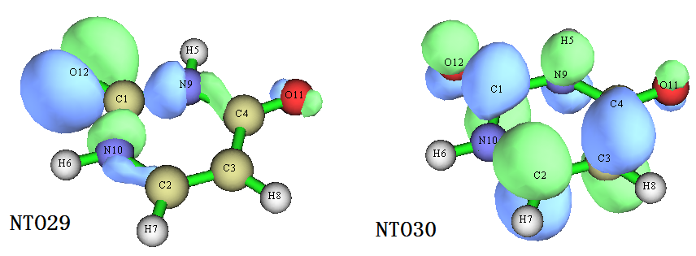

毫无疑问，该 S0→S3 激发可视为从 O12 孤对电子到尿嘧啶环反键 π 轨道的跃迁，至少我们有 86.55% 的把握这么说。从 NTO 本征值注意到 NTO28→NTO31 跃迁也有小贡献 (13.40%)，请画出相应轨道并讨论其特征。

NTO 也可做定量分析。例如，可进入主功能 8 用合适选项定量分析它们的轨道成分，或用主功能 100 的子功能 11 计算选定的两 NTO 间的重叠程度和质心距离。

在 Multiwfn 中可计算任何种类轨道的能量。[4.300.6 节](sec-4-300-other-functions-part-3.md#43006-计算轨道能量以-nto-轨道为例)给出计算 NTO 轨道能量的详细例子。

值得注意的是，NTO 分析相对空穴-电子分析有优缺点，这点已在[3.21.6 节](sec-3-21-electron-excitation-analysis.md#3216-产生自然跃迁轨道-ntos-6)末尾提到。对许多体系和激发，即使做了 NTO 变换仍没有占主导贡献的 NTO 对，此时必须求助于空穴-电子分析以便讨论激发特征。空穴-电子分析的缺点是不能像 NTO 分析那样给出轨道相位信息，且计算代价更高。

### **用脚本批量做 NTO 分析**

有时想对一批激发做 NTO 分析，例如，想分别产生含 S0→S1、S0→S2 和 S0→S3 跃迁 NTO 的一批 .fch 文件，虽然可在 Multiwfn 交互界面手动做，但更高效更巧妙的方法是用 shell 脚本。若是 Linux 用户，可运行以下 shell 脚本产生 *S1.fch*、*S2.fch* 和 *S3.fch*，它们分别含 S0→S1、S0→S3 和 S0→S3 对应的 NTO。只要有基本的 shell 编程知识，该脚本很容易理解。

```bash
#!/bin/bash
cat << EOF > allNTO.txt
18
6
examples/NTO/uracil.out
EOF
for ((i=1;i<=3;i=i+1))
do
cat << EOF >> allNTO.txt
$i
2
S$i.fch
6
EOF
done
./Multiwfn examples/excit/NTO/uracil.fch < allNTO.txt
rm ./allNTO.txt
```

该脚本也提供为 *examples\excit\NTO\allNTO.sh*。若不对脚本做任何修改，应把该脚本拷贝到 Multiwfn 文件夹并在 Multiwfn 文件夹运行 *./allNTO.sh*，则在同一文件夹产生 *S1.fch*、*S2.fch* 和 *S3.fch*。实际研究中应按实际情况适当修改脚本，研究的激发范围由 "i=1;i\<=3" 决定。

## **4.18.8 用 IFCT 方法和电荷转移矩阵热图研究电子激发中的片段间电荷转移**

片段间电荷转移 (interfragment charge transfer, IFCT) 是基于空穴-电子分析推导的定量研究不同片段间电荷转移量的方法。电荷转移的情况也可用电荷转移矩阵热图非常直观理解，它是 IFCT 分析的副产品。若不熟悉这些概念，请仔细读[3.21.8 节](sec-3-21-electron-excitation-analysis.md#3218-用-ifct-方法计算电子激发中的片段间电荷转移-8)。

下面两节分别用两个分子说明怎么做 IFCT 分析和画电荷转移矩阵热图，这两种分析提供互补的视角。

### **4.18.8.1 4-硝基苯胺的 IFCT 分析**

本例说明如何用 IFCT 方法研究 4-硝基苯胺三个片段 (-NO₂、-NH₂ 和连接苯) 在电子激发中的 CT。

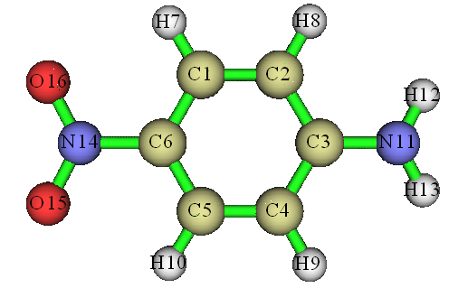

4-硝基苯胺在 PBE0/6-311G\* 水平的 TDDFT 任务的 Gaussian 输入文件已提供为 *examples\excit\4-nitroaniline.gjf*。注意用了 *IOp(9/40=4)* 以便 Gaussian 打印足够的组态系数。用 Gaussian 运行以获得 .chk 文件和 .out 文件，再经 formchk 把 .chk 文件转为 .fch。.fch 和 .out 文件已在 "examples\excit" 文件夹提供。

启动 Multiwfn 并输入以下命令

```text
examples\excit\4-nitroaniline.fch
18  // Electron excitation analysis
8  // Calculate interfragment charge transfer in electron excitation via IFCT method
1  // Mulliken partition
[Press ENTER button]  // Load examples\excit\4-nitroaniline.out
2  // We first analyze transition from ground state (S0) to the second excited state (S2)
3  // Define three fragments
11-13  // Atomic indices of amino group (fragment 1)
1-10  // Atomic indices of benzene group (fragment 2)
14-16  // Atomic indices of nitro group (fragment 3)
```

会看到

```text
 Contribution of each fragment to hole and electron:
  1  Hole:  28.17 %     Electron:   3.02 %
  2  Hole:  65.89 %     Electron:  29.52 %
  3  Hole:   5.94 %     Electron:  67.46 %
 Construction of interfragment charger-transfer matrix has finished!

 Variation of population number of fragment  1:  -0.25150
 Variation of population number of fragment  2:  -0.36369
 Variation of population number of fragment  3:   0.61519

 Intrafragment electron redistribution of fragment  1:   0.00849
 Intrafragment electron redistribution of fragment  2:   0.19453
 Intrafragment electron redistribution of fragment  3:   0.04009

 Transferred electrons between fragments:
  1 ->  2:   0.08315       1 <-  2:   0.01987     Net  1 ->  2:   0.06328
  1 ->  3:   0.19001       1 <-  3:   0.00179     Net  1 ->  3:   0.18821
  2 ->  3:   0.44452       2 <-  3:   0.01754     Net  2 ->  3:   0.42697

 Intrinsic charge transfer percentage, CT(%):     75.688 %
 Intrinsic local excitation percentage, LE(%):    24.312 %
```

输出很容易理解，若困惑请看[3.21.8 节](sec-3-21-electron-excitation-analysis.md#3218-用-ifct-方法计算电子激发中的片段间电荷转移-8)相应的解释。例如，数据显示 S0→S2 激发中硝基 (片段 3) 向氨基 (片段 1) 给出 0.00179 个电子同时从氨基接受 0.19001 个电子，因此硝基总共从氨基得到 0.18821 个电子。若把苯片段也计入，电子激发使硝基的电子布居总共增加 0.61519。两端基中的电子重排现象不突出，但如数据所示 (0.19453)，起 π 桥作用的苯内的电子重排显著。由于 CT(%) 明显大于 LE(%)，该激发大多可视为电荷转移态。

为便于讨论，我把所有 IFCT 分析数据总结在下表。对角项对应片段内电子重排的量。

| Donor       | Amino group | benzene | nitro group |
|-------------|-------------|---------|-------------|
| amino group | 0.008       | 0.083   | 0.190       |
| benzene     | 0.020       | 0.195   | 0.445       |
| nitro group | 0.002       | 0.018   | 0.040       |

从表可见有三个突出的片段间 CT 项(按大小排序)：benzene→nitro、amino→nitro、amino→benzene，都从氨基指向硝基。

为更好直观理解以上数据，用[4.18.1 节](#4181-用空穴-电子分析完整表征电子激发)所述方法画空穴-电子等值面图：

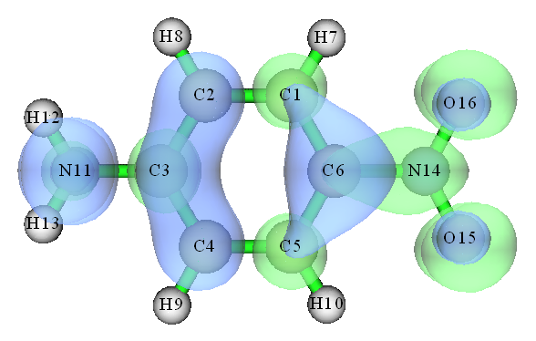

图中空穴和电子的主要分布区分别对应蓝和绿。可见空穴主要分布在氨基和苯部分，而电子主要位于苯桥和硝基，显然整体 CT 方向是从氨基到硝基，这与定量片段间 CT 分析的观察完全一致。

#### **用 Hirshfeld 划分**

通常，本例用的类 Mulliken 划分是好选择，因为计算相当快且结果通常合理。不幸的是，它与弥散函数不兼容，有时出现非物理的负片段空穴或电子贡献。当必须用弥散函数(如阴离子体系)，或 Multiwfn 警告有负贡献时，应改用更稳健的 Hirshfeld 划分。它对任何情形都表现好，但代价明显更高。改用 Hirshfeld 划分只需在 Multiwfn 询问计算空穴和电子成分的方法时输入 *2*。上例用 Hirshfeld 划分算得的数据如下；可见结果与类 Mulliken 划分下的结果近似相同。

```text
Intrafragment electron redistribution of fragment  1:   0.01047
Intrafragment electron redistribution of fragment  2:   0.19579
Intrafragment electron redistribution of fragment  3:   0.05327

Transferred electrons between fragments:
 1 ->  2:   0.08246       1 <-  2:   0.02485     Net  1 ->  2:   0.05761
 1 ->  3:   0.17946       1 <-  3:   0.00311     Net  1 ->  3:   0.17636
 2 ->  3:   0.42612       2 <-  3:   0.02448     Net  2 ->  3:   0.40164

Charge transfer percentage, CT(%):     74.047 %
Local excitation percentage, LE(%):    25.953 %
```

值得注意的是 Multiwfn 能一次性对一批激发态算 IFCT，因而能轻松识别所有激发态的主要特征，例子见[4.18.6 节](#4186-产生并分析尿嘧啶的自然跃迁轨道-nto)。

关于 IFCT 分析的更多讨论和说明见我的博客文章“使用 Multiwfn 的 IFCT 方法计算电子激发中任意定义的两个片段间的电子转移量”(中文，<http://sobereva.com/433>)。

### **4.18.8.2 画电荷转移矩阵热图以直观理解电子激发的本质**

电荷转移矩阵 (charge transfer matrix, CTM) 与跃迁密度矩阵 (TDM) 密切相关，它们的热图常对电子激发提供相似的信息。绘制 TDM 的方法已在[4.18.2.2 节](#41822-绘制并分析跃迁密度矩阵-tdm)说明。在我看来，CTM 的物理意义比 TDM 更清楚，更能揭示实际电荷转移特征。此外，由于 CTM 在空穴-电子分析的理论框架下推导(见[3.21.1 节](sec-3-21-electron-excitation-analysis.md#3211-分析并可视化空穴电子分布跃迁密度和跃迁电磁偶极矩密度-1))，CTM 热图总能与空穴和电子的分布很好对照。

这里仍用[4.18.2.2 节](#41822-绘制并分析跃迁密度矩阵-tdm)研究的分子为例。画 CTM 热图之前，应先产生 CTM。启动 Multiwfn 并输入

```text
examples\excit\NH2_C8_NO2\NH2_C8_NO2.fchk
18  // Electron excitation analysis
8  // IFCT analysis
1  // Mulliken-like partition to derive atomic contribution to hole and electron
examples\excit\NH2_C8_NO2\NH2_C8_NO2.out
1  // Study S0→S1 excitation
-1  // Export atom-atom CTM to atmCTmat.txt in current folder
2  // Enter the function used for plotting heat map
atmCTmat.txt  // Load matrix data from this file
1  // Show heat map
```

现在看到下图，紫线和文字是手动加的。

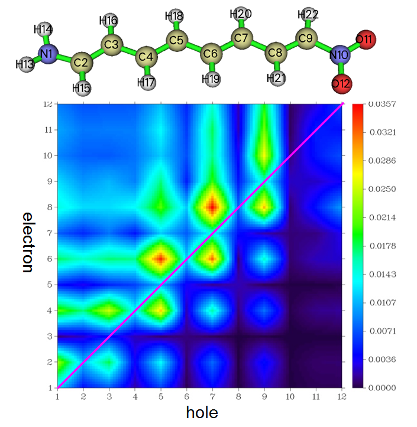

该图与[4.18.2.2 节](#41822-绘制并分析跃迁密度矩阵-tdm)给出的原子 TDM 热图有相似特征，但也有不可忽略的差别。按 IFCT 观点，当前图的每个非对角元严格展示原子间转移的电子量。逐列看图，可直观看到碳链上每个原子向其前后端的原子转移电子，向硝基一侧的转移量明显多于向氨基一侧。例如，从图可知第五列第六元的值大于第四元，所以 C5→C6 的电子转移量必定多于 C5→C4。

接下来再看另一个激发的 CTM 热图。用同样方法画的 S0→S9 的图如下，还附了相应的 hole&electron 等值面图。由于发现 S0→S9 跃迁明显涉及一些氢，因此图中也计入氢(选一次“4 Toggle if taking hydrogens into account”)。

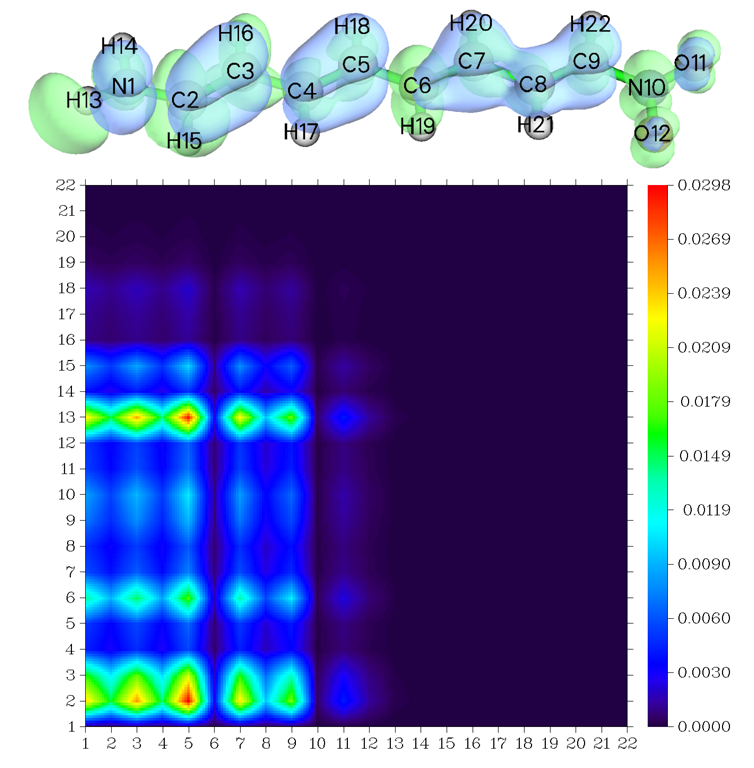

从以上热图可见，有很强的电子转移从原子 1\~5 和 7\~9 区到编号 13 的氢原子，该观察与 hole&electron 等值面图完全一致，即 H13 处有很大的绿色等值面。此外，从等值面图可见原子 6 基本只被绿色等值面包围，意味着该原子不向其他原子转移电子而大量接受其他原子的电子；相应地，热图中 Y=6 行的颜色鲜明，而 X=6 对应的列很暗。

从该例子可发现，hole&electron 等值面图提供最直观的视觉效果，但若与 CTM 热图一起讨论，可从定量角度更透彻理解电荷转移，也避免等值面值选择的任意性导致不合理判断的可能。

CTM 也可基于片段画。为此，只需在热图绘制功能中载入片段定义文件或直接输入片段定义，再重画即可。

## **4.18.9 产生跃迁密度矩阵并变换为轨道表象**

> **注**
>
> 本节对大多数 Multiwfn 用户可能没兴趣，但对专家有价值

在[4.18.2 节](#4182-跃迁密度矩阵与跃迁偶极矩密度矩阵分析的说明)已展示 Multiwfn 中跃迁密度可用实空间函数和着色矩阵(热图)研究。Multiwfn 对跃迁密度能做更多。如本节所示，Multiwfn 能把产生的跃迁密度矩阵变换为轨道表象并把轨道导出为波函数文件。这带来许多方便；例如，用该文件分析“电子密度”时，实际研究的函数直接对应跃迁密度。注意这些轨道可视为跃迁密度矩阵 (TDM) 的自然轨道，但它们与[3.21.6 节](sec-3-21-electron-excitation-analysis.md#3216-产生自然跃迁轨道-ntos-6)介绍的 NTO (自然跃迁轨道) 显著不同。

这里以 N-苯基吡咯为例，其 S0→S1 的跃迁密度已在[4.18.2 节](#4182-跃迁密度矩阵与跃迁偶极矩密度矩阵分析的说明)画成等值面。本节目的是把该跃迁密度变换为轨道并导出为 .wfx 文件，以便随后基于该文件非常轻松研究跃迁密度的性质。

首先产生含 TDM 的 .fch 文件。启动 Multiwfn 并输入

```text
examples\excit\N-phenylpyrrole.fch  // The .fch file yielded by Gaussian TDDFT task
18  // Electron excitation analysis
9  // Generate and export TDM
1  // Generate TDM between ground state and excited state
examples\excit\N-phenylpyrrole.out  // The output file of Gaussian TDDFT task with IOp(9/40=4) keyword
1  // Analyze electron transition from ground state to the 1st excited state (S0→S1)
1  // Symmetrize the raw TDM. This is important, the natural orbitals cannot be properly yielded later without symmetrization of the TDM
y  // Export current wavefunction to TDM.fch in current folder, whose "Total SCF Density" field records the just generated symmetrized TDM
```

接下来把 TDM 变换为自然轨道。重启 Multiwfn 并输入

```text
TDM.fch
200  // Other functions (Part 2)
16  // Generate natural orbitals based on the density matrix in .fch/.fchk file
SCF  // The matrix to be transformed comes from the "Total SCF Density" field
y  // Export the generated orbitals to new.mwfn and load it
```

现在当前目录下有 *new.mwfn*，含从 S0→S1 TDM 变换来的自然轨道。内存中的轨道也对应这些自然轨道。假设还想把它们导出为 .wfx 文件，应输入以下命令。

```text
0  // Return to main menu
100  // Other functions (Part 1)
2  // Export various kinds of files
4  // Output current wavefunction as .wfx file
TDM.wfx  // The path of the file to be generated
```

将来若用 *TDM.wfx* 为输入文件并经主功能 5 计算“电子密度”的格点数据，会发现所得等值面图(适当调整等值面值后)与[4.18.2.1 节](#41821-在实空间分析跃迁密度和跃迁偶极矩密度)展示的跃迁密度 *T*(**r**) 图完全相同。

## **4.18.10 获得分子轨道对对跃迁偶极矩的贡献**

为深入理解跃迁电或磁偶极矩，Multiwfn 提供把它们分解为各分子轨道对跃迁贡献的功能，介绍见[3.21.10 节](sec-3-21-electron-excitation-analysis.md#32110-把跃迁电磁偶极矩分解为分子轨道对贡献-10)。这里给出例子。本例涉及的 .fch 和 .out 文件由 Gaussian 的 TDDFT 计算产生。

启动 Multiwfn 并输入

```text
examples\excit\N-phenylpyrrole.fch
18  // Electron excitation analysis
10  // Decompose transition dipole moment as molecular orbital pair contributions
1  // The type of transition dipole moment is electric
examples\excit\N-phenylpyrrole.out
1  // Select the excitation from ground state (S0) to the first singlet excited state (S1)
```

现在屏幕上显示以下关于该激发的信息

```text
 Transition dipole moment in X/Y/Z:   -0.000000  -0.000000   1.781438 a.u.
 Norm of transition dipole moment:     1.781438 a.u.
 Oscillator strength:   0.3935306
```

屏幕上还有几个选项，它们是不言自明的。先选选项 1 并输入如 *0.02*，则打印所有贡献大于 0.02 的分子轨道对：

```text
#Pair   Orbital trans. Coefficient      Transition dipole X/Y/Z   Norm (a.u.)
  1213     35 ->     46   0.040230   0.000000   0.000000   0.037709   0.037709
  1214     35 ->     50  -0.047670   0.000000  -0.000000   0.040152   0.040152
  1239     36 ->     40  -0.101270   0.000000  -0.000000  -0.280355   0.280355
  1259     37 ->     40  -0.127550   0.000000   0.000000  -0.148489   0.148489
  1260     37 ->     52   0.069960  -0.000000  -0.000000  -0.122222   0.122222
  1262     37 ->     58  -0.036060  -0.000000   0.000000  -0.025065   0.025065
  1278     38 ->     39   0.672690  -0.000000   0.000000   2.796678   2.796678
  1280     38 ->     50   0.052570  -0.000000   0.000000   0.046724   0.046724
  2489     36 <-     40  -0.014330   0.000000  -0.000000  -0.039671   0.039671
  2506     37 <-     52   0.015140  -0.000000  -0.000000  -0.026450   0.026450
  2522     38 <-     39  -0.027240   0.000000  -0.000000  -0.113249   0.113249
Sum of the above      11 pairs:     -0.000000  -0.000000   2.165763
```

从输出可立即发现 MO38→MO39 跃迁对该 S0→S1 激发有主导贡献 (2.796678 a.u.)。

当有太多分子轨道对对跃迁偶极矩有不可忽略的贡献而难以识别重要分子轨道跃迁时，可让 Multiwfn 按其对跃迁偶极矩特定分量的贡献对分子轨道对排序。例如，这里选选项“4 Print orbital pairs in the order of absolute contribution to Z component”再输入 *5*，会看到对跃迁偶极矩 Z 分量贡献最大的五个分子轨道对。

```text
  #Pair   Orbital trans. Coefficient      Transition dipole X/Y/Z   Norm (a.u.)
   1278     38 ->     39   0.672690  -0.000000   0.000000   2.796678   2.796678
   1239     36 ->     40  -0.101270   0.000000  -0.000000  -0.280355   0.280355
   1259     37 ->     40  -0.127550   0.000000   0.000000  -0.148489   0.148489
   1260     37 ->     52   0.069960  -0.000000  -0.000000  -0.122222   0.122222
   2522     38 <-     39  -0.027240   0.000000  -0.000000  -0.113249   0.113249
```

顺便一提，振子强度 (*f*) 直接与跃迁电偶极矩模的平方相关，因此可预期若把对应 MO38→MO39 的组态系数设为零，即忽略其贡献，*f* 会明显降低。如前所示，S0→S1 原来的 *f* 为 0.39353。定量考察 MO38→MO39 如何影响 *f*。为此，可手动把该跃迁的组态系数设为零再重新考察 *f* 值。为此输入以下命令

```text
0  // Return to menu of electron excitation analysis
-1  // Check, modify and export configuration coefficients of an excitation
1  // Choose the first excited state
1  // Set coefficient of a MO pair
38,39  // The MO indices of the MO pair
1  // The transition type is chosen as "Excitation", hence MO38→MO39 is selected (if inputting 2, then what we selected will be MO38←MO39)
0  // Set the configuration coefficient to zero
-3  // Export current excitation information to a plain text file
S1.txt  // The path of the file to be stored excitation information of S0→S1
```

现在当前目录下已产生 *S1.txt*，用文本编辑器打开会发现对应 MO38→MO39 的系数确实为零。

再重启 Multiwfn 并输入

```text
o  // Load the file used at the last time, namely examples\excit\N-phenylpyrrole.fch
18  // Electron excitation analysis
10  // Decompose transition dipole moment as molecular orbital pair contributions
1  // The type of transition dipole moment is electric
S1.txt
```

现在打印的 *f* 只有 0.1278，不到原来值 (0.39353) 的 1/3，表明 MO38→MO39 对 S0→S1 激发的强度有决定性影响。

> **注**
>
> 由于 MO38→MO39 的系数高达 0.6727，设为零后，剩余系数的平方和已远小于 0.1，远离闭壳层情形的理想值 (0.5)。

在我的论文 *Carbon*, **165**, 461 (2020) 中，用上面说明的功能研究了环\[18\]碳极强吸收的本质，建议看图 4 和相关讨论。若在工作中用该功能，建议也引用该论文。

用上面说明的类似方法，也可把跃迁磁偶极矩分解为分子轨道对跃迁的贡献，这对研究旋光强度有用。

## **4.18.11 把分子片段贡献的跃迁偶极矩画成箭头**

> **注**
>
> 本节的中文版是我的博客文章“使用 Multiwfn+VMD 绘制特定片段贡献的跃迁偶极矩矢量”(<http://sobereva.com/396>)。

在[4.18.2.1 节](#41821-在实空间分析跃迁密度和跃迁偶极矩密度)已展示如何在实空间绘制跃迁偶极矩密度，这对研究三维空间不同区域的贡献极有用。事实上，若用下面提供的 VMD 特殊绘图脚本 (<http://www.ks.uiuc.edu/Research/vmd/>)，分子片段贡献的跃迁偶极矩可轻松画成箭头，极方便讨论总跃迁偶极矩的组成。

这里以偶氮苯为例。偶氮苯的 Gaussian TDDFT 任务输入文件提供为 *examples\excit\Azobenzene.gjf*。注意用了 *IOp(9/40=4)* 且计算后保存 .chk 文件。用 Gaussian 运行，再把 *azobenzene.chk* 转为 *azobenzene.fch*。(若手头没有 Gaussian，也可直接从 <http://sobereva.com/multiwfn/extrafiles/Azobenzene_exc.zip> 下载 .out 和 .fch 文件)

启动 Multiwfn，载入 *azobenzene.fch*，再输入

```text
18  // Electron excitation analysis
11  // Decompose transition dipole moment as basis function and atom contributions
Azobenzene.out  // The Gaussian output file obtained by running Azobenzene.gjf
2  // Assume that we want to study is electron excitation from ground state to excited state 2 (you can also input two indices to study transition between the two excited states)
1  // The type of transition dipole moment to be decomposed is electric
n  // Do not generate AAtrdip.txt, which is not involved in the present example
```

现在当前目录输出 *trdipcontri.txt*，含每个基函数和每个原子贡献的跃迁偶极矩。把该文件移到 VMD 文件夹。

回到主菜单，再进入主功能 100 的子功能 2，把当前分子几何导出为 *azobenzene.pdb*。

把 *examples\excit\loadip.tcl* 拷贝到 VMD 文件夹，这是我写的 VMD 脚本，能从 *trdipcontri.txt* 载入数据。还定义了自定义命令 "dip" 和 "dipatm"，用于把特定分子片段贡献的跃迁偶极矩画成箭头。

启动 VMD，把文件 *azobenzene.pdb* 拖入 VMD 主窗口载入，再在 VMD 控制台窗口运行 `source loaddip.tcl` 执行脚本。假设想把分子分为三部分分别考察它们对跃迁偶极矩的贡献，即第一苯基 (原子 1\~11)、N₂ 部分 (原子 12 和 13) 和第二苯基 (原子 14\~24)，应在 VMD 控制台窗口运行以下命令

```tcl
draw color red
dip "serial 1 to 11"
dip "serial 12 13"
dip "serial 14 to 24"
```

现在 VMD 图形窗口看到三个红色箭头。箭头圆柱部分的长度对应片段跃迁偶极矩的大小，箭头中心对应片段的几何中心。注意用 "dip" 命令时，片段几何中心和所选片段对跃迁偶极矩的定量贡献也显示在 VMD 控制台窗口。

> **注**
>
> 注：感兴趣原子的编号不连续也没关系。例如，*dip "serial 1 5 to 8 11 to 14 18"* 画原子 1、5、6、7、8、11、12、13、14、18 组成的片段的跃迁偶极矩。

为提高图形质量，在控制台窗口输入 *color Display Background white* 把背景设为白色，进入 Graphics - Representation 把 Drawing method 设为 CPK，再在 VMD 主窗口选 Display - Orthographic。最终图形如下。

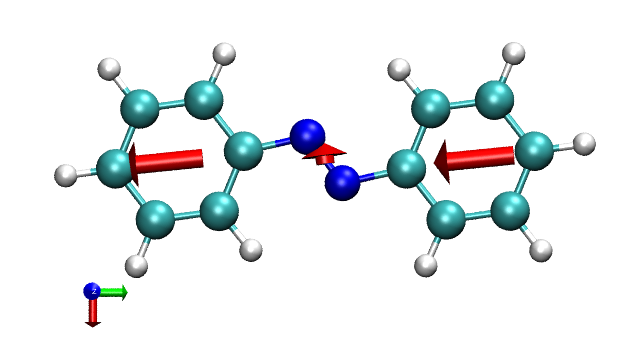

可见两苯基都对总跃迁偶极矩的 Y 分量有显著贡献(图左下坐标轴的红绿蓝分别对应 X、Y、Z 方向)。为定量比较，总跃迁偶极矩矢量及其组成也列在下面

```text
Total：           0.1155  -2.8868  0.0
Phenyl group 1：0.14262 -1.43288 0.0
N2：             -0.16948 -0.02138 0.0
Phenyl group 2：0.14262 -1.43288 0.0
```

若还想在图上把总跃迁偶极矩画成绿色箭头，可输入 *draw color green* 再输入 *dip all*。

也可画每个原子贡献的跃迁偶极矩。为此输入 *draw delete all* 删去所有已有箭头，再输入 *dipatm*，会立即看到

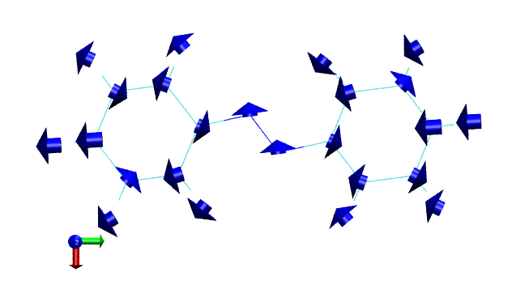

用以上方法分解跃迁偶极矩时有非常重要的一点要注意，即片段的贡献常依赖原点的选择，因为片段的跃迁电荷常不为零。例如，若用空穴-电子分析模块的子功能 6 导出原子跃迁电荷再加和为片段跃迁电荷，会发现第一苯基的值为 0.2116。由于它不为零，可证明若平移偶氮苯的整体坐标，该片段对应的跃迁偶极矩必定变化；换言之，结果不确定。因此，在论文中应仔细讨论片段跃迁偶极矩。

另一非常重要的一点是，由于跃迁偶极矩经 Mulliken 方法分解，电子激发计算中有弥散函数时上面展示的分析方法没有意义。

## **4.18.13 研究单个激发态的电子结构和两激发态之间的差别**

[4.18 节](sec-4-18-electron-excitation-analysis.md)其他大多数小节着重举例说明如何研究电子跃迁特征，但有时想研究单个激发态在特定性质上的特征或两激发态之间的差别。在 Multiwfn 中可像往常一样对激发态做各种波函数分析，但输入文件必须含该激发态的波函数。对能研究激发态的多组态方法，如 CIS 和 TDDFT，激发态波函数必须记录为自然轨道 (natural orbital, NO)，因为 Multiwfn 总是以轨道形式载入波函数。

本节的主要目的是说明用于产生含激发态 NO 的 .mwfn 文件的功能，以便分析该态的波函数特征。强烈建议先读[3.21.13 节](sec-3-21-electron-excitation-analysis.md#32113-产生特定激发态的自然轨道-13)，其中描述了产生激发态 NO 的细节。

> **注**
>
> CIS/TDHF/TDA-DFT/TDDFT 激发态波函数(或密度矩阵)有两种：(1) 非弛豫密度 (2) 弛豫密度。差别已在[3.21.1.1 节](sec-3-21-electron-excitation-analysis.md#32111-理论)详细描述。简单说，前者不如后者真实，但产生后者需要额外代价(比单纯算激发能高得多)。接下来先说明如何基于非弛豫密度对激发态做波函数分析并研究两激发态之间的差别，本节最后还举例说明如何基于弛豫密度分析激发态。

### **激发态波函数分析的例子 (基于非弛豫密度)**

这里以 N-苯基吡咯为例，假设想考察第二单重激发态的 Mayer 键级。为此，先用 *IOp(9/40=4)* 关键词做常规 TDDFT 计算，*examples\excit\N-phenylpyrrole.out* 是输出文件，*examples\excit\N-phenylpyrrole.fch* 是相应的 .fch 文件。几何构型先前已对基态优化。

启动 Multiwfn 并输入以下命令

```text
examples\excit\N-phenylpyrrole.fch
18  // Electron excitation analysis
13  // Generate natural orbitals of specific excited states
examples\excit\N-phenylpyrrole.out
2  // Choose the 2nd excited state
```

现在当前目录下已产生 *NO_0002.mwfn*，它以 NO 形式记录第二激发态的波函数。

重启 Multiwfn 并输入

```text
NO_0002.mwfn
9  // Bond order analysis
1  // Mayer bond order
```

从输出可知 N5-C10 键即连接吡咯和苯部分的键的键级为 0.794。若对 *examples\excit\N-phenylpyrrole.fch* 重复计算，结果对应基态，会发现 Mayer 键级为 0.713。显然，在 S0 极小点从 S0 到 S2 的垂直激发明显削弱 N5-C10 的强度。

### **绘制激发态之间的密度差**

接下来说明如何绘制各激发态之间的密度差(对应非弛豫密度)。事实上这很容易，只需分别产生含两激发态 NO 的 Multiwfn 输入文件，再经[4.5.5 节](sec-4-5-generate-grid-data-and-view-isosurface-map.md#455-绘制电子密度差值图以研究咪唑配位镁卟啉的电子转移)或[4.18.3 节](#4183-基于电子密度差分析电子激发中的电荷转移)所示步骤求差。

仍以 N-苯基吡咯为例。用 *N-phenylpyrrole.fch* 和 *N-phenylpyrrole.out* 重复前述步骤产生 .mwfn 文件，当 Multiwfn 请你输入激发态编号时，输入 *1-3*，则当前目录下产生 *NO_0001.mwfn*、*NO_0002.mwfn* 和 *NO_0003.mwfn*，显然现在可研究 1-2、1-3 和 2-3 之间的密度差。

假设目前想可视化第三与第一激发态之间电子密度差的等值面图，重启 Multiwfn 并输入

```text
NO_0003.mwfn
5  // Calculate grid data
0  // Custom operation
1  // One file will be dealt with the first loaded file
-,NO_0001.mwfn
1  // Electron density
2  // Medium-quality grid
-1  // Visualize isosurface
```

把等值面值设为 0.005 后，得到下图

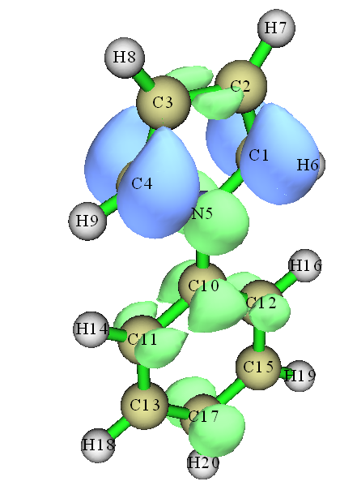

其他激发态之间的密度差图可类似获得。

虽然也可用量子化学程序直接产生含各激发态 NO 的波函数文件，但步骤显然比用 Multiwfn 繁琐得多，因为如上所示，Multiwfn 的优点是能同时为一批激发态产生含 NO 的 .mwfn 文件。

### **计算激发态之间片段电荷的差别**

接下来为例定量研究电子分布的差别，比较激发态 3 和 1 之间吡咯环的片段电荷。

启动 Multiwfn 并输入

```text
NO_0003.mwfn
7  // Population analysis
-1  // Define fragment
1-9  // The pyrrole fragment, which is composed of atoms 1~9
11  // ADCH charge
1  // Use built-in atomic densities
```

会看到

```text
Fragment charge:    0.54421290
```

即第三激发态吡咯环的片段电荷为 0.544。对 *NO_0001.mwfn* 重复计算，会发现吡咯环的电荷为 0.117。数据表明在从第一到第三激发态的(假设)跃迁中，吡咯片段失去 0.544−0.117=0.43 个电子，这很好解释了为什么相应的密度差图中吡咯环周围有明显的等值面且大多数是蓝色。别忘了当前结果仍对应非弛豫激发态密度。

### **激发态的波函数分析 (基于弛豫密度)**

本节最后展示如何基于弛豫密度对激发态做波函数分析。仍以 N-苯基吡咯为例。

准备以下内容的 Gaussian 输入文件。完整文件已提供为 *examples\excit\N-phenylpyrrole_relaxS2.gjf*。

```text
%chk=C:\N-phenylpyrrole_relaxS2.chk
# TD(nstates=5,root=2) cam-b3lyp/6-31+g(d) density
...[ignored]
```

用 Gaussian 运行该文件，则对应第二激发态弛豫密度的密度矩阵写入 *N-phenylpyrrole_relaxS2.chk*。再用 formchk 转为 *N-phenylpyrrole_relaxS2.fch* (也可直接从 <http://sobereva.com/multiwfn/extrafiles/N-phenylpyrrole_relaxS2.zip> 下载)。

先需把密度矩阵变换为 NO。启动 Multiwfn 并输入

```text
N-phenylpyrrole_relaxS2.fch
200  // Other functions, part 2
16  // Generate NOs based on the density matrix in .fch/.fchk
CI  // The label of TDDFT density matrix in the file is “CI”
y  // Export new.mwfn in current folder and then automatically load it, which contains the newly generated NOs
```

现在内存中的轨道已对应基于第二激发态弛豫密度产生的 NO，再做任意波函数分析，例如

```text
0  // Return to main menu
9  // Bond order analysis
1  // Mayer bond order
```

从输出可知 N5-C10 的键级为 0.756，而如前所示，对应非弛豫密度的该值为 0.794。微小差异意味着基于非弛豫密度的分析结果至少定性正确，与基于准确但昂贵的弛豫密度得到的一样有用。

也可能基于弛豫密度计算两激发态之间的密度差。需重复以上步骤两次分别为两不同激发态产生 .mwfn 文件，再像往常一样基于两 .mwfn 文件求密度差。

> **注**
>
> 对 Gaussian 用户，事实上可用如“# PBE1PBE/6-31G\* out=wfn TD(root=*x*)”关键词把激发态 *x* 的 NO 导出到特定 .wfn 文件，也可用作激发态波函数分析的输入文件。但别忘了 Multiwfn 许多功能需要基函数信息，而 .wfn 文件不能提供，因而此时能用的分析种类严重受限。此外，仅用 Gaussian 也可能产生 NO 并存到 .fch 文件，如[第 4 章](4-tutorials-and-examples.md)开头明确描述的，但该步骤相对繁琐。注意这些方式产生的 NO 对应弛豫激发态波函数。若只需要对应非弛豫激发态波函数的 NO，在 route 部分加“density=rhoci”关键词即可。

## **4.18.16 绘制电荷转移光谱并计算所有激发态的主要特征：以 N-苯基吡咯为例**

> **注**
>
> 本节的中文版是我的博客文章“使用 Multiwfn 绘制电荷转移光谱 (CTS) 直观分析电子光谱的内在特征”(<http://sobereva.com/628>)，其中也有扩展讨论。

若不熟悉 IFCT 分析，请先看[3.21.8 节](sec-3-21-electron-excitation-analysis.md#3218-用-ifct-方法计算电子激发中的片段间电荷转移-8)掌握基本知识，并跟随[4.18.8 节](#4188-用-ifct-方法和电荷转移矩阵热图研究电子激发中的片段间电荷转移)经实际例子更好理解 IFCT 分析。在 IFCT 分析之上定义的所谓电荷转移光谱 (charge-transfer spectrum, CTS) 已在[3.21.16 节](sec-3-21-electron-excitation-analysis.md#32116-电荷转移光谱-cts-分析)介绍，跟随本例之前请先读。若工作中涉及 CTS，请引用 *Carbon*, **187**, 78 (2022) DOI: [10.1016/j.carbon.2021.11.005](https://doi.org/10.1016/j.carbon.2021.11.005)，其中我首次提出 CTS 并在补充信息中介绍。

本节举例说明如何计算所有激发态的 IFCT 数据以便轻松识别它们的主要特征，还说明如何绘制 CTS，它能直观揭示 UV-Vis 光谱各峰的本质。

以 N-苯基吡咯为例，用 Gaussian 在 CAM-B3LYP/6-31+G(d) 水平做 TDDFT 计算了五个激发态。注意计算用了 *IOp(9/40=4)* 关键词。本研究把苯基和吡咯基分别定义为两个片段，以便从片段内电子重排和片段间电子转移的角度识别激发态的本质。

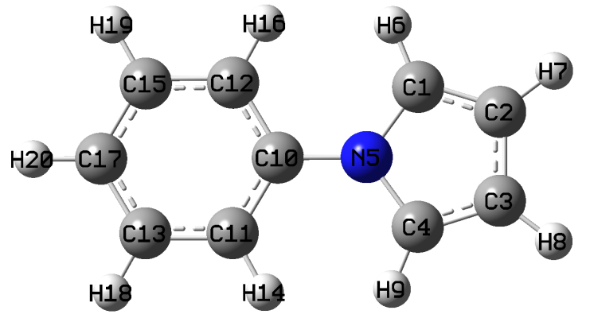

### **计算所有激发态的 IFCT 数据**

启动 Multiwfn 并输入

```text
examples\excit\N-phenylpyrrole.fch  // Produced by TDDFT task of Gaussian
18  // Electron excitation analysis
16  // Calculate charge-transfer spectrum and characters of all excited states
2  // Define two fragments
1-9  // Fragment 1, namely the pyrrole moiety
10-20  // Fragment 2, namely the phenyl moiety
[Press ENTER button directly]  // Load examples\excit\N-phenylpyrrole.out, which is output file of Gaussian TDDFT task
2  // Hirshfeld partition (because diffuse functions were employed in the TDDFT task, Mulliken-like partition should not be used here)
```

然后 Multiwfn 依次计算每个激发态的 IFCT 项，所得空穴和电子分布打印在屏幕上。计算完成后，当前目录下得到 *IFCTdata.txt* 和 *IFCTmajor.txt*，还发现新的子文件夹 "CT_multiple" (该子文件夹已在“examples\excit\”提供)。

*IFCTdata.txt* 的内容如下。可见它含所有激发态的详细 IFCT 分析结果。各项的含义容易理解。例如，hole(1) 和 ele(1) 分别对应片段 1 (吡咯) 对空穴和电子分布的贡献。redis(1) 表示片段 1 内的电子重排量。1-\>2 表示从片段 1 到片段 2 的电子转移量。

```text
state  hole(1) ele(1)  hole(2) ele(2)  redis(1) redis(2)  1->2   1<-2
   1   0.5191  0.3931  0.4809  0.6069   0.2041   0.2918  0.3150 0.1890
   2   0.2452  0.0742  0.7548  0.9258   0.0182   0.6988  0.2270 0.0560
   3   0.9522  0.4356  0.0478  0.5644   0.4148   0.0270  0.5375 0.0208
   4   0.9812  0.7392  0.0188  0.2608   0.7253   0.0049  0.2560 0.0139
   5   0.9620  0.0779  0.0380  0.9221   0.0749   0.0351  0.8871 0.0030
```

由于 *IFCTdata.txt* 数据很多，很难快速识别激发态的主要特征，尤其定义的片段多于两个时。因此 Multiwfn 还导出 *IFCTmajor.txt*，其中只展示每个激发贡献大于 5% 的 IFCT 项。该文件的内容为

```text
state    f     nm
   1  0.3935  245.0:  Redis(1) 20.4 %  Redis(2) 29.2 %  1->2 31.5 %  1<-2 18.9 %
   2  0.0139  244.4:  Redis(2) 69.9 %  1->2 22.7 %  1<-2  5.6 %
   3  0.0214  236.4:  Redis(1) 41.5 %  1->2 53.7 %
   4  0.0000  208.9:  Redis(1) 72.5 %  1->2 25.6 %
   5  0.1674  207.8:  Redis(1)  7.5 %  1->2 88.7 %
```

可见振子强度 (f)、波长 (nm) 以及主要 IFCT 项清楚展示。显然激发态 5 (S5) 主要表现电荷转移特征，而激发态 1 (S1) 表现强混合特征。由于其他激发态的 *f* 都很小，它们对 UV-Vis 光谱没有明显贡献。

### **绘制电荷转移光谱 (CTS)**

我提出的电荷转移光谱 (CTS) 指把总 UV-Vis 光谱分解为各 IFCT 项分别贡献的子光谱，从而图形化展示每个明显峰的潜在本质。要画这种光谱，重启 Multiwfn 并输入

```text
CT_multiple\CT_multiple.txt  // The list file containing input files for plotting various types of CTS and corresponding legends
11  // The main function for plotting spectrum
3  // UV-Vis
0  // Plot spectrum
```

现在屏幕上显示光谱。稍调绘图设置使它更好看。关闭光谱再输入

```text
22  // Set thickness of curves/lines/texts/axes/grid
1  // Set thickness of curves
5
0  // Return
17  // Other plotting settings
11  // Set position of legends
8  // Upper left corner
10  // Set text size of legend
45
0  // Return
3  // Set lower and upper limit of X-axis
170,300,20  // Lower limit, upper limit, and label interval
0  // Replot
```

当前的 CTS 如下

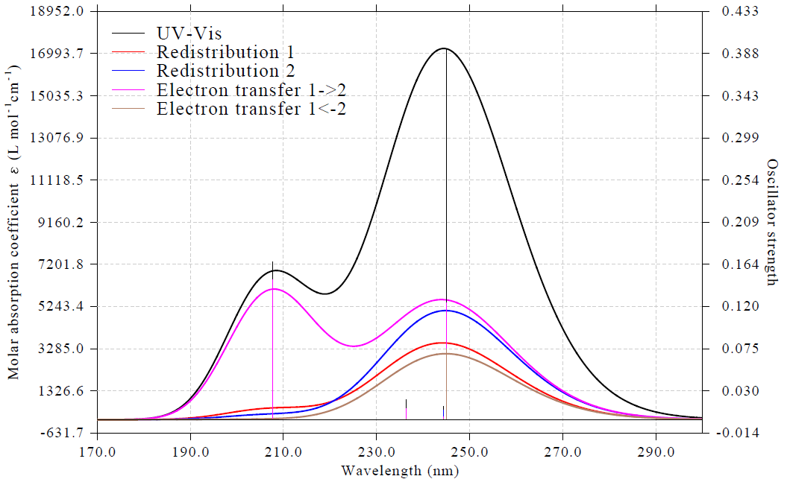

可清楚看到，210 nm 附近的峰基本对应纯电荷转移激发，因为该区域“Electron transfer 1-\>2”曲线接近黑色 UV-Vis 光谱曲线。约 245 nm 的最高峰表现高度杂化特征，两条片段内电子重排曲线和两条片段间电子转移曲线都表现出相当的高度。

本例相对简单，因为只定义了两个片段，事实上可定义任意多个片段。例如，若定义三个片段(如分别对应 D-π-A 体系的 D、π、A 部分)，CTS 有 9 条曲线，即：redis(1)、redis(2)、redis(3)、1-\>2、1-\>3、2-\>3、1\<-2、1\<-3、2\<-3。

## **4.18.17 基于电子激发做电子密度极化分析的例子**

本节说明如何做基于电子激发的电子密度极化分析，该方法在 *J. Phys. Chem. A*, **124**, 633 (2020) 提出。请先仔细读[3.21.17 节](sec-3-21-electron-excitation-analysis.md#32117-基于电子激发的电子密度极化分析)掌握基本知识。本节重现 *J. Phys. Chem. A* 论文的第一个例子，它用 -0.1 e 点电荷近似模拟 SN₂ 反应起始阶段的亲核试剂。发生亲核进攻的分子是 CH₃Cl。点电荷与碳的距离任意设为 3 Å。见下图。

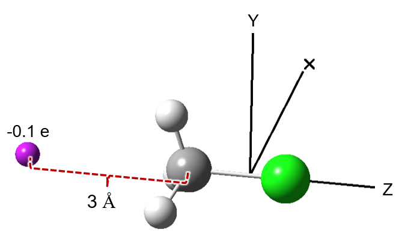

本例用 ωB97XD/def2-TZVP 水平对 CH₃Cl 做 50 个激发态的 TDDFT 任务，几何在 B3LYP/def-TZVP 水平优化。Gaussian 输入输出文件已在“examples\excit\CH3Cl\”文件夹提供，由所得 .chk 文件转的 .fch 文件提供为 *CH3Cl.fch*。注意任务用了 *IOp(9/40=4)* 关键词，必要性已在[3.21.A 节](sec-3-21-electron-excitation-analysis.md#321a-电子激发分析模块的基本信息)强调。由于碳原子的 XYZ 坐标为 (0.0, 0.0, -1.13395200) Å，按上图，显然点电荷应放在 (0.0, 0.0, -4.13395200) Å。

启动 Multiwfn 并输入

```text
CH3Cl.fch
18  // Electron excitation analyses
17  // Electron density polarization analysis based on electron excitations
1  // Only one point charge will be set as the external potential
0.0,0.0,-4.13395200,-0.1  // XYZ coordinate (Å) and value (e) of the point charge
2  // Medium-quality grid (corresponding to grid spacing of 0.2 Bohr. If you want to reduce cost, low-quality grid can also be used)
[Press ENTER button]  // Load the Gaussian output file CH3Cl.out, which is in the same folder as the CH3Cl.fch
```

现在 Multiwfn 依次计算 50 个激发态的数据，会看到以下输出：

```text
Excited state contributions:
  State #    Exc. Ene (Ha)       c_k          E2(kJ/mol)
       1        0.273727     -0.00000190     -0.00000000
       2        0.273727     -0.00000299     -0.00000001
       3        0.339810      0.00000105     -0.00000000
...[ignored...]
      50        0.705411     -0.00008669     -0.00001392

 Excited state contributions sorted by |c_k|:
  State #    Exc. Ene (Ha)       c_k          E2(kJ/mol)
       9        0.421066      0.00755963     -0.06317769
      22        0.503194     -0.00329586     -0.01435108
      14        0.456544     -0.00278408     -0.00929093
      42        0.651216     -0.00259838     -0.01154363
      38        0.633059     -0.00208700     -0.00723935
      47        0.666453      0.00156450     -0.00428287
...[ignored...]

 Total E2:   -0.001206 eV (   -0.1164 kJ/mol)
 Integral of density polarization:    5.01383559E-07
 Amount of electrons polarized:  0.01196258
```

可见第 9 激发态的 $c_{k}$ 最大，对 $E^{(2)}$ 贡献最大，所以该激发态值得进一步考察。“Total E2”和“Amount of electrons polarized”分别对应 $E^{(2)}$ 和 *δN*，它们量级小是因为点电荷小且离任何原子不太近。

选选项“1 Visualize isosurface of density polarization”可视化 *ρ*$_{pol}$ 再把等值面值改为 0.0002，会看到下图左图，其中绿和蓝分别对应正(电子积累)和负(电子耗尽)区。为便于理解，所放点电荷的位置在图中自动画成 Bq 原子。这样得到的 *ρ*$_{pol}$ 是近似的。若想获得严格的 *ρ*$_{pol}$ (下图右图)，应该用通常方法，即取有和无背景电荷算得的电子密度之差(画电子密度图的方法请参阅[4.5.5 节](sec-4-5-generate-grid-data-and-view-isosurface-map.md#455-绘制电子密度差值图以研究咪唑配位镁卟啉的电子转移))，有和无背景电荷产生的波函数文件分别对应 *examples\excit\CH3Cl\bkchg\CH3Cl_Q.fch* 和前述 *CH3Cl.fch*。可见近似 *ρ*$_{pol}$ 和严格 *ρ*$_{pol}$ 定性一致，表明用微扰理论估计的近似 *ρ*$_{pol}$ 有意义。

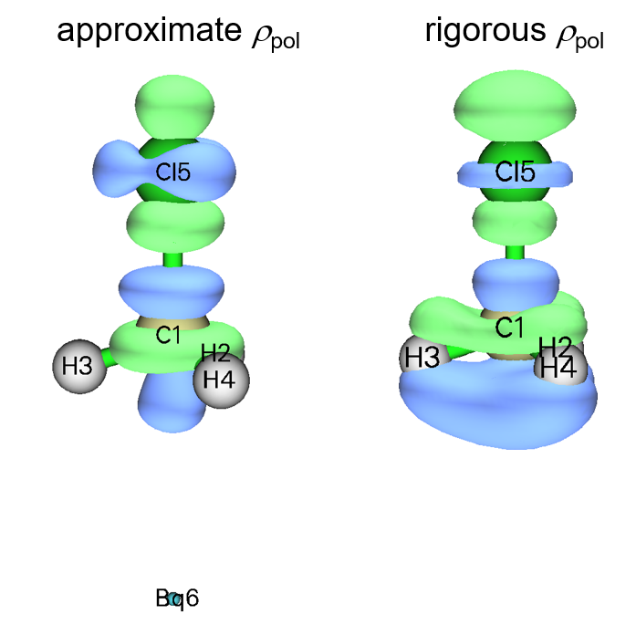

从上图可见 Cl-C 键轴末端有电子密度降低的区域，所以可认为当携带局域负电荷、触发 SN₂ 反应的亲核试剂靠近碳原子时，碳原子变得更亲电。

接下来选选项“2 Visualize isosurface of transition density of an excited state”再输入 9 可视化对 *ρ*$_{pol}$ 贡献最大的第 9 电子激发的跃迁密度。等值面值设为 0.004 后，看到下图，其中绿和蓝分别代表正部和负部。可见其分布与 *ρ*$_{pol}$ 相当接近，进一步证实从基态到第 9 激发态的激发对响应外势的电子密度重排有最关键的贡献。值得一提的是，第 *k* 个电子激发对 *ρ*$_{pol}$ 的贡献就是 $2{c}_{k}{\rho}_{0}^{k}$，其中 ${\rho}_{0}^{k}$ 是跃迁密度。

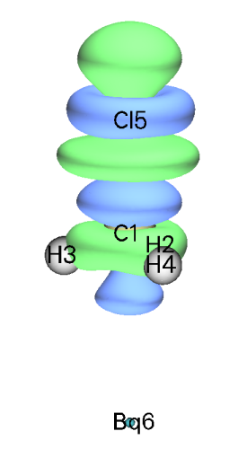

用 NTO 分析从轨道跃迁图像更好理解第 9 电子激发的本质，例子见[4.18.6 节](#4186-产生并分析尿嘧啶的自然跃迁轨道-nto)，若有主导的分子轨道跃迁也可直接看分子轨道图。若用[3.21.15 节](sec-3-21-electron-excitation-analysis.md#32115-打印所有激发态中的主要-mo-跃迁)介绍的功能，会发现第 9 电子激发主要 (81.7%) 由 HOMO-2 到 LUMO 的跃迁主导，它们的等值面图用主功能 0 画出如下。可见 HOMO-2 表现 C-H 和 C-Cl 键的成键特征，而 LUMO 表现 C-Cl 键的反键特征。所以，可得出结论，外加点电荷的微扰导致电子从成键轨道转移到反键轨道，C-Cl 键因而被削弱。该推测可直接经算键级证实。基于 *CH3Cl.fch* 算得 C-Cl 键的 Mayer 和 Laplacian 键级分别为 1.068 和 0.432，而对 *CH3Cl_Q.fch* 算得的值分别为 1.061 和 0.428，清楚表明点电荷的存在可察觉地降低 C-Cl 成键强度。如前所述，点电荷用于模拟 CH₃Cl 的 SN₂ 反应起始阶段的亲核试剂，我们的观察表明亲核试剂所带电荷产生的静电势引发 C-Cl 键断裂。

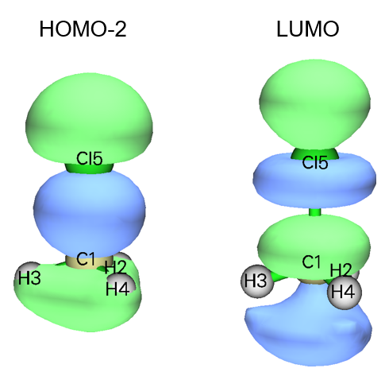

最后，若对外势的分布有兴趣，可选选项“3 Visualize isosurface of external potential”，会发现等值面是球形且恰包住点电荷。

从该例子可见，用电子激发分析电子密度极化确实对化学体系响应外微扰提供有价值的独特洞察。更多应用例子和讨论见 *J. Phys. Chem. A*, **124**, 633 (2020) 和 *J. Comput. Chem.*, **42**, 1118 (2021)。

## **4.18.18 计算 (P)-\[6\]螺烯 ECD/CPL 不对称因子 (*g*) 的例子**

请看[3.21.18 节](sec-3-21-electron-excitation-analysis.md#32118-计算手性体系的-ecdcpl-不对称因子-g)了解本节说明功能的相关背景信息和特点。本节举例说明如何用 Multiwfn 轻松计算典型手性分子 (*P*)-\[6\]螺烯的 ECD 和 CPL 不对称因子 (*g*)，还展示跃迁电偶极矩和磁偶极矩可非常方便可视化。说明用 Gaussian 的 TDDFT 输出文件，其他电子激发任务的 ORCA 输出文件也可用 (例子文件 *examples\excit\g_factor\TDDFT_S0geom_ORCA.out*)。

### **ECD 光谱的不对称因子 (*g*\_CD)**

*examples\excit\g_factor\TDDFT_S0geom.out* 是用 Gaussian 16 在 CAM-B3LYP/def2-SV(P) 水平对基态结构(用同样水平优化)算的螺烯 TDDFT 任务的输出文件，计算了 30 个激发态，用 IEFPCM 溶剂化模型表示 CH₂Cl₂ 溶剂环境。这里获得这些态的 $g_{\mathrm{CD}}$ 及相关信息。启动 Multiwfn，载入该文件，再输入

```text
18  // Electron excitation analyses
18  // Calculate ECD/CPL dissymmetry factor (g) of chiral systems
1  // This study is for ECD
```

然后 Multiwfn 从 Gaussian 输出文件载入跃迁电偶极矩和磁偶极矩并打印在屏幕上，输出所有激发态的 $g_{\mathrm{CD}}$ 以及与其密切相关的各量：

```text
 Wavlen: Wavelength (nm)
 |e_tran|: Magnitude of transition electric dipole moment (in 1E-20 esu*cm)
 |m_tran|: Magnitude of transition magnetic dipole moment (in 1E-20 erg/Gauss)
 angle: Angle between transition electric and magnetic moments (degree)
 R: Rotatory strength (in 1E-40 cgs = erg*esu*cm/Gauss)
 D: Dipole strength (in 1E-38 cgs = esu^2*cm^2)
 g: ECD dissymmetry factor (dimensionless)

 State Wavlen  |e_tran| |m_tran| angle  cos(angle)     R        D        g
    1   339.5    63.17    0.272   90.01    -0.000      0.0     39.9   0.000003
    2   320.6    28.09    0.078    0.00     1.000     -2.2      7.9  -0.011134
    3   303.5   611.95    3.922  110.89    -0.357    856.0   3745.0   0.009143
    4   288.0   106.78    0.307    0.00     1.000    -32.8    114.0  -0.011492
...[ignored...]
   29   182.1   182.09    0.280  180.00    -1.000     51.0    331.6   0.006156
   30   181.8    97.30    0.811  153.75    -0.897     70.8     94.7   0.029912
```

显然 S₃ 应是实验 ECD 和 UV-Vis 光谱中最低可观察的激发，因为 S₁ 和 S₂ 的旋光强度 (*R*) 和偶极强度 (*D*) 都可忽略。注意到在关于螺烯衍生物的研究工作 *Chem. Sci.*, **12**, 5522 (2021) 中，实际的 S₃ 甚至(有点混淆地)标为 S₁，因为它是第一个光学活性的吸收。S₃ 的 $g_{\mathrm{CD}}$ 为 0.0091，与 *Chem. Sci.*, **12**, 5522 (2021) 图 3(f) 报道的 0.85×10⁻² 符合得很好。

现在在 VMD 可视化程序 (<http://www.ks.uiuc.edu/Research/vmd/>) 中直观查看 S₃ 的跃迁电偶极矩 ( ${\boldsymbol{\mu}}^{\mathrm{tran}}$ ) 和跃迁磁偶极矩 ( ${\mathbf{m}}^{\mathrm{tran}}$ )。在本功能的后处理菜单选选项“2 Export current structure to .pdb file”再输入 *S0.pdb*，在当前目录产生名为“S0.pdb”的 pdb 文件，含当前结构。再选选项“1 Generate VMD script file for visualizing transition electric/magnetic moments”再输入 *ECD.vmd*，在当前目录产生名为“ECD.vmd”的 VMD 脚本。

启动 VMD (推荐 1.9.3 版)，把 *S0.pdb* 载入其中，用 licorice 风格画分子结构。把 *ECD.vmd* 移到 VMD 文件夹并在 VMD 控制台窗口运行 `source ECD.vmd` 执行脚本。之后在 VMD 控制台窗口运行 *emtran 3*，把 S₃ 的 ${\boldsymbol{\mu}}^{\mathrm{tran}}$ 和 ${\mathbf{m}}^{\mathrm{tran}}$ 分别画成红和青色箭头，如下所示。默认箭头长 5 Å，箭头半径 0.15 Å。微调绘图设置的方法见 *ECD.vmd* 顶部的注释。

![Transition electric and magnetic dipole moment vectors of the S1 state of (P)-\[6\]helicene](assets/figures/ch4/image1225.png)

接下来看 S₂。S₂ 态的 ${\boldsymbol{\mu}}^{\mathrm{tran}}$ 和 ${\mathbf{m}}^{\mathrm{tran}}$ 都恰平行于 Z 轴。在一张图中一起画时，必须稍移动箭头中心使它们视觉上可区分。在 VMD 控制台窗口运行命令：*emtran 2 5 5 0.15 0 0.3 0 0 -0.3 0*，其中“5 5 0.15”指两箭头长都是 5 Å，半径 0.15 Å。“0 0.3 0”和“0 -0.3 0”指红蓝箭头的中心分别移动 (0.0 0.3 0.0) 和 (0.0 -0.3 0.0) Å。现在看到下图，由于中心移动，两箭头不重叠。

![Transition electric and magnetic dipole moment vectors of the S2 state of (P)-\[6\]helicene](assets/figures/ch4/image1226.png)

### **CPL 的不对称因子 (*g*\_CPL)**

*examples\excit\g_factor\TDDFT_opt_S1.out* 是螺烯 S₁ 态的 TDDFT 几何优化的输出文件，以 S₀ 极小为初始几何。只算了 3 个激发态，这足够了，因为 CPL 的发射态就是 S1 (Kasha 规则)。为获得 $g_{\mathrm{CPL}}$，把该文件载入 Multiwfn，进入主功能 18 的子功能 18，Multiwfn 载入最后输出的 ${\boldsymbol{\mu}}^{\mathrm{tran}}$ 和 ${\mathbf{m}}^{\mathrm{tran}}$，它们对应 S₁ 极小结构的数据。再选“2 This study is for CPL”，屏幕上看到以下信息：

```text
 State Wavlen  |e_tran| |m_tran| angle  cos(angle)     R        D        g
    1   372.4    72.32    0.226   97.32    -0.127     -2.1     52.3  -0.001592
    2   348.4    45.88    0.137  180.00    -1.000     -6.3     21.0  -0.011926
    3   334.0   748.12    3.693   73.04     0.292    805.8   5597.0   0.005759
```

显然，$g_{\mathrm{CPL}}$ 为 -0.0016，与 *Commun. Chem.*, **1**, 38 (2026) 表 1 报道的相同分子相同溶剂下的实验值 -0.0009 符号相同。*Chem. Sci.*, **12**, 5522 (2021) 图 3(f) 报道的相应值为 +0.0013，他们的计算水平与我们相同，大小与我们非常接近，但符号不同。我怀疑他们在符号上搞错了。$g_{\mathrm{CPL}}$ 与 S₁ 的 $g_{\mathrm{CD}}$ (0.000003) 的差别来自 S₀ 和 S₁ 极小之间微小的结构差别。如前所示，还可让 Multiwfn 把当前结构导出为 pdb 文件并导出 VMD 脚本以可视化 S₁ 的 ${\boldsymbol{\mu}}^{\mathrm{tran}}$ 和 ${\mathbf{m}}^{\mathrm{tran}}$ 从而洞察 $g_{\mathrm{CPL}}$。文件已在“examples\excit\g_factor\”文件夹提供为 *S1.pdb* 和 *CPL.vmd*。
