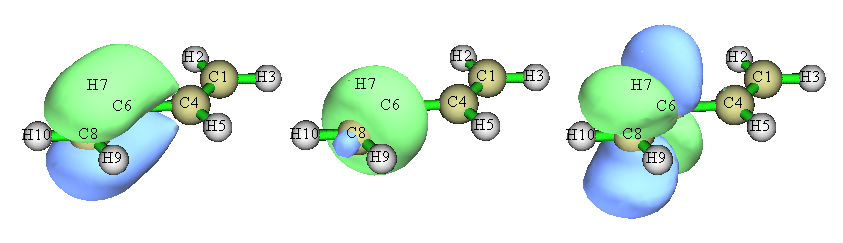
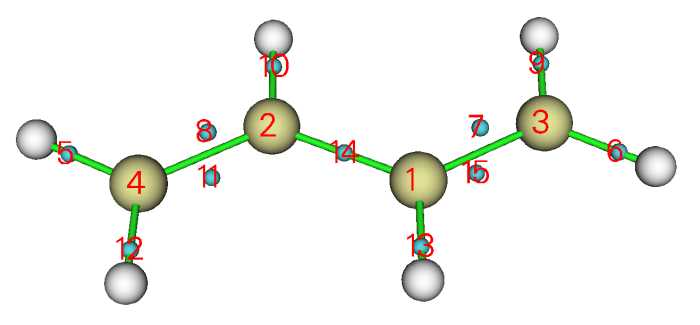
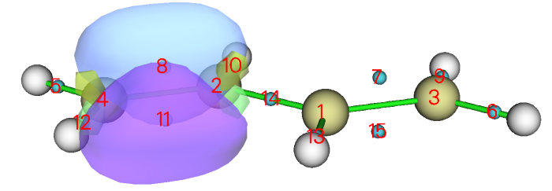
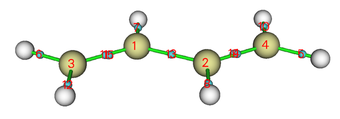
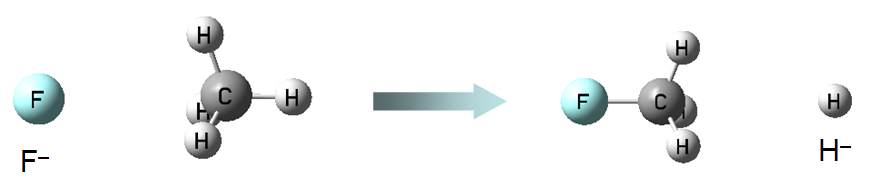
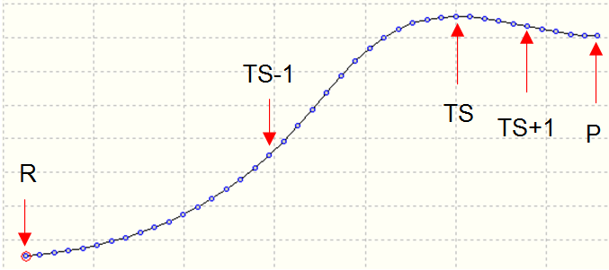
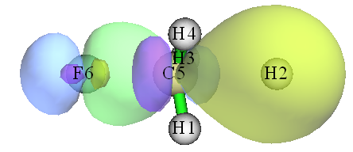
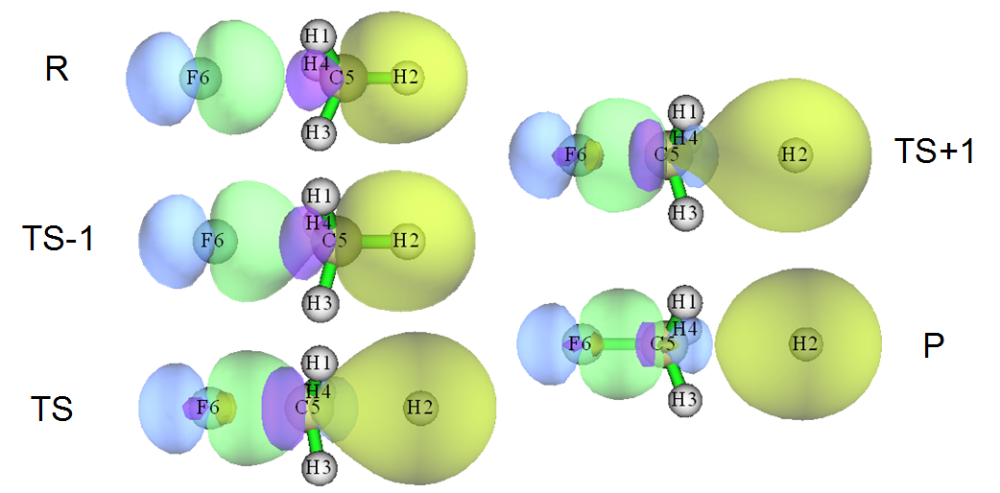
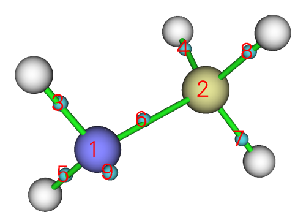

# **4.19 轨道定域化 (Orbital localization) 分析**

> **注**
>
> 本节大部分内容也可见我的博客文章“Multiwfn 轨道定域化功能的使用以及与 NBO 和 AdNDP 分析的比较”(<http://sobereva.com/380>，中文)。

轨道定域化是一种非常强大而有用的技术，它可以将通常表现出高度离域特征的正则分子轨道转化为定域形式，即定域分子轨道 (localized molecular orbital, LMO)。LMO 与化学键、孤对电子等许多经典化学概念密切相关，因此可用于分析和揭示许多有化学意义的问题。阅读本节之前，请先阅读[3.22 节](sec-3-22-orbital-localization-analysis.md)以掌握一些基础知识。其他章节中的一些例子，如[4.8.4 节](sec-4-8-molecular-orbital-composition-analysis.md#484-用lobamloba方法计算氧化态)和 [4.100.22 节](sec-4-100-other-functions-part-1.md#410022-分析非平面体系-non-planar-system的π电子-π-electron特征环庚三烯-cycloheptatriene)中的例子，也用到了轨道定域化功能。

**注意：** 当大量使用弥散函数时，不建议使用默认的轨道定域化方法，即基于 Mulliken 布居的 Pipek-Mezey 方法 (PM-Mulliken)，否则结果可能具有误导性。如果必须使用弥散函数，应改用基于 Becke 布居的 Pipek-Mezey 方法 (PM-Becke) 或 Foster-Boys 方法，各种轨道定域化方法的优缺点见[3.22 节](sec-3-22-orbital-localization-analysis.md)。

## **4.19.1 用 Pipek-Mezey 方法定域 1,3-丁二烯的分子轨道**

本节以反式-1,3-丁二烯为例说明 Multiwfn 轨道定域化分析的用法。

### **进行 LMO 分析的基本步骤**

输入文件为 *examples\butadiene.fch*，由 B3LYP/6-31G\*\* 水平得到。你可以先通过主功能 0 观察它的分子轨道，会发现所有分子轨道都高度离域，没有一个与化学键理论的经典概念直接对应。现在我们进行轨道定域化，将它们转化为更具化学意义的轨道。启动 Multiwfn 并输入

```text
examples\butadiene.fch
19  // Orbital localization. By default, Pipek-Mezey localization method based on Mulliken population is used
2  // Perform localization for both occupied and unoccupied MOs
```

由于该体系很小，定域化迭代立即收敛，并打印出所得轨道的主要特征。此后 Multiwfn 自动将 LMO 导出为当前目录下的 *new.fch* 并加载它。此时，内存中的轨道系数已完全更新为 LMO。你可以用不同方式表征它们。我们进入主功能 0 观察这些轨道，会发现所有轨道都表现出很强的定域特征，尤其是占据轨道。下面是涉及 C6-C8 的三个 LMO 的截图，前两个是占据轨道，分别对应 σ 键和 π 键；第三个是非占据轨道，可大致判断为反 π 键轨道。



### **计算 LMO 能量**

可以计算 LMO 的能量，如下所示。启动 Multiwfn 并输入

```text
examples\butadiene.fch
19  // Orbital localization
-4  // Allow Multiwfn to generate and print energy for LMOs
1  // Evaluate energies of the LMOs using the Fock matrix generated by MO energies and coefficients via F=SCEC^-1 relationship
2  // Localize both occupied and unoccupied orbitals
```

计算完成后，Multiwfn 计算 LMO 的能量并按能量从低到高排序。你可以在屏幕上找到所有 LMO 的能量。最高占据与最低非占据 LMO 的信息如下所示

```text
   14   Energy:   -0.2750728 a.u.      -7.4851 eV   Type: A+B   Occ: 2.0
   15   Energy:   -0.2750728 a.u.      -7.4851 eV   Type: A+B   Occ: 2.0
   16   Energy:    0.2185911 a.u.       5.9482 eV   Type: A+B   Occ: 0.0
   17   Energy:    0.2185913 a.u.       5.9482 eV   Type: A+B   Occ: 0.0
```

请在主功能 0 中绘制这些轨道，尝试判断它们的特征。

> **注**
>
> 顺便一提，也可以基于从外部文件载入的 Fock 矩阵计算 LMO 的能量(详见[附录 7](sec-6-7-about-providing-fock-ks-matrix-to-multiwfn.md))，如果无法基于分子轨道能量和系数成功生成 Fock 矩阵，这是唯一的选择。例如，Fock 矩阵可以从 NBO .47 文件载入；对当前体系要实现这一点，可以进入主功能 100 并选择子功能 2，再选择选项 10 将当前体系导出为 Gaussian 输入文件。然后适当修改输入文件，要求 Gaussian 输出 .47 文件，并确保计算水平与 *examples\butadiene.fch* (B3LYP/6-31G\*\*) 完全一致。准备好的输入文件已提供为 *examples\butadiene_47.gjf*。用 Gaussian 运行它，你会在 C: 盘根目录下找到所得的 *BUTADIENE.47*(该文件已提供为 *examples\butadiene.47*)。在主功能 19 中，选择选项 -4 允许 Multiwfn 计算 LMO 能量后，若选择子选项“2 Evaluate, loading Fock matrix from a file”并输入 .47 文件的路径，.47 文件中记录的 Fock 矩阵将被载入，并在适当时候用于计算 LMO 轨道能量。

### **显示所有 LMO 的中心位置**

可以将所有生成的 LMO 的中心位置可视化，从而立即了解 LMO 的分布。这里我说明如何实现。

重新启动 Multiwfn 并输入

```text
examples\butadiene.fch
19  // Orbital localization
-8  // Switch status of “If calculating center position and dipole moment of LMOs” to “Yes”
-6  // Change localization method
10  // Foster-Boys
1  // Localize occupied orbitals (center position of unoccupied LMOs is generally uninteresting therefore we do not localize unoccupied MOs)
n  // Skip the dipole moment analysis
```

从提示可以看到，轨道定域化像往常一样完成后、新生成的 *new.fch* 被自动载入 Multiwfn 后，程序计算每个 LMO 的中心位置。为了便于可视化这些中心，Multiwfn 在当前体系中加入 Bq 原子(即“鬼原子”)来代表 LMO 的中心。中心坐标以及 LMO 编号与 Bq 编号的对应关系自动导出到当前目录下的 *LMOcen.txt*。本次计算该文件的内容为

```text
 LMO     1 corresponds to Bq    11, X,Y,Z:    1.1372    0.7759   -0.0000 Bohr
 LMO     2 corresponds to Bq    12, X,Y,Z:   -1.1372   -0.7759   -0.0000 Bohr
 LMO     3 corresponds to Bq    13, X,Y,Z:    1.1372    3.3081   -0.0000 Bohr
...[ignored]
```

然后我们回到主菜单，进入主功能 0 可视化 LMO 中心和轨道等值面。绘图设置已自动设为特别适合显示 LMO 的状态，此时你可以看到：



从这张图可以非常清楚地了解生成的 LMO 的分布。每个青色小球是一个鬼原子，代表一个 LMO 的中心。在当前设置下鬼原子的编号从 1 开始，因此图中显示的编号直接对应 LMO 编号。例如，我们想同时显示边界 C-C 键处的两个 LMO，由于标号为 8 和 11 的青色小球位于该键附近，我们在轨道列表中选择轨道 8 显示它，再选择“Show+Sel. isour#2”并选择轨道 11。之后将等值面值改为 0.13，并将绘制风格设为透明，你将看到



显然，经 Foster-Boys 方法得到的两个 LMO 共同表现了边界 C-C 键的双键特征。这两个 LMO 被称为“香蕉”轨道，不表现出 σ-π 分离特征。

你也可以尝试可视化经 Pipek-Mezey 方法生成的 LMO 的中心位置。由于该方法将每个双键表示为一对分离的 σ 和 π LMO，它们的中心应该非常靠近，从下图可以看到这些中心确实几乎无法区分：



值得注意的是，有两种方法可以快速找到感兴趣化学键对应的 LMO 的编号。第一种是查看轨道定域化过程中打印的轨道成分，第二种是直接可视化 LMO 中心，在适当位置找到青色小球上方显示的编号，正如我刚才演示的。

## **4.19.2 分析 SN2 反应中定域分子轨道的变化**

在本例中，我们研究定域分子轨道 (LMO) 沿反应路径的变化，以直观显示化学键的变化，以一个典型的 SN2 反应为例。



该 SN₂ 反应涉及 F-C 键的形成和 C-H 键的断裂，因此在下面的分析中我们将关注相应的两个 LMO。该 SN₂ 反应的 IRC 如下所示，共考虑了五个点，它们的 .fch 文件已提供在 *examples\SN2* 文件夹中。



首先，我们为过渡态 (TS) 几何构型生成 LMO。启动 Multiwfn 并输入

```text
examples\SN2\TS.fch
19  // Orbital localization
1  // Localize occupied orbitals
0  // Visualize orbitals
```

可以发现有两个轨道分别对应 F-C 键和 C-H 键，为了便于比较我们将它们画在一起



绿-蓝等值面和紫-黄等值面清楚地描绘了分别对应 F-C 键和 C-H 键的轨道。

我们对 *R.fch*、*TS-1.fch*、*TS+1.fch* 和 *P.fch* 绘制同样的图，再把图放在一起，如下所示



从图中，SN₂ 反应过程中化学键的变化非常清楚(R→TS-1→TS→TS+1→P)。在反应物状态，绿-蓝等值面对应氟原子的孤对电子，而紫-黄等值面表现出 C-H 典型的共价键特征。随着反应进行，两个 LMO 平滑变化，C-F 共价键特征越来越突出，在最终产物状态，紫-黄等值面代表的 LMO 已对应于 H⁻ 阴离子的 1s 轨道。

## **4.19.3 表征 \[Re₂Cl₈\]²⁻ 阴离子的 Re-Re 键**

人们普遍认为 \[Re₂Cl₈\]²⁻ 阴离子中的 Re-Re 键是四重键，构型为 (σ²π⁴δ²)。σ 键来自两个铼原子 ${d}_{{z}^{2}-{p}_{z}}$ 杂化轨道的重叠，两个 π 键来自它们的 $d_{\mathrm{xz}}$ 和 $d_{\mathrm{yz}}$ 轨道的重叠，而 δ 键由它们的 $d_{\mathrm{xy}}$ 轨道重叠形成。这一经典概念能否经由轨道定域化分析得到验证？

在 B3LYP 下对 Cl 用 6-31G\*、对 Re 用 SDD 得到的 \[Re₂Cl₈\]²⁻ 阴离子的 .fchk 文件提供为 *examples\Re2Cl82-.fchk*。将其载入 Multiwfn 并对占据轨道做轨道定域化，从输出中可以立即辨认出对应 Re-Re 键的四个 LMO：

> **提示**
>
> 如果想更容易找到对应 Re1-Re2 键的 LMO 的编号，最好的办法是在启动 Multiwfn 之前将 *settings.ini* 中的 "iprintLMOorder" 设为 1。此后，LMO 的成分将按原子和原子对的顺序打印。

```text
Almost two-center LMOs: (Sum of two largest contributions > 80.0%)
  57:   7(Cl) 73.8%   2(Re) 22.5%        58:  10(Cl) 73.8%   2(Re) 22.5%
  59:   4(Cl) 73.8%   1(Re) 22.5%        60:   2(Re) 48.1%   1(Re) 48.1%
  61:   8(Cl) 73.8%   2(Re) 22.5%        62:   3(Cl) 73.8%   1(Re) 22.5%
  64:   1(Re) 45.9%   2(Re) 45.9%        66:   6(Cl) 73.8%   1(Re) 22.5%
  67:   9(Cl) 73.8%   2(Re) 22.5%        69:   5(Cl) 73.8%   1(Re) 22.5%
  83:   1(Re) 45.9%   2(Re) 45.9%        84:   2(Re) 43.6%   1(Re) 43.6%
```

然后我们进入主功能 0 观察它们(默认等值面值为 0.05)：

![Four localized molecular orbitals of the \[Re2Cl8\]2- anion](assets/figures/ch4/image1235.png)

从 LMO 的等值面图可以清楚看出，LMO60 对应 σ 键，LMO64 和 LMO83 对应 π 键，LMO84 对应 δ 键。这一观察支持四重键的说法。

然而，如果计算 Mayer 键级，会发现情况没那么简单。用主功能 9 计算的 Re-Re 键的 Mayer 键级为 2.94，为什么该值明显低于预期的 4.0？

为深入理解，我们用主功能 9 对 Re-Re 键做“轨道占据数微扰 Mayer 键级 (Orbital occupancy-perturbed Mayer bond order)”分析，输出为

```text
Mayer bond order after orbital occupancy-perturbation:
 Orbital     Occ      Energy    Bond order   Variance
...[Ignored]
    60     2.00000   -0.14354    2.001481   -0.935449
...[Ignored]
    64     2.00000   -0.12793    2.276388   -0.660542
...[Ignored]
    83     2.00000   -0.01749    2.276388   -0.660542
    84     2.00000    0.02809    2.466317   -0.470613
```

结果表明，σ LMO 的贡献为 0.935，每个 π LMO 贡献 0.661，δ LMO 贡献 0.471。虽然原则上 Mayer 键级不能被精确分解，但这些数据足以帮助我们理解每个成键 LMO 的相对重要性。显然 σ 键对 Re-Re 键最重要，而 δ 键的重要性相对最低。

现在产生了一个新问题，为什么四个 LMO 对 Re-Re 键 Mayer 键级的贡献不同？用更小的等值面值观察它们的等值面也许能回答这个问题。下面展示了等值面值为 0.01 时四个 LMO 的图形

![The same four localized molecular orbitals of \[Re2Cl8\]2- from another view](assets/figures/ch4/image1236.png)

从图中发现，LMO60 基本只分布在两个 Re 原子周围，因此它对 Re-Re Mayer 键级的贡献应接近 1.0。LMO64 和 LMO83 都略微离域到四个 Cl 原子，因此它们并不纯粹表现 Re-Re 键特征，对 Re-Re Mayer 键级的贡献较低。LMO84 离域到全部八个 Cl 原子，自然可以预期它对 Re-Re Mayer 键级的贡献最小。

顺便一提，如果你有兴趣，可以对 Cr₂ 做轨道占据数微扰 Mayer 键级分析，会发现 Mayer 键级几乎恰好为 6.0，且对应 Cr-Cr 键的六个轨道基本每个都贡献 1.0，这主要是因为这些轨道没有离域到任何其他原子上。

## **4.19.4 基于 CH₃NH₂ 的双中心 LMO 研究键偶极矩**

Multiwfn 支持几种计算键偶极矩的方法，如[4.A.11 节](sec-4-A-special-topics-and-advanced-tutorials.md#4a11-研究化学键的方法概述)所述。本节以 CH₃NH₂ 为例，说明基于双中心 LMO 可以研究键偶极矩，它在某种程度上反映键极性。相关理论介绍见[3.22 节](sec-3-22-orbital-localization-analysis.md)。

启动 Multiwfn 并输入

```text
examples\CDA\CH3NH2\CH3NH2.fch
19  // Orbital localization
-8  // Switch status of “If calculating center position and dipole moment of LMOs” to “Yes”
1  // Localize occupied orbitals
y  // Perform dipole moment analysis for the LMOs
```

此时当前目录下已生成 *LMOdip.txt*，在该文件中可以找到以下内容，它们是用[3.22 节](sec-3-22-orbital-localization-analysis.md)“专题 3”所示的特殊方法计算的：

```text
Single-center orbital dipole moments (a.u.):
    1 (   5N )  X/Y/Z:  -0.04465   0.01500   0.00001  Norm:   0.04710
    2 (   1C )  X/Y/Z:   0.00010   0.00014   0.00000  Norm:   0.00017
    9 (   5N )  X/Y/Z:  -1.28448   0.41598   0.00001  Norm:   1.35016
 Sum            X/Y/Z:  -1.32903   0.43112   0.00001  Norm:   1.39721

 Two-center bond dipole moments (a.u.):
    3 (   5N  -   6H )  X/Y/Z:  -0.08951  -0.20801   0.30542  Norm:   0.38021
    4 (   1C  -   4H )  X/Y/Z:  -0.06753   0.08375  -0.00000  Norm:   0.10758
    5 (   5N  -   7H )  X/Y/Z:  -0.08950  -0.20802  -0.30543  Norm:   0.38022
    6 (   5N  -   1C )  X/Y/Z:   0.17708   0.25312  -0.00000  Norm:   0.30891
    7 (   1C  -   3H )  X/Y/Z:   0.08532   0.06534  -0.09566  Norm:   0.14387
    8 (   1C  -   2H )  X/Y/Z:   0.08532   0.06534   0.09566  Norm:   0.14387
 Sum                    X/Y/Z:   0.10119   0.05152  -0.00001  Norm:   0.11355
```

进入主功能 0 后，可以看到下图



对照该图和 *LMOdip.txt* 的内容，可以发现分别对应 N5 和 C1 内层轨道的 LMO1 和 LMO2 极性可忽略不计(即“norm”基本为零)，反映 LMO 中心非常靠近原子核位置。LMO9 对应 N5 的孤对电子轨道，其“norm”高达 1.35 a.u.，表明 LMO 中心明显偏离 N5 原子核。LMO3 和 5 对应 N-H 键，LMO4、7 和 8 对应 C-H 键，众所周知 C-H 的极性应低于 N-H，这一点被它们“Norm”值的差异很好地反映出来。对应 C-N 键的 LMO6 的“Norm”为 0.3089，很好地表明 C-N 是极性键这一事实。

此外，在当前体系中 N5 和 C1 的 Y 坐标分别为 -1.438 和 1.330 Bohr。LMO6 的键偶极矩的 Y 分量为 0.253，是明显的正值。这一观察表明负、正电荷中心分别位于 N5 和 C1 一侧，与氮的电负性大于碳的事实相符。
