# **4.20 弱相互作用的可视化研究**

## **4.20.1 用 NCI 方法研究 2-吡哆素 2-氨基吡啶中的弱相互作用**

请先仔细阅读第 [3.23.1](sec-3-23-visual-study-of-weak-interaction.md#3231-非共价相互作用-noncovalent-interaction-nci分析-1) 节，理解理论以及如何使用 Multiwfn 进行 NCI 分析。此外，书籍章节 DOI: [10.1016/B978-0-12-821978-2.00076-3](https://doi.org/10.1016/B978-0-12-821978-2.00076-3) 和 *Angew. Chem. Int. Ed.*, **137**, e202504895 (2025) DOI: [10.1002/anie.202504895](https://doi.org/10.1002/anie.202504895) 对 NCI 做了非常详细的介绍。

2-吡哆素 2-氨基吡啶体系中的弱相互作用特征已在第 [4.2.1](sec-4-2-topology-analysis.md#421-2-吡哆醇-2-氨基吡啶的分子中的原子-aim-拓扑分析与芳香性分析) 节中用 AIM 理论研究过，本节我们也对它做 NCI 分析，同时我将展示如何把填色 RDG 图和 AIM 拓扑图画在同一张图上。

启动 Multiwfn 并输入

```text
examples\2-pyridoxine_2-aminopyridine.wfn
20  // Visual study of weak interaction
1  // NCI analysis
2  // Medium-quality grid
```

稍等片刻，格点数据计算完毕。然后可选择 -1 查看散点图，从中可对体系中的相互作用做初步考察。

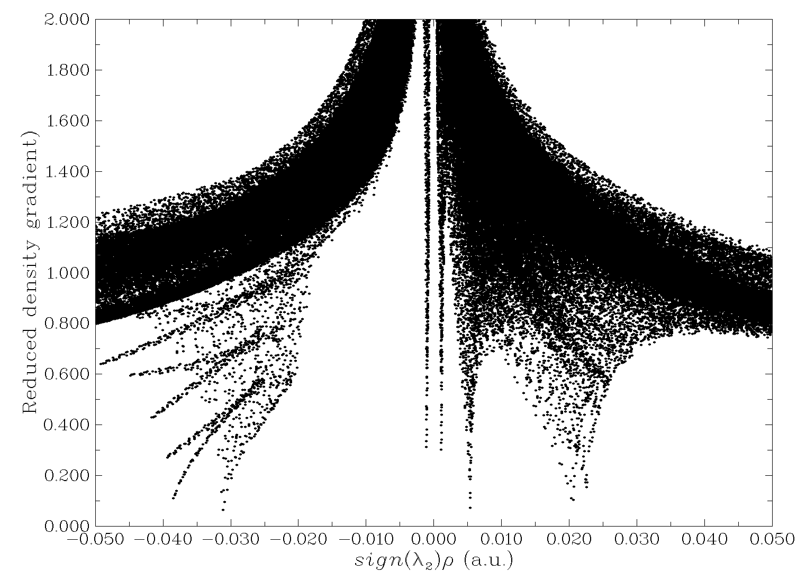

由于在 *sign*(*λ*₂)*ρ* 很负的区域存在尖峰（接近底部的点），根据第 [3.23.1](sec-3-23-visual-study-of-weak-interaction.md#3231-非共价相互作用-noncovalent-interaction-nci分析-1) 节对 NCI 方法的描述，我们立刻知道该二聚体体系中必定存在明显的分子间吸引相互作用。在很正的一侧也有一个尖峰，因此当前体系中应存在空间位阻效应。

然后选择选项 3 导出 *func1.cub* 和 *func2.cub*，用第 [3.23.1](sec-3-23-visual-study-of-weak-interaction.md#3231-非共价相互作用-noncovalent-interaction-nci分析-1) 节所述方法使用 VMD 绘制填色 RDG 图，得到下图

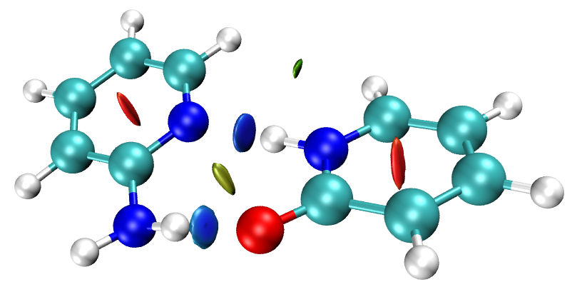

现在该体系中相互作用的类型非常清楚。芳香环内存在空间位阻效应，因为相应等值面的颜色为红色。两个氢键 N⋅⋅⋅⋅⋅H-N 和 N-H⋅⋅⋅⋅⋅O 应该很强，因为相应的 RDG 等值面呈蓝色。两个氢之间也有一个 RDG 等值面，由于其颜色为绿色，应视为范德华相互作用，非常弱。该区域对应散点图中间的尖峰。

### **在填色 RDG 图上展示 AIM 信息**

下面我说明如何在填色 RDG 图上绘制 AIM 临界点 (CPs) 和键径，所得图形信息量更大，因为相互作用的轨迹被生动地展示出来，而这类信息在 NCI 分析中并未明确揭示。

返回主菜单，输入以下命令搜索临界点、生成键径，然后分别将其导出为当前文件夹下的 *CPs.pdb* 和 *paths.pdb*。

```text
2  // Topology analysis
2  // Search nuclear CPs
3  // Search bond CPs
8  // Generate bond path
-4  // Modify or export CPs
6  // Export CPs as CPs.pdb in current folder
0  // Return
-5  // Modify or print detail or export paths
6  // Export paths as paths.pdb in current folder
```

然后关闭 Multiwfn。依次把 *CPs.pdb* 和 *paths.pdb* 拖入 VMD 主窗口加载，选择 "Graphics"-"Representation"，把 "Selected molecules" 改为第二项（对应 *CPs.pdb*），把 "Drawing Method" 改为 "VDW"，并把 "Sphere Scale" 从默认的 1.0 设为最小值 0.1。注意在 *CPs.pdb* 文件中，C、N、O、F 原子分别对应 (3,-3)、(3,-1)、(3,+1)、(3,+3)。这里我们只想在图上用黄色绘制键临界点（即 (3,-1) 型临界点），因此在 "Selected Atoms" 文本框中输入 "nitrogen" 并按回车，然后把 "Coloring Method" 改为 "Color ID"，在下拉框中选择 "4 yellow"。此时图形如下所示

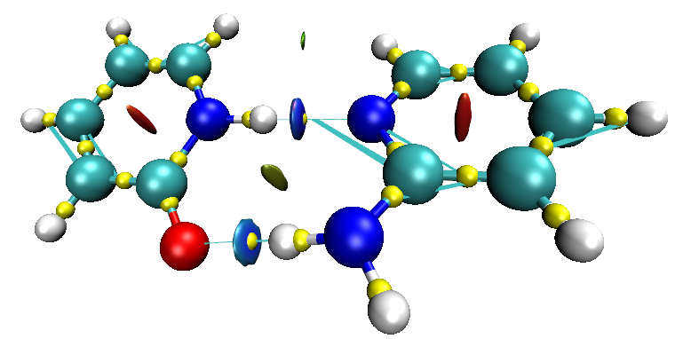

你可能觉得对应临界点的小球太大，但由于 VMD 的限制，无法通过图形窗口进一步减小 "Sphere Scale"。要让小球更小，必须在 VMD 控制台窗口中使用相应命令。要找到合适的命令，可选择 "File"-"Log Tcl Commands to Console"，然后把 "Sphere Scale" 改为其它值（例如 0.2），你会立刻在 VMD 控制台窗口中看到相应的文本行命令，当前该命令为 `mol modstyle 0 1 VDW 0.200000 12.000000`，其中参数 0.2 对应小球尺寸。因此，要把小球尺寸减小到例如 0.09，应在控制台窗口输入 `mol modstyle 0 1 VDW 0.09 12.000000`，然后在 VMD 图形窗口中就会看到小球已经变小了。

接下来改变键径的外观。在 "Graphics"-"Representation" 面板中，选择 "Selected molecules" 中的第三项（对应 paths.pdb），把绘制方法改为 "VDW"，着色方法设为 "Color ID" 并选择 "3 orange"，然后用上述技巧把小球尺寸设为 0.02。最终图形如下所示。

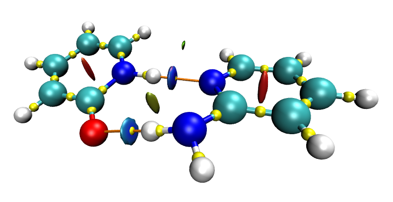

从该图不仅可以清楚地看到弱相互作用区域，还生动地展示了相互作用路径。注意 H-H 相互作用没有对应的临界点和键径，因为该区域不存在电子密度梯度为零的位置，这也是为什么散点图中对应此 H-H 相互作用的尖峰没有完全触及图底部的原因。这一观察反映了 NCI 分析相对于 AIM 分析的一个优势，即即使没有对应的键临界点，相互作用也能被揭示出来。

在 VMD 中显示临界点和键径的步骤有些繁琐，因此我**强烈**建议使用 VMD 绘图脚本自动完成上述所有步骤，请看本视频教程的第 4 部分：<https://youtu.be/e4FpVc9ao48>，你会发现整个过程极其简单。关于该脚本的更多信息见第 [4.2.5](sec-4-2-topology-analysis.md#425-基于-multiwfn-输出在-vmd-可视化程序中轻松绘制高质量-aim-拓扑图) 节。

## **4.20.2 基于前分子密度的 NCI 方法研究 DNA 中的弱相互作用**

如果你不熟悉 NCI 分析和前分子 (promolecular) 近似的概念，请阅读第 [3.23.1](sec-3-23-visual-study-of-weak-interaction.md#3231-非共价相互作用-noncovalent-interaction-nci分析-1) 和 [3.23.2](sec-3-23-visual-study-of-weak-interaction.md#3232-基于前分子-promolecular密度的-nci-分析-2) 节。本例中，我们将对一个由 10 个碱基对组成的 DNA 片段做 NCI 分析。由于该体系相当大，采用前分子近似来快速近似构建分子电子密度。本例也在本视频教程的第 3 部分中演示：<https://youtu.be/e4FpVc9ao48>。

这里我们只研究 DNA 局部区域的弱相互作用特征，该区域被框在透明盒子中：

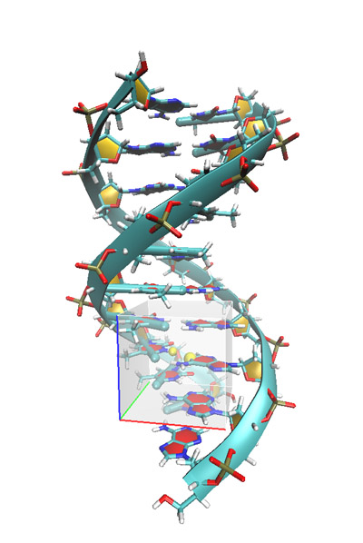

启动 Multiwfn 并输入：

```text
examples\DNA.pdb
20  // Visual study of weak interaction
2  // NCI analysis based on promolecular density
7  // Use mode 7 for defining grid data
84,565  // Use midpoint of atom 84 and 565 as center of grid data. You can view molecule structure in your favourite visualization tool to find two proper atoms used to define center
120,120,120  // Because the spatial scope of grid data is large, we need relatively large number of grid points, otherwise the grid spacing will be too large, which results in bad quality of RDG isosurfaces
9,9,9  // Set the extension distances in all directions to 9 Bohr
```

> **提示**
>
> 你也可以用模式 10 在 GUI 窗口中交互式设置盒子，盒子大小和盒子中心位置更可控

格点数据计算完毕后，选择选项 3 把 *sign*(*λ*₂)*ρ* 和 RDG 分别导出为当前文件夹下的 *func1.cub* 和 *func2.cub*，然后把它们以及 *examples\RDGfill_pro.vmd* 复制到 VMD 安装文件夹。启动 VMD，在控制台窗口输入 `source RDGfill_pro.vmd` 绘制填色 RDG 等值面图，经过适当调整后结果如下所示。（为获得更好的可视化效果，打开 "graphics"-"Representation"，把 DNA 的绘制方法改为 Licorice，把键半径改为 0.2。然后进入“Display”-“Display settings...”，把“Cue Mode”设为 "Linear"，把“Cue Start/End”分别设为 2.25 和 3.75，以便大幅屏蔽远处的原子）。最后你将得到下图……

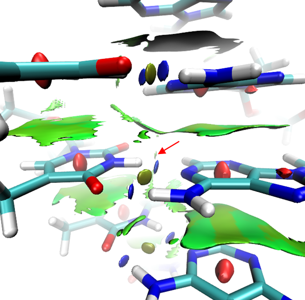

很清楚，相邻碱基对之间存在 π-π 堆积相互作用（大的扁平等值面），每个碱基对之间有两个强氢键。红色箭头所指区域看似是氢键，因为它连接着氢和氧，但由于填充色为绿色，我们可以断定它只能视为范德华 (vdW) 相互作用。

*RDGfill_pro.vmd* 中的默认等值 0.3 适合当前情形，但可能不适合展示其它体系的弱相互作用区域，此时需手动调节。你可以直接编辑 .vmd 文件，也可以在 VMD 中选择“Graphics”-“Representation”，选中样式为“Isosurface”的表示，在文本框中输入期望值重置等值。

## **4.20.3 用 aNCI 方法可视化研究体相环境中水的弱相互作用**

> **注 1**
>
> 本节介绍的 aNCI 方法**已经过时**，改用 amIGM 方法要好得多，见第 [4.20.13](#42013-用-amigm-揭示动态环境中的弱相互作用) 节的说明。

> **注 2**
>
> 本节的中文版是我的博文“用 Multiwfn 研究分子动力学中的弱相互作用”(<http://sobereva.com/186>)，其中还包含扩展讨论。

如果你不熟悉 NCI 和 aNCI 方法，请先阅读第 [3.23.1](sec-3-23-visual-study-of-weak-interaction.md#3231-非共价相互作用-noncovalent-interaction-nci分析-1)、[3.23.2](sec-3-23-visual-study-of-weak-interaction.md#3232-基于前分子-promolecular密度的-nci-分析-2)、[3.23.3](sec-3-23-visual-study-of-weak-interaction.md#3233-平均-nci-分析-anci3) 节的介绍、书籍章节 DOI: [10.1016/B978-0-12-821978-2.00076-3](https://doi.org/10.1016/B978-0-12-821978-2.00076-3)，以及 *Angew. Chem. Int. Ed.*, **137**, e202504895 (2025) DOI: [10.1002/anie.202504895](https://doi.org/10.1002/anie.202504895)。本节介绍的 aNCI 方法是 NCI 分析方法在动态环境（例如分子……）中的推广。

在本例中，我将展示如何用 Multiwfn 可视化研究体相水体系 MD 模拟中水分子间的弱相互作用。你可以用任何程序做 MD 模拟，只要知道如何把私有格式的轨迹转为通用的可被 Multiwfn 识别并用于 aNCI 分析的 .xyz 格式即可。

这里假设你是 GROMACS 4.5 用户。MD 过程的详细步骤如下（与 GROMACS \>= 5.0 很不同），所有相关文件都可在 *examples\aNCI* 文件夹中找到。如果你不想自己做 MD 模拟，可直接下载稍后用于 aNCI 分析的 *wat.xyz*：<http://sobereva.com/multiwfn/extrafiles/aNCI_wat_xyz.zip>。

### **用 GROMACS 生成 MD 轨迹**

首先建立名为 *emptybox.gro* 的文件，记录一个空盒子，每个方向边长为 2.5nm。然后运行以下命令向盒子中填充水。

```text
genbox -cp emptybox.gro -cs spc216.gro -o water.gro
```

运行以下命令并选择 "GROMOS96 53a6 force field" 得到体相水体系的 top 文件。采用 SPC/E 水模型。

```text
pdb2gmx -f water.gro -o water.gro -p water.top -water spce
```

然后在 298.15 K、1 atm 环境下做 100ps 的 NPT MD 以平衡体相水。

```text
grompp -f pr.mdp -c water.gro -p water.top -o water-pr.tpr
mdrun -v -deffnm water-pr
```

用 VMD 程序加载 *water-pr.gro*，选择靠近盒子中心的一个水。我们选择 *resid 编号为 101* 的水，如下图所示高亮显示。注意该水中两个氢的编号为 302 和 303，氧的编号为 301。

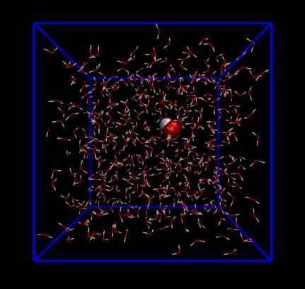

该水将在接下来的 MD 模拟中被冻结。为此生成 index 文件，即输入以下命令

```text
make_ndx -f water-pr.gro
ri 101
q
```

运行以下命令在 298.15 K 下做 1 ns 平衡 MD 模拟，轨迹每 1 ps 保存一次，最终得到 1000 帧。resid 编号为 101 的水通过关键词 "freezegrps = r_101" 被冻结。注意用的是 NVT 系综而非 NPT，因为 NPT 过程会缩放原子坐标，一定程度上破坏冻结效果。

```text
grompp -f md.mdp -c water-pr.gro -p water.top -o water-md.tpr -n index.ndx
mdrun -v -deffnm water-md
```

把 *water-pr.gro* 加载进 VMD，再把 *water-md.xtc* 加载到同一 ID，选择 "File"-"Save Coordinate..." 选项，文件类型设为 xyz，在 "Selected atoms" 框中输入 *all*，在 "First" 和 "Last" 窗口分别输入 *1* 和 *1000*。最后点击 "Save" 按钮把 GROMACS 轨迹转为 *wat.xyz*。

**重要提示**：当前的 *wat.xyz* 记录的是原子名而非元素名。例如若用文本编辑器打开该文件，会发现每个水含有 OW、HW1 和 HW2，它们都是原子名。而标准 .xyz 文件中应只记录原子元素。因此一般情况下，你应手动把 VMD 生成的 .xyz 文件中的所有原子名替换为元素名。幸运的是，本例可跳过这一步，因为元素周期表中没有名为 OW、HW1 和 HW2 的元素，因此 Multiwfn 只会采用原子名的首字母来尝试识别其元素，可被正确识别为氧和氢，加载 .xyz 文件后你会在屏幕上看到提示“Formula: H1022 O511”，这正是我们期望的。若你在“formula”中发现了不期望的元素，那就意味着你必须把 .xyz 文件中相应的原子名替换为其实际元素名。

### **用 Multiwfn 生成格点数据**

启动 Multiwfn 并输入以下命令

```text
wat.xyz
20  // Visual study of weak interaction
3  // aNCI analysis
1,1000  // The range of the frames to be analyzed
7
301,301  // Using atom 301 (the oxygen of the frozen water) as the box center of the grid data
80,80,80  // The number of grid points on each side
4.5,4.5,4.5  // Extend 4.5 Bohr in each side
```

现在 Multiwfn 开始计算每一帧的电子密度、梯度和 Hessian，然后得到它们的平均量，最后计算平均 RDG 和平均 *sign*(*λ*₂)*ρ*。整个过程很耗时，在常见的 Intel 4 核计算机上约需半小时。（注意这里所说的电子密度是用前分子 (promolecular) 近似产生的，即简单叠加处于自由态的原子的密度而构建）

计算完毕后，可选选项 1 查看平均 RDG（X 轴）与平均 *sign*(*λ*₂)*ρ*（Y 轴）之间的散点图，如下，也有一个选项可把相应数据点导出为纯文本文件。

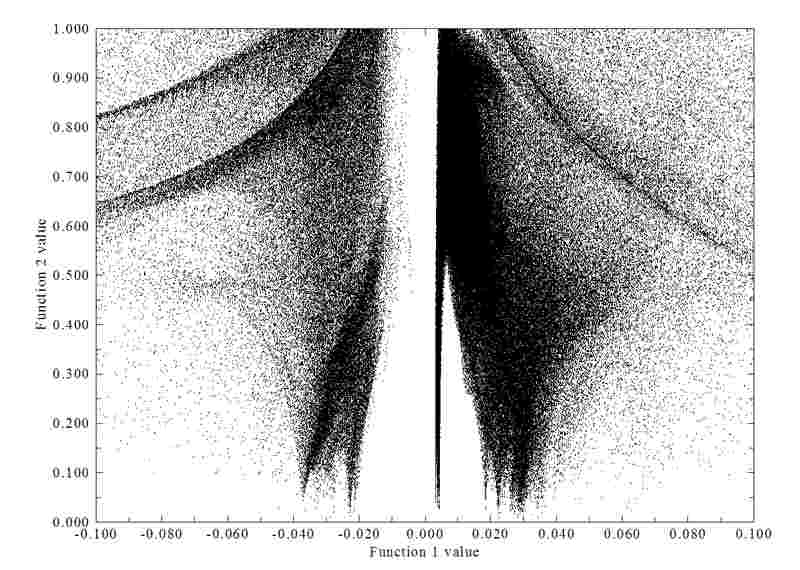

选选项 6 把平均 RDG 和平均 *sign*(*λ*₂)*ρ* 的格点数据分别导出为当前文件夹下的 *avgRDG.cub* 和 *avgsl2r.cub*。

由于我们还想考察弱相互作用的稳定性，再选 7 把热涨落指数导出为当前文件夹下的 *thermflu.cub*。注意该过程需要重新计算每一帧的电子密度，因此很耗时。

### **分析**

把 *avgRDG.cub*、*avgsl2r.cub*、*thermflu.cub* 以及 "examples\aNCI" 文件夹中的 *avgRDG.vmd* 和 *avgRDG_TFI.vmd* 复制到 VMD 程序所在目录。

直接启动 VMD，在其控制台窗口输入 `source avgRDG.vmd`，平均 RDG 等值面将以 0.25 的等值显示，同时平均 *sign*(*λ*₂)*ρ* 以不同颜色映射在等值面上。为使图形更清楚，应屏蔽无关原子，即进入 "Graphics" - "Representation"，选中 "style" 为 "CPK" 的条目，在 "Selected Atoms" 框中输入 `serial 301 302 303` 然后按回车。此时图中只呈现 resid 编号为 101 的水。适当旋转和平移视角后，你将看到

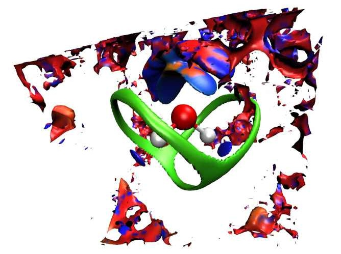

不幸的是，所关注的水周围有大量噪音等值面，多少扰乱了图形，因此最好将其屏蔽。该目的可通过 Multiwfn 的主功能 13 实现，步骤如下。

然后启动 Multiwfn 并输入

```text
avgRDG.cub
13  // Process grid data
13  // Set the value of the grid points far away from specific atoms
1.5  // If the distance between a grid point and any selected atoms is longer than 1.5 times of vdW radius of corresponding atom, then the value of the grid point will be set as given value
100  // An arbitrarily large value (should be larger than the isovalue of the RDG isosurfaces)
2  // Inputting selected atoms by hand
301-303  // The indices of the atoms are 301, 302 and 303
0  // Export the updated grid data to a new cube file
avgRDG.cub  // The name of the new cube file
```

把新生成的 *avgRDG.cub* 复制到 VMD 程序文件夹覆盖旧文件，再用脚本 *avgRDG.vmd* 绘图，经过适当调整后你将看到（为清楚起见，同时展示两侧视角）
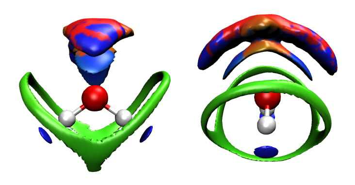

这次得到的图形非常清楚。颜色标尺从 -0.25 到 0.25，对应 Blue-Green-Red（蓝-绿-红）的颜色变化。越蓝表示相应区域的静电相互作用或氢键效应越强，越红表示空间位阻效应越强。绿色区域意味着电子密度低，对应 vdW 相互作用。从图中可见两个氢附近有两个蓝色椭圆，表明在 MD 过程中由于 O-H 基团形成了强氢键。细长的绿色等值面展示了该水倾向于通过 vdW 相互作用与其它水相互作用的方向。氧上方有一大块等值面，其中间部分呈红色，而蓝色出现在两端；后者反映氧的两对孤对电子在模拟过程中作为氢键受体，而前者揭示水之间的排斥相互作用区。

接下来研究弱相互作用的稳定性。先关闭当前等值面，然后在控制台窗口输入命令 `source avgRDG_TFI.vmd`，经过适当调整后你将看到

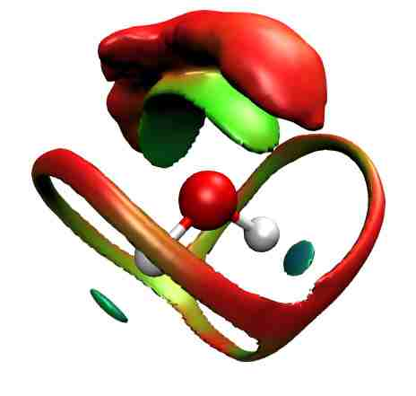

颜色标尺为 0\~1.5，仍对应 Blue-Green-Red 的颜色过渡。越蓝（红）意味着热涨落指数 (TFI) 越小（大），因而相应区域的弱相互作用越稳定（不稳定）。图中显示，该水作为氢键给体是稳定的，而作为氢键受体的稳定性稍弱；vdW 相互作用区域完全呈红色，表明与氢键相比 vdW 相互作用明显不稳定。

最后值得一提的是，用 aNCI 方法可以画出一幅很漂亮的图，生动揭示配体与蛋白间的相互作用，如下图所示。绘制该图的详细步骤已在本帖中描述：“用 Multiwfn 做 aNCI 分析以图形化研究动态过程中的蛋白-配体相互作用”(<http://sobereva.com/591>，中文)。若通过谷歌翻译仍不能完全理解该文，请联系我，我会找时间把它译成英文。

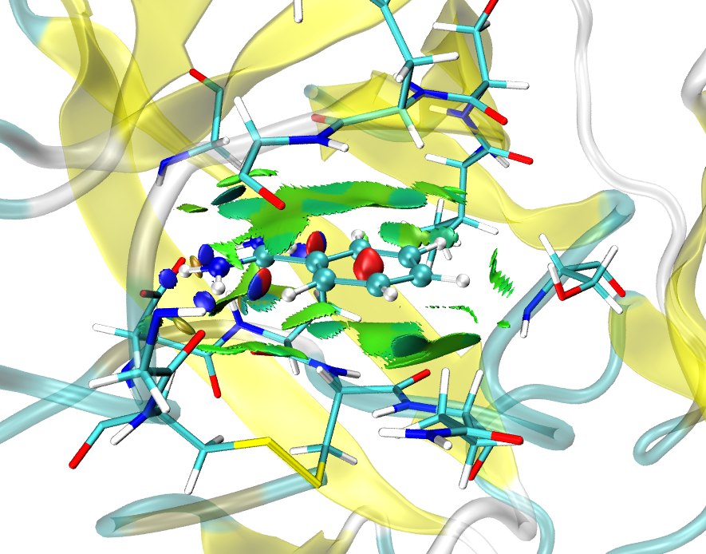

## **4.20.4 用 IRI 分析揭示苯酚二聚体中的化学键和弱相互作用区域**

IRI（相互作用区域指示函数，Interaction Region Indicator）由我提出，见 *Chemistry−Methods*, **1**, 231 (2021)。在学习本节前，请先阅读原始论文、本手册第 [3.23.8](sec-3-23-visual-study-of-weak-interaction.md#3238-相互作用区域指示函数-interaction-region-indicator-iri与-iri-π-分析-4) 节和 DOI: [10.1016/B978-0-12-821978-2.00076-3](https://doi.org/10.1016/B978-0-12-821978-2.00076-3)，先掌握 IRI 的基本知识。这里我用两个例子分别展示如何绘制 *sign*(*λ*₂)*ρ* 映射的 IRI 等值面和 IRI 平面图，以同时揭示化学键和弱相互作用区域。

此外，Multiwfn 还可对 IRI 做拓扑分析以定量研究它，见第 [4.2.11](sec-4-2-topology-analysis.md#4211-相互作用区指示剂-iri-和约化密度梯度-rdg-的拓扑分析) 节。

关于 IRI 分析的更多信息，请下载文档“用 Multiwfn 做 IRI 分析的教程”并照做：<http://sobereva.com/multiwfn/res/IRI_tutorial.zip>。该文档还详细描述了做 IRI-π 分析的步骤。IRI-π 是 IRI 的变体，旨在生动揭示 π 相互作用。

> **注**
>
> 强烈建议阅读我的这篇博文：“用 IRI 方法图形化研究化学体系中的化学键和弱相互作用”(<http://sobereva.com/598>，中文)，其中仔细描述了 IRI 的特征，给出了更丰富的讨论，提供了更多例子。

### **绘制 *sign*(*λ*₂)*ρ* 映射的 IRI 等值面**

这里以苯酚二聚体为例。你会发现几乎所有步骤都与第 [3.23.1](sec-3-23-visual-study-of-weak-interaction.md#3231-非共价相互作用-noncovalent-interaction-nci分析-1) 节所述的 NCI 分析完全相同。

启动 Multiwfn 并输入

```text
examples\PhenolDimer.wfn
20  // Visual study of weak interaction
4  // IRI analysis
3  // High-quality grid
3  // Export cube file
```

把 *func1.cub*、*func2.cub* 和绘图脚本 *examples\IRIfill.vmd* 移到 VMD 文件夹。然后启动 VMD，在 VMD 控制台窗口输入 `source IRIfill.vmd` 执行脚本，立刻看到下图（在 "Graphics" - "Representation" 中原子的球尺寸已减小到 0.6）。

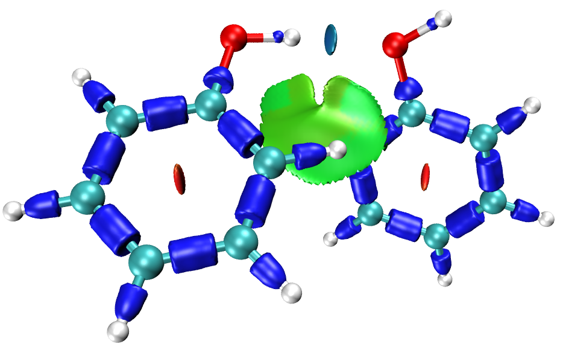

*IRIfill.vmd* 脚本采用以下颜色标尺。下图也解释了各种颜色的含义。

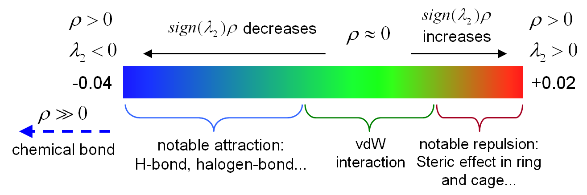

IRI 图的图形效果显然相当令人满意。弱相互作用区域展示得与 NCI 分析一样好，化学键区域也被蓝色等值面清楚揭示，表明这些区域电子密度很大，意味着成键效应很强。

注意最合适的 IRI 函数等值对不同体系可能不同，*IRIfill.vmd* 脚本中的默认等值为 1.0。你可在 .vmd 脚本文件中修改它（即该脚本中 "mol representation Isosurface" 后面的值），或在 VMD 的 "Graphics" - "Representations" 面板中手动调节。

### **绘制 IRI 与 *sign*(*λ*₂)*ρ* 之间的散点图**

算完 IRI 格点数据后，可选“2 Output scatter points to output.txt in current folder”，生成的 *output.txt* 包含每个格点的 X、Y、Z、IRI 和 *sign*(*λ*₂)*ρ*。利用该文件和 gnuplot 绘图脚本 *examples\scripts\IRIscatter.gnu*，可绘制 IRI 与 *sign*(*λ*₂)*ρ* 之间的填色散点图。Gnuplot 可从 <http://www.gnuplot.info> 免费获得。把 *output.txt* 和 *IRIscatter.gnu* 移到含 gnuplot 可执行文件的文件夹，然后在该文件夹运行命令：`gnuplot IRIscatter.gnu`，之后会在当前文件夹得到 *IRIscatter.ps*。可用 Acrobat、Photoshop 或 IrfanView（需安装 ghostscript）打开，或先用在线图像转换器 <https://cloudconvert.com/image-converter> 转换成其它图像格式再打开，你将看到

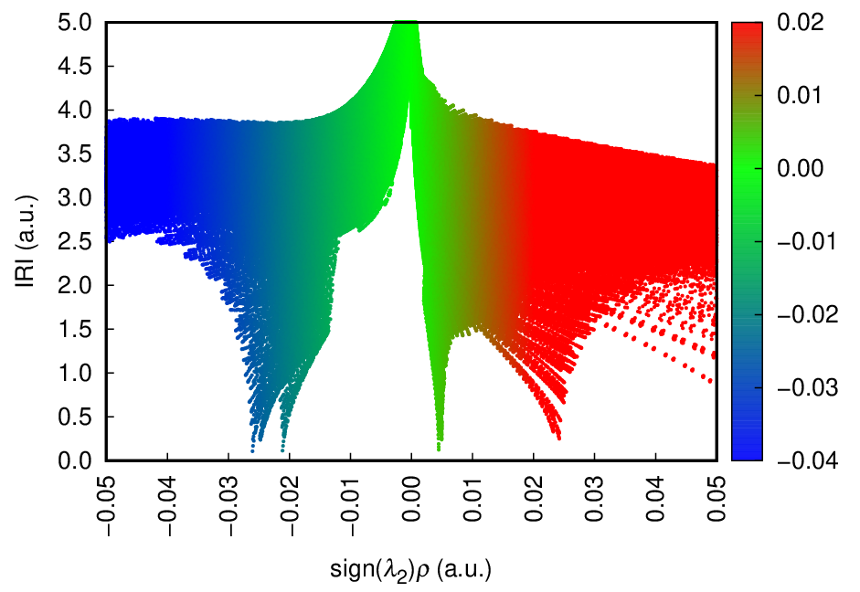

把填色散点图与前面 IRI 等值面图的颜色对比，可找到散点图中的尖峰与等值面的对应关系。显然，-0.02 到 -0.03 a.u. 之间的蓝色/青色尖峰对应氢键相互作用，约 0.005 a.u. 处的绿色尖峰对应 vdW 相互作用，约 0.025 a.u. 处的红色尖峰对应苯环内的空间位阻效应。

绘图脚本 X 轴默认范围为 -0.05 到 0.05。若适当扩大，就能展示对应化学键的尖峰，只需把 *IRIscatter.gnu* 第 14、15 行改为

```gnuplot
set xrange [-0.5:0.3]
set xtic  -0.5,0.1,0.3 nomirror rotate font "Helvetica"
```

重新运行绘图脚本后得到下图，显然 -0.4 到 -0.3 a.u. 之间的尖峰对应化学键，因为只有化学键区域的电子密度才能达到这个量级。

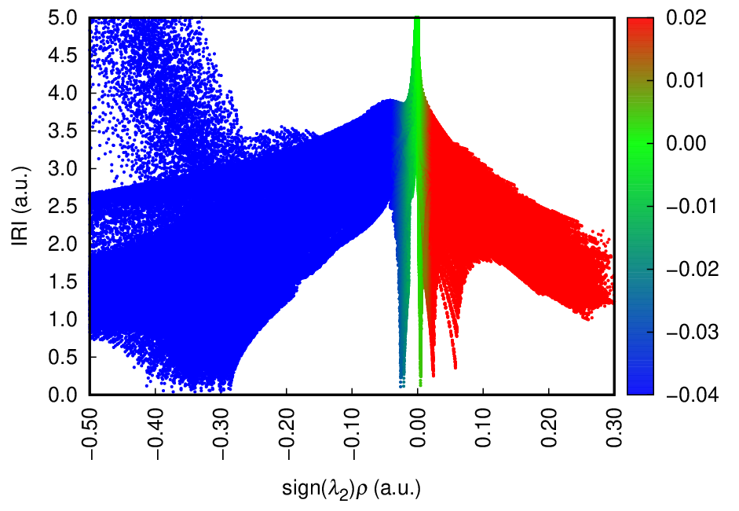

### **绘制不含共价键区域的 IRI 图**

若只想在 IRI 图中可视化非共价相互作用，最简单的办法是在 IRI 分析的后处理菜单中选“9 Screen out covalent bond regions (set IRI to 100 for regions with sign(lambda2)rho \< -0.1 a.u.)”。之后若导出格点数据并通过 VMD 绘制 IRI 图，会发现共价键区域已被屏蔽，如下图所示

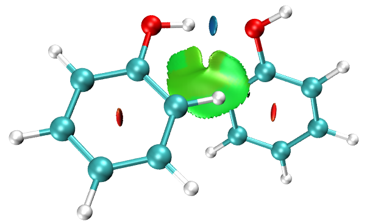

### **绘制 IRI 平面图**

有时绘制特定平面上的 IRI 平面图以揭示该平面内的相互作用区域也很有用。下面我以 *examples\GC.wfn*（一个碱基对二聚体）说明如何实现。

启动 Multiwfn 并输入

```text
examples\GC.wfn
4  // Plot plane map
24  // IRI
1  // Color-filled map
[Press ENTER button]  // Use default number of grids
0  // Modify extension distance
1  // 1 Bohr
1  // XY plane, which is the plane all atoms are
0  // Z=0
```

关闭图形后输入

```text
19  // Set color transition
2  // Reversed rainbow
4  // Enable showing atom labels and reference point
1  // Red
8  // Enable showing bonds
14  // Brown
-1  // Plot again
```

此时可看到下图

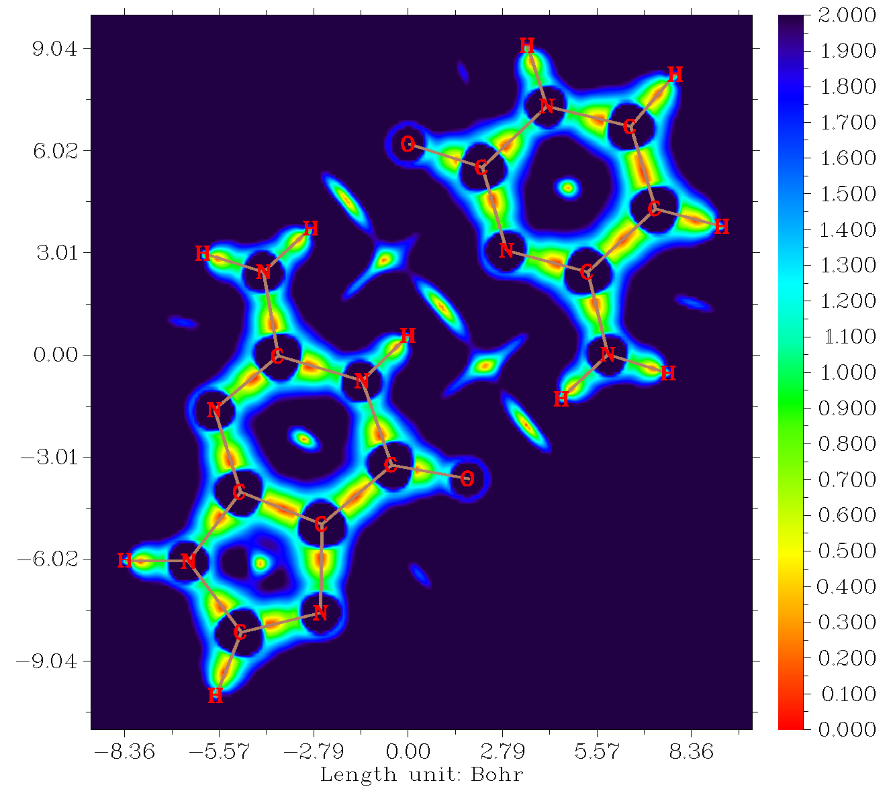

该图中的橙色和绿色区域（IRI \< 1.0）清楚揭示了显著化学键相互作用和弱相互作用发生的区域。IRI \>1.0 的区域要么电子密度梯度大，要么电子密度可忽略，没有化学意义。

## **4.20.5 用 DORI 分析同时揭示苯酚二聚体中的共价和非共价相互作用**

坦率地说，自从我提出 IRI 分析后，DORI（密度重叠区域指示函数，Density Overlap Regions Indicator）分析已不再有价值，因为 IRI 揭示各类相互作用区域的能力与 DORI 相近，而图形效果明显优于 DORI。不过我仍以苯酚二聚体为例说明如何在 Multiwfn 中做 DORI 分析。请先阅读第 [3.23.4](sec-3-23-visual-study-of-weak-interaction.md#3234-密度重叠区域指示函数-density-overlap-regions-indicator-dori分析-5) 节理解 DORI 的基本知识。

启动 Multiwfn 并输入

```text
examples\PhenolDimer.wfn
20  // Visual study of weak interaction
4  // DORI analysis
3  // High-quality grid
3  // Export cube file
```

把 *func1.cub*、*func2.cub* 和绘图脚本 *examples\DORIfill.vmd* 移到 VMD 文件夹。然后启动 VMD，在控制台窗口输入 `source DORIfill.vmd`，立刻看到下图

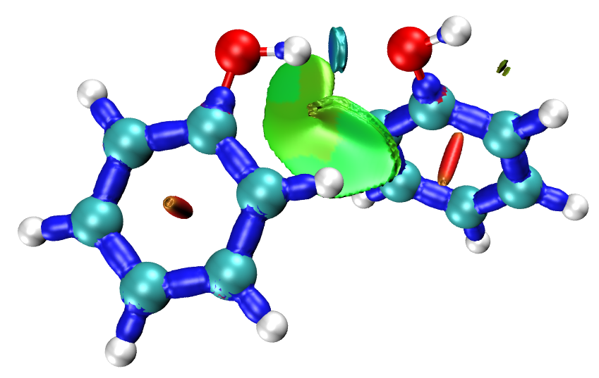

DORI 图的图形效果显然不如 IRI 图，尤其是对应弱相互作用的等值面边缘看起来相当难看。而且 DORI 定义复杂得多，计算代价高于 IRI，因此应始终用 IRI 代替 DORI。

*DORIfill.vmd* 采用与 *IRIvill.vmd* 相同的颜色过渡方法和颜色标尺。最合适的 DORI 等值对不同体系不同，*DORIfill.vmd* 脚本中的默认等值为 0.95，若觉得不合适可修改。

## **4.20.6 范德华势的可视化与分析**

> **注**
>
> 本主题的中文版是我的博文“范德华势的计算、分析及其在 Multiwfn 中的绘制”(<http://sobereva.com/551>，中文)，其中有更多例子和补充讨论。

我提出的范德华 (vdW) 势的概念已在第 [3.23.7](sec-3-23-visual-study-of-weak-interaction.md#3237-范德华势的可视化-6) 节仔细介绍过，请先认真阅读。本节我将说明如何可视化和分析 vdW 势。

### **4.20.6.1 例 1：螺烯 (Helicene)**

本例说明可视化螺烯的 vdW 势，其结构如下所示

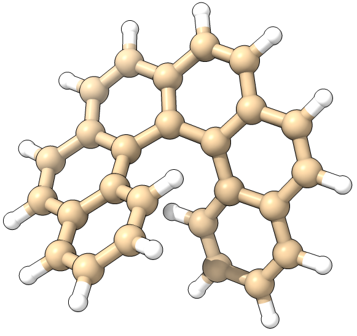

研究 vdW 势需选一个探针原子。例如本例想用 He 原子作探针，因此把 *settings.ini* 中的 "ivdwprobe" 参数改为 2。

现在启动 Multiwfn 并输入

```text
examples\helicene.xyz
20  // Visual study of weak interaction
6  // Visualization of van der Waals potential
3  // High-quality grid (the computational cost of vdW potential is extremely low, therefore we use relatively good grid quality here)
```

从菜单可见，现在可直接可视化 vdW 势或其两个组分，即排斥势和色散势。也可把它们的格点数据导出为 cube 文件。该模块中单位为 kcal/mol。

现在选选项 3 可视化 vdW 势的等值面图，等值为 0.6 (kcal/mol) 的结果如下左图所示。若只想可视化负值部分，有个技巧：等值设为 -0.6，取消勾选 "Show both sign" 复选框，然后选 "Isosurface style" - "Exchange positive and negative colors"，结果如下右图所示（"Ratio of atomic size" 已改为 4.0，此时的分子表示对应原子 vdW 球的叠加）。

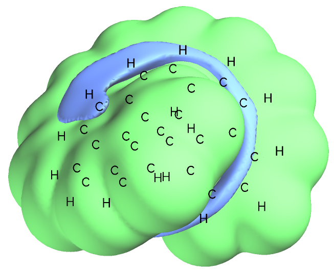 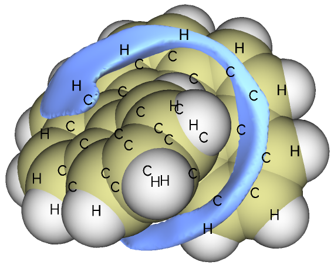

上图中，蓝色等值面代表 vdW 势为负的区域，在这些区域色散吸引效应超过排斥效应。可以预期 He 原子（更一般地，各种小的非极性分子）会倾向于被吸附到蓝色区域，这源于色散相互作用。靠近原子核的所有区域都被绿色等值面包围，表明这些地方排斥势主导 vdW 势，这是正常情形。

vdW 势图能与实际观测对应吗？答案是肯定的。我基于 Grimme 的 xtb 程序中的 GFN0-xTB 理论，对由一个螺烯分子和一个 He 原子组成的复合物在 10 K 下做了 2500 ps 分子动力学模拟，He 原子的轨迹帧（小球）和空间分布函数等值面（橙色等值面）如下所示

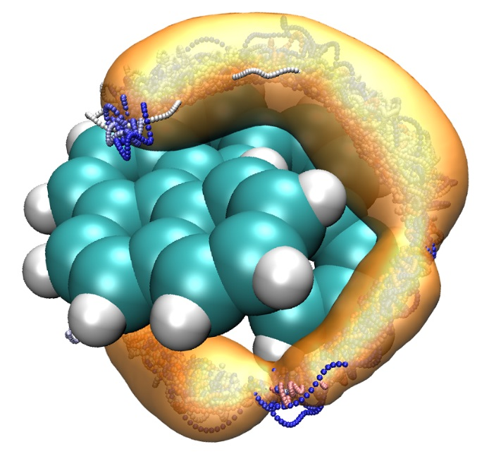

可见多数轨迹帧和空间分布函数的主要分布与前面 vdW 势图中蓝色区域高度相似，证明若 vdW 相互作用主导分子间相互作用，vdW 势确实能展示有利吸附区域（当然，前提是吸附质和吸附位点的局域区域都近乎非极性，否则静电相互作用将很大程度上控制吸附行为，此时应考察静电势而非 vdW 势）。

> **注**
>
> 顺便说，可视化 vdW 势格点数据还有另一种方式，即绘制 vdW 势着色的 vdW 表面图，在 Windows 系统中的步骤是：把 "examples\scripts\vdWpot" 文件夹中的 *vdWpot.bat* 和 *vdWpot.txt* 复制到当前文件夹，适当修改 .bat 文件中输入文件和 VMD 文件夹的路径，然后运行该 .bat 文件。之后启动 VMD，把 "examples\scripts\vdwpot" 文件夹中 *vdWpot.vmd* 文件的全部内容复制到 VMD 控制台窗口，就能看到 vdW 势着色的 *ρ*=0.001 a.u. 表面（注意 *ρ* 是用前分子近似估计的）。但由于这类图的图形效果不太好，我更倾向于用等值面图研究 vdW 势。

### **4.20.6.2 例 2：环\[18\]碳 (Cyclo\[18\]carbon)**

环\[18\]碳体系在我的工作 *Carbon*, **165**, 468 (2020)、*Carbon*, **165**, 461 (2020) 和 <http://sobereva.com/carbon_ring.html> 中被非常广泛地研究过。本例说明如何绘制该体系 vdW 势的平面图。在 ωB97XD/def2-TZVP 水平优化的结构已给出为 *examples\C18.xyz*。可见该体系恰好为平面，完全位于 Z=0 的 XY 平面。

我们将在分子平面上绘制 vdW 势的填色图。为此需把自定义函数设为 vdW 势，即把 *settings.ini* 中的 "iuserfunc" 参数设为 92。与上例一样仍用 He 元素作探针原子，因此 *settings.ini* 中的 "ivdwprobe" 应设为 2。

启动 Multiwfn 并输入

```text
examples\C18.xyz
4  // Plot plane map
100  // User-defined function
1  // Color-filled map
[Press ENTER button directly to use recommended grid]
0  // Set extension distance
10  // 10 Bohr
1  // XY plane
0  // Z value
```

在图上点击鼠标右键关闭它，然后输入

```text
1  // Set lower&upper limit of color scale
-0.8,0.8  // Note that unit is kcal/mol for vdW potential
4  // Enable showing atom labels
12  // Dark green
8  // Enable showing bonds
14  // Brown
19  // Set color transition
8  // Blue-White-Red
2  // Enable showing contour lines
```

现在选选项 -1 重绘该图，你将看到

![van der Waals potential map of cyclo\[18\]carbon in a plane](assets/figures/ch4/image1261.png)

该图中红色和蓝色分别代表正和负的 vdW 势。从图可见环\[18\]碳中心周围的 vdW 势相当负，因此该处吸附非极性分子的能力最强。该体系外围区域的 vdW 势适度为负，意味着非极性分子在此区域只能因色散吸引与该体系弱相互作用。

请也绘制 vdW 势的等值面图以及 YZ 平面上的 vdW 势平面图，以便更好理解这个特殊体系周围 vdW 势的整体分布。通过主功能 3，还可绘制给定两点间的 vdW 势，因此可轻松研究从环中心沿垂直于环方向的 vdW 势变化。

值得注意的是，很容易得到给定点（例如该体系中心，其位置恰为 (0,0,0)）的 vdW 势值。只需进入主功能 1，输入 *0,0,0*，再选 Bohr 或 Å 作单位，然后从屏幕上看到以下信息：

```text
User-defined real space function: -0.6979258635E+00
```

即（以 He 为探针原子的）vdW 势为 -0.70 kcal/mol。

#### **vdW 势的盆分析**

若想得到 vdW 势的最负值，可利用强大的盆分析模块，第 [4.17](sec-4-17-basin-analysis.md) 节有详细说明。现在用该模块找环\[18\]碳 vdW 势的最负值。

> **注**
>
> Multiwfn 还支持对 vdW 势做拓扑分析以得到其极小点，见第 [4.2.10](sec-4-2-topology-analysis.md#4210-范德华势的拓扑分析) 节的例子，结果比用盆分析模块更准确。因此，相比下面介绍的方法，更推荐用拓扑分析模块！

启动 Multiwfn 并输入以下命令

```text
examples\C18.xyz
17  // Basin analysis
1  // Generate basins and locate attractors
100  // User-defined real space function. Now it corresponds to vdW potential with He as probe atom
2  // Medium-quality grid
```

等待一会儿直到计算完成，然后可选选项 10 可视化定位到的 vdW 势极小点

![Structure of cyclo\[18\]carbon with atom indices](assets/figures/ch4/image1262.png)

只有环中心周围的极小点有化学意义。可见这些极小点被自动聚在一起并共享同一编号 (1)，可视为简并极小点。环外围区域的极小点可忽略，因为它们基本由数值噪音导致。

然后输入

```text
-3  // Show information of attractors
y  // Show attractors after sorting according to their values
```

然后可看到聚类前每个极小点的位置和值。最后可看到最终极小点（即聚类后）的位置和值：

```text
   Attractor       X,Y,Z coordinate (Angstrom)            Value
       1    0.00000000    0.00000000   -0.01763924  -0.757315492E+00
      21    0.00000000   -6.45596244   -0.52917725  -0.242350606E+00
      36    0.00000000   -6.45596244    0.52917725  -0.242350606E+00
      28    6.37658585   -1.08481336   -0.50271839  -0.242126321E+00
[...ignored]
```

显然，该体系 vdW 势的极小值（例如共享吸引子编号 1 的点）为 -0.757 kcal/mol。打印的坐标 "0.00000000 0.00000000 -0.01763924" 对应其所有成员的平均值。

若之后想通过 VMD 等可视化软件绘制极小点，可选 "-4 Export attractors as pdb/pqr/txt/gjf file"，再选相应选项把 *attractors.pdb* 导出到当前文件夹，该文件中原子编号和残基编号的含义在屏幕上有明确说明。具体来说，若把该文件加载进 VMD，可用 "resid 1" 作选择以绘制全局极小点，因为它们共享编号 1。
## **4.20.10 用独立梯度模型 (IGM) 可视化和定量弱相互作用**

请阅读第 [3.23.5](sec-3-23-visual-study-of-weak-interaction.md#3235-基于前分子-promolecular密度的独立梯度模型-independent-gradient-model-igm分析-10) 节和我的综述 DOI: [10.1016/B978-0-12-821978-2.00076-3](https://doi.org/10.1016/B978-0-12-821978-2.00076-3) 以及 *Angew. Chem. Int. Ed.*, **137**, e202504895 (2025) DOI: [10.1002/anie.202504895](https://doi.org/10.1002/anie.202504895)，掌握 *Phys. Chem. Chem. Phys.*, **19**, 17928 (2017) 提出的独立梯度模型 (IGM, Independent Gradient Model) 方法的基本知识。若不熟悉 NCI 分析，还应先读第 [3.23.1](sec-3-23-visual-study-of-weak-interaction.md#3231-非共价相互作用-noncovalent-interaction-nci分析-1) 节，因为 IGM 分析的许多方面与 NCI 密切相关。本节将通过几个例子展示 Multiwfn 中 IGM 分析的用法。更多讨论和实例见我的博文“通过独立梯度模型 (IGM) 研究分子间弱相互作用”（中文，<http://sobereva.com/407>）。

因为 IGM 方法不依赖波函数，可用任何含原子坐标信息的文件作输入，如 .xyz、.mol 和 .pdb（详见第 [2.5](sec-2-5-input-files-and-wavefunction-types.md) 节）。本节用的 VMD 为 1.9.3 版，可从 <http://www.ks.uiuc.edu/Research/vmd/> 免费获得。

> **注**
>
> 注意：若体系不是特别大且能生成波函数文件，**强烈建议用 IGMH 而非 IGM** 以获得更合理的结果。IGMH 是 IGM 的改进版，见第 [3.23.6](sec-3-23-visual-study-of-weak-interaction.md#3236-基于电子密度-hirshfeld-分区的-igm-igmh分析-11) 节的介绍和第 [4.20.11](#42011-用-igmh基于-hirshfeld-分割分子密度的-igm研究弱相互作用) 节的例子。即使因计算代价或拿不到波函数文件而不能用 IGMH，也**强烈建议用 mIGM 而非 IGM**，见第 [3.23.10](sec-3-23-visual-study-of-weak-interaction.md#32310-修正-igm-migm分析--10) 节的介绍和第 [4.20.12](#42012-用-migm-研究弱相互作用) 节的例子。

### **4.20.10.1 例 1：鸟嘌呤-胞嘧啶 (GC) 碱基对**

IGM 框架包含许多有用的思想并定义了许多有用的概念，本例将做一系列分析。以简单体系鸟嘌呤-胞嘧啶 (GC) 碱基对为例。实际研究中有些分析可忽略，分析顺序完全任意。

#### **(1) 研究 δ*g* 函数**

先通过绘制填色平面图研究 δ*g* 函数的分布特征。启动 Multiwfn 并输入以下命令

```text
examples\GC.pdb
4  // Plot plane map
22  // δg
1  // Color-filled map
[Press ENTER button to use default grid setting]
1  // XY plane
0  // Z=0
```

当前屏幕上的图看起来很模糊，这是因为默认颜色标尺不适合当前情形，于是关闭图形并输入

```text
1  // Set color scale
0,0.2  // Lower and upper limits
4  // Show atomic labels
1  // Red color
-2  // Set label intervals of axes
3,3,0.02  // Intervals for X, Y and color bar
8  // Enable showing bonds
14  // Brown
-1  // Plot again
```

你将看到下图

![Color-filled van der Waals potential map of cyclo\[18\]carbon](assets/figures/ch4/image1263.png)

上图清楚揭示了所有原子间相互作用，δ*g* 的大小与相互作用强度正相关。可见所有化学键区域都有大的 δ*g* 值（高于 0.2 的区域显示为白色）。δ*g* 函数还勾勒出碱基对间的三个氢键区域，其中 δ*g* 函数值明显小于化学键区域。

δ*g* 也可画成等值面图。返回主菜单并输入

```text
5  // Calculate grid data
22  // δg
2  // Medium-quality grid
-1  // Show isosurface
```

等值为 0.15 和 0.03 的等值面如下所示（可用更高质量格点或把格点数据的外延距离设小些使图形更光滑）

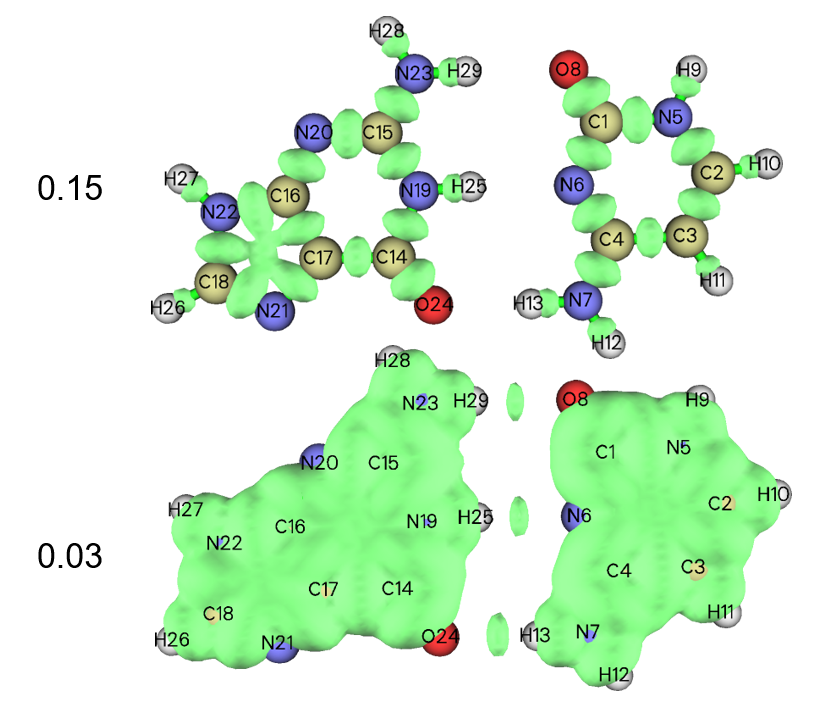

由于化学键区域 δ*g* 值相对大，等值设为 0.15 时只见化学成键相互作用。显然，δ*g* 可像 ELF 和 IRI 函数一样用作展示化学键的函数，还有个额外优点是只需要几何信息。把等值降到小值（例如 0.02）时，弱相互作用区域也可同时可视化。

#### **(2) 研究碱基对间的 δ*g*^inter 函数**

δ $g^{\mathrm{inter}}$ 是 IGM 分析框架中的关键函数，专为揭示用户定义的两个（甚至更多）片段间的相互作用区域而设计。这里绘制该函数以研究两个碱基间的相互作用。虽然如前所示，这些相互作用也可通过直接画 δ*g* 揭示，但片段内相互作用对应的等值面严重污染了图形。幸运的是，IGM 分析允许把 δ*g* 分离为 δ $g^{\mathrm{inter}}$ 和 δ $g^{\mathrm{intra}}$，分别只反映片段间和片段内相互作用对 δ*g* 的贡献。

返回主菜单并输入以下命令

```text
20  // Visual study of weak interactions
10  // IGM analysis
2  // Define two fragments
1-13  // Range of atoms in the first base
14-29  // Range of atoms in the second base (you can also input c here to define the rest of the present system as the second fragment)
2  // Medium-quality grid
```

计算后将看到后处理菜单。各选项含义已在第 [3.23.5](sec-3-23-visual-study-of-weak-interaction.md#3235-基于前分子-promolecular密度的独立梯度模型-independent-gradient-model-igm分析-10) 节解释过。可用选项 -1 直接绘制 δ*g* 或 δ $g^{\mathrm{inter}}$ 或 δ $g^{\mathrm{intra}}$ 随 *sign*(*λ*₂)*ρ* 变化的散点图。我们选选项 -1 再选子选项 4，所得图中红色和黑色点分别对应 δ $g^{\mathrm{inter}}$ 和 δ $g^{\mathrm{intra}}$。

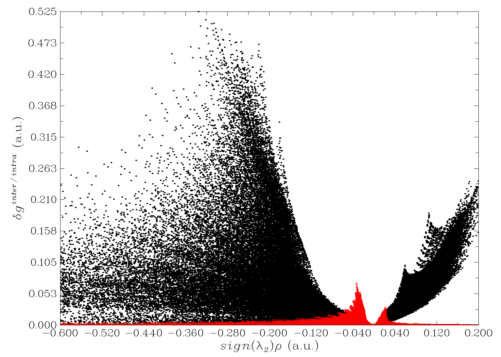

若熟悉 NCI 方法，自然知道如何讨论该图，现在尝试辨认散点图中峰的特征。在 *sign*(*λ*₂)*ρ* 约 -0.04 的区域，可见 δ $g^{\mathrm{inter}}$ 有显著峰（高约 0.06），意味着氢键存在。若 δ $g^{\mathrm{inter}}$ 等值面设为低于约 0.06 的等值，相应等值面应在图中可见。在 *sign*(*λ*₂)*ρ* 约 +0.02 的区域，δ $g^{\mathrm{inter}}$ 也有个小峰。由于正的 *sign*(*λ*₂)*ρ* 意味着排斥相互作用，该峰可能反映两碱基间两环中心弱的空间位阻区域。在上述散点图中，在 *sign*(*λ*₂)*ρ* = -0.3 附近有 δ $g^{\mathrm{intra}}$ 的非常显著的峰。该峰对应片段内相互作用，且相应的 *sign*(*λ*₂)*ρ* 不仅为负而且很大，表明是吸引且强的相互作用，因此该峰必定源于化学键。

用 Multiwfn 可直接可视化 δ $g^{\mathrm{inter}}$ 和 δ $g^{\mathrm{intra}}$ 的等值面。为此关闭散点图，选选项 "4 Show isosurface of grid data"，再选相应选项并适当设等值，得到以下等值面图

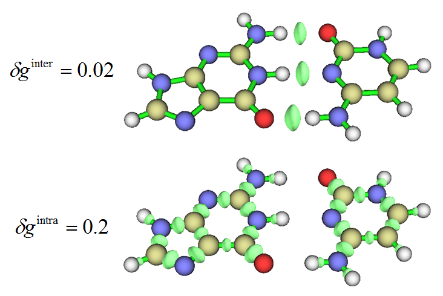

可见 δ $g^{\mathrm{inter}}$ 和 δ $g^{\mathrm{intra}}$ 的确只分别展示片段间和片段内相互作用。这极大方便了对两类相互作用的分别讨论。

从上述 δ $g^{\mathrm{inter}}$ = 0.02 等值面图只能可视化氢键区域。要找到两碱基间环中心的空间位阻区域，应把 δ $g^{\mathrm{inter}}$ 的等值进一步降到例如 0.008，如下所示。环中心空间位阻区域已用箭头标出。

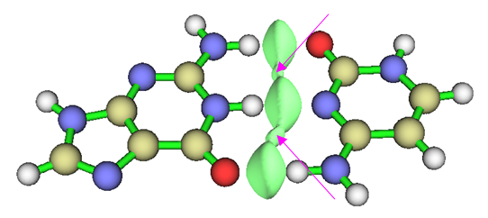

#### **(3) 绘制 *sign*(*λ*₂)*ρ* 映射的 δg$^{inter}$ 等值面**

若把 *sign*(*λ*₂)*ρ* 以不同颜色映射到 δ $g^{\mathrm{inter}}$ 等值面上，就不仅能认出弱相互作用发生在哪里，还能立刻捕捉相互作用的特征。Multiwfn 目前不能绘制填色等值面图，需像 NCI 分析那样用 VMD 程序来做。

在 IGM 后处理菜单中选选项 "3 Output cube files to current folder"，则 *sign*(*λ*₂)*ρ*、δ*g*、δ $g^{\mathrm{inter}}$ 和 δ $g^{\mathrm{intra}}$ 将分别导出为当前文件夹下的 *sl2r.cub*、*dg.cub*、*dg_inter.cub* 和 *dg_intra.cub*。把 *sl2r.cub*、*dg_inter.cub* 以及 VMD 绘图脚本 *examples\IGM_inter.vmd* 移到 VMD 文件夹。启动 VMD，在控制台窗口输入 `source IGM_inter.vmd`，立刻看到下图

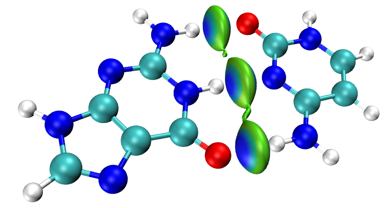

*IGM_inter.vmd* 脚本默认等值为 0.01，可在 "Graphics" - "Representation" 面板拖动等值条手动改变等值。脚本中 *sign*(*λ*₂)*ρ* 的默认颜色标尺范围为 -0.05 到 0.05，默认颜色过渡为 Blue-Green-Red。因此等值面越蓝，吸引相互作用越强；越红，空间位阻效应越大。等值面上的绿色区意味着相应相互作用弱，可视为范德华相互作用。

类似地，可绘制 *sign*(*λ*₂)*ρ* 映射的 δ $g^{\mathrm{intra}}$ 等值面。只需把 *sl2r.cub*、*dg_intra.cub* 及相应的 VMD 绘图脚本 *examples\IGM_intra.vmd* 移到 VMD 文件夹，然后在控制台窗口输入 `source IGM_intra.vmd` 执行即可。

#### **(4) 把片段间相互作用分解为原子和原子对贡献**

原子对 δ*g* 指数（δ $G^{\mathrm{pair}}$）是原子对对两片段间总 δ $g^{\mathrm{inter}}$ 贡献的定量指标，而给定原子的所有原子对 δ*g* 指数求和得到其原子 δ*g* 指数（δ $G^{\mathrm{atom}}$），代表它对片段间相互作用的重要性。百分比原子 δ*g* 指数 δ $G^{\mathrm{atom}}$ (%) 对应归一化 δ $G^{\mathrm{atom}}$ 乘以 100%，可粗略视为对片段间相互作用的百分比贡献。在 Multiwfn 中这些指数很容易求得。在 IGM 后处理菜单中选选项 6 再选 "2 High quality"（该格点绝对足够精细），Multiwfn 将计算这些指数。结果将导出为当前文件夹下的 *atmdg.txt*，然后程序会问是否同时导出当前文件夹下的 *atmdg.pdb*，本例选 *y*。

*atmdg.txt* 的部分内容摘录如下：

```text
Atom delta-g indices of fragment  1 and percentage contributions
 Atom    6 :    0.496653  (  23.07 % )
 Atom   13 :    0.483135  (  22.44 % )
 Atom    8 :    0.411759  (  19.13 % )
[ignored...]
Atom delta-g indices of fragment  2 and percentage contributions
 Atom   25 :    0.589516  (  27.39 % )
 Atom   24 :    0.431975  (  20.07 % )
 Atom   29 :    0.388667  (  18.06 % )
[ignored...]
Atom pair delta-g indices and percentage contributions (zero terms are not shown)
   13   24 :    0.251327  (  11.68 % )
    6   25 :    0.236065  (  10.97 % )
    8   29 :    0.218248  (  10.14 % )
```

若把上述数据与下面所示当前体系结构图对比，会发现这些指数对讨论片段间相互作用非常有意义且有用

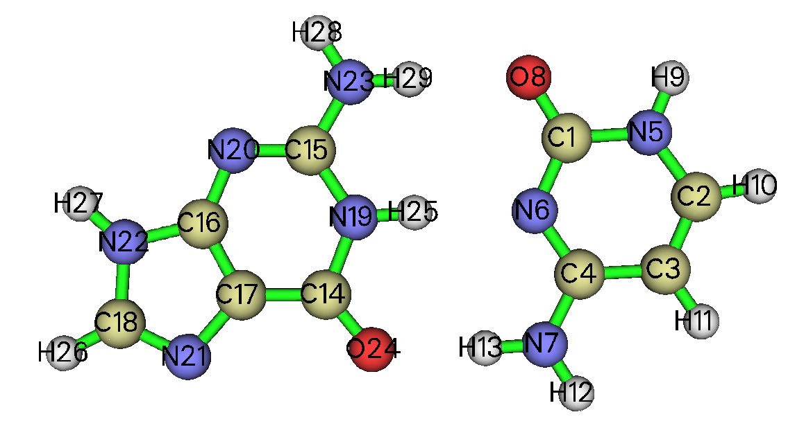

片段 1 的 δ $G^{\mathrm{atom}}$ 最大的三个是 6、13 和 8，片段 2 的是 25、24 和 29，它们恰是离另一片段最近的原子，无疑它们对片段间相互作用的贡献最重要。H13-O24、N6-H25 和 O8-H29 的 δ $G^{\mathrm{pair}}$ 最大，反映它们是形成该碱基对最关键的相互作用。

注意 Multiwfn 还把 IBSIW（弱相互作用的本征键强度指数）导出到 *IBSIW.txt*。其定义已在第 [3.23.6](sec-3-23-visual-study-of-weak-interaction.md#3236-基于电子密度-hirshfeld-分区的-igm-igmh分析-11) 节描述过。该指数与原子间相互作用强度的相关性可能比原子对 δ*g* 指数更强。

#### **(5) 以百分比原子 δ*g* 指数给分子结构着色**

用 VMD 还可把 δ $G^{\mathrm{atom}}$ 和 δ $G^{\mathrm{atom}}$ (%) 映射到分子结构上，从而生动展示各原子对片段间相互作用的相对重要性。如有需要，δ $g^{\mathrm{inter}}$ 等值面也可一同展示。现在绘制这样一幅图。

首先如前所述用 *IGM_inter.vmd* 脚本绘制填色 δ $g^{\mathrm{inter}}$ 等值面。之后需删除显示分子结构的默认表示，于是进入 "Graphics" - "Representation"，选中第一项（当前样式为 CPK），点击 "Delete Rep" 按钮。然后把前面生成的 *atmdg.pdb* 拖入 VMD 主窗口加载。该文件中“occupancy”字段记录 δ $G^{\mathrm{atom}}$ (%)，要图形化展示每个原子的值，应让 VMD 按 occupancy 属性给原子着色。再次进入 "Graphics" - "Representation"，把 "Drawing method" 设为 CPK，把 "Coloring method" 设为“Occupancy”，然后点击 "Trajectory" 标签，把颜色标尺上限设为 50 并按回车，此时图形窗口中的体系应如下所示。

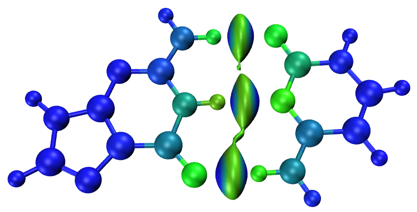

由于 *IGM_inter.vmd* 设的颜色过渡为 Blue-Green-Red，而当前情形最大的百分比原子 δ*g* 指数为 27%（见 *atmdg.txt*），当前映射 δ $G^{\mathrm{atom}}$ (%) 的颜色标尺范围设为 0\~50，因此上图中原子越绿，δ $G^{\mathrm{atom}}$ (%) 越大。绿色原子可视为片段间相互作用的“热点原子”。蓝色原子对片段间相互作用的贡献可忽略，因为它们的 δ $G^{\mathrm{atom}}$ (%) 非常接近零。

本例到此结束，相信通过本例你已掌握 IGM 分析的基本步骤。接下来几个例子我将展示更多内容。

#### **技巧：绘制 *sign*(*λ*₂)*ρ* 着色的 IGM 散点图**

在本例第 (2) 部分，我已展示如何直接用 Multiwfn 绘制 *sign*(*λ*₂)*ρ* 与各种形式 δ*g* 的散点图。如下所示，用 gnuplot 程序可按与 VMD 相同的 *sign*(*λ*₂)*ρ* 颜色标尺给散点图着色，从而更容易辨认散点图峰与填色 δ $g^{\mathrm{inter}}$ 等值面图的对应关系。绘制 *sign*(*λ*₂)*ρ* 着色的 RDG 散点图用了非常类似的方法，见第 [3.23.1](sec-3-23-visual-study-of-weak-interaction.md#3231-非共价相互作用-noncovalent-interaction-nci分析-1) 节的“特殊技巧 1”。

运行以下命令

```text
examples\GC.pdb
20  // Visual study of weak interactions
10  // IGM analysis
2  // Define two fragments
1-13  // Range of atoms in the first base
14-29  // Range of atoms in the second base
2  // Medium-quality grid
2  // Output scatter points to output.txt
```

然后把导出的 *output.txt* 和绘图脚本 *examples\scripts\IGMscatter.gnu* 复制到含 gnuplot 可执行文件的文件夹，再在该文件夹运行命令：*gnuplot IGMscatter.gnu*，之后得到 *IGMscatter.ps*。若用 Acrobat、Photoshop 或 IrfanView（需安装 ghostscript）打开，或先通过在线工具 <https://cloudconvert.com/image-converter> 转为其它图像格式再打开，你将看到

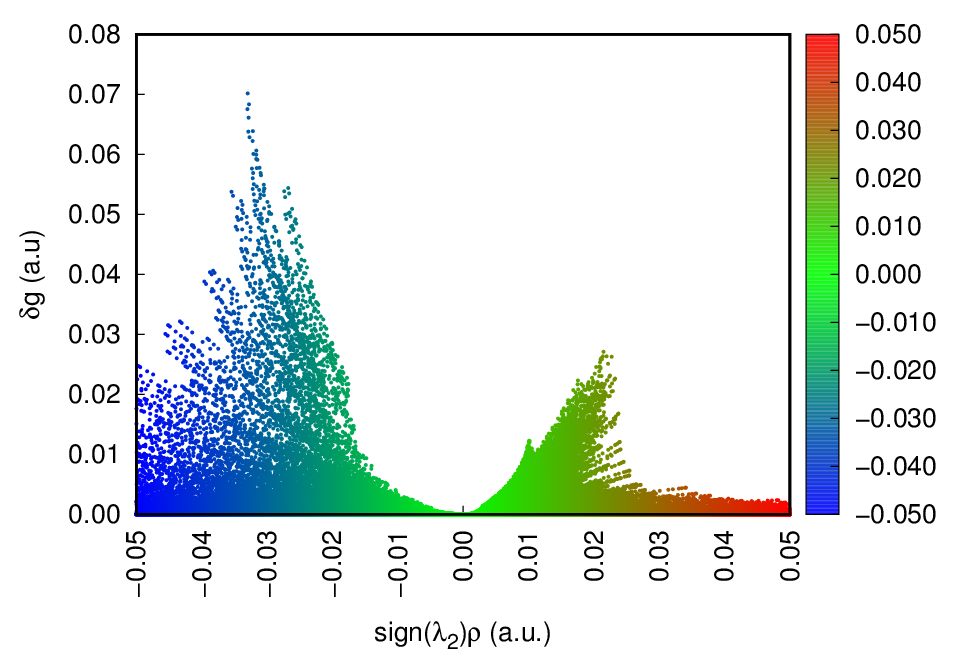

当前图中 Y 轴对应 δ $g^{\mathrm{inter}}$。*IGMscatter.gnu* 中默认颜色标尺与 *IGMinter.vmd* 采用的完全相同，即 -0.05\~0.05。

若想用该脚本绘制 δ $g^{\mathrm{intra}}$ 随 *sign*(*λ*₂)*ρ* 的图，应把 *IGMscatter.gnu* 中的 "4:1:4" 改为 "4:2:4"；若想绘制 δ*g* 随 *sign*(*λ*₂)*ρ* 的图，应改为"4:3:4"。

若发现 X 轴范围不合适，可改 "xtic" 和 "xrange" 后面的数据；若 Y 轴不合适，可改 "ytic" 和 "yrange"。

### **4.20.10.2 例 2：C₆₀-晕苯 (coronene) 二聚体**

本例将对 C₆₀-晕苯二聚体做 IGM 分析，最后基于 Multiwfn 输出的数据用 VMD 绘制下图。

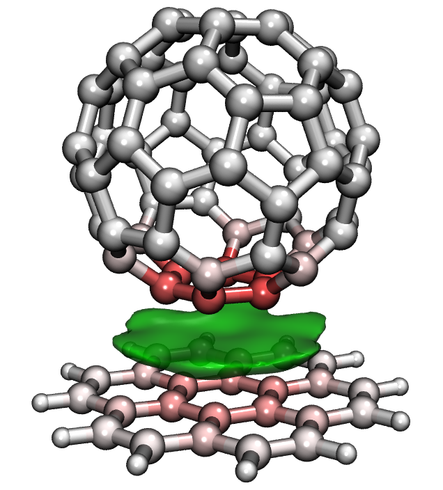

上图中，主要的范德华相互作用区域（更具体地，π-π 堆积区域）展示为绿色等值面，原子颜色越红对相互作用贡献越大。若觉得该图漂亮并想复现，只需按以下步骤操作。

用 Gaussian 在 PM6-D3 水平优化的二聚体 pdb 文件已提供为 *examples\C60_coronene.pdb*。启动 Multiwfn 并加载它，然后输入以下命令

```text
20  // Visual study of weak interactions
10  // IGM analysis
2   // Define two fragments
1-60  // C_60 is fragment 1
c  // Other part, namely coronene, is fragment 2
2  // Medium-quality grid
3  // Output cube files in current folder
6  // Evaluate atom and atomic pair δg indices
2  // High quality
y  // Export atmdg.pdb in current folder
```

启动 VMD，在 VMD 控制台窗口输入以下命令：

```text
color scale method BWR
color Display Background white
axes location Off
display depthcue off
display rendermode GLSL
```

然后把 *atmdg.pdb* 拖入 VMD 主窗口，进入 "Graphics" - "Representation"，把 "Drawing Method" 设为 "CPK"，把键半径从默认 0.3 改为 0.8，把 "Coloring Method" 设为 "Occupancy"，把 "Material" 设为 "EdgyShiny"。再到 "Trajectory" 标签，把颜色标尺下限和上限分别设为 -15 和 15。

接下来需在图上绘制 δ $g^{\mathrm{inter}}$ 等值面。把 *dg_inter.cub* 拖入 VMD 主窗口加载，然后进入 "Graphics" - "Representation"，把默认样式从 "lines" 改为 "Isosurface"，把 "Draw" 设为 "Solid Surface"，把 "Show" 设为 "Isosurface"，然后在 "Isovalue" 框中输入 *0.004* 并按回车。把 "Coloring Method" 改为 "ColorID" 并选 "7 green"。把 "Material" 改为 "EdgyGlass"。

最后渲染该图。选 "File" - "Render"，选 "Tachyon (internal, in-memory rendering)" 并点击 "Start Rendering" 按钮，就得到本节开头所示图形。所得图形文件为 .tga 格式，可用 IrfanView 或 Photoshop 等查看。

> **注**
>
> 注意本例中填色效果只用于分子结构，未用于等值面。这是因为在 VMD 中颜色过渡设置被所有表示共享，即不能对分子结构用 Blue-White-Red 颜色过渡而对等值面用惯常的 Blue-Green-Red 颜色过渡。考虑到当前体系只有一种相互作用，即范德华相互作用，而在常规填色 IGM 图中该区域基本着绿色，我决定直接给整个等值面指定绿色，从而能自由设置分子结构着色的颜色过渡模式。

### **4.20.10.3 例 3：噁唑烷酮三聚体**

Multiwfn 的 IGM 模块极其灵活，可用于任意多个片段。本例用噁唑烷酮三聚体说明这一点。几何取自 *J. Chem. Theory Comput.*, **11**, 3065 (2015)。

先用 δ $g^{\mathrm{inter}}$ 揭示三个单体间的所有相互作用。启动 Multiwfn 并输入

```text
examples\oxazolidinone_trimer.xyz
20  // Visual study of weak interactions
10  // IGM analysis
3   // Define three fragments
1-11  // Fragment 1: Monomer 1
12-22  // Fragment 2: Monomer 2
23-33  // Fragment 3: Monomer 3
2  // Medium-quality grid
3  // Output cube files in current folder
```

然后用前述方法通过 *IGM_inter.vmd* 脚本绘制填色 δ $g^{\mathrm{inter}}$ 等值面图，你将看到下图

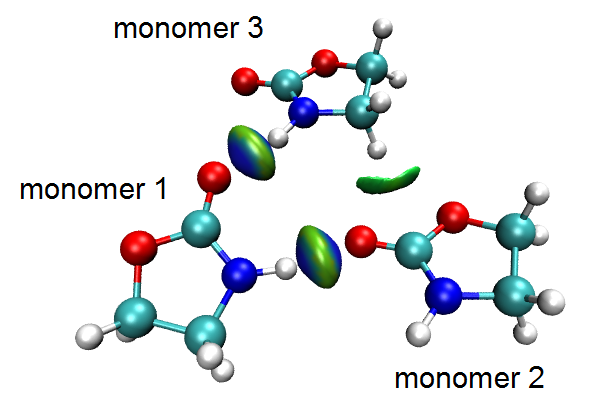

从图中异构体等值面的颜色发现，1-2 和 1-3 相互作用对应典型氢键，而 2-3 相互作用明显弱得多，更宜归为范德华相互作用。

假设只想研究 1-2 与 2-3 间的相互作用，同时希望屏蔽对应 1-3 相互作用的 δ $g^{\mathrm{inter}}$ 等值面，该怎么做？答案是：只定义两个片段，让片段 1 对应单体 2，片段 2 对应单体 1 和 3。现在这样做，输入以下命令

```text
0  // Return to last menu
10  // IGM analysis
2   // Define two fragments
12-22  // Fragment 1: Monomer 2
1-11,23-33  // Fragment 2: Monomers 1 and 3
2  // Medium-quality grid
3  // Output cube files in current folder
6  // Evaluate atom and atomic pair δg indices
2  // High quality
y  // Export atmdg.pdb in current folder
```

然后用新生成的 *sl2r.cub* 和 *dg_inter.cub* 通过 *IGM_inter.vmd* 再次绘制 δ $g^{\mathrm{inter}}$ 等值面，同时基于 *atmdg.pdb* 文件按 δ $G^{\mathrm{atom}}$ (%) 给结构着色，最终得到下图

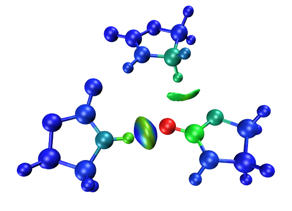

现在对应单体 1-3 相互作用的等值面不可见了。由于 *IGM_inter.vmd* 设的颜色过渡为 Blue-Green-Red，而我未手动调节自动确定的映射 δ $G^{\mathrm{atom}}$ (%) 的颜色范围，因此当前图中 δ $G^{\mathrm{atom}}$ (%) 最大的位点渲染为红色，应视为所研究相互作用的“最热原子”。绿色或青色原子的 δ $G^{\mathrm{atom}}$ (%) 量级适中，而蓝色原子对相互作用的贡献完全可忽略。

最后，只突出单体 1 和 2 间的相互作用而完全忽略单体 3。输入以下命令

```text
0  // Return to last menu
10  // IGM analysis
2   // Define two fragments
1-11  // Fragment 1: Monomer 1
12-22  // Fragment 2: Monomers 2
2  // Medium-quality grid
3  // Output cube files in current folder
```

把所得 *dg_inter.cub* 和 *sl2r.cub* 移到 VMD 文件夹，用 *IGM_inter.vmd* 脚本绘制相应的填色等值面图。最好让单体 3 透明，因为当前它不重要。于是进入 "Graphics" - "Representation"，点击已有 CPK 样式的表示，在 "Selected Atoms" 框输入 *fragment 0 1* 并按回车，此时单体 3 不可见。接下来点击 "Create Rep" 按钮，在 "Selected Atoms" 框输入 *fragment 2* 并按回车，再把 "Drawing method" 设为 "Licorice" 并把 "Bond Radius" 改为 0.2，再把 "Material" 设为 "Ghost"。此时应看到下图，其中只有单体 1 和 2 间的相互作用可见，而所有与单体 3 相关的相互作用都被忽略了。

> **附**
>
> VMD 中的“片段”概念与 Multiwfn IGM 分析中的“片段”不同。在 VMD 中，结构文件加载进 VMD 后会自动判定成键关系，然后每个未连接的片段被赋予唯一片段编号。编号从 0 开始。

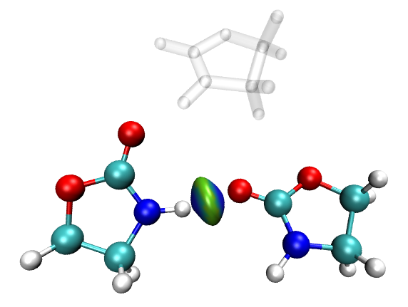

从本例可见片段划分高度任意。所有片段的并集不一定等于整个体系。当想研究分子内相互作用时，也可把整个分子分成多个片段以揭示有意思的相互作用区域。

本例只以简单体系为例，但我认为已足以充分展示 IGM 分析、Multiwfn 和 VMD 程序的极端灵活性和强大功能。IGM 方法也可轻松用于复杂得多的体系；例如在我的博文 <http://sobereva.com/407>（中文）中，我展示了 IGM 可清楚揭示由四个大柔性分子组成的四聚体中两个单体间的相互作用。

值得一提的是，键临界点 (BCP) 处的 δ*g* 值与相互作用强度正相关（见 IGM 原始论文表 1），Multiwfn 也能计算它。首先把含波函数信息的文件加载进 Multiwfn，然后用主功能 2 做拓扑分析并定位 BCP，再用选项 7 查看 BCP 性质，可从屏幕直接读到 δ*g* 值。这里不明确给出相应的分析例子，请自行尝试这类分析。
## **4.20.11 用 IGMH（基于 Hirshfeld 分割分子密度的 IGM）研究弱相互作用**

请查阅 IGMH 原始论文 (*J. Comput. Chem.*, **43**, 539 (2022) <https://doi.org/10.1002/jcc.26812>)、本手册第 [3.23.6](sec-3-23-visual-study-of-weak-interaction.md#3236-基于电子密度-hirshfeld-分区的-igm-igmh分析-11) 节、*Angew. Chem. Int. Ed.*, **137**, e202504895 (2025) DOI: [10.1002/anie.202504895](https://doi.org/10.1002/anie.202504895) 和 DOI: [10.1016/B978-0-12-821978-2.00076-3](https://doi.org/10.1016/B978-0-12-821978-2.00076-3)，掌握 IGMH 方法的基本知识。若能读中文，还请看 <http://sobereva.com/621>，其中全面清楚地介绍了 IGMH 并有许多相关讨论。

本节只给出一个极简单的 IGMH 例子。**非常详细的教程**（约 40 页）仔细介绍了如何对分子和周期体系做各种 IGMH 分析，可从 <http://sobereva.com/multiwfn/res/IGMH_tutorial.zip> 下载，别忘了看！

IGMH 分析功能的使用与 IGM 完全相同，因此若认真读过第 [4.20.10](#42010-用独立梯度模型-igm-可视化和定量弱相互作用) 节，就能顺利做 IGMH 分析。本节以由 2-吡哆素和 2-氨基吡啶组成的二聚体为例，该体系在第 [4.2.1](sec-4-2-topology-analysis.md#421-2-吡哆醇-2-氨基吡啶的分子中的原子-aim-拓扑分析与芳香性分析) 节已通过 AIM 分析研究过。

启动 Multiwfn 并输入

```text
examples\2-pyridoxine_2-aminopyridine.wfn  // Since IGMH relies on wavefunction information, therefore you should use such as .wfn, .fch, .mwfn, .molden, etc. as input file
20  // Visual study of weak interaction
11  // IGMH analysis
2  // Define two fragments
1-12  // Atom indices in fragment 1
13-25  // Atom indices in fragment 2
2  // Medium-quality grid
3  // Output cube files to current folder
```

接下来，为绘制 *sign*(*λ*₂)*ρ* 着色的 δ $g^{\mathrm{inter}}$ 等值面图，把导出的 *sl2r.cub* 和 *dg_inter.cub* 从当前文件夹移到 VMD 文件夹，再把 *examples\IGM_inter.vmd* 脚本复制到 VMD 文件夹，然后启动 VMD，在 VMD 控制台窗口运行 `source IGM_inter.vmd` 命令执行绘图脚本。

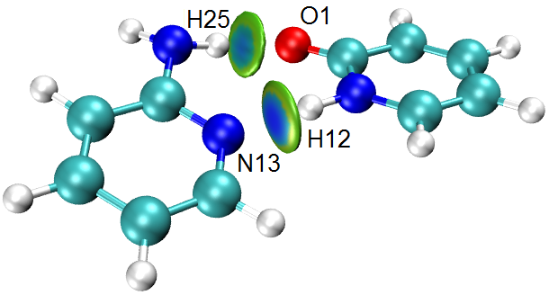

该图的颜色条为“examples”文件夹中的 *IGMH_colorbar.png*。由于对应 N-H⋅⋅⋅N 相互作用的等值面中心的蓝色比对应 N-H⋅⋅⋅O 相互作用的更深，预计 N-H⋅⋅⋅N 的氢键相互作用更强。

> **提示**
>
> 若希望上图中异构体等值面的半径小些，只展示最重要的相互作用区域，可把等值从 0.01 增大到 0.015，即进入 "Graphics" - "Representation"，把 "Isovalue" 框中的值改为 0.015 然后按回车。此时还可把颜色标尺范围调得比默认 (-0.05\~0.05) 窄些，使等值面上的颜色更鲜明，即在 "Representation" 界面点击 "Trajectory" 标签，然后在两个框中分别输入 -0.045 和 0.045 再按回车。

在后处理菜单中，还可选选项 6 计算原子和原子对 δ*g* 指数（即 δ $G^{\mathrm{atom}}$ 和 δ $G^{\mathrm{pair}}$ 指数），用高质量格点算得的结果如下所示

```text
Atom pair delta-g indices and percentage contributions (zero terms are not shown)
   12   13 :    0.116367  (  16.57 % )
    1   25 :    0.096210  (  13.70 % )
    2   13 :    0.052037  (   7.41 % )
    1   23 :    0.042800  (   6.09 % )
...[ignored]
```

从该定量数据可进一步确认 N-H12⋅⋅⋅N13 强于 N-H25⋅⋅⋅O1 的结论。

为比较，可通过 IGM 模块绘制同样的图，*sign*(*λ*₂)*ρ* 着色的 δ $g^{\mathrm{inter}}$ 等值面图如下所示（*sign*(*λ*₂)*ρ* 用实际密度而非前分子密度算得）。可见 IGM 的图形效果比 IGMH 差得多，因为等值面太臃肿，难以观察比较，即使仔细调节等值也不能完全避免该问题。IGM 与 IGMH 的许多比较见 IGMH 原始论文。

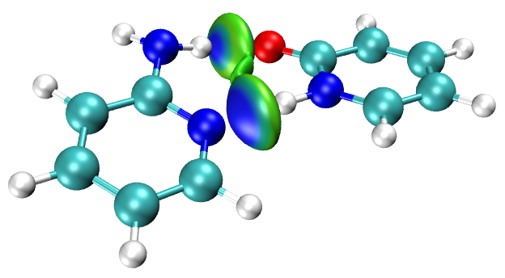

### **技巧：大幅降低片段间相互作用 IGMH 可视分析的代价**

多数人用 IGMH 方法主要为可视化和分析片段间相互作用。实践中这只需在片段间重叠区计算 δ $g^{\mathrm{inter}}$ 和 *sign*(*λ*₂)*ρ* 格点数据，所有非重叠区的格点完全不需要。考虑到这一点，Multiwfn 支持一种策略以大幅降低 IGMH（及 mIGM、IGM）格点数据计算的代价。实现如下：*settings.ini* 文件中有个名为“IGMvdwscl”的参数。每个片段的表面定义为原子球的并集，其中每个原子的 vdW 半径按“IGMvdwscl”缩放。在 IGMH、mIGM 或 IGM 分析的格点数据计算步骤中，一个格点仅当其位于两个或更多片段表面间的重叠区内时才会被计算，否则直接跳过。用此策略，计算 IGMH 格点数据的时间常减少数倍或更多。具体节省时间的比例取决于用户定义的格点盒子中有多大比例由可忽略的格点组成。

显然，启用该策略后，只能绘制 δ $g^{\mathrm{inter}}$ 的等值面。δ*g* 或 δ $g^{\mathrm{intra}}$ 的等值面不再能绘制，因为只有 δ $g^{\mathrm{inter}}$ 等值面保证只出现在片段间重叠区。

“IGMvdwscl”默认为 0，意味着省时策略关闭。要启用该策略，把“IGMvdwscl”设为合适的正值。值越大，省时效果越弱；值越小，截断 δ $g^{\mathrm{inter}}$ 等值面的风险越高。一般推荐 2.0：足够安全，同时显著减少计算时间。

该策略不影响 δ $G^{\mathrm{atom}}$ 和 δ $G^{\mathrm{pair}}$ 指数的计算代价和结果。

该策略在我的博文 <http://sobereva.com/756>（中文）中有更详细的描述，并给出了例子。

## **4.20.12 用 mIGM 研究弱相互作用**

> **注**
>
> mIGM 的更多细节和例子见我的博文“用 mIGM 方法基于几何快速图形化表示弱相互作用”(<http://sobereva.com/755>，中文)。

mIGM 已在第 [3.23.10](sec-3-23-visual-study-of-weak-interaction.md#32310-修正-igm-migm分析--10) 节简述，并在 *Struct. Bond.*, **190**, 297 (2026) DOI: [10.1007/430_2025_95](https://doi.org/10.1007/430_2025_95) 中详细介绍。因为其图形效果远好于 IGM，而代价与 IGM 基本相同，始终强烈建议用 mIGM 代替 IGM。mIGM 的用法与 IGM 基本相同，这里给个简单例子。

```text
examples\phenylalanineresiduestrimer.xyz is optimized trimer of capped phenylalanine, we use mIGM to reveal the interactions within it. Boot up Multiwfn and load this file, then input
20  // Visual study of weak interaction
-10  // mIGM analysis
3  // Define three fragments
1-29  // Atom indices in fragment 1 (the first monomer)
30-40,52,53,56,57,63-65,77-87  // Atom indices in fragment 2 (the second monomer)
c  // All other atoms (the third monomer)
4  // Manually input grid spacing
0.2  // Grid spacing of 0.2 Bohr is sufficient to obtain a smooth enough image
3  // Output cube files to current folder
```

当前文件夹已生成一些 .cub 文件。把 *dg_inter.cub* 和 *sl2r.cub* 移到 VMD 文件夹，删除其它 .cub 文件。把 *examples\IGM_inter.vmd* 脚本复制到 VMD 文件夹，然后启动 VMD，在 VMD 控制台窗口运行 `source IGM_inter.vmd` 命令执行绘图脚本，mIGM 图立刻显示在图形窗口。之后在 VMD 中选“Graphics” - “Representation”，在“Isovalue”文本框输入 *0.07* 改变等值，你将看到下图，它很好地揭示了三个分子间各类相互作用（色散和氢键）。相应颜色标尺与第 [4.20.11](#42011-用-igmh基于-hirshfeld-分割分子密度的-igm研究弱相互作用) 节提到的 IGMH 相同。

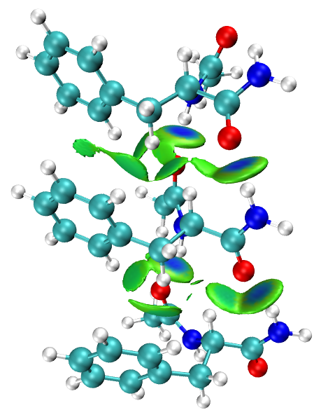

在后处理菜单中，也可像 IGM 和 IGMH 分析那样通过相应选项计算原子或原子对 δ*g* 指数。

## **4.20.13 用 amIGM 揭示动态环境中的弱相互作用**

> **注**
>
> 我的博文“用 amIGM 方法图形化直观表示动态过程中的平均弱相互作用”(<http://sobereva.com/759>，中文) 更全面地说明了 amIGM 方法的用法，并介绍了许多要点。

amIGM 已在第 [3.23.11](sec-3-23-visual-study-of-weak-interaction.md#32311-平均修正-igm-amigm分析--12) 节简述，并在 *Struct. Bond.*, **190**, 297 (2026) DOI: [10.1007/430_2025_95](https://doi.org/10.1007/430_2025_95) 中详细介绍。本节说明如何用 amIGM 方法可视化揭示模拟盒子中一个苯酚分子与环境水间的相互作用。这是 amIGM 方法原始论文中的应用例子。

首先需运行分子动力学 (MD) 模拟得到轨迹文件，必须为多帧 .xyz 格式。例如可把 GROMACS/AMBER/NAMD/CP2K……程序生成的轨迹加载进 VMD 软件，保存为 .xyz 文件。重要的是，所关注的区域应通过冻结或位置约束固定（最好靠近模拟盒子中心）。本例中，唯一的溶质分子苯酚在整个模拟中固定在盒子中心，而填充盒子其余部分的水分子可自由运动。在室温模拟 1 ns 的压缩 .xyz 轨迹文件可直接从 <http://sobereva.com/multiwfn/extrafiles/phenol_in_water.7z> 下载。解压该压缩包后将得到 *phenol_in_water.xyz*，其中含 1001 帧（轨迹每 1 ps 保存一次）。

启动 Multiwfn 并加载 *phenol_in_water.xyz*，然后输入

```text
20  // Visual study of weak interactions
-12  //amIGM analysis
2  //Define two fragments for amIGM. If you define n fragments, then amIGM will reveal all interactions between the n fragments
1-13  //Atomic indices of fragment 1, corresponding to the phenol
c  //The rest of atoms (waters) is defined as fragment 2
1,1000  //Consider 1 to 1000 frames
11  //Because the interactions of phenol-water occur in various regions around phenol, the box containing the grids to be calculated should cover the entire phenol, we choose mode 11 to realize this aim, namely we will select a set of atoms, set extension distance around them and grid spacing
1-13  //The atoms for defining the box
3 A  //Extension distance is set to 3 Å
[Press ENTER button]  //Grid spacing is set to the default 0.2 Bohr, which is adequate of obtaining fine enough amIGM maps
```

现在 Multiwfn 开始计算。代价与考虑的帧数成线性关系，与原子数和待算格点数成正相关。在 Intel i9-13980HX 移动 CPU 上用 16 并行线程，计算共耗时 8.8 分钟。amIGM 分析的并行效率很理想，因此用核数多的服务器 CPU 将大为受益。

计算完毕后，在后处理菜单可见许多选项，见第 [3.23.11](sec-3-23-visual-study-of-weak-interaction.md#32311-平均修正-igm-amigm分析--12) 节。这里选选项 3 把平均 δ $g^{\mathrm{inter}}$ 的格点数据导出为当前文件夹下的 *avgdg_inter.cub*，平均 *sign*(*λ*₂)*ρ* 导出为 *avgsl2r.cub*。把两个 .cub 文件移到 VMD 文件夹，并把 VMD 脚本 *aIGM.vmd* 从“examples”文件夹复制到 VMD 文件夹。接下来启动 VMD，在 VMD 控制台窗口运行命令 `source aIGM.vmd` 执行脚本，两个 .cub 文件将被加载，amIGM 图立刻显示在屏幕上，如下所示

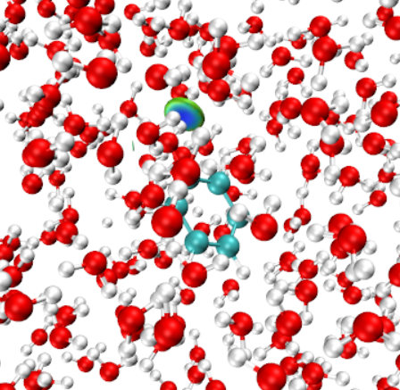

当前图难以看清，需改变绘图设置。在 VMD 主窗口选“Graphics” - “Representation”，在“Isovalue”文本框输入 *0.003* 把平均 δ $g^{\mathrm{inter}}$ 的等值设为 0.003 a.u.。然后点击对应 CPK 样式的表示，在“Selected Atoms”文本框输入 *fragment 0* 只让苯酚可见。此时应看到：

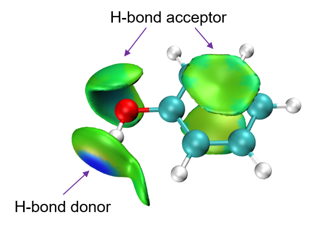

该图对应的颜色条为 *examples\IGMH_colorbar.png*。显然，上图非常生动成功地展示了苯酚与周围水间的平均相互作用，证明了 amIGM 的巨大价值。若把等值进一步降到例如 0.0018 a.u.，还会出现更多等值面，展示更弱的相互作用（多为色散效应），相关讨论和更多例子见 amIGM 原始论文。

### **研究相互作用稳定性**

在后处理菜单中，选选项 8 计算 δ $g^{\mathrm{inter}}$ 标准差和 TFI$^{amIGM}$（amIGM 的热涨落指数）的格点数据，然后分别导出为当前文件夹下的 *stddg_inter.cub* 和 *TFI_amIGM.cub*。可把任其一映射到平均 δ $g^{\mathrm{inter}}$ 的等值面上以图形化展示相互作用稳定性的差异；通常它们的图形效果类似，等值面上某处值越大，相应相互作用的动态稳定性越低。“examples”文件夹中的 *aIGM_TFI.vmd* 是把 *TFI_amIGM.cub* 以颜色映射到 *avgdg_inter.cub* 等值面上的 VMD 脚本文件。现在把 *TFI_amIGM.cub* 和 *aIGM_TFI.vmd* 移到 VMD 文件夹，然后启动 VMD，在 VMD 控制台窗口运行 `source aIGM_TFI.vmd`，再把平均 δ $g^{\mathrm{inter}}$ 的等值改为 0.003 a.u.，经适当微调后你将看到下图。*aIGM_TFI.vmd* 中 TFI$^{amIGM}$ 的默认颜色范围为 0.0 到 2.0，采用蓝-绿-红过渡，很适合本例。应只关注等值面外侧的颜色（内侧颜色不易区分），由此可见 O-H...O 氢键区相对稳定（热涨落弱），而六元碳环上下方的 π-H 键区稳定性较差（热涨落显著）。

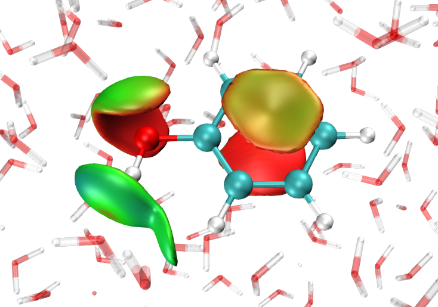

### **amIGM 分析的重要说明**

- 所研究体系不宜太大，否则 amIGM 分析代价可能高得难以承受。当前体系含 1342 个原子，不算太大。若你的体系原子数巨大，必须改用更小模型，或把当前体系截断为只保留感兴趣区域周围的原子（为此可在用 VMD 保存新轨迹文件时用合适的“selection”）。
- 考虑的轨迹帧越多，结果越真实，等值面越光滑。通常至少应考虑 500 帧。
- 如前所述，关键对象的构象位置和结构应固定。可见上例的 MD 模拟中苯酚原子在初始坐标被完全冻结。若关键对象可自由平移旋转，或 MD 模拟中构象变化大，δ $g^{\mathrm{inter}}$ 的等值面将杂乱无章，无法可视化研究相互作用。
- 为大幅降低 amIGM 和 aIGM 的计算代价，Multiwfn 采用一种方案：若格点在片段 1 任意原子的缩放 vdW 半径内，则计算该格点，其它忽略以省代价。*settings.ini* 中的参数“amIGMvdwscl”对应缩放因子，值越小代价越低。默认 amIGMvdwscl=2 被发现非常安全。采用该加速方案显然意味着用户定义的片段 1 应对应 MD 模拟中固定的关键区域。把“amIGMvdwscl”设为 0 可关闭加速方案，此时所定义片段的顺序任意，例如上例中也可把水定义为片段 1，而把苯酚定义为片段 2。
- MD 模拟程序中的原子名一般与元素名不同。最好在 .xyz 轨迹文件中记录元素名而非原子名，否则 Multiwfn 可能猜错元素，使 amIGM 分析出错。注意 Multiwfn 加载完输入文件后会显示体系化学式，从中可轻松检查每种元素是否都被正确识别。

### **技巧：用 amIGM 研究配体-蛋白相互作用时准备轨迹文件的常用做法**

首先在溶剂化盒子中对整个复合物做 NPT 模拟使其充分平衡，然后固定配体做至少 1 ns 的 NVT 模拟，至少保存 500 帧。然后用 VMD 抽取含配体及所有紧密接触残基的团簇，把这部分的轨迹保存为 .xyz 文件。可用选择 "resname MOL or protein same resid as within 3.5 of resname MOL" 抽取团簇，其中 MOL 为配体的残基名。接下来在 amIGM 分析中应定义两个片段，第一个为配体，另一个含所有其它原子。用 aNCI 分析配体-蛋白相互作用生成 .xyz 轨迹文件的完整例子见我的博文 <http://sobereva.com/591>，同样完全适用于 amIGM 分析。
