# **4.200 其他功能（第二部分）**

## **4.200.5 绘制电子密度的径向分布函数**

Multiwfn 能够绘制任意实空间函数的径向分布函数（radial distribution function, RDF），详见[3.200.5](sec-3-200-other-functions-part-2.md#32005-对实空间函数绘制径向分布函数)节。该功能对于研究球形体系的电子结构特征特别有用。

本节由两部分组成。在第一部分中，我们将绘制富勒烯（C₆₀）电子密度的 RDF；而在第二部分中，我将展示如何绘制一个 Rydberg 轨道电子密度的 RDF，以对其进行定量表征。

### **第一部分：富勒烯电子密度的 RDF**

由于 B3LYP/6-31G\* 水平的富勒烯 .wfn 文件很大，我只为你提供相应的 Gaussian 输入文件（"examples" 文件夹中的 *C60.gjf*），请适当修改并用 Gaussian 运行它以生成 *C60.wfn*。

启动 Multiwfn 并输入：

```text
C60.wfn
200  // Other functions (Part 2)
5  // Plot RDF for a real space function
3
1,6  // Set the lower and upper limit of RDF to 1.0 and 6.0 Å, respectively
0  // Calculate RDF and its integration curve
```

计算完成后，选择选项 0，屏幕上将显示如下 RDF 图，X 轴对应径向距离

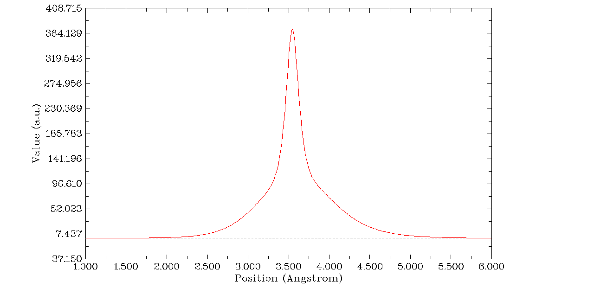

可以看到，RDF 的峰值约为 3.5 Å，这是因为碳原子核与球心之间的距离为 3.545 Å。众所周知，除氢原子外，任何原子的电子密度都在核位置处取最大值。

如果你仔细检查 RDF 曲线，会发现峰右侧的曲线略高于左侧。其原因是富勒烯外侧的 π 电子比内侧更丰富。你也可以绘制并分析 ELF 等值面图来证实这一点。

你也可以选择选项 2 来绘制 RDF 的积分曲线，如下所示

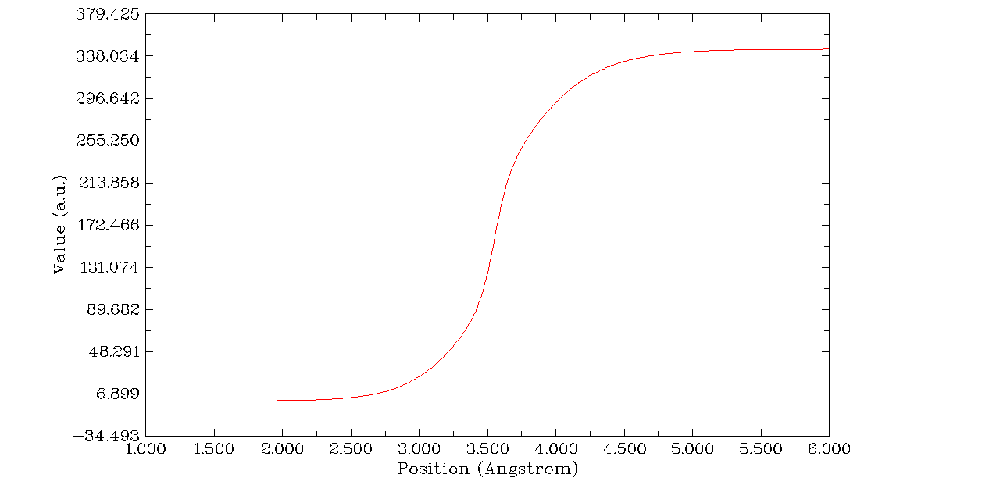

你可能已经注意到，计算完成后屏幕上有如下提示：

```text
Integrating the RDF in the specified range is        344.9321931513
```

这意味着从 *r*=1.0 到 *r*=6.0 Å 对 RDF 积分得到 344.932，它也对应积分曲线在 *r*=6.0 处的值。该值与我们的预期（即当前体系的电子数 360）明显偏离。一个原因是默认的积分点数不够大（径向和角向部分分别为 500 和 2030，你可以手动增加它们），而另一个更重要的原因是当前体系太大，使用单中心积分方法很难得到非常精确的结果，至少对电子密度积分而言是如此。

### **第二部分：用电子密度的 RDF 定量表征丙酮的 Rydberg 轨道**

Rydberg 轨道（Rydberg orbital）是指空间上非常弥散的分子轨道（MO），其轨道形状类似于原子轨道，因为 Rydberg 轨道中的电子可视为被一个小的阳离子核微弱束缚，而该阳离子核的行为类似于原子核。为了忠实地描述 Rydberg 轨道的弥散特征，必须使用带有大量弥散函数的基组，例如 aug-cc-pVTZ。

下面我们使用的示例文件是 Gaussian 在 B3LYP/aug-cc-pVTZ 水平下计算的甲醛。我们将首先把 Rydberg 轨道可视为等值面，然后计算这些轨道对应电子密度的 RDF，以对其进行定量表征。

启动 Multiwfn，载入 *examples\H2CO_aVTZ.fch*，然后进入主功能 0。由于 Rydberg 轨道非常弥散，为了在观察时避免其等值面被截断，你应首先选择"其他设置"-"设置扩展距离"并输入一个较大的值，这里我们输入 12。之后，把等值面值改为比默认值小得多的值，例如 0.01。然后我们任意选择一些虚轨道来考察其特征。你会发现很多虚轨道都表现出非常弥散的特征，例如，下方显示了 MO10 和 MO11：

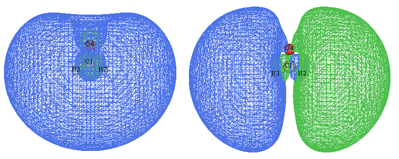

它们的主要分布区域都远离分子。MO10 几乎呈球对称，因此可记为 *s* 型 Rydberg 轨道。而 MO11 有两个相位，它们平均分布在两侧，整体形状非常接近原子 *p* 轨道，因此 MO11 可认定为 *p* 型 Rydberg 轨道。

如何定量证明这些 Rydberg 轨道的主要分布区域远离分子中心？最好的方法之一就是绘制这些轨道对应电子密度的 RDF。这里我们为 MO11 绘制这种 RDF 图。我们关闭主功能 0 的图形界面，然后输入以下命令：

```text
6  // Modify wavefunction
26  // Modify orbital occupation number
0  // Select all orbitals
0  // Select occupation number of all orbitals to zero
11  // Select orbital 11
2  // Set occupation number of orbital 11 to 2.0 (assume it is doubly occupied)
q  // Return
-1  // Return to main menu
200
5  // Plot RDF
3  // Set lower and upper limit of radial plotting
0,10  // From 0 to 10 Å
4  // Set angular number of integration points. The default value is unnecessarily high for present purpose, therefore we set it to a smaller value to reduce computational time
302  // 302 angular points
0  // Calculate RDF for electron density (which is the default real space function)
1  // Plot the RDF map
```

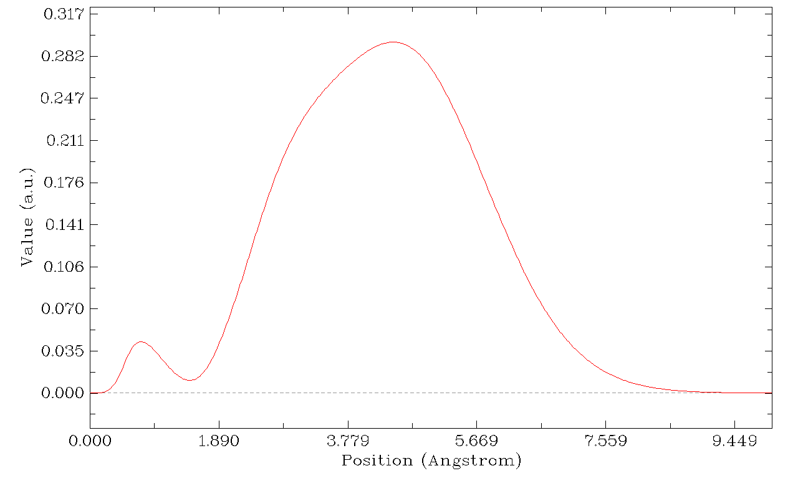

从图中可以看出，全局最大峰位于约 4.6Å 处，表明该轨道波函数的主要分布区域远离原点（在当前的 .fch 文件中，笛卡尔原点对应分子中心），因此 MO11 可明确地认定为 Rydberg 轨道。

请也为一个普通的价虚轨道绘制这样的 RDF 图，例如作为 π\* 轨道的 MO9。它的峰位置在哪里？

## **4.200.6 研究不同波函数文件中轨道之间的对应关系**

本节给出两个例子，说明如何使用[3.200.6](sec-3-200-other-functions-part-2.md#32006-分析两个波函数中轨道的对应关系)节介绍的功能，该功能旨在揭示不同波函数文件中轨道之间的关系。

### **4.200.6.1 揭示 CH₃NH₂ 的 HF 与 MP2 轨道之间的关系**

本节研究 CH₃NH₂ 的 HF/6-31+G\* 分子轨道（MO）与 MP2/6-31+G\* 自然轨道（natural orbital, NO）之间的对应关系。

启动 Multiwfn 后输入

```text
C:\CH3NH2_MP2.wfn  // MP2/6-31+G* wavefunction file, there are 48 NOs
200  // Other function, part 2
6  // Analyze correspondence between orbitals in two wavefunctions
[Press ENTER button directly to choose all orbitals]
C:\CH3NH2_HF.wfn  // HF/6-31+G* wavefunction file, there are 9 MOs
[Press ENTER button directly to choose all orbitals]
```

然后你将看到

```text
   1:       2( 94.63%)    1(  5.36%)    4(  0.01%)    3(  0.00%)    6(  0.00%)
   2:       1( 94.64%)    2(  5.36%)    3(  0.00%)    9(  0.00%)    6(  0.00%)
   3:       3( 85.21%)    4(  9.87%)    7(  3.24%)    9(  0.88%)    6(  0.79%)
   4:       4( 86.88%)    3( 10.66%)    6(  1.94%)    9(  0.48%)    7(  0.02%)
   5:       6( 54.88%)    7( 41.11%)    9(  3.20%)    4(  0.45%)    3(  0.34%)
   6:       8( 57.50%)    5( 42.47%)    7(  0.00%)    6(  0.00%)    4(  0.00%)
   7:       5( 57.50%)    8( 42.48%)    7(  0.00%)    4(  0.00%)    6(  0.00%)
   8:       9( 86.62%)    6( 10.30%)    7(  1.63%)    4(  0.89%)    3(  0.50%)
   9:       7( 53.98%)    6( 32.07%)    9(  8.76%)    3(  3.28%)    4(  1.89%)
  10:       9(  0.00%)    7(  0.00%)    6(  0.00%)    4(  0.00%)    2(  0.00%)
  11:       5(  0.00%)    8(  0.00%)    3(  0.00%)    7(  0.00%)    4(  0.00%)
... (ignored)
  47:       6(  0.01%)    7(  0.00%)    9(  0.00%)    3(  0.00%)    4(  0.00%)
  48:       9(  0.04%)    7(  0.00%)    6(  0.00%)    4(  0.00%)    3(  0.00%)
```

第一列表示 MP2 自然轨道（NO）的编号，右侧显示了 Hartree-Fock 分子轨道对它们贡献最大的五个。如可见，第一个（第二个）NO 几乎等价于第二个（第一个）MO。而第 9 个 NO 不能仅用任何一个 MO 表示，它主要来自第 7 个（53.98%）和第 6 个 MO（32.07%）的强烈混合，第 9 个 MO 也有不可忽略的贡献（8.76%）。

如果你想得到当前波函数中某个轨道（例如第 5 个 NO）的所有系数和组成，只需输入 *5*，你将看到

```text
    1   Contribution:     0.000 %    Coefficient:    0.001509
    2   Contribution:     0.000 %    Coefficient:   -0.000042
    3   Contribution:     0.339 %    Coefficient:   -0.058201
    4   Contribution:     0.447 %    Coefficient:    0.066869
    5   Contribution:     0.000 %    Coefficient:    0.000000
    6   Contribution:    54.882 %    Coefficient:    0.740826
    7   Contribution:    41.113 %    Coefficient:   -0.641194
    8   Contribution:     0.000 %    Coefficient:    0.000000
    9   Contribution:     3.199 %    Coefficient:   -0.178856
Total:    99.980 %
```

该输出表明 $\displaystyle |\mathrm{NO}\ 5\rangle=0.7408\,|\mathrm{MO}\ 6\rangle-0.6412\,|\mathrm{MO}\ 7\rangle-0.1788\,|\mathrm{MO}\ 9\rangle\cdots$ 最后一行的 99.98% 说明第 5 个 NO 可被这九个 MO 的线性组合完美表示。

### **4.200.6.2 研究氮孤对对多巴胺分子轨道的贡献**

有时研究诸如"杂原子的孤对对某个分子轨道的贡献有多大？"之类的问题很有用，将轨道定域化（orbital localization）技术与主功能 200 的子功能 6 相结合，可以对此问题给出明确的回答。本节我们将研究 Donor-π-acceptor 型分子的氨基中氮孤对对占据轨道的贡献。波函数文件为 *examples\excit\D-pi-A.fchk*，其结构和原子编号如下所示

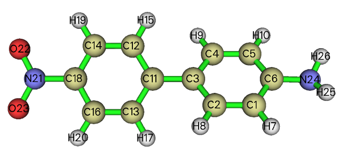

我们应首先生成定域分子轨道（localized molecular orbital, LMO），因为通常一个孤对可以用一个 LMO 表示。

启动 Multiwfn 并输入以下命令

```text
examples\excit\D-pi-A.fchk
19  // Orbital localization analysis
1  // Localize occupied orbitals
```

LMO 会自动导出到当前文件夹的 *new.fch* 中。从屏幕上输出的 LMO 组成中，我们可以发现有几个 LMO 与 N24（即氨基中的氮）密切相关。下面是轨道组成输出的相关行。

```text
    4:  24(N ) 99.3%        5:  18(C ) 98.9%        6:   6(C ) 98.6%
...
   19:  24(N ) 60.1%  25(H ) 32.9%        20:  21(N ) 57.5%  18(C ) 33.7%
   27:   2(C ) 45.6%   3(C ) 44.5%        28:  24(N ) 53.6%   6(C ) 37.8%
   33:  23(O ) 65.8%  21(N ) 27.5%        34:  24(N ) 59.9%  26(H ) 33.2%
   43:   5(C ) 46.2%   4(C ) 44.9%        44:  24(N ) 77.7%   6(C )  9.9%
```

为了确认哪一个对应 N24 的孤对，我们进入主功能 0，逐个检查上述突出的 LMO 的等值面，我们发现 LMO 44 可视为 N24 的孤对轨道，其等值面值为 0.1 的等值面图如下所示

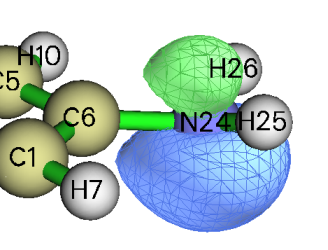

现在我们可以检查该 LMO 对各个 MO 的贡献。重新启动 Multiwfn 并输入

```text
examples\excit\D-pi-A.fchk
200  // Other functions (Part 2)
6  // Analyze correspondence between orbitals in two wavefunctions
1,56  // We want to check all occupied MOs (indices range is 1~56)
new.fch  // The file containing LMOs
44,44  // Only the 44th orbital in the new.fch will be taken into account
```

从输出中，我们可以发现一些 MO 含有 LMO 44 的较大成分，相关行如下所示（由于只考虑了 LMO 44，其他 LMO 的贡献恰为零）

```text
    44:     44( 10.04%)   43(  0.00%)   42(  0.00%)   41(  0.00%)   40(  0.00%)
*   45:     44(  8.73%)   43(  0.00%)   42(  0.00%)   41(  0.00%)   40(  0.00%)
*   49:     44( 33.29%)   43(  0.00%)   42(  0.00%)   41(  0.00%)   40(  0.00%)
*   53:     44( 14.28%)   43(  0.00%)   42(  0.00%)   41(  0.00%)   40(  0.00%)
*   56:     44( 19.74%)   43(  0.00%)   42(  0.00%)   41(  0.00%)   40(  0.00%)
```

我们返回主菜单，进入主功能 0 并可视化 MO 49，以检查 LMO 44（N24 的孤对）是否真的对其有较大贡献（33.29%）。等值面值为 0.05 的等值面图如下所示

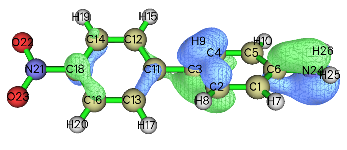

如可见，MO 44 的确很大程度上来自 N24 孤对的贡献，因为其等值面的很大一部分覆盖了 N24 的孤对区域，计算得到的组成 33.29% 应是一个合理的值。

## **4.200.12 计算能量指数（EI）与键极性指数（BPI）**

本节我将说明如何计算 EI 与 BPI 指数，它们定义于 *J. Phys. Chem.*, **94**, 5602 (1990)。如果你对这两个量不熟悉，请先阅读[3.200.12](sec-3-200-other-functions-part-2.md#320012-计算能量指数-ei-或键极性指数-bpi)节。本例涉及的几何结构与波函数在 HF/6-31G\* 水平下产生，即上述论文中所用的水平。

我们将计算 CH₃NH₂ 中 C-N 键的 BPI，在此之前我们首先需要计算 C 与 N 原子的参考 EI 值，它们分别对应乙烷中 C 与 H₂N-NH₂ 中 N 的 EI。启动 Multiwfn 并输入

```text
examples\EI_BPI\ethane.fch
200  // Other function, part 2
12  // Calculate energy index (EI) or bond polarity index (BPI)
1  // C1 atom
```

你将看到参考分子乙烷中 C 的 EI 值为 -0.667639 a.u.。

重新启动 Multiwfn 并输入

```text
examples\EI_BPI\N2H4.fch
200  // Other function, part 2
12  // Calculate EI or BPI
1  // N1 atom
```

你可以看到参考分子 H₂N-NH₂ 中 N 的 EI 值为 -0.718126 a.u.。

接下来我们计算 CH₃NH₂ 中 C 与 N 的 EI。重新启动 Multiwfn 并输入

```text
examples\EI_BPI\CH3NH2.fch
200  // Other function, part 2
12  // Calculate EI or BPI
1  // C1, the result is -0.693374 a.u.
5  // N5, the result is -0.698092 a.u.
```

CH₃NH₂ 中的 BPI$_{CN}$ 计算如下

$$
\mathrm{BPI}_{\mathrm{CN}}=(\mathrm{EI}_{\mathrm{C}}-\mathrm{EI}_{\mathrm{C}}^{\mathrm{ref}})-(\mathrm{EI}_{\mathrm{N}}-\mathrm{EI}_{\mathrm{N}}^{\mathrm{ref}})=-0.693374+0.667639+0.698092-0.718126=-0.046
$$

作为比较，用 *examples\EI_BPI\F2.fch* 计算 F 的参考值，结果应为 -0.992542 a.u.，再用 *examples\EI_BPI\CH3F.fch* 计算 CH₃F 分子中 C 与 F 的 EI，结果应分别为 -0.750302 和 -0.885961。然后计算 BPI$_{CF}$ 值为 -0.750302+0.667639+0.885961-0.992542= -0.189。由于 CH₃F 中的 BPI$_{CF}$ 明显比 CH₃NH₂ 中的 BPI$_{CN}$ 更负，可以得出结论：CH₃F 中的 C-F 键比 CH₃NH₂ 中的 C-N 键极性更强。

通过 EI 指数我们还可以评估所谓基团电负性，它通常比原子电负性更有用。这里我们计算 -CH₃ 基团的电负性，它就是 CH₃ 自由基的 EI$_{C}$ 的负值。启动 Multiwfn 并输入

```text
examples\EI_BPI\CH3.fch  // Optimized and produced at UHF/6-31G*
200  // Other function, part 2
12  // Calculate EI or BPI
1  // Carbon atom
```

结果为 -0.630656 a.u.，对应 CH₃ 基团的电负性为 0.631。然后我们用 *examples\EI_BPI\F.fch* 计算 -F 基团的电负性，结果为 0.957。显然 -F 基团的电负性高得多，因此由于其平均每个价电子能量更低，它吸引电子的能力比 -CH₃ 基团更强。

## **4.200.13 研究轨道对密度差的贡献**

> **注**
>
> 本节的中文版是我的博客文章"使用 Multiwfn 研究分子轨道、NBO 等对密度差和 Fukui 函数的贡献"(<http://sobereva.com/502>)。

本节我将用几个例子说明如何求得各类轨道对不同类型密度差（density difference, Δ*ρ*）的贡献，并展示通过这些分析可以获得哪些有化学价值的信息。请先阅读[3.200.13](sec-3-200-other-functions-part-2.md#320013-计算轨道对密度差或其它格点数据的贡献)节，以获得关于本节所用功能的基本知识。

### **4.200.13.1 分子轨道对苯酚 Fukui 函数 *f*⁻ 的贡献**

Fukui 函数（Fukui function）的基本概念已在[4.5.4](sec-4-5-generate-grid-data-and-view-isosurface-map.md#454-用福井函数和对偶描述符研究苯酚亲电进攻的有利位点)节中详细介绍。Fukui 函数 $f^-$ 在文献中常用于识别亲电进攻的有利位点，它是 Δ*ρ* 的一个特例，定义为 ${\rho}_{N}\left( \mathbf{r} \right)-{\rho}_{N-1}\left( \mathbf{r} \right)$，其中 *N* 为原始状态的电子数。研究各个分子轨道对 $f^-$ 的相对贡献很有意义，这样我们可以从轨道角度更好地认识其特征。其基本思想是，如果把分子轨道的密度视为可用作线性展开 $f^-$ 的基函数，那么最优展开系数就可用来衡量每个 MO 对 $f^-$ 的贡献。

显然，如果没有轨道弛豫效应，$f^-$ 必定与 *N* 状态 HOMO 的概率密度完全相同。当然，这一假设并不成立，因为在实际中，当电子数从 *N* 变为 *N*-1 时，*N* 状态的所有分子轨道都必然会发生某种程度的变形。

下面我们以苯酚为例说明如何计算所有占据轨道对 $f^-$ 的贡献。*N* 与 *N*-1 状态的轨道波函数文件已分别作为 "examples" 文件夹中的 *phenol.wfn* 与 *phenol_N-1.wfn* 提供。在计算贡献之前，我们首先需要生成 $f^-$ 的 cube 文件。为此，启动 Multiwfn 并输入

```text
examples\phenol.wfn  // Wavefunction file of N-state
5  // Calculate grid data
0  // Set custom operation
1  // Only one file will be operated with the file that has been loaded
-,examples\phenol_N-1.wfn
1  // Electron density
2  // Medium-quality grid
2  // Export the grid data as density.cub in current folder
```

现在，我们可以直接进入用于求轨道对 Δ*ρ* 贡献的功能。输入以下命令

```text
0  // Return to main menu
200  // Other functions (Part 2)
13  // Evaluate orbital contributions to density difference or other grid data
density.cub  // The file containing grid data of f^-
0  // Choose orbital range and start analysis
o  // Only consider orbitals with non-zero occupation in the fitting. For present case all occupied MOs are chosen (note that the wavefunction file we loaded is in .wfn format, in fact it only contains occupied orbitals, thus unoccupied orbitals cannot be chosen even if you want)
```

很快贡献值按升序列出：

```text
 Orbital    20   Value:    -0.108
 Orbital    11   Value:    -0.089
 Orbital     9   Value:    -0.065
[ignored...]
 Orbital    23   Value:     0.111
 Orbital    24   Value:     0.214
 Orbital    25   Value:     0.766
 Sum of all values:       1.000
 Fitting error (definition 1):      0.8911
 Fitting error (definition 2):    0.003828
```

因为默认将所有贡献之和约束为 1.0，所以"所有值之和"恰为 1.0。对当前情形该默认约束是合理的，因为 *N* 与 *N*-1 恰好相差 1 个电子。"拟合误差"显示了拟合质量。拟合误差越小，拟合质量越好。然而，检验拟合质量的最好方法是直观比较实际 Δ*ρ* 与拟合 Δ*ρ* 的等值面。从以上数据可以清楚地看到，MO25（HOMO）主导了 $f^-$，而 MO24（HOMO-1）与 MO23（HOMO-2）也起着不可忽略的作用。

在后处理菜单中，我们可以选择选项 2 和 3 分别可视化所提供的格点数据（即从 *density.cub* 载入的那个）与拟合格点数据的等值面。两套格点数据之差可通过选项 4 可视化。相应的图形如下所示，等值面值设为 0.005。为便于比较，贡献最大的三个分子轨道也一并给出如下，等值面值为 0.07，贡献值标注在括号中。

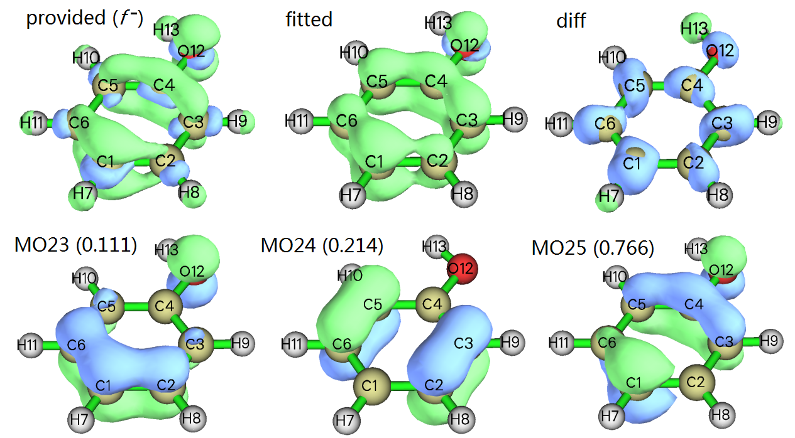

从上图可以看出，我们拟合的格点数据与所提供的非常接近，至少拟合结果能够合理地再现 π 区域的基本特征。所提供与拟合格点数据的主要差别在 σ 区域，如"diff"子图所示。这一观察表明，失去一个电子导致 σ 电子发生严重的弛豫，仅基于 *N* 状态的占据轨道无法完全表示。

上图中显示的 MO23、MO24 与 MO25 均为 π 轨道，这一事实解释了为何 $f^-$ 的 σ 部分无法在拟合格点数据中得到忠实表示。注意有少数分子轨道的贡献为负，其中最负的是 MO20（-0.108）。如果你检查该轨道，会发现它是一个 σ 轨道。然而，由于其形状与"diff"格点数据不太相似，它的出现并没有改善拟合质量，也没有减小所提供与拟合格点数据之间的差别。

从上图我们还可以发现 MO25 等值面的轮廓与 $f^-$ 非常相似，这就是 MO25 贡献占主导的原因，也是 $f^-$ 常常能被 HOMO 分布合理近似的原因。显然，如果没有轨道弛豫效应，MO25 的贡献应恰为 1.0，而所有其他分子轨道的贡献应为 0.0。

> **注**
>
> 值得强调的是，拟合中所考虑的轨道范围会影响所得贡献。例如，你只想计算 MO 10\~15 的贡献，你会发现当选择 MO 1\~15 与选择 MO 10\~15 时，它们的贡献是不同的。

### **4.200.13.2 NBO 轨道对 1,3-丁二烯 Fukui 函数 *f*⁻ 的贡献**

这次我们计算各种高占据 NBO 对 1,3-丁二烯 $f^-$ 的贡献。*N* 与 *N*-1 状态的 .fch 文件，以及为 *N* 状态生成的 NBO 绘图文件 .31 与 .37，已在 "examples\orb_densdiff\butadiene" 文件夹中提供。几何结构已针对 *N* 状态优化。

注意 .37 文件中记录的 NBO 轨道可分为两类，即 Lewis 型与 Rydberg 型。Lewis 型 NBO 的占据数约为 2.0，而 Rydberg 型几乎未占据。由于只有 Lewis 型 NBO 对 *N* 状态的电子密度有显著贡献，我们只考虑这些轨道。

首先，我们生成 $f^-$ 型 Fukui 函数的 cube 文件。启动 Multiwfn 并输入

```text
examples\orb_densdiff\butadiene\butadiene.fch
5  // Calculate grid data
0  // Set custom operation
1  // Only one file will be operated with the file that has been loaded
-,examples\orb_densdiff\butadiene\butadiene_N-1.fch
1  // Electron density
1  // Low-quality grid (since the current system is very small, low-quality grid is adequate)
2  // Export the grid data as density.cub in current folder
```

现在重新启动 Multiwfn 并输入

```text
examples\orb_densdiff\butadiene\BUTADIENE.31
37  // Load the BUTADIENE.37 in the same folder, which records NBO orbitals
```

现在如果你进入主功能 6 并选择选项 3 查看轨道信息，你会发现由于占据数高，前 15 个轨道对应 Lewis 型 NBO。接下来，我们在主菜单中输入以下命令

```text
200  // Other functions (Part 2)
13  // Evaluate orbital contributions to density difference or other grid data
density.cub  // The file containing grid data of f^-
0  // Choose orbital range and start analysis
1-15  // Range of Lewis NBOs
```

结果如下所示

```text
 Orbital     3   Value:    -0.047
 Orbital     8   Value:    -0.046
[ignored...]
 Orbital    10   Value:     0.017
 Orbital     4   Value:     0.530
 Orbital     9   Value:     0.531
 Sum of all values:       1.000
 Fitting error (definition 1):      0.9008
 Fitting error (definition 2):    0.004961
```

数据清楚地表明 NBO4 与 NBO9 同等且完全地主导了 $f^-$，而其他轨道的参与可以安全地忽略。

所提供的 $f^-$ 与拟合结果的等值面（等值面值=0.01），以及 NBO4 与 NBO9 的等值面（等值面值=0.1）共同显示如下

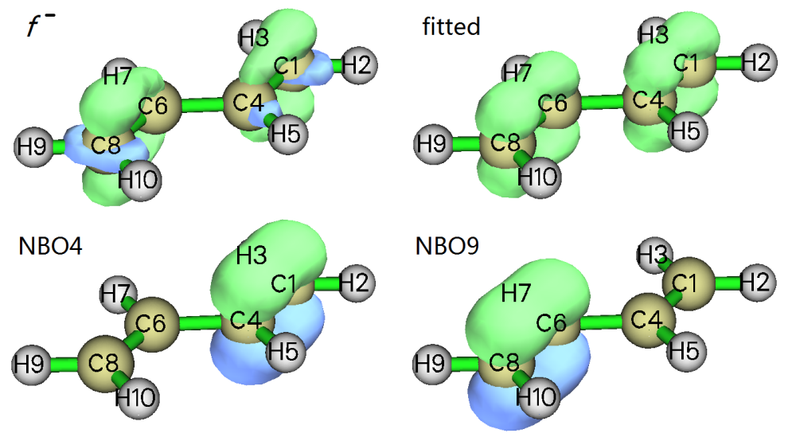

因为从图中显然可见 NBO4 与 NBO9 分别对应 C1-C4 与 C6-C8 的 π 键，且拟合函数与所提供的 $f^-$ 定性一致，我们可以得出结论：$f^-$ 主要由 C1-C4 与 C6-C8 键上的 π 电子组成。

### **4.200.13.3 NBO 轨道对 H₂CO 的 S0 与 S1 态之间密度差的贡献**

最后，我们研究 NBO 对 H₂CO 的 S1 与 S0 态之间 Δ*ρ* 的贡献。

本节使用的所有相关文件已在 "examples\orb_densdiff\H2CO" 文件夹中提供，包括为基态生成的 NBO 绘图文件、基态的波函数文件（*S0.fch*）与第一激发态的波函数（*S1.wfn*）。用于生成这些文件的 Gaussian 输入文件也一并提供。

我们首先生成 S1 与 S0 态之间的 Δ*ρ*。启动 Multiwfn 并输入

```text
examples\orb_densdiff\H2CO\S1.wfn
5  // Calculate grid data
0  // Set custom operation
1  // Only one file will be operated with the file that has been loaded
-,examples\orb_densdiff\H2CO\S0.fch
1  // Electron density
1  // Low-quality grid
2  // Export the grid data as density.cub in current folder
-1  // Visualize the isosurface
```

等值面值=0.03 的等值面如下所示。

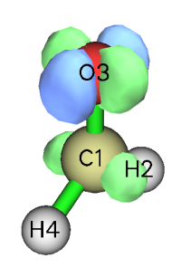

```text
examples\orb_densdiff\H2CO\H2CO.31
37  // Load the H2CO.37 in the same folder, which records NBO orbitals
200  // Other functions (Part 2)
13  // Evaluate orbital contributions to density difference or other grid data
density.cub  // The file containing grid data of Δρ_S0→S1
1  // Set constraint on the sum of contributions
2  // Set the constraint to a specific value
0  // Since electron excitation does not alter the number of electrons, the sum of contributions is set to be constrained to zero
0  // Choose orbital range and start analysis
[Press ENTER button to consider all orbitals]  // Note that during electron excitation, a portion of electrons is excited to empty orbitals, therefore only taking Lewis NBOs into account is evidently inadequate, so all orbitals should be taken into account in the present context
```

结果如下所示

```text
 Orbital     8   Value:    -0.719
 Orbital    16   Value:    -0.254
 Orbital     9   Value:    -0.151
[ignored...]
 Orbital    11   Value:     0.115
 Orbital    22   Value:     0.132
 Orbital    18   Value:     0.148
 Orbital    32   Value:     0.894
 Sum of all values:       0.000
 Fitting error (definition 1):      0.4778
 Fitting error (definition 2):    0.001770
```

可见，具有主导正值的是 NBO32。具有最负贡献的是 NBO8，其负贡献的幅度远大于任何其他 NBO。从 Gaussian 输出文件 *examples\orb_densdiff\H2CO\S0.out* 中 NBO 模块打印的"自然键轨道（总结）"一栏可以看出，NBO8 被认定为"O 3 的 LP ( 2)"，即 O3 的孤对。

拟合 Δ*ρ* 的等值面（等值面值=0.03）以及 NBO8 与 NBO32 的等值面（等值面值均设为 0.17）如下所示。

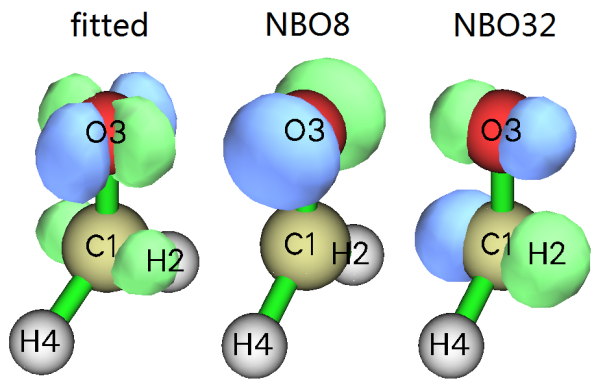

将"拟合"图与前面所示的 Δ*ρ*$_{S0\to S1}$ 图比较，显然拟合的 Δ*ρ* 与严格计算的几乎完全相同，因此当前情形的拟合质量相当高，贡献值必然非常可靠且有意义。从轨道等值面图显然可见 NBO8 的确对应 O3 的孤对，而 NBO32 对应 C1-O3 的反 π 轨道，因此 S0→S1 激发可明确地认定为 n(O3)→π\*(C1-O3) 型跃迁。

你也可以计算各种 NAO 对 S0→S1 激发的贡献，与上例唯一的区别是，在载入 *H2CO.31* 后，你应输入 *33* 以载入记录 NAO 轨道的 *H2CO.33*。你会发现 S0→S1 激发主要涉及从高占据的 *p* 型 NAO 到几乎未占据 NAO 的跃迁。

## **4.200.14 域分析例子**

域分析（domain analysis）是指对给定实空间函数等值面包围区域的定量分析，详见[3.200.14](sec-3-200-other-functions-part-2.md#320014-域分析求函数等值面内的性质)节。为说明域分析模块的强大与灵活，下面给出域分析的一些实际应用。

### **4.200.14.1 在约化密度梯度（RDG）等值面内积分实空间函数以定量研究弱相互作用**

在阅读之前，请先阅读[3.23.1](sec-3-23-visual-study-of-weak-interaction.md#3231-非共价相互作用-noncovalent-interaction-nci分析-1)节，以理解如何用约化密度梯度（reduced density gradient, RDG）揭示弱相互作用区域。本节我展示通过对 RDG 等值面包围的域积分来表征弱相互作用的可能性。

#### **体系 1：苯酚二聚体**

首先，我们以苯酚二聚体为例。启动 Multiwfn 并输入

```text
examples\phenoldimer.wfn
200  // Other functions (Part 2)
14  // Integrate real space functions within isosurfaces of a real space function
```

这里我们要研究由 RDG = 0.5 等值面定义的 RDG 域；换句话说，这些域由 RDG \< 0.5 的格点组成。因此，我们选择选项 2 并选择"13 Reduced density gradient"，然后选择选项 3 并输入判据，即 *\<0.5*（事实上，RDG \< 0.5 是默认设置，你不需要手动做这些步骤）。接下来，输入以下命令：

```text
1  // Start calculation grid data and generate domains
-10  // Adjust extension distance
0  // Set extension distance to zero to avoid wasting of grid points at boundary area, where RDG isosurfaces commonly do not occur
2  // Medium-quality grid (grid spacing=0.1 Bohr), generally this is accurate enough
```

现在 Multiwfn 开始计算所选实空间函数（即 RDG）的格点数据，然后根据 RDG\<0.5 的判据识别各自独立的 RDG 域。最终找到四个域，构成域的格点数如下最后一列所示：

```text
Domain:     1    Grids:     208    Volume:     0.031 Angstrom^3
Domain:     2    Grids:     290    Volume:     0.043 Angstrom^3
Domain:     3    Grids:     200    Volume:     0.030 Angstrom^3
Domain:     4    Grids:    2597    Volume:     0.385 Angstrom^3
```

要将它们可视化，选择"3 Visualize domains"。在图形界面中，你可以在右下列表中选择域编号。第 2 与第 4 个域如下所示：

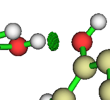 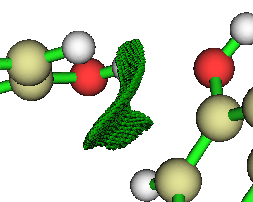

如果你已读过[3.23.1](sec-3-23-visual-study-of-weak-interaction.md#3231-非共价相互作用-noncovalent-interaction-nci分析-1)节，你一定知道这些域分别对应两个苯酚之间的氢键与 van der Waals (vdW) 相互作用。我们可以通过在相应区域内积分特定的实空间函数来研究这些域的性质。我们输入

```text
1  // Integrate a domain
2  // Index of the domain of interest
2  // Choose a real space function
1  // Using electron density as integrand
```

结果为：

```text
 Integration result:    0.6932973049E-02 a.u.
 Volume:    0.290000 Bohr^3  (    0.042974 Angstrom^3 )
 Average:    0.2390680362E-01
 Maximum:    0.2766231164E-01   Minimum:    0.1994457517E-01
```

类似地，我们对域 4 这样做：

```text
 Integration result:    0.1181667175E-01 a.u.
 Volume:    2.597000 Bohr^3  (    0.384836 Angstrom^3 )
 Average:    0.4550123895E-02
 Maximum:    0.6217203920E-02   Minimum:    0.3102088666E-02
```

从输出我们知道，对应氢键与 vdW 相互作用的域中涉及的电子数分别为 0.006933 与 0.011817。它们可解释为重叠电子，并与同类型相互作用的强度密切相关。然而，由于这两个域对应不同类型的弱相互作用，重叠电子的大小与它们强度之间并无正相关，也就是说我们不能据此得出两个苯酚之间的 vdW 相互作用强于分子间氢键。输出中的"Volume"表示域的体积，我们可以发现 vdW 相互作用涉及的空间区域比氢键宽得多。"Average"对应实空间……

#### **体系 2：2-pyridoxine 2-aminopyridine**

2-pyridoxine 2-aminopyridine (PP) 的分子间氢键已在[4.2.1](sec-4-2-topology-analysis.md#421-2-吡哆醇-2-氨基吡啶的分子中的原子-aim-拓扑分析与芳香性分析)节中用 AIM 分析研究过，而这次我们将用 $q_{\mathrm{int}}$ 指数分析它们。该指数提出于 *J. Phys. Chem. A*, **115**, 12983 (2011)，用于判断不同分子间距离下氢键的相互作用，其定义请见[3.200.14](sec-3-200-other-functions-part-2.md#320014-域分析求函数等值面内的性质)节。通常，$q_{\mathrm{int}}$ 指数越负，相互作用越稳定。

$q_{\mathrm{int}}$ 指数基于对 RDG = 0.6 等值面包围的域积分定义，因此我们需要先计算 RDG 格点数据并生成相应的域。注意，将 RDG 格点数据的扩展距离设为零并不总是合适。对当前体系，如果你用扩展距离为零的主功能 5 计算 RDG 格点数据，你会看到一些 RDG 等值面被盒子边界截断，如下红色箭头所示。这种情况下 Multiwfn 的域积分模块无法工作。

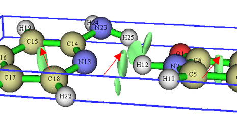

因此，在计算当前情形的 RDG 格点数据时，扩展距离应设为比零稍大的值，3 Bohr 足以安全地避免意外截断。扩展距离也不应设为过大的值，否则待计算的格点数会非常高，从而非常耗时。

启动 Multiwfn 并输入以下命令：

```text
examples\2-pyridoxine_2-aminopyridine.wfn
200  // Other functions (Part 2)
14  // Integrate real space functions within isosurfaces of a real space function
3  // Change the default criterion of defining domain
<0.6
1  // Start calculation of grid data
-10  // Change extension distance
3  // 3.0 Bohr of extension distance
2  // Medium-quality grid
```

现在可视化所得的域。域 2 与域 4 如下所示，显然它们分别对应 N23-H25⋅⋅⋅⋅⋅⋅O1 与 N2-H12⋅⋅⋅⋅⋅⋅N13 的氢键。

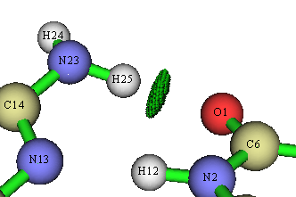 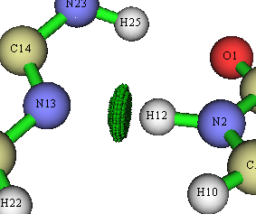

接下来，选择选项"5 Calculate q_bind index for a domain"并输入 *2*，然后直接按回车键以使用 *ρ*$^{4/3}$ 作为被积函数（即 *J. Phys. Chem. A*, **115**, 12983 (2011) 中所用的），所得该域的 $q_{\mathrm{int}}$ 及相关细节如下所示

```text
 q_att:       0.00490957 a.u.
 q_rep:       0.00005590 a.u.
 q_bind:     -0.00485367 a.u.
 Volume (lambda2<0):     0.599000 Bohr^3
 Volume (lambda2>0):     0.010000 Bohr^3
 Volume (Total):         0.609000 Bohr^3
Similarly, we obtain results for domain 4
 q_att:       0.00805204 a.u.
 q_rep:       0.00037346 a.u.
 q_bind:     -0.00767858 a.u.
 Volume (lambda2<0):     0.745000 Bohr^3
 Volume (lambda2>0):     0.052000 Bohr^3
 Volume (Total):         0.797000 Bohr^3
```

由于 N2-H12⋅⋅⋅⋅⋅⋅N13 对应的 $q_{\mathrm{bind}}$（-0.007678）比 N23-H25⋅⋅⋅⋅⋅⋅O1 的（-0.004854）负得多，前者应强于后者。

由于两种相互作用都是氢键，也可以通过简单比较域中包含的电子数来估计其相对强度。我们选择"2 Perform integration for all domains"，然后输入 *2*，再选择电子密度作为被积函数，以得到所有域的电子布居：

```text
Domain    Integral (a.u.)     Volume (Bohr^3)      Average
     1    0.1212147834E-03         0.111000    0.1092025076E-02
     2    0.1647945811E-01         0.609000    0.2705986553E-01
     3    0.1714432107E-02         0.319000    0.5374395319E-02
     4    0.2618188584E-01         0.797000    0.3285054685E-01
     5    0.8932587581E-02         0.412000    0.2168103782E-01
     6    0.7764521413E-02         0.394000    0.1970690714E-01
 Integration result of all domains:    0.6119409984E-01 a.u.
 Volume of all domains:     2.642000 Bohr^3       0.391504 Angstrom^3
```

不仅域 2 的积分值（0.01648）明显小于域 4（0.02618），而且域 2 的平均值（0.02706）也小于域 4（0.03285），因此我们有很强的证据说 N2-H12⋅⋅⋅⋅⋅⋅N13 强于 N23-H25⋅⋅⋅⋅⋅⋅O1。

用本节说明的类似步骤，你也可以在其他实空间函数的等值面包围的域中积分其他实空间函数，例如势能密度与自旋密度，例如 IRI、δ $g^{\mathrm{inter}}$ 与 ELF。

注意域中积分的精度直接由格点设置决定，格点质量越高精度越好。例如，在可视化域时，如果你发现某个域仅由很少的格点组成，且其轮廓很粗糙，则该域的积分精度必然很低。
### **4.200.14.2 用域分析模块可视化分子空腔并计算其体积**

这是域分析模块的一个应用实例，我将简要说明如何用 Multiwfn 可视化分子空腔并计算空腔体积。关于该主题的更多例子与信息，可见我的博客文章"使用 Multiwfn 可视化分子空腔并计算空腔体积"(<http://sobereva.com/408>，中文)。

用域分析研究分子空腔的想法非常简单：我们首先计算前分子密度（promolecular density），然后把电子密度低于某个阈值（例如 0.0001）的区域定义为分子空腔。可能存在不止一个这样的区域，域分析模块会自动为它们分配不同的域编号。之后，通过可视化这些域，应很容易找到对应分子空腔的域。阈值的选择有一定任意性，通常 0.001\~0.0001 a.u. 是合适的。

本节以 α-环糊精为例。在用域分析模块研究空腔之前，建议先在不同等值面值下可视化前分子密度。启动 Multiwfn 并输入：

```text
examples\alpha-cyclodextrin.pdb
5  // Calculate grid data
1  // Promolecular density
-10  // Set extension distance
0  // Zero extension distance, namely let the box just enclose the molecule
1  // Low-quality grid
-1  // Show isosurface map
```

点击图形窗口中的"Show data range"以蓝色框显示格点数据的盒子，并分别把等值面值设为 0.01 与 0.001，你将看到

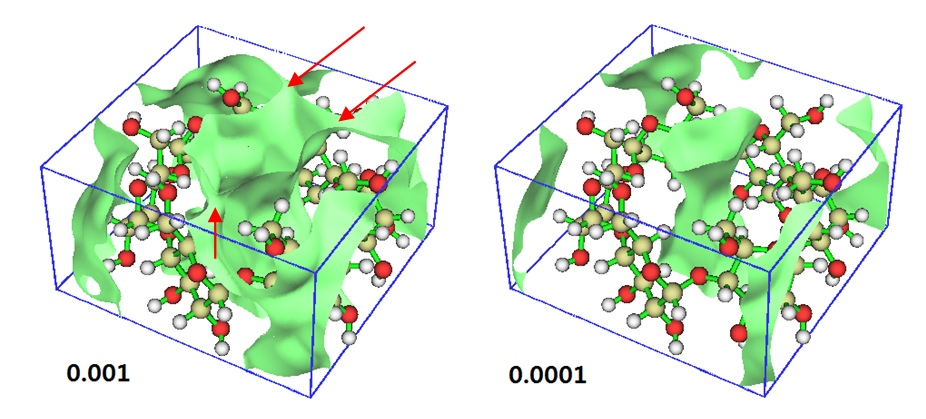

很容易理解，如果我们用 0.001 a.u. 的阈值，则分子中心空腔对应的域无法定义，因为内部区域与外部区域经由红色箭头所指的三个通道相连。而在 0.0001 a.u. 的情形下，分子空腔可清晰辨认，因此我们可以用该阈值使用域分析模块研究空腔。

返回主菜单，然后输入以下命令

```text
200  // Other functions (Part 2)
14  // Domain analysis
2  // Choose the real space function to be calculated and used for partitioning domains
1  // Promolecular density
3  // Define the rule of determining domains
<0.0001  // Regions with electron density less than 0.0001 will be defined as domains
1  // Calculate grid data and assign domains
-10  // Change extension distance
0  // No extension distance
1  // Low-quality grid
```

计算完成后，你将在屏幕上看到以下信息。共找到六个域，所有域的格点数与体积如下所示

```text
Domain:     1    Grids:       4    Volume:     0.005 Angstrom^3
Domain:     2    Grids:   12010    Volume:    14.238 Angstrom^3
Domain:     3    Grids:    5822    Volume:     6.902 Angstrom^3
Domain:     4    Grids:   39654    Volume:    47.009 Angstrom^3
Domain:     5    Grids:   13949    Volume:    16.536 Angstrom^3
Domain:     6    Grids:    7438    Volume:     8.818 Angstrom^3
```

然后我们可以用选项 3 可视化每个域。在检查这些域后，我们发现编号为 4 的域对应分子空腔，如下所示：

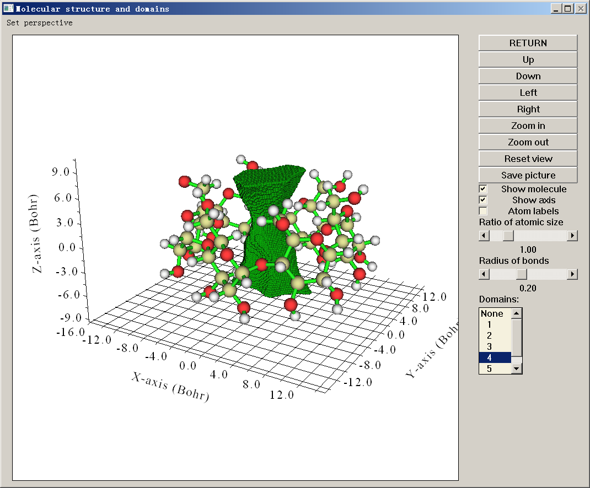

由于该域很好地代表了实际分子空腔的形状，其体积是空腔大小的良好指标。如前所示，其体积为 47.0 ų。

关闭图形界面，选择选项 1 在域内做积分，并输入 *4* 以选择积分对应空腔的域。我们选择"100 User-defined real space function"作为被积函数（默认该函数处处为 1.0，因而几乎不花计算成本），然后屏幕上打印以下信息

```text
Integration result:    0.3172320000E+03 a.u.
 Volume:  317.232000 Bohr^3  (   47.008943 Angstrom^3 )
 Average:    0.1000000000E+01
 Maximum:    0.1000000000E+01   Minimum:    0.1000000000E+01

 Position statistics for coordinates of domain points (Angstrom):
 X minimum:   -2.7823  X maximum:    3.1445  Span:    5.9268
 Y minimum:   -2.6823  Y maximum:    2.6095  Span:    5.2918
 Z minimum:   -3.1770  Z maximum:    3.9140  Span:    7.0910
```

由于当前被积函数处处为 1.0，积分结果直接对应域的体积（47.0 ų），从输出我们还发现域的跨度距离，在 Z 方向该值为 7.09 Å，即域中 Z 坐标最大与最小点之差。因此，用 Multiwfn 我们不仅能得到空腔体积，还能得到空腔跨度距离。

此外，我们可以用选项 10 把选定的域导出为当前文件夹中的 *domain.cub*，以便在第三方可视化工具（如 VMD）中把域描绘为等值面。在所得的 *domain.cub* 中，选定域内的格点值为 1，而其他区域（以及边界格点）的值为 0，因此域的等值面可用介于 0 与 1 之间的等值面值渲染（通常用 0.5）。我们对域 4 这样做并在 VMD 中把它绘制为等值面，将得到下图

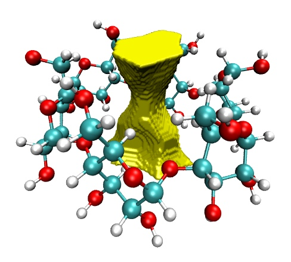

我们也可以用选项 11 把域的边界格点导出到 *domain.pdb*，其中每个粒子对应一个边界格点。你可以把该文件载入 VMD 并把粒子渲染为点。然后如果你想测量域，可以按键盘键 2，再在图形窗口中点击两点，将出现连线并标注距离，如下所示（为便于观察选择了"Display"-"Orthographic"）

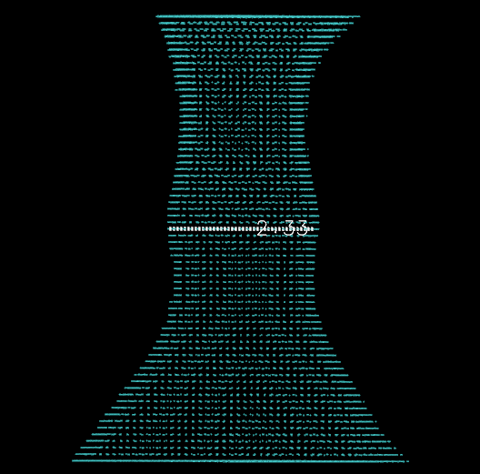

### **4.200.14.3 在电子密度差的等值面内积分电子密度差**

本节我们在电子密度差（electron density difference, EDD）的等值面内积分 EDD。具体而言，本节的 EDD 对应形变密度（deformation density, Δ*ρ*$_{def}$），其定义见[3.7.2](sec-3-7-custom-operation-promolecular-and-deformation-properties.md#372-前分子与变形性质-promolecular-and-deformation-properties-1-2)节。以苯为例。

苯的 EDD 的 .cub 文件（*benzene_EDD.cub*）已在 <http://sobereva.com/multiwfn/extrafiles/benzene_EDD.zip> 提供。你也可以用主功能 5 很容易地生成它。我们先检查其等值面图。启动 Multiwfn 并载入 *benzene_EDD.cub*，然后进入主功能 0，把等值面值设为 0.015，你将看到如下图。绿色与蓝色等值面分别对应正与负部分，即由于苯由孤立原子形成导致的电子密度增加与减少区域。本例我们将用域分析模块分别在红色与蓝色圆圈标示的两个域内积分 EDD。

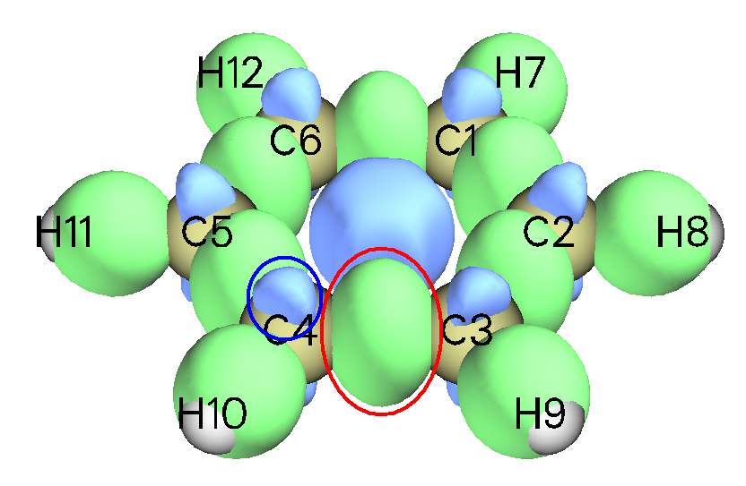

返回主菜单，然后输入

```text
200  // Other functions (Part 2)
14  // Domain analysis
3  // Set criterion for defining domain
<-0.015  // The regions with function value more negative than -0.015 will be determined as domains, which is in line with the blue isosurfaces shown above
-1  // Yield domains based on the grid data in memory
```

域立即生成：

```text
Domain:      1    Grids:     1912    Volume:     0.8502 Angstrom^3
Domain:      2    Grids:      433    Volume:     0.1925 Angstrom^3
Domain:      3    Grids:      423    Volume:     0.1881 Angstrom^3
Domain:      4    Grids:      434    Volume:     0.1930 Angstrom^3
Domain:      5    Grids:      432    Volume:     0.1921 Angstrom^3
Domain:      6    Grids:      430    Volume:     0.1912 Angstrom^3
Domain:      7    Grids:      427    Volume:     0.1899 Angstrom^3
```

进入选项 3 可视化这些域。通过检查每个域的分布，我们发现域 3 对应上述蓝色等值面，如下所示。每个小绿球对应域内的一个格点。

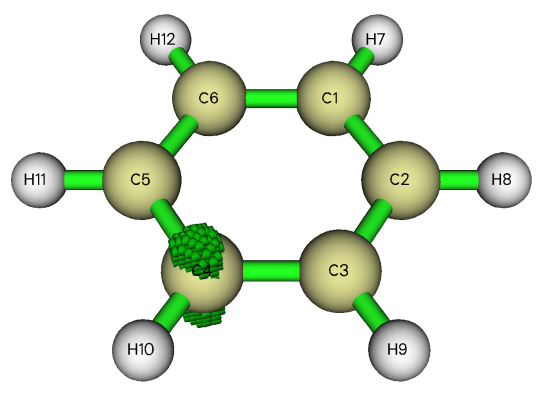

然后我们在域 3 内积分 EDD。关闭图形窗口并输入

```text
1   // Perform integration for a domain
3  // Domain index is 3
1  // The integrand is just the grid data in memory, namely EDD
```

结果为 -0.032 a.u.。

接下来，我们在前面提到的绿色等值面内积分 EDD。输入：

```text
0  // Exit domain analysis module
14  // Domain analysis
3  // Set criterion for defining domain
>0.015
-1  // Yield domains based on the grid data in memory
```

经直观检查后，我们发现域 14 对应感兴趣的等值面，如下所示

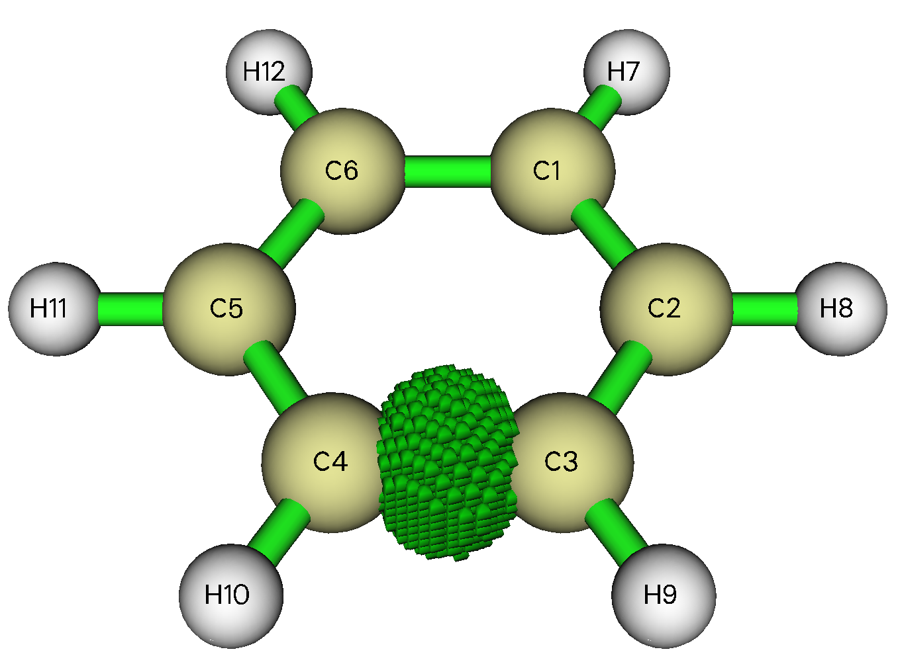

关闭图形窗口并输入

```text
1   // Perform integration for a domain
14  // Domain index is 14
1  // The integrand is just the grid data in memory, namely EDD
```

结果为 0.156 a.u.。

最后，值得强调的是，由于积分基于均匀格点数值求值，格点间距越小，积分精度越好。

你可以用类似方法积分其他种类的 EDD，包括 Fukui 函数与对描述符（dual descriptor）。
## **4.200.18 研究特定路径的键长/键级交替（BLA/BOA）以及键角与二面角的变化**

> **注**
>
> 本节的中文版是我的博客文章"使用 Multiwfn 计算键长/键级交替（BLA/BOA）并研究键长、键级和角度随键编号的变化"(<http://sobereva.com/501>)，其中有更多讨论。

键长交替（bond length alternation, BLA）与键级交替（bond order alternation, BOA）的定义与计算的基本知识已在[3.200.18](sec-3-200-other-functions-part-2.md#320018-计算键长键级交替-blaboa-以及键角二面角交替)节介绍。Multiwfn 不仅能计算 BLA 与 BOA，还能计算键长、键级、键角与二面角沿给定路径的变化。该功能在研究共轭链特征时非常有用。本节给出两个例子。

在该功能中，任何携带几何结构信息的文件格式都可用作输入文件，如 .xyz、.pdb 与 .mol。但如果你还想研究 BOA，输入文件必须包含基函数信息，如 .mwfn、.fch、.molden 或 .gms。

### **4.200.18.1 噻吩低聚物的 BLA 与 BOA**

本节我们将计算含 5 个重复单元的噻吩低聚物的 BLA 与 BOA，在 PBE0/6-31G\* 水平下生成的 .fchk 文件可在此下载：<http://sobereva.com/multiwfn/extrafiles/TP5.zip>。几何结构在 B3LYP/6-31G\* 水平下优化。

计算前，你需要先确定感兴趣共轭链中原子的编号。最容易的方法是使用 GaussView。现在用 GaussView（版本 ≥ 6.0）打开 *TP5.fchk*，在"Builder"面板中选择  按钮，然后按住鼠标左键让光标依次经过共轭链中的每个原子以将其选中为黄色。之后，GaussView 窗口中的图像应如下所示：

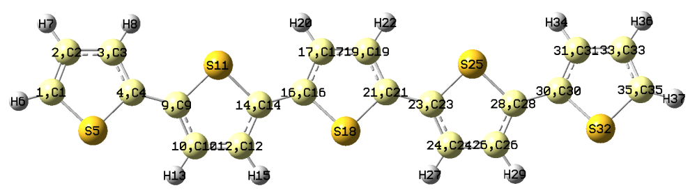

然后进入"Tools"-"Atom Selection"，你会发现所选链的原子编号为 10,12,14,16-17,19,21,23-24,26,28,30-31,33,35。另外，从上图可见，起始侧与末端侧原子的编号分别为 1 与 35。

> **注**
>
> 当然，对当前功能使用 GaussView 并非绝对必要。然而，没有 GaussView，你必须靠目视手动记录链中所有原子的编号，显然该过程相当麻烦！

现在启动 Multiwfn 并输入

```text
TP5.fchk
200  // Other functions (Part 2)
18  // Calculate bond length/order alternation (BLA/BOA) and study variation of bond characteristics with respect to bond index
10,12,14,16-17,19,21,23-24,26,28,30-31,33,35  // The indices of the atoms in the chain
1,35  // Index of the atom at the beginning side and ending side
```

然后 Multiwfn 根据你输入的信息自动识别链的原子序列。从屏幕可见，识别的序列为

```text
Sequence of the atoms in the chain from the beginning side to the ending side
       1       2       3       4       9      10      12      14      16
      17      19      21      23      24      26      28      30      31
      33      35
```

如果你把该序列与分子结构图比较，会发现序列完全正确，因此后续数据应是有意义的。

接下来，给出键编号、组成键的两个原子的编号、键长与键级：

```text
  Bond     Atom1     Atom2   Length (Angstrom)   Mayer bond order
     1         1         2        1.3678              1.6303
     2         2         3        1.4232              1.2924
     3         3         4        1.3795              1.5445
     4         4         9        1.4468              1.0985
     5         9        10        1.3799              1.5273
[ignored...]
```

最后，显示一些统计数据以及 BLA 与 BOA：

```text
 The number of even bonds:     9
 The number of odd bonds:     10
 Average length of even bonds:       1.4300 Angstrom
 Average length of odd bonds:        1.3779 Angstrom
 Bond length alternation (BLA):      0.0521 Angstrom
 Average bond order of even bonds:      1.2109
 Average bond order of odd bonds:       1.5465
 Bond order alternation (BOA):         -0.3356
```

如屏幕所述，键数据也已导出到当前文件夹的 *bondalter.txt*，你可以绘制"键长 vs. 键编号"与"键级 vs. 键编号"曲线图。下图用 Origin 绘制，相应的 .opj 文件已作为 "examples" 文件夹中的 *bondalter.opj* 提供。

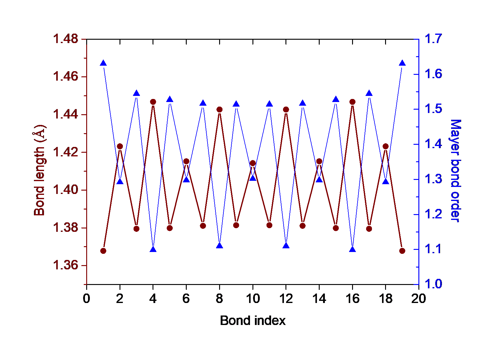

Multiwfn 还会问你是否输出键角与二面角沿原子序列的变化，我们输入 *n*，因为它们不是我们目前感兴趣的。

### **4.200.18.2 研究环[18]碳环内键长、键角与二面角的变化**

下图是 200 K 下环[18]碳的 *ab-initio* 分子动力学轨迹的一帧。该模拟在我发表的研究论文 *Chem. Asian J.*, **16**, 56 (2021) DOI: 10.1002/asia.202001228 中进行。本节我们将研究键长、键角与二面角沿该环的变化。

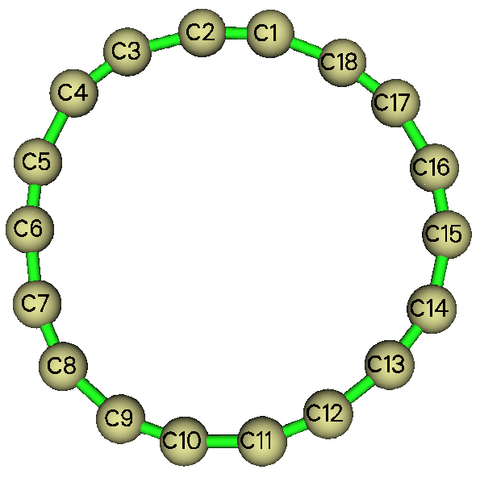

启动 Multiwfn 并输入

```text
examples\C18_MD_1.xyz  // A frame extracted from molecular dynamics trajectory
200  // Other functions (Part 2)
18
1-18  // The atom indices in the ring
1,1  // The path under study is a closed path, i.e. a ring, in this case the two inputted atom indices must be the same. Index of any atom in the ring could be inputted, it will be regarded as the beginning atom
```

输出的键长变化如下所示

```text
  Bond     Atom1     Atom2   Length (Angstrom)
    1         1         2         1.208
    2         2         3         1.375
    3         3         4         1.209
[...ignored]
   17        17        18         1.201
   18        18         1         1.384
```

接下来，我们输入 *y* 让 Multiwfn 输出键角与二面角沿所定义路径的变化，你将看到：

```text
Note The unit of printed values is degree

 Atoms:     1     2     3  Angle:   164.841
 Atoms:     2     3     4  Angle:   154.976
 Atoms:     3     4     5  Angle:   155.200
[...ignored]
 Atoms:    17    18     1  Angle:   162.906
 Atoms:    18     1     2  Angle:   158.520

 Atoms:     1     2     3     4  Dihedral:  28.69, deviation to planar:  28.69
 Atoms:     2     3     4     5  Dihedral:  25.51, deviation to planar:  25.51
 Atoms:     3     4     5     6  Dihedral:  22.98, deviation to planar:  22.98
[...ignored]
 Atoms:    17    18     1     2  Dihedral:  16.91, deviation to planar:  16.91
 Atoms:    18     1     2     3  Dihedral:  18.13, deviation to planar:  18.13
```

从以上输出我们可以很容易地检查键角与二面角沿 18 元环如何变化。注意二面角（*D*）的值域为 0\~180°，若 *D* 在 0\~90° 内，"偏离平面"与 *D* 相同，而若 *D* 在 90\~180° 内，则它对应 180−*D*。

如果你从屏幕复制数据（若不知如何操作见[5.4](sec-5-4-copy-outputs-from-command-line-window-to-clipboard.md)节）并用 Origin 等外部软件绘图，可以得到下图，它们非常清楚地展示了该环的几何特征：

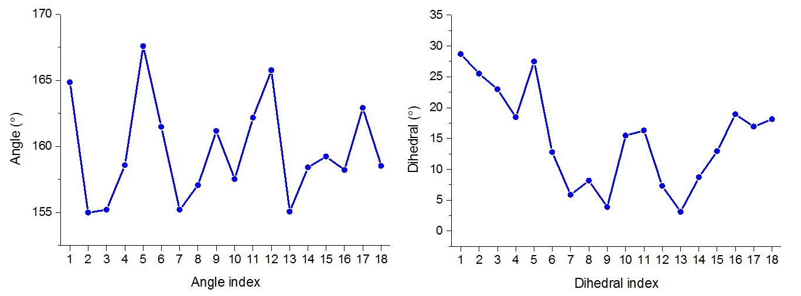

由于键角与二面角沿该环明显波动，我们可以得出结论：在分子动力学模拟过程中该环发生了显著的几何变形。

## **4.200.19 计算空间离域指数的例子**

请阅读[3.200.19](sec-3-200-other-functions-part-2.md#320019-计算轨道或函数的空间离域指数-sdi)节以理解空间离域指数（spatial delocalization index, SDI）的基本知识。本例我们将计算轨道波函数密度的 SDI，以表征各种轨道的空间离域程度。SDI 也可用于定量任何其他函数的空间离域，如自旋密度。

注意[4.8.5](sec-4-8-molecular-orbital-composition-analysis.md#485-通过轨道离域指数odi定量轨道的空间离域程度)节描述的 ODI 也能比较轨道离域程度；但 ODI 与 SDI 的定义不同，SDI 原则上更严格且不依赖原子划分方法的选择。

### **基于波函数文件计算 SDI**

作为例子，我们计算 *examples\excit\D-pi-A.fchk* 所有占据轨道密度的 SDI。启动 Multiwfn，载入该文件，然后输入

```text
200  // Other function (Part 2)
19  // Calculating SDI
2  // Calculate SDI for density of orbital wavefunctions
1-56  // Indices of occupied MOs
```

你将立即在屏幕上看到以下结果，单位为 a.u.

```text
...ignored
SDI of orbital    11:    0.3763
SDI of orbital    12:    0.5834
SDI of orbital    13:    0.5287
SDI of orbital    14:    0.4195
SDI of orbital    15:    0.3759
SDI of orbital    16:    0.3759
SDI of orbital    17:    4.9640
SDI of orbital    18:    4.5899
SDI of orbital    19:    6.0700
SDI of orbital    20:   11.5668
...ignored
```

你可以用 Origin 等绘制 SDI 值 vs. 轨道编号的图：

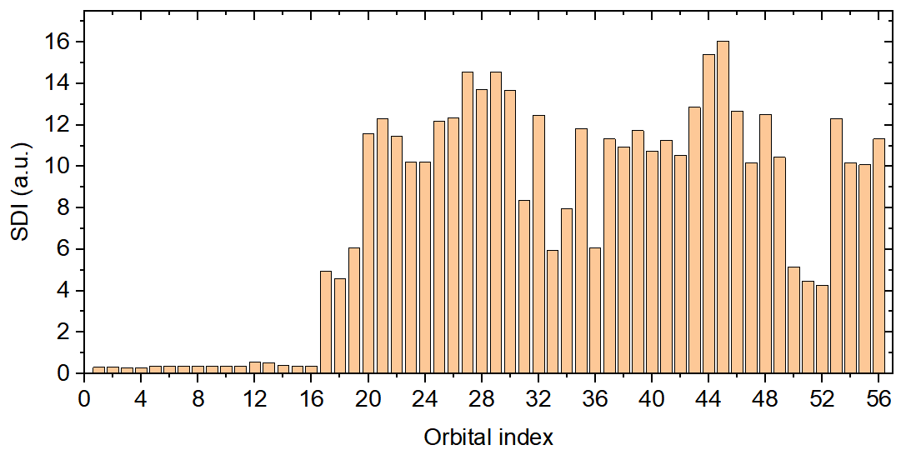

轨道密度的 SDI 越大，轨道离域特征越明显。从上图你可以推断轨道 44 强烈离域（SDI = 15.41 a.u.），而轨道 33（SDI = 5.97 a.u.）高度定域。比较见下图。轨道 1 至 16 显然是核轨道，因为极低的 SDI 表明它们具有极强的定域特征。

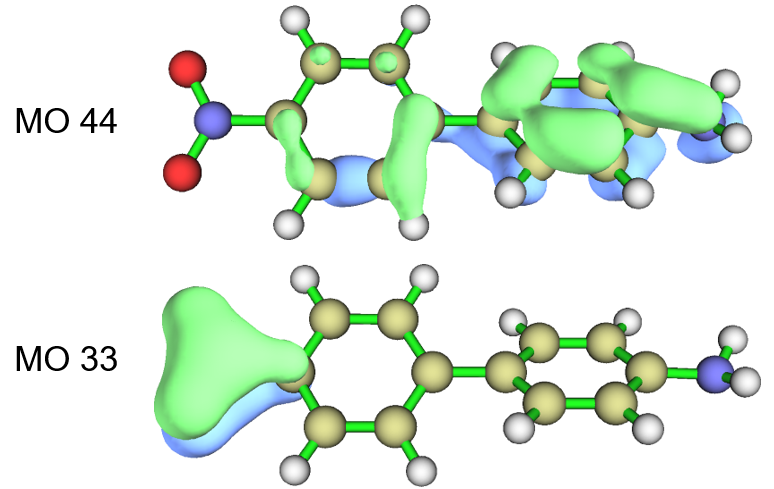

### **基于格点数据文件计算 SDI**

计算 SDI 时，你不仅可以提供包含波函数信息的文件作为输入文件，还可以提供包含待研究函数的格点数据文件（例如 cube 文件）。作为例子，我们基于 D-pi-A 体系 MO19 密度的格点数据计算 SDI，该文件可从 <http://sobereva.com/multiwfn/extrafiles/D-pi-A_MO19_dens.zip> 下载。启动 Multiwfn 并载入压缩包中的 cube 文件，然后输入

```text
200  // Other function (Part 2)
19  // Calculating SDI
3  // Calculate SDI based on grid data in memory
```

然后你将看到：

```text
Spatial delocalization index is    6.030145
```

该结果与基于 *examples\excit\D-pi-A.fchk* 计算的 MO19 的 SDI（6.07）符合得很好。

有时能产生格点数据文件的量子化学或第一性原理程序无法生成 Multiwfn 支持的波函数文件，这种情况下如果你需要计算 SDI 以研究轨道离域，就必须像本例这样基于格点数据文件计算 SDI。

只要 Multiwfn 原生支持，或你能提供该函数的格点数据文件，Multiwfn 也可用于计算任何其他函数的 SDI。例如，若你用记录自旋密度的 cube 文件作为输入文件并输入与本例相同的命令，则所得 SDI 可用于表征自旋密度离域的空间范围。
## **4.200.20 用键级密度与自然适应性轨道研究化学键**

> **注**
>
> 该主题的中文版是"使用键级密度（BOD）与自然适应性轨道（NAdO）图形化研究化学键"(<http://sobereva.com/535>)，其中有更多例子和更充分的讨论。

键级密度（bond order density, BOD）与自然适应性轨道（natural adaptive orbital, NAdO）的理论已在[3.200.20](sec-3-200-other-functions-part-2.md#320020-键级密度-bod-和自然自适应轨道-nado-分析)节中详细介绍，请先认真阅读。本节我将给出两个例子，展示如何用 BOD 与 NAdO 研究化学键。

### **4.200.20.1 绘制 N₂ 分子的键级密度**

离域指数（delocalization index, DI）表示两个原子间平均共享的电子对数，可视为（共价）键级的定义。通过绘制 BOD，我们可以更好地理解其数值的本质。BOD 对全空间积分恰对应两原子间的 DI，因此 BOD 能够展示各处对 DI 的局域贡献。

本节以 N₂ 分子为例，我们将在分子平面上把其 BOD 绘制为填色图。在 Multiwfn 中，离域指数（DI）可经模糊空间分析模块（主功能 15）基于模糊划分计算，或经盆分析模块（主功能 17）基于 AIM 划分计算；相应地，两个模块都能导出 BOD 分析所需的原子重叠矩阵（atomic overlap matrix, AOM）。本例我们用前者（后者同样可行但更贵）。

启动 Multiwfn 并输入以下命令

```text
examples\N2.fch  // Optimized and generated at B3LYP/def-TZVP level. You can also use other files (e.g. .molden and .mwfn) as long as the file contains basis function information
15  // Fuzzy atomic space analysis
3  // Calculate and output atomic overlap matrix to AOM.txt in current folder
0  // Return to main menu
200  // Other functions (Part 2)
20  // Bond order density (BOD) and natural adaptive orbital (NAdO) analyses
1  // Use atomic overlap matrix (AOM) for the analysis
[Press ENTER button]  // Load the AOM.txt in current folder
1,2  // Indices of the two atoms to be analyzed
```

然后生成 NAdO，你可以找到以下信息

```text
Generating natural adaptive orbitals (NAdOs)...
Eigenvalues of NAdOs: (sum=   3.11681 )
  1.00000   0.99999   0.99999   0.05728   0.05728   0.00113   0.00113
```

这些值是 NAdO 轨道的本征值，其和（3.11681）恰对应两原子间的 DI。同时，当前文件夹中生成了 *NAdOs.mwfn*，其中前 7 个轨道为 NAdO 轨道，其占据数对应 NAdO 本征值。该文件中所有其他轨道与 *N2.fch* 中的虚轨道相同。

接下来，我们输入 *y* 让 Multiwfn 载入新生成的 *NAdOs.mwfn*。从现在起，电子密度函数直接对应 BOD 函数。现在我们把 BOD 绘制为填色图。输入以下命令

```text
0  // Return to main menu
4  // Plot plane map
1  // Electron density (which corresponds to BOD in the present context)
1  // Color-filled map
[Press ENTER button]  // Use recommended grid setting
0  // Set extension distance
2  // 2 Bohr
3  // YZ plane
0  // Z=0
```

现在 BOD 图弹出。调整绘图设置后，你可以看到下图

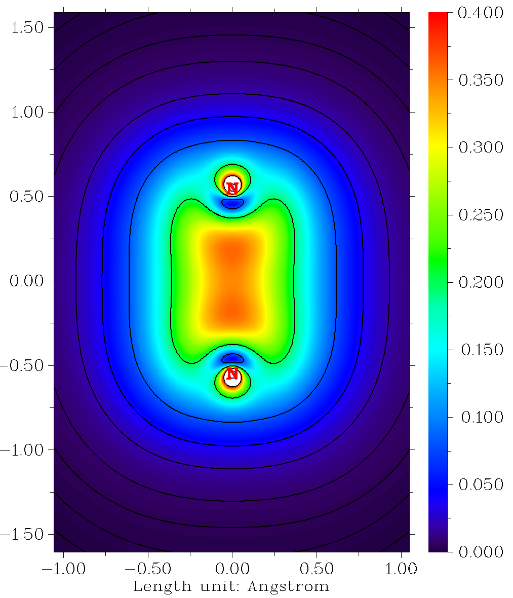

可见 BOD 的分布是合理的，其主体分布在成键区，表明该区域的电子对 DI 值有主要贡献，并在共价键中起关键作用。

### **4.200.20.2 研究丁二烯中 C-C 键的 BOD 与 NAdO 轨道**

本节我们将研究 1,3-丁二烯中两类 C-C 键的 BOD 与 NAdO 轨道，其几何结构如下所示。这次分析将基于 AIM 划分生成的 AOM 进行（像上例那样用模糊划分同样合理）。

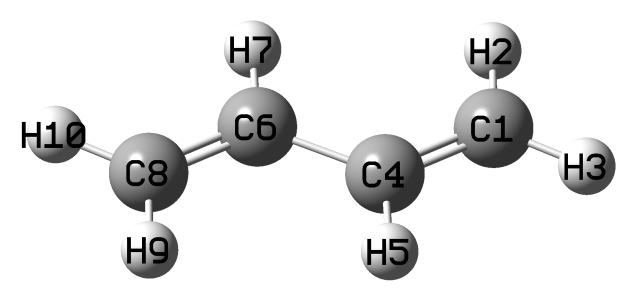

启动 Multiwfn 并输入

```text
examples\butadiene.fch  // Generated at B3LYP/6-31G** level
17  // Basin analysis module
1  // Generate basins and locate attractors
1  // Use electron density to define basins (i.e. AIM basins)
2  // Medium-quality grid
6  // Output orbital overlap matrix in atoms to AOM.txt in current folder
-10  // Return to main menu
200  // Other functions (Part 2)
20  // Bond order density (BOD) and natural adaptive orbital (NAdO) analyses
1  // Use atomic overlap matrix (AOM) for the analysis
[Press ENTER button]  // Load the AOM.txt in current folder
4,6  // Indices of the two carbons at the center of the system
```

现在你可以看到

```text
Eigenvalues of NAdOs: (sum=   1.11455 )
   0.90121   0.24533   0.07666   0.00358   0.00062   0.00006   0.00001
   0.00000  -0.00000  -0.00003  -0.00004  -0.00316  -0.00966  -0.02645
  -0.07359
```

这意味着中心 C-C 键的 DI 为 1.114。然后输入 *y* 以载入新生成的 *NAdOs.mwfn* 文件。之后，我们用主功能 5 计算电子密度的格点数据，它现在对应 BOD，再把它绘制为等值面。等值面值为 0.05 的所得图如下所示。

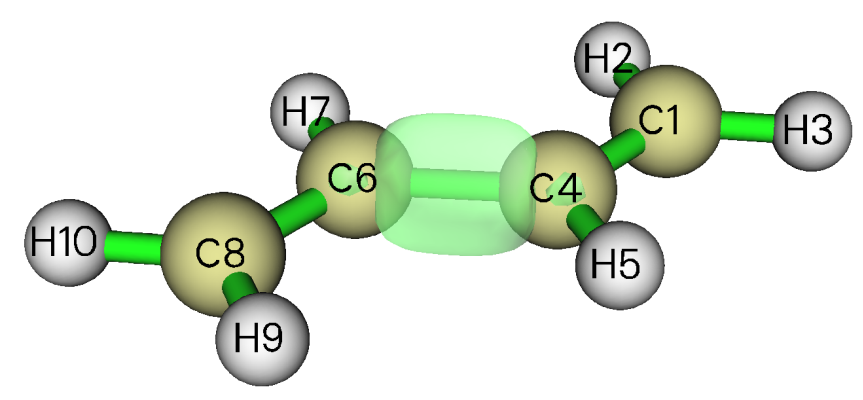

显然，对 C4-C6 键有显著贡献的大多数电子集中在该键周围，这正是我们预期的。

接下来，进入主功能 0 可视化各个 NAdO 轨道。注意若你在图形菜单中选择"Orbital info."-"Show all"，可以看到以下轨道信息

```text
 Orb:     1 Ene(au/eV):     0.000000       0.0000 Occ: 0.901215 Type:A+B (?   )
 Orb:     2 Ene(au/eV):     0.000000       0.0000 Occ: 0.245331 Type:A+B (?   )
 Orb:     3 Ene(au/eV):     0.000000       0.0000 Occ: 0.076660 Type:A+B (?   )
 Orb:     4 Ene(au/eV):     0.000000       0.0000 Occ: 0.003580 Type:A+B (?   )
 Orb:     5 Ene(au/eV):     0.000000       0.0000 Occ: 0.000621 Type:A+B (?   )
[...ignored]
 Orb:    14 Ene(au/eV):     0.000000       0.0000 Occ:-0.026445 Type:A+B (?   )
 Orb:    15 Ene(au/eV):     0.000000       0.0000 Occ:-0.073586 Type:A+B (?   )
 Orb:    16 Ene(au/eV):    -0.023511      -0.6398 Occ: 0.000000 Type:A+B (?   )
 Orb:    17 Ene(au/eV):     0.084006       2.2859 Occ: 0.000000 Type:A+B (?   )
 Orb:    18 Ene(au/eV):     0.115938       3.1548 Occ: 0.000000 Type:A+B (?   )
[...ignored]
```

前 15 个轨道为 NAdO，其"Occ"值对应 NAdO 本征值，可视为 NAdO 对 DI 的贡献。编号大于 15 的所有轨道均为 *examples\butadiene.fch* 中的虚轨道，不是我们感兴趣的。从上表可见，只有前两个 NAdO 轨道对 DI 有突出贡献，它们的等值面图如下所示，也标注了本征值。

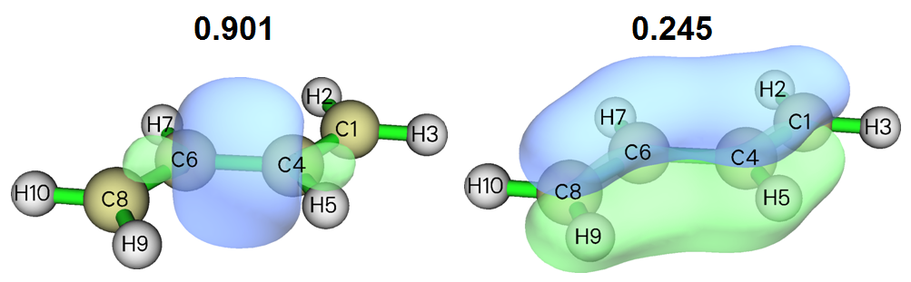

可见，第一个 NAdO 看起来像 σ 型定域轨道（关于此点的更多信息见[4.19.1](sec-4-19-orbital-localization-analysis.md#4191-用-pipek-mezey-方法定域-13-丁二烯的分子轨道)节的例子），对 DI 值（1.114）有关键贡献（0.901）；这完全可以理解，因为 C4-C6 键的主要成分必为 σ 相互作用。第二个 NAdO 也有不可忽略的贡献（0.245）。由于它显示典型的 π 轨道特征，我们可以推断 C4-C6 键中存在弱 π 相互作用。

现在我们把注意力转向边界 C-C 键，即 C1-C4（或 C6-C8）。重新启动 Multiwfn 并输入以下命令（你可以先手动备份此前的 *NAdOs.mwfn* 以免被覆盖）

```text
examples\butadiene.fch
200  // Other functions (Part 2)
20  // Bond order density (BOD) and natural adaptive orbital (NAdO) analyses
1  // Use atomic overlap matrix (AOM) for the analysis
[Press ENTER button]  // Load the AOM.txt in current folder
1,4  // Indices of the two carbons at the boundary of the system
y  // Load the newly generated NAdOs.mwfn
```

之后，用主功能 0 可视化仅有的两个对 DI 有显著贡献的轨道，如下所示（等值面值=0.05）

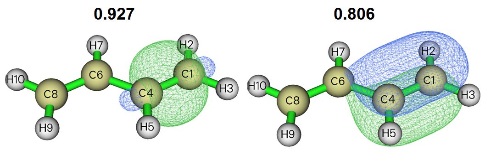

C1-C4 的 σ 型 NAdO 轨道的本征值与 C4-C6 的相当，表明两类 C-C 键具有相近强度的 σ 相互作用。相比之下，C1-C4 的 π 型 NAdO 轨道对 DI 的贡献比 C4-C6 的高得多，很好地反映了边界 C-C 键比中心键具有强得多的 π 相互作用这一事实。

在本节末，我想强调 BOD/NAdO 方法一个非常值得注意的优点，即你可以直接指定待研究的键，如上已充分说明。例如，对下图所示的多巴胺，若你想研究某个键（例如 C5-C7）的 BOD 或相应 NAdO，当 Multiwfn 请你输入原子编号时，你只需输入 *5,7*，显然该特征使成键分析非常方便！下图显示了 C5-C7 的 BOD=0.03 等值面。

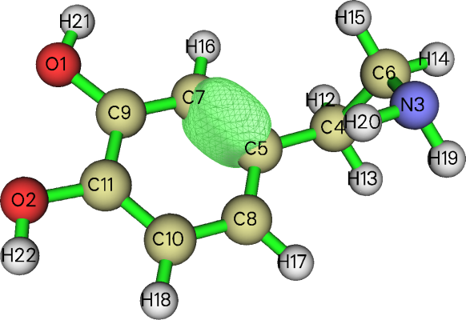

同样值得注意的是，BOD/NAdO 分析也可基于盆分析模块导出的 *BOM.txt* 对两个盆之间的 DI 进行可视化。例如，你可以用盆分析模块生成电子定域化函数（electron localization function, ELF）盆，然后用相应选项把盆重叠矩阵（basin overlap matrix, BOM）导出到 *BOM.txt*。之后，在 BOD/NAdO 分析功能中，选择载入 *BOM.txt*，再输入感兴趣的两个盆的编号，就会生成这两个局域区域的 NAdO。用这种方式，你可以直观研究例如两个孤对区域之间或孤对与共价成键区域之间的电子共享。显然，BOD/NAdO 分析模块极其灵活！

### **4.200.20.3 用 BOD/NAdO 研究两个片段之间的相互作用**

我还把 BOD 与 NAdO 分析推广到片段间相互作用的情形。为说明如何实现，本节以 oxirane 为例分子，氧原子与两个碳原子将分别定义为两个片段。此外，本例还将说明 NAdO 能量的求值。

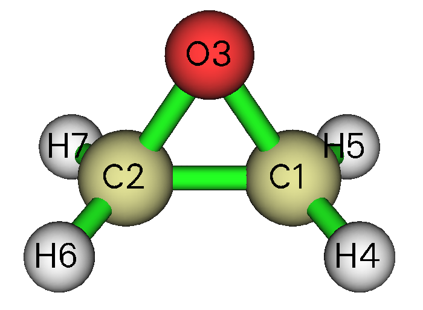

我们像前面的例子那样生成包含 AOM 的文件。启动 Multiwfn 并输入

```text
examples\oxirane.fchk
15  // Fuzzy atomic space analysis
3  // Calculate and output atomic overlap matrix to AOM.txt in current folder
0  // Return to main menu
200  // Other functions (Part 2)
20  // Bond order density (BOD) and natural adaptive orbital (NAdO) analyses
-1  // Toggle if calculating energies for NAdOs
1  // Evaluate NAdOs energies based on the Fock matrix generated by MO energies and coefficients
3  // Interfragment interaction analysis based on fragment overlap matrix (FOM)
[Press ENTER button]  // Load AOM.txt in current folder
3  // Fragment 1: The oxygen atom
1,2  // Fragment 2: The two carbons
```

所载入的 AOM 用于构建两个片段的片段重叠矩阵（fragment overlap matrix, FOM），所生成 NAdO 的本征值为

```text
Eigenvalues of NAdOs: (sum=   2.47514 )
  0.97214   0.86882   0.35986   0.10399   0.08304   0.03930   0.02916
  0.02059   0.00045   0.00042   0.00013  -0.00275
```

可见，有三个 NAdO 轨道对 DI 有显著贡献。此外，如屏幕提示所示，当前情形还求值了 NAdO 的能量。

输入 *y* 以载入当前文件夹中新生成的 *NAdOs.mwfn* 后，你可以在主功能 0 中可视化它们的等值面，如下所示。也标注了本征值与能量：

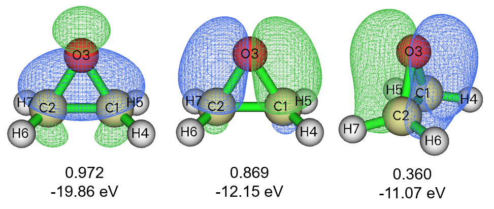

显然，以上三个 NAdO 轨道很好地阐明了片段 O1 与片段 C1-C2 之间的轨道相互作用，且在相互作用区可清楚地观察到同相重叠。其中，第一个 NAdO 能量最低，表明它对片段间结合贡献最大。请接着经由主功能 4 在 C1、C2 与 O3 定义的平面上绘制 BOD 图，以可视化直接贡献片段间相互作用的电子的分布。

这只是一个展示 BOD/NAdO 在揭示片段间相互作用方面用途的非常简单的例子，显然它也可应用于复杂得多的情形以获得更深入的认识，例如二茂铁中铁原子与两个环戊二烯基环之间的相互作用、原子簇中被包封原子与笼之间的相互作用。

最后，我还想提及，在模糊原子空间分析模块中，在生成 AOM 文件之前你可以用选项 -1 把空间划分方法切换为 Hirshfeld-I；在某些情形下，特别当涉及金属时，结果可能比用默认划分明显更好。
