# **4.21 能量分解分析 (Energy decomposition analysis)**

除本节给出的例子外，Multiwfn 还能进行所谓的简单能量分解，参见[4.100.8节](sec-4-100-other-functions-part-1.md#41008-使用组合的碎片波函数-fragment-wavefunction进行简单的能量分解-energy-decomposition)中的例子。

## **4.21.1 基于力场的能量分解分析 (EDA-FF)示例**

本节将说明如何基于经典力场对特定片段之间进行能量分解分析，该方法将被称为 EDA-FF。请先仔细阅读[3.24.1节](sec-3-24-energy-decomposition-analysis.md#3241-基于分子力场-force-field-ff-的能量分解分析-eda-ff)，以掌握 EDA-FF 背后的基本思想与实现。若认真看完下面的例子，便应能轻松地将该方法应用于各种体系。

更深入的讨论见我的博客文章"使用 Multiwfn 做基于力场的能量分解分析"（中文，<http://sobereva.com/442>）。

若在工作中使用了 EDA-FF 分析，请引用这篇文章：*Mat. Sci. Eng. B*, **273**, 115425 (2021) DOI: [10.1016/j.mseb.2021.115425](https://doi.org/10.1016/j.mseb.2021.115425)，我在该文中简要描述了 EDA-FF，并用它研究了环[18]碳与石墨烯之间的相互作用。

### **4.21.1.1 例1：水二聚体**

作为第一个例子，我们基于 AMBER 力场对一个非常简单的体系——水二聚体做 EDA-FF，其最稳定几何构型如下所示

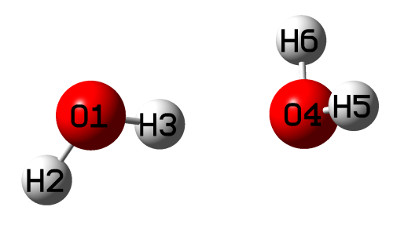

#### **相关文件**

相关文件已放在 "examples\EDA\EDA_FF\waterdimer" 文件夹中，如下所示：

- *dimer.mol*：水二聚体的 .mol 文件，包含在 B3LYP-D3(BJ)/6-311G\*\* 水平下优化的几何构型，该水平对优化分子簇非常可靠。注意此文件中原子顺序为 O1 H2 H3 O4 H5 H6

- *water.fchk*：水单体在 B3LYP-D3(BJ)/6-311G\*\* 水平下做优化任务产生的 .fchk 文件

- *mollist.txt*：对应水二聚体的分子列表文件

- *water.txt*：水单体的分子类型文件

可见，*mollist.txt* 的内容很简单

```text
water.txt 2
```

对应水二聚体含有两个水分子这一事实，它们都由当前文件夹中的 *water.txt* 描述。

*water.txt* 的内容为

```text
OW  -0.737121
HW  0.368560
HW  0.368560
```

表明水中氧和氢的原子类型分别为 OW 和 HW，第二列是用 Merz-Kollman (MK) 方法计算的原子电荷。

#### **分子类型文件的细节**

这里说明分子类型文件 *water.txt* 是如何构建的。原子类型可根据原子的实际化学环境以及力场原始文献中原子类型的定义手动指定，但若分子中原子很多，这一过程会很麻烦。因此，这里展示如何用流行的 GaussView 自动指定原子类型。将 *water.fchk* 载入 GaussView，点击粗体 **A** 字母图标进入 "atom list editor"，再点击粗体橙色 **M** 字母图标显示原子类型，然后双击 "AMBER Type" 列标题，此时窗口状态应为

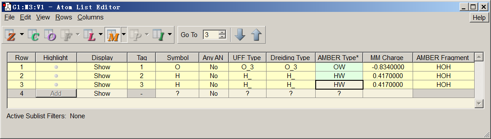

然后点击 "File" - "Export Data"，将文件保存为 *water.txt*。接着，通过 Ultraedit 等高级文本编辑器的列模式，删除除 "AMBER Type" 列之外的所有列，再删除文件中的第一行。此时 *water.txt* 中只剩下所有原子的原子类型。之后，基于 *water.fchk* 用主功能 7 的子功能 13（或 12）计算 MK（或 CHELPG）电荷（可参考[4.7.1节](sec-4-7-population-analysis-and-atomic-charge-calculation.md#471-计算三氟化氯的hirshfeld和chelpg原子电荷以及片段电荷)中的例子），再把从屏幕输出（或导出的 .chg 文件）得到的电荷复制为 *water.txt* 的第二列。至此，*water.txt* 的准备工作完成。

#### **进行分析**

现在开始做 EDA-FF 分析。将 *water.txt* 复制到当前文件夹，然后启动 Multiwfn 并输入

```text
dimer.mol  // The file containing dimer structure information (you can also use other formats containing the geometry information as input file, such as the .fch file produced during optimization task of the dimer)
21  // Energy decomposition analysis
1  // Energy decomposition analysis based on forcefield
3  // Load atom types and atomic charges
mollist.txt  // The actual path of the molecular list file. At this point, the program read atom types and charges from the water.txt and assign them to the two water molecules in the current system
2  // Define fragments
2  // Two fragments will be defined
1-3  // The atomic indices of the fragment 1
4-6  // The atomic indices of the fragment 2
```

若想检查当前体系中所有原子的原子类型和电荷是否已正确设置，可选择选项 4，输出为

```text
*** Fragment   1:
 Atom:    1(O )    Charge:   -0.737121    Type: OW
 Atom:    2(H )    Charge:    0.368560    Type: HW
 Atom:    3(H )    Charge:    0.368560    Type: HW
 *** Fragment   2:
 Atom:    4(O )    Charge:   -0.737121    Type: OW
 Atom:    5(H )    Charge:    0.368560    Type: HW
 Atom:    6(H )    Charge:    0.368560    Type: HW
```

可见原子类型和电荷都被正确指定了。

现在选择选项 1 开始 EDA-FF 分析，结果会立即显示在屏幕上：

```text
Contribution of each atom in defined fragments to overall interfragment interac
tion energies:
 Atom    1(O )   Elec:   12.53  Rep:    3.85  Disp:   -2.21  Total:   14.17
 Atom    2(H )   Elec:   -6.24  Rep:    0.00  Disp:    0.00  Total:   -6.24
 Atom    3(H )   Elec:  -16.87  Rep:    0.00  Disp:    0.00  Total:  -16.87
 Atom    4(O )   Elec:  -23.52  Rep:    3.85  Disp:   -2.21  Total:  -21.88
 Atom    5(H )   Elec:    6.47  Rep:    0.00  Disp:    0.00  Total:    6.47
 Atom    6(H )   Elec:    6.47  Rep:    0.00  Disp:    0.00  Total:    6.47

 Interaction energy components between all fragments:
                         Electrostatic   Repulsive   Dispersion     Total
 Frag   1 -- Frag   2:       -21.15         7.71        -4.43       -17.87
```

输出中的单位均为 kJ/mol。以上信息表明两个水分子之间的总相互作用能为 -17.87 kJ/mol，与高精度水平 CCSD(T)/CBS 得到的结果 -20.58 kJ/mol 相近（见 S66 弱相互作用测试集的原始文献，*J. Chem. Theory Comput.*, **7**, 2427 (2011)）。尽管给定结果有一定误差，但至少足以用于定性讨论。以上数据还表明静电相互作用 (-21.15 kJ/mol) 对两个水之间的结合能有决定性贡献，显然一般氢键的主要本质是由静电相互作用主导的。色散 (dispersion) 相互作用对结合也有贡献，但量级相对较小。交换-排斥效应 (7.71 kJ/mol)在一定程度上抵消了由静电和色散效应引起的吸引相互作用。

在 S66 测试集原文中，用非常理想的 DFT-SAPT 方法给出的水二聚体色散相互作用能与静电相互作用能之比为 0.29，与 EDA-FF 给出的值 (4.43/21.15=0.21) 定性一致。因此，以非常简单的水二聚体为例可以看出，只要力场和原子电荷的选择合适，EDA-FF 的结果一般是可靠的。对于某些体系，力场算出的总相互作用能与可靠量子化学方法算出的结果不太接近，但即便如此，一般而言 EDA-FF 给出的各种物理成分之间的比例仍是有意义的。依我之见，用量子化学方法得到的总相互作用能 (Δ $E^{\mathrm{tot}}$ ) 乘以合适力场算出的 Δ $E^{\mathrm{ele}}$ 与 Δ $E^{\mathrm{tot}}$ 之比来近似估计静电相互作用能 (Δ $E^{\mathrm{ele}}$ )，不是个坏主意。

以上输出还给出了每个原子对所有已定义片段之间总相互作用的贡献，因此可以很容易地看出哪些原子对片段间相互作用有关键影响。所有原子贡献之和等于总相互作用能（若体系只有两个原子 *A* 和 *B*，且各自被定义为一个片段，则原子 *A* 的贡献为 *A*-*B* 相互作用能的一半）。从上面给出的数据可以看出，每个原子的影响都不容忽视，毕竟体系中原子之间的距离并不远。对吸引作用最重要的贡献是 O4 原子的静电相互作用 (-23.52 kJ/mol)，这一结果很容易理解，因为 O4 是氢键的受体原子。与 O4 直接作用形成氢键的 H3，由于显著的静电效应，对结合也有很大贡献 (-16.87 kJ/mol)。数据表明只有氧原子有非零的排斥和色散项，这是因为原子类型 HW 的范德华势参数为零，故 HW 原子只表现为点电荷，仅体现静电效应。

#### **原子间相互作用**

若选择一次选项 -3，将其状态从默认的 "No" 切换为 "Yes"，则在经由选项 1 做 EDA-FF 分析时，程序还会把每个原子对的距离 (Å)、相互作用能 (kJ/mol) 及其成分输出到当前文件夹的 *interatm.txt* 中。本例的文件内容为

```text
******* Between fragment   1 and fragment   2:
  Atom_i  Atom_j  Dist(Ang) Electrostatic   Repulsive    Dispersion     Total
      1      4:     2.873       262.78         7.71        -4.43       266.05
      1      5:     3.176      -118.86         0.00         0.00      -118.86
      1      6:     3.176      -118.86         0.00         0.00      -118.86
      2      4:     3.346      -112.79         0.00         0.00      -112.79
      2      5:     3.762        50.16         0.00         0.00        50.16
      2      6:     3.762        50.16         0.00         0.00        50.16
      3      4:     1.916      -197.02         0.00         0.00      -197.02
      3      5:     2.312        81.64         0.00         0.00        81.64
      3      6:     2.312        81.64         0.00         0.00        81.64
```

从以上数据可以发现，每对原子之间的相互作用能都很大，主要来自静电相互作用。例如，由于两个氧原子 O1 和 O4 电荷较大且符号相同，静电互斥能高达 262.78 kJ/mol。片段之间的结合能看起来比上述数值小数量级，这是因为在计算片段间相互作用能时，原子对之间的静电相互作用大都正负抵消了。

### **4.21.1.2 例2：环晕苯-胞嘧啶-鸟嘌呤三聚体**

在 *J. Chem. Theory Comput.*, **9**, 3364 (2013) 给出的 L7 弱相互作用测试集中，一个体系 C3GC 是由环晕苯（以下简称 C3）、鸟嘌呤 (G) 和胞嘧啶 (C) 组成的三聚体。作者已在 TPSS-D/TZVP 水平下优化了其几何构型，如下所示。GC 碱基对形成了三重氢键，并经由 π-π 堆积相互作用物理吸附在 C3 上。

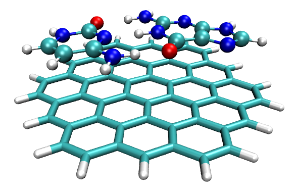

本节我们将基于 AMBER 力场对该体系做 EDA-FF 分析。相关文件放在 "examples\EDA\EDA-FF\C3GC" 目录中。

#### **准备工作**

注意，只有当任一分子类型中的原子序号是连续的时，Multiwfn 才能做 EDA-FF，否则无法通过分子列表文件和分子类型文件为体系中每个原子设置原子电荷和类型。L7 测试集补充材料中给出的结构文件是 *C3GC.xyz*，该文件不能直接使用，因为每个单体中的原子序号不连续。判断原子序号是否连续的最简单方法之一如下：先把 *C3GC.xyz* 载入 Multiwfn，用主功能 100 的子功能 2 将其转换为 *C3GC.pdb*（做此转换是因为 GaussView 不支持 .xyz 格式），然后把此 pdb 文件载入 GaussView，在任一分子中的任意原子上（如原子 C5）右击，选择 "Select Fragments of Atom C5"（GaussView 6 起有此选项）。此时该分子中的所有原子都被选中显示为黄色，再点击 "Tools" - "Atom Selection"。如下方截图所示，文本框中显示的序号为 5-9、13-17、19、25-29，显然原子序号不连续，需要修正。

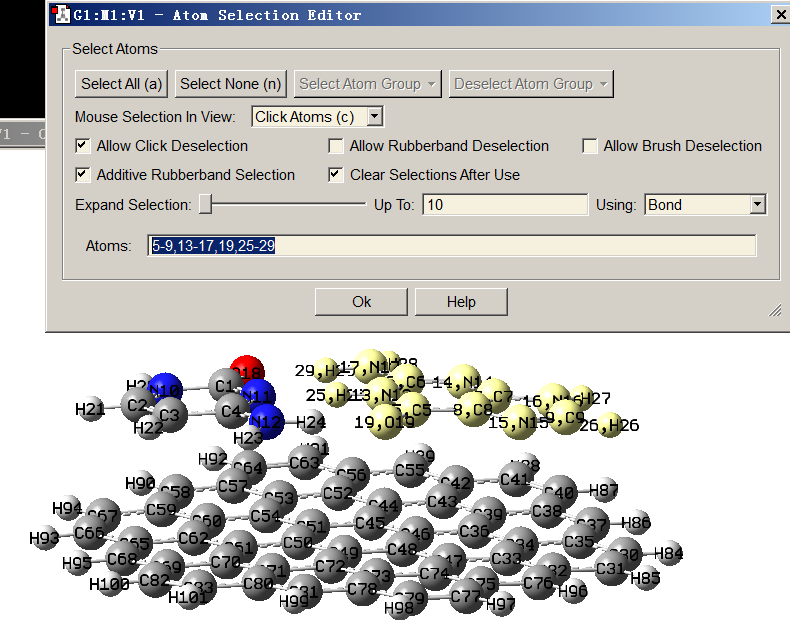

使每个分子中原子序号连续的最简便方法是在 GaussView 中进入 "Atom list editor"，然后选择 "Edit" - "Reorder" - "All Atoms (Except the First) by Bonding"，之后原子序号会按连接关系重排，可见每个单体中的原子序号都已变为连续，如下所示。现在把该结构保存为 *C3GC.pdb* 以替换旧文件。

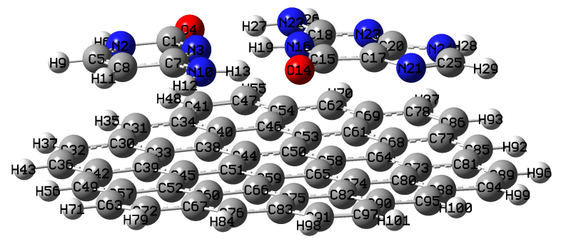
然后我们把三聚体中的每个单体复制到各自的 GaussView 窗口中，分别保存为 .gjf 文件，把关键词改为 "B3LYP/6-311G\*\*" 并用 Gaussian 运行，再基于产生的 .fch 文件用 Multiwfn 计算 MK 电荷。同时，利用 GaussView 确定每个单体的原子类型。最后，把原子类型和电荷合并为每个单体的单个文件，于是得到 *C.txt*、*G.txt* 和 *C3.txt*，它们已放在 "examples\EDA\EDA-FF\C3GC" 目录中。

最后，创建一个分子列表文件 *mollist.txt*（用别的名字也可以），内容为 *C.txt*、*G.txt* 和 *C3.txt* 的实际路径以及相应分子的数目，注意文件路径的顺序必须与 *G3GC.pdb* 中给出的分子顺序严格一致。显然，*mollist.txt* 的内容应为（假设所有分子类型文件都放在 C:）

```text
C:\C.txt 1
C:\G.txt 1
C:\C3.txt 1
```

#### **开始分析**

所有准备工作都已完成，现在开始 EDA-FF 分析。启动 Multiwfn 并输入

```text
C3GC.pdb
21  // Energy decomposition analysis
1  // EDA-FF
3  // Load atom types and charges
mollist.txt  // Input actual path of mollist.txt
2  // Define fragments
3  // Three fragments will be defined
1-13  // Atom indices in fragment 1, namely cytosine (C)
14-29  // Atom indices in fragment 2, namely guanine (G)
30-101  // Atom indices in fragment 3, namely C3
```

选择选项 1 进行 EDA-FF 计算，结果如下（忽略了原子贡献部分）

```text
                         Electrostatic   Repulsion   Dispersion     Total
 Frag   1 -- Frag   2:      -120.98        60.26       -45.54      -106.27
 Frag   1 -- Frag   3:         1.88        44.86       -94.69       -47.95
 Frag   2 -- Frag   3:         0.71        62.08      -132.62       -69.84
```

数据表明 G-C 结合非常强，高达 -106.27 kJ/mol，主要是因为静电成分很大 (-120.98 kJ/mol)，这是 G 与 C 之间形成了三对氢键的结果。C3 与 G 之间 (-47.95 kJ/mol)以及 C3 与 C 之间 (-69.84 kJ/mol) 的总相互作用能也不小，主要源于它们之间显著的 π-π 堆积。由于 π-π 堆积的本质纯粹是色散效应，可见 C3-C 与 C3-G 的色散相互作用很强（分别为 -94.69 和 -132.62 kJ/mol），远高于 G-C 之间的色散 (-45.54 kJ/mol)。由于 C3 本质上是有限的石墨烯片，它与 G 和 C 的相互作用区域显然是非极性的（即原子电荷很小），故 C3-C 与 C3-G 相互作用中的静电成分可忽略不计（分别仅为 0.71 和 1.88 kJ/mol）。

我还用对评估弱相互作用非常稳健的 B3LYP-D3(BJ)/6-311+G\*\* 水平，基于二聚体模型计算了 G-C、C3-G 与 C3-C 的结合能，结果为

```text
G-C (Frag 1 - Frag 2)：-143.97 kJ/mol
C3-C (Frag 1 - Frag 3)：-56.69 kJ/mol
C3-G (Frag 2 - Frag 3)：-76.27 kJ/mol
```

对 C3-C 和 C3-G 可见，AMBER 力场算出的结果与量子化学方法算出的结果非常接近，但对 G-C 定量差别相当显著。该现象说明力场用于强度很大的弱相互作用时定量精度有限。不过在这种情形下，若只关注各种物理成分之间的比例，EDA-FF 的结果仍是有用的，不会导致明显的误导性结论。

#### **按对相互作用能的贡献给原子着色**

利用 .pqr 文件格式，在 VMD 可视化程序中按不同颜色给原子着色可方便地可视化原子性质，这一策略在[4.A.10节](sec-4-A-special-topics-and-advanced-tutorials.md#4a10-通过给原子着色直观展示原子性质)中有详细介绍。显然，若把原子对片段间相互作用能的贡献存入 .pqr 文件，就能在图中生动地展示每个原子的重要性和作用。类似思想也用在 IGM 分析中，见[4.20.10节](sec-4-20-visual-study-of-weak-interactions.md#42010-用独立梯度模型-igm-可视化和定量弱相互作用)的说明。

现在在 EDA-FF 界面中选择 "-4 Toggle if outputting atom contributions to .pqr files" 选项，将其状态切换为 "Yes"，再选选项 1 做 EDA-FF 分析。计算完成后，当前目录下会出现 *atmint_tot.pqr*、*atmint_ele.pqr*、*atmint_rep.pqr*、*atmint_disp.pqr* 和 *atmint_vdW.pqr*（其中一些已放在 "examples\EDA\EDA-FF\C3GC\pqr" 中）。这些 .pqr 文件中原子电荷列的数据分别对应每个原子对片段间的总/静电/排斥/色散/vdW 相互作用能的贡献，数值与屏幕上打印的完全一致。例如，*atmint_disp.pqr* 中片段 1 的 C1 原子的原子电荷列数值对应 C1 原子与片段 2 和 3 所有原子之间色散相互作用能的一半。

我们把 *atmint_tot.pqr* 载入 VMD 程序，进入 "Graphics" - "Representation"，按 "Charge" 属性给原子着色，把色标的下限和上限从默认值分别改为 -50 和 50。把 G 和 C 部分的绘制方式设为 CPK 模式（在 "Selected Atoms" 框中用 *fragment 0 1* 选择它们），C3 部分用 Licorice 风格显示（用 *fragment 2* 选择它）。色标方法设为 BWR (Blue-White-Red)。最后图形如下所示（若不熟悉 VMD、不知道如何在 VMD 中实现这些设置，请参考[4.A.10节](sec-4-A-special-topics-and-advanced-tutorials.md#4a10-通过给原子着色直观展示原子性质)）：

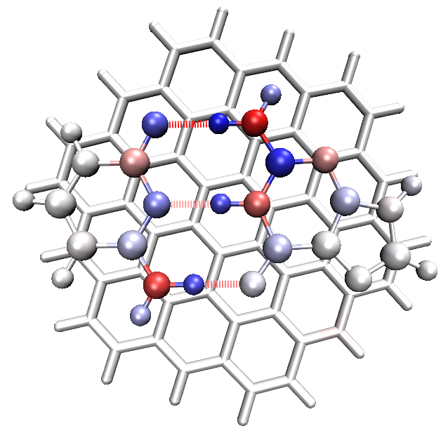

由于当前色标为 Blue-White-Red，图中原子颜色越蓝，其对三聚体总结合能的原子贡献越负（即吸引效应越显著）；而越红的原子，起的排斥作用越强。相对较白的原子对三聚体结合只起微不足道的作用。从该图可见，每个氢键受体原子以及与之直接作用的氢原子颜色明显偏蓝，故它们对 G-C 结合的稳定性贡献很大。所有氢键供体原子的颜色为红色，表明它们的存在不利于结合，这是因为氢键供体与受体原子带有量级大且符号相同的原子电荷，因而彼此间有显著的静电互斥。从上图还可见，C3 的所有原子以及 G 和 C 中远离氢键区域的原子都只有很浅或纯白的颜色，这一现象并非意味着它们对三聚体结合的贡献近乎为零，而是表明它们的贡献相对较弱，故在当前色标设置下难以显现。

假设我们想生动展示 C3 与 GC 碱基对之间的色散相互作用，则在 EDA-FF 界面中输入以下命令

```text
2  // Redefine fragments
2  // Two fragments will be defined
1-29  // Fragment 1, the GC base pair
30-101  // Fragment 2, the C3 part
1  // Start the EDA-FF calculation
```

随后屏幕上显示以下信息，数据等于 C3-C 与 C3-G 相互作用能之和

```text
                         Electrostatic   Repulsion   Dispersion     Total
 Frag   1 -- Frag   2:         2.59       106.94      -227.31      -117.79
```

同时，当前文件夹中生成了四个新的 .pqr 文件（它们已放在 "examples\EDA\EDA-FF\C3GC\pqr2" 文件夹中）。把其中的 *atmint_disp.pqr* 载入 VMD，按上述方式根据原子着色，但色标用 -10 到 10，再选 "Display" - "Orthographic" 修改视角，可见

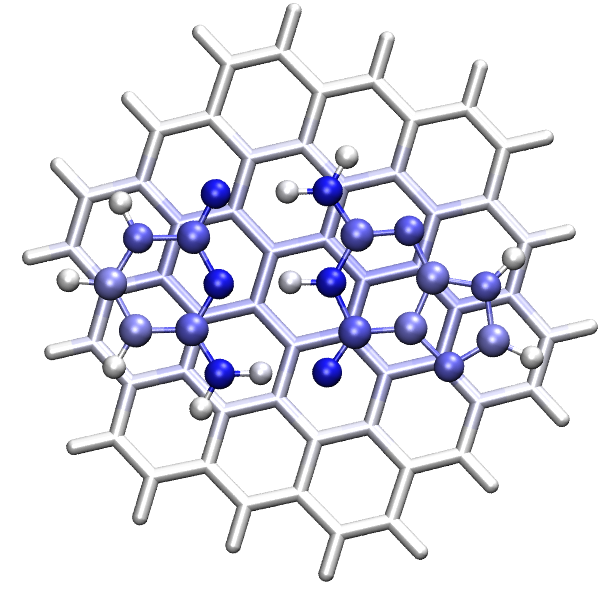

上图中原子颜色越蓝，它对 C3 与 GC 之间色散相互作用的贡献越大。从图可见，GC 部分每个重原子对色散相互作用的贡献几乎均等，主要是因为它们到 C3 平面的垂直距离几乎相同，且这些原子携带的电子数相差不大。GC 对中的氢原子对 C3-GC 色散相互作用的贡献很小，这是因为氢原子只有很少的电子。在 C3 部分，与 GC 对直接接触的碳颜色为浅蓝，表明它们对色散相互作用有显著贡献。远离 GC 对的 C3 原子颜色为白，反映它们对色散相互作用的影响可忽略（回想色散吸引随距离急剧衰减这一事实，它有 1/ $r^6$ 渐近行为）。

> **注**
>
> 上图中 GC 对中的重原子很蓝，而 C3 中对等位置的原子没那么蓝，原因是：由于 C3 中原子很多，GC 对中每个重原子可与大范围的 C3 原子形成色散相互作用，故各项之和较大。由于 GC 对中原子数少，C3 的每个原子只能与 GC 对中相对较少的原子相互作用，故各项之和不大。若想让 C3 部分的原子颜色更突出，可把 C3 部分对应表示的色标范围设为比我们之前用的 -10\~10 更小的值；例如，改为 -6 到 6 会得到满意的图形。

#### **关于确定单个氢键的结合能**

一些读者可能想到，若能独立确定 G-C 之间三个氢键各自的结合能就好了。实现此目标没有唯一的方式，因为这相当于把体系划分成几部分，必然带有任意性。一个看似简便的实现方法是把一个氢键的供体与受体部分直接定义为两个片段。例如，考察 N10-H13...O14 氢键，我们输入

```text
2  // Redefine fragments
2  // Two fragments will be defined
10,13  // Atomic indices of donor part of N10-H13...O14
14  // Atomic index of acceptor part of N10-H13...O14
1  // Perform EDA-FF analysis
```

结果为

```text
                         Electrostatic   Repulsion   Dispersion     Total
 Frag   1 -- Frag   2:        71.27        21.78        -9.40        83.65
```

显然该结果不合理，因为总结合能被预测为正值！根本原因是静电相互作用是长程效应（1/*r* 渐近行为），故不能简单忽略其它原子的影响。我也尝试过用其它方式评估 N10-H13...O14 氢键结合能，尽管其中一些给出看似可接受的结果（例如，把 N10、H12、H13 和 O14 对总 G-C 结合能的原子贡献加起来），但遗憾的是三个氢键的相对强弱无法得到忠实解释。依我之见，基于 EDA-FF 不可能对该体系导出单个氢键的相互作用能，原因是三个氢键靠得太近因而耦合很强，极化效应明显，同时这些氢键中还涉及共振助效，这些因素使三个氢键的总相互作用能很难被合理分解。不过，若有若干氢键且位点彼此相距很远，则应有可能通过估计相应局域区域中原子间的相互作用能来单独评估每个氢键的强度。

AFAIK，确定单个氢键结合能的最好方法是用分子中的原子 (AIM) 分析，参见[4.2.1节](sec-4-2-topology-analysis.md#421-2-吡哆醇-2-氨基吡啶的分子中的原子-aim-拓扑分析与芳香性分析)中的介绍和说明。

#### **其它方面**

值得注意的是，除 SAPT 外，评估色散相互作用能的一个可能可行的方法是使用 DFT-D3 色散校正，采用对完全不能描述色散相互作用的交换-相关泛函拟合的 zero-damping 参数。该策略已用于[4.100.8节](sec-4-100-other-functions-part-1.md#41008-使用组合的碎片波函数-fragment-wavefunction进行简单的能量分解-energy-decomposition)所示的能量分解分析例子中。用 zero-damping BLYP 泛函参数算得的片段间相互作用能的 DFT-D3 色散校正如下所示

```text
C -- G: -26.65 kJ/mol
C -- C3: -87.78 kJ/mol
G -- C3: -115.10 kJ/mol
```

可见这三个值与 AMBER 力场评估的相应色散相互作用能（分别为 -45.54、-94.69、-132.62）接近，说明用 AMBER 力场或 DFT-D3 估计色散相互作用能都是合理的途径。

用 UFF 做 EDA-FF 分析常常不理想。若对本体系这样做，结果为

```text
                         Electrostatic   Repulsion   Dispersion     Total
 Frag   1 -- Frag   2:      -120.98       848.28       -80.36       646.94
 Frag   1 -- Frag   3:         1.88        52.65      -107.41       -52.87
 Frag   2 -- Frag   3:         0.71        68.89      -143.58       -73.99
```

可见 UFF 预测的 C3-C 与 C3-G 相互作用正常，量级与 AMBER 算出的接近，但 G-C 的相互作用能为很大的正值，显然完全不合理。从数据容易发现原因是交换-排斥成分被严重高估。这不是个别现象，而是 UFF 的普遍现象，这也是我一般不推荐基于 UFF 做 EDA-FF 的原因（尽管在 EDA-FF 之前用 UFF 优化几何可缓解此问题）。

如[3.24.1节](sec-3-24-energy-decomposition-analysis.md#3241-基于分子力场-force-field-ff-的能量分解分析-eda-ff)所述，对非常大的体系，用非常便宜的 EEM 电荷（参数对 B3LYP/6-31G\* 水平的 CHELPG 电荷拟合）代替严格导出的 ESP 拟合电荷做 EDA-FF 分析可能是可行的选择；但我的测试表明此处理会对本体系的静电相互作用造成显著误差。基于 EEM 电荷评估的 G 与 C 之间的静电相互作用能仅为 -74.26 kJ/mol，远低于基于 MK 电荷评估的值 (-120.98 kJ/mol)。因此，只要可能，强烈推荐在 EDA-FF 分析中使用 ESP 拟合电荷 (MK 或 CHELPG)，这对得到精度满意的静电相互作用能至关重要。

## **4.21.2 乙烷旋转位垒的 Shubin Liu 能量分解分析**

Shubin Liu 能量分解 (EDA-SBL) 的思想和用法已在[3.24.2节](sec-3-24-energy-decomposition-analysis.md#3242-shubin-liu-能量分解)中描述。本节用 EDA-SBL 方法研究乙烷优化过的 eclipsed 与 staggered 构象之间能量差的来源。相关输入输出文件已放在 "examples\EDA\EDA_SBL" 文件夹中。

首先，用 Gaussian 在 B3LYP/def-TZVP 水平下优化 staggered 构象（D₃ 点群）和 eclipsed 构象（D$_{3h}$ 点群）的乙烷，后者实际是过渡态。然后用这些几何构型创建两个 Gaussian 输入文件，即 *ethane_staggered.gjf* 和 *ethane_eclipsed.gjf*，这两个文件对应 B3LYP/def2-TZVP 水平的单点任务。如[3.24.2节](sec-3-24-energy-decomposition-analysis.md#3242-shubin-liu-能量分解)所述，route 部分包含 *ExtraLinks=L608* 关键词，输入文件末尾有 *-5* 行，表示当前用的泛函是 B3LYP。

用 Gaussian 运行这两个 .gjf 文件分别得到 *ethane_staggered.out* 和 *ethane_eclipsed.out*，再用 formchk 把产生的 .chk 文件转为 .fch 文件。

我们先对 staggered 乙烷评估 EDA-SBL 方法定义的能量项。启动 Multiwfn 并输入

```text
examples\EDA\EDA_SBL\ethane_staggered.fch
21  // Energy decomposition analysis
2  // Shubin Liu's energy decomposition
examples\EDA\EDA_SBL\ethane_staggered.out
```

此时 Multiwfn 从 Gaussian 输出文件中载入相关信息，再评估 EDA-SBL 方法定义的 steric 项。最后打印 EDA-SBL 能量成分：

```text
 E_steric:              64.213411 Hartree
 E_electrostatic:     -146.114859 Hartree
 E_quantum:              2.037465 Hartree

 E_total:              -79.863983 Hartree
```

E_total 与 Gaussian 输出文件中的单点能一致。

对 eclipsed 乙烷重复上述分析，再把数据汇总为下表

|                  | *E*$_{total}$ | *E*$_{steric}$ | *E*$_{electrostatic}$ | *E*$_{quantum}$ |
|------------------|------------|------------|------------|------------|
| Eclipsed (a.u.)  | -79.85972  | 64.21925   | -146.10780 | 2.02883    |
| Staggered (a.u.) | -79.86398  | 64.21341   | -146.11486 | 2.03747    |
| Diff. (kJ/mol)   | 11.2       | 15.3       | 18.5       | -22.7      |

可见 eclipsed 构象能量比 staggered 高 11.2 kJ/mol，对应乙烷 C-C 单键旋转位垒。数据表明空间 (steric) 效应应是位垒的主要来源之一，因为 Δ $E_{\mathrm{steric}}$ 明显为正。此外，相当大的 Δ $E_{\mathrm{electrostatic}}$ =18.5 kJ/mol 表明静电相互作用是决定位垒高度的主导因素。相比之下，$E_{\mathrm{quantum}}$ 的变化反映纯粹由量子效应引起的能量变化，它显著抵消了空间和经典静电项，因而对降低位垒起重要作用。

从屏幕上可见，EDA-SBL 模块还打印了构成 $E_{\mathrm{steric}}$、$E_{\mathrm{electrostatic}}$ 和 $E_{\mathrm{quantum}}$ 的其它中间量，如 Pauli 动能，故可用它们尝试从更多角度分析两种构象的能量差。

用 EDA-SBL 方法对一系列小有机分子的旋转位垒的透彻分析见 *J. Phys. Chem. A*, **117**, 962 (2013)，建议感兴趣的用户阅读。

## **4.21.3 sobEDA 与 sobEDAw 能量分解分析示例**

*sobEDA.sh* shell 脚本用于基于 Gaussian 和 Multiwfn 方便地做 sobEDA 与 sobEDAw 能量分解分析。<http://sobereva.com/soft/sobEDA_tutorial.zip> 中有非常详细的介绍和丰富的应用例子，请仔细查看。

## **4.21.4 原子对色散能贡献分析示例**

> **注**
>
> 本节的中文版是我的博客文章"使用 Multiwfn 图形化展示原子对色散能的贡献和色散密度" (<http://sobereva.com/705>)，其中有更多例子和讨论。

本节给出原子对色散能贡献以及色散能分析的一些例子。请先仔细阅读[3.24.4节](sec-3-24-energy-decomposition-analysis.md#3244-原子对色散能贡献的分析)掌握基础知识，并了解如何在 *settings.ini* 中设置"dftd3path"。

### **4.21.4.1 考察 helicene 中原子贡献的色散能和色散密度**

本例考察 6-helicene 中哪些原子对色散能有突出贡献。启动 Multiwfn 并输入

```text
examples\helicene.xyz  // Structure file of 6-helicene
21  // Energy decomposition analysis
4  // Analysis of atomic contribution to dispersion energy
1  // Calculate atomic contributions to dispersion energy for current system
```

屏幕上会立即看到以下信息，其中包含当前体系的总色散，即带 B3LYP 拟合参数的 DFT-D3(BJ) 色散校正能。同时清楚给出了原子对色散能的贡献。

```text
Total dispersion energy:     -74.468 kcal/mol

 Atomic contribution to dispersion energy
     1(C )    -2.681 kcal/mol
     2(C )    -2.072 kcal/mol
     3(C )    -2.068 kcal/mol
     4(C )    -2.650 kcal/mol
     5(C )    -3.432 kcal/mol
[...ignored]
    40(H )    -0.569 kcal/mol
    41(H )    -0.511 kcal/mol
    42(H )    -0.614 kcal/mol
```
接下来可输入 *y* 把 *atomdisp.pqr* 导出到当前文件夹。把它载入 VMD 程序，在"Graphics" - "Representation"界面中，把"Drawing Method"设为 CPK，"Coloring Method"设为"Charge"，再在"Trajectory"面板中把色标下限和上限分别设为 -5.0 和 5.0，可见下图。由于 VMD 默认色标为红-白-蓝，此图中颜色越红的原子，其对色散能的贡献越负，与其它原子的色散相互作用越强。

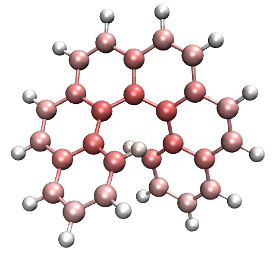

从上图可见，碳原子对色散能的贡献远大于氢，越靠近 helicene 中心的碳原子贡献越大。原因很容易理解，因为越靠近分子中心的碳原子，能与其它原子有越丰富的色散相互作用。

接下来计算色散密度 (dispersion density)。选择选项"2 Calculate dispersion density for current system"，再选"Medium-quality grid"，会发现 *dispdens.cub* 已导出到当前文件夹，它是色散密度的 cube 文件（单位 kcal/mol/Bohr³）。把它载入 VMD，以 -0.15 为等值面画等值面图并用透明材质，再把分子结构图的表示方式设为 licorice，可得下图。图中异值面分布清楚表明 helicene 内部区域比其它区域对色散能有相对更显著的贡献。

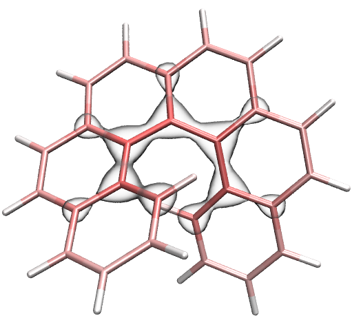

值得注意的是，本功能中可用选项 6 计算任意定义的两个片段之间的色散相互作用能。例如，要计算 helicene 两端两个六元碳环之间的色散相互作用能，选此选项后应输入 *17-22* 再输入 *11-12,23-26*，可见

```text
Dispersion interaction energy between the fragments:      -2.809 kcal/mol
```

### **4.21.4.2 actos 两种构象的色散能差异**

Actos 是柔性药物分子，其卷曲构象与线型构象的 xyz 文件已分别作为 *Actos_curly.xyz* 和 *Actos_linear.xyz* 放在"examples"文件夹中。本节考察卷曲构象相对线型构象原子对色散能贡献的变化。启动 Multiwfn 并输入

```text
examples\Actos_curly.xyz
21  // Energy decomposition analysis
4  // Analysis of atomic contribution to dispersion energy
3  // Calculate difference of atomic contributions to dispersion energy between current and another systems
[Press ENTER button]  // All atoms in the present system (Actos_curly.xyz) are of interest
examples\Actos_linear.xyz
[Press ENTER button]  // All atoms in Actos_curly.xyz are of interest
```

从屏幕输出可知 *Actos_linear.xyz* 与 *Actos_curly.xyz* 的总色散能分别为 -57.553 kcal/mol 和 -69.757 kcal/mol，可见卷曲构象的色散相互作用更显著。同时屏幕上还打印了每个原子对两结构色散能贡献的差值。

然后输入 *y*，当前目录下会生成 *diffatomdisp.pqr*，其中"charge"属性记录 *Actos_curly.xyz* 每个原子贡献的色散能减去 *Actos_linear.xyz* 每个原子贡献的色散能，该文件中的原子坐标与 *Actos_curly.xyz* 相同。基于此文件用 VMD 画分子结构并按"charge"属性给原子着色，色标范围设为 -1.0 到 1.0 kcal/mol，可得下方左侧的图（色标条是从"Graphics" - "Color" - "Color Scale"面板截取再用 Powerpoint 手工制作的），下方右侧图中的原子按元素名着色以资比较（黄/青/红/蓝/白分别为硫/碳/氧/氮/氢）。

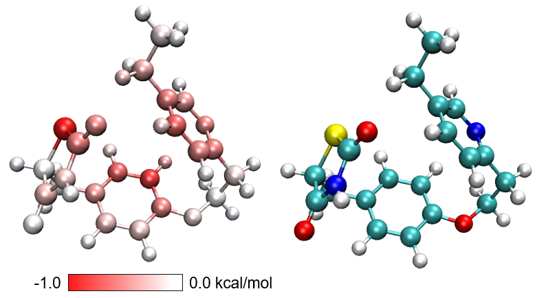

上方左图中越红的原子，对应在线型构象变为卷曲构象过程中对色散能变化贡献越多的原子。可见色散相互作用的增强主要发生在构象卷曲后能与其它原子靠得更近的原子上。白色原子的色散效应主要分布在边角处，变化不显著。

Multiwfn 还能生成色散密度的差值格点数据。在本功能中输入以下命令

```text
4  // Calculate dispersion density difference between current and another system
[Press ENTER button]  //All atoms in the present system (Actos_curly.xyz) are of interest
examples\Actos_linear.xyz  // Another system
```

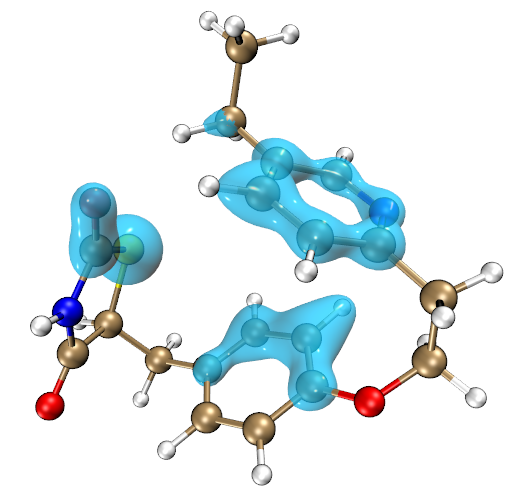

### **4.21.4.3 甲苯在沸石上的吸附**

本节说明对周期性体系的分析。"examples"文件夹中的 *zeolite.cif* 与 *zeolite-mol.cif* 分别是沸石以及吸附了甲苯的沸石的结构文件，后者由 CP2K 程序在 PBE-D3(BJ)/DZVP-MOLOPT-SR-GTH 水平下优化，前者的坐标直接从后者中提取。这两个 .cif 文件都可用作原子对色散能贡献分析和色散密度计算的输入文件。因为 .cif 文件向 Multiwfn 提供了晶胞信息，计算会自动考虑周期性。

首先，用与[4.21.4.1节](#42141-考察-helicene-中原子贡献的色散能和色散密度)所述完全相同的方式对 *zeolite-mol.cif* 做分析并按原子对色散能的贡献给原子着色，色标设为 -8.0 到 8.0 kcal/mol，可得下图。只有吸附的甲苯原子（对应文件中的 217-231 号原子）显示为大球。从图可见硅原子对色散能的贡献最大，远大于氧和碳原子，甲苯中的氢原子贡献最小。

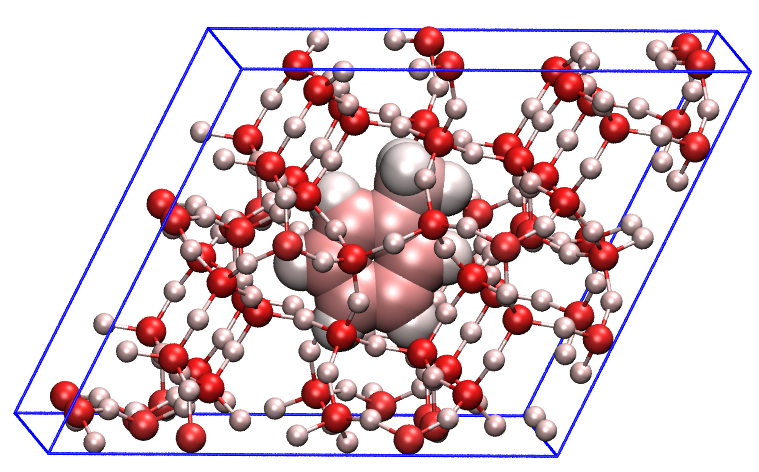

```text
examples\zeolite-mol.cif
21  // Energy decomposition analysis
4  // Analysis of atomic contribution to dispersion energy
3  // Calculate difference of atomic contributions to dispersion energy between current and another systems
1-216  // The atoms of interest are those of the zeolite moiety (first 216 atoms) in the current system (zeolite-mol.cif)
examples\zeolite.cif  // Another system
[Press ENTER button directly]  // The atoms of interest are all 216 atoms in zeolite.cif, which also correspond to atoms 1-216 in zeolite-mol.cif
y  // Export diffatomdisp.pqr in current folder
```

把 *diffatomdisp.pqr* 载入 VMD，按"charge"属性给原子着色，色标设为 -0.8 到 0.8，可见

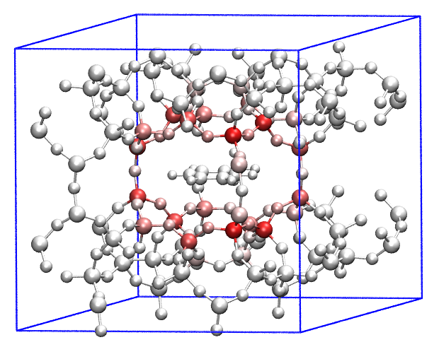

上图中吸附的甲苯全为白色，因为它不在我们先前定义的 *zeolite-mol.cif* 感兴趣原子范围内，故其数据全为零。图中的粉色或红色原子表明靠近甲苯的沸石原子贡献的色散能因吸附发生了很大变化。由于 *zeolite-mol.cif* 中沸石部分的构型与 *zeolite.cif* 相同，故上图中原子颜色完全反映沸石原子与甲苯之间的色散相互作用。从图可见色散相互作用随距离衰减非常快（已知为 1/ $r^6$ 衰减行为）。基本上，只有离甲苯最近一层的沸石原子才与它有显著的色散相互作用。

上图可改为下图，其中与甲苯有显著相互作用的沸石原子显示得清楚得多。具体而言，在 VMD 的"Graphics" - "Representation"界面中应创建三个 Rep

- Rep 1：显示甲苯，按 Name 着色，用 Licorice 风格和 BrushedMetal 材质显示

- Rep 2：用选择 *serial 1 to 216* 显示整个沸石，绘制方式设为 Licorice（Bond Radius = 0.1），着色方式设为"Charge"，材质设为 Transparent

- Rep 3：显示"charge"属性比 -0.2 更负（用选择 *charge\<-0.2*）的沸石原子，用 CPK 绘制方式和"Charge"着色方式。

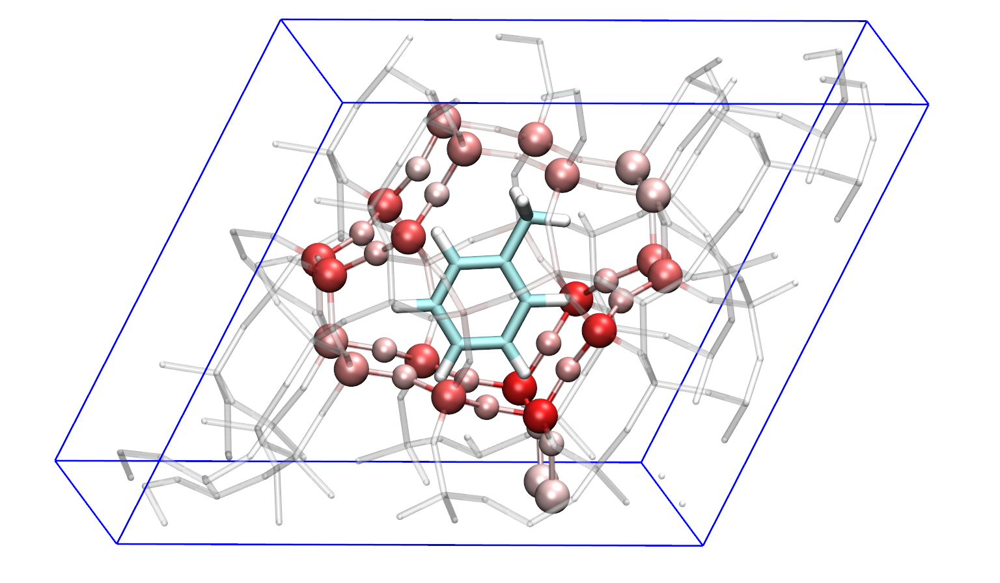

在本节末尾强调，在做原子色散能贡献或色散密度的差值分析时，两个体系中所选感兴趣原子范围的原子数必须相同，原子顺序也必须相同，否则显而易见，两个体系做差时原子贡献的色散能会混淆。
