# **4.22 概念密度泛函理论 (conceptual density functional theory, CDFT) 分析实例**

## **4.22.1 自动计算苯酚的概念密度泛函理论量**

> **注**
>
> 本节的中文版是我的博客文章“使用 Multiwfn 轻松计算概念密度泛函理论中定义的各种量”(<http://sobereva.com/484>)。

在本节中，我将展示如何非常方便地计算概念密度泛函理论 (conceptual density functional theory, CDFT) 框架下定义的几乎所有量。以苯酚为例。由于苯酚是中性分子，*N*、*N*+1 和 *N*-1 电子态分别对应中性态、阴离子态和阳离子态。

在学习本例之前，请先阅读[第 3.25 节](sec-3-25-conceptual-density-functional-theory-analysis.md)，其中描述了将要计算的所有量和基本用法。

### **所需波函数文件的准备**

应首先优化中性态的苯酚，请自行完成。*examples\phenol.xyz* 是在广泛使用的 B3LYP/6-31G\* 水平下优化得到的苯酚几何构型，其质量足以满足本研究。

启动 Multiwfn 并输入以下命令：

```text
examples\phenol.xyz
22  // Calculate various quantities in conceptual density functional theory
1  // Generate .wfn files for N, N+1 and N-1 electrons states
[Press ENTER button directly]  // The generated .gjf files will correspond to single point task at B3LYP/6-31G* level
[Press ENTER button directly]  // Use default charge and spin multiplicity, namely 0 1 for N state, -1 2 for N+1 state, and 1 2 for N-1 state
```

现在当前目录下已生成 *N.gjf*、*N+1.gjf* 和 *N-1.gjf*，它们分别是用于生成 *N.wfn*、*N+1.wfn* 和 *N-1.wfn* 的单点任务输入文件。现在可以用 Gaussian 手动运行它们。如果不修改这些文件中 .wfn 文件的生成路径，运行后，对于 Linux 版 Gaussian，它们将生成在当前目录下，而对于 Windows 版，它们将生成在 Gaussian 临时目录下。

也可以让 Multiwfn 直接调用 Gaussian 运行 .gjf 文件。假设已将 *settings.ini* 中的 "gaupath" 参数设为 Gaussian 可执行文件的实际路径，现在可以在 Multiwfn 窗口中输入 *y*，则 .gjf 文件将被 Gaussian 执行，生成的 .wfn 文件将出现在当前目录下，之后 .gjf 和 .out 文件将被自动删除。

> **注**
>
> Multiwfn 也能生成 ORCA 程序的输入文件以生成 .wfn 文件。为此，应先选择一次选项 -2，再选择选项 1，则将生成三个 ORCA 输入文件。用 ORCA 手动运行它们之后，将得到 *N.wfn*、*N-1.wfn*、*N+1.wfn*，应将它们移动到 Multiwfn 目录下。

### **计算全局指数和原子指数**

因为当前目录下已提供 *N.wfn*、*N+1.wfn* 和 *N-1.wfn*，现在可以开始计算 CDFT 量。选择选项 "2 Calculate various quantitative indices"，则 Multiwfn 开始计算 Hirshfeld 电荷并从 .wfn 文件中提取信息，结果输出到当前目录下的 *CDFT.txt* 中。内容如下所示，都是不言自明的。该文件也已作为 *examples\CDFT.txt* 提供。

```text
 Hirshfeld charges, condensed Fukui functions and condensed dual descriptors
 Units used below are "e" (elementary charge)
     Atom     q(N)    q(N+1)   q(N-1)     f-       f+       f0      CDD
     1(C )  -0.0587  -0.1185   0.0852   0.1439   0.0598   0.1018  -0.0841
     2(C )  -0.0390  -0.1674   0.0268   0.0658   0.1284   0.0971   0.0626
     3(C )  -0.0597  -0.1873   0.0319   0.0916   0.1276   0.1096   0.0360
...[ignored]

 Condensed local electrophilicity/nucleophilicity index (e*eV)
     Atom              Electrophilicity          Nucleophilicity
     1(C )                  0.02576                  0.45535
     2(C )                  0.05533                  0.20827
     3(C )                  0.05496                  0.28982
...[ignored]

Condensed local softness (e/Hartree), relative electrophilicity/nucleophilicity (dimensionless) and condensed local hyper-softness (e/Hartree^2)
     Atom         s-          s+          s0        s+/s-       s-/s+       s(2)
     1(C )      0.3761      0.1562      0.2661      0.4154      2.4075     -0.5746
     2(C )      0.1720      0.3355      0.2538      1.9501      0.5128      0.4271
     3(C )      0.2392      0.3333      0.2863      1.3933      0.7177      0.2459
...[ignored]

 E(N):     -307.464860 Hartree
 E(N+1):     -307.383614 Hartree
 E(N-1):     -307.163438 Hartree
 E_HOMO(N):     -0.218913 Hartree,   -5.9569 eV
 E_HOMO(N+1):    0.161297 Hartree,    4.3891 eV
 E_HOMO(N-1):   -0.464864 Hartree,  -12.6496 eV
 First vertical IP:     0.301421 Hartree,    8.2021 eV
 First vertical EA:    -0.081246 Hartree,   -2.2108 eV
 Mulliken electronegativity:     0.110088 Hartree,    2.9956 eV
 Chemical potential:            -0.110088 Hartree,   -2.9956 eV
 Hardness (=fundamental gap):    0.382667 Hartree,   10.4129 eV
 Softness:      2.613235 Hartree^-1,    0.0960 eV^-1
 Softness^2:    6.828998 Hartree^-2,    0.0092 eV^-2
 Electrophilicity index:    0.015835 Hartree,    0.4309 eV
 Nucleophilicity index:     0.116285 Hartree,    3.1643 eV
```

可将上面所示的凝聚 Fukui 函数和凝聚对偶描述符与[第 4.7.3 节](sec-4-7-population-analysis-and-atomic-charge-calculation.md#473-计算凝聚fukui函数和凝聚对偶描述符)中手动计算的结果比较，会发现数据完全一致。显然，使用本模块计算 CDFT 量比手动计算容易得多！

> **注**
>
> 坦率地说，输出的涉及 *N*+1 态能量的值（如垂直电子亲和能和 Mulliken 电负性）不是很准确，因为众所周知，要获得相对准确的阴离子体系能量，必须使用弥散函数。因此，若需要这些量的更好结果，在用 Multiwfn 准备 Gaussian 输入文件时，建议选择至少 6-311+G\* 水平的基组。

### **计算 Fukui 函数和对偶描述符**

接下来研究 Fukui 函数 (*f*) 和对偶描述符 (Δ*f*)，它们是实空间函数。选择选项 "3 Calculate grid data of Fukui function, dual descriptor and related functions "，再选择 "2 Medium-quality grid"，则 Multiwfn 自动计算 *N*、*N*+1 和 *N*-1 态的电子密度格点数据。之后，可选择相应选项来可视化 Fukui 函数或对偶描述符，或将它们作为 cube 文件导出到当前目录下。Multiwfn 绘制的各种 *f* 和 Δ*f* 汇总在下图中，所有等值面值均设为 0.007 a.u.：

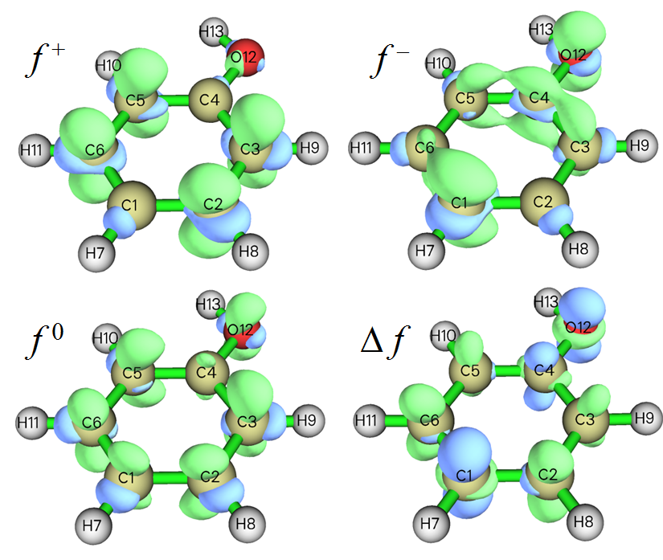

从上图可以发现，本模块自动生成的 *f* 和 Δ*f* 与[第 4.5.3 节](sec-4-5-generate-grid-data-and-view-isosurface-map.md#453-计算-elf-σ-和-elf-π-以研究苯的芳香性)中利用主功能 5 的自定义操作功能手动得到的结果相同。无疑使用本模块方便得多！

> **注**
>
> 如[第 4.5.4 节](sec-4-5-generate-grid-data-and-view-isosurface-map.md#454-用福井函数和对偶描述符研究苯酚亲电进攻的有利位点)所述，对偶描述符也可基于 *N*-1 和 *N*+1 态的自旋密度近似评估，然而在本模块中，对偶描述符及其凝聚形式是以精确方式评估的。

值得注意的是，若用相应选项将格点数据导出为 cube 文件，则可用[第 4.A.14 节](sec-4-A-special-topics-and-advanced-tutorials.md#4a14-用vmd脚本将cube文件渲染为最先进水平的等值面图)所述方法，通过 VMD 以最高水准的质量将上述函数非常快速、容易地绘制为等值面图。例如，下图是经 VMD 渲染的 $f^-$ 函数。

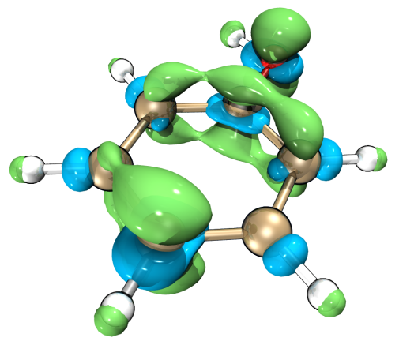

### **计算局域（超）软度和局域亲电/亲核指数**

上面介绍的模块还可用于导出或可视化局域软度、局域超软度、局域亲电指数和局域亲核指数。

例如，我们将导出局域亲电指数的 cube 文件，回想其定义就是 $f^+$ 乘以全局亲电指数。因此，选择选项 "-1 Set the scale factor to various grid data"，输入 0.4309（即选项 2 输出的以 eV 为单位的全局亲电指数，见 *CDFT.txt*），再选择选项 "5 Export grid data of scaled f+ as f+.cub in current folder"。现在，导出的 *f+.cub* 即对应局域亲电指数，单位为 eV/Bohr³。

下一个例子，我们将导出局域超软度 (local hyper-softness, LHS) 的 cube 文件，其定义和实用价值在 *J. Math. Chem.*, **62**, 461 (2024) 中有仔细讨论。它可简单地用 Δ*f* 乘以全局软度的平方来评估。因此，选择选项 "-1 Set the scale factor to various grid data" 并输入 6.828998（即选项 2 输出的以 Hartree⁻² 为单位的 softness²，见前述 *CDFT.txt*），再选择选项 "5 Export grid data of scaled dual descriptor as DD.cub in current folder"。现在，导出的 *DD.cub* 即对应局域超软度，单位为 1/(Bohr³Hartree²)，或简记为 a.u.。

### **$\omega_{\mathrm{cubic}}$ 和 *ε* 的计算**

如[第 3.25 节](sec-3-25-conceptual-density-functional-theory-analysis.md)所述，亲电指数 $\omega_{\mathrm{cubic}}$ 在研究弱相互作用时很有用，至少对卤键如此，而亲电描述符 *ε* 是与亲电性关联比 *ω* 更好的量。若还想计算它们，进入本模块后应先选选项 -1 将其状态切换为 "Yes"，然后按上面所示例子操作（*即*借助选项 1 准备 .wfn 文件，再用选项 2 执行计算），则选项 2 输出的 *CDFT.txt* 将包含 $\omega_{\mathrm{cubic}}$、其在每个原子上的凝聚值以及 *ε*。一个中间量，即第二垂直电离能，也会被打印输出。

更具体地，对本例而言，进入本模块后应输入

```text
-1  // Toggle calculating ω_cubic and ε
1  // Generate .wfn files for N, N+1, N-1, N-2 electronic states
[Press ENTER button directly]  // Use B3LYP/6-31G* level
[Press ENTER button directly]  // Use default charge and spin multiplicity, namely 0 1 for N state, -1 2 for N+1 state, 1 2 for N-1 state, 2 1 for N-2 state
```

现在运行新生成的四个 .gjf 文件以获得 *N.wfn*、*N+1.wfn*、*N-1.wfn* 和 *N-2.wfn*，再选择选项 2。从输出的 *CDFT.txt* 中可找到：

```text
Cubic electrophilicity index (w_cubic):    0.021716 Hartree,    0.5909 eV
Electrophilic descriptor (epsilon):        0.080522 Hartree,    2.1911 eV
```

## **4.22.2 轨道加权 Fukui 函数和轨道加权对偶描述符研究示例**

> **注**
>
> 本节附带扩展讨论和更多例子的中文版是我的博客文章“通过轨道加权 Fukui 函数和轨道加权对偶描述符预测亲核与亲电反应位点”(<http://sobereva.com/533>)。

请先阅读[第 3.25.3 节](sec-3-25-conceptual-density-functional-theory-analysis.md#3253-专题-1轨道加权-fukui-函数与对偶描述符)，其中介绍了轨道加权 Fukui 函数（${f}_{w}^{+}$ 和 ${f}_{w}^{-}$）和对偶描述符 $\Delta {f}_{w}$，也给出了一些重要说明。在本节中我们将用这些函数研究几个体系。

### **第一部分：C₆₀**

在本部分我们将用轨道加权函数揭示 C₆₀ 的反应位点，它具有高点群对称性，前线分子轨道高度简并。像这样的分子无法用标准形式的 Fukui 函数和对偶描述符合理研究。该体系在 B3LYP/6-31G\* 水平下生成的 .fch 文件可从 <http://sobereva.com/multiwfn/extrafiles/C60.zip> 下载，它是本分析的输入文件。

启动 Multiwfn 并输入以下命令

```text
C60.fch
22  // Calculate various quantities in conceptual density functional theory
```

在当前菜单中，可用选项 4 设置后续轨道加权计算中使用的 Δ 参数，本例中保持默认值（0.1 Hartree）不变，只有当发现结果不满意时才应适当修改。

我们首先可视化轨道加权函数的等值面。输入以下命令

```text
7  // Calculate grid data of OW Fukui function and OW dual descriptor
2  // Medium quality
```

然后可用相应选项可视化 ${f}_{w}^{+}$、${f}_{w}^{-}$、${f}_{w}^{0}$ 和 $\Delta {f}_{w}$ 的等值面，如下图所示。注意应将等值面值改为合适的值，否则等值面可能完全不可见。下图使用 0.0003 a.u. 的等值面绘制。

![Orbital-weighted Fukui functions and dual descriptor of cyclo\[18\]carbon](assets/figures/ch4/image1298.png)

在上图中，绿色和蓝色等值面分别代表正部和负部。可见，所有轨道加权函数的分布都符合分子点群对称性，这是轨道加权形式独有的优势。相比之下，若绘制 HOMO 密度（对应于 $f^-$ 的冻结轨道形式）或经有限差分（$ρ_{N}$ − $ρ_{N}$₋₁）计算并绘制 $f^-$，会发现它们的分布反直觉（与分子对称性不一致），因而在揭示反应位点时毫无用处。如[第 4.5.4 节](sec-4-5-generate-grid-data-and-view-isosurface-map.md#454-用福井函数和对偶描述符研究苯酚亲电进攻的有利位点)中介绍的，具有大正值 $f^-$ 或显著负 Δ*f* 的区域对应具有显著亲核性的位点，或等价地说，易受亲电攻击。从上图可发现，最有亲电攻击倾向的位点是 \[6,6\] 型 C-C 键（*即*两个相邻六元环共用的键）上方的区域。这一观察与实验发现完全一致（详见 $\Delta {f}_{w}$ 原论文，即 *J. Phys. Chem. A*，**123**，10556 (2019) 中的广泛讨论），该结论还可根据平均局域电离能在 vdW 表面上极小值的分布进一步证实，关于如何做这种分析见[第 4.12.2 节](sec-4-12-quantitative-analysis-of-molecular-surface.md#4122-苯酚分子表面上的平均局部离子化能-average-local-ionization-energy-alie分析)。

轨道加权形式的 Fukui 函数和对偶描述符由多个轨道贡献。若想查看权重以更好理解轨道加权函数如何工作，在本模块中可选择 "5 Print current orbital weights used in orbital-weighted (OW) calculation"，则将看到

```text
 10 Highest weights in orbital-weighted f+
 Orbital   181 (LUMO  )   Weight:  12.47 %   E_diff:     1.752 eV
 Orbital   182 (LUMO+1)   Weight:  12.47 %   E_diff:     1.752 eV
 Orbital   183 (LUMO+2)   Weight:  12.47 %   E_diff:     1.752 eV
 Orbital   184 (LUMO+3)   Weight:   6.32 %   E_diff:     2.847 eV
 Orbital   185 (LUMO+4)   Weight:   6.32 %   E_diff:     2.847 eV
 Orbital   186 (LUMO+5)   Weight:   6.32 %   E_diff:     2.847 eV
 Orbital   187 (LUMO+6)   Weight:   4.70 %   E_diff:     3.207 eV
 Orbital   188 (LUMO+7)   Weight:   4.70 %   E_diff:     3.207 eV
 Orbital   189 (LUMO+8)   Weight:   4.70 %   E_diff:     3.207 eV
 10 Highest weights in orbital-weighted f-
 Orbital   180 (HOMO  )   Weight:   9.06 %   E_diff:    -1.752 eV
 Orbital   179 (HOMO-1)   Weight:   9.06 %   E_diff:    -1.752 eV
 Orbital   178 (HOMO-2)   Weight:   9.06 %   E_diff:    -1.752 eV
 Orbital   177 (HOMO-3)   Weight:   9.06 %   E_diff:    -1.752 eV
 Orbital   176 (HOMO-4)   Weight:   9.06 %   E_diff:    -1.752 eV
 Orbital   175 (HOMO-5)   Weight:   5.02 %   E_diff:    -2.728 eV
 Orbital   174 (HOMO-6)   Weight:   5.02 %   E_diff:    -2.728 eV
 Orbital   173 (HOMO-7)   Weight:   5.02 %   E_diff:    -2.728 eV
 Orbital   172 (HOMO-8)   Weight:   5.02 %   E_diff:    -2.728 eV
 Orbital   171 (HOMO-9)   Weight:   5.02 %   E_diff:    -2.728 eV
```

"E_diff" 是轨道能量与近似取为 *E*(HOMO) 和 *E*(LUMO) 平均值的化学势之差。显然，轨道能量越接近化学势，该轨道的权重越高。

也可计算凝聚的 ${f}_{w}^{+}$、${f}_{w}^{-}$、${f}_{w}^{0}$ 和 $\Delta {f}_{w}$，从而定量研究它们在每个原子位点的值。为此，在本模块中应选择 "6 Calculate condensed OW Fukui function and OW dual descriptor"。然而，这些凝聚量对上面研究的 C₆₀ 没有意义，因为所有原子在空间上等价。

顺便值得一提的是，${f}_{w}^{+}$、${f}_{w}^{-}$、${f}_{w}^{0}$ 和 $\Delta {f}_{w}$ 在分子表面上的极值可通过定量分子表面分析模块精确定位，从而定量比较不同区域的值。使用该模块的许多例子已在[第 4.12 节](sec-4-12-quantitative-analysis-of-molecular-surface.md)中给出。下面我们考察 $\Delta {f}_{w}$ 在 *ρ* = 0.01 a.u. 等值面上的极值。首先，将 *settings.ini* 中的 "iuserfunc" 参数设为 98，因为如[第 2.7 节](sec-2-7-user-defined-real-space-function.md)所述，$\Delta {f}_{w}$ 对应第 98 个自定义函数。然后启动 Multiwfn 并输入

```text
C60.fch
12  // Quantitative analysis of molecular surface
1  // Select the way to define surface
1  // Isosurface of electron density
0.01  // Use ρ = 0.01 a.u. isosurface to define the surface
2  // Select mapped function
-1  // User-defined real space function, which now corresponds to ∆f_w
3  // Spacing of grid points for generating molecular surface
0.25  // Use slightly larger grid spacing than default to reduce cost. This setting is already fine enough for present investigation
0  // Start analysis
```

计算完成后，在后处理菜单中选择选项 0 可视化极值点。为使图形清晰，将 GUI 中的 "Ratio of atomic size" 改为 3.0 以放大原子球。GUI 窗口中的图形如下所示。标出了 $\Delta {f}_{w}$ 的几个极小值点（蓝色小球），数值可从文本窗口找到。红色小球对应极大值点。

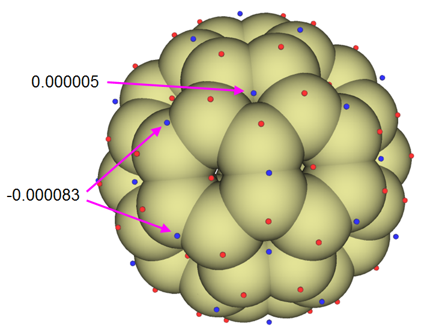

可见，\[6,6\] 键上方的 $\Delta {f}_{w}$ 比其它区域明显更负，因此这些位置具有最高的亲电反应活性。虽然每个五元环中心上方也有表面极小值，但数值略为正，因此五元环没有参与亲电反应的明显倾向。

### **第二部分：环\[18\]碳**

环\[18\]碳在我的工作 *Carbon*，**165**，468 (2020)、*Carbon*，**165**，461 (2020) 及 <http://sobereva.com/carbon_ring.html> 中有非常系统的研究。该体系具有高对称性（D$_{9h}$），因而非常适合用轨道加权函数研究。该体系的 .fchk 可直接经 <http://sobereva.com/multiwfn/extrafiles/C18.zip> 下载，是在 ωB97XD/def2-TZVP 水平下生成的。该体系 $\Delta {f}_{w}$ =0.0008 a.u. 的等值面如下所示。

![Orbital-weighted dual descriptor of cyclo\[18\]carbon](assets/figures/ch4/image1300.png)

环\[18\]碳含有两种 C-C 键，一种短、一种长，交替出现。两条短键用红色箭头标出。从上图可清楚看到，短 C-C 键和长 C-C 键分别易受亲电和亲核攻击，因为前者被负等值面包围，后者被正等值面包围。

在 Multiwfn 中，也可将 $\Delta {f}_{w}$ 绘制为平面图。例如，我们将环\[18\]碳分子平面上的 $\Delta {f}_{w}$ 绘制为颜色填充图。先将 *settings.ini* 中的 "iuserfunc" 参数设为 98，然后启动 Multiwfn 并输入

```text
C18.fchk
4  // Plot plane map
100  // User-defined real space function, which now corresponds to ∆f_w
1  // Color-filled map
[Press ENTER button to use default grid setting]
1  // XY plane
0  // Z=0
```

关闭弹出的图，然后在后处理菜单中调整一些设置并重绘，之后将看到下图。蓝色等高线对应 vdW 表面。

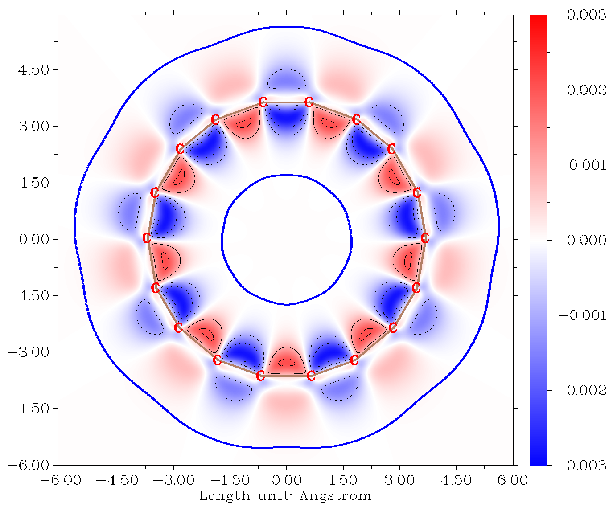

从上图可发现，环的内侧边缘比外侧边缘更具反应活性，因为内侧边缘的 $\Delta {f}_{w}$ 绝对值更大。

### **第三部分：CH₃Cl**

最后，我们用 $\Delta {f}_{w}$ 研究 CH₃Cl 的反应活性。输入文件为 *examples\CH3Cl.fchk*。用与上面例子相同的方式计算 $\Delta {f}_{w}$ 的格点数据，然而，为了获得更好的图形效果，这次不在 Multiwfn 中直接可视化等值面，而是经相应选项将 $\Delta {f}_{w}$ 的格点数据导出为 *OW_DD.cub*，再用[第 4.A.14 节](sec-4-A-special-topics-and-advanced-tutorials.md#4a14-用vmd脚本将cube文件渲染为最先进水平的等值面图)所述方法经 VMD 程序轻松渲染为等值面图。0.008 a.u. 的等值面如下所示。

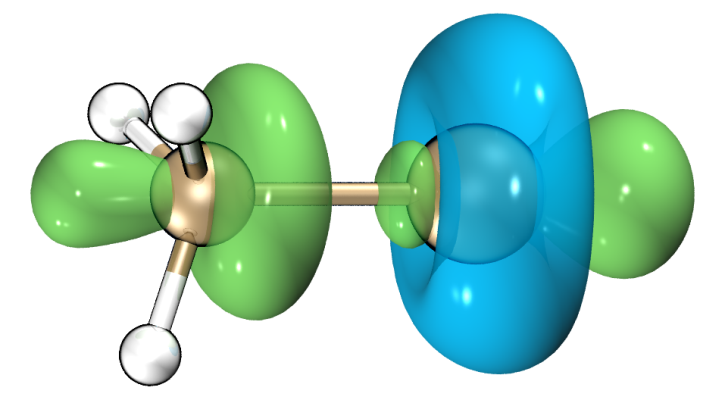

可见，Cl 原子周围出现环形负区域，表明该区域呈现 Lewis 碱特征。在 C-Cl 键两端 $\Delta {f}_{w}$ 明显为正，表明碳端的位点易受亲电攻击（*如* SN₂ 反应），而 Cl 端的位点表现为 Lewis 酸，这与存在 σ-hole 区域的事实一致。

顺便说一下，也可像 C₆₀ 的例子那样研究 $\Delta {f}_{w}$ 在分子表面上的极值，从而在定量水平上讨论 $\Delta {f}_{w}$。

## **4.22.3 （准）简并 HOMO/LUMO 情形的 CDFT 分析实例**

如[第 3.25.4 节](sec-3-25-conceptual-density-functional-theory-analysis.md#3254-专题-2基于电子密度的准简并-fukui-函数与对偶描述符)所述，除采用轨道加权形式外，当 HOMO 和/或 LUMO （准）简并时，Multiwfn 还支持另一种形式的 CDFT 分析。该形式仅依赖电子密度，因而理论上比轨道加权形式更严格，代价是额外的计算量，因为还应计算 *N*+*p* 和 *N*-*q* 态的波函数文件，其中 *p* 和 *q* 分别为 LUMO 和 HOMO 的简并度。下面给出两个例子。

### **4.22.3.1 苯的 Fukui 函数和对偶描述符**

在本节以苯为例说明考虑 HOMO/LUMO 简并时 Fukui 函数和对偶描述符的计算。因为需要基于轨道能量确定简并度，所以应首先为所研究的结构生成一个波函数文件。*examples\benzene.fch* 是由 Gaussian 16 在 B3LYP/6-31G\* 水平下几何优化任务产生的波函数文件。

启动 Multiwfn 并输入

```text
examples\benzene.fch
22  // Calculate various quantities in conceptual density functional theory
-3  // Set degree of frontier molecular orbital degeneracy
```

现在屏幕上显示最低 10 个非占据轨道的信息，以帮助确定 LUMO 简并度

```text
...[ignored]
Orbital    25 (LUMO+3)   Energy:     3.838 eV  E_diff:     3.737 eV
Orbital    24 (LUMO+2)   Energy:     2.346 eV  E_diff:     2.246 eV
Orbital    23 (LUMO+1)   Energy:     0.100 eV  E_diff:     0.000 eV
Orbital    22 (LUMO  )   Energy:     0.100 eV
```

从轨道能量可清楚看出 LUMO 和 LUMO+1 严格简并，而 LUMO+2 能量明显更高，因此 LUMO 简并度为 2。在此输入 *2*（注意 Multiwfn 提示若在此直接按回车，将使用简并度 2。这是因为 Multiwfn 通过统计有多少非占据轨道能量与 LUMO 相差小于 0.01 eV 来确定 LUMO 简并度）。

然后屏幕上显示最高 10 个占据轨道的信息：

```text
Orbital    21 (HOMO  )   Energy:    -6.720 eV
Orbital    20 (HOMO-1)   Energy:    -6.720 eV  E_diff:     0.000 eV
Orbital    19 (HOMO-2)   Energy:    -9.234 eV  E_diff:    -2.514 eV
Orbital    18 (HOMO-3)   Energy:    -9.234 eV  E_diff:    -2.514 eV
...[ignored]
```

发现 HOMO 和 HOMO-1 能量完全相同，因此现在输入 *2* 表示 HOMO 简并度为 2（也可直接按回车使用自动确定的简并度 2）。

接下来，可用自己喜欢的量子化学程序手动生成 *N*、*N*+2 和 *N*-2 态的波函数文件。为方便，这里让 Multiwfn 帮我们准备输入文件。输入以下命令：

```text
1  // Single point input files of Gaussian for generating .wfn files for N, N+2, N-2 states will be prepared (If you are an ORCA user, you can choose option -2 to change to ORCA program before selecting this option)
[Press ENTER button]  //Use the default B3LYP/6-31G* level for single point calculation
[Press ENTER button]  //As mentioned in prompt, pressing ENTER button directly will use net charge and spin multiplicity of (0 1), (-2 3) and (2 3) for the N, N+2 and N-2 states, respectively. These combinations are reasonable for present case
```

因为当前尚未定义 *N*+1 和 *N*-1 态，而选项 2 中计算第一垂直电离能、电子亲和能及软度等相关量需要 *E*(*N*+1) 和 *E*(*N*-1)，所以 Multiwfn 还会要求输入这两个态的净电荷和自旋多重度。然而，本例只想计算 Fukui 函数和对偶描述符，它们与这些能量量无关，所以按两次回车跳过这两个态的定义。

现在当前目录下已生成 *N.gjf*、*N+2.gjf* 和 *N-2.gjf*，可手动用 Gaussian 运行它们，或直接输入 *y* 让 Multiwfn 调用本机 Gaussian 运行它们（此时 *settings.ini* 中的 “gaupath” 已正确定义）。计算全部完成后，当前目录下将有 *N.wfn*、*N+2.wfn* 和 *N-2.wfn*。

然后绘制考虑 HOMO 和 LUMO 简并的 Fukui 函数和对偶描述符的等值面图。输入以下命令

```text
3  // Calculate grid data of Fukui function and dual descriptor (if N.wfn, N+2.wfn and N-2.wfn are not present in current folder, Multiwfn will ask you to input path of wavefunction files of the three states)
2  // Medium-quality grid
2  // Visualize isosurface of f^-
```

将等值面值改为 0.005 a.u. 后，将看到下图

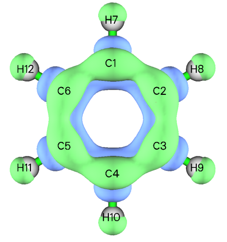

从上图可见，考虑 HOMO 简并的 $f^-$ 分布，即 ($ρ_{N}$ − $ρ_{N}$₋₂)/2，完全符合分子对称性。正区域（绿色等值面所示）主要出现在碳原子上下方的分子平面两侧，从而正确表明 π 电子云易发生亲电攻击。相比之下，若按通常方式绘制 $f^-$，即 $ρ_{N}$ − $ρ_{N}$₋₁，会发现其分布明显违背实际分子对称性，从而对亲电攻击优先位点得出误导性结论。

类似地，可用选项 1、3 和 4 分别可视化考虑前线轨道简并下计算的 $f^+$、$f^0$ 和对偶描述符 Δ*f* 的等值面图。

#### ***f*⁺ 和对偶描述符计算水平选择的注意**

对苯体系，若用含弥散函数的 B3LYP 基组（*如* 6-311+G\*）生成波函数文件，会发现算得的（准）简并 $f^+$ 和 Δ*f* 分布极其弥散（呈现很强的 Rydberg 特征）且不完全符合分子对称性。这是因为该泛函严重的自相互作用误差 (self-interaction error, SIE) 问题使 *N*+2 态的电子过度弥散，而当前基组有能力描述远离分子的空间区域。此时得到的 $f^+$ 和 Δ*f* 行为不好，不能用于讨论优先反应位点。

值得注意的是，在 *Chem. Phys. Lett.*，**724**，29 (2019) 中发现，若基于有限差分评估 Fukui 函数和对偶描述符（与本情形相同），则即使不含弥散函数的 3-zeta 基组基本也能得到有意义的对偶描述符。

尽管本例采用的 B3LYP/6-31G\* 水平给出看似合理的 $f^+$ 和 Δ*f* 分布，若追求更严格的结果，我推荐使用长程校正 DFT 泛函如 ωB97XD 配合不含弥散函数的 3-zeta 基组，*如* 6-311G\*。ωB97XD 的 SIE 问题比常用的 B3LYP 弱得多，因此阴离子态电子束缚得更紧；不含弥散函数的 3-zeta 基组已能充分描述价层电子结构，同时电子被迫束缚在价层区域内，保证 $f^+$ 和 Δ*f* 只代表化学感兴趣的区域。

### **4.22.3.2 C₆₀ 富勒烯的局域软度和局域超软度**

在本节说明 C₆₀ 富勒烯局域软度和局域超软度的计算。它们在 *J. Math. Chem.*，**62**，461 (2024) 中是在 ωB97XD/6-311+G\* 水平下给出的，但本节改用 6-311G\* 以大幅节省计算量。由 Gaussian 16 在 ωB97XD/6-311G\* 水平下几何优化产生的 .fchk 文件（*C60_wB97XD_opt.fchk*）可从 <http://sobereva.com/multiwfn/extrafiles/C60_wB97XD_opt.7z> 下载。

```text
C60_wB97XD_opt.fchk
22  // Calculate various quantities in conceptual density functional theory
-3  // Set degree of frontier molecular orbital degeneracy
[Press ENTER button directly]  // Use automatically determined LUMO degeneracy of 3
[Press ENTER button directly]  // Use automatically determined HOMO degeneracy of 5
1  // Generate .wfn files for various electrons states
wB97XD/6-311G* symm=loose scf=conver=7  // Keywords for performing single point task of Gaussian. The “symm=loose” ensures that Gaussian will utilize I_h point group of C_60 to greatly reduce cost. “scf=conver=7” slightly loosens SCF convergence threshold to make it easier to reach
-1,2  // Net charge and spin multiplicity of N+1 state
1,2  // Net charge and spin multiplicity of N-1 state
```

现在当前目录下已生成 *N.gjf*、*N-1.gjf*、*N+1.gjf*、*N-3.gjf* 和 *N+5.gjf*，输入 *y* 让 Multiwfn 调用 Gaussian 执行计算（或手动计算）。计算后，当前目录下将有 *N.wfn*、*N-1.wfn*、*N+1.wfn*、*N-3.wfn* 和 *N+5.wfn*。

然后选择选项 2 计算各种 CDFT 量并打印到当前目录下的 *CDFT.txt*。从中可找到软度及其平方：

```text
 Softness:      4.638426 Hartree^-1,    0.1705 eV^-1
 Softness^2:   21.514996 Hartree^-2,    0.0291 eV^-2
```

接下来，输入以下命令得到局域超软度，它是软度平方与对偶描述符的乘积

```text
3  // Calculate grid data of Fukui function, dual descriptor and related functions
-10  // Set extension distance
6  // 6 Bohr, which is slightly larger than the default one to avoid isosurface truncation at box boundary when isovalue is set to a small value
3  // Since C_60 is not small, we use high-quality grid to guarantee that grid spacing will not be too large and thus leading to poor isosurface map
-1  // Set the scale factor to various grid data
21.514996  // Square of softness in Hartree^-2
8  // Export grid data of scaled dual descriptor as DD.cub in current folder
```

现在当前目录下新生成的 *DD.cub* 即对应局域超软度，单位为 1/(Bohr³Hartree²)。经 VMD 以 0.001 等值面绘制为等值面图，将看到下图，它与 *J. Math. Chem.*，**62**，461 (2024) 的图 4 基本完全相同，尽管当前基组 6-311G\* 与该工作中使用的昂贵得多的 6-311+G\* 不同。还值得注意的是，该图的主要特征与[第 4.22.2 节](#4222-轨道加权-fukui-函数和轨道加权对偶描述符研究示例)得到的 C₆₀ 的 $\Delta {f}_{w}$ 相当。

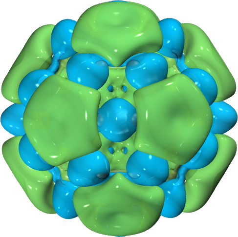

用类似方式可得到局域软度，其定义为软度与 Fukui 函数的乘积。输入以下命令

```text
-1  // Set the scale factor to various grid data
4.638426  // Softness in Hartree^-1
6  // Export grid data of scaled f- as f-.cub in current folder
```

现在当前目录下新生成的 *f-.cub* 即对应局域软度 $s^-$，单位为 1/(Bohr³Hartree)。下图是经 VMD 绘制的 $s^-$ 的 0.005 和 0.003 等值面，前者与 *J. Math. Chem.*，**62**，461 (2024) 的图 2 相同，而后者更清楚地区分最易发生亲电攻击的键（*即*两个六元环共用的键），它看起来与[第 4.22.2 节](#4222-轨道加权-fukui-函数和轨道加权对偶描述符研究示例)中 C₆₀ 的 ${f}_{w}^{-}$ 图非常相似。

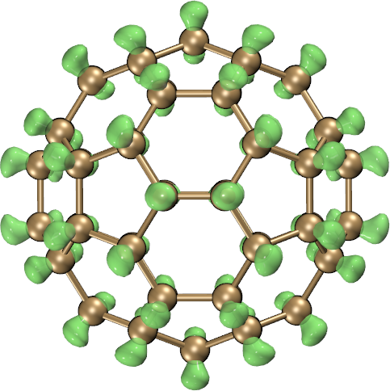 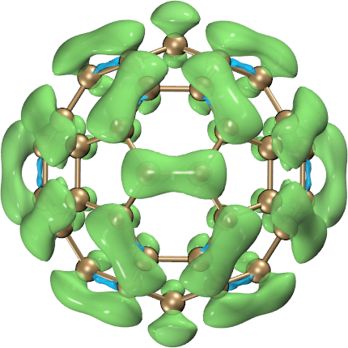

### **4.22.3.3 开壳层分子 O₂ 的 Fukui 函数和对偶描述符**

请先阅读[第 3.25.4.2 节](sec-3-25-conceptual-density-functional-theory-analysis.md#32542-开壳层情形)以熟悉评估开壳层情形各种形式 Fukui 函数和对偶描述符的工作方程。本例计算 O₂ 的这些函数，O₂ 是有代表性的开壳层分子（三重态基态），前线轨道存在简并。

```text
examples\O2.fch  // Wavefunction file of ground state O_2 at B3LYP/6-31G* level
22  // Calculate various quantities in conceptual density functional theory
12  // Calculate Fukui function and dual descriptor based on formalism of conceptual spin-polarized DFT
1  // Set degeneracy of frontier molecular orbitals
[Press ENTER button directly]  // Use suggested degeneracy of LUMO(α)
[Press ENTER button directly]  // Use suggested degeneracy of HOMO(α)
[Press ENTER button directly]  // Use suggested degeneracy of LUMO(β)
[Press ENTER button directly]  // Use suggested degeneracy of HOMO(β)
```

```text
[Press ENTER button directly]  // Use suggested degeneracy of HOMO(β)
```

现在可看到前线轨道简并度的总结：

```text
Degeneracy of LUMO(alpha):  1
Degeneracy of HOMO(alpha):  2
Degeneracy of LUMO(beta):   2
Degeneracy of HOMO(beta):   2
```

接下来输入

```text
2  //Generate .wfn files for various electrons states
[Press ENTER button directly]  // Use the default B3LYP/6-31G* as computational level for generating Gaussian input files
```

现在会发现当前目录下已生成 *state0_3.gjf*、*state-1_4.gjf*、*state-2_1.gjf*、*state2_1.gjf* 和 *state2_5.gjf*，它们是为生成研究所涉及各电子态 .wfn 文件的单点任务 Gaussian 输入文件。例如，*state-1_4.gjf* 对应净电荷 -4、自旋多重度 4。若本机装有 Gaussian，可输入 *y* 请 Multiwfn 调用 Gaussian 计算它们；或者手动用 Gaussian 计算，再将生成的 .wfn 文件放入当前目录。

现在选择选项 3 并选中等质量格点，开始计算不同态电子密度的格点数据。之后，在后处理菜单中选择将感兴趣的实空间函数可视化为等值面图，或将格点数据导出为 .cub 文件。例如，选择选项 7 绘制 $\Delta{f}_{\Delta{N}_{S}<0}$ 形式的对偶描述符，将等值面改为 0.0005 a.u. 并设材质为透明后，将看到下图，它与 *Chem. Phys. Lett.*，**506**，104 (2011) 图 7 中的 DUAL-UDFT 情形完全相同。

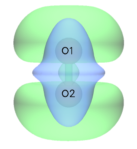

## **4.22.4 绘制 Fukui 势和对偶描述符势的例子**

本例说明为马来酸酐绘制 Fukui 势和对偶描述符势，后者也见于 *J. Math. Chem.*，**62**，1094 (2024)，是在 M06-2X/6-311++G(d,p) 水平下计算的，因此我们用同样水平复现该结果。若对这两种势不熟悉，请先查看[第 3.25.1 节](sec-3-25-conceptual-density-functional-theory-analysis.md#3251-理论)。

启动 Multiwfn 并输入

```text
examples\maleic_anhydride.xyz  //Geometry was optimized at M06-2X/6-311++G(d,p) level
22  // Conceptual DFT (CDFT) analysis
1  // Generate .wfn files for N, N+1, N-1 electrons states
M062X/6-311++G(d,p)  // Keywords of Gaussian to perform single point calculations
[Press ENTER button]  // Use (0 1), (-1 2) and (1 2) for N, N+1 and N-1 states
y  // Invoke Gaussian to calculate the three states (assume that you have properly set “gaupath” in settings.ini)
9  // Calculate grid data of Fukui potential and dual descriptor potential
1  // Because calculating ESP grid data is relatively expensive, so here we choose to use low-quality grid
```

现在，可选择相应选项可视化各种 Fukui 势和对偶描述符势 (dual descriptor potential, DDP)，${V}_{{f}^{+}}$、${V}_{{f}^{-}}$ 和 $DDP={V}_{{f}^{+}}-{V}_{{f}^{-}}$ 的等值面图如下所示，正部和负部分别以绿色和蓝色显示。DDP 图与 *J. Math. Chem.*，**62**，1094 (2024) 的图 5 完全一致。DDP 图的绿色部分表明 C4 和 C5 最易发生亲电攻击。实验上已知马来酸酐的这两个原子可与亲核的*顺*-1,3-丁二烯发生 D-A 加成反应。

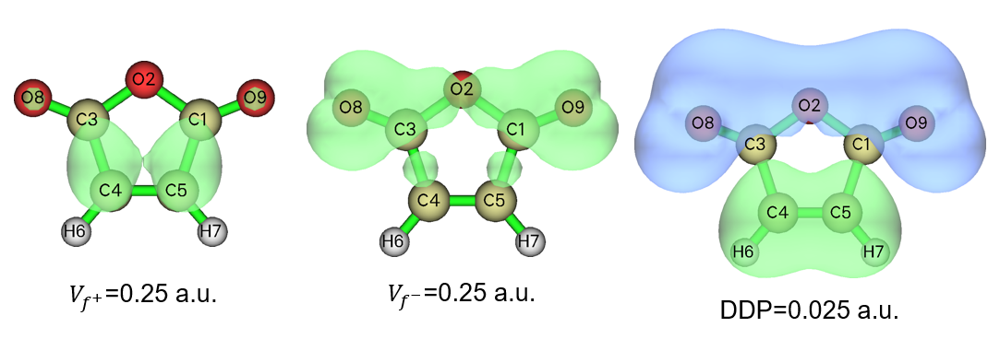

## **4.22.5 计算键对偶描述符 (bond dual descriptor, BDD) 的例子**

> **注**
>
> 使用 Multiwfn 计算键对偶描述符研究不同化学键的反应活性”(<http://sobereva.com/766>)。

请先阅读[第 3.25.1 节](sec-3-25-conceptual-density-functional-theory-analysis.md#3251-理论)中关于键对偶描述符 (bond dual descriptor, BDD) 的简要介绍，并阅读[第 4.22.1 节](#4221-自动计算苯酚的概念密度泛函理论量)以理解概念 DFT 分析模块的基本用法。本节将说明丙烯腈 BDD 的计算，其在 B3LYP/6-31G\* 水平下优化的结构如下所示，结构文件为 *examples\acrylonitrile.xyz*。

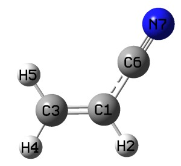

启动 Multiwfn，载入 *examples\acrylonitrile.xyz*，然后输入

```text
22  // Conceptual DFT (CDFT) analysis
1  // Generate .wfn files for N, N+1, N-1 electrons states
[Press ENTER button directly]  // The generated .gjf files will correspond to single point task at B3LYP/6-31G* level
[Press ENTER button directly]  // Use default charge and spin multiplicity, namely 0 1 for N state, -1 2 for N+1 state, and 1 2 for N-1 state
```

然后在当前目录下手动用 Gaussian 或请 Multiwfn 调用 Gaussian 计算 *N.gjf*、*N-1.gjf*、*N+1.gjf*，则当前目录下将有 *N.wfn*、*N-1.wfn* 和 *N+1.wfn*。再选择选项“10 Calculate bond dual descriptor (BDD)”。之后，Multiwfn 依次载入 .wfn 文件并计算每个电子态的模糊键级，然后打印 BDD，见下。为便于研究，只直接给出 10 个最正和最负的值。

```text
10 most negative BDD values:
    1(C )     3(C ):    -0.562
    6(C )     7(N ):    -0.365
    3(C )     7(N ):    -0.029
    2(H )     3(C ):    -0.009
    1(C )     4(H ):    -0.008
    1(C )     5(H ):    -0.008
    4(H )     7(N ):    -0.001
    4(H )     5(H ):    -0.000
    5(H )     7(N ):    -0.000
    2(H )     4(H ):     0.000

10 most positive BDD values:
    1(C )     6(C ):     0.312
    1(C )     7(N ):     0.166
    3(C )     6(C ):     0.064
    3(C )     5(H ):     0.016
    3(C )     4(H ):     0.016
    2(H )     6(C ):     0.006
    2(H )     7(N ):     0.004
    5(H )     6(C ):     0.003
    4(H )     6(C ):     0.003
    1(C )     2(H ):     0.001
```

上面的结果表明 C1-C3 是最易受亲电攻击的键（该键呈现最强亲核性），其次是 C6-N7。C1-C6 是最易受亲核攻击的键（该键呈现最强亲电性）。上面给出的一些数据不对应直接成键的原子，如 C1-N7 和 C3-C6，可简单忽略。

Multiwfn 随后询问是否将所有键的 BDD 按原子编号顺序导出到当前目录下的 *BDD.txt*，并将所有键的 BDD 按数值排序导出到当前目录下的 *BDD_sorted.txt*。可选择 *y* 导出。

注意 BDD 计算功能也支持前线分子轨道简并的情形，就像[第 4.22.3 节](#4223-准简并-homolumo-情形的-cdft-分析实例)所示例的情形。对这些体系，应在生成 .wfn 文件和 BDD 计算之前用选项 -3 设置 HOMO 和 LUMO 简并度。

## **4.22.6 计算对偶离域描述符 (dual delocalization descriptor, DDD) 的例子**

请先仔细阅读[第 3.25.6 节](sec-3-25-conceptual-density-functional-theory-analysis.md#3256-专题-4对偶离域描述符)以获得关于对偶离域描述符 (dual delocalization descriptor, DDD) 的基本知识。本节将说明如何为氨基苯计算 DDD 框架下定义的量。该体系在 ωB97XD/6-311G(d,p) 下计算的 .fch 文件可从 <http://sobereva.com/multiwfn/extrafiles/aminobenzene_DDD.7z> 下载，计算水平和几何构型与 DDD 原论文 *Phys. Chem. Chem. Phys.*，**28**，19133 (2026) 中使用的完全相同。我们将用 Hirshfeld 分区定义用于评估原子重叠矩阵 (atomic overlap matrix, AOM) 的原子空间，该做法在 DDD 原论文中也被采用。

启动 Multiwfn 并输入

```text
aminobenzene_DDD.fch  // The file in the compressed package mentioned above
22  // Conceptual DFT (CDFT) analysis
11  // Calculate dual delocalization descriptor (DDD)
2  // Calculate AOM via Hirshfeld partition
```

现在已生成 AOM，可输入两个原子的编号以研究相应键的 DDD。例如，输入 *1,6*，它对应*间*-*对*位 C-C 键，将看到

```text
Result of    1(C )   --    6(C )
f-:      0.067452
f+:      0.026544
g-:      0.017868
g+:      0.011229
f(1):   -0.040907
f(2):   -0.056481
```

该结果与 DDD 原论文表 2 中的相应数据完全相同，除了 $g^-$，我们的结果是表 2 中值的两倍。我们的结果是正确的，实际上若严格按该论文 Eq. 29 评估，表 2 中的 $g^-$ 应加倍。
