# **4.23 ETS-NOCV 分析的例子**

> **注**
>
> 本节的中文版是我的博文"在 Multiwfn 中使用 ETS-NOCV 方法深入分析片段间轨道相互作用"（<http://sobereva.com/609>）。

本节给出几个例子，说明如何用 ETS-NOCV（扩展过渡态-化学价自然轨道，Extended Transition State - Natural Orbitals for Chemical Valence）分析研究片段间相互作用。如果你还没读过第 [3.26](sec-3-26-ets-nocv-analysis.md) 节，请先读它以获得关于 ETS-NOCV 分析理论及其在 Multiwfn 中实现细节的相关知识。下面多数例子用的输入文件是由 Gaussian 产生的 .fch 文件，其他携带基函数信息的波函数文件也可用（见第 [2.5](sec-2-5-input-files-and-wavefunction-types.md) 节），例如你可以用 ORCA 程序产生 .molden 文件作为输入文件。

> **注**
>
> 必须强调，若无特殊原因，请勿使用弥散函数，否则可能因无法直接生成 Fock/Kohn-Sham 矩阵而无法按所示步骤得到轨道能量（此时你必须向 Multiwfn 提供一个包含 Fock/Kohn-Sham 矩阵的文件，见本手册[附录 7](sec-6-7-about-providing-fock-ks-matrix-to-multiwfn.md)），而且 ETS-NOCV 模块中用 SCPA 方法计算的轨道组成可能高度不合理。

## **4.23.1 简单的闭壳层例子：CO-BH₃**

在本例中，我们用 ETS-NOCV 在 B3LYP/6-31G\* 水平研究 COBH₃ 配合物中 CO 和 BH₃ 的相互作用，所有相关文件见 "examples\ETS-NOCV\COBH3" 文件夹。由于这是第一个 ETS-NOCV 例子，过程将描述得非常详细。

### **准备输入文件**

首先，我们需要分别为 COBH₃、CO 和 BH₃ 生成波函数文件。

我们先搭建 COBH₃ 的几何，然后创建一个几何优化任务的输入文件，相应的 Gaussian 输入文件是 "examples\ETS-NOCV\COBH3" 中的 *COBH3.gjf*。运行它并把所得 .chk 文件转为 .fch，就得到 *COBH3.fch*。

接下来，从优化好的 COBH₃ 几何中提取 CO 和 BH₃ 的 Cartesian 坐标，然后创建相应的单点任务输入文件，它们是 "examples\ETS-NOCV\COBH3" 文件夹中的 *CO.gjf* 和 *BH3.gjf*。注意为了避免 Gaussian 计算中几何自动重取向，必须用 *nosymm* 关键词。运行这两个片段输入文件后，你会得到 *CO.fch* 和 *BH3.fch*。注意不要对两个片段做几何优化，否则它们的坐标会与配合物中的不一致。

片段电子态的选择，即 ETS-NOCV 分析中参考态 (reference state) 的定义，某种程度上是任意的。在当前例子中，显然 CO 和 BH₃ 应取单重态，这不仅因为单重态是 CO 和 BH₃ 孤立态下最稳定的状态，更重要的是因为它们以闭壳层状态相互成键（OC→BH₃ 是配位键）。

### **ETS-NOCV 数据的定量分析**

启动 Multiwfn 并输入

```text
examples\ETS-NOCV\COBH3\COBH3.fch  // Complex wavefunction file
23  // ETS-NOCV analysis
2  // Two fragments
examples\ETS-NOCV\COBH3\CO.fch  // Wavefunction file of fragment 1. Note that loading order of the fragment wavefunction files must be in line with occurrence order of fragments in the complex
examples\ETS-NOCV\COBH3\BH3.fch  // Wavefunction file of fragment 2
```

现在 NOCV 轨道和 NOCV 对的信息立即打印出来：

```text
       --------------- Pair and NOCV orbital information --------------
There are totally   26 NOCV pairs and    51 NOCV orbitals
NOCV orbitals whose eigenvalues are smaller than 1.0E-03 are not shown
Note: Energies of NOCV orbitals have not been evaluated, so they are all zero

 Pair  Energy | Orbital  Eigenvalue    Energy  | Orbital  Eigenvalue    Energy
    1    0.00       1      0.56514       0.00       51     -0.56514       0.00
    2    0.00       2      0.40205       0.00       50     -0.40205       0.00
    3    0.00       3      0.40204       0.00       49     -0.40204       0.00
    4    0.00       4      0.13007       0.00       48     -0.13007       0.00
    5    0.00       5      0.03704       0.00       47     -0.03704       0.00
    6    0.00       6      0.03703       0.00       46     -0.03703       0.00
    7    0.00       7      0.03419       0.00       45     -0.03419       0.00
    8    0.00       8      0.00834       0.00       44     -0.00834       0.00
    9    0.00       9      0.00273       0.00       43     -0.00273       0.00
Sum of NOCV eigenvalues:   0.00000
```

NOCV 轨道按本征值从最正到最负排序。从输出可见 NOCV 轨道是成对的，每两个本征值相反的 NOCV 轨道构成一个 NOCV 对。例如，从上面输出可见 NOCV 3 和 NOCV 49 的本征值分别为 0.402 和 -0.402，因此它们组成一个 NOCV 对，即 NOCV 对 3。所有 NOCV 轨道的本征值之和恰为零，因为轨道相互作用不影响总电子数。

本征值绝对值越大的 NOCV 对，对轨道相互作用引起的密度差影响越大。从上面的信息可见，总共有 26 个 NOCV 对，但由于默认打印阈值（即本征值绝对值必须大于 0.001）只打印了其中九个，其中只有对 1 到 4 对密度差有显著影响。因此，你只需考察这些 NOCV 对的特征即可研究 CO 和 BH₃ 的轨道相互作用

目前，NOCV 轨道和对的能量还没计算。要计算它们，你应提供一个包含 Fock 矩阵（HF 情形）或 Kohn-Sham (KS) 矩阵（DFT 情形）的文件，详见本手册[附录 7](sec-6-7-about-providing-fock-ks-matrix-to-multiwfn.md)。在本例和后续例子中我们用更方便的方法，即直接让 Multiwfn 基于配合物波函数 *COBH3.fch* 中分子轨道的能量和系数矩阵生成 Fock/KS 矩阵。所以，我们在后处理菜单中选择选项"-2 Generate Fock/KS matrix and evaluate NOCV orbital energies"，然后生成 KS 矩阵并计算 NOCV 能量，之后 NOCV 信息再次打印在屏幕上，如下所示

```text
Pair  Energy | Orbital  Eigenvalue    Energy  | Orbital  Eigenvalue    Energy
    1  -77.88       1      0.56514    -120.88       51     -0.56514      16.93
    2  -15.83       2      0.40205    -139.60       50     -0.40205    -100.22
    3  -15.84       3      0.40204    -139.62       49     -0.40204    -100.23
    4   -5.53       4      0.13007     -44.60       48     -0.13007      -2.06
    5   -0.41       5      0.03704     -18.25       47     -0.03704      -7.19
    6   -0.41       6      0.03703     -18.19       46     -0.03703      -7.13
    7   -0.65       7      0.03419      21.33       45     -0.03419      40.48
    8   -0.06       8      0.00834    -308.53       44     -0.00834    -301.42
    9   -0.02       9      0.00273   -1661.86       43     -0.00273   -1655.69
Sum of NOCV eigenvalues:   0.00000
Sum of pair energies:    -116.63 kcal/mol
```

从输出可见，这次每个 NOCV 对都有相应的能量，所有 NOCV 对能量之和为 -116.63 kcal/mol，表明轨道相互作用使配合物稳定了 116.63 kcal/mol，将记为 Δ $E^{\mathrm{orb}}$ 。一个 NOCV 对的能量按属于它的 NOCV 轨道的能量与本征值乘积之和算得。例如，NOCV 对 1 ($\Delta{{\mathrm{E}}}_{1}^{\mathrm{orb}}$) 的能量为 -77.88 kcal/mol，它按 −120.88×0.5651 + 16.93×(−0.5651) 算得。

> **注**
>
> 重要的是注意，正如第 [3.26.2](sec-3-26-ets-nocv-analysis.md#3262-实现细节) 节所述，由于 Multiwfn 中 ETS-NOCV 分析用的 Fock/KS 矩阵是基于实际配合物波函数而非人为过渡态波函数构建的，打印的"Sum of pair energies"不是严格的轨道相互作用能，打印的 NOCV 能量也不是标准 ETS-NOCV 分析中确切的对应量。但一般发现差异很小，不明显影响分析得出的结论。
>
> 你可能已注意到 NOCV 对 9 由两个能量很负的 NOCV 轨道组成，但对能量却极小 (-0.02 kcal/mol)，原因是什么？事实上，相应的 NOCV 轨道 9 和 43 非常类似于内层轨道（你可以用很小的等值面可视化轨道等值面来确认），显然它们的能量必定相当负，因为它们感受到很强的核吸引势；但由于这类轨道几乎不参与成键，它们的本征值必定很小，使得 NOCV 对能量小到完全可以忽略。

### **NOCV 对的可视化分析**

显然，NOCV 对 1 (-77.9 kcal/mol) 是对 Δ $E_{\mathrm{orb}}$ (-116.6 kcal/mol) 的主导贡献，通过可视化该对密度的等值面，可以对在 CO 和 BH₃ 配位中起关键作用的相互作用机制获得更深入的理解。NOCV 对 2 和 3 的贡献也不可完全忽略，因此通过可视化它们的密度可以理解哪种相互作用对片段间结合起次要作用。

现在我们选择选项"2 Show isosurface of NOCV pair density"，然后选择"2 Medium-quality grid"，对 COBH₃ 这样的小体系展示 NOCV 对密度已足够。现在 NOCV 信息再次打印在屏幕上，方便用户选择感兴趣的 NOCV 对。接下来，我们输入 *1* 计算 NOCV 对 1 的密度的格点数据并显示其等值面。在 0.005 a.u. 等值面下，你可以在 GUI 窗口中看到下图（箭头是手动加的）

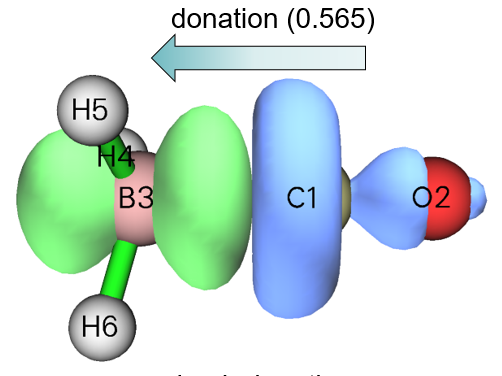

在该图中，蓝色和绿色等值面分别显示由于 NOCV 对 1 描述的轨道相互作用导致电子密度减少和增加的区域。显然，NOCV 对 1 对应于从 CO 部分到 BH₃ 部分的显著电子转移。转移电子的量对应于该 NOCV 对的本征值绝对值，即 0.565。这种相互作用的出现是自然预期的，因为 CO 富电子而倾向于给电子，而 BH₃ 是缺电子物种，倾向于用位于硼的空轨道接受电子。由于这种 CO→BH₃ 给体相互作用如此突出并极大地稳定了该配合物，很容易理解为什么相应的 NOCV 对能量高达 -77.9 kcal/mol。

接下来，我们查看 NOCV 对 2 的密度。点击 GUI 窗口右上角的 "RETURN" 按钮，然后输入 *2*。把等值面调到合适的值 0.002 a.u. 后，你会看到

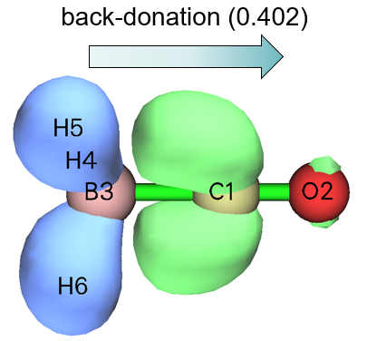

显然，NOCV 对 2 代表从 BH₃ 的 σ(B-H) 占据轨道到 CO 空 π\* 轨道的反馈。加以这种反馈效应不强，NOCV 对 2 的能量只有 -15.8 kcal/mol 的中等值。但 NOCV 对 2 对电子密度差的影响并不比 NOCV 对 1 小多少，因为前者的本征值（0.402，对应反馈电子的量）并不显著低于后者（0.565）。

类似地，你可以接着观察 NOCV 对 3，由于 COBH₃ 的 C$_{3v}$ 点群，它的能量和本征值与 NOCV 对 2 简并，特征也相同，只是 NOCV 对 3 中 CO 通过它的另一个空 π 轨道从 BH₃ 接受电子。

最后，我们可视化所有其他 NOCV 对的密度之和。关闭 GUI 窗口然后输入 *4-26*（记得总共有 26 个 NOCV 对），你会在控制台窗口发现以下信息

```text
Sum of positive eigenvalues of selected pairs:   0.25072
Sum of energies of selected pairs:       -7.09 kcal/mol
```

你会看到如下等值面（等值面 = 0.001 a.u.）

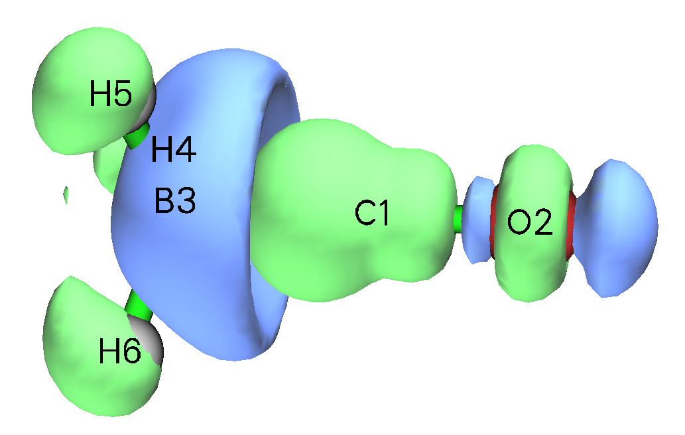

等值面的形状很复杂，很难对其集体相互作用给出清晰的化学解释。但我们仍能察觉到存在一定程度的从 BH₃ 到 CO 的反馈，以及各片段区域内的电子密度极化。由于这些 NOCV 对的能量之和仅为 -7.09 kcal/mol，NOCV 对 4 到 26 代表的带极化效应的反馈不起重要作用。

### **NOCV 轨道的可视化**

接下来，我将展示如何可视化 NOCV 轨道，从中可以更好地理解 NOCV 对密度是如何构建的。关闭 GUI 窗口，然后输入 *q* 回到后处理菜单，再选择选项"1 Show isosurface of NOCV orbitals"。现在 NOCV 信息打印在屏幕上，同时出现一个 GUI 窗口，你可以通过右下角的列表选择要可视化的 NOCV 轨道，也可以直接在右下角文本框输入 NOCV 轨道序号然后按 ENTER 键。该 GUI 的功能与主功能 0 完全相同（关于该界面的更多介绍见第 [4.0](sec-4-0-view-orbitals-and-structure.md) 节的例子）。

从控制台窗口可发现 NOCV 对 1 由 NOCV 轨道 1 和 51 组成：

```text
Pair  Energy | Orbital  Eigenvalue    Energy  | Orbital  Eigenvalue    Energy
   1  -77.88       1      0.56514    -120.88       51     -0.56514      16.93
[...ignored]
```

所以，为了更深入理解 NOCV 对 1 的特征，我们应可视化轨道 1 和 51。下面 collectively 展示了等值面 0.15 的两个轨道的等值面，以及 0.01 a.u. 等值面的 NOCV 对 1。从该图可以清楚地认识到 NOCV 对 1 的密度是如何由 NOCV 轨道 1 和 51 的本征值加权的轨道密度构成的。

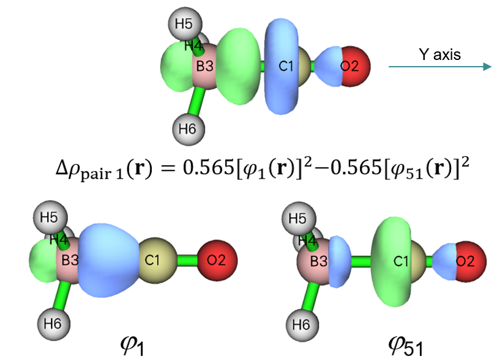

通常，可视化 NOCV 轨道不是很有用，因为 NOCV 轨道的化学意义不太强。

### **研究 NOCV 对和轨道的组成**

Multiwfn 能计算 NOCV 对及相应轨道的组成，如果你希望定量考察它们的本质，这很有用。现在我们选择选项"14 Calculate composition of NOCV orbitals and pairs"，NOCV 信息随即打印在屏幕上。这里我们研究 NOCV 对 1 及相关的两个 NOCV 轨道的组成，所以输入 *1*，然后你会看到下面的输出。组成是用第 [3.10.3](sec-3-10-orbital-composition-analysis.md#3103-用-mullikenstout-politzer-和-scpa-方法输出片段-1-的成分和片段间成分-4-5-6) 节提到的 SCPA 方法计算的，注意它与弥散函数不兼容。

```text
Note: Only the basis functions and shells having absolute composition in the NO
CV pair or corresponding NOCV orbitals larger than   0.500 % are printed below.
The threshold can be changed via "compthres" parameter in settings.ini

 Contribution of each basis function to NOCV pair/orbitals:
  Basis    Type    Atom    Shell    Orb.    1   Orb.   51   Pair    1
     1     S        1(C )    1        0.09 %      1.13 %     -0.58 %
     2     S        1(C )    2        1.05 %      4.09 %     -1.72 %
     4     Y        1(C )    3        1.81 %      5.53 %     -2.10 %
     6     S        1(C )    4       15.77 %     49.68 %    -19.17 %
     8     Y        1(C )    5        5.07 %      5.06 %      0.00 %
    19     Y        2(O )    9        0.01 %      1.60 %     -0.90 %
    23     Y        2(O )   11        0.02 %      0.68 %     -0.37 %
    32     S        3(B )   14        9.89 %      9.27 %      0.35 %
    34     Y        3(B )   15       42.83 %     10.50 %     18.27 %
    36     S        3(B )   16       11.57 %      9.02 %      1.44 %
    38     Y        3(B )   17        4.37 %      1.23 %      1.77 %
    47     S        4(H )   20        1.99 %      0.09 %      1.07 %
    49     S        5(H )   22        1.97 %      0.09 %      1.06 %
    51     S        6(H )   24        1.97 %      0.09 %      1.06 %

 Contribution of each basis function shell to NOCV pair/orbitals:
  Shell    Type    Atom         Orb.    1   Orb.   51   Pair    1
     1     S        1(C )         0.09 %      1.13 %     -0.58 %
     2     S        1(C )         1.05 %      4.09 %     -1.72 %
     3     P        1(C )         1.81 %      5.53 %     -2.10 %
     4     S        1(C )        15.77 %     49.68 %    -19.17 %
     5     P        1(C )         5.07 %      5.06 %      0.00 %
     9     P        2(O )         0.01 %      1.60 %     -0.90 %
    11     P        2(O )         0.02 %      0.68 %     -0.37 %
    14     S        3(B )         9.89 %      9.27 %      0.35 %
    15     P        3(B )        42.83 %     10.50 %     18.27 %
    16     S        3(B )        11.57 %      9.02 %      1.44 %
    17     P        3(B )         4.37 %      1.23 %      1.77 %
    18     D        3(B )         0.55 %      0.09 %      0.26 %
    20     S        4(H )         1.99 %      0.09 %      1.07 %
    22     S        5(H )         1.97 %      0.09 %      1.06 %
    24     S        6(H )         1.97 %      0.09 %      1.06 %

 Contribution of various types of shells to NOCV pair/orbitals:
 Type     Orb.    1   Orb.   51   Pair    1
  s:       45.14 %     74.98 %    -16.87 %
  p:       54.10 %     24.59 %     16.67 %
  d:        0.76 %      0.42 %      0.19 %
  f:        0.00 %      0.00 %      0.00 %
  g:        0.00 %      0.00 %      0.00 %
  h:        0.00 %      0.00 %      0.00 %

 Contribution of each atom to NOCV pair/orbitals:
   Atom         Orb.    1   Orb.   51   Pair    1
     1(C ):      23.99 %     65.82 %    -23.64 %
     2(O ):       0.28 %      2.94 %     -1.50 %
     3(B ):      69.40 %     30.30 %     22.10 %
     4(H ):       2.12 %      0.32 %      1.02 %
     5(H ):       2.11 %      0.31 %      1.01 %
     6(H ):       2.11 %      0.31 %      1.01 %
```

可见，NOCV 对 1 及相应的 NOCV 轨道 1 和 51 中各基函数、壳层、角动量类型和原子的贡献依次输出。你可以把这些信息与前面给出的等值面图比较，会发现定量组成确实与等值面反映的特征一致。根据所用 6-31G\* 基组的定义和基函数的贡献，还可以估计 NOCV 对和轨道中各原子轨道的组成。例如，第 2 和第 6 个基函数分别是原子 4 的第二个和第三个 S 型基函数，它们合在一起代表 2*s* 原子轨道，所以它们对 NOCV 对的贡献之和（−1.72% −19.17% = −20.89%）就是 2*s* 原子轨道在 NOCV 对 1 中的组成，它主要贡献了该 NOCV 对的负部分。类似地，可发现 2 $p_{\mathrm{z}}$ 原子轨道对 NOCV 对 1 的贡献为 18.27% +1.77% = 20.04%，它是正部分的主导贡献者；这与从 NOCV 对 1 等值面的观察完全一致，即硼原子周围有绿色（正）等值面，两个瓣沿 Y 轴伸展，显然它必定主要由硼 $p_{\mathrm{z}}$ 原子轨道组成。

注意，正如一个 NOCV 对在全空间的积分必定恰为零一样，一个 NOCV 对的组成之和也总是零。

### **Pauli / 轨道 / 总形变密度的可视化**

Pauli 形变密度 (Pauli deformation density)（Δ*ρ*$^{Pauli}$）、轨道形变密度 (orbital deformation density)（Δ*ρ*$^{orb}$）和总形变密度 (total deformation density)（Δ*ρ*）已在第 [3.26](sec-3-26-ets-nocv-analysis.md) 节描述。Δ*ρ*$^{Pauli}$ 展示 Pauli 排斥引起的从启动子态 (promolecular state) 到冻结态 (frozen state) 的电子密度变化，Δ*ρ*$^{orb}$ 显示轨道相互作用引起的从冻结态到实际配合物态的电子密度变化，Δ*ρ* 对应片段间配位整个过程中的总电子密度变化，即 Δ*ρ* = Δ*ρ*$^{Pauli}$ + Δ*ρ*$^{orb}$。

要可视化这三种形变密度，分别选择选项"3 Show isosurface of Pauli deformation density"、"4 Show isosurface of orbital deformation density"和"5 Show isosurface of total deformation density"。相应的等值面图 collectively 展示如下

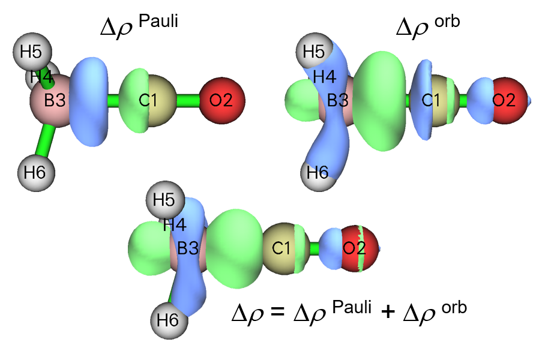

从 Δ*ρ*$^{Pauli}$ 图可以清楚地看出 Pauli 排斥使 CO 和 BH₃ 之间的相互作用区电子密度明显减少。相反，Δ*ρ*$^{orb}$ 图表明两片段的轨道相互作用使成键区电子密度显著累积，这是形成共享电子相互作用的典型信号。Δ*ρ* 的等值面表明片段间相互作用的总体效应使 CO 和 BH₃ 之间的电子密度可观地增加。

顺便值得注意的是，Δ*ρ*$^{orb}$ 对应于所有 NOCV 对密度之和。换句话说，如果你选择"2 Show isosurface of NOCV pair density"然后输入所有 NOCV 对的序号，即当前情形下的 *1-26*，所得等值面图将与 Δ*ρ*$^{orb}$ 完全相等。

### **启动子态 / 冻结态 / 实际配合物轨道的可视化**

如果你有兴趣理解 Pauli 排斥如何使片段轨道变形，可以直观比较启动子轨道和冻结态轨道，前者对应片段的原始分子轨道 (MO)（即 *CO.fch* 和 *BH3.fch* 中 MO 的并集），而后者对应片段占据轨道之间正交化之后的片段 MO（对空片段 MO，启动子态和冻结态没有区别）。

要可视化启动子轨道，在后处理菜单中选择选项"11 Visualize promolecular orbitals"；要可视化冻结态轨道，选择选项"12 Visualize frozen state orbitals"。选项"13 Visualize actual complex orbitals"用于直接可视化记录在配合物波函数文件即 *COBH3.fch* 中的轨道。

选择上述任一选项后，所有占据轨道的信息显示在控制台窗口（见下），以便你方便地找到想可视化的轨道序号。

```text
Orb:     1 Ene(au/eV):     0.000000       0.0000 Occ: 2.000000 Type:A+B
Orb:     2 Ene(au/eV):     0.000000       0.0000 Occ: 2.000000 Type:A+B
Orb:     3 Ene(au/eV):     0.000000       0.0000 Occ: 2.000000 Type:A+B
Orb:     4 Ene(au/eV):     0.000000       0.0000 Occ: 2.000000 Type:A+B
Orb:     5 Ene(au/eV):     0.000000       0.0000 Occ: 2.000000 Type:A+B
Orb:     6 Ene(au/eV):     0.000000       0.0000 Occ: 2.000000 Type:A+B
Orb:     7 Ene(au/eV):     0.000000       0.0000 Occ: 2.000000 Type:A+B
Orb:    31 Ene(au/eV):     0.000000       0.0000 Occ: 2.000000 Type:A+B
Orb:    32 Ene(au/eV):     0.000000       0.0000 Occ: 2.000000 Type:A+B
Orb:    33 Ene(au/eV):     0.000000       0.0000 Occ: 2.000000 Type:A+B
Orb:    34 Ene(au/eV):     0.000000       0.0000 Occ: 2.000000 Type:A+B
```

从轨道序号的连续性，从上面信息可知轨道 1 到 7 和 8 到 30 分别对应片段 1 (CO) 的占据和空轨道；而轨道 31 到 34 及其他轨道分别对应片段 2 (BH₃) 的占据和空轨道。在下图中我分别绘制了启动子态和冻结态 MO 7（CO 的 HOMO）的等值面，等值面设为小值 0.02 以便你清楚地察觉它们的差异

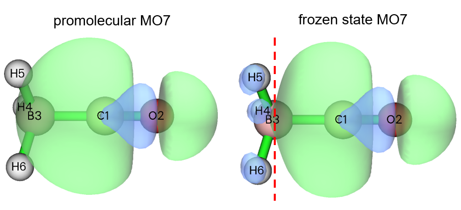

显然，由于 Pauli 排斥效应，冻结态 CO 的 HOMO 在 BH₃ 区域多了一个节面，如红色虚线标示，这是满足该轨道与 BH₃ 所有占据轨道正交条件所必需的。

至此 COBH₃ 体系的分析结束。在本节我已全面说明了 ETS-NOCV 模块各选项的用法，而在实际研究中通常你只需关注前几个 NOCV 对的能量、本征值和密度等值面。

## **4.23.2 简单的开壳层例子：乙烷**

本节我用一个简单分子说明开壳层相互作用的 ETS-NOCV 分析。我们将研究两个 ⋅CH₃ 自由基如何形成乙烷 (C₂H₆)。

首先，在 B3LYP/6-31G\* 水平优化乙烷并为它和两个 ⋅CH₃ 自由基生成波函数文件，步骤与上一节完全相同。相应的 Gaussian 输入文件和所得 .fch 文件已在 "examples\ETS-NOCV\ethane" 文件夹提供。显然，⋅CH₃ 自由基在单点计算中应设为双重态。

启动 Multiwfn 并输入

```text
examples\ETS-NOCV\ethane\ethane.fch  // Wavefunction file of the whole system
23  // ETS-NOCV analysis
2  // Two fragments
examples\ETS-NOCV\ethane\CH3_1.fch  // Wavefunction file of the first ⋅CH_3 radical
examples\ETS-NOCV\ethane\CH3_2.fch  // Wavefunction file of the second ⋅CH_3 radical
n  // Do not flip spin of the first ⋅CH_3 radical
y  // Flip spin of the second ⋅CH_3 radical
```

与上一节的闭壳层例子不同，本例中会问你是否翻转两个开壳层片段的自旋。翻转自旋意味着交换 α 和 β 电子的信息。正确翻转自旋很重要，因为我们需要保证所有片段 α (β) 电子数之和与整个体系相同。乙烷有 9 个 α 电子和 9 个 β 电子，而每个 ⋅CH₃ 自由基有 5 个 α 电子和 4 个 β 电子。显然，我们需要翻转第一个或第二个 ⋅CH₃ 自由基的自旋，否则合并两个片段后会有 5+5=10 个 α 电子和 4+4=8 个 β 电子，与乙烷不符。

接下来，我们选择选项 -2 生成 NOCV 轨道/对能量，然后两种自旋的 NOCV 信息显示在屏幕上：

```text
       --------------- Pair and NOCV orbital information --------------
There are totally   42 NOCV pairs and    84 NOCV orbitals
NOCV orbitals with absolute eigenvalues smaller than 1.0E-03 are not shown
Note: All energies are given in kcal/mol
                        ----- Alpha NOCV orbitals -----
 Pair  Energy | Orbital  Eigenvalue    Energy  | Orbital  Eigenvalue    Energy
    1  -93.24       1      0.44471    -117.62       42     -0.44471      92.06
    2   -1.20       2      0.04959     -28.00       41     -0.04959      -3.76
    3   -1.20       3      0.04959     -28.00       40     -0.04959      -3.76
    4   -0.85       4      0.04192       8.65       39     -0.04192      28.92
    5   -0.85       5      0.04192       8.65       38     -0.04192      28.92
    6   -1.09       6      0.03679     -19.92       37     -0.03679       9.79
    7   -0.48       7      0.02349      -4.18       36     -0.02349      16.23
    8   -0.01       8      0.00125   -2808.79       35     -0.00125   -2799.86
                        ----- Beta NOCV orbitals -----
 Pair  Energy | Orbital  Eigenvalue    Energy  | Orbital  Eigenvalue    Energy
   22  -93.24      43      0.44471    -117.62       84     -0.44471      92.06
   23   -1.20      44      0.04959     -28.00       83     -0.04959      -3.76
   24   -1.20      45      0.04959     -28.00       82     -0.04959      -3.76
   25   -0.85      46      0.04192       8.65       81     -0.04192      28.92
   26   -0.85      47      0.04192       8.65       80     -0.04192      28.92
   27   -1.09      48      0.03679     -19.92       79     -0.03679       9.79
   28   -0.48      49      0.02349      -4.18       78     -0.02349      16.23
   29   -0.01      50      0.00125   -2808.79       77     -0.00125   -2799.86
Sum of NOCV eigenvalues:  Alpha=   0.00000  Beta=   0.00000
Sum of pair energies:  Alpha=     -98.93  Beta=     -98.93  Total=    -197.86
```

上面显示的 α 和 β NOCV 信息看似完全相同，这是因为两个片段互相对称。"Sum of pair energies" 项表明片段间轨道相互作用对两个 ⋅CH₃ 间结合能的贡献近高达 -200 kcal/mol，每种自旋贡献约 -100 kcal/mol。

从上面的 NOCV 信息可见，每种自旋只有一个 NOCV 对起关键作用，现在我们考察它的特征。输入以下命令

```text
2  // Show isosurface of NOCV pair density
2  // Medium-quality grid
1  // Check NOCV pair 1, which is the dominant pair of alpha spin
```

查看等值面后，关闭 GUI 窗口并输入 *22* 查看 NOCV 对 22，它是 β 自旋的主导对。NOCV 对 1、对 22 的密度等值面以及它们之和（对应于在当前界面输入 *1,22*）在 0.01 a.u. 等值面下 collectively 展示如下，相应的电子转移特征已标出（*q* 是转移电子量，对应于上面打印的 NOCV 对本征值的绝对值）。

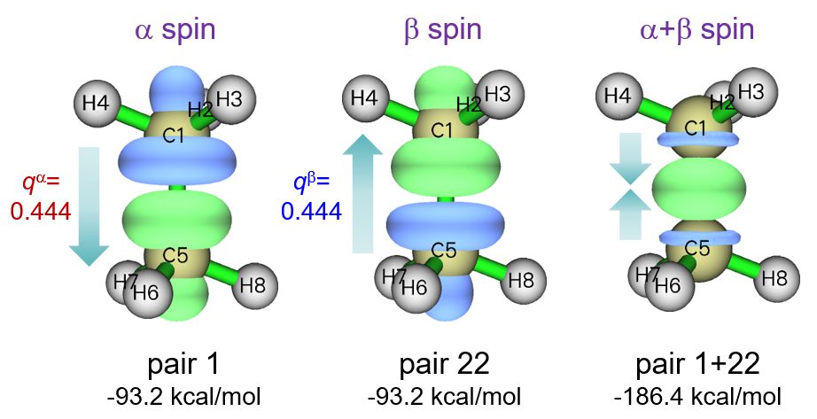

可见，NOCV 对 1 主要表现为 α 电子从第一个 ⋅CH₃ 片段（由 C1、H2、H3 和 H4 组成）转移到第二个 ⋅CH₃ 片段（由 C5、H6、H7 和 H8 组成），它是由于第一个 ⋅CH₃ 的单占据 α 轨道和第二个 ⋅CH₃ 的空 α 轨道混合。NOCV 对 22 与 NOCV 对 1 特征类似，但它对应 β 电子的转移且方向相反。NOCV 对 1 和 22 之和对应两片段间成键区电子密度的集中，这是形成共价键非常典型的特征。从上图还可发现，每种自旋的轨道相互作用在乙烷两端引起的电子密度增加或减少在把两种自旋的 NOCV 密度加和时基本抵消。

我们也看看 NOCV 对 2 和 3，它们是简并的，对应 α 自旋的次要轨道相互作用，每个仅对片段间结合贡献 -1.2 kcal/mol 的能量。0.0015 a.u. 的等值面如下所示

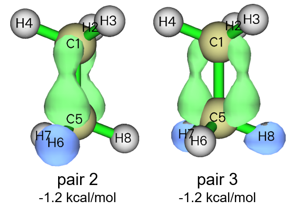

这些相互作用看似由占据 σ(C-H) 轨道到空 π(C-C) 轨道的超共轭引起，因为氢区域电子密度减少而 C-C 键区域电子密度增加，且沿键有节面。如果可视化相应的 NOCV 轨道，这种相互作用特征会看得更清楚。公认乙烷中的两个 ⋅CH₃ 片段由 σ 键结合，这与我们的观察一致，即这些伴随的 σ(C-H)→π(C-C) 相互作用能量贡献微不足道，NOCV 本征值 (0.049) 可忽略。

如果你有兴趣，可以用后处理菜单中的选项 1 可视化构成上述 NOCV 对的 NOCV 轨道，如我们在上一节做的，你会对轨道相互作用获得更丰富的理解；具体地，对于表现出强电子转移特征的 NOCV 对，你可以通过目视 NOCV 轨道等值面分别讨论起给体和受体作用的轨道。

## **4.23.3 含多重键的开壳层体系：乙烯**

本节我们用 ETS-NOCV 理论研究乙烯中两个 CH₂ 的双键相互作用。最好把当前分析中的 CH₂ 视为三重态，不仅因为众所周知孤立态 CH₂ 卡宾的基态是三重态，更重要的是两个 CH₂ 只有在三重态且自旋不同（即 ↑↑CH₂ 和 ↓↓CH₂）时才能形成双键，在此状态 CH₂ 有一个未配对电子占据平行于片段平面的轨道，另一个未配对电子占据垂直于片段的轨道。

现在如上例在 B3LYP/6-31G\* 水平为乙烯及其两个 CH₂ 片段生成波函数文件，相应的 Gaussian 输入文件和 .fch 文件已在 "examples\ETS-NOCV\ethene" 文件夹提供。

启动 Multiwfn 并输入

```text
examples\ETS-NOCV\ethene\ethene.fch  // Wavefunction file of the ethene
23  // ETS-NOCV analysis
2  // Two fragments
examples\ETS-NOCV\ethene\CH2_1.fch  // Wavefunction file of the first CH_2 fragment
examples\ETS-NOCV\ethene\CH2_2.fch  // Wavefunction file of the second CH_2 fragment
n  // Do not flip spin of the first CH_2 fragment
y  // Flip spin of the second CH_2 fragment
-2  // Generate Fock/KS matrix and evaluate NOCV orbital energies
```

现在我们可以看到

```text
       --------------- Pair and NOCV orbital information --------------
There are totally   38 NOCV pairs and    76 NOCV orbitals
NOCV orbitals with absolute eigenvalues smaller than 1.0E-03 are not shown
Note: All energies are given in kcal/mol
                        ----- Alpha NOCV orbitals -----
 Pair  Energy | Orbital  Eigenvalue    Energy  | Orbital  Eigenvalue    Energy
    1  -63.11       1      0.57168    -125.97       38     -0.57168     -15.57
    2  -99.78       2      0.38673    -101.82       37     -0.38673     156.21
    3   -2.28       3      0.07016     -66.15       36     -0.07016     -33.70
    4   -1.64       4      0.05624      13.27       35     -0.05624      42.50
    5   -1.73       5      0.04700     -26.85       34     -0.04700       9.99
    6   -0.48       6      0.02675     -62.39       33     -0.02675     -44.32
    7   -0.01       7      0.00136   -2733.67       32     -0.00136   -2723.71
                        ----- Beta NOCV orbitals -----
 Pair  Energy | Orbital  Eigenvalue    Energy  | Orbital  Eigenvalue    Energy
   20  -63.11      39      0.57168    -125.97       76     -0.57168     -15.57
   21  -99.78      40      0.38673    -101.82       75     -0.38673     156.21
   22   -2.28      41      0.07016     -66.15       74     -0.07016     -33.70
   23   -1.64      42      0.05624      13.27       73     -0.05624      42.50
   24   -1.73      43      0.04700     -26.85       72     -0.04700       9.99
   25   -0.48      44      0.02675     -62.39       71     -0.02675     -44.32
   26   -0.01      45      0.00136   -2733.67       70     -0.00136   -2723.71
Sum of NOCV eigenvalues:  Alpha=   0.00000  Beta=   0.00000
Sum of pair energies:  Alpha=    -169.05  Beta=    -169.05  Total=    -338.09
```

对每种自旋，只有两个 NOCV 对对应突出的轨道相互作用。我们用选项 2 可视化相应 NOCV 对的密度，0.01 a.u. 等值面的等值面图 collectively 展示如下，这些 NOCV 对对应的电子转移用箭头标出

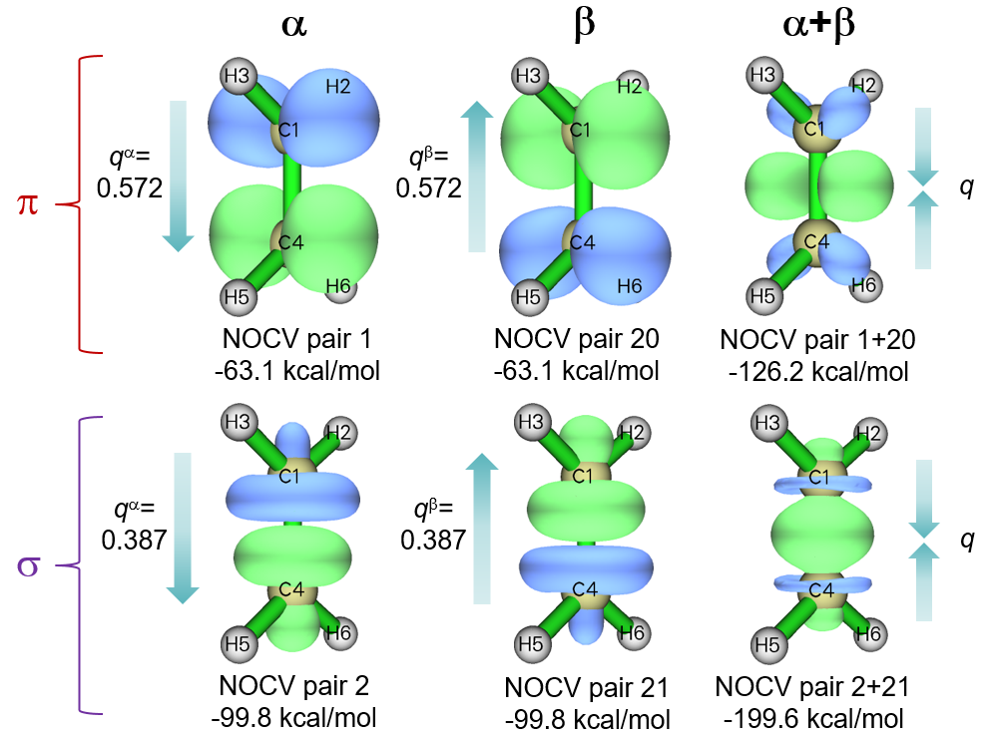

可见 NOCV 对 1 和 2 分别代表 α 电子的 π 和 σ 相互作用；β 自旋的对应物是 NOCV 对 20 和 21。NOCV 对 1 和 20 之和对应总 π 相互作用，从上面所示的相应密度等值面图可见该相互作用使 C-C 键上方和下方电子密度显著增加。乙烯中 C-C σ 相互作用的特征与上一节讨论的乙烷非常相似。从 NOCV 对能量可发现，π 相互作用对两个 CH₂ 间结合的能量贡献 (-126.2 kcal/mol) 比 σ 相互作用 (-199.6 kcal/mol) 弱得多。值得注意的是乙烯中的 σ 相互作用略强于乙烷中的 (-186.4 kcal/mol，如上一节所示)，这可能是 σ 和 π 相互作用的协同效应。

## **4.23.4 弱相互作用例子：A-T 碱基对**

在本例中我们用 ETS-NOCV 分析弱相互作用。在腺嘌呤-胸腺嘧啶 (A-T) 碱基对中，已知两分子间有两个氢键，如下面的虚线所示，将对它们做 ETS-NOCV 分析。

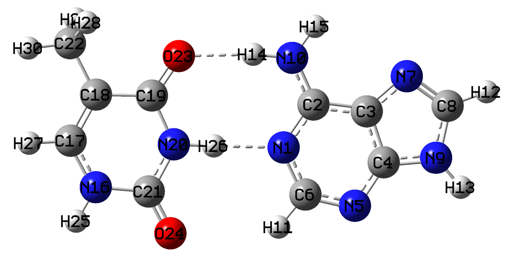

A-T 碱基对的几何取自 JSCH-2005 测试集 (*Phys. Chem. Chem. Phys.*, 8, 1985 (2006))，它已在合适水平下优化，所以我们不再进一步优化。在本例中我们将用 ORCA 5.0 程序在 ωB97M-V/def2-TZVP 水平做单点计算，当然你也可以用 Gaussian 等其他程序做计算。二聚体和两个单体的 ORCA 输入文件是 "examples\ETS-NOCV\AT" 文件夹中的 *AT.inp*、*A.inp* 和 *T.inp*。运行它们后，用 ORCA 包中的 "orca_2mkl" 工具把所得 .gbw 文件转为 Molden 输入文件；如果你不知道怎么做，请查阅[第 4 章](4-tutorials-and-examples.md)开头。生成的 *AT.molden*、*A.molden* 和 *T.molden* 可在 <http://sobereva.com/multiwfn/extrafiles/A-T_base_pair_molden.zip> 下载。

启动 Multiwfn 并输入

```text
AT.molden  // Wavefunction file of A-T base pair
23  // ETS-NOCV analysis
2  // Two fragments
A.molden  // Wavefunction file of adenine (A) fragment
T.molden  // Wavefunction file of thymine (T) fragment
-2  // Generate Fock/KS matrix and re-evaluate NOCV orbital energies
```

目前，在默认打印阈值（NOCV 本征值 \> 0.001）下屏幕上打印了多达 40 个 NOCV 对，数目太多不易查看。所以，我们适当提高打印阈值，输入

```text
-3  // Set printing threshold of NOCV eigenvalues
0.02
0  // Print NOCV information again
```

现在打印的 NOCV 对数目显著减少：

```text
       --------------- Pair and NOCV orbital information --------------
There are totally  328 NOCV pairs and   655 NOCV orbitals
NOCV orbitals with absolute eigenvalues smaller than 2.0E-02 are not shown
Note: All energies are given in kcal/mol

 Pair  Energy | Orbital  Eigenvalue    Energy  | Orbital  Eigenvalue    Energy
    1  -11.20       1      0.20598     -15.91      655     -0.20598      38.45
    2   -4.05       2      0.11820     -18.61      654     -0.11820      15.66
    3   -0.79       3      0.07198     -91.72      653     -0.07198     -80.71
    4   -0.79       4      0.07066     -77.74      652     -0.07066     -66.59
    5   -0.59       5      0.04312     -29.08      651     -0.04312     -15.45
    6   -0.34       6      0.03551     -40.19      650     -0.03551     -30.49
    7   -0.27       7      0.02859     -24.18      649     -0.02859     -14.72
    8   -0.15       8      0.02619     -56.34      648     -0.02619     -50.77
    9   -0.15       9      0.02032     -16.97      647     -0.02032      -9.45
Sum of NOCV eigenvalues:  -0.00000
Sum of pair energies:     -18.33 kcal/mol
```

可见，只有 NOCV 对 1 和 2 对应显著的轨道相互作用，它们的能量比常见对应化学键相互作用的 NOCV 对低至少一个数量级。它们密度的等值面图展示如下，所有其他 NOCV 对的总密度也给出。等值面设为很小的值 0.002 a.u.，明显小于前几节采用的值，因为 H 键对应的轨道相互作用远弱于化学键相互作用（事实上，如我的工作 *J. Comput. Chem.*, **40**, 2868 (2019) 明确指出的，常见强度的 H 键由静电相互作用主导）

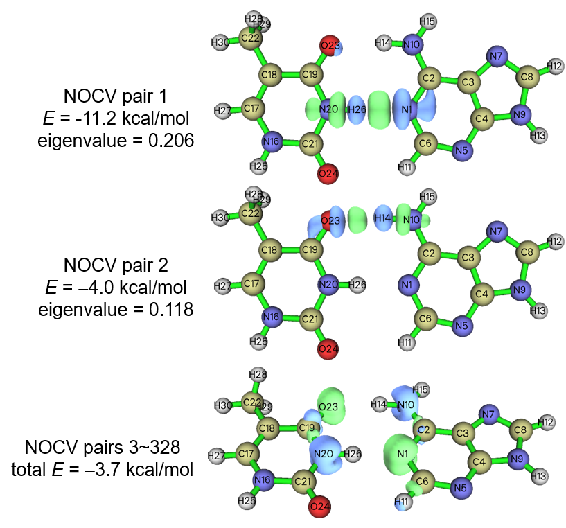

从上图可见 NOCV 对 1 和 2 主要分别代表 H 键 N20-H26⋅⋅⋅⋅N1 和 O23⋅⋅⋅⋅H14-N10 的轨道相互作用。仅从轨道相互作用的角度看，前一个 H 键的强度明显强于后者。如果你有兴趣，可以用分子中的原子 (AIM) 理论按第 [4.2.1](sec-4-2-topology-analysis.md#421-2-吡哆醇-2-氨基吡啶的分子中的原子-aim-拓扑分析与芳香性分析) 节描述的流程分别评估两个 H 键的结合能。上图还表明 H 键形成中的轨道相互作用效应使氢和 H 键受体原子之间出现可察觉的电子密度集中，所以即使像 A-T 碱基对中这样中等强度的 H 键也伴有轻微的共价特征。

所有其他 NOCV 对，如上图中 NOCV 对 3 到 328 之和所示，大多对应从 H 键给体原子到 H 键受体原子的边缘 π 电子转移。由于相应的总能量很小，我不再进一步探讨。

## **4.23.5 过渡金属配位例子：(CO)₅Cr=CH₂**

在本例中，我们用 ETS-NOCV 研究过渡金属配位物 (CO)₅Cr=CH₂，把它划分为 (CO)₅Cr 和 CH₂ 两个片段，研究它们之间的配位键。

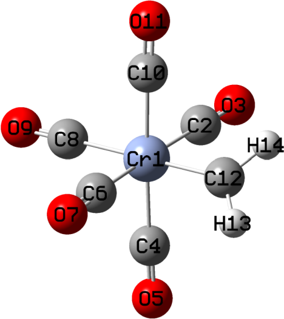

本例用 Gaussian 16 做计算。Cr 用 SDD 赝势 (pseudopotential) 及相应的标准价基组，配体原子用 6-311G\*，TPSSh 交换-关联泛函，因为它通常是对含 3*d* 金属配位物的理想选择。这种理论方法和基组的组合适合大多数过渡金属配位体系。我们先优化整个配位物得到其波函数文件 *(CO)5CrCH2.fch*，之后提取两片段的坐标再做单点任务得到它们的波函数文件 *(CO)5Cr.fch* 和 *CH2.fch*。Gaussian 输入文件以及所得 .fch 文件已在 "examples\ETS-NOCV(CO)5CrCH2\\" 文件夹提供。

> **注**
>
> 值得注意的是，如果你像本例这样在片段和整个体系的计算中使用不同基组（配位物用 "genecp" 而 CH₂ 配体用 6-311G\*），且你不熟悉 Gaussian 中 Cartesian 和球谐基函数的默认适配规则，强烈建议总在输入文件中加 *5d* 关键词以保证所有计算都用球谐基函数，否则所有片段的基函数总数可能与整个体系的基函数数目不同。

在本研究中正确选择电子态很重要。整个配位物和 (CO)₅Cr 片段中的 Cr 原子应为低自旋（六个 3*d* 电子都配对），所以计算中整个配位物和 (CO)₅Cr 的自旋多重度应设为 1。尽管已知 CH₂ 的基态是三重态，但为了对该体系做 ETS-NOCV 分析，在其单点计算中必须对 CH₂ 采用单重态，因为该状态比三重态更接近 (CO)₅Cr=CH₂ 中 CH₂ 的实际电子结构（自然预期单重态 CH₂ 利用其孤对与低自旋 Cr 原子的空 3*d* 轨道形成配位键）。

现在启动 Multiwfn 并输入

```text
examples\ETS-NOCV(CO)5CrCH2(CO)5CrCH2.fch
23  // ETS-NOCV analysis
2  // Two fragments
examples\ETS-NOCV(CO)5CrCH2(CO)5Cr.fch  // Fragment 1
examples\ETS-NOCV(CO)5CrCH2\CH2.fch  // Fragment 2
-2  // Generate Fock/KS matrix and evaluate NOCV orbital energies
```

目前屏幕上显示的 NOCV 信息是

```text
Pair  Energy | Orbital  Eigenvalue    Energy  | Orbital  Eigenvalue    Energy
   1  -42.57       1      0.94516    -139.72      247     -0.94516     -94.68
   2  -72.70       2      0.71995    -114.71      246     -0.71995     -13.74
   3   -3.49       3      0.16177     -28.10      245     -0.16177      -6.51
   4   -1.45       4      0.08316     -60.03      244     -0.08316     -42.63
   5   -0.58       5      0.05439     -52.30      243     -0.05439     -41.65
   6   -0.77       6      0.04558      54.27      242     -0.04558      71.17
[...ignored]
```

可见 NOCV 对 1 和 2 对两片段间配位键形成的能量贡献远大于其他 NOCV 对，所以我们只关注它们。现在用选项 2 分别可视化两个 NOCV 对的密度等值面，0.01 a.u. 等值面的相应等值面图如下所示

> **注**
>
> 建议选择选项 2 后选"High-quality grid"，因为当前体系不算小。若选"Medium-quality grid"等值面会有些锯齿。当可视化等值面后发现当前格点设置不合适，可以回到后处理菜单选择选项"-5 Set grid for calculation of various densities"重新定义下次可视化的格点设置。

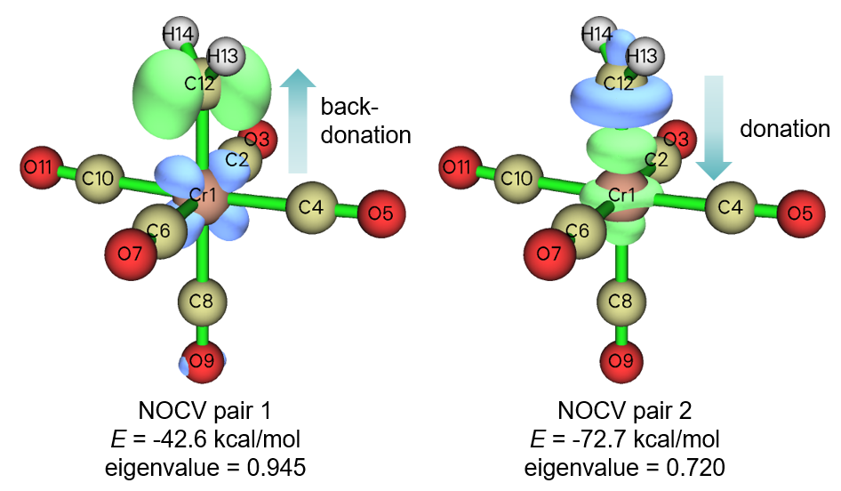

从等值面的形状和颜色可以清楚地看出 NOCV 对 2 表现出从单重态 CH₂ 的孤对到 Cr 空 $dz^2$ 轨道的电子给体特征，而 NOCV 对 1 显示从占据 3*d* 轨道到 CH₂ 垂直于其片段平面的空轨道的电子反馈。前者对应 σ 键的形成，它对结合的能量贡献 (-72.7 kcal/mol) 明显大于显示 π 特征的后者 (-42.6 kcal/mol)。同一键的 σ 相互作用强于单套 π 相互作用是很常见的，这一点也反映在我们第 [4.23.3](#4233-含多重键的开壳层体系乙烯) 节乙烯例子中的观察。然而，根据 NOCV 对本征值，注意到 π 型反馈相互作用引起的电子密度变化比 σ 型给体相互作用大。这里顺便值得强调的是 NOCV 本征值和 NOCV 能量之间没有必然的正相关。

## **4.23.6 多于两个片段的例子：乙炔三聚的过渡态**

ETS-NOCV 也可用于多于两个片段的情形，也可用于势能面极小点之外的结构，如过渡态 (TS)。在本例中，我用乙炔三聚的过渡态 (TS) 说明这一点。该反应如下图所示，图中的 TS 几何在 B3LYP/6-31G\* 水平优化。我们将分析 TS 结构处三个弯曲乙炔如何因轨道相互作用而相互作用。

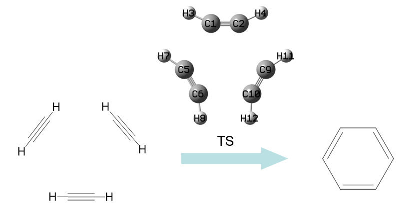

"examples\ETS-NOCV\C2H2_trimerization_TS" 文件夹中的 *TS.gjf* 是预优化 TS 几何的单点任务的 Gaussian 输入文件。该文件夹中的 *1.gjf*、*2.gjf* 和 *3.gjf* 对应 TS 几何处三个扭曲乙炔分子的单点任务。所有文件的计算水平都是 B3LYP/6-31G\*，足以得到定性合理的 ETS-NOCV 结果。运行这些文件并用 formchk 工具转换所得 .chk 文件，就得到该文件夹中的 .fch 文件。

启动 Multiwfn 并输入

```text
examples\ETS-NOCV\C2H2_trimerization_TS\TS.fch
23  // ETS-NOCV analysis
3  // Three fragments
examples\ETS-NOCV\C2H2_trimerization_TS\1.fch  // Fragment 1
examples\ETS-NOCV\C2H2_trimerization_TS\2.fch  // Fragment 2
examples\ETS-NOCV\C2H2_trimerization_TS\3.fch  // Fragment 3
-2  // Generate Fock/KS matrix and evaluate NOCV orbital energies
```

然后你会看到

```text
There are totally   51 NOCV pairs and   102 NOCV orbitals
NOCV orbitals with absolute eigenvalues smaller than 1.0E-03 are not shown
Note: All energies are given in kcal/mol

 Pair  Energy | Orbital  Eigenvalue    Energy  | Orbital  Eigenvalue    Energy
    1  -25.50       1      0.57545     -95.07      102     -0.57545     -50.76
    2  -25.50       2      0.57545     -95.07      101     -0.57545     -50.76
    3   -0.93       3      0.09515     -66.85      100     -0.09515     -57.12
    4   -0.93       4      0.09515     -66.85       99     -0.09515     -57.12
    5   -1.31       5      0.07688    -114.89       98     -0.07688     -97.89
    6   -1.50       6      0.07168      62.87       97     -0.07168      83.83
    7   -0.33       7      0.03245       3.82       96     -0.03245      14.08
    8   -0.33       8      0.03245       3.82       95     -0.03245      14.07
    9   -0.13       9      0.02029      -0.40       94     -0.02029       6.16
[...ignored]
```

可见 NOCV 对 1 和 2 是简并的，它们在 0.005 a.u. 等值面的密度等值面图如下所示，也给出了它们之和

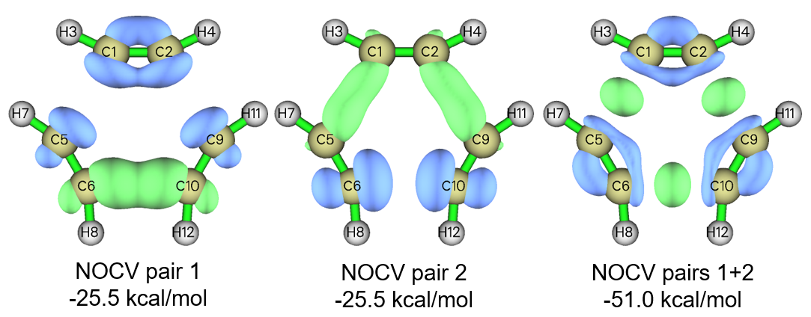

NOCV 对 1 和 2 能量相同是因为该体系有点群 D$_{3h}$ 对称性，它是旋转群。从等值面图显然看出 NOCV 对 1 或对 2 单独都没有意义，但它们之和有意义。如上图第三个子图所示，在 TS 几何处相邻乙炔之间已在一定程度上存在 σ 键相互作用，因为在新 C-C 键将要形成的地方可察觉到明显的电子集中。还注意到该子图中的蓝色等值面表明乙炔中 C-C 键的面内 π 区电子密度减少，清楚地说明乙炔间的新 σ C-C 键是以牺牲原来的面内 π 键为代价形成的。

已知在乙炔三聚反应的产物即苯分子中，每个 C-C 键都有一定程度的 π 相互作用，一个自然的问题是：在 TS 结构处乙炔间的 π 相互作用是否也已形成？为探讨这一点，我们查看其他 NOCV 对的等值面，会很快发现只有 NOCV 对 3 和 4 显示 π 特征，如它们的密度等值面如下所示。单独可视化 NOCV 对 3 或 4 事实上没有意义，所以我们也绘制两对密度之和的等值面，如下图第三个子图所示；但只有等值面设为相当小的值 (0.0002 a.u.) 时才能清楚地可视化等值面。

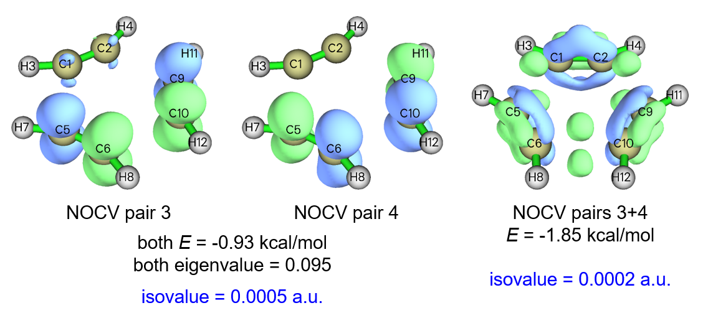

NOCV 对 3 和 4 之和的等值面表明相邻乙炔之间确实存在 π 相互作用，因为在新 C-C 键将要形成的上方和下方 π 区可发现绿色等值面。但由于能量仅为 -1.85 kcal/mol，且等值面只有在极小的密度等值面下才能察觉，乙炔间的 π 相互作用在实践中完全可以忽略。该论点也可通过计算 TS 结构波函数的 π 电子 Mayer 键级来支持，做法见第 [4.100.22](sec-4-100-other-functions-part-1.md#410022-分析非平面体系-non-planar-system的π电子-π-electron特征环庚三烯-cycloheptatriene) 节。你会发现 C1-C5 的 π Mayer 键级仅为 0.010，其大小小到完全可以忽略。
