# **4.24 (超)极化率分析的例子**

## **4.24.1 解析 Gaussian "polar" 任务的输出文件得到 (超)极化率并计算相关量**

如第 [3.27.1](sec-3-27-hyperpolarizability-analysis.md#3271-解析-gaussian-的超极化率任务输出并计算相关量) 节介绍，Multiwfn 能够解析 Gaussian "polar" 任务的摘要输出信息，把数据重组成可读性强得多的格式，同时输出许多有用的量。本节给出一个例子。

在 "examples\polar" 文件夹中，*NH3_polar_static.out* 和 *NH3_polar_dynamic.out* 是用常见的交换-关联泛函 PBE0 对 NH₃ 做的静态和频率相关 (超)极化率计算的输出文件，相应的 Gaussian 输入文件也在同一文件夹中提供。计算中使用了带丰富弥散函数的大基组 (aug-cc-pVTZ)，注意弥散函数对得到合理的 (超)极化率起关键作用，因此是绝对不可少的。

### **研究静态极化率和第一超极化率**

首先，我们用 Multiwfn 从 *NH3_polar_static.out* 解析数据。启动 Multiwfn 并输入

```text
examples\polar\NH3_polar_static.out
24  // (Hyper)polarizability analysis
1  // Parse (hyper)polarizability task of Gaussian
1  // Start parsing. We select option 1 because third-order derivative of current level (normal DFT functional) is supported by Gaussian
```

现在你可以在屏幕上看到以下信息：

```text
Dipole moment:
 X,Y,Z=    0.000000    0.000000   -0.596558   Norm=    0.596558

 Static polarizability:
 XX=       13.692700
 XY=        0.000000
 YY=       13.693300
 XZ=        0.000000
 YZ=       -0.000334
 ZZ=       15.323600
 Isotropic average polarizability:       14.236533
 Isotropic average polarizability volume:       2.109636 Angstrom^3
 Polarizability anisotropy (definition 1):        1.630600
 Polarizability anisotropy (definition 2):        1.630600
 Eigenvalues of polarizability tensor:     13.69270     13.69330     15.32360
 Polarizability anisotropy (definition 3):        1.630600

 Note: It is well known that the sign of hyperpolarizability of Gaussian 09/16 s
hould be inverted, the outputs shown below have already been corrected

 Static first hyperpolarizability:
 XXX=        0.000000
 XXY=       12.903200
 XYY=        0.000000
 YYY=      -12.900200
 XXZ=        9.617100
 XYZ=        0.000000
 YYZ=        9.564710
 XZZ=        0.000000
 YZZ=        0.016285
 ZZZ=       26.613200

 Beta_X=        0.00000  Beta_Y=        0.01929  Beta_Z=       45.79501
 Magnitude of first hyperpolarizability:       45.795014
 Projection of beta on dipole moment:      -45.795010
 Beta ||     :      -27.477006
 Beta ||(z)  :       27.477006
 Beta _|_(z) :        9.159002
```

输出很容易理解，所有输出量的详细解释见第 [3.27.1](sec-3-27-hyperpolarizability-analysis.md#3271-解析-gaussian-的超极化率任务输出并计算相关量) 节。

### **研究频率相关的极化率和超极化率**

接下来，我们从 *NH3_polar_dynamic.out* 提取频率相关 (超)极化率。启动 Multiwfn 并输入

```text
examples\polar\NH3_polar_dynamic.out
24  // (Hyper)polarizability analysis
1  // Parse (hyper)polarizability task of Gaussian
-1  // Let Multiwfn load frequency-dependent (hyper)polarizability
1  // Start parsing
```

Multiwfn 检测到有三套数据：

```text
       1   w=    0.000000 (     Static    )
       2   w=    0.065600 (      695.04nm )
       3   w=    0.071900 (      634.14nm )
```

如果我们输入 *2*，则加载并解析对应 0.0656 a.u. 入射光的 (超)极化率数据。

输出偶极矩和极化率信息后，Multiwfn 请你选择要输出的超极化率类型：

```text
1: Beta(-w;w,0)   2: Beta(-2w;w,w)
Note: Option 2 is meaningless if "DCSHG" keyword was not used
```

你可以根据需要任选其一。由于从 *NH3_polar_dynamic.gjf* 可见我们用的关键词是 *polar=DCSHG*，两种类型都可用。

现在如果你选择选项 2 解析 β(-2w;w,w)，不仅显示第一超极化率，还打印超瑞利散射 (HRS) 相关量，如下所示（详见第 [3.27.1](sec-3-27-hyperpolarizability-analysis.md#3271-解析-gaussian-的超极化率任务输出并计算相关量) 节）

```text
<beta_ZZZ^2>:  8.12843560E+02
<beta_XZZ^2>:  1.45318790E+02
Hyper-Rayleigh scattering (beta_HRS):        30.954
Depolarization ratio (DR):   5.594
|<beta J=1>|:        59.743
|<beta J=3>|:        41.624
Nonlinear anisotropy parameter (rho):   0.697
Dipolar contribution to beta, phi_beta(J=1):     0.589
Octupolar contribution to beta, phi_beta(J=3):   0.411
< (beta_ZXZ+beta_ZZX)^2 - 2*betaZZZ*betaZXX >:  2.04387968E+02
```

接下来，如果你想研究散射强度随入射光偏振角的演化，应输入 *y* 再输入一个初始角度，例如 -180。之后当前文件夹生成 *HRS_angle.txt*，其中包含偏振角从 -180° 到 179° 以 1° 步长变化对应的散射强度。如果你用如 Origin 把数据绘制为 "Polar theta(X) r(Y)" 图，会得到下图，其中红色曲线在不同角度的径向距离对应计算的 HRS 强度。相应的 Origin .opj 文件已作为 *examples\polar\HRS_angle.opj* 提供。

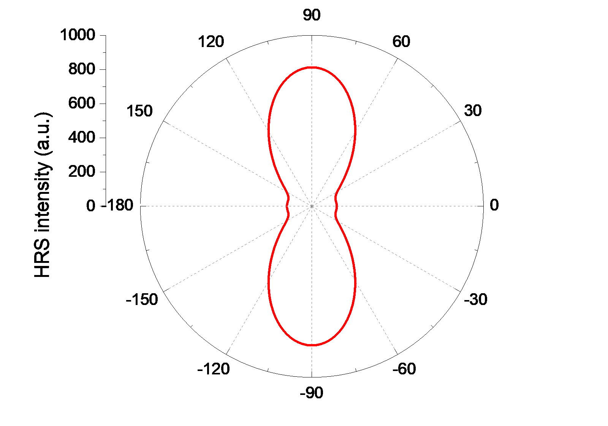

### **研究第二超极化率**

Gaussian 也能计算静态和动态第二超极化率 (γ)。示例输入文件是 *examples\polar\NH3_gamma.gjf*，输出文件也在同一文件夹中给出。该任务用了 *polar=gamma* 关键词，并指定了两个外场频率（532 nm 和 680 nm）。下面我说明用 Multiwfn 解析 532 nm 处 γ(-2w;w,w,0) 的数据。

启动 Multiwfn 并输入

```text
examples\polar\NH3_gamma.out
24  // (Hyper)polarizability analysis
1  // Parse (hyper)polarizability task of Gaussian
-1  // Let Multiwfn load frequency-dependent (hyper)polarizability
7  // This option is specific for parsing polarizability and second hyperpolarizability
3  // 532 nm
```

532 nm 处的动态极化率及相关量现在显示在屏幕上。然后选择 2 进一步解析 gamma(-2w;w,w,0)，然后你会看到

```text
 XXXX=    3.966470E+03
 YXXX=    0.000000E+00
 ZXXX=    8.493370E-05
 XYXX=XXYX=    0.000000E+00
[...ignored]
 ZZZZ=    3.204030E+04

 Magnitude of gamma:      1.067181E+04
 X component of gamma:    2.134993E+03
 Y component of gamma:    2.134897E+03
 Z component of gamma:    1.023580E+04
 Average of gamma (definition 1), gamma ||:    1.450569E+04
 Average of gamma (definition 2):    1.461464E+04
 gamma _|_:    4.653651E+03
```

可见，γ 张量的所有分量都非常清楚地显示出来，还显示了基于 γ 定义的一些量，它们在 γ 研究中很有用。注意上面数据是输入取向下的。

类似地，你可以用 Multiwfn 解析 gamma(-w;w,0,0)。如果你想解析 gamma(0;0,0,0)，解析前不要选选项 -1。

## **4.24.2 基于态求和 (SOS) 方法研究极化率和超极化率**

### **4.24.2.1 计算 NH₃ 的极化率和超极化率**

在本例中我将展示如何用 Multiwfn 基于态求和 (sum-over-states, SOS) 方法计算 HF 分子的极化率和超极化率。请确保你已读过第 [3.27.2.1](sec-3-27-hyperpolarizability-analysis.md#32721-超极化率的计算) 节。

如第 [3.27.2.1](sec-3-27-hyperpolarizability-analysis.md#32721-超极化率的计算) 节介绍，SOS 计算需要大量电子态的信息，包括电偶极矩、激发能以及这些态之间的跃迁偶极矩。通常这些信息可通过 ZINDO、CIS、TDHF 和 TDDFT 计算得到。在本例中我们用非常流行的 CIS 方法。根据我的经验，TDHF 和 TDDFT 这些能给出更准确激发能的更昂贵方法，与 SOS 技术联用时，给出的 (超)极化率不一定比 CIS 好。

#### **准备工作**

本例中我们用 Gaussian 程序做 CIS 计算。但 Gaussian 自身不能输出 SOS 计算所需的足够信息。虽然对 CIS（和 ZINDO）有个关键词 *alltransitiondensities*，它使 Gaussian 输出每对激发态之间的跃迁密度矩，但所有态的电偶极矩仍不能在一次运行中得到。幸运的是，我们可以用 Multiwfn 强大的电子激发分析模块，基于 Gaussian 或 ORCA 程序的 CIS/TDHF/TDDFT 任务输出文件，产生 SOS 所需的全部信息。

首先，用 Gaussian 运行 *examples\NH3_SOS.gjf* 产生输出文件 *NH3_SOS.out*，并用 formchk 工具把 checkpoint 文件转为 *NH3_SOS.fch*。如果你手头没有 Gaussian，可直接在 <http://sobereva.com/multiwfn/extrafiles/NH3_SOS.rar> 下载它们。

> **注**
>
> 由于 SOS 结果常常随计入的激发态数目收敛较慢，本例中我们产生高达 150 个激发态以充分避免截断误差。当然，采用更多激发态在 CIS 计算和随后 Multiwfn 中的 SOS 计算都需要更多计算时间。在大多数实际研究中，100 个态一般已足够大，甚至 70 个也常常足以给出可用的结果。超极化率尤其是高阶超极化率的计算对基组质量有非常严格的要求，丰富的弥散函数是绝对不可少的。本例中我们采用 def2-TZVPPD (*J. Chem. Phys.*, **133**, 134105)，它是为分子响应性质计算优化的高质量基组。由于当前版本 Gaussian 没有内置该基组，它取自 BSE 网站 (<https://www.basissetexchange.org>)。关键词 *IOp(9/40=5)* 很重要，因为在 ZINDO/CIS/TDHF/TDDFT 任务中，默认 Gaussian 只输出绝对值大于 0.1 的跃迁系数，而 *IOp(9/40=5)* 把判据降到 0.00001，从而输出多得多的系数，由此我们下一步可用 Multiwfn 得到准确的跃迁偶极矩。值得注意的是，你也可以用 TDHF 或 TDDFT 代替 CIS，例如你可以写 *\#P TD(nstates=150) CAM-B3LYP/gen IOp(9/40=5)*。

启动 Multiwfn 并输入以下命令

```text
C:\NH3_SOS.fch
18  // Electron excitation analysis module
5  // Calculate transition dipole moments and dipole moment for all excited states
C:\NH3_SOS.out
3  // Generate SOS.txt
```

当前文件夹生成的 *SOS.txt* 文件包含 SOS (超)极化率计算所需的全部信息。该文件可直接用于 Multiwfn 的 SOS 模块。

重启 Multiwfn 并输入

```text
SOS.txt
24  // (Hyper)polarizability analysis
2  // Study (hyper)polarizability by sum-over-states (SOS) method
```

注意 SOS 模块中用的单位都是原子单位。

#### **极化率 (alpha) 的计算**

现在，选择 1 并输入 *0* 计算静态极化率 α(0;0)，结果是

```text
             1              2              3
 1      14.610682       0.000000       0.000000
 2       0.000000      14.610682       0.000000
 3       0.000000       0.000000      14.552483
Isotropic average polarizability:      14.591283
Isotropic average polarizability volume:       2.162205 Angstrom^3
Polarizability anisotropy (definition 1):       0.058199
Eigenvalues:      14.552483      14.610682      14.610682
Polarizability anisotropy (definition 2):       0.029100
```

可见，不仅输出了极化率张量，还输出了一些相关量。它们的定义见第 [3.100.20](sec-3-100-other-functions-part-1.md#310020-计算hellmann-feynman力calculate-hellmann-feynman-forces) 节。这里得到的各向同性平均极化率为 14.59，与实验测定值 14.56 完全一致！(*Mol. Phys.*, **33**, 1155)

然后我们计算动态极化率 α(-ω;ω)，设外场频率为 0.0719 a.u.。再次选选项 1，输入 *0.0719*，从输出可见 ω=0.0719 处的动态各向同性极化率为 14.86，略大于静态值。

#### **第一超极化率 (beta) 的计算**

接下来，我们计算第一超极化率，考虑静态情形 β(0;0,0)。选选项 2 并输入 *0,0*。只有沿偶极矩方向的 β 分量即 β$_{||}$ 是我们特别感兴趣的，因为只有该量能由实验测定。从输出发现 β$_{||}$(0;0,0) 为 -38.98。相应的实验值没有，但该值接近 CCSD(T) 方法算得的高精度值 (-34.3, 见 *J. Chem. Phys.*, **98**, 3022 (1993))。

随后，我们计算 ω=0.0656 a.u. 处的 β(-2ω;ω,ω)。再次选选项 2 并输入 *0.0656, 0.0656*，把两个外场的频率都设为 0.0656 a.u.。这次 β$_{||}$ 值为 -49.69，又与实验测定值 -48.9±1.2 非常一致（见 A. Hernández-Laguna 等编 *Quantum Systems in Chemistry and Physics*, Vol. 1, p111）

> **注**
>
> 虽然本例中 SOS/CIS 计算与参考值的一致好得惊人，但对其他体系不总如此。SOS/CIS 方法有时会严重高估 β 值！

#### **第二超极化率 (gamma) 的计算**

最后，我们计算第二超极化率 γ。选 3 并输入 *0,0,0* 设为静电场。由于 γ 的计算明显比 β 耗时，Multiwfn 不自动用所有态，而是允许你设定要计入的态数目。原则上值越大结果越好，但当然计算耗时更多。这里，我们输入 *150* 用所有态。过一会儿，结果显示在屏幕上，γ 的平均值为 928.74。注意该值可能不准确（没有参考值，所以我不确定这是不是好结果），主要原因之一是电子激发计算用的基组不够大。γ 的准确计算通常需要像 d-aug-cc-pVTZ（或更好的）这样的基组，它比常用的 aug-cc-pVTZ 多一层弥散函数。

Multiwfn 还能计算第三超极化率 δ(-ω;ω₁,ω₂,ω₃,ω₄)，其中 ω=ω₁+ω₂+ω₃+ω₄，但本例中我们不做，因为该量相当不重要，而且当考虑的态数目大时计算极其昂贵；此外，计算中必须用超高质量的基组……

#### **(超)极化率随考虑态数目的变化**

SOS 计算中非常重要的一点是所用的态数目必须足够高；换句话说，如果你的 SOS 研究涉及 *n* 个态，(超)极化率随态数目的变化必须在 *n* 之前收敛，否则必须增大 *n*。用 Multiwfn 可以方便地检验是否满足收敛条件。这里我们检验静态 β 的收敛性。选选项 6 并输入 *0,0*，过一会儿，结果导出到当前文件夹的 *beta_n.txt* 和 *beta_n_comp.txt*，每列的含义在屏幕上清楚地给出。然后你可以用喜欢的工具绘制 *beta_n.txt* 中的数据。如果你是 Origin 用户，可以直接把该文件拖到 Origin 窗口绘制为曲线图。下图显示了静态 β$_{||}$ 以及静态各向同性平均极化率 $\langle\alpha\rangle$ 随考虑态数目的变化。

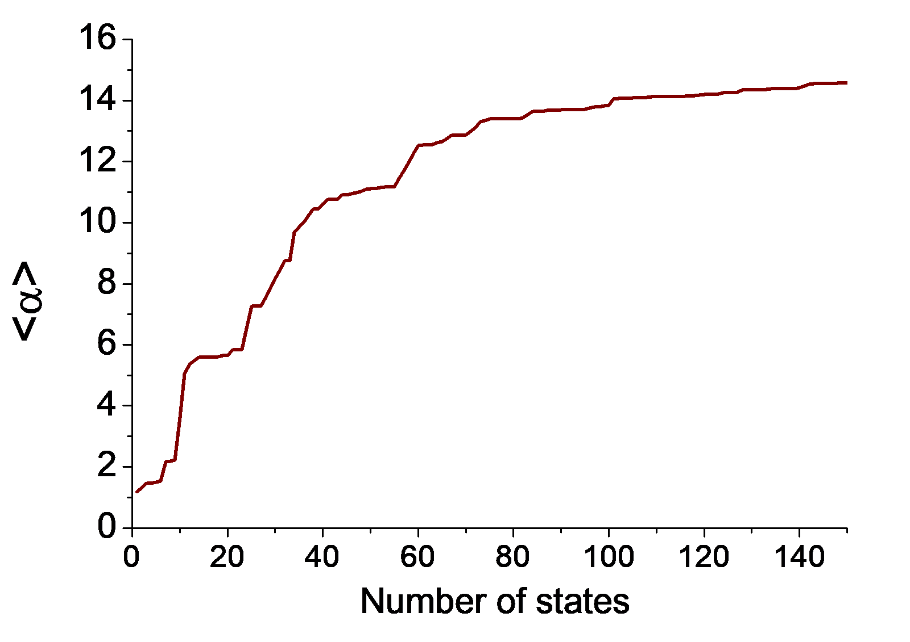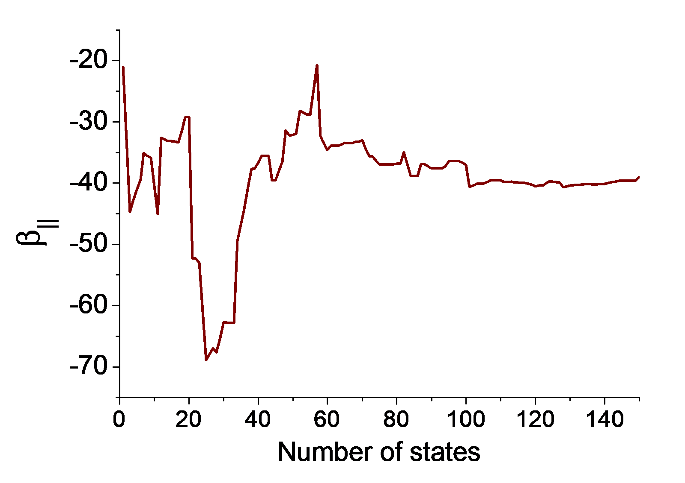

显然两个量在 *n*=100 处已基本收敛。由于我们的计算用了 150 个态，因态截断导致的误差可安全忽略。从图中还可见如果态数目截断在 70，结果在定性上仍正确。

你也可以类似地用选项 5 和 7 分别研究 α 和 γ 的收敛行为。

#### **(超)极化率随外场频率的变化**

在 Multiwfn 的 SOS 模块中，还可以方便地研究动态 (超)极化率随外场频率的变化。例如，我们研究 β(-ω₁;ω₁,0) 在 ω₁ 从 0 到 0.5 a.u. 以 0.01 步长的变化。写一个纯文本文件，每行对应一对 ω₁, ω₂（本例中 ω₂ 固定为零），例如

> **注**
>
> 提示：为方便，你可以用 Microsoft Excel 程序产生频率列表，把表格存为 .txt 文件（你可选如 "Text (tab delimited)"，但不要选 "Unicode text"）。

```text
0.00  0
0.01  0
0.02  0
...
0.5   0
```

然后选选项 16，输入纯文本文件的路径，β 在每对频率下计算，结果输出到当前文件夹的 *beta_w.txt* 和 *beta_w_comp.txt*，数据的每列含义在屏幕上清楚地给出。这些文件中的数据可直接用 Origin 绘制为曲线图，例如 β(-ω₁;ω₁,0) 的大小如下所示：

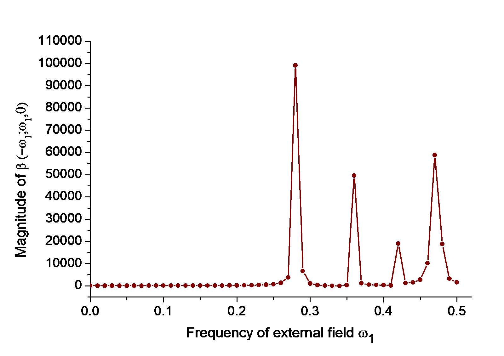

类似地，你也可以用选项 15 和 17 分别研究 α 和 γ 随外场频率的变化。

#### **同时扫描 β(-(ω₁+ω₂);ω₁,ω₂) 的 ω₁ 和 ω₂**

用 SOS 模块的子功能 19，还可以同时扫描 β(-(ω₁+ω₂);ω₁,ω₂) 的 ω₁ 和 ω₂。例如，在 SOS 模块中输入以下命令

```text
19
-0.6,0.6,100  // Lower limit, upper limit and number of steps of ω_1 (in a.u.)
-0.6,0.6,100  // Lower limit, upper limit and number of steps of ω_2 (in a.u.)
```

过一会儿，当前文件夹生成 *beta_w.txt* 和 *beta_w_comp.txt*，文件的每列含义在屏幕上清楚地说明。要直观研究总 β 如何随 ω₁ 和 ω₂ 变化，可以用第一、第二和第 7 列分别作为 X、Y 和 Z 数据绘制起伏图。下图是用 Sigmaplot 绘制的：

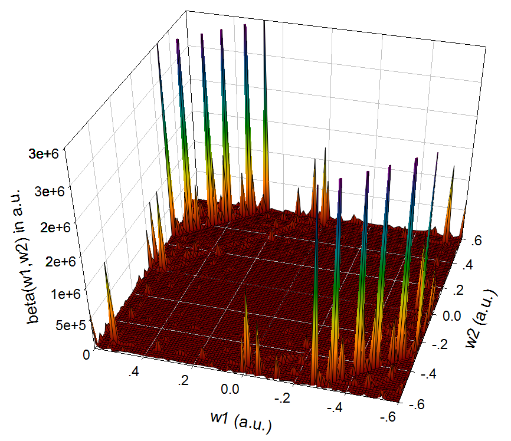

这类图展示了当前体系的单光子共振 β(-ω₁;ω₁,0) 或 β(-ω₂;0,ω₂)、和频与差频特征。在 ω₁ 和 ω₂ 之一为零的位置出现大峰意味着在相应频率有显著的电光 Pockels 效应，在 ω₁=ω₂ 频率处的大峰表明在该频率有强的二次谐波 (SHG) 效应，在 ω₁= -ω₂ 频率处的大峰显示在该频率有显著的光整流效应。这类图的讨论例子见 *ACS Appl. Nano Mater.*, **2**, 1648 (2019)。

### **4.24.2.2 对 NH₂-biphenyl-NO₂ 的第一超极化率做二能级和三能级模型分析**

> **注**
>
> 本节的中文版是我的博文"使用 Multiwfn 对第一超极化率做二能级和三能级模型分析"（<http://sobereva.com/512>）。

在超极化率计算研究的文献中，常用二能级模型阐明影响第一超极化率的主要因素，该分析也为类似体系间 *β* 的差异提供了清晰的理解。Multiwfn 实现的三能级模型是二能级模型向计入两个激发态的自然推广。请先阅读第 [3.27.2.2](sec-3-27-hyperpolarizability-analysis.md#32722-超极化率的两能级与三能级模型分析) 节获得关于二能级和三能级模型的基础知识。本节我将说明做这些分析的基本步骤

必须强调，只有满足以下两个条件时二能级或三能级分析才有用：

- *β* 的只有一个分量（即 *β*$_{XXX}$ 或 *β*$_{YYY}$ 或 *β*$_{ZZZ}$）起主导作用。该分量应作为分析对象

- 一个激发态（对二能级模型）或两个激发态（对三能级模型）对 *β* 的贡献远大于所有其他激发态

大多数给体-π-受体型体系很好地满足以上两个条件。本节我们以典型的给体-π-受体体系 NH₂-biphenyl-NO₂ 为例。"examples\excit" 文件夹中的 *D-pi-A.fchk* 和 *D-pi-A.out* 是该体系在 CAM-B3LYP/6-31G(d) 水平的 Gaussian TDDFT 任务产生的，得到了五个最低单重激发态。值得注意的是，没有足够的弥散函数，(超)极化率不能达到定量准确水平；但我们当前的目的只是用二能级和三能级模型非常粗略地讨论影响 *β* 的因素，所以用这两个文件做分析是可以接受的。

#### **准备输入文件**

启动 Multiwfn 并输入以下命令

```text
examples\excit\D-pi-A.fchk
18  // Electron excitation analysis module
5  // Calculate transition dipole moments and dipole moment for all excited states
examples\excit\D-pi-A.out
3  // Generate SOS.txt, which contains all information needed by the two- or three-level analysis
```

现在我们已准备好做二/三能级分析。在此之前，需要确认应研究 *β* 的哪个分量。*D-pi-A.fchk* 的分子几何如下所示（用主功能 0 显示）。可见，给体-π-受体路径的方向与 X 轴完全平行，因此预期当前体系只有 *β*$_{XXX}$ 是突出的。

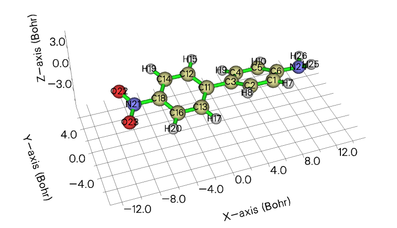

#### **二能级分析**

重启 Multiwfn 并输入

```text
SOS.txt
24  // (Hyper)polarizability analysis
2 // Study (hyper)polarizability by sum-over-states (SOS) method
20  // Two- or three-level model analysis of β
```

现在 Multiwfn 打印所有激发态的关键信息，它们与二能级和三能级分析密切相关：

```text
Excitation energy (E), transition electric dipole moment between ground state and excited state, and variation of dipole moment of excited states w.r.t. ground state
                  Trans. dipole moment (a.u.)        Var. dipole moment (a.u.)
 State   E(eV)     X       Y       Z      Tot        X       Y       Z      Tot
    1   3.9069   0.444  -0.000  -0.002   0.444    -1.010  -0.001   0.001   1.010
    2   4.0624   2.528  -0.003  -0.007   2.528     6.563  -0.015  -0.047   6.501
    3   4.4166  -0.003  -0.002  -0.023   0.024    -1.081   0.002   0.002   1.077
    4   4.7912   0.001   0.341  -0.013   0.341     1.845  -0.006  -0.015   1.823
    5   4.8872  -0.004   0.192  -0.171   0.257     0.993  -0.019  -0.049   0.925
```

因为激发态 2 的跃迁偶极矩大小和偶极矩变化远大于其他态，同时激发态 2 的激发能较低，所以该态可明确地认定为所谓的关键态 (crucial state)。

接下来，我们输入 *1-5* 对从 1 到 5 的每个激发态做二能级分析，你会看到

```text
beta evaluated by two-level model: (a.u.)
 #    1: XXX=       -58.05  YYY=        -0.00  ZZZ=         0.00  Norm=        58.05
 #    2: XXX=     11289.12  YYY=        -0.00  ZZZ=        -0.00  Norm=     11289.12
 #    3: XXX=        -0.00  YYY=         0.00  ZZZ=         0.00  Norm=         0.00
 #    4: XXX=         0.00  YYY=        -0.15  ZZZ=        -0.00  Norm=         0.15
 #    5: XXX=         0.00  YYY=        -0.13  ZZZ=        -0.27  Norm=         0.30
```

显然，只有激发态 2 对 *β*$_{XXX}$ 有显著贡献。

我们可以让 Multiwfn 打印关于激发态 2 的更详细信息。输入以下命令

```text
20  // Two or three-level model analysis of β
2  // Select excited state 2 for two-level model analysis
```

输出的信息如下所示

```text
 Excited state     2
 Excitation energy    0.149290 a.u.    4.0624 eV
 Transition dipole moment (a.u.)
 X=    2.527776  Y=   -0.003088  Z=   -0.007328  Total=    2.527789
 Oscillator strength
 X=    0.635943  Y=    0.000001  Z=    0.000005  Total=    0.635949
 Variation of dipole moment (a.u.)
 X=    6.562899  Y=   -0.015345  Z=   -0.046710  Total=    6.563083

 beta evaluated by two-level model: (a.u.)
 XXX=    11289.1185  YYY=       -0.0000  ZZZ=       -0.0007  Norm=    11289.1185
```

上面已给出二能级模型涉及的所有项，二能级模型的表达式见第 [3.27.2.2](sec-3-27-hyperpolarizability-analysis.md#32722-超极化率的两能级与三能级模型分析) 节。如果你有类似体系，例如当前体系的两个苯环换成三个苯环，你可以用上面的量根据二能级模型研究各种因素如何导致 *β*$_{XXX}$ 的差异。

#### **三能级分析**

我们也可以做三能级模型分析。在 Multiwfn 窗口中输入

```text
20  // Perform two- or three-level model analysis of β again
1,2  // Choose excited states 1 and 2 for the three-level model analysis
```

你会看到以下输出

```text
 Excited state     1
 Excitation energy    0.143576 a.u.    3.9069 eV
 Transition dipole moment (a.u.)
 X=    0.444412  Y=   -0.000436  Z=   -0.001817  Total=    0.444416
 Oscillator strength
 X=    0.018904  Y=    0.000000  Z=    0.000000  Total=    0.018905
 Variation of dipole moment (a.u.)
 X=   -1.009787  Y=   -0.000610  Z=    0.000608  Total=    1.009787

 Excited state     2
 Excitation energy    0.149290 a.u.    4.0624 eV
 Transition dipole moment (a.u.)
 X=    2.527776  Y=   -0.003088  Z=   -0.007328  Total=    2.527789
 Oscillator strength
 X=    0.635943  Y=    0.000001  Z=    0.000005  Total=    0.635949
 Variation of dipole moment (a.u.)
 X=    6.562899  Y=   -0.015345  Z=   -0.046710  Total=    6.563083

 Transition dipole moment between states     1 to     2: (a.u.)
 X=    1.475397  Y=   -0.001634  Z=   -0.008677  Total=    1.475423
 Individual contribution of excited state     1 to beta: (a.u.)
 XXX=      -58.0482  YYY=       -0.0000  ZZZ=        0.0000  Norm=       58.0482
 Individual contribution of excited state     2 to beta: (a.u.)
 XXX=    11289.1185  YYY=       -0.0000  ZZZ=       -0.0007  Norm=    11289.1185
 Coupling contribution of the two excited states to beta: (a.u.)
 XXX=      927.8987  YYY=       -0.0000  ZZZ=       -0.0001  Norm=      927.8987

 beta evaluated by three-level model: (a.u.)
 XXX=    12158.9690  YYY=       -0.0000  ZZZ=       -0.0007  Norm=    12158.9690
```

可见三能级模型分析涉及的所有项都已给出。我们还发现激发态 1 对 *β*$_{XXX}$ 的单独贡献相当小，两态间的耦合项也可忽略，意味着对当前体系采用二能级模型分析已完全足够，分析中纳入更多态不提供额外的理解。

激发态 1 对应的单独贡献相当低的原因很容易理解。根据二能级模型，对给定 *β* 分量的贡献与该分量偶极矩变化和跃迁偶极矩平方成正比。与激发态 2 相比，激发态 1 的这两个量都明显小。

> **提示**
>
> 有时，电子激发任务的输出文件可能包含大量态，而做二能级或三能级模型分析时我们总只需要前几个低激发态。为了显著降低产生 *SOS.txt* 的耗时，此时可以适当设置 *settings.ini* 中的 "maxloadexc" 参数。例如，输出文件包含多达 100 个激发态，但预期感兴趣的态不会高于第 5 激发态，因此可把 "maxloadexc" 设为 5，则只有前 5 个激发态被识别、加载并用于计算。

## **4.24.3 研究 (超)极化率密度的例子**

> **注**
>
> 本节的中文版是我的博文"使用 Multiwfn 极其方便地绘制 (超)极化率密度以及三维空间对 (超)极化率的贡献"（<http://sobereva.com/683>）。

请先阅读第 [3.27.3](sec-3-27-hyperpolarizability-analysis.md#3273-研究超极化率密度) 节获得关于 (超)极化率密度和空间对 (超)极化率贡献分析的基础知识。下面我们研究典型小分子 H₂CO 的第二超极化率密度。极化率密度和第一超极化率密度也可用几乎完全相同的方法研究，只需在 Multiwfn 界面中选择相应的量。

做这类分析时必须明确分子的取向，当前情形 C=O 键平行于 Z 轴，如下所示。本例中我们着重研究第二超极化率密度的 ZZZ 分量（ ${\rho}_{zzz}^{(3)}$ ）和空间对 *γ*$_{zzzz}$（第二超极化率的 ZZZZ 分量）的贡献，即 ${-z\rho}_{zzz}^{(3)}$ 。

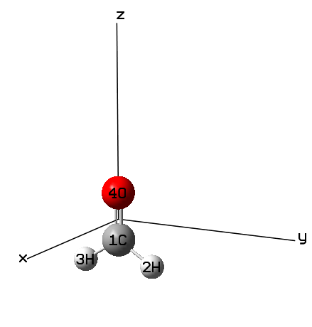

在做超极化率密度分析前，建议先用 Gaussian 做常规的静态 **γ** 计算，以便判断我们的超极化率密度分析是否足够合理。该任务的 Gaussian 输入和输出文件已作为 "examples\polar\polardens" 文件夹中的 *gamma.gjf* 和 *gamma.out* 提供，采用常用的 PBE0/aug-cc-pVTZ 水平。从输出文件末尾可见 *γ*$_{ZZZZ}$ 为 0.309211D+04 a.u.（即 3092.1 a.u.）。该任务用的几何在 B3LYP/def-TZVP 水平优化。

### **准备工作**

启动 Multiwfn 并输入

```text
examples\polar\polardens\H2CO.xyz  //Multiwfn will load the geometry from this file, which contains the same coordinate as gamma.gjf
24  //(Hyper)polarizability analysis
3  //(Hyper)polarizability density analysis
3  //Study second hyperpolarizability density and spatial contribution to second hyperpolarizability
3  //Z direction
1  //Generate Gaussian input files of single point task under different external electric fields
[Press ENTER button directly]  //Use 0 and 1 as net charge and spin multiplicity, respectively
```

现在 Multiwfn 在当前文件夹生成 *Z-2.gjf*、*Z-1.gjf*、*Z+1.gjf* 和 *Z+2.gjf*。如果你用文本编辑器打开它们，会发现它们对应 PBE0/aug-cc-pVTZ 水平不同电场下的单点任务，同时当前文件夹会生成与输入文件同名的 .wfx 文件（一种波函数格式）。有限电场的大小为 0.003 a.u.，因此例如 *Z+2.gjf* 对应施加 Z 方向大小为 0.003\*2 = 0.006 a.u. 的外电场。文件中的 "nosymm" 关键词很重要，它防止 Gaussian 在计算中自动重取向分子。如果你想用其他计算水平和设置，可手动修改 .gjf 文件中的关键词。

用 Gaussian 运行 .gjf 文件（你可用 "examples" 文件夹中的 *runall.sh* shell 脚本调用 Gaussian 运行当前文件夹中的所有文件）。然后你会在当前文件夹发现 *Z-2.wfx*、*Z-1.wfx*、*Z+1.wfx* 和 *Z+2.wfx*。

接下来，在 Multiwfn 中输入以下命令

```text
2  //Load .wfx files of single point task under different external electric fields
[Press ENTER button directly]  //Assume that the .wfx files are in current folder
```

如屏幕提示，Multiwfn 已找到所有需要的 .wfx 文件，出现一个新界面，你可以选择计算格点数据或绘制平面图。显然，当前情形下界面中的"第二超极化率密度"和"空间对第二超极化率的贡献"分别指 ${\rho}_{zzz}^{(3)}$ 和 ${-z\rho}_{zzz}^{(3)}$ 。

### **可视化等值面图**

我们先可视化 ${\rho}_{zzz}^{(3)}$ 的等值面图。为此，输入

```text
1  //Generate grid data of second hyperpolarizability density
2  //Medium-quality grid
1  //Visualize isosurface map
```

把等值面设为 0.5 后，你会看到 ${\rho}_{zzz}^{(3)}$ 的等值面图：

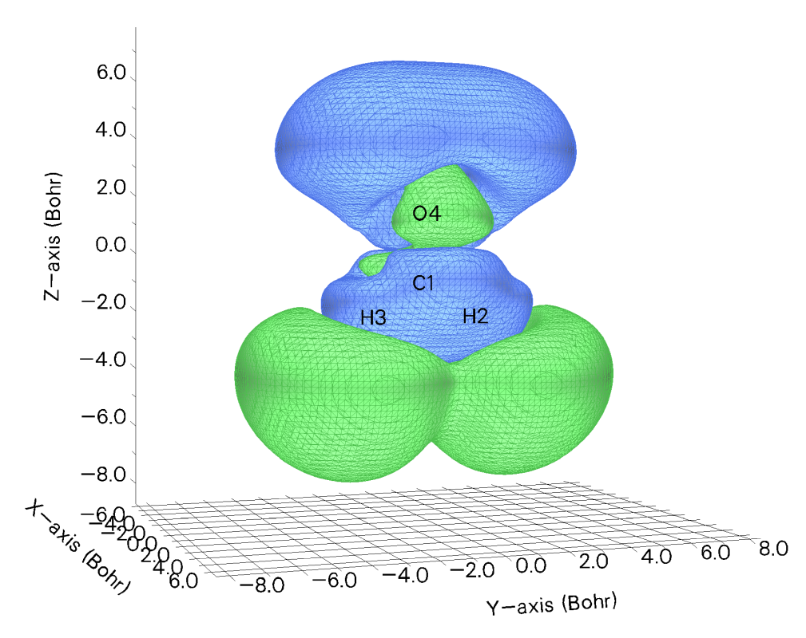

但从该图仍难讨论各空间区域对 *γ*$_{ZZZZ}$ 的贡献，因为 -*z* 因子还没考虑进去。为得到 ${-z\rho}_{zzz}^{(3)}$ ，关闭 GUI 窗口，输入以下命令

```text
0  //Return
2  //Generate grid data of spatial contribution to second hyperpolarizability
2  //Medium-quality grid
```

从屏幕可发现当前格点数据的积分为 3008.2 a.u.，接近 *examples\polar\polardens\gamma.out* 中 *γ*$_{ZZZZ}$ 值 3092.1 a.u.，表明 ${-z\rho}_{zzz}^{(3)}$ 的格点数据确实合理（如果设置格点时用更高质量的格点并增大默认延伸距离，积分会更接近 3092.1 a.u.）。

现在选选项 2 可视化等值面图。把等值面设为 2 后，你会看到 ${-z\rho}_{zzz}^{(3)}$ 的等值面图如下：

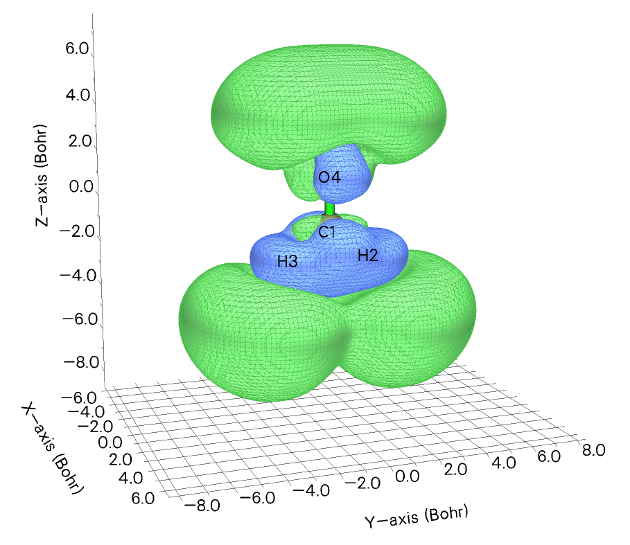

图中，绿色（蓝色）等值面包围的区域对 *γ*$_{ZZZZ}$ 有正（负）贡献。可见在分子价层区，贡献基本为负，但在分子两端贡献显著为正，且大小明显超过负区，这就是为什么当前体系 *γ*$_{ZZZZ}$ 为明显正值。显然通过这样的图像，你可以立即解释 **γ** 的某个分量为什么大或小，或为什么为正或负。毫无疑问这类分析在研究 (超)极化率的内在特征时极其有用！

### **绘制平面图**

```text
3  //Plot plane map of second hyperpolarizability density
1  //Color-filled map
[Press ENTER button directly]  //Use the default 200*200 grid points
3  //YZ plane
0  //X=0
3  //YZ plane
0  //X=0
```

关闭图形，然后输入以下命令微调图形效果

```text
19  //Set color transition
8  //Blue-White-Red
2  //Enable showing contour lines
3  //Change contour line setting
4  //Delete some contour lines (we only want to keep contour lines with relatively large value in this example)
32-37
4  //Delete some contour lines
1-6
1  //Save setting and return
4  //Enable showing atom labels and reference point
12  //Dark green
8  //Enable showing bonds
14  //Brown
1  //Set lower & upper limits
-6,6
-1  //Replot
```

你会看到下图，看起来相当漂亮

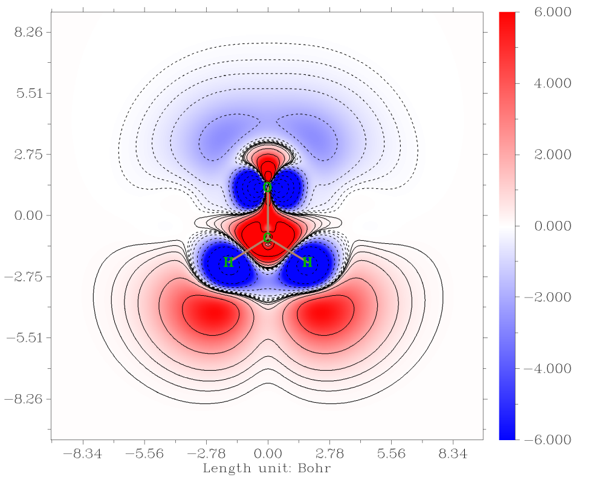

选择"-5 Return to main menu"后，就可选"4 Plot plane map of spatial contribution to second hyperpolarizability"用类似方法绘制 ${-z\rho}_{zzz}^{(3)}$。

### **得到 (超)极化率的原子贡献**

得益于 Multiwfn 的灵活性，基于格点数据在每个原子空间中积分相应的 (超)极化率密度，就可以很容易得到 (超)极化率的原子贡献。通常推荐用模糊原子空间，因为耗时很低。这里我们通过积分 -*zρ*$^{(3)}_{ZZZ}$ 的格点数据计算 *γ*$_{ZZZZ}$ 的原子贡献。

通过前面提到的选项"2 Generate grid data of spatial contribution to second hyperpolarizability"生成 ${-z\rho}_{zzz}^{(3)}$ 的格点数据后，选择选项"2 Export grid data as cube file"然后直接按 ENTER 键，把格点数据导出为当前文件夹中的 *grid.cub*。然后把 *settings.ini* 中的 "iuserfunc" 设为 -1，使自定义函数对应于基于载入格点数据的插值函数。重启 Multiwfn，载入 *grid.cub*，然后输入以下命令：

```text
15  //Fuzzy atomic space analysis
1  //Integrate a real space function in every atomic space
100  //User-defined function
```

结果是

```text
  Atomic space        Value                % of sum            % of sum abs
    1(C )           28.87467715             0.962679             0.962679
    2(H )          950.91673574            31.703459            31.703459
    3(H )          949.91946330            31.670210            31.670210
    4(O )         1069.69915961            35.663652            35.663652
Summing up above values:       2999.41003579
Summing up absolute value of above values:       2999.41003579
```

"Value" 标签下的值是 *γ*$_{ZZZZ}$ 的原子贡献，"% of sum" 下的值是百分比贡献。从数据清楚地看出两个氢和氧对 *γ*$_{ZZZZ}$ 有主要贡献。所有值之和为 2999.4 a.u.，也与 Gaussian *polar=gamma* 任务输出的 *γ*$_{ZZZZ}$ 值 (3092.1 a.u.) 相当接近，表明数据是有意义的。

## **4.24.5 用单位球表示直观研究 (超)极化率的例子**

> **注**
>
> 本节的中文版是我的博文"使用 Multiwfn 通过单位球表示图形化研究 (超)极化率张量"（<http://sobereva.com/547>，中文），其中有更多讨论。

如果你不熟悉 (超)极化率的单位球和矢量表示分析，请先阅读第 [3.27.5](sec-3-27-hyperpolarizability-analysis.md#3275-通过单位球与矢量表示可视化超极化率) 节。本节中，我以 CH₃NHCHO 和环\[18\]碳为例，展示如何用 Multiwfn 结合 VMD 可视化软件实现这类分析，并证明这些方法的用处。

### **4.24.5.1 CH₃NHCHO 的一阶超极化率**

本节中，我们分析 CH₃NHCHO 在 1030 nm 处的 SHG（二次谐波）型动态第一超极化率 (**β**)，目的之一是重现单位球表示方法原始论文 (*J. Comput. Chem.*, **32**, 1128 (2011)) 的图 2(e)。我们用与作者相同的计算水平，即几何优化用 B3LYP/6-311+G\*\*，超极化率计算用 HF/6-311++G\*\*。作者用 GAMESS-US 程序，而我们用 Gaussian 计算 **β**。

首先，用 Gaussian 运行 *examples\polar\CH3NHCHO\polar.gjf*，其内容如下所示

```text
#P HF/6-311++g(d,p) polar=DCSHG CPHF=rdfreq

B3LYP/6-311++G** opted

0 1
[coordinate optimized at B3LYP/6-311++G** level]

450nm 1030nm
　
　
```

该输入文件中，*polar=DCSHG* 请求 Gaussian 计算 SHG 型的超极化率，即 **β**(-2ω;ω,ω)。如 *CPHF=rdfreq* 关键词要求的，两个入射光频率从输入文件末尾加载。注意必须用 \#P，否则 Multiwfn 将无法从输出文件解析 (超)极化率。

现在我们用 Multiwfn 解析输出文件并把 **β** 导出为 .txt 文件。启动 Multiwfn 并输入以下命令

```text
examples\polar\CH3NHCHO\polar.out
24  // (Hyper)polarizability analysis
1  // Parse "polar" task of Gaussian. PS: If you are not familiar with this function, please check Section 3.27.1 for introduction and 4.24.1 for example
-1  // Request Multiwfn to parse dynamic (hyper)polarizability
-4  // Request Multiwfn to export parsed (hyper)polarizability as .txt file
1  // Start parsing (hyper)polarizability
2  // As shown on screen, the second option corresponds to 1030 nm case
2  // Load SHG form of β
n  // Do not perform analysis related to hyper-Rayleigh scattering
```

现在对应 1030 nm 的极化率张量 (**α**) 和 SHG 形式的 **β** 已分别导出为当前文件夹中的 *alpha.txt* 和 *beta.txt*。

如第 [3.27.5](sec-3-27-hyperpolarizability-analysis.md#3275-通过单位球与矢量表示可视化超极化率) 节所述，要实现单位球表示，一般应让 Multiwfn 加载包含原子坐标的文件，以便 Multiwfn 确定合适的球半径。这里我们让 Multiwfn 直接从 Gaussian 输出文件加载原子坐标。为此，把 *settings.ini* 中的 "iloadGaugeom" 改为 2，即请求 Multiwfn 从加载的 Gaussian 输出文件以标准取向加载原子坐标。然后启动 Multiwfn 并输入

```text
examples\polar\CH3NHCHO\polar.out
24 // (Hyper)polarizability analysis
5  // Visualize (hyper)polarizability via unit sphere and vector representations
```

现在你可发现许多用于调整绘图参数的选项，如球上箭头的半径和长度、箭头数目等，目前我们用默认设置。选择选项 2，从屏幕提示可发现 Multiwfn 自动从当前文件夹的 *beta.txt* 加载 **β** 张量（因为它存在），然后导出当前文件夹中的 *beta.tcl*，它对应单位球表示的 VMD 绘图脚本。还可发现当前文件夹已导出 *beta_vec.tcl*，它是矢量表示的 VMD 绘图脚本。

由于我们还想在 VMD 中显示分子结构，需要产生一个 VMD 能识别的含原子信息的文件，因此输入

```text
0  // Exit current function
0  // Return to main menu
100  // Other function (Part 1)
2  // Generate new file
1  // Export current geometry as .pdb file
CH3NHCHO.pdb
```

现在当前文件夹有了 *CH3NHCHO.pdb*，可以关闭 Multiwfn 程序。

把当前文件夹的 *beta.tcl* 和 *beta_vec.tcl* 移到 VMD 安装文件夹，然后启动 VMD，在 VMD 命令窗口依次输入 `source beta.tcl` 和 `source beta_vec.tcl` 运行这两个绘图脚本。接下来，把 *CH3NHCHO.pdb* 拖到 "VMD Main" 窗口加载它，然后进入 "Graphics" - "Representation" 把 "Drawing Method" 改为 "CPK"。现在你在 VMD 图形窗口可看到下图，给出两个侧视图：

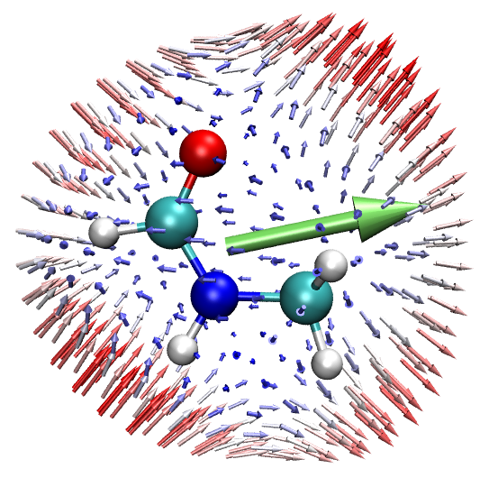 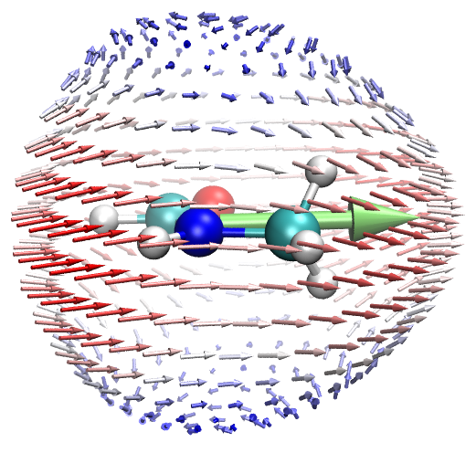

可发现该图与 *J. Comput. Chem.*, **32**, 1128 (2011) 的图 2(e) 几乎完全相同，细微差异来自数值方面以及 Gaussian 中 B3LYP 的定义与 GAMESS-US 略有不同。在该图中，球上的箭头对应缩放后的 **β**$^{eff}$ 矢量，箭头方向与 **β**$^{eff}$ 一致，长度等于 **β**$^{eff}$ 的模乘以缩放因子。箭头按长度着色，最短（最长）箭头分别为蓝色和红色，白色箭头长度居中。箭头起点均匀分布在球面上，球半径可用 Multiwfn 中的相应选项控制。

从上图能学到什么？为阐明这一点，标出三个特征区。粉色箭头是球面相应点的法向量。

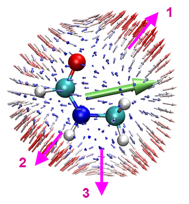

- 区域 1：如果沿粉色箭头指示的方向对分子施加两个外电场，它们的组合效应会在*相同*方向产生诱导偶极矩，如球上的小箭头所示。

- 区域 2：与区域 1 类似，但诱导偶极矩出现在与所加电场*相反*的方向。

- 区域 3：如果从上到下施加两个外电场，如粉色箭头所示，它们的组合效应会导致诱导偶极矩指向右侧。这种看似奇怪的现象反映了该分子的各向异性响应特征。显然，不用单位球表示方法，这一点很难注意到。

由于本例中的 **β** 是对应 1030 nm 的 SHG 型，上面提到的外电场实际上以 1030 nm 的频率变化，它们源自沿与之垂直方向辐射的 1030 nm 光。

上图中的大绿色箭头称为矢量表示，它对应缩放后的 (*β*$_{x}$, *β*$_{y}$, *β*$_{z}$) 矢量，展示 **β** 的主要特征。可见其方向与球上所有箭头的矢量和基本一致。毫无疑问，这种矢量表示在表示 **β** 时简洁有用，但 **β** 的各向异性特征被完全忽略。

### **4.24.5.2 环\[18\]碳的极化率和二阶超极化率**

环\[18\]碳是一个有反常电子结构的有趣体系，它的各种特征包括 (超)极化率已在我的工作中被非常全面地探讨（总结见 <http://sobereva.com/carbon_ring.html>）。本节中，我们用单位球表示直观研究它的极化率和二阶超极化率 (**γ**)，本例事实上部分重现了我的研究论文 *Chem. Asian J.* (2021) DOI: 10.1002/asia.202100589。

计算 (超)极化率包括 **γ** 的 Gaussian 输入文件已作为 *examples\polar\C18\gamma.gjf* 提供，它用 LPol-ds 基组，基组文件可从 <http://sobereva.com/345> 得到。本例中我们只研究静态 **α** 和 **γ**，因此在分子坐标后指定 0.0 作为入射光频率。几何在 ωB97XD/def2-TZVP 水平优化。

我们先从 Gaussian 输出文件提取 **α** 和 **γ** 并写为 .txt 文件。启动 Multiwfn 并输入以下命令

```text
examples\polar\C18\gamma.out  // Output file of aforementioned input file
24  // (Hyper)polarizability analysis
1  // Parse "polar" task of Gaussian
-4  // Request Multiwfn to export parsed (hyper)polarizability as .txt file
7  // Start parsing α and γ
```

现在当前文件夹有了 *alpha.txt* 和 *gamma.txt*。然后输入

```text
0  // Exit current function
5  // Visualize (hyper)polarizability via unit sphere and vector representations
-3  // Change scale factor of length of the arrows on sphere surface
0.005  // This value is smaller than default, since α of cyclo[18]carbon is fairly large. If default value is used, you will find the arrows are too long
-5  // Change length scale factor for the arrow of vector representation
0.01
1  // Perform unit sphere representation analysis of α. Since alpha.txt already exists in current folder, α tensor is automatically loaded from it
```

现在当前文件夹有了 *alpha.tcl* 和 *alpha_vec.tcl* 文件，它们分别是 **α** 单位球表示和 **α** 矢量表示的 VMD 绘图脚本。把它们移到 VMD 文件夹，启动 VMD，在 VMD 命令窗口依次输入 `source alpha.tcl` 和 `source alpha_vec.tcl` 运行它们。

为了显示分子结构，还需用 Multiwfn 把当前分子结构导出为 .pdb 文件，步骤已在上一节描述。把它载入 VMD 并将其绘制方法设为 CPK 后，我们会看到

![Unit sphere representation for cyclo\[18\]carbon](assets/figures/ch4/image1339.png)

该图中球上的箭头反映从分子中心向不同方向施加相同强度外电场时诱导偶极矩的大小和方向。从图中可清楚地看到环\[18\]碳环在平行（垂直）于环平面方向的极化率大（小）。该观察很容易理解，如我的环\[18\]碳研究论文 *Carbon*, **165**, 468 (2020) 指出，该体系有 36 个高度离域电子（18 个面内和 18 个面外电子），因此当电场平行于环施加时，这些电子会被显著极化，产生大的诱导偶极矩；相反，该体系的电子在垂直于环的方向不容易被极化。注意在我的环\[18\]碳论文 *Carbon*, **165**, 461 (2020) 中，报道平行和垂直于环的 α 分量值分别为 392 和 98 a.u.，显然上图所示与这些定量值完全一致。

上面三支中央的大双向箭头展示 **α** 沿 X、Y 和 Z 方向的相对大小，计算其长度 ($α_{x}$, $α_{y}$, $α_{z}$) 的方法已在第 [3.27.5](sec-3-27-hyperpolarizability-analysis.md#3275-通过单位球与矢量表示可视化超极化率) 节提到。从箭头长度很清楚地看出 α 在垂直于环方向的大小比其他方向低得多。

类似地，我们用单位球表示直观研究 **γ**。在 Multiwfn 窗口中输入

```text
-3  // Change scale factor of length of the arrows on sphere
1E-5  // This value is significantly smaller than default one, since magnitude of γ is quite large
-5  // Change length scale factor for the arrow of vector representation
0.00005
1  // Perform unit sphere representation analysis of γ. Since gamma.txt already exists in current folder, γ tensor is automatically loaded from it
```

把当前文件夹新生成的 *gamma.tcl* 和 *gamma_vec.tcl* 移到 VMD 文件夹，然后在 VMD 软件中依次运行它们。

注意子功能 1（主功能 24）解析的 **γ** 张量对应输入取向（相反，解析的 **α** 和 **β** 对应标准取向），因此，载入 VMD 的分子结构文件也必须对应输入取向，否则单位球表示图可能误导。为了产生对应输入取向的 .pdb 文件，把 *settings.ini* 中的 "iloadGaugeom" 改为 1，然后重启 Multiwfn 并输入

```text
examples\polar\C18\gamma.out  // Geometry in input orientation will be loaded from this file
100  // Other function (Part 1)
2  // Generate new file
1  // Export current geometry as .pdb file
C18.pdb
```

把 *C18.pdb* 载入 VMD 并以 CPK 风格显示，你会看到下图

![Unit sphere representation of cyclo\[18\]carbon for another response component](assets/figures/ch4/image1340.png)

该图的特征与 **α** 图类似。从彩色小箭头可见，平行于环施加的三个电场的组合效应能在相同方向诱导出相对强的偶极矩变化，而在垂直于环的方向该现象弱得多。

从矢量表示，即从沿 X、Y 和 Z 轴的三支大双向箭头的长度，可以更好地认识 **γ** 沿三个方向的相对大小。由于青色箭头相当短，Z 方向的 **γ** 相对可忽略。
