# **4.25 电子离域和芳香性分析的例子**

下面给出一些芳香性分析的例子，而 Multiwfn 中大多数电子离域和芳香性分析在其他节中有说明，概述见第 [4.A.3](sec-4-A-special-topics-and-advanced-tutorials.md#4a3-芳香性研究方法概述) 节。

## **4.25.3 研究苯的等化学屏蔽面 (ICSS) 和磁屏蔽分布**

等化学屏蔽面 (Iso-chemical shielding surface, ICSS) 指磁屏蔽值的等值面，它给出了芳香性的直观图像。如果你熟悉 NICS，也可以简单地把 ICSS 看作变号后的 NICS 等值面。更多信息见第 [3.28.3](sec-3-28-electron-delocalization-and-aromaticity-analyses.md#3283-生成等化学屏蔽表面-icss-及相关量) 节。在本例中我们将研究苯。由于这是一个平面体系，我们将绘制 ICSS$_{ZZ}$ 而不是 ICSS，即只考虑磁屏蔽张量中垂直于分子平面的分量。ICSS$_{ZZ}$ 必定比 ICSS 更有物理意义，正如 NICS$_{ZZ}$ 是比 NICS 更好的芳香性指标（已在 *Org. Lett.*, **8**, 863 (2006) 中证明）一样。同时我还将展示如何绘制沿一条线的磁屏蔽值和在一个平面内的磁屏蔽值。

据我所知，ICSS$_{ZZ}$ 是我在 Multiwfn 中实现 ICSS 期间首次提出的。所以，如果你的工作中涉及 ICSS$_{ZZ}$，请引用我包含 ICSS$_{ZZ}$ 分析的研究工作：*Carbon*, **165**, 468 (2020)。

你应首先为当前体系准备一个标准的单点任务的 Gaussian 输入文件，之后将用作模板输入文件。该文件已作为 *examples\ICSS\benzene.gjf* 提供，其中几何已在合理水平下优化。

启动 Multiwfn 并输入以下命令

```text
examples\ICSS\benzene.gjf  // Note that molecular plane is in XY plane
25  // Electron delocalization and aromaticity analyses
3  // Generate grid data of ICSS or related quantities
1  // Low-quality grid, magnetic shielding tensor at 130910 points will be calculated by Gaussian later. Using "medium-quality grid" could result in smoother maps, but the calculation will be much more expensive. Note that the default extension distance is 12 Bohr, which is usually large enough
n  // Do not skip the step of generating Gaussian input file, because this is the first time we carry out analysis and thus currently we do not have Gaussian input/output files in hand
```

现在 Multiwfn 基于模板文件在当前文件夹生成了大量 NMR 任务的 Gaussian 输入文件。这些文件命名为 *NICS0001.gjf*、*NICS0002.gjf* ... *NICS0017.gjf*。用 Gaussian 运行这些文件，*NICS0001.gjf* 必须第一个运行。输出文件可从这里直接下载：<http://sobereva.com/multiwfn/extrafiles/benzene_ICSS.rar>。

> **注**
>
> 如果你的 Gaussian 不能正常运行这些文件，请检查输出文件的尾部，有两个常见原因：
>
> \(1\) %mem 太小导致任务无法完成，你需要在模板 .gjf 文件中将 %mem 设为较大值后重试。
>
> \(2\) *settings.ini* 中的 "NICSnptlim" 太大，你应适当减小它后重试。原因是在 Gaussian 中对 Bq 原子数目有限制，且某种程度上取决于 Gaussian 版本和你的计算机。对于 G09 D.01 和 E.01，你应加上 "guess=huckel" 关键词，否则由于内存分配 bug，必须把 NICSnptlim 减小到很小的值才能让 Gaussian 正常运行（此时总计算耗时会相当高）。如果使用 "guess=huckel" 时在 Link401 出错，则改用 "guess=core"。对于 G16，不需要 guess 关键词。

> **提示**
>
> 你可以利用脚本 "examples\runall.sh"（Linux 用）或 "examples\runall.bat"（Windows 用），它调用 Gaussian 运行当前文件夹中的所有 .gjf 文件，生成同名但后缀为 .out 的输出文件。

假设输出文件（*NICS0001.out*、*NICS0002.out*...）已放在 "C:\benzene" 文件夹中，在 Multiwfn 中你应输入 *C:\benzene\NICS*。我们想先研究 ICSS$_{ZZ}$，因此选择 "5: ZZ component"，然后 Multiwfn 加载所有 Gaussian 输出文件并将磁屏蔽张量转换为 ICSS$_{ZZ}$ 的格点数据。之后你会看到一个新菜单，你可以直接用选项 1 可视化格点数据的等值面，用选项 2 将其导出为 cube 文件，或用选项 -1 重新选择 ICSS 的形式。ICSS$_{ZZ}$ = 2.0 ppm 的等值面如下所示

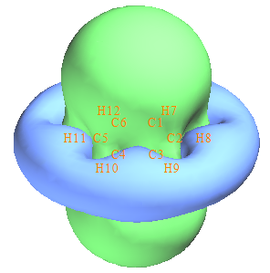

可以看到，绿色等值面（Z 分量屏蔽值为正）完全覆盖了苯环上方和下方的区域，表明由于源于全局离域 π 电子的诱导环电流，Z 方向外磁场在这些区域被大幅屏蔽，该观察意味着苯很强的芳香性。从下面的示意图可以更深入地理解 ICSS$_{ZZ}$；在垂直于苯并穿过苯的圆柱形区域内，诱导磁场（紫色箭头）方向与外磁场 (**B**₀) 恰好相反，这就是为什么该区域磁屏蔽值的 Z 分量很大的原因。

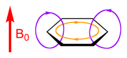

还可以看到，蓝色等值面（Z 分量屏蔽值为负）出现在苯的外侧区域，表现出退屏蔽效应。这主要是因为诱导磁场与 **B**₀ 平行，从而在该区域增强了 **B**₀。

如果你适当旋转视角，会清楚地发现 C-H 键也被绿色曲面完全覆盖。原因是参与 C-H 成键的 σ 电子形成显著的局域诱导环电流，所以外磁场在 C-H 键周围也被强烈屏蔽。

如果你想把当前格点数据导出为 .cub 文件以便用 VMD 等第三方软件可视化，可以关闭 GUI 窗口并选择 2，将格点数据导出为当前文件夹中的 *ICSSZZ.cub*。

### **基于已有的 Gaussian 输出文件直接研究 ICSS**

假设你已经得到了用于 ICSS 目的的 Gaussian 输出文件，并想直接研究 ICSS，启动 Multiwfn 后应输入以下命令：

```text
examples\ICSS\benzene.gjf
25  // Electron delocalization and aromaticity analyses
3  // Generate grid data of ICSS or related quantities
1  // Low-quality grid
y  // Skip generating Gaussian input files and thus directly load Gaussian output files
C:\benzene\NICS
5  // Study ICSS_ZZ
```

可以看到，这次采用的格点设置与我们用来生成 Gaussian 输入/输出文件时完全一致，这一点极其重要。如果格点设置不同，文件加载必定失败。

### **绘制平面内的磁屏蔽值图**

> **注**
>
> 如果你只对平面图感兴趣，强烈建议用主功能 25 的子功能 14 来实现该目的，它方便得多，而且计算耗时比计算三维 ICSS 格点数据低得多。见第 [4.25.14](#42514-绘制二维-nics-平面图的例子) 节，了解如何轻松绘制 NICS-2D 平面图。注意 NICS 和 ICSS 仅差一个符号。

下面我将展示如何绘制一个平面内的磁屏蔽值。由于我们手头已有 ICSS$_{ZZ}$ 的格点数据，通过基于格点数据的插值技术，可以很容易得到一条线/一个平面上任意点的磁屏蔽值。

我们先绘制 X=0 的 YZ 平面内 ICSS$_{ZZ}$ 的填色图。该平面垂直于苯并穿过 C4-H10 和 C1-H7。将 *settings.ini* 中的 "iuserfunc" 设为 *-3*，然后启动一个新的 Multiwfn 并输入以下命令

```text
ICSSZZ.cub
4  // Plot plane map
100  //User-defined function, which now corresponds to the function interpolated by the grid data of ICSSZZ.cub via B-spline algorithm
1  // Color-filled map
[Press Enter button]
0  // Set extension distance of the plot
8  // 8 Bohr
3  // YZ plane
0  // X=0
```

现在图形弹出来了，关闭它然后输入

```text
4  // Show atom labels
3  // Blue
1  // Change lower and upper limit of color scale
-60,60
2  // Enable showing contour lines
-2  // Set label interval in X, Y and color scale axes
3,3,10
19  // Set color transition
8  // Blue-White-Red
-1  // Replot the map
```

现在你可以看到下图

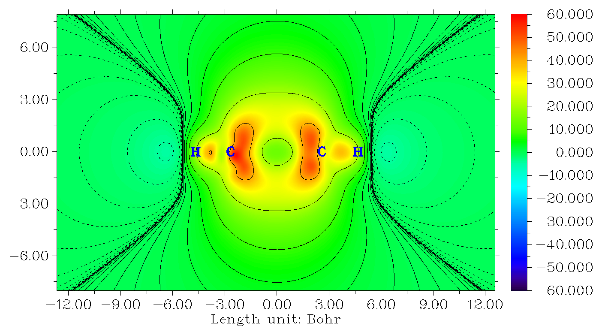

从图中可以发现，虽然苯中心磁屏蔽的 Z 分量为正值，但其大小远小于环平面上方和下方区域。原因很清楚，即苯只有 π 芳香性，而其 σ 电子没有全局离域形成 σ 芳香性，所以由于缺乏 σ 环电流的形成，平面内的屏蔽效应相对较弱。

### **磁屏蔽值的曲线图**

> **注**
>
> 如果你只对曲线图感兴趣，强烈建议用主功能 25 的子功能 13 来实现该目的，它方便得多，而且计算耗时比计算三维 ICSS 格点数据低得多。见第 [4.25.13](#42513-绘制一维-nics-曲线计算积分-inics-和-fipc-nics-的例子) 节，了解如何轻松绘制 NICS 曲线图。

接下来，我们绘制曲线图，研究垂直于环平面、从环中心出发的线上磁屏蔽的变化。选择 -5 回到主菜单并输入

```text
3  // Plot curve map
100  // User-defined function
2  // Input coordinate of two points to define a line
0,0,-8,0,0,8  // The line starts from 8 Bohr below and above the ring center
```

你会立即看到

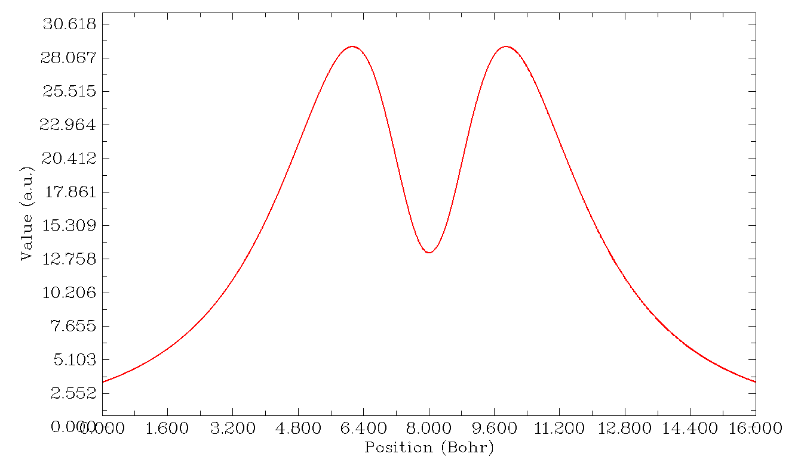

可见磁屏蔽 Z 分量的最大值出现在环平面上方/下方约 1.8 Bohr 处。如果你选择 "6 Find the positions of local minimum and maximum"，会看到

```text
Maximum X (Bohr):    6.122667  Value:    0.28936394E+02
Minimum X (Bohr):    8.000000  Value:    0.13254245E+02
Maximum X (Bohr):    9.882667  Value:    0.28937419E+02
```

即沿该线的 ICSS$_{ZZ}$ 最大值为 28.9 ppm，其位置在环平面上方/下方 9.88-8=1.88 Bohr (0.995 Å)。而在环中心处，ICSS$_{ZZ}$ 仅为 13.2 ppm。

> **注**
>
> 注意，由于计算 ICSS$_{ZZ}$ 格点数据时用的延伸距离只有 12 Bohr，当基于 ICSS$_{ZZ}$ 插值数据绘制曲线或平面图时，图中涉及的空间范围不应太大。例如，我们不能绘制从 (0,0,0) 到 (0,0,20) 的曲线图。如果某点超出格点数据插值的有效空间范围，其值将为 0。

### **基于 ICSS$_{ZZ}$ 数据计算 NICS(0)$_{ZZ}$ 和 NICS(1)$_{ZZ}$**

值得注意的是，如果你已有 ICSS$_{ZZ}$ 格点数据，无需做任何额外计算即可直接得到常用的 NICS(0)$_{ZZ}$ 和 NICS(1)$_{ZZ}$ 指标，因为任意点的 NICS 值可通过 ICSSzz 格点数据的插值直接得到。作为例子，我们计算 NICS(1)$_{ZZ}$。由于上述原因确保 *settings.ini* 中的 "iuserfunc" 已设为 -3，然后启动 Multiwfn 并输入

```text
ICSSZZ.cub
1  // Calculate function values at a point
0,0,1  // The point 1 Å above the ring center
2  // The inputted position is in Å
```

从屏幕上可发现 "User-defined real space function" 值为 28.9，即 NICS(1)$_{ZZ}$ 为 -28.9 ppm。

### **结语**

ICSS/ICSS$_{ZZ}$ 确实是讨论芳香性和反芳香性的非常有用的方法，很多例子见 ICSS 的原始论文 (*J. Chem. Soc. Perkin Trans.* 2, **2001**, 1893)，以及一些应用论文，如 *J. Phys. Chem. C*, **123**, 18593 (2019)，还有我对环\[18\]碳的研究 *Carbon*, **165**, 468 (2020)。

我强烈建议你多做一些绘制和分析 ICSS/ICSS$_{ZZ}$ 的练习，我在 "examples\ICSS" 文件夹中提供了一些理想的练习体系，包括薁 (azulene)、环丁二烯 (cyclobutadiene)、环庚三烯 (cycloheptatriene)、卟啉 (porphyrin)、丙烷 (propane) 和苝烯 (pyracylene)；其中环丁二烯是最简单的一个。下面是环丁二烯 ICSS = 0.5 等值面用两种风格的展示；从图中可以清楚地看出该体系表现出很强的反芳香性特征，4*n* π 电子在垂直于环并穿过环的圆柱形区域内引起明显的退屏蔽效应，这种情形与苯完全相反。

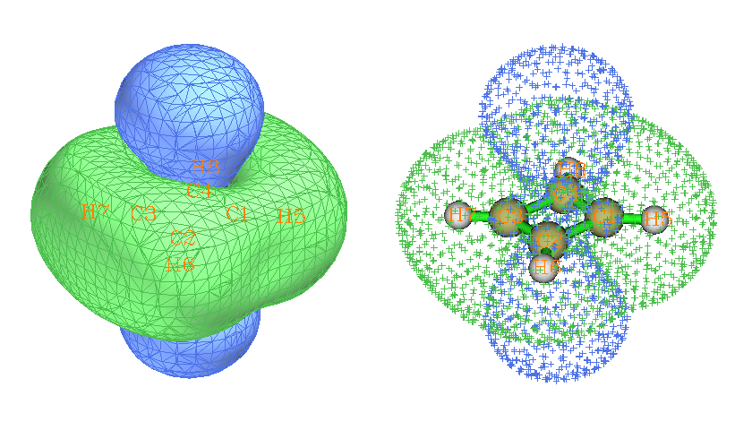

我写过一篇很详细的帖子讨论 ICSS，其中涉及 "examples\ICSS" 文件夹中的所有体系，见我的博文"使用 Multiwfn 研究芳香性：绘制等化学屏蔽面"（中文，<http://sobereva.com/216>）。

## **4.25.6 计算菲的 HOMA 和 Bird 芳香性指标**

HOMA 是最常用的基于几何均等化的芳香性指标，详见第 [3.28.6](sec-3-28-electron-delocalization-and-aromaticity-analyses.md#3286-计算-homa-和-bird-芳香性指数) 节。这里我们用 HOMA 研究菲的哪个环芳香性更强。

由于 HOMA 计算只需要分子坐标，你可以直接用如 .pdb 和 .xyz 作为输入文件。当然，其他包含分子坐标的文件，如 .wfn 和 .fch 文件也可以。本例中的几何在 B3LYP/6-31G\* 水平下优化。

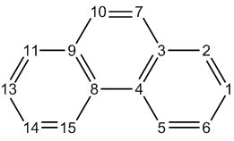

启动 Multiwfn 并输入以下命令

```text
examples/phenanthrene.pdb
25  // Electron delocalization and aromaticity analyses
6  // Calculate HOMA and Bird aromaticity index
0  // Start the calculation
```

你会看到打印了默认参数，它们取自 *J. Chem. Inf. Comput. Sci.*, **33**, 70 (1993)，你也可以在计算前通过选项 1 自行修改这些参数。

现在输入我们感兴趣的环中的原子序号，我们先计算中间环的 HOMA，所以输入 *3,4,8,9,10,7*，输入顺序必须与原子连接顺序一致。你会立即得到如下结果

```text
        Atom pair         Contribution  Bond length(Angstrom)
   3(C )  --    4(C ):      -0.065698        1.427111
   4(C )  --    8(C ):      -0.210455        1.458000
   8(C )  --    9(C ):      -0.065698        1.427111
   9(C )  --   10(C ):      -0.096016        1.435282
  10(C )  --    7(C ):      -0.033673        1.360000
   7(C )  --    3(C ):      -0.096016        1.435282
HOMA value is    0.432442
```

显然，C4-C8 对理想键长 1.388 偏离最显著，对 HOMA 给出很大的负贡献，换句话说，显著破坏了芳香性。HOMA 值按 1 加上环中所有键的贡献算得。

然后输入 *8,15,14,13,11,9* 计算边缘环的 HOMA，结果为 0.855126。由于该值比中间环的更接近 1，HOMA 表明两个边缘环的芳香性更强。

Bird 指标是另一个衡量芳香性程度的量，简述见第 [3.28.6](sec-3-28-electron-delocalization-and-aromaticity-analyses.md#3286-计算-homa-和-bird-芳香性指数) 节。现在选择选项 2 计算两个环的 Bird 指标，你会发现边缘环的值比中间环的更接近 100。同样，Bird 指标也表明两个边缘环的芳香性更强。

## **4.25.13 绘制一维 NICS 曲线、计算积分 (INICS) 和 FiPC-NICS 的例子**

> **注**
>
> 本节的中文版是我的博文"使用 Multiwfn 绘制一维 NICS 曲线并通过其积分衡量芳香性"（<http://sobereva.com/681>），其中还包含更多讨论和例子。

本节我将说明如何绘制 NICS 曲线并计算其积分（INICS 指标）以及 FiPC-NICS 指标来研究芳香性。请先阅读第 [3.28.13](sec-3-28-electron-delocalization-and-aromaticity-analyses.md#32813-nics-1d-扫描曲线图积分-nics-inics-和-fipc-nics) 节获得一些基础知识。

### **4.25.13.1 例子 1：infinitene 的 NICS$_{ZZ}$ 曲线**

在 PBE0/6-31G\* 水平优化的 infinitene 分子是 *examples\NICS_scan\infinitene.pdb*，如下所示（给出两个视角）。在本例中我们将对高亮的环做 NICS$_{ZZ}$ 扫描。扫描方向垂直于拟合的环平面、从环的几何中心指向体系外侧。

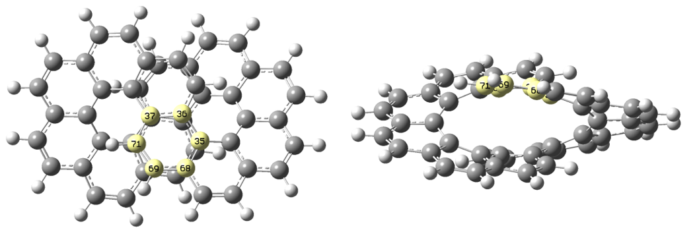

启动 Multiwfn 并输入以下命令

```text
examples\NICS_scan\infinitene.pdb  //You can also use any other file format containing structure information, similarly hereinafter
25  //Electron delocalization and aromaticity analyses
13  //NICS-1D scan curve map, integral NICS (INICS) and FiPC-NICS
2  //The two end points of scanning line are above and below the center of a plane fitted for specific atoms, and the line perpendicularly passes through their center
35-37,68-69,71  //Using these atoms (highlighted in the map above) to define a fitting plane
[Press ENTER button directly]  //The center is chosen as geometric center of the selected atoms (in this step you may also input coordinate of other type of center, such as the ring critical point obtained by topology analysis module of Multiwfn)
10  //An end point of the scanning line is above 10 Å of the fitting plane from the center
0  //Another end point is below 0 Å of the fitting plane from the center, namely the scan will start from the ring center
```

现在当前文件夹已生成 *NICS_1D.gjf*。你可以把它载入 GaussView 可视化扫描点，见下图。紫色球是 Bq 原子，将在 NMR 任务中计算其磁屏蔽张量。可见所有 Bq 原子均匀地出现在预期的扫描线上。

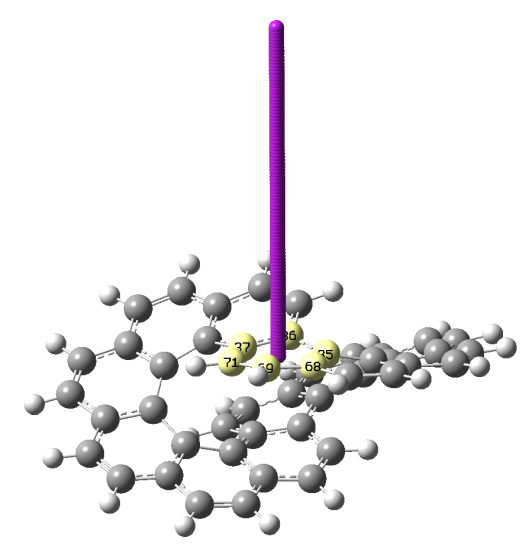

为降低耗时，手动把 *NICS_1D.gjf* 中的基组改为 6-31G\*。然后用 Gaussian 运行它。相应的输入和输出文件已在 "examples\NICS_1D" 文件夹中作为 *infinitene_NICS_1D.gjf* 和 *infinitene_NICS_1D.out* 提供。

接下来，在 Multiwfn 窗口中输入

```text
2  //Load Gaussian output file of NICS-1D scanning
examples\NICS_scan\infinitene_NICS_1D.out  //Gaussian output file
```

然后出现一个新界面，选项都是自明的。一个值得注意的选项是 -1，从中可以选择要研究的 NICS 分量。默认使用垂直于拟合平面的分量，它在表征芳香性时最有意义。假设 Z 为拟合平面法线方向，我们将其称为 NICS$_{ZZ}$。

现在选择选项 1 绘制 NICS 曲线（当前对应 NICS$_{ZZ}$），你会看到下图（在选择该选项前选一次选项 -3 可将图水平翻转）

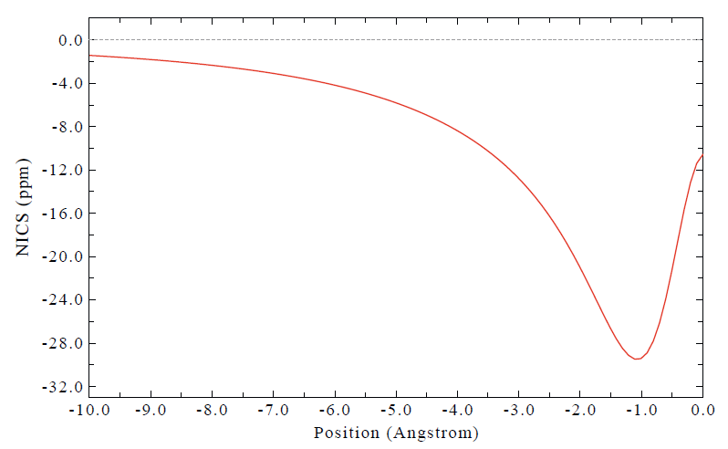

可见该环是芳香性的，因为 NICS$_{ZZ}$ 明显为负，尤其在距环中心 1 Å 处。

从屏幕上还能找到曲线的积分：

```text
Integral of NICS component:    -96.19 ppm*Angstrom
```

另外，你可以选择选项 5 得到曲线的极值：

```text
Minimum X (Angstrom):    1.111111  Value:   -0.29469963E+02
Totally found    1 minima,    0 maxima
```

### **4.25.13.2 例子 2：苯的 NICS$_{sigma,ZZ}$ 和 NICS$_{pi,ZZ}$ 曲线**

在本例中，我们将绘制苯的分别由 σ 和 π 电子贡献的 NICS$_{ZZ}$ 曲线，即 NICS$_{σ,ZZ}$ 和 NICS$_{π,ZZ}$。要绘制 NICS$_{π,ZZ}$，启动 Multiwfn 后输入以下命令。

```text
examples\NICS_scan\benzene.pdb  //Benzene optimized at B3LYP/6-31G* level, the molecule is lying at XY plane of Z=0
25  //Electron delocalization and aromaticity analyses
13  //NICS-1D scan curve map, integral NICS (INICS) and FiPC-NICS
2  //The two end points of scanning line are above and below the center of a plane fitted for specific atoms, and the line perpendicularly passes through their center
1-6  //Using all carbon atoms in this system to define a fitting plane
[Press ENTER button directly]  //The center is chosen as geometric center of the selected atoms
10  //An end point of the scanning line is above 10 Å of the fitting plane from the center
10  //Another end point is below 10 Å of the fitting plane from the center
```

这次用的模板文件内容如下，它要求 Gaussian 只计算由 MO 17,20,21（当前水平下苯的 π-MO）贡献的磁屏蔽信息。关键词 *nmr=csgt iop(10/93=2)* 必须有。*AICD.txt* 是该 IOp 生成的文件，在此情形下完全无用，运行后可直接删除。

```text
#p b3lyp/6-31+G* nmr=csgt iop(10/93=2)

template file

  0  1
[geometry]

AICD.txt

17,20,21

　 
```

用 Gaussian 运行当前文件夹生成的 *NICS_1D.gjf*。输出文件已作为 *examples\NICS_scan\benzene-pi_NICS_1D.out* 提供。

接下来，在 Multiwfn 窗口中输入

```text
2  //Load Gaussian output file of NICS-1D scanning
examples\NICS_scan\benzene-pi_NICS_1D.out  //Gaussian output file
1  //Plot NICS curve map, which corresponds to NICS_π,ZZ in present case
```

现在你可以看到下图。X=0 对应环中心位置。

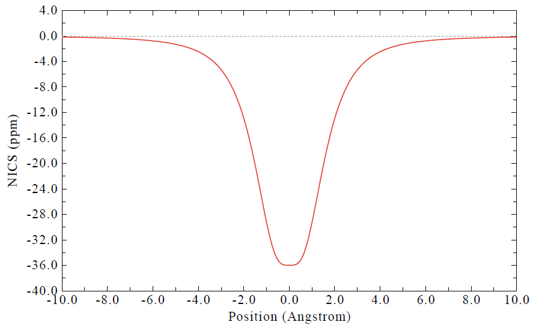

你可以用几乎完全相同的方法绘制 NICS$_{σ,ZZ}$，唯一区别是在模板文件中应指定 σ MO 的序号。相应的模板文件是 *examples\NICS_scan\template_NMR_benzene-sigma.gjf*。

在 "examples\NICS_scan\\" 文件夹中，*C5H5-.pdb* 和 *C7H7+.pdb* 分别是优化好的 C₅H₅⁻ 和 C₇H₇⁺ 离子。你可以用上面展示的相同方法得到它们的 NICS$_{σ,ZZ}$ 和 NICS$_{π,ZZ}$ 曲线，相关文件也在该文件夹中提供。注意在界面中你可以选择选项"3 Export NICS curve data along the line"把曲线数据导出为纯文本文件。然后，把不同情形的曲线数据导入如 Origin 后，你可以把它们画在一起，如下所示。

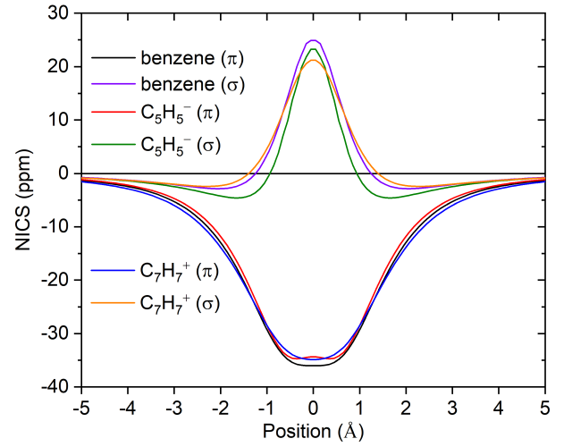

可见 σ 电子对环中心附近的 NICS$_{ZZ}$ 有可观的影响。根据 NICS$_{π,ZZ}$ 曲线，三个体系都表现出相当的 π 芳香性。但它们的差异可从积分定量判定。苯、C₅H₅⁻ 和 C₇H₇⁺ 的 NICS$_{π,ZZ}$ 积分分别为 -142.45、-134.85 和 -145.02 ppm⋅Å，表明 π 芳香性强弱为 C₇H₇⁺ ≥ 苯 \> C₅H₅⁻。

### **4.25.13.3 例子 3：计算苯的 FiPC-NICS 指标**

> **注**
>
> 关于 FiPC-NICS 的更多讨论见我的博文"使用 Multiwfn 计算 FiPC-NICS 芳香性指标"（<http://sobereva.com/724>，中文）。

在主功能 25 的子功能 13 的后处理菜单中可直接计算 FiPC-NICS 芳香性指标，下面以苯为例说明。如果你不熟悉它，请查阅第 [3.28.13](sec-3-28-electron-delocalization-and-aromaticity-analyses.md#32813-nics-1d-扫描曲线图积分-nics-inics-和-fipc-nics) 节。

启动 Multiwfn 并输入

```text
examples\NICS_scan\benzene.pdb  //Benzene optimized at B3LYP/6-31G* level, the molecule is lying at XY plane of Z=0
25  //Electron delocalization and aromaticity analyses
13  //NICS-1D scan curve map, integral NICS (INICS) and FiPC-NICS
2  //The two end points of scanning line are above and below the center of a plane fitted for specific atoms, and the line perpendicularly passes through their center
1-6  //Using all carbon atoms in this system to define a fitting plane
[Press ENTER button directly]  //The center is chosen as geometric center of the selected atoms
0  //An end point of the scanning line is 0 Å from the center
10  //Another end point is 10 Å from the center
200  //200 points used in NICS scan
1  // Generate Gaussian input file for NICS-1D scanning
examples\NICS_scan\template_NMR.gjf  //Gaussian template file corresponding NMR calculation at B3LYP/6-31+G* level
```

现在当前文件夹已生成 NICS_1D.gjf，把它重命名为 *benzene_NICS_1D_0to10.gjf* 并用 Gaussian 运行。输出文件已提供。接下来，我们输入

```text
2  // Load Gaussian output file of NICS-1D scanning
examples\NICS_scan\benzene_NICS_1D_0to10.out  //Gaussian output file
6  //Calculate FiPC-NICS
```

你会立即看到结果：

```text
FiPC-NICS is   -9.332247 ppm, at   1.179 Angstrom
```

结果表明，在苯环中心上方 1.179 Å 处，NICS 的面内分量（NICS$_{in}$）消失，面外分量（NICS$_{out}$）为 -9.33 ppm。该结果与 FiPC-NICS 原始论文中的相应数据（-9.59 ppm 在 1.18 Å 处，几何优化和 NMR 计算用 PBE0/6-311++G\*\*）非常接近。

Multiwfn 还在当前文件夹导出了 *FiPC-NICS.txt*，每列的含义在屏幕上清楚地给出。该文件包含所有扫描点的信息。你可以取最后两列，即 NICS$_{in}$ 和 NICS$_{out}$，分别作为 X 轴和 Y 轴绘制散点+连线图。所得图如下所示，与 FiPC-NICS 原始论文的图 1 符合得非常好。

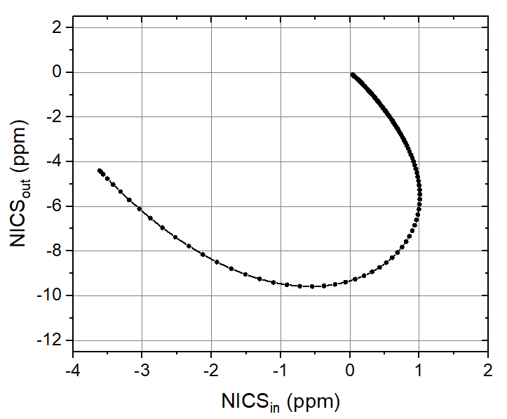

## **4.25.14 绘制二维 NICS 平面图的例子**

> **注**
>
> 本节的中文版是我的博文"使用 Multiwfn 轻松绘制二维 NICS 平面图研究芳香性"（<http://sobereva.com/682>），其中还包含更多讨论和例子。

本节我将说明如何绘制 NICS 平面图。请先阅读第 [3.28.14](sec-3-28-electron-delocalization-and-aromaticity-analyses.md#32814-nics-2d-扫描平面图) 节获得一些基础知识。注意下面例子中的 NICS$_{ZZ}$ 指垂直于所关注平面的 NICS 分量，Z 并不总对应 Z 轴。

### **4.25.14.1 绘制晕苯上方 1 Å 的 NICS$_{ZZ}$ 平面图**

在本例中我们绘制晕苯 (coronene) 上方 1 Å 的填色 NICS$_{ZZ}$ 平面图，在 B3LYP/6-31G\* 水平优化的晕苯是 *examples\NICS_scan\coronene.pdb*。该分子是完全平面的，位于 Z=0 的 XY 平面。

启动 Multiwfn 并输入以下命令

```text
examples\NICS_scan\coronene.pdb
25  //Electron delocalization and aromaticity analyses
14  //NICS-2D scan plane map
1  //Color-filled map
[Press ENTER button directly]  //Using default number of grid points (100*100)
0  //Set extension distance
1  // 1 Bohr
1  //XY plane
1a  //Z = 1Å
1  //Gaussian input file for NICS-2D scanning
examples\NICS_scan\template_NMR.gjf  //Template input file of NMR task of Gaussian, which is used to generate Gaussian input file for NICS-2D scan. [geometry] line in this file will be replaced with coordinates of scanning points, while other parts are kept unchanged
NICS_2D.gjf has been generated in current folder, you can properly modify it according to actual situation. Run it by Gaussian, the output file is examples\NICS_scan\coronene_NICS_2D.out.
```

接下来，在 Multiwfn 窗口中输入

```text
2  //Load Gaussian output file of NICS-2D scanning
examples\NICS_scan\coronene_NICS_2D.out
5  //Taking ZZ Cartesian component. Since the molecule is exactly in XY plane, the resulting NICS will correspond to NICS_ZZ in common sense (i.e. the component normal to ring plane)
```

从屏幕上可找到该平面内 NICS$_{ZZ}$ 的最小值和最大值：

```text
The minimum of data:  -43.3034000000000
The maximum of data:   11.3487000000000
```

关闭屏幕上显示的图，然后输入以下命令微调绘图设置

```text
4  //Enable showing atom labels
1  //Red
8  //Enable showing bonds
14  //Brown
17  //Set distance threshold for showing atom labels
5  //5 Bohr
y  //Show labels of the atoms that beyond the threshold by light font
1  //Set lower&upper limit of color scale
-45,45
-8  //Change length unit of the graph to Angstrom
-2  //Set label intervals in X, Y, and color scale axes
2,2,10
2  //Enable showing contour lines
3  //Change contour line setting
8  //Generate contour value by arithmetic progression
-50,5,21  //Starting value, step, and total number
y  //Removing existing contour lines. Then the contour values will be -50,-45,-40...40,45,50
1  //Save setting and return
-1  //Replot
```

现在你得到下图。由此可以清楚地看出外圈的芳香性比内环强，因为前者上方 1 Å 的 NICS$_{ZZ}$ 明显比后者更负。

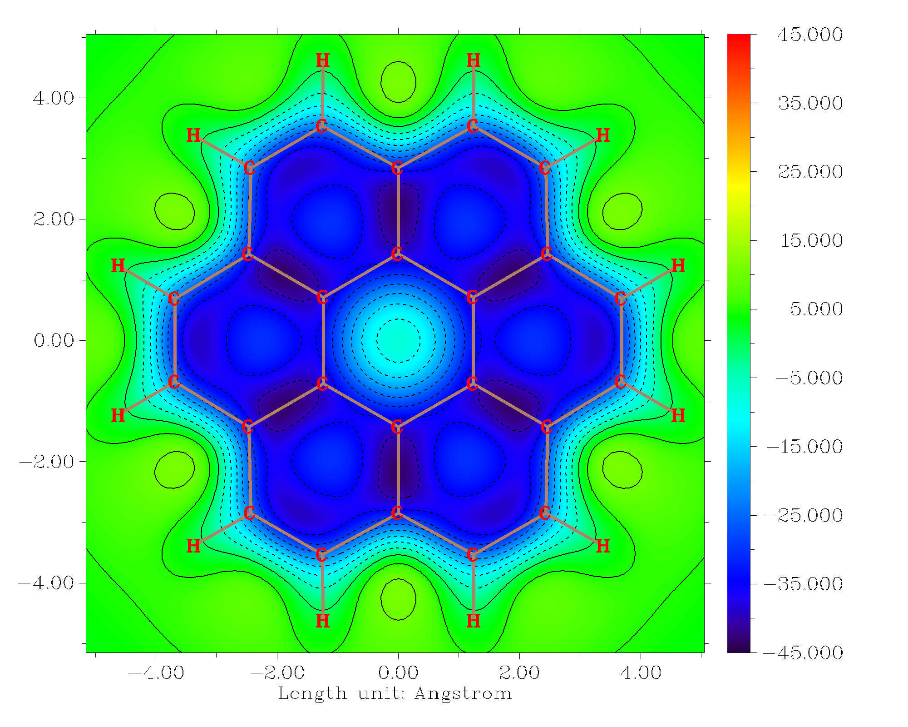

### **4.25.14.2 绘制 N(phenyl)₃ 苯环上方 1 Å 的 NICS$_{ZZ}$ 平面图**

在本例中，我们将绘制下面所示 N(phenyl)₃ 高亮环上方 1 Å 的 NICS$_{ZZ}$ 平面图。由于该环相对 Cartesian 轴是倾斜的，我们将用特殊方式定义绘图平面。

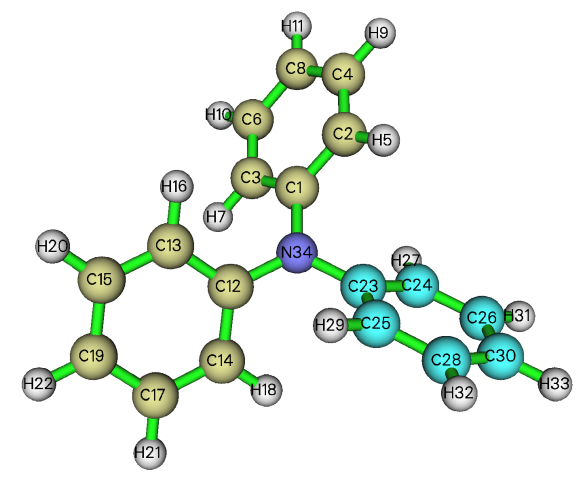

启动 Multiwfn 并输入以下命令

```text
examples\NICS_scan\N(phenyl)3.pdb  //Structure optimized at B3LYP/6-31G* level
25  //Electron delocalization and aromaticity analyses
14  //NICS-2D scan plane map
1  //Color-filled map
[Press ENTER button directly]  //Using default number of grid points (100*100)
8  //The plotting plane is above or below the plane consisting of specific atoms
23,24,26,30,28,25  //Atoms in the ring of interest
```

注意屏幕上显示了所选原子拟合平面的单位法向量，请记下来，之后会用到：

```text
The unit normal vector is    0.33076524    0.57300118    0.74984265
```

```text
1  //The plotting plane is parallel to the fitting plane and at 1 Å above it. Negative value means below it
6  //Length of the plotting plane (a square region) is set to 6 Å
```

现在你可以在屏幕上找到以下信息：

```tcl
draw triangle {   2.495   2.581  -1.739} {  -1.211  -0.235   2.047} {   6.776  -1.451  -0.547}
draw triangle {  -1.211  -0.235   2.047} {   6.776  -1.451  -0.547} {   3.070  -4.266   3.239}
draw material Transparent
```

如果你把 *N(phenyl)3.pdb* 载入 VMD，然后在 VMD 命令窗口运行上面三条命令，再适当调整图形表示，你会看到下图，它展示了绘图平面对应的区域。可见绘图平面已被正确定义。

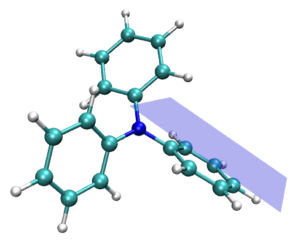

接下来，输入以下命令

```text
1  //Generate Gaussian input file for NICS-2D scanning
examples\NICS_scan\template_NMR.gjf  //Template file of Gaussian for NMR task
```

现在当前文件夹已生成 *NICS_2D.gjf*，手动编辑它把基组改为 6-31G\*，然后用 Gaussian 运行。输出文件已作为 *examples\NICS_scan\N(phenyl)3_NICS_2D.out* 提供。

然后在 Multiwfn 窗口中输入

```text
2  //Load Gaussian output file of NICS-2D scanning
examples\NICS_scan\N(phenyl)3_NICS_2D.out
0  //Take the NICS component along specific direction
0.33076524    0.57300118    0.74984265  //The unit normal vector shown by Multiwfn earlier
```

现在屏幕上已显示 NICS$_{ZZ}$ 平面图。关闭它并适当调整绘图设置（参考第 [4.4](sec-4-4-output-and-plot-various-properties-in-a-plane.md) 节丰富的例子），最终可得到下图所示的相当漂亮的图。注意颜色过渡已设为 Yellow-Orange-Black，对应范围 \[-34,0\]。

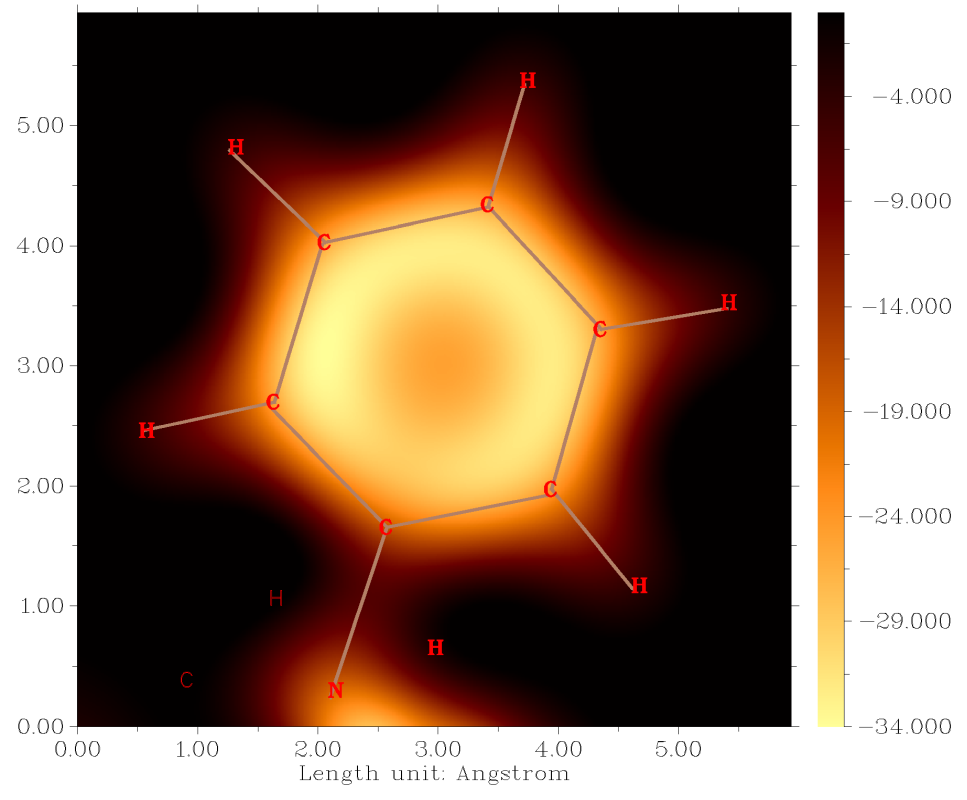

显然该苯环是芳香性的，因为它上方 1 Å 的 NICS$_{ZZ}$ 明显为负。还注意到环内侧的磁屏蔽略强于环中心。
