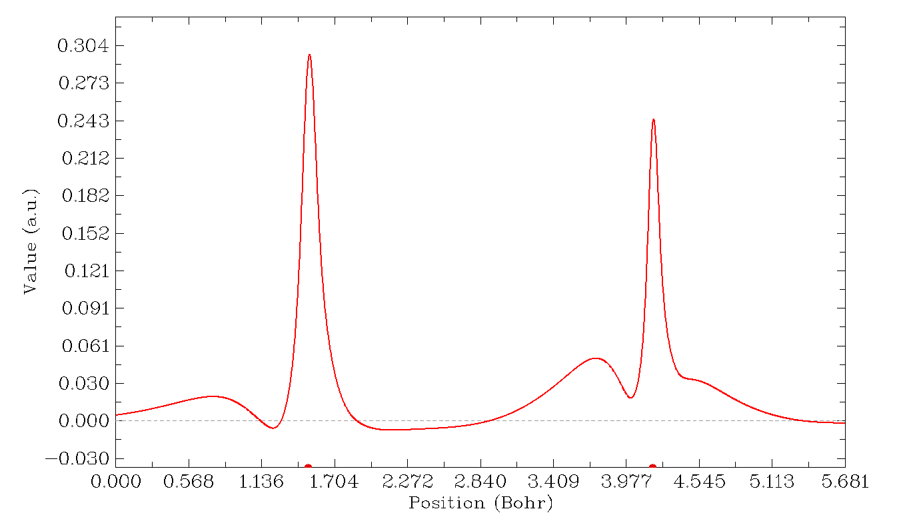
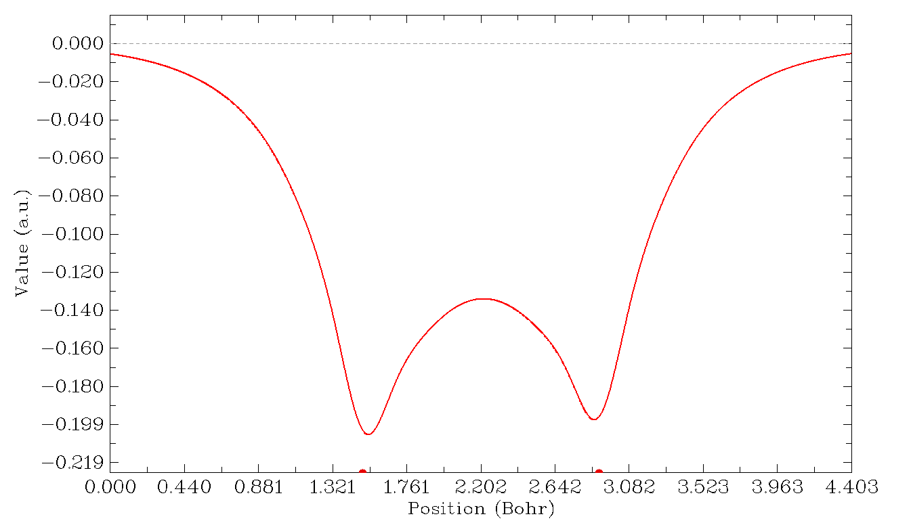
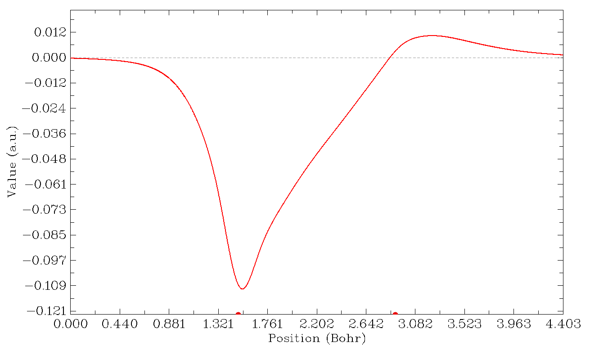
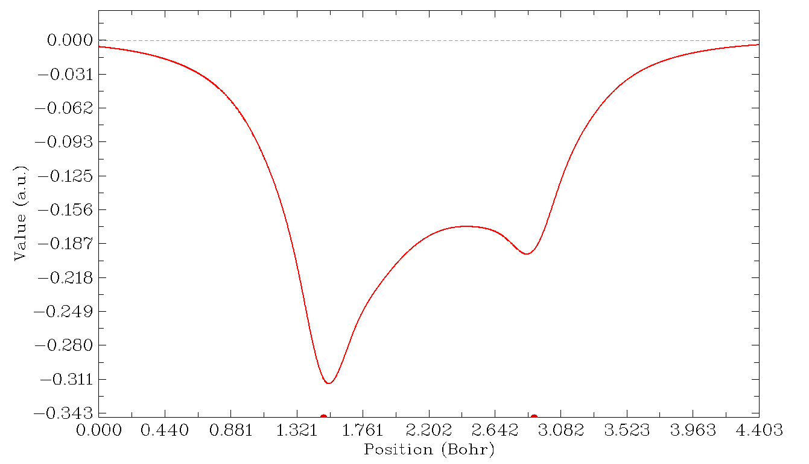
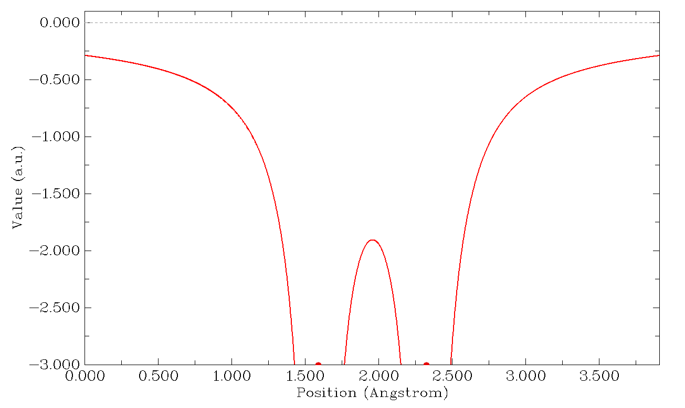
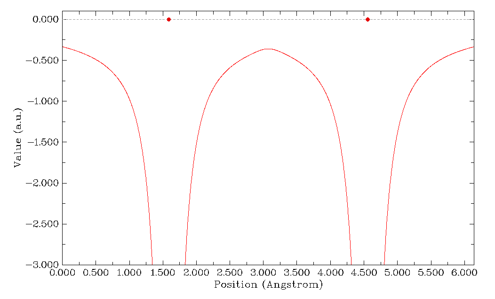

# **4.3 在一条线上输出并绘制各种性质**

## **4.3.1 沿碳原子和氧原子绘制三重态甲酰胺的自旋密度曲线**

启动 Multiwfn 并输入以下命令

```text
examples\formamide-m3.wfn
3  // Main function 3, plot real space function along a line
5  // Spin density
1  // Defining the line by nuclear coordinate of two atoms
1,6  // Indices of the two atoms, carbon and oxygen atoms correspond to 1 and 6 in present example, respectively
```

图形会立即显示：



X 轴对应于你所定义的线上位置，虚线对应于 Y=0 的位置，左右两个红色圆圈分别表示你所选第一个和第二个原子的位置。在图形上点击鼠标右键关闭图形后，命令行窗口会出现一个新菜单，你可以通过相应选项保存图形文件、调整 Y 轴范围、导出 X-Y 数据点以及重绘图形等。选择选项 6 可以定位极小值和极大值位置：

```text
Local maximum X:    0.753677  Value:    0.20104903D-01
Local minimum X:    1.219518  Value:   -0.55161276D-02
Local maximum X:    1.503567  Value:    0.29655008D+00
Local minimum X:    2.145518  Value:   -0.70202704D-02
Local maximum X:    3.736194  Value:    0.51047629D-01
Local minimum X:    4.006988  Value:    0.18918295D-01
Local maximum X:    4.184992  Value:    0.24448996D+00
Totally found    3 local minimum,    4 local maximum
```

使用上面介绍的相同步骤，你可以绘制 Multiwfn 支持的任何实空间函数 (real space function) 的曲线图，请试一试。

## **4.3.2 研究 H₂ 的 Fermi 空穴和 Coulomb 空穴**

> **注**
>
> 这是一个相对高级的例子，如果你是量子化学新手，可以跳过本节。

在本例中，我们将沿 H₂ 的轴线绘制关联空穴 (correlation hole)（Fermi 空穴和 Coulomb 空穴）。这是一个高级话题，如果你不熟悉关联空穴的概念，请查阅第 [2.6](sec-2-6-real-space-functions.md) 节第 17 部分中的讨论。

Hartree-Fock 波函数能够描述 Fermi 关联，但完全忽略了 Coulomb 关联。在这种情况下，可以用 Multiwfn 计算并绘制精确的 Fermi 空穴。如果需要分析 Coulomb 空穴，则必须使用后 HF (post-HF) 波函数。在当前版本中，Multiwfn 能够通过 Müller 近似对后 HF 波函数计算并绘制近似的 Fermi 空穴和 Coulomb 空穴，该近似利用自然轨道 (natural orbital) 来模拟精确的对密度 (pair density)。虽然引入了近似，但结果一般至少在定性上是正确的。

首先，我们在 CCSD/cc-pVTZ 水平下优化 H₂ 并生成 .wfn 文件。CCSD 是 Gaussian 程序能产生的最高水平的波函数（如果需要更高水平的波函数，必须求助于其他程序，详见第 [4.A.8](sec-4-A-special-topics-and-advanced-tutorials.md#4a8-分析高于ccsd水平的波函数) 节）。该文件已作为 *examples\H2_CCSD.wfn* 提供。H1 的坐标为 (0.0, 0.0, 0.7016) Bohr，H2 的坐标为 (0.0, 0.0, -0.7016) Bohr。

关联空穴涉及两个电子的坐标，为了直观地研究它，我们必须确定参考电子的位置。在本例中，我们将参考点设在 (0.0,0.0,-0.3) Bohr。因此，打开 *settings.ini*，将 *refxyz* 参数改为 0.0,0.0,-0.3。

我们首先分析的关联空穴是 Fermi 空穴（也称为交换空穴 (exchange hole)），因此将 *settings.ini* 中的 *paircorrtype* 改为 1。由于这是闭壳层体系，*α* 或 *β* 电子的结果完全相同，而对于开壳层体系，你应该用 *settings.ini* 中的 "pairfunctype" 选择将研究哪种自旋的电子，你也可以通过调整该参数来选择研究交换-关联密度或关联因子。

现在启动 Multiwfn，输入以下命令

```text
examples\H2_CCSD.wfn
3  // Draw curve map
17  // Correlation hole
1  // Defining the line by nuclear coordinate of two atoms
2,1  // Draw curve graph along H2 and H1
```

然后你将看到



该图表明，如果我们在 (0.0,0.0,-0.3) 处放置一个 *α* 电子，那么由于同自旋电子之间的 Pauli 排斥，在两个原子核周围找到另一个 *α* 电子的概率将以几乎相同的程度显著降低。在 H-H 成键区，概率也明显降低。根据 Bader 的陈述 "An electron can go where its hole goes and, if the Fermi hole is localized, then so is the electron"（见 *Atoms in molecules - A quantum theory* 第 251 页），我们可以说，如果一个 *α* 电子出现在 (0.0,0.0,-0.3)，那么它必定能够容易地离域到整个 H₂ 分子空间。

现在我们研究 Coulomb 空穴。关闭 Multiwfn，将 "paircorrtype" 改为 2，重启 Multiwfn，然后用相同步骤重新绘制曲线图，你将看到



左右两侧的红点分别标示了 H2 和 H1 的位置。如何在图上推断参考点的位置？从提示 "Set extension distance for mode 1, current: 1.500000 Bohr" 可知，绘制范围相对于 H2 和 H1 的 Z 坐标向两侧各延伸了 1.5 Bohr，而我们知道参考点的 Z 坐标比 H2 大约 0.4016 Bohr，所以上图中参考点的位置为 1.5+0.4016=1.9016 Bohr（如果你想在图上标出参考点的位置，可以选择 "4 Draw a vertical line at specific X" 并输入 *1.9016*，然后通过选项 -1 重绘图形）。上图表明，由于 Coulomb 排斥，在离参考电子最近的氢（即 H2）周围找到另一个电子（*α* 或 *β*）的概率大幅降低。作为补偿，在 H1 背侧的概率增加了。

最后，我们研究 Fermi 关联和 Coulomb 关联的综合效应。将 "paircorrtype" 改为 3，再次绘制线图，你将看到



该图实际上是前两张图之和。从该图可以清楚地看出，在离参考电子最近的氢周围找到电子（*α* 或 *β*）的概率降低比在另一个氢周围更严重。

## **4.3.3 用 PAEM-MO 方法研究原子间相互作用**

> **注**
>
> 这是一个相对高级的例子，如果你是量子化学新手，可以跳过本节。

在 *J. Comput. Chem.*, **35**, 965 (2014) 中，作者提出了一种名为 PAEM-MO 的方法，用于揭示两个原子之间（共价或非共价结合）相互作用的本质。在本例中，我将简要介绍该方法，并展示如何在 Multiwfn 中实现 PAEM-MO 分析。

PAEM（作用于分子中一个电子上的势，potential acting on one electron in a molecule）指作用于 **r** 处电子的总势，可写为 $V_{\mathrm{PAEM}}(\mathbf{r})=-V_{\mathrm{ESP}}(\mathbf{r})+V_{\mathrm{XC}}(\mathbf{r})$ ；其中 $V_{\mathrm{ESP}}$ 是分子静电势 (molecular electrostatic potential)，已在第 [2.6](sec-2-6-real-space-functions.md) 节第 12 部分介绍。$-V_{\mathrm{ESP}}$ 可视为体系中作用于电子的经典势，而交换-关联 (XC) 势 $V_{\mathrm{XC}}$ 则代表由于量子效应导致的重要修正。$V_{\mathrm{XC}}$ 有两个分量，即关联势（ $V_{\mathrm{C}}$ ）和交换势（ $V_{\mathrm{XC}}$ ）；事实上只有后者是重要的，这意味着即使在 Hartree-Fock 水平得到的势一般也是精确 $V_{\mathrm{XC}}$ 的良好近似。

在波函数理论中，交换-关联势可明确写为 $V_{\mathrm{XC}}(\mathbf{r})=\frac{1}{\rho(\mathbf{r})}\int\frac{\Gamma_{\mathrm{XC}}(\mathbf{r},\mathbf{r}')}{\left|\mathbf{r}-\mathbf{r}'\right|}\mathrm{d}\mathbf{r}'$ ，其中 Γ 称为交换-关联密度，详见第 [2.6](sec-2-6-real-space-functions.md) 节第 17 部分。在 DFT 理论中，XC 势直接来自交换-关联泛函对电子密度的变分，即 $V_{\mathrm{XC}}(\mathbf{r})=\delta E_{\mathrm{XC}}[\rho(\mathbf{r})]/\delta\rho(\mathbf{r})$ 。$V_{\mathrm{XC}}$ 在 Multiwfn 中可用自定义函数 (user-defined function) 使用。如果参数 "iuserfunc" 设为 **33**，则将基于 Γ 计算 $V_{\mathrm{XC}}$；如果设为 **34**，则根据 DFT XC 势计算 $V_{\mathrm{XC}}$，此时计算耗时比 **33** 低数倍。更多信息请查阅第 [2.7](sec-2-7-user-defined-real-space-function.md) 节中的相应描述。

HF 和 KS-DFT 理论的本质是单电子本征方程

$$
\hat{h}\varphi(\mathbf{r})=\varepsilon\varphi(\mathbf{r})
$$

其中

$$
\hat{h}=-(1/2)\nabla^2+V_{\mathrm{PAEM}}(\mathbf{r})
$$

求解该方程得到一组 MO { $\varphi$ }，其本征值对应于在轨道中运动的电子的能量。

根据 PAEM-MO 的观点，如果一个占据 MO 的能量高于一对原子之间 $V_{\mathrm{PAEM}}$ 的势垒，那么该 MO 中的电子将能自由离域到两个原子上，从而对共价成键有直接贡献。

下面我给出两个非常简单的例子，说明用 PAEM-MO 方法判断原子间相互作用类型。更多例子和讨论见 *J. Comput. Chem.*, **35**, 965 (2014)。

### **氢分子中的 H-H 相互作用**

首先将 *settings.ini* 中的 "iuserfunc" 设为 33，则自定义函数等价于基于 Γ 计算的 $V_{\mathrm{XC}}$。启动 Multiwfn 并输入以下命令

```text
examples\H2.fch  // Produced at HF/def2-TZVP level
3  // Plot real space function along a line
100  // User-defined function
0  // Adjust extension size at both sides
3  // 3 Bohr, which is larger than the default value
1  // Use two nuclei to define the line
1,2
```

关闭图形，然后调整一些绘图参数使图形更好看

```text
11  // Change length unit of the graph to Å
3  // Change range of Y axis
-3,0.1  // From -3.0 a.u. to 0.1 a.u.
10  // Set label intervals of X and Y axes
0.5,0.5
-1  // Replot
```

你将看到下图，它展示了沿 H₂ 轴线的 PAEM 曲线



可以看到，在 H-H 键中点附近存在 PAEM 势垒。为了定位势垒的准确值，关闭图形并选择 6。从输出中找到曲线的最大值为 -1.903 a.u. (-51.78 eV)。当前体系只有一个双占据 MO，其能量 (-16.23eV) 明显超过了 PAEM 势垒，意味着该电子并不束缚在任何氢原子内，而是对 H-H 成键有显著贡献，因此 H-H 键必定是共价键。

### **He₂ 中的 He-He 相互作用**

请用与上面相同的步骤绘制 He₂ 中沿 He-He 轴线的 PAEM 曲线。这里使用的波函数文件是 *examples\He2.fch*，它是在间距为 2.97 Å（一个合理的距离）下 HF/def2-TZVP 水平产生的。所得图形应如下所示



显然，PAEM 势垒 (-9.78 eV) 高于 H₂ 的情形。两个双占据 MO 的能量分别为 -25.03 和 -24.91 eV，都低于势垒，因此每个 He 原子中的电子很难（但由于隧穿效应并非完全不可能）越过势垒自由离域到另一个 He。He-He 相互作用因此应视为非共价相互作用。

注意，在 PAEM-MO 的原始论文中 PAEM 是基于昂贵的 CISD 波函数计算的，而我们仅用了 HF 波函数。然而，我们的结果与 CISD 水平的结果符合得很好，表明在 PAEM 研究中关联势可以安全地忽略。

建议感兴趣的用户将 iuserfunc=34 重绘 PAEM，以在 PAEM 中采用 DFT XC 势，你会发现结果与我们之前得到的非常相似。

值得注意的是，尽管 PAEM-MO 分析方法有明确的物理意义，但它的许多局限性严重阻碍了它成为像 ELF 或 LOL 那样区分共价和非共价相互作用的通用方法：(1) PAEM-MO 分析并非在所有情况下都给出合理结论。例如，PAEM-MO 错误地表明水二聚体中的氢键是共价相互作用。(2) PAEM-MO 难以应用于多原子分子，因为常常存在太多形状复杂的占据轨道。(3) 如果两个原子靠得太近，PAEM-MO 几乎总是表明相互作用是共价的。
