# **4.300 其他功能（第三部分）**

## **4.300.1 可视化晶胞中的自由区域并计算自由体积的例子**

> **注记**
>
> 本主题的中文版是我的博文“使用 Multiwfn 图形化显示分子动力学中的孔洞和自由区域”（<http://sobereva.com/539>）和“使用 Multiwfn 计算晶体结构中自由区域体积并图形化显示自由区域”（<http://sobereva.com/617>），其中包含更多讨论并介绍了更多技巧。

Multiwfn 能够可视化晶胞中的自由区域（即孔洞或空腔）并计算自由体积，请先认真阅读 3.300.1 节 [3.300.1](sec-3-300-other-functions-part-3.md#33001-查看胞中的自由区域并计算自由体积)以了解本节所展示功能的基本信息和所用的算法。下面我将通过两个例子来展示该功能。

### **例 1：分子动力学模拟产生的煤结构**

在第一个例子中，我们以 *examples\coal.pdb* 为例，它是周期性边界条件下煤分子动力学模拟的一帧：

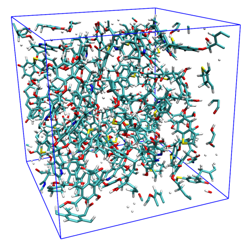

注意，若用文本编辑器打开该文件，可发现如下一行：

```text
CRYST1   31.064   31.100   31.093  90.00  90.00  90.00 P 1         1
```

意思是盒子为长方体，X、Y、Z 方向的长度分别为 31.064、31.100、31.093 Å。

启动 Multiwfn 并输入

```text
examples\coal.pdb
300  // Other functions (Part 3)
1  // Viewing free regions and calculating free volume in a cell
4  // Set method of smoothing
1  // Gaussian function
1.8  // FWHM of Gaussian function is 1.8 times of vdW radius, which is found to be able to result in satisfactory isosurface map of smoothed grid data for present system
1  // Set grid and start calculation
[Press ENTER button]  // Use default origin (0,0,0), which is suitable for present system
[Press ENTER button]  // Use default box lengths, which correspond to the lengths of the three sides of the present cell
[Press ENTER button]  // Use default grid space 0.25 Å, which is usually fine enough
```

格点数据计算完成后，可看到关于自由区域大小的信息：

```text
Volume of entire box:   30038.649 Angstrom^3
Free volume:   14783.074 Angstrom^3, corresponding to   49.21 % of whole space
```

该输出表明，整个晶胞中约有一半不在体系的范德华（van der Waals）表面之内。

在新出现的菜单中选择选项 3 可视化平滑后格点数据的等值面，然后在图形界面中勾选 "Show molecule" 和 "Show data range" 复选框，即可看到分子结构以及代表自由区域的等值面：

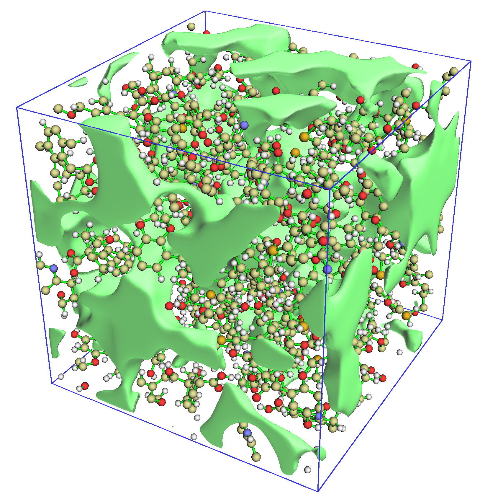

从上图可以看出，实际的自由区域被等值面非常生动、清晰地揭示出来。默认等值面数值为 0.5。若增大它，等值面会收缩，只显示显著的孔洞；反之，若减小等值面数值，已有的等值面会膨胀，图中还会出现更多不显著的孔洞。

> **注记**
>
> 平滑方法的选择会显著影响平滑后格点数据的等值面。从上图可以看出，半高全宽（FWHM）=1.8 Bohr 的高斯（Gaussian）函数对本体系效果很好，但有时并不如预期那样合理。例如，当体系由拥挤的原子组成（如原子团簇）时，这种平滑函数可能带来人为假象，因为它衰减得太慢，有时与自由区域对应的等值面面积过小或完全消失。此时可尝试其他平滑函数，如 Becke 函数或误差（error）函数，默认的是缩放因子为 1.0 的误差函数。也可以尝试比本例更小的半高全宽的高斯函数。

在后处理菜单中，还可以将平滑后的格点数据导出为 .cub 文件，以便用 VMD、ChimeraX 和 VESTA 等第三方可视化工具渲染。还可以找到用于可视化原始格点数据等值面的选项，不过正如你将看到的，该等值面几乎无法展示本体系的孔洞特征，而且等值面非常锯齿状，这体现了 Multiwfn 所采用平滑算法的重要性，格点数据计算算法的细节见 3.300.1 节 [3.300.1](sec-3-300-other-functions-part-3.md#33001-查看胞中的自由区域并计算自由体积)。

值得注意的是，如 4.200.14.2 节 [4.200.14.2](sec-4-200-other-functions-part-2.md#4200142-用域分析模块可视化分子空腔并计算其体积)所示，Multiwfn 的域分析模块也能可视化空腔并计算空腔体积，但该模块只适合研究单个分子的内部空腔，不能像本体系这样研究大晶胞中的所有孔洞。

### **第 2 部分：共价有机框架晶体**

Multiwfn 也能查看实验测定的分子晶体的自由区域并计算其体积。本例以共价有机框架（COF，covalent organic frame）体系为例说明这一点。注意，虽然该晶体的晶胞是非正交的，Multiwfn 同样能正确工作。

启动 Multiwfn 并输入

```text
examples\COF_12000N2.cif
300  // Other functions (Part 3)
1  // Viewing free regions and calculating free volume in a cell
1  // Set grid and start calculation
[Press ENTER button]  // Use default origin (0,0,0)
[Press ENTER button]  // Use default box lengths
[Press ENTER button]  // Use default grid space 0.25 Å
```

屏幕上显示的定量数据为

```text
Volume of entire box:    2996.151 Angstrom^3
Free volume:    1953.217 Angstrom^3, corresponding to   65.19 % of whole space
```

显然，该 COF 的密度一定很低，因为其自由体积约占整个晶胞的 2/3。

当格点非正交时，Multiwfn 无法直接绘制其等值面图，因此这次我们在后处理菜单中选择选项 4，将平滑后的格点数据导出为当前目录下的 *free_smooth.cub*。之后将其载入 VMD 软件（<http://www.ks.uiuc.edu/Research/vmd/>），进入“Graphics”-“Representation”，将体系的绘制方式设为“Licorice”，再添加一个用于显示等值面的 representation，并按以下截图设置（我使用的 VMD 版本为 1.9.3）

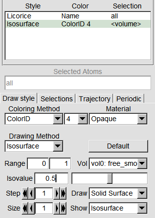

然后在控制台窗口输入 *pbc box* 以绘制格点数据的边框，并将背景色设为白色，即可看到

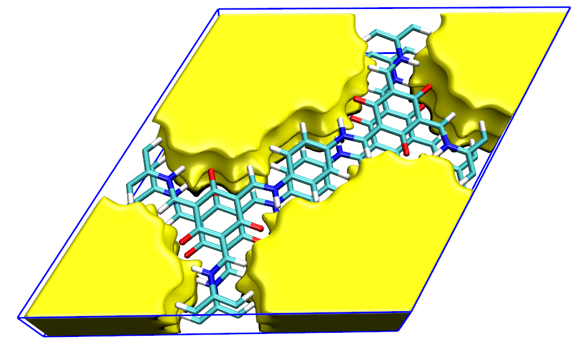

图形效果非常令人满意，自由区域得到了很好的展示。

顺便一提，若将结构的绘制方式设为“VDW”，会发现自由区域的等值面与范德华表面形成明显的互补，表明自由区域确实得到了合理的展示。

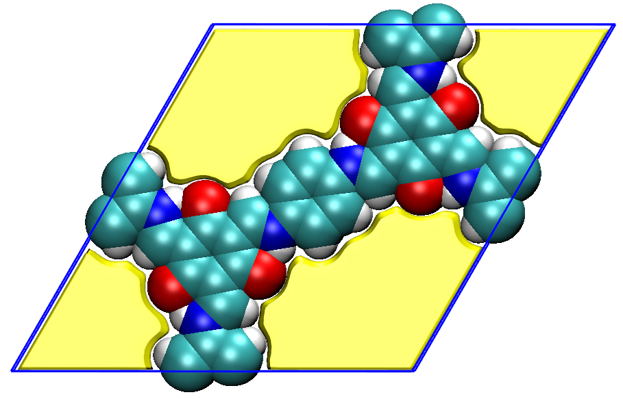

也可以用 VESTA 软件基于 *free_smooth.cub* 绘制自由区域图，图形效果甚至更好，细节见 <http://sobereva.com/617>。

## **4.300.2 将原子径向密度拟合为 STO 或 GTF 的例子**

Multiwfn 能够将孤立原子的球平均电子密度拟合为多个 Slater 型轨道（STO，Slater type orbital）或高斯型函数（GTF，Gaussian type function）的组合，请先阅读 3.300.2 节 [3.300.2](sec-3-300-other-functions-part-3.md#33002-将原子径向密度拟合为多个-sto-或-gtf-的线性组合)以获得基本知识。本节将说明如何使用该功能实现拟合。

### **4.300.2.1 将硅的径向密度粗略拟合为若干 STO**

本节将硅原子的径向密度拟合为几个 STO 的线性组合。由于拟合函数数目较少，拟合过程很快，拟合密度的计算也相当便宜，不过拟合质量预计不会非常高。

启动 Multiwfn 并输入

```text
examples\atomwfn\Si.wfn  // Generated at ROHF/6-31G* level
300  // Other functions (Part 3)
2  // Fitting atomic radial density as multiple STOs or GTFs
3  // Check or set initial guess of coefficients and exponents of fitting functions
2  // Set initial guess as "crude fitting by a few STOs with variable exponents". Then from screen you can find only four STOs will be employed in the fitting, their initial status are
```

```text
           Coefficient       Exponent
STO  1:    1.000000E+03    2.700000E+01
STO  2:    3.000000E+02    9.000000E+00
STO  3:    2.000000E+01    3.000000E+00
STO  4:    1.000000E+00    1.000000E+00
```

初始参数看起来是合理的。然后输入以下命令

```text
0  // Return to upper level of menu
1  // Start fitting
```

默认使用 4000 个间距为 0.001 Å 的均匀分布点进行拟合，显然它们覆盖了 *r* = 0-4 Å 的径向范围。若已认真读过 3.300.2 节 [3.300.2](sec-3-300-other-functions-part-3.md#33002-将原子径向密度拟合为多个-sto-或-gtf-的线性组合)，会发现拟合过程中输出的信息很容易理解。输出的后半部分如下所示

```text
Integral of fitted density calculated using 100 points:   13.13399890
Fitted coefficients are scaled by      1.06593583

Fitted parameters (a.u.) after scaling:
           Coefficient       Exponent
STO  1:   -1.995734E+00    1.190199E+00
STO  2:    2.505769E+00    1.217813E+00
STO  3:    1.004017E+02    6.877422E+00
STO  4:    2.231748E+03    3.681991E+01

RMSE of fitting error at all points:           17.562831 a.u.^2
Pearson correlation coefficient r:    0.995316  r^2:    0.990654
```

可以看到，最初拟合密度在全空间的积分为 13.13399890，因此拟合函数的系数被乘以 14/13.13399890=1.06593583 进行缩放，其中 14 是硅的实际电子数。在本次拟合中，四个 STO 的系数和指数都被优化了，最终参数打印在 "Fitted parameters (a.u.) after scaling" 标题下。RMSE 是定量衡量拟合质量的有用量。拟合密度与实际密度之间的 $r^2$ 系数高达 0.99，说明拟合是合理的；不过，仍强烈建议采用其他方式进一步检验拟合质量并确认拟合的可靠性，以便拟合参数能安全地用于实际研究中估计密度。

在新出现的菜单中可以看到很多选项，其含义要么是自明的，要么已在 3.300.2.2 节 [3.300.2.2](sec-3-300-other-functions-part-3.md#330022-用法)中介绍过。要定量检验 4000 个拟合点处的拟合质量，选择选项 1，可看到

```text
Radial distance (Angstrom), actual density (a.u.), difference between fitted an
d actual density (a.u.) as well as relative difference
#    1  r: 0.00100  rho:     1632.43875869  Diff:    548.91831985 (   33.63 %)
#    2  r: 0.00200  rho:     1580.36292117  Diff:    459.79079234 (   29.09 %)
#    3  r: 0.00300  rho:     1507.61800756  Diff:    400.75362143 (   26.58 %)
#    4  r: 0.00400  rho:     1427.66453603  Diff:    357.71394386 (   25.06 %)
[ignored...]
# 3997  r: 3.99700  rho:        0.00000506  Diff:     -0.00000029 (   -5.71 %)
# 3998  r: 3.99800  rho:        0.00000504  Diff:     -0.00000029 (   -5.81 %)
# 3999  r: 3.99900  rho:        0.00000502  Diff:     -0.00000030 (   -5.91 %)
# 4000  r: 4.00000  rho:        0.00000500  Diff:     -0.00000030 (   -6.01 %)
```

"Diff" 是拟合密度与实际密度之差，括号中的数值为相对误差。可见，紧靠原子核的区域误差不小，但这无关紧要，因为该区域不是化学上感兴趣的，化学家通常主要关注价层区域的电子密度。

接着，选择选项 3，用对数坐标直观查看拟合密度与实际密度的曲线，可看到

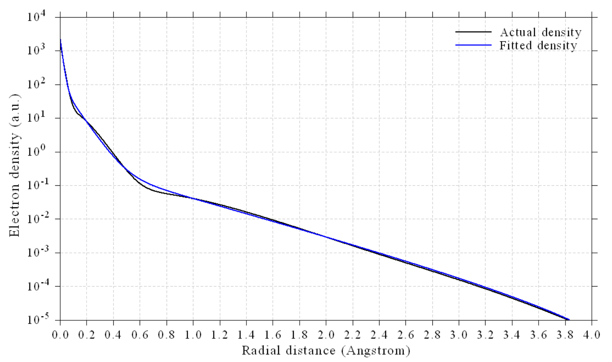

拟合显然是成功的，因为在 1.8 Å 以内的区域拟合密度曲线与实际密度曲线很接近。值得一提的是，硅的 Bondi 范德华半径为 2.1 Å。

也可以选择选项 4，用线性坐标绘制拟合密度与实际密度的对比图，会进一步发现拟合密度确实很好地再现了实际密度。

若选择选项 5，则在当前目录下输出 *fitdens.txt*。该文件包含从 0 到 10 Å 均匀分布点处的拟合密度（第二列），格点间距为拟合点的一半，即 0.001/2=0.0005 Å。从该文件的数据可以发现，拟合密度变化平滑单调，没有出现负值，进一步说明拟合是成功的，拟合参数是可靠的。

最后，选择选项 6，用不同数目的高斯积分点检验拟合密度在全空间的积分，可看到：

```text
Number of integration points:   40    Integral:     13.99999923
Number of integration points:   60    Integral:     13.99999993
Number of integration points:   80    Integral:     13.99999999
[ignored...]
Number of integration points:  280    Integral:     14.00000000
Number of integration points:  300    Integral:     14.00000000
```

可见，所有情况下积分几乎都精确等于实际电子数（14），进一步证明我们的拟合是合理的。

由于拟合密度已通过多方面的质量检验，最终可以断定，四个 STO 的拟合参数可在今后的研究中安全可靠地使用。

### **4.300.2.2 将溴的径向密度精确拟合为多个 GTF**

为了可靠而精确地拟合径向密度，通常需要不少于 10 个指数可变的 GTF。本例将以此方式拟合溴原子的径向密度。这种拟合几乎适用于元素周期表中的任何元素。

启动 Multiwfn 并输入

```text
examples\atomwfn\Br.wfn  // Generated at ROHF/6-31G* level
300  // Other functions (Part 3)
2  // Fitting atomic radial density as STOs or GTFs
3  // Check or set initial guess of coefficients and exponents of fitting functions
5  // Fine fitting by 10 GTFs with variable exponents (of course, using more GTFs will result in better fitting)
```

从屏幕上可以看到，拟合将使用 10 个 GTF，所有系数初始都设为 1.0，而指数分布范围很大，最小的为 0.1，最大的为 381，相邻两个 GTF 的指数之比为 2.5。指数小、中、大的 GTF 分别主要用于表示拖尾区域、价层区域和紧靠原子核的区域。

然后输入 0 返回上一级菜单，再选择选项 1 开始拟合。拟合过程中，从提示信息可以看到，为避免数值问题，自动删除了 1 个系数非常小的多余拟合函数：

```text
Delete redundant function (coeff=-5.59231E-05 exp= 9.99991E-02), refitting...
Totally  1 redundant fitting functions have been eliminated
```

得到的拟合参数为：

```text
Fitted parameters (a.u.) after scaling:
           Coefficient       Exponent
GTF  1:    8.328778E-02    2.556435E-01
GTF  2:    5.163781E-01    6.322086E-01
GTF  3:    1.221206E+01    5.157472E+00
GTF  4:    2.475569E+01    5.176644E+00
GTF  5:    5.926930E+02    6.326802E+01
GTF  6:    4.017684E+03    7.298312E+02
GTF  7:    1.006232E+04    2.458635E+03
GTF  8:    1.046461E+04    1.557579E+04
GTF  9:    1.658191E+07    1.206884E+09
```

还可以看到误差统计：

```text
Pearson correlation coefficient r:    0.999706  r^2:    0.999413
```

从该数据可以发现拟合质量近乎完美！$r^2$ 几乎精确等于 1.0！

请用与上一节相同的方式检验拟合质量，会发现本次拟合完全成功。例如，选择选项 3 后可看到下图，它表明所有区域的拟合质量都是完美的。

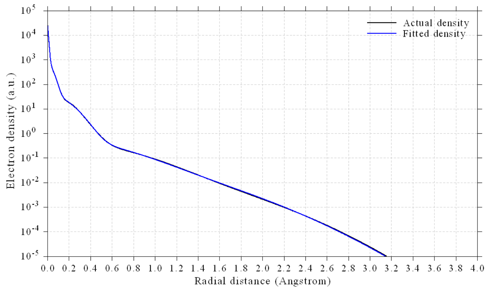

显然，当想要达到很高的拟合质量时，本节展示的拟合流程是相当理想的。

顺便一提，从前面展示的拟合 GTF 参数可以发现，GTF 3 和 GTF 4 的指数几乎相同，意味着可将它们合并为单个 GTF 以减少参数。为此，输入

```text
0  // Return
3  // Check or set initial guess of coefficients and exponents. Then from screen you can find the parameters we fitted earlier
10  // Combine two fitting functions together
3,4  //Indices of the two fitting functions to combine
0  // Return
1  // Start fitting
```

然后可用选项 3 再次可视化径向密度，会发现用现在的 8 个 GTF 拟合的质量不变，因此 8 个 GTF 已完全足以对本原子实现精确拟合。

Multiwfn 的拟合模块非常灵活，有很多控制拟合策略的选项，更多信息见 3.300.2 节 [3.300.2](sec-3-300-other-functions-part-3.md#33002-将原子径向密度拟合为多个-sto-或-gtf-的线性组合)。

## **4.300.4 模拟扫描隧道显微镜（STM）图像的例子**

> **注记**
>
> 本主题的中文版是我的博文“使用 Multiwfn 模拟扫描隧道显微镜（STM）图像”（<http://sobereva.com/549>，中文），其中给出了扩展讨论，并以环[18]碳为例子。

若对 STM 的理论或 Multiwfn 中 STM 的模拟不熟悉，请先查看 3.300.4 节 [3.300.4](sec-3-300-other-functions-part-3.md#33004-模拟扫描隧道显微镜-stm-图像)。接下来两节将分别为菲分别模拟恒高和恒流模式的 STM。模拟将基于 *examples\phenanthrene.fch* 中的波函数，该文件在 B3LYP/6-31G\* 水平下产生。

需要注意的是，要在 Multiwfn 中模拟 STM，分子必须平行于 XY 平面（分子本身不一定是平面的），而 *phenanthrene.fch* 中的分子平行于 YZ 平面。因此，在 STM 模拟之前必须先旋转分子。当然，我们可以先重定向分子再做量子化学单点任务来产生波函数文件，但更好的办法是用 Multiwfn 直接旋转波函数和几何结构，即在 Multiwfn 中输入以下命令

```text
examples\phenanthrene.fch
6  // Check & modify wavefunction
33  // Rotate wavefunction, namely X→Y, Y→Z, Z→X
0  // Rotate all orbitals
y  // Also rotate molecule structure. Then the molecule will be on XZ plane
33  // Rotate wavefunction again
0  // Rotate all orbitals
y  // Also rotate molecule structure
```

现在菲已精确位于 Z=0 Å 的 XY 平面上（可通过主功能 0 核实这一点）。然后进入主功能 100，选择子功能 2，再选择相应选项将当前波函数导出为新的 .mwfn 文件。在接下来两节中，该新文件将被称为 *mol.mwfn*。

### **4.300.4.1 为菲模拟恒高 STM 图像**

这里为菲模拟恒高模式的 STM 图像。启动 Multiwfn 并输入

```text
mol.mwfn
300  // Other function (Part 3)
4  // Simulating STM image
```

从屏幕上的信息可以看到，费米能级（$E_{\mathrm{F}}$）已被设为 HOMO 能量与 LUMO 能量的平均值，偏压（*V*）已被自动设为 HOMO 能量与 $E_{\mathrm{F}}$ 之差，此时只有 HOMO 能对 STM 图像做贡献。为了得到预期的 STM 图像，正确定义 *V* 至关重要。当 *V* 为负时，电子从样品流向 STM 针尖，*V* 越负，可能对 STM 图像做贡献的分子轨道越多。还要注意，样品中的原子与针尖之间的距离会显著影响 STM 图像。从选项 7 的信息可以发现，待绘制平面的默认 Z 坐标为 0.7 Å。由于 *mol.mwfn* 中所有原子的 Z 坐标都为 0 Å，核与针尖之间的距离为 0.7 − 0.0 = 0.7 Å。本例将在 *V* = -5.0 V、*Z* = 1.2 Å 下绘制 STM 图像。

现在输入以下命令

```text
2  // Set bias voltage
-5  // Bias voltage of -5.0 V
7  // Set Z coordinate
1.2  // Z=1.2 Å
0  // Calculate tunneling current on the plane
```

现在可以在屏幕上看到以下信息

```text
Lower limit of MO energy considered in the calculation:      -8.362 eV
Upper limit of MO energy considered in the calculation:      -3.362 eV
The MOs taken into account in the current STM simulation:
MO    44   Occ= 2.000   Energy=     -7.6491 eV   Type: Alpha&Beta
MO    45   Occ= 2.000   Energy=     -7.0599 eV   Type: Alpha&Beta
MO    46   Occ= 2.000   Energy=     -6.0337 eV   Type: Alpha&Beta
MO    47   Occ= 2.000   Energy=     -5.7308 eV   Type: Alpha&Beta
Totally   4 MOs are taken into account

Grid spacings in X and Y are    0.118428    0.082980 Bohr
Calculating, please wait...
Maximal value (LDOS) is    0.010218 a.u.
```

可见，有 4 个占据分子轨道的能量落在 $E_{\mathrm{F}}$ +*eV*（-8.362 eV）与 $E_{\mathrm{F}}$（-3.362 eV）之间，因此 STM 图像的平面数据对应于它们在该平面内的几率密度乘以占据数（本例中为闭壳层分子轨道，故为 2.0）之和，该数据也称为局域态密度（LDOS，local density-of-states）。如提示所示，所计算平面内 LDOS 的最大值为 0.010218 a.u.。

现在进入了 STM 绘图菜单，可看到很多用于调节绘图效果的选项，它们都是自明的，请自行尝试。这里直接选择选项 0 以默认设置绘图，可看到

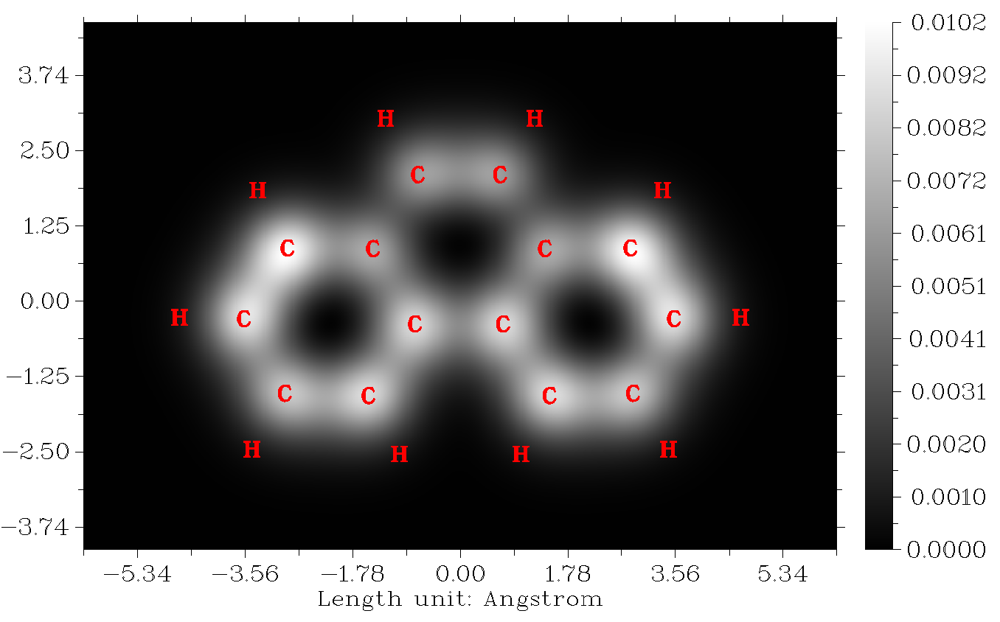

该图中白色越亮，LDOS 越大，从而隧穿电流（*I*）越强，因为 Tersoff-Hamann 模型表明 *I* 与 LDOS 成正比。可见，两边六元环上方的 *I* 信号比中央六元环更突出。

### **4.300.4.2 为菲模拟恒流 STM 图像**

本节再次为菲绘制 STM 图像，但使用恒流模式。启动 Multiwfn 并输入

```text
mol.mwfn
300  // Other function (Part 3)
4  // Simulating STM image
1  // Switch the mode of STM image to constant current
2  // Set bias voltage
-5  // Again we use bias voltage of -5.0 V
```

在恒流模式下，对三维区域内均匀分布的每一点计算 LDOS，其 X、Y、Z 范围可分别用选项 5、6、7 设置，通常默认设置就是合适的。这里直接选择选项 0 开始计算，从屏幕信息可以发现所计算区域内 LDOS 的最大值为 0.048 a.u.。

在后处理菜单中可看到几个选项，先用选项 1 可视化隧穿电流的等值面图，在当前语境下即对应 LDOS。LDOS=0.015 a.u. 对应的等值面如下所示。注意，虽然等值面数值的选择是任意的，但应在 0 与最大值（本例为 0.048 a.u.）之间

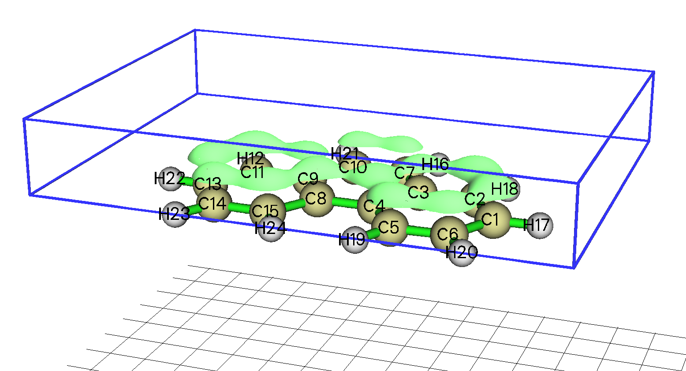

在上图中，隧穿电流的等值面通常出现在碳原子上方，说明默认的计算区域对本例是合适的。勾选 "Show data range" 复选框可显示蓝色盒子，它表示计算 LDOS 的区域。

接着绘制平面图。选择选项 "3 Calculate and visualize constant current STM image"，再输入预期的隧穿电流值，本例输入 *0.01*。之后 Multiwfn 开始计算隧穿电流（LDOS）近似等于 0.01 a.u. 处的 Z 值，显然在不同 (*x*,*y*) 位置处 Z 不同。然后从屏幕上可看到

```text
Minimal Z is    0.700000 Angstrom
Maximal Z is    1.206432 Angstrom
```

它们分别是 STM 图像颜色标尺合适的下限和上限。

现在进入绘制恒流模式 STM 图像的界面，输入以下命令

```text
2  // Choose map type
2  // Color-filled map with contour lines
7  // Set label interval in X, Y and color scale axes
1.5,1.5,0.05
-3  // Change other plotting settings
2  // Set number of decimal places of tick labels
1  // Set X axis
1  // Set Y axis
2  // Set Z axis
0  // Return
0  // Plot the STM image
```

然后可在屏幕上看到该图：

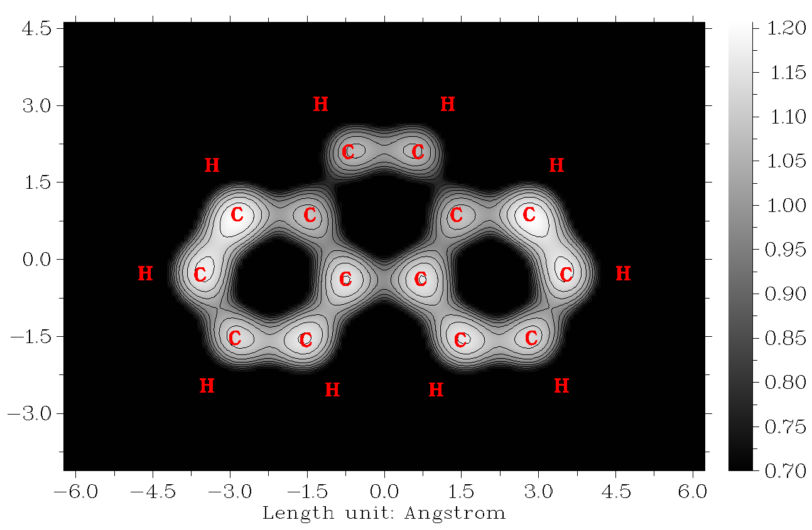

上图中数值对应于 STM 针尖的 Z 距离。可见，在恒定电流（LDOS）为 0.01 a.u. 时，STM 针尖在两边六元环上方的 Z 位置相对较高。该图的特征与恒高模式的 STM 图像非常相似。

若想用其他恒流值进一步研究 STM 平面图，可退出绘图界面，再次进入选项 "3 Calculate and visualize constant current STM image" 并输入预期的电流值。

## **4.300.5 计算尿嘧啶的电偶极矩、多极矩和电子空间分布范围**

如 3.300.5 节 [3.300.5](sec-3-300-other-functions-part-3.md#33005-计算电偶极多极矩和电子空间范围)所述，Multiwfn 能够解析地计算电偶极矩、四极矩、八极矩、十六极矩和电子空间分布范围 \<$r^2$\>。本节以简单的尿嘧啶分子为例计算这些量。

启动 Multiwfn 并输入

```text
examples\uracil.wfn
300  // Other function (Part 3)
5  // Calculate electric dipole moment and multipole moments
```

计算非常快，若已读过 3.300.5 节 [3.300.5](sec-3-300-other-functions-part-3.md#33005-计算电偶极多极矩和电子空间范围)，会发现以下信息很容易理解。如屏幕上明确指出的，除非另有说明，单位均为原子单位（a.u.）。

```text
 Dipole moment from nuclear charges (a.u.):    0.000000   0.000000   0.000000
 Dipole moment from electrons (a.u.):          0.473309   1.823683   0.000736

 Dipole moment (a.u.):       0.473309      1.823683      0.000736
 Dipole moment (Debye):      1.203031      4.635340      0.001872
 Magnitude of dipole moment:      1.884103 a.u.      4.788911 Debye

 Quadrupole moments (Standard Cartesian form):
 XX=  -43.878975  XY=    1.812455  XZ=   -0.000544
 YX=    1.812455  YY=  -28.230039  YZ=   -0.004831
 ZX=   -0.000544  ZY=   -0.004831  ZZ=  -34.463441
 Quadrupole moments (Traceless Cartesian form):
 XX=  -12.532235  XY=    2.718682  XZ=   -0.000816
 YX=    2.718682  YY=   10.941169  YZ=   -0.007246
 ZX=   -0.000816  ZY=   -0.007246  ZZ=    1.591066
 Magnitude of the traceless quadrupole moment tensor:   13.645453
 Quadrupole moments (Spherical harmonic form):
 Q_2,0 =   1.591066   Q_2,-1=  -0.008367   Q_2,1=  -0.000942
 Q_2,-2=   3.139264   Q_2,2 = -13.552376
 Magnitude: |Q_2|=   14.001908

 Octopole moments (Cartesian form):
 XXX=   14.0946  YYY=    8.6123  ZZZ=    0.0027  XYY=    6.6643  XXY=   46.4098
 XXZ=   -0.0099  XZZ=    2.7809  YZZ=   -7.6843  YYZ=    0.0159  XYZ=   -0.0033
 Octopole moments (Spherical harmonic form):
 Q_3,0 =    -0.0062  Q_3,-1=   -52.5167  Q_3,1 =    -5.9005
 Q_3,-2=    -0.0129  Q_3,2 =    -0.0500  Q_3,-3=   103.2618  Q_3,3 =    -4.6630
 Magnitude: |Q_3|=    116.0929

Hexadecapole moments:
XXXX=       -684.9560  YYYY=       -289.5418  ZZZZ=        -39.7011
XXXY=         13.4854  XXXZ=         -0.0058  YYYX=         12.7574
YYYZ=         -0.0243  ZZZX=         -0.0009  ZZZY=         -0.0061
XXYY=       -168.4269  XXZZ=       -104.4367  YYZZ=        -71.1599
XXYZ=         -0.0008  YYXZ=         -0.0039  ZZXY=          2.9446

Electronic spatial extent <r^2>:      822.650952
Components of <r^2>:  X=     501.328431  Y=     286.859071  Z=      34.463450
```

若 *settings.ini* 中的 "ispecial" 设为 1，则在计算偶极矩和多极矩之前，会先平移体系使核对偶极矩的贡献为零。

注意，也可用主功能 15 的子功能 2 计算上述量，但它是基于多中心格点数值计算的，耗时显著更高而数值精度略低。不过它有一个独特的优点，即可以计算当前体系中特定片段的偶极矩和多极矩，例子见 4.15.3 节 [4.15.3](sec-4-15-fuzzy-atomic-space-analysis.md#4153-计算片段偶极矩以展示局域极性)。

\<$r^2$\> 是定量表征电子分布宽广程度的有用指标，我有一篇博文详细讨论了这一点：<http://sobereva.com/616>（中文）。

## **4.300.6 计算轨道能量：以 NTO 轨道为例**

如 3.300.6 节 [3.300.6](sec-3-300-other-functions-part-3.md#33006-通过输入-fock-矩阵计算当前轨道能量)所述，Multiwfn 有一个功能，可基于用户提供的 Fock/Kohn-Sham 矩阵求内存中轨道的能量。原则上，可用该功能计算任何种类轨道的能量！本例将说明如何利用该功能求自然跃迁轨道（NTO，natural transition orbital）的能量。以典型的给体-π-受体体系的 S0→S1 激发为例。请确保已理解如何做 NTO 分析，例子见 4.18.6 节 [4.18.6](sec-4-18-electron-excitation-analysis.md#4186-产生并分析尿嘧啶的自然跃迁轨道-nto)。本例包含三个步骤：（1）通过 TDDFT 计算产生 NTO 轨道（2）产生包含 Fock/Kohn-Sham 矩阵的文件（3）计算 NTO 轨道能量。

首先，产生 NTO 轨道，TDDFT 任务的 Gaussian 输入文件为 *examples\excit\D-pi-A.gjf*，相应的输出文件和 .fchk 文件也在同一目录下提供。启动 Multiwfn 并输入以下命令

```text
examples\excit\D-pi-A.fchk
18  // Electron excitation analysis
6  // Generate natural transition orbitals (NTOs)
examples\excit\D-pi-A.out
1  // The first excited state (S1 state)
```

然后可以看到

```text
The highest 10 eigenvalues of occupied NTOs:
   0.000022    0.000023    0.000038    0.000057    0.000105
   0.000149    0.000172    0.000339    0.008236    0.992492

The highest 10 eigenvalues of virtual NTOs:
   0.992492    0.008236    0.000339    0.000172    0.000149
   0.000105    0.000057    0.000038    0.000023    0.000022
```

这些数据表明 NTO 对本例效果很好，因为本征值最高的 NTO 对对该激发的贡献达 99.2%，即 S0→S1 激发几乎可完美地用该 NTO 跃迁表示。然后选择选项 3 将 NTO 导出为当前目录下的 *NTO.mwfn*。

接着，产生包含本体系 Kohn-Sham 矩阵的文件，细节见 3.100.17 节 [3.100.17](sec-3-100-other-functions-part-1.md#310017-基于轨道能量和系数生成fockks矩阵generate-fockks-matrix-based-on-orbital-energies-and-coefficients)。启动 Multiwfn 并输入

```text
examples\excit\D-pi-A.fchk
100  // Other functions (Part 1)
17  // Generate Fock/KS matrix based on orbital energies and coefficients
KS.txt
```

现在当前目录下的 *KS.txt* 包含了从 *D-pi-A.fchk* 中分子轨道能量和系数反推得到的 Kohn-Sham 矩阵。

最后，计算 NTO 轨道的能量。启动 Multiwfn 并输入

```text
NTO.mwfn
300  // Other functions (Part 3)
6  // Calculate energies of the present orbitals
KS.txt
```

然后 Multiwfn 从 *KS.txt* 文件载入 Kohn-Sham 矩阵，NTO 轨道能量的计算即刻完成。之后可选择“1 Export orbital energies to orbene.txt in current folder”将能量导出到当前目录下的 *orbene.txt*，其内容为

```text
[...ignored]
     54  Occ=  2.0000  E=     -0.41616309 Hartree    -11.3244 eV
     55  Occ=  2.0000  E=     -0.27176663 Hartree     -7.3951 eV
     56  Occ=  2.0000  E=     -0.34791315 Hartree     -9.4672 eV
     57  Occ=  0.0000  E=     -0.02609500 Hartree     -0.7101 eV
     58  Occ=  0.0000  E=      0.03073422 Hartree      0.8363 eV
     59  Occ=  0.0000  E=      0.76811627 Hartree     20.9015 eV
[...ignored]
```

在 *NTO.mwfn* 中，本征值最高的占据和非占据 NTO 分别为轨道 56 和 57，根据上述数据可知它们的能量分别为 -9.4672 和 -0.7101 eV，这是非常合理的。

注意，向 Multiwfn 提供 Kohn-Sham 矩阵还有其他方式，见本手册附录 7 [附录 7](sec-6-7-about-providing-fock-ks-matrix-to-multiwfn.md)。例如，也可用 Gaussian 直接产生 .47 文件，它同样能为 Multiwfn 提供 Kohn-Sham 矩阵以产生轨道能量。下面说明做法。新建一个 Gaussian 输入文件，内容如下，注意几何结构、DFT 泛函和基组必须与 *examples\excit\D-pi-A.gjf* 完全相同（该文件已作为 *examples\excit\D-pi-A_get47.gjf* 提供）

```text
# CAM-B3LYP/6-31g(d) pop=nboread

b3lyp/6-31g(d) opted

0 1
[geometry part]

$NBO archive file=C:\D-PI-A $END
　
　
```

用 Gaussian 运行该文件后，在 C: 目录下得到 *D-PI-A.47* 文件，它已作为 *examples\excit\D-PI-A.47* 提供。然后在主功能 300 中选择子功能 6 后，输入该 .47 文件的路径，Multiwfn 将从中载入 Kohn-Sham 矩阵并计算轨道能量。

> **注记**
>
> 由于数值原因，.47 文件中记录的 Kohn-Sham 矩阵与 Multiwfn 直接产生的 Kohn-Sham 矩阵有微小差别，因此两种情况下得到的 NTO 能量也略有不同。但该差别对实际研究完全可忽略。
>
> 当大量使用弥散函数以致量子化学程序自动删除了一些线性相关的基函数时，Multiwfn 将无法直接产生 Kohn-Sham 矩阵，此时必须用其他方式向 Multiwfn 提供 Kohn-Sham 矩阵，如使用 .47 文件。

## **4.300.8 为\[Ru(bpy)₃\]²⁺ 配位体绘制表面距离投影图**

> **注记**
>
> 本教程的中文版及更多讨论见“使用 Multiwfn 绘制分子和固体的表面距离投影图”（<http://sobereva.com/589>）。

请先阅读 3.300.8 节 [3.300.8](sec-3-300-other-functions-part-3.md#33008-绘制表面距离投影图)以获得关于分子表面距离投影图的基本知识。本节以 \[Ru(bpy)₃\]²⁺ 为例展示如何绘制这种图。*examples\excit\Ru(bpy3)2+.gjf* 包含该体系的优化后几何结构，因此将用作输入文件（当然，也可以用 .xyz、.pdb、.mol2 等其他格式的文件作为输入文件）。该体系已处于适合研究配体对 Ru 原子包埋情况的取向，见下图。若当前取向不适合绘制该图，应用 GaussView 等分子可视化软件旋转它。

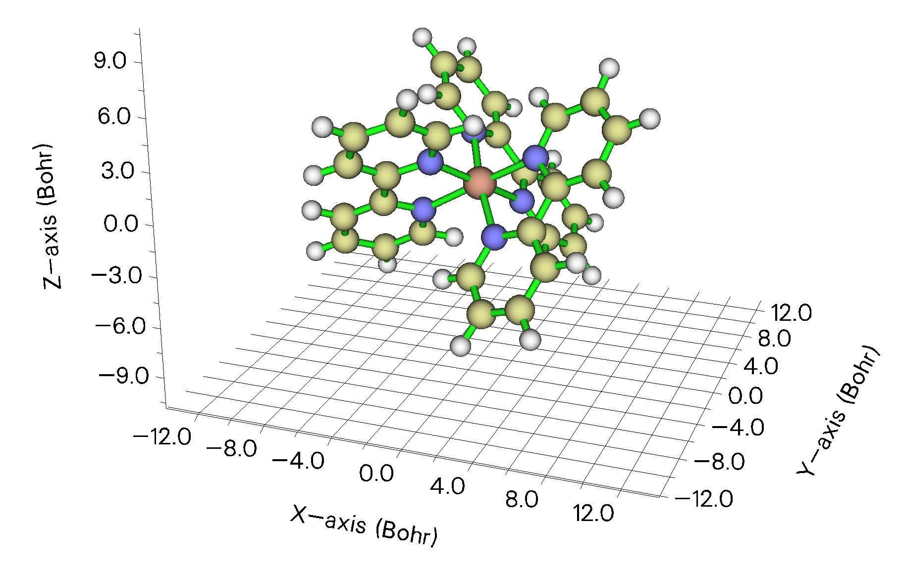

启动 Multiwfn 并输入

```text
examples\excit\Ru(bpy3)2+.gjf
300  // Other functions (Part 3)
8  // Plot molecular surface distance projection map
```

这次不改任何默认设置，直接选择选项 0 开始计算。此时，分子表面定义为前线（promolecular）电子密度 0.05 a.u. 的等值面。

计算完成后，进入绘制平面图的界面。直接选择选项 0 在屏幕上显示该图，可看到

![\[Ru(bpy)3\]2+ 阳离子的表面距离投影图](assets/figures/ch4/image1432.png)

可见，不同颜色很好地展示了分子表面各区域到屏幕的距离，Ru 原子与配体的相对位置可非常清楚地辨认。在默认设置下，Z=0 对应于 Z 坐标最正的原子的 Z 位置。若当前图不满意，可关闭该图，用界面中丰富的选项进一步改善图形效果。

接着，换一种分子表面定义再次绘制该图，即原子范德华球的叠加。现在输入以下命令

```text
-1  // Return
1  // Set definition of molecular surface
3  // Superposition of atomic van der Waals spheres scaled by a factor
1  // We do not scale van der Waals radii in this example, so we set scale factor to 1
0  // Start calculation
0  // Show the map on screen
```

然后可看到下图，可见 Ru 原子被周围配体深深包埋，由于强空间位阻，外来分子不易接近 Ru 原子。

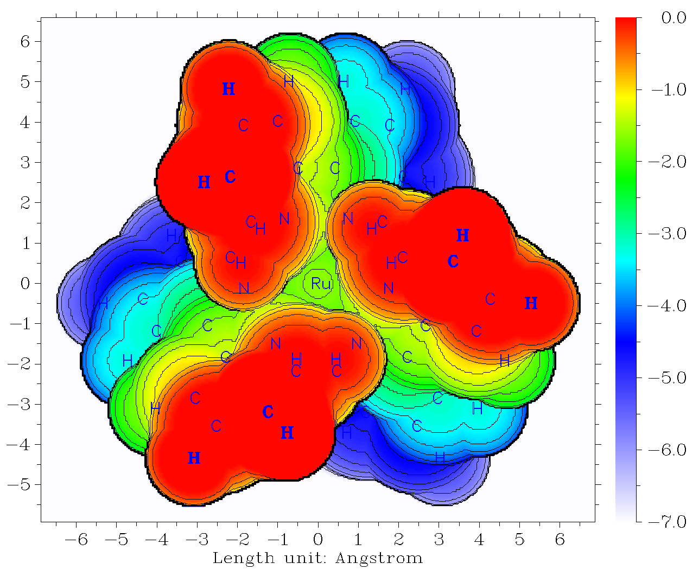

由原子球叠加构建的范德华表面显然不太光滑。用电子密度 0.005 a.u. 等值面作为分子表面的定义可产生特征类似的图，而颜色过渡和等值线要光滑得多（返回上一级菜单后，可选择选项 1，再选 1，然后输入 0.005 切换到该定义）。

注意，Multiwfn 也能为固体表面绘制这种图，例子见 <http://sobereva.com/589> 第 4 节。
