# **4.4 在平面内输出和绘制各种性质**

Multiwfn 的主功能 4 用于为实空间函数绘制各种平面图。该模块极为灵活，显然不可能用有限的例子展示该功能的所有可能用法；但若认真跟随这些例子并尝试再现图形，将获得关于用 Multiwfn 绘制平面图足够多的基本知识。强烈建议阅读 3.5 节 [3.5](sec-3-5-outputting-and-plotting-specific-property-in-a-plane.md)，其中介绍了关于绘制平面图的很多要点。

> **注记**
>
> 视频 <https://youtu.be/E7lAGac3aDM> 值得一看，其中展示了再现 Multiwfn 标志（Li₆ 团簇的 ELF 图）的全过程。该视频还展示了如何使图的背景透明。

## **4.4.1 绘制填充色图和等值线图的说明**

### **4.4.1.1 绘制氰化氢的电子密度**

本例将氰化氢的电子密度绘制为填充色图和等值线图。启动 Multiwfn 并输入以下命令

```text
examples\HCN.wfn
4  // Plot graph in a plane
1  // Electron density
1  // Color-filled map
[Press ENTER button directly]  // Use the recommended grid setting, namely 200,200. If you increase the number of grid points, graph will become finer and smoother, but you have to wait longer time for calculating data and plotting the graph
2  // XZ plane (Z-axis is the molecular axis of present system, you can confirm this via main function 0)
0  // The XY plane with Y=0 Bohr
```

几秒后图形弹出

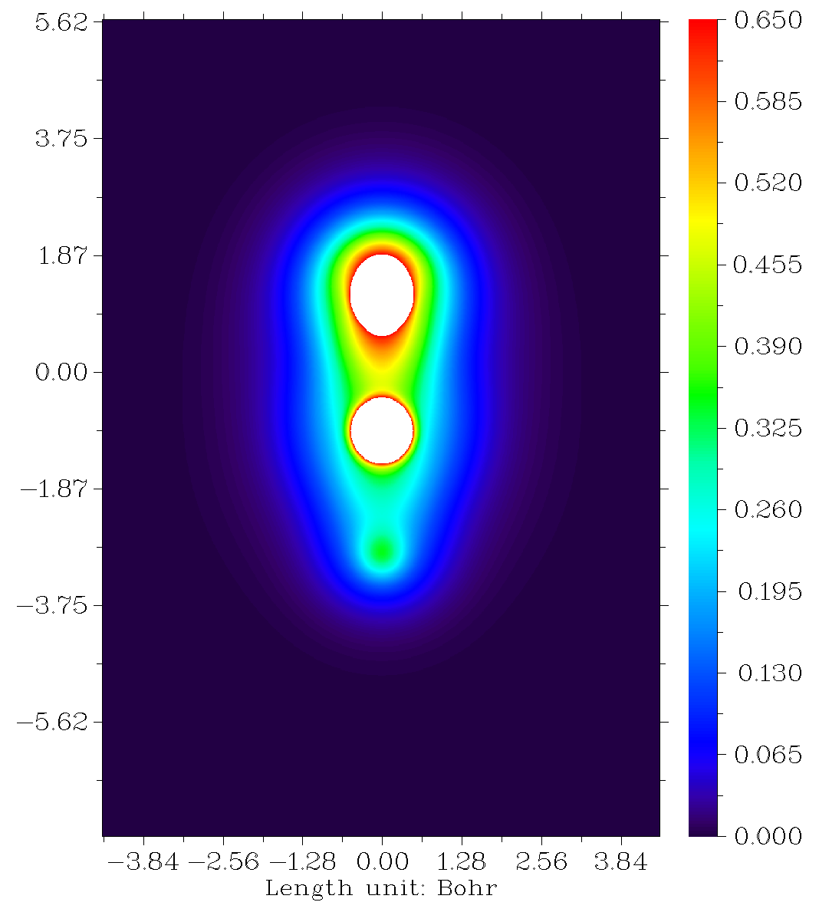

碳和氮的中心区域为白色，说明电子密度超过了颜色标尺的上限（0.65）。关闭图形后出现后处理菜单，有很多选项，其含义都很容易理解。可选择相应选项调节绘图参数，再用选项 -1 重新绘制，或将 X-Y 数据集导出为纯文本文件以便用外部软件（Sigmaplot、Origin、Matlab 等）绘图，或将图像文件保存在当前目录（图形格式由 *settings.ini* 中的 "graphformat" 控制）。

现在对上图稍加改进。输入以下命令：

```text
-8  // Change length unit of the graph to Å
-2  // Set label interval in X, Y and color scale axes
1,1,0.1
4  // Enable showing atom labels
1  // Red labels
8  // Enable showing bonds
3  // Blue color for bonds
-1  // Redraw the graph
```

现在可在屏幕上看到下图

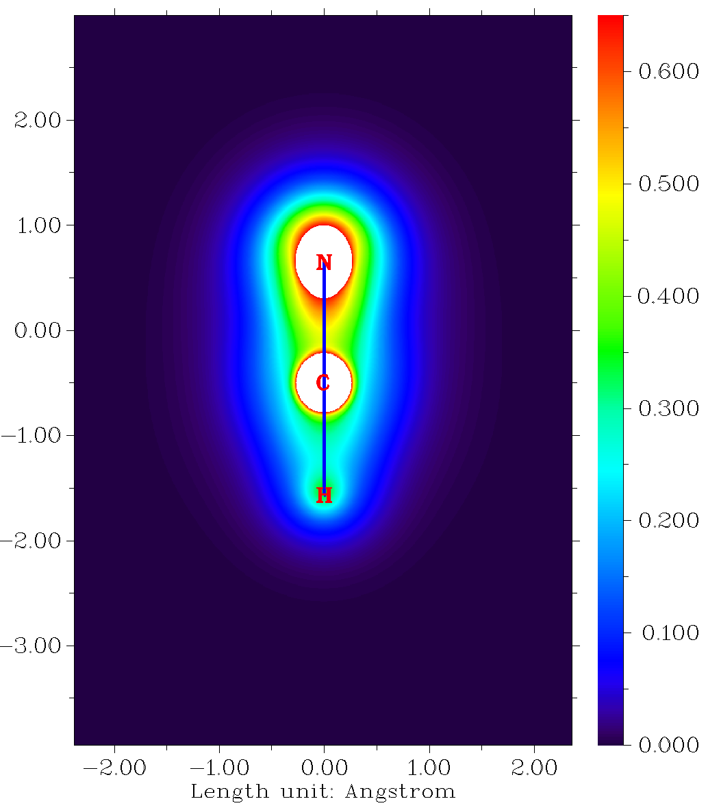

在 4.6.2 节 [4.6.2](sec-4-6-modify-and-check-wavefunction.md#462-价层电子密度分析去掉某些轨道对实空间函数贡献的例子)将为 HCN 绘制价层电子密度，会发现价层电子密度比总电子密度传达多得多的信息。

接着，将电子密度绘制为等值线图。重复上面的例子，但选择 "2 Contour line map" 而不是 "1 Color-filled map"，可看到下图

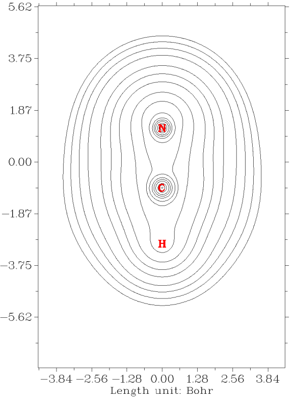

后处理菜单中有很多选项。若选择选项 2，等值面数值会被标注在相应的等值线上。一旦选择选项 3，将进入设置等值线的界面，颜色、粗细、等值线数值等各种参数都可方便地自定义，请自行尝试；若有困惑，请查阅 3.5.4 节 [3.5.4](sec-3-5-outputting-and-plotting-specific-property-in-a-plane.md#354-等值线的设置)以了解更多细节。

值得注意的是，.pdf 格式比默认的 .png 格式更适合等值线图（以及其他主要由线条组成的图），因为 .pdf 是矢量格式，图形可无损缩放，线条看起来更光滑。要改为 .pdf 格式，应将 *settings.ini* 中的 "graphformat" 改为 *pdf*。

### **4.4.1.2 绘制 FOX-7 的定域轨道定位函数（LOL）**

本例为含能化合物 FOX-7 绘制定域轨道定位（LOL，localized orbital locator）函数。LOL 是揭示电子定域特征的常用函数，介绍见 2.6 节 [2.6](sec-2-6-real-space-functions.md)。它与另一个非常常用的函数——电子定域函数（ELF）有类似的特征。本节的输入文件为 *examples\FOX-7.wfn*，若将其载入 Multiwfn 并进入主功能 0，可看到以下结构。我们将绘制由原子 N9、C2、N12 定义的平面。

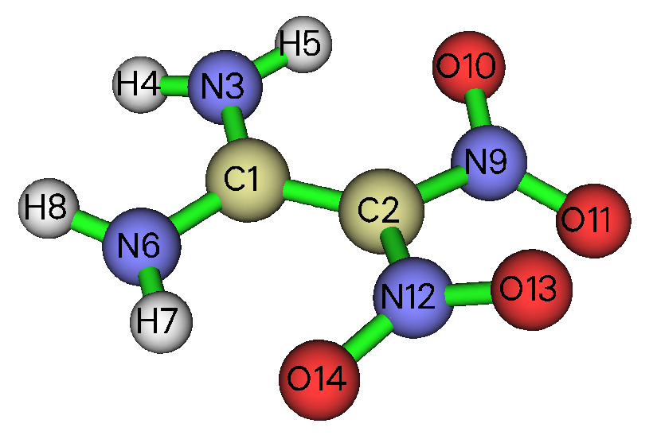

启动 Multiwfn 并输入

```text
examples\FOX-7.wfn
4  // Plot plane map
10  // Localized orbital locator (LOL)
1  // Color-filled map
[Press ENTER button directly]
4  // Define the plane by three atoms
9,2,12  // Use nuclear position of the three atoms to define the plane
```

直接显示在屏幕上的图形不易研究。因此，关闭图形再输入以下命令

```text
8  // Enable showing bonds
14  // Brown color
4  // Enable showing atom labels
1  // Red color
18  // Change style of atomic labels
3  // Plot both element symbol and atomic index
-1  // Show the graph again
```

可看到下图

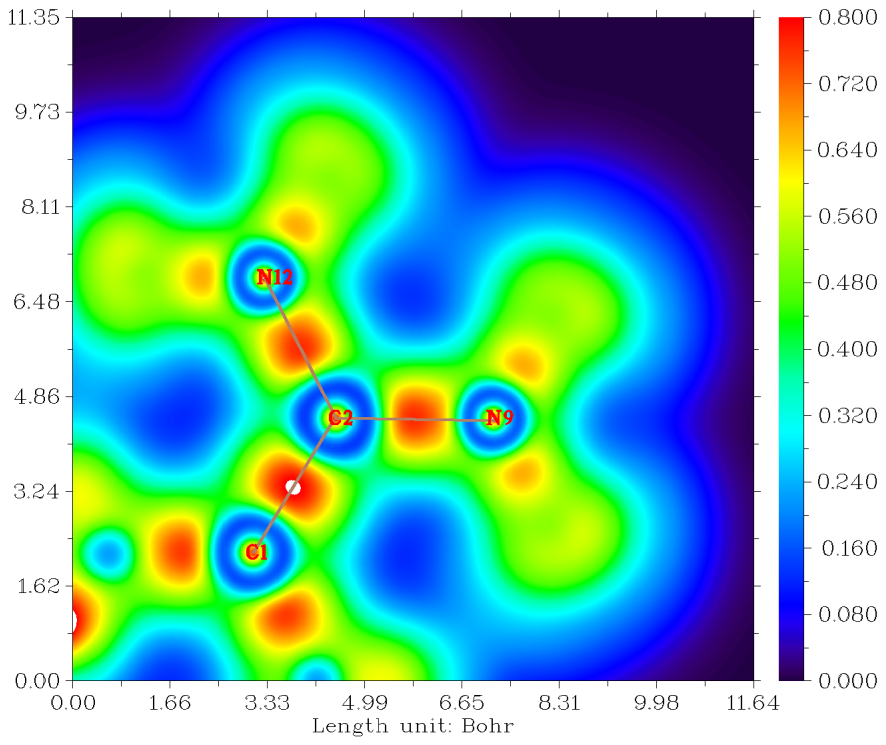

可以发现，很多原子的标签没有显示在图上，这是因为这些原子到绘图平面的垂直距离大于 *settings.ini* 中的 "disshowlabel" 参数。若想在图上显示所有原子标签，应关闭图形并输入以下命令：

```text
17  // Set distance threshold for showing atom labels
10  // Enlarge the threshold to 10 Bohr
y  // If there is any atom whose vertical distance to the plane exceeds the threshold, its label will still be shown but using thin text
-1  // Plot the map again to check effect
```

可看到下图，这里只给出感兴趣的部分

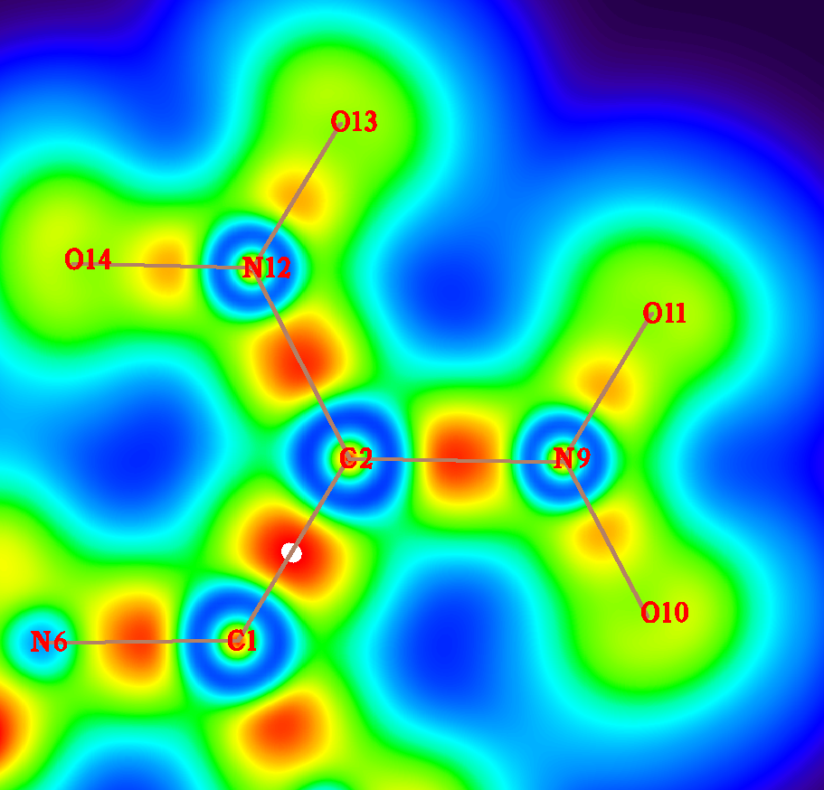

可见，所有原子的标签都已显示，相应的键也显示出来。该图中红色充分揭示了成键区域高度的电子定域特征。N 与 O 之间的电子定域程度不如 C-N 和 C-C 键的情况，这是“电荷移键（charge-shift bond）”的已知特征，关于该点的更多信息见 *Chem. Eur. J.*, **11**, 6358 (2005)。

默认的颜色过渡方式为 "Rainbow"，在函数值分别低于和高于颜色标尺的区域为白色和黑色。用户可改变着色方式。举例说明，在后处理菜单中输入

```text
19  // Set color transition
17  // Black-Blue-Cyan
1  // Set lower&upper limit of color scale
0,0.7  // Decrease the upper limit from default value to 0.7 to make color able to better distinguish ELF in different regions
-1  // Replot
```

下图看起来很酷 ;-D

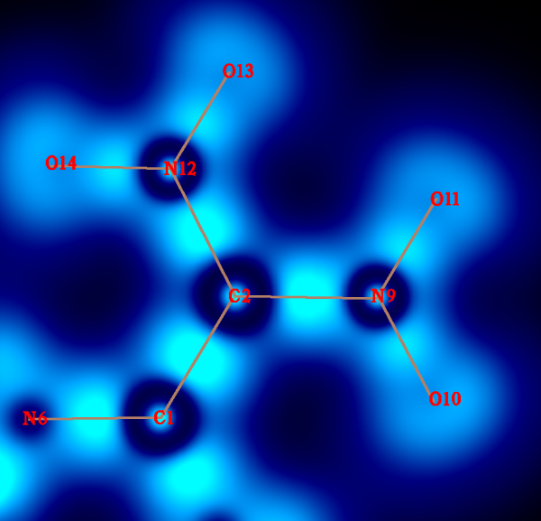

等值线可添加到填充色图上。要绘制漂亮的带等值线的填充色图，输入以下命令

```text
19  // Set color transition
8  // Blue-White-Red
2  // Enable showing contour lines
1  // Set lower&upper limit of color scale
0,1
-2  // Set label interval in X, Y and color scale axes
2,2,0.1
-1  // Replot
```

当前图形如下所示，相当令人满意

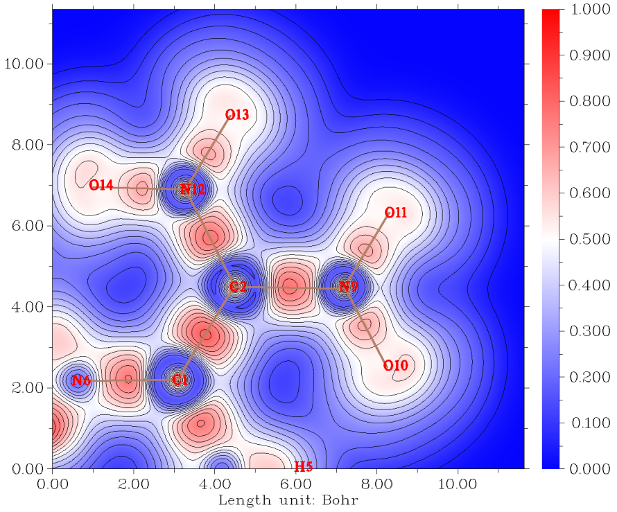

顺便一提，若想在图中平移或旋转所绘制的对象，在定义绘图平面的界面中，在选择选项 4 或 5 之前，应先选择选项 "-1: Set translation and rotation of the map for plane types 4 and 5"，再输入平移值和旋转角，更多信息见 3.5.2 节 [3.5.2](sec-3-5-outputting-and-plotting-specific-property-in-a-plane.md#352-格点平面和作图区域的设置)。

## **4.4.2 一氟乙烷电子定域函数（ELF）带投影效果的阴影浮雕图**

本节说明如何绘制带投影的阴影浮雕图。启动 Multiwfn 并输入以下命令

```text
examples\C2H5F.wfn
0  // View the molecular structure first to find the plane we are interested in. Suppose that the C-C-F plane is what we want to plot, record the atomic indices (1, 5, 8), and then click RETURN button to return to main menu
4  // Plot graph in a plane
9  // Electron localization function (ELF)
5  // Shaded relief map with projection effect
[Press ENTER button]  // Use recommended grid setting, namely 100,100
0  // Manually set extension distance. If you do not do this, you will find the resulting graph is somewhat truncated at boundary because the default extension distance is too small for present case
6  // Set extension distance to 6 Bohr, which is slightly larger than the default value
4  // Define the plotting plane by three atoms
1,5,8  // Indices of the three atoms
```

下图立即弹出：

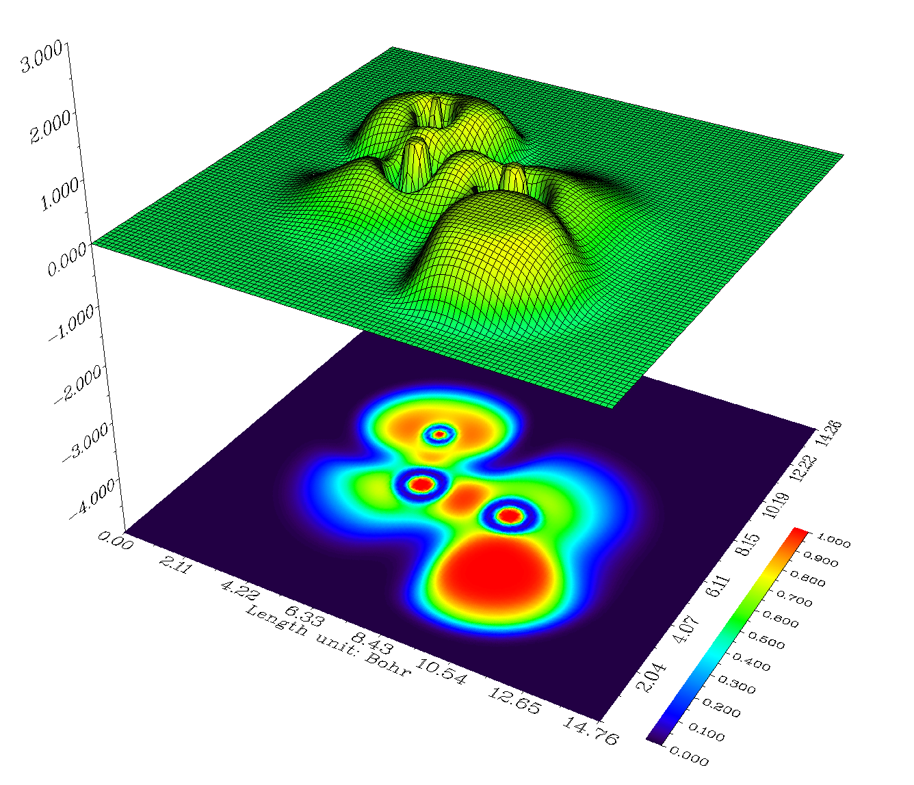

可见，C-C 和 C-F 共价键区域有很高的 LOL 值，表明这些地方电子定域程度很高。每个原子核周围的蓝色环状区域揭示了重原子的价层与内层之间电子定域很低的区域。紫色箭头指出了氟原子的孤对区域。

用后处理界面的选项 0 可将图形界面中看到的图保存为图形文件。若发现导出的图像中对象边缘被截断，应选择选项 -1 重新进入图形界面窗口，缩小图形再导出图片。

## **4.4.3 绘制不含某些原子贡献的平面图**

本节的主要目的是说明如何绘制不含某些原子贡献的实空间函数平面图。在 Multiwfn 中可用两种不同方式实现该目的，分别以下面两个例子展示。

### **例 1：去掉两个原子贡献的尿嘧啶电子密度拉普拉斯等值线图**

在主功能 6 中，可用子功能 -3 和 -4 删除以某些原子为中心的高斯型函数（GTF，Gauss type function），以去掉它们对各种基于实空间函数的分析的贡献。本例将利用该特性。由于该处理减少了 GTF 总数，后续分析的计算耗时会降低。

启动 Multiwfn 并输入以下内容

```text
examples\uracil.wfn
6  // Modify wavefunction
-4  // Discard contribution of some atoms
3,4  // All GTFs centered on atoms 3 and 4 will be discarded. In other words, contribution of atoms 3 and 4 will be removed from current wavefunction
-1  // Return to main menu
4  // Plot graph in a plane
3  // Laplacian function
2  // Contour line map
[Press ENTER button to use default grid setting]
1  // XY plane will be plotted
0  // The Z-position of the XY plane is zero, that is molecular plane
```

下面是得到的图形，实线和虚线分别对应正值和负值区域。

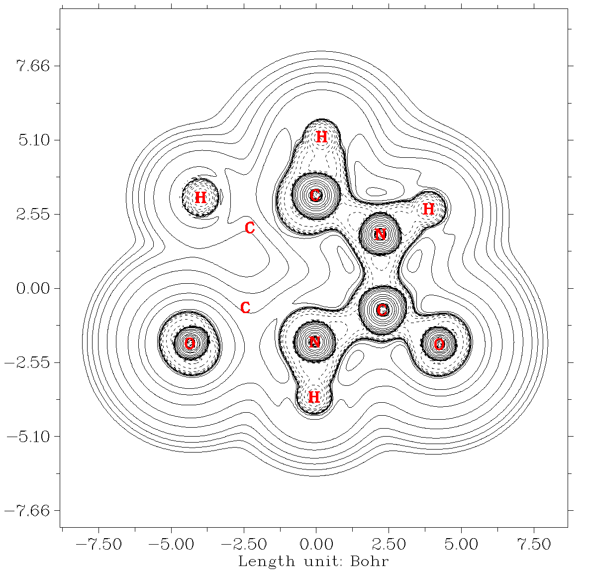

从图中可以看到，两个碳的贡献已如预期被去掉。

顺便一提，若研究大体系但只关心局域区域，可去掉远离该区域的原子上的 GTF，以节省实空间函数分析（如拓扑分析、盆分析、计算格点数据……）的计算时间。

### **例 2：只由尿嘧啶环内原子贡献的 LOL 平面图**

按常规绘制平面图后，可要求程序只绘制由某片段贡献的图。具体做法是，产生用户定义片段的 Hirshfeld 权重函数并乘到平面数据上。该处理只影响当前绘制的图，不影响任何后续分析，因为该处理不修改波函数。

这里用该功能绘制只由环内六个原子贡献的尿嘧啶定域轨道定位（LOL）图。启动 Multiwfn 并输入以下命令：

```text
examples\uracil.wfn
4  // Plane map
10  // LOL
1  // Color-filled map
[Press ENTER button to use default grid setting]
1  // XY plane will be plotted
0  // Z=0
```

关闭图形再输入

```text
-9  // Only plot the data around certain atoms
1-6  // The index of the six atoms in the uracil ring
8  // Enable showing bonds
14  // Brown
-1  // Replot
```

然后可看到

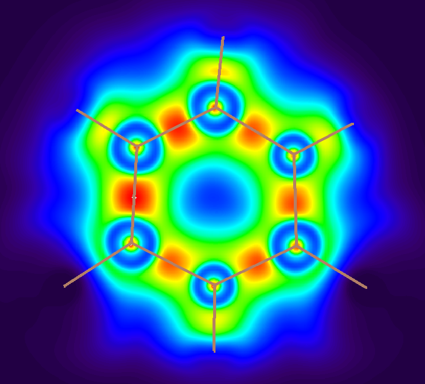

显然，远离环原子的格点处 LOL 值已被显著屏蔽。若想恢复原来的图，可在后处理菜单中选择 "-9 Recovery original plane data" 再重新绘制。

## **4.4.4 三氟化氯静电势的等值线图**

本例将三氟化氯的静电势（ESP，electrostatic potential）绘制为等值线图。启动 Multiwfn 并输入以下命令

```text
examples\ClF3.wfn  // Generated at B3LYP/6-31G* level
4  // Plot graph in a plane
12  // Total electrostatic potential
2  // Draw contour line map
120,120  // Number of grids in each direction
3  // YZ plane
0  // Set X coordinate of the YZ plane to 0
```

因为 ESP 的计算明显比其他实空间函数耗时，需要等待一会儿。

计算完成后，ESP 图弹出。该图不便直观分析，因为我们感兴趣的往往是分子范德华表面上的 ESP 值，因此最好同时在该图上画出范德华表面。为此，用右键关闭图形，在后处理菜单中选择选项 15，再选择选项 -1 重新绘制图形，可看到如下图片。实线和虚线分别表示 ESP 为正值和负值的区域。

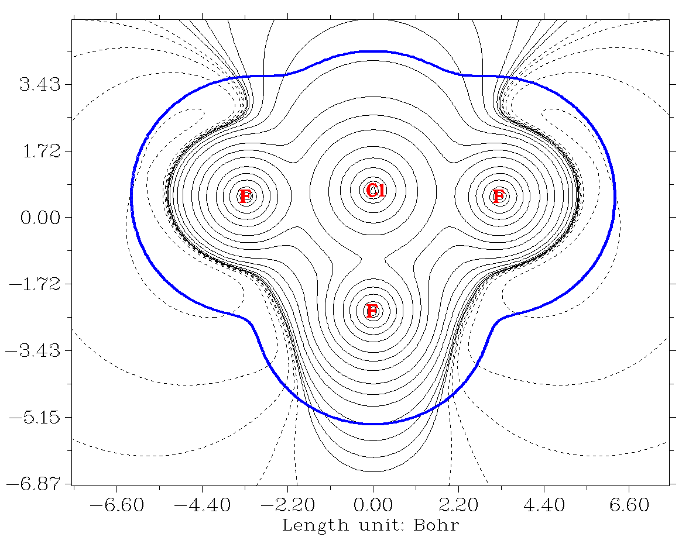

粗蓝线对应于范德华表面（电子密度=0.001 a.u. 的等值面，如 R. F. W. Bader 所定义）。从图中很清楚，氯原子整体带正电，因为靠近氯原子的范德华表面大多与实等值线相交。同理可见，平伏位（equatorial）氟原子比两个轴向氟原子电子少，该结论在 4.7.1 节为该分子计算原子电荷时可进一步验证。

Multiwfn 也能直接绘制由原子电荷导出的 ESP 平面图。首先，需要准备一个 .chg 扩展名的纯文本文件，第一列对应元素名，第 2、3、4 列分别对应 X、Y、Z 坐标（单位 Å），最后一列为原子电荷。例如：

```text
  Cl    0.000000    0.000000    0.359408    0.529971
  F     0.000000    1.726507    0.294501   -0.228394
  F     0.000000    0.000000   -1.267884   -0.073185
  F     0.000000   -1.726507    0.294501   -0.228394
```

按常规启动 Multiwfn，再用该 .chg 文件作为输入。绘图流程与上面给出的完全相同，只是在 Multiwfn 提示选择实空间函数时，应选择 8（由原子电荷得到的 ESP）而不是 12。

## **4.4.5 两个轨道波函数的等值线图**

Multiwfn 能够同时为两个轨道绘制等值线图。本节将同时描绘 NH2COH 的 NBO 12 和 NBO 56（回想 4.0.2 节 [4.0.2](sec-4-0-view-orbitals-and-structure.md#402-查看乙醇的自然键轨道-nbo)）。所选平面是垂直于分子平面且同时经过碳和氮原子的平面。届时可以看到，需要用特殊方式定义这样的绘图平面。分子几何结构和原子编号如下所示。

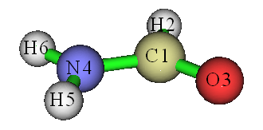

启动 Multiwfn 并输入：

```text
examples\NH2COH.31
37  // Load NH2COH.37
4  // Plot plane graph
4  // Orbital wavefunction
12,56  // The two orbital indices. If you only input one index, then only one orbital will be plotted
[Press ENTER button to use default grid setting]
7  // This mode is used to define a plotting plane parallel to a bond and meantime normal to a plane defined by three atoms
1,4  // The plotting plane is parallel to C1-N4
3,1,4  // The plotting plane is perpendicular to the plane defined by O3-C1-N4
10  // The length of X-axis of the resulting map is 10 Bohr
10  // The length of Y-axis of the resulting map is 10 Bohr
```

图形立即弹出。用右键关闭它，选择选项 2 并输入 25 以在等值线上显示等值面数值，再选择 -1 重绘图形，可看到：

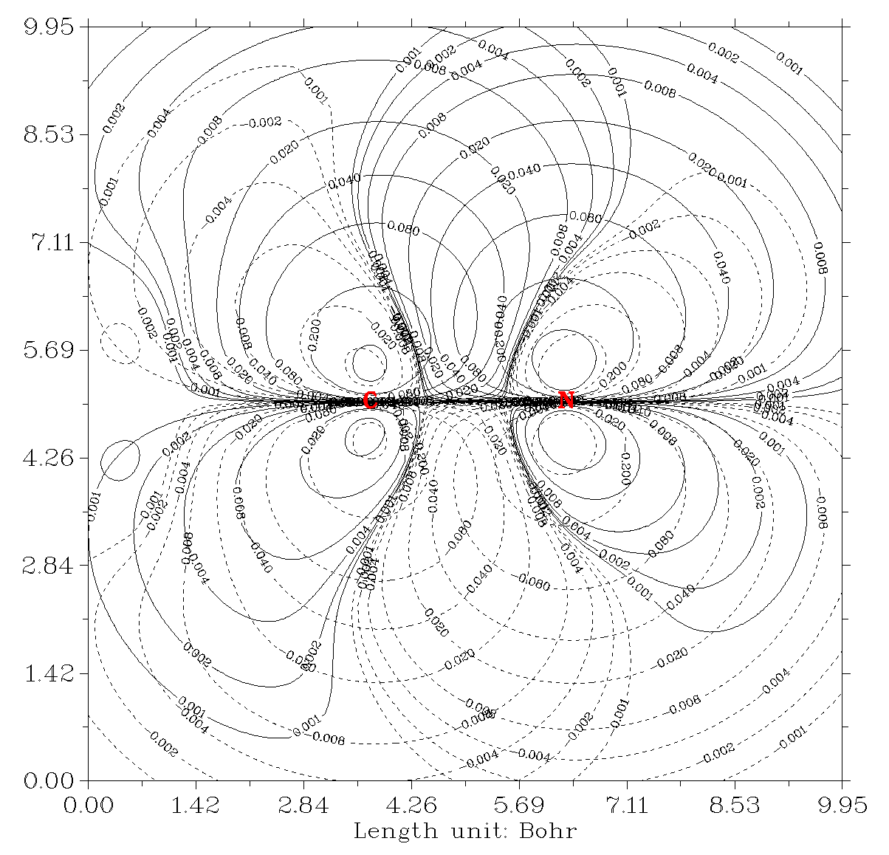

该等值线图不太理想，等值线太多交织在一起，干扰了视线。罪魁祸首是等值面数值太小（绝对值小于 0.01）的等值线。既然这些等值线不重要，可删除它们使图形更清晰。因此，关闭图形并输入

```text
3  // Change contour line setting
4  // Delete some contour lines
1-4  // Delete contour lines 1~4, they respectively correspond to 0.001, 0.002, 0.004, 0.008
4  // Delete some contour lines
28-31  // Delete the four contour lines corresponding to -0.001, -0.002, -0.004, -0.008. For convenience, you can choose option 6 to export current contour line setting to an external file, when you use Multiwfn next time you can load present setting directly by choosing option 7 in current interface
15  // Set the drawing style suitable for publication, namely positive and negative parts are portrayed as red solid lines and blue dashed lines, respectively
1  // Save setting and return to the upper menu
-8  // Change length unit of the graph to Å
-2  // Set label interval in X and Y axes
1,1  // Intervals in both X and Y axes are 1.0 Å
-1  // Replot the contour map
2  // Enable showing isovalue on contour lines
30  // Use label size of 30
```

现在图形变得非常清晰且信息丰富，同相位的重叠区域非常明显。

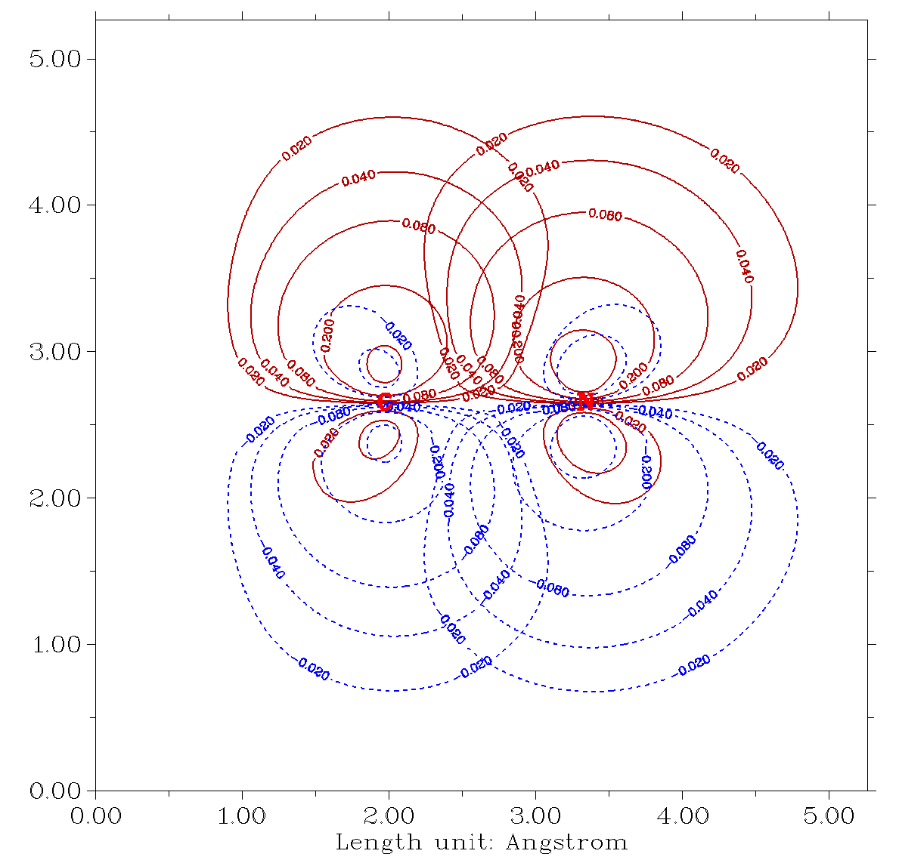

## **4.4.6 过氧化氢电子密度的梯度＋等值线图及拓扑路径**

如 3.5.5 节 [3.5.5](sec-3-5-outputting-and-plotting-specific-property-in-a-plane.md#355-在平面图上绘制临界点路径和盆间路径)所介绍，临界点、键径和盆间面也可绘制在平面图上，这里给出一个简单的例子。绘制这种图有相应的视频说明 <https://youtu.be/gv5FkiFWUY0>，建议观看。

### **电子密度的梯度图**

首先，展示如何为过氧化氢绘制普通的电子密度梯度图。启动 Multiwfn 并输入以下命令

```text
examples\H2O2.fch  // Of course, you can also use other types of files as input, as long as the file contains GTF information
4  // Plotting plane map
1  // Electron density
6  // Gradient line with/without contour line map
[Press ENTER button to use default grid setting]
4  // Use three atoms to define the plotting plane
2,1,3  // Define the plane by nuclear positions of atoms 2, 1 and 3
```

相对于其他图形类型，产生数据和绘制梯度图需要更多计算时间，但由于本体系很小且基组只有 6-31G\*，图形立即出现：

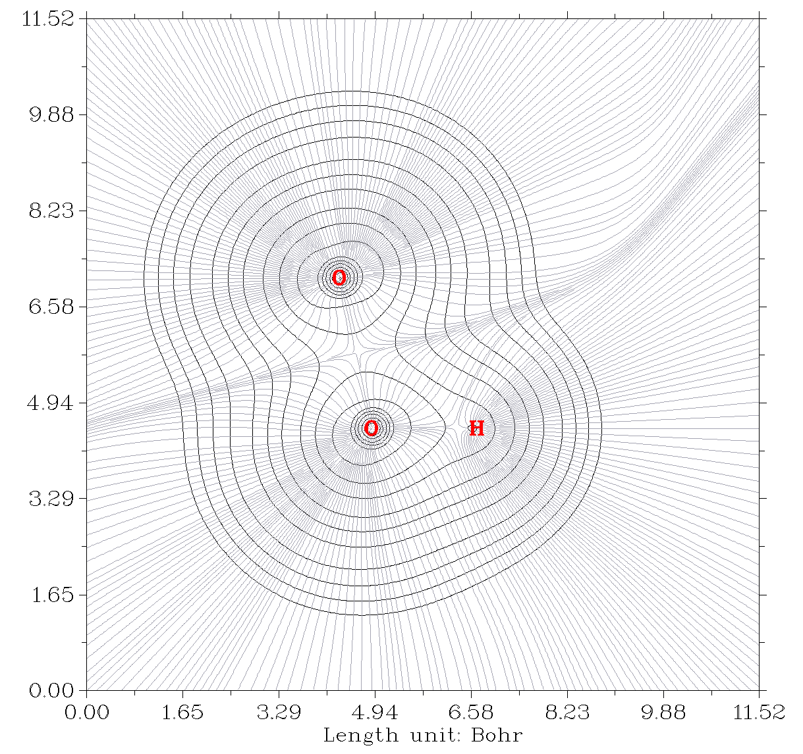

这类图形在 Bader 的 AIM 分析中非常有用。Multiwfn 支持的任何其他实空间函数也可绘制梯度＋等值线图。在后处理菜单中，可用选项 11、12、13、14 调节梯度线的绘图效果，它们分别控制梯度线的光滑度、密度、颜色和密度。

### **带电子密度键径和临界点的电子密度梯度图**

若希望图中也描绘临界点和路径，需在绘图之前先做如 4.2.1 节 [4.2.1](sec-4-2-topology-analysis.md#421-2-吡哆醇-2-氨基吡啶的分子中的原子-aim-拓扑分析与芳香性分析)所示的拓扑分析。现在输入以下命令

```text
-5  // Return to main menu
2  // Topology analysis (by default electron density is the function to be analyzed)
2  // Search CPs from nuclear positions
3  // Search CPs from midpoint of atomic pairs
8  // Generating the paths connecting (3,-3) and (3,-1) CPs, namely generating bond paths in current context
0  // Visually check if all expected CPs and paths have been generated. This step is optional
-10  // Return to main menu
```

然后按上述方式绘制电子密度的梯度线图。得到的图形应如下所示。棕、蓝、橙色圆圈分别表示 (3,-3)、(3,-1) 和 (3,+1) 临界点。粗深棕色线描绘键径。

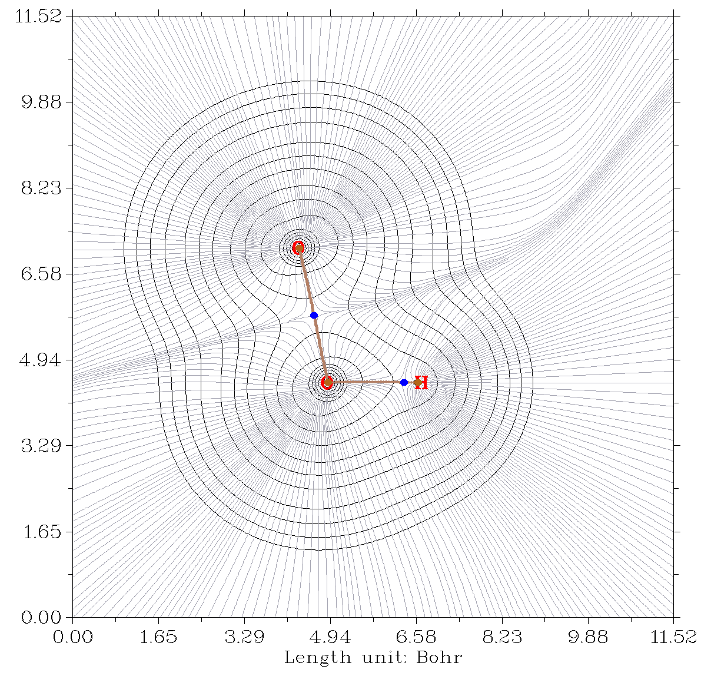

在后处理菜单中，可进入“4 Set details of plotting critical points and paths”调节临界点和路径的显示设置。

> **提示**
>
> 不同类型临界点的颜色可用 *settings.ini* 文件中的 "CP_RGB_2D" 设置。

盆间路径也可画在图上。若已在拓扑分析模块中完成临界点的搜索，在绘制等值线/梯度/矢量场图后，可在后处理阶段找到名为 "Generate and show interbasin paths" 的选项；选中它再重新绘图，盆间路径将以粗深蓝色线显示在图上：

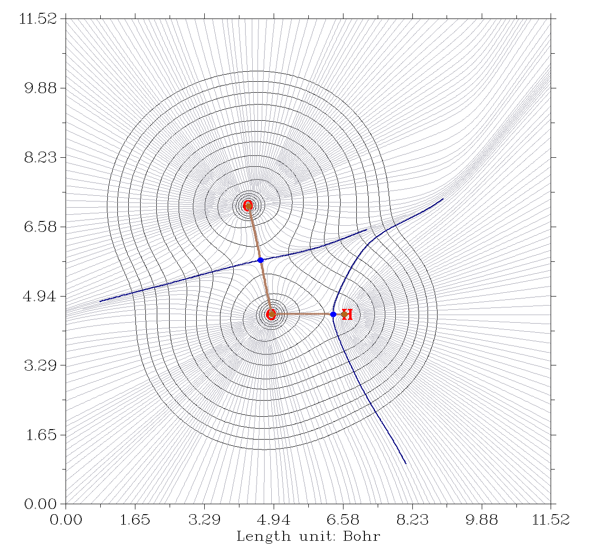

注意，在产生盆间路径之前，可用后处理菜单中的选项 "7 Set stepsize and maximal iteration for interbasin path generation" 设置相关参数（步长和迭代数）。迭代数越大，盆间路径可能越长。

### **带电子密度键径和临界点的电子密度拉普拉斯等值线图**

最后，绘制电子密度拉普拉斯的等值线图，之前产生的键径和临界点也显示在上面。返回主菜单再输入以下命令

```text
4  // Plotting plane map
3  // Laplacian of electron density
2  // Contour line map
[Press ENTER button to use default grid setting]
4  // Use three atoms to define the plotting plane
2,1,3  // Define the plane by nuclear coordinates of atoms 2, 1 and 3
```

得到的图形如下所示（只给出局域区域）

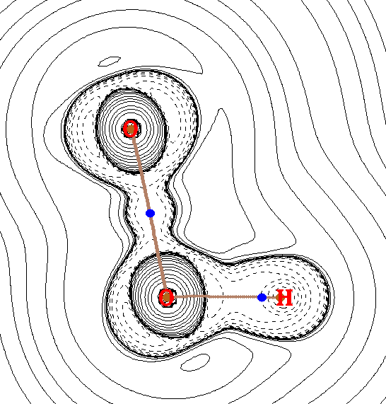

## **4.4.7 乙酰氯电子密度的变形图**

电子密度的变形图清晰地展示了分子形成过程中电子密度分布的变化，其定义为实际分子电子密度减去所有组成原子在自由态时的电子密度。变形密度分析的示例见我的论文 [*Acta Phys. -Chim. Sin.*](http://www.whxb.pku.edu.cn/EN/10.3866/PKU.WHXB201709252)[,](http://www.whxb.pku.edu.cn/EN/10.3866/PKU.WHXB201709252) [**34**](http://www.whxb.pku.edu.cn/EN/10.3866/PKU.WHXB201709252)[, 503 (2018)](http://www.whxb.pku.edu.cn/EN/10.3866/PKU.WHXB201709252)。

由于实际化学体系中有很多原子，用自定义操作功能画这种图是辛苦的工作。幸运的是，Multiwfn 提供了一个特殊选项以高度自动化的方式实现。启动 Multiwfn 并输入以下命令

```text
examples\CH3COCl.wfn
4  // Plot plane map
-2  // Tell Multiwfn you want to draw deformation map, then Multiwfn prepares free-state atom wavefunctions
B3LYP/6-31G*  // The level used to generate atomic wavefunction files by Gaussian, it is the same as the level used for generating CH3COCl.wfn
D:\study\g09w\g09.exe  // The path of executable file of Gaussian (you can also use another Gaussian version). If you already set correct path in “gaupath” parameter in settings.ini, then Multiwfn will not ask you to input the path every time
```

现在 Multiwfn 开始调用 Gaussian 计算原子波函数，再在内部平移并球化它们。这些临时波函数文件存放在当前目录的“wfntmp”文件夹中，得到预期图形后可删除该文件夹。继续输入剩余命令。

```text
1  // Electron density function
2  // Contour map
[Press ENTER button to use default grid setting]
1
0  // The XY plane with Z=0 is the plane of acyl chloride
```

然后变形图弹出：

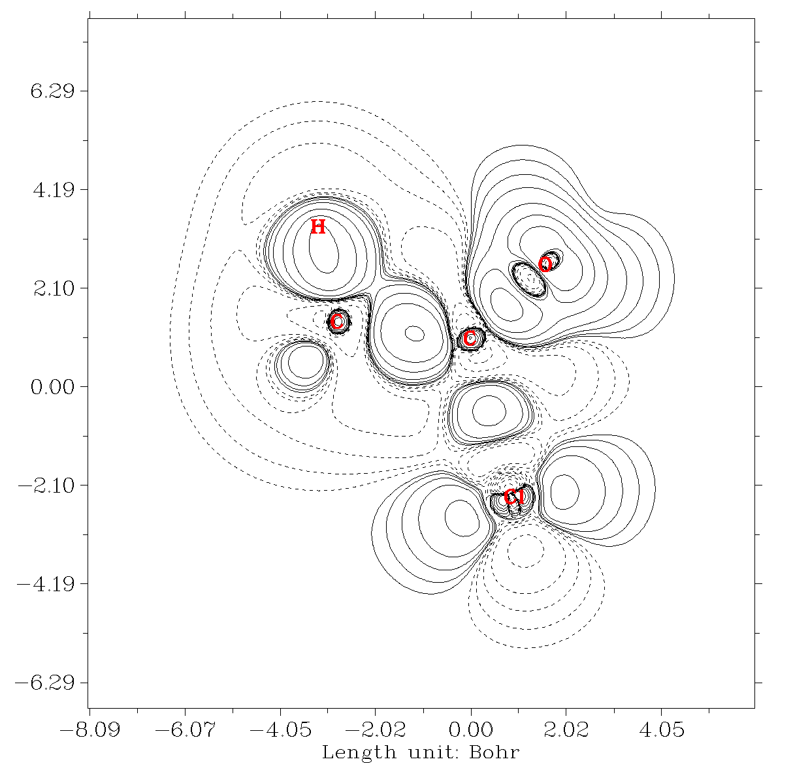

正如预期的，电子密度向成键区域集中。还发现氯原子周围的密度分布大幅偏离球形，该观察与杂化轨道理论一致，氯原子形成了一定程度的 sp³ 杂化态。

选择相应的实空间函数也可为其他函数绘制变形图，不过并非所有函数都有意义。

若下次想避免重新计算原子波函数文件，可将“wfntmp”文件夹中不带数字后缀的 .wfn 文件（如“C .wfn“）复制到当前目录的“atomwfn”文件夹中，若 Multiwfn 发现所需原子波函数已全部存在于“atomwfn”文件夹中，就不再调用 Gaussian 重算它们。

> **提示**
>
> 也可用“examples”目录中的 *genatmwfn.pdb* 在一次运行中产生特定基组下的所有原子波函数，请查阅 3.7.3 节 [3.7.3](sec-3-7-custom-operation-promolecular-and-deformation-properties.md#373-原子波函数的生成-generation-of-atomic-wavefunctions)。

“examples”目录中的“atomwfn”文件夹包含所有前四周期元素的原子波函数（6-31G\*），可直接将该文件夹复制到当前目录，之后绘制变形图时就不再需要 Gaussian。

若体系涉及比 Kr 重的元素，必须手动计算相应的原子 .wfn 文件并放入 "atomwfn" 文件夹。关于准备原子波函数文件的更多细节见 3.7.3 节 [3.7.3](sec-3-7-custom-operation-promolecular-and-deformation-properties.md#373-原子波函数的生成-generation-of-atomic-wavefunctions)。

## **4.4.8 绘制水四聚体相对其组成单体的电子密度和 ELF 差值图**

本例说明如何为给定实空间函数绘制体系与其组成片段之间的差值图。将以电子密度和 ELF 为研究函数。

*examples\water_tetramer\wfn\complex.wfn* 是优化后水四聚体的波函数文件，该目录下的 *water1/2/3/4.wfn* 是每个水单体的波函数文件。相应的 Gaussian 输入文件也在该目录下提供。注意，单体坐标直接取自配合物坐标，且所有文件都用了 *nosymm* 关键词，以避免 Gaussian 在计算中自动重定向分子几何结构。（牢记，只有当所有片段的坐标与整个配合物的坐标完全一致时，密度差值图才有意义）

### **绘制电子密度的差值图**

首先，为配合物相对全部四个单体绘制电子密度差值的平面图。启动 Multiwfn 并输入

```text
examples\water_tetramer\wfn\complex.wfn
4  // Plot plane map
0  // Custom operation
4  // Four files will be operated on the firstly loaded system
-,examples\water_tetramer\wfn\water1.wfn
-,examples\water_tetramer\wfn\water2.wfn
-,examples\water_tetramer\wfn\water3.wfn
-,examples\water_tetramer\wfn\water4.wfn
1  // Electron density
2  // Contour map
[Press ENTER to use default grid setting]
4  // Define plane by three atoms
7,10,1
```

图形立即弹出。可进一步改善绘图效果。关闭图形并输入

```text
3  // Change contour line settings
15  // Set line style and width suitable for publication
1  // Save and return
17  // Set distance threshold for showing atom labels
0.2  // 0.2 Bohr
y  // If the distance between an atom and the plotting plane is larger than the specified 0.2 Bohr, then the label will be drawn as thin style
0  // Save the plot as graphic file in current folder
```

图形文件应如下所示

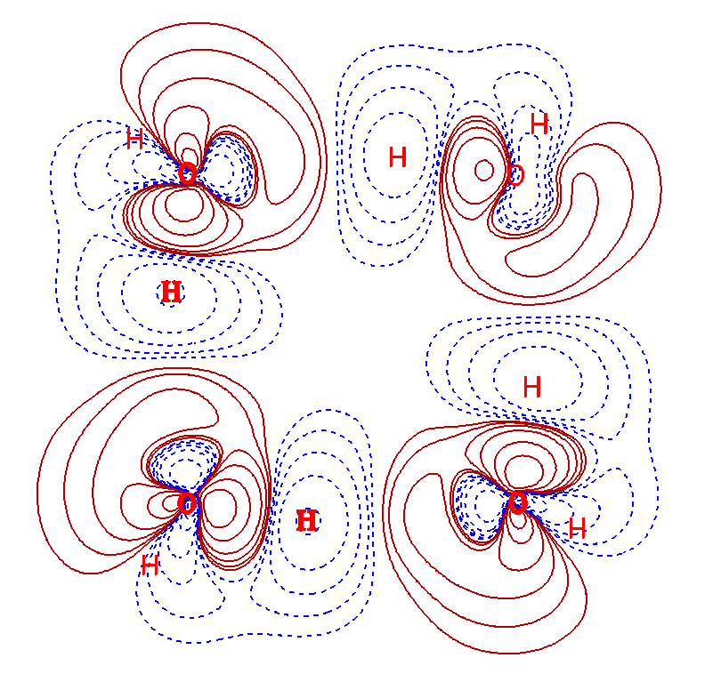

图中红色实线和蓝色虚线分别对应于四聚体形成过程中电子密度增加和减少的区域。

在 Multiwfn 中也可用主功能 5 方便地将密度差值绘制为等值面图，得到的图形如下所示，等值面数值为 0.003。若不知道如何实现，请查阅 4.5.5 节 [4.5.5](sec-4-5-generate-grid-data-and-view-isosurface-map.md#455-绘制电子密度差值图以研究咪唑配位镁卟啉的电子转移)。

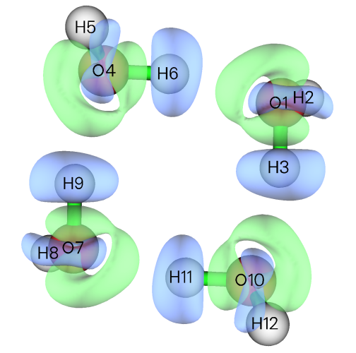

### **绘制 ELF 的差值图**

接着，绘制 ELF 的填充色差值图。输入以下命令

```text
-5  // Return to main menu
4  // Plot plane map
0  // Custom operation
4  // Four files will be operated on the firstly loaded system
-,examples\water_tetramer\wfn\water1.wfn
-,examples\water_tetramer\wfn\water2.wfn
-,examples\water_tetramer\wfn\water3.wfn
-,examples\water_tetramer\wfn\water4.wfn
9  // ELF
1  // Color-filled map
[Press ENTER button]
4  // Define plane by three atoms
7,10,1
```

当前屏幕上显示的图形很难看，因为默认颜色标尺不适合本例。关闭图形并输入

```text
1  // Set lower&upper limit of color scale
-1.5,0.1
4  // Disable showing atomic labels
4  // Enable showing atomic labels again, now you can select label color
3  // Blue labels
-1  // Show the graph again
```

可看到

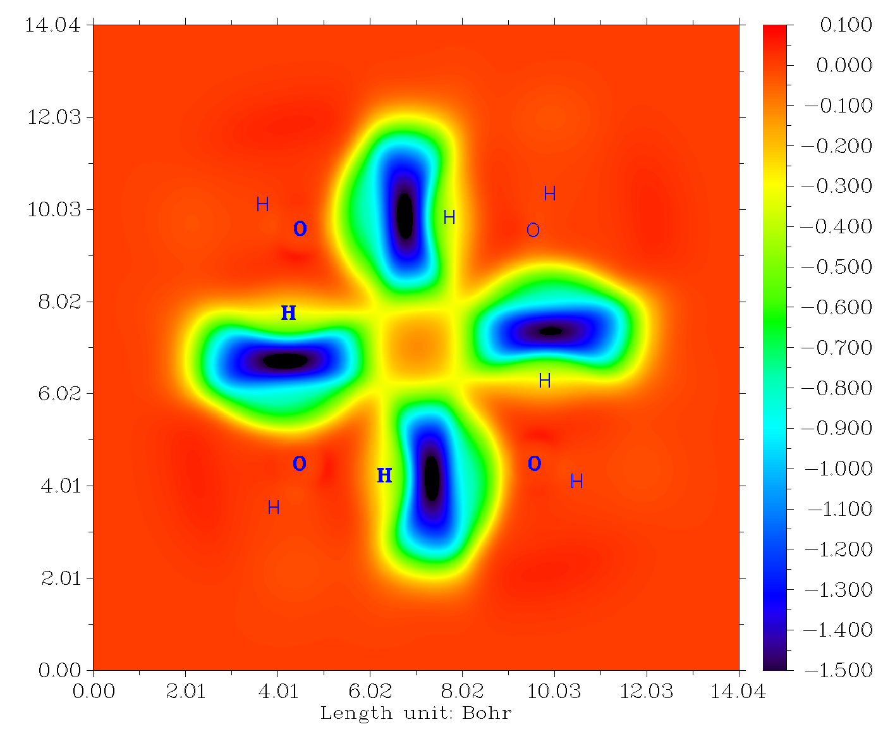

蓝色特别是深蓝色区域表明相应区域 ELF 下降。该图表明，配合物形成过程中，分子间相互作用区域的电子定域降低，这可能是 Pauli 排斥效应的结果。

## **4.4.9 绘制卟啉的 LOL-π 图以揭示有利的电子离域路径**

众所周知的 ELF-π 是仅由 π 电子贡献的 ELF。类似地，LOL-π 可定义为定域轨道定位（LOL）函数的一种变体。相关知识见我的论文 *Theor. Chem. Acc.*, **139**, 25 (2020) DOI: 10.1007/s00214-019-2541-z。LOL-π 的特征与 ELF-π 高度类似，但通常 LOL-π 的图形效果更好。本节说明如何在卟啉上方 1.2 Bohr 处绘制填充色 LOL-π 平面图，会发现该图对理解优先电子离域路径很有用，而离域路径与分子芳香性密切相关。

绘制和分析 LOL 与 LOL-π 的唯一区别是，后者需先将除 π 轨道外所有轨道的占据数设为零。如下所示，这可用 Multiwfn 自动完成。

在 B3LYP/6-31G\* 水平下计算的卟啉 .fch 文件可从 <http://sobereva.com/multiwfn/extrafiles/porphyrin.rar> 下载。启动 Multiwfn 并载入该 .fch 文件，再输入以下命令：

```text
100  // Other functions
22  // Detect π orbitals
0  // Detect π orbitals for delocalized orbitals of exactly planar system
2  // Set occupation number of all other orbitals to zero
0  // Return to main menu
4  // Plot plane map
10  // LOL
1  // Color-filled map
[Press ENTER button]  // Use default grids
3  // Plot YZ plane
1.2  // X=1.2 Bohr
```

关闭图形，再输入

```text
1  // Set lower&upper limit of color scale
0,0.66
4  // Enable showing atom labels
7  // Cyan color
17  // Set distance threshold for showing atom labels
2  // Since the distance between the plotting plane and molecular is 1.2 Bohr, to make all atomic labels shown on the graph, this threshold must be set to a value larger than 1.2 Bohr. Here we set it to 2.0 Bohr
y
8  // Enable showing bonds
14  // Brown color
-1  // Replot
```

现在可看到下图

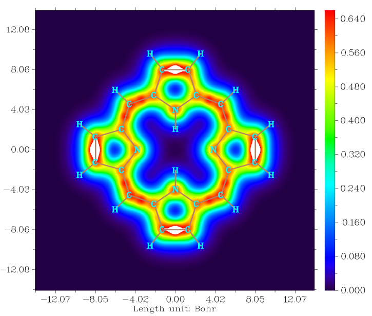

高 LOL-π 区域（红或橙色区域）清晰地揭示了有利的离域路径。若绘制由垂直于分子平面的外磁场诱导的当前图（例如用 AICD 或 GIMIC 方法，细节见我的幻灯片：<http://sobereva.com/148>），会发现单向连续的诱导电流主要形成在 LOL-π 函数突出的有利离域路径上。

接着，为充分展示 Multiwfn 平面绘图功能的灵活性，说明如何用明显不同的风格绘制上图，即用颜色填充等值线之间的区域。

返回主菜单，再输入

```text
4  // Plot plane map
10  // LOL
2  // Color-filled map
[Press ENTER button]  // Use default grids
0  // Set extension distance
1  // 1 Bohr (smaller than default to decrease blank region around the molecule)
3  // Plot YZ plane
1.2  // X=1.2 Bohr
```

关闭图形，再输入

```text
9  // Enable filling colors between current contour lines
9  // Set status of filling colors
2  // Set lower and upper limits of filling
-0.2,0.52
4  // Toggle showing color bar
5  // Set label interval of color bar
0.1
3  // Set color transition
18  // Viridis
0  // Return
-8  // Change length unit of the graph to Å
-2  // Set label interval in X and Y axes
2,2
3  // Change setting of contour lines
8  // Generate contour value by arithmetic progression
0,0.07,15  // Generate contour lines of 0.00, 0.07, 0.14 ... 0.98
y  // Remove existing contour lines
1  // Save setting and return
17  // Set distance threshold for showing atom labels
2  // Maximal distance is 2 Bohr
y
8  // Enable showing bonds
14  // Brown
-3  // Change other plotting settings
10  // Set format of exporting image file
7  // pdf format. It is highly suggested to export this kind of map as vector format such as .pdf
0  // Return
0  // Save the graph to a graphical file in current folder
```

现在可打开导出的 .pdf 文件，可看到下图。可见线条相当光滑，颜色也很舒服！现在该图与带等值线的填充色图不同，因为相邻两条等值线之间只有一种颜色。

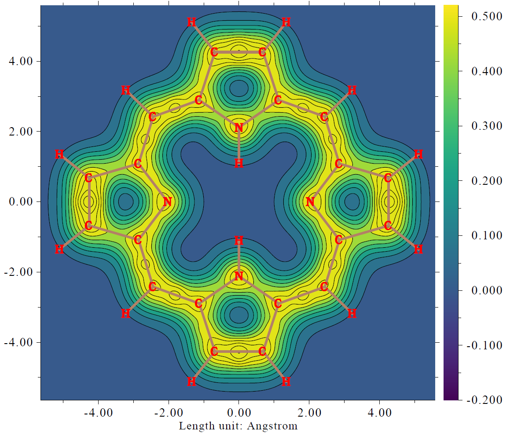

## **4.4.10 绘制静电势的梯度线和矢量场图以揭示 LiF 的电场**

本节的主要目的是说明如何正确绘制有意义的梯度线图和矢量场图。

电场（**F**）定义为静电势（ESP）对坐标一阶导数矢量（即梯度矢量）的负值；因此，若绘制 ESP 的梯度线或矢量场图，可生动地展示 **F**。本节以离子化合物 LiF 为例。

### **梯度线图**

启动 Multiwfn 并输入

```text
examples\LiF.wfn  // Generated at B3LYP/6-31G* level
4  // Plot plane map
12  // ESP
6  // Gradient line map
[Press ENTER button to use default grid setting]
0  // Modify extension distance
6  // 6 Bohr (larger than default value)
3  // YZ plane
0  // X=0
```

关闭图形，再输入

```text
15  // Show a contour line to reveal van der Waals surface
10  // Show arrow on the gradient lines
```

现在可得到下图

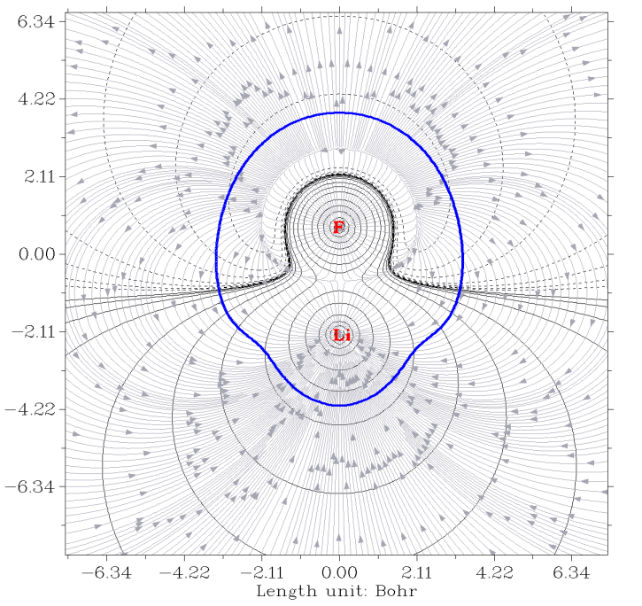

上图中灰色梯度线清晰地展示了各处电场的方向。注意，由于电场对应于 ESP 的*负*梯度矢量，箭头实际应反向。

### **矢量场图**

接着，绘制另一种风格的图以展示电场特征。输入以下命令：

```text
-5  // Return to main menu
4  // Plot plane map
12  // ESP
7  // Vector field map
50,50  // Number of grids in the two dimensions
3  // YZ plane
0  // X=0
```

关闭屏幕上显示的图形再输入

```text
11  // Map color to arrows
10  // Set upper limit of absolute value for scaling arrows
0.05
15  // Show a contour line to reveal van der Waals surface
13  // Invert gradient vectors, so that the arrows will correspond to direction of electric field
1  // Disable showing atom labels and reference point
1  // Enable showing atom labels and reference point
3  // Use blue label color
```

重新绘制图形，可看到

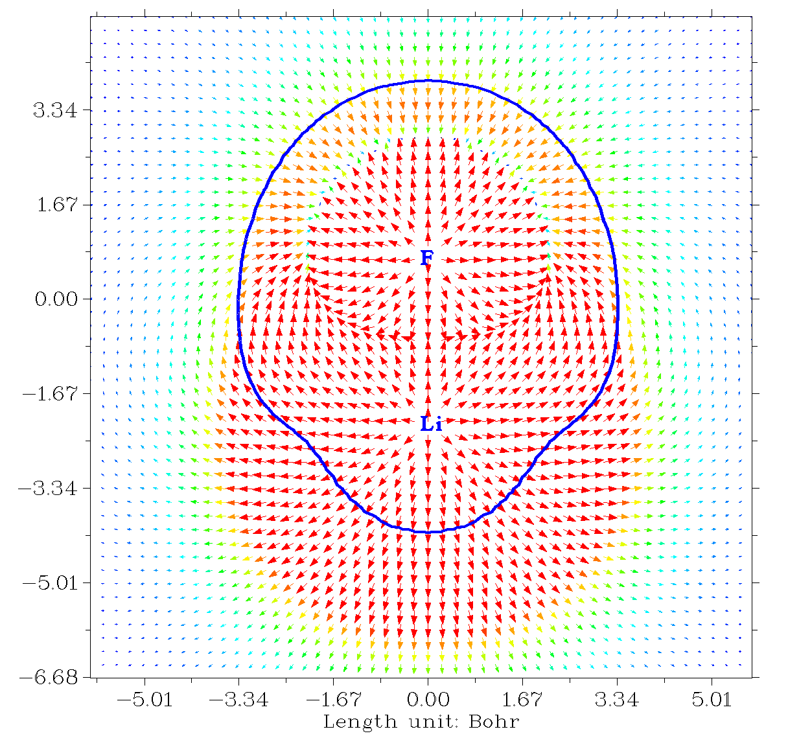

该图中箭头越红，相应位置电场强度越大。可见电场从每个原子核发出，而在离两核相对较远的区域，电场矢量的总体方向是从 Li 一侧指向 F 一侧，这是因为本体系中 Li 和 F 分别带明显的正负净电荷。还可以发现图顶部有一个半圆形的区域，电场强度很小或为零，该区域实际是 ESP 最负的区域，因而表现为分子电场的终点（事实上，该区域周围的所有箭头都指向该区域）。

## **4.4.11 绘制漂亮的 Kr 原子 4*p* 轨道**

本例说明如何为 Kr 原子的 4*p* 原子轨道绘制非常清晰漂亮的填充色等值线图。波函数文件 *Kr.wfn* 已在“examples\atomwfn”文件夹中提供，它由 Gaussian 在 B3LYP/6-31G\* 水平下做单点任务产生。

启动 Multiwfn 并输入以下命令

```text
examples\atomwfn\Kr.wfn
4  // Output and plot specific property in a plane
4  // Value of orbital wavefunction
17  // The orbital corresponding to 4p_z (you can first use main function 0 to visually find the orbital of your interest)
2  // Contour line map
[Press ENTER button]  // Use default number of grids
0  // Modify extension distance to make plotting area slightly larger than default
5  // 5 Bohr
2  // XZ plane
0  // Y=0
```

用右键关闭图形，再输入以下命令改善图形效果

```text
9  // Enable filling colors for contour lines
9  // Set status of filling colors between the contour lines
3  // Set color transition
8  // Blue-White-Red
0  // Return
3  // Change setting of contour lines
5  // Use built-in contour values suitable for special purpose
3  // Suitable for plotting orbital wavefunction (namely ±0.01*2^(^i^-1), i = 1-28)
1  // Save setting and return
```

现在可用选项 -1 查看当前图。本例将图形保存为 .pdf 文件。可用 *settings.ini* 中的“graphformat”设置默认文件格式，但这里临时改为 .pdf，因此输入

```text
-3  // Change other plotting settings
10  // Set format of exporting image file
7  // pdf
0  // Return
```

最后，选择选项 0 保存图形文件。打开文件后可看到

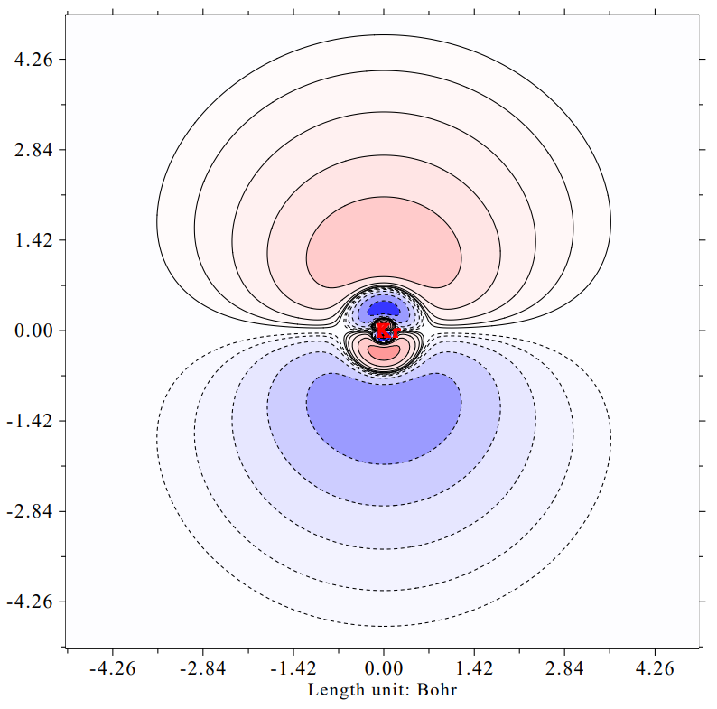

可见，图形效果完美，非常清晰漂亮！

## **4.4.12 在等值线上显示函数的极值点**

本例说明如何在平面图中特定等值面的等值线上展示实空间函数极值点的位置。这里以苯酚为例，在分子平面内绘制静电势（ESP）在 *ρ* = 0.001 a.u. 等值线上的极值点。

启动 Multiwfn 并输入

```text
examples\phenol.wfn
4  // Plot plane map
1  // Electron density
2  // Contour line map
[Press ENTER button]  // Use default number of grids
1  // XY plane
0  // Z=0
```

关闭屏幕上显示的图，再输入

```text
19  // Enable showing extrema of a function on a contour line
0.001  // Isovalue of present function (i.e. electron density)
12  // ESP
-1  // Replot plane map
```

现在可看到下图，红色和蓝色小球分别对应于等值线上的极大值和极小值

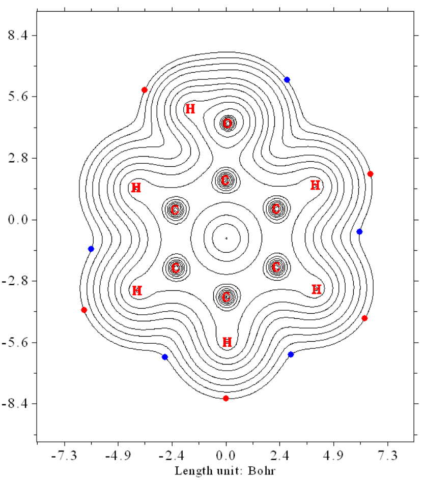

另外，在控制台窗口可找到极值点的信息，包括平面图中的 X、Y 坐标以及极值点处的 ESP 值

```text
 Contour line    1
 Minimum found at   -2.757166   -6.243420  Value:    0.0124521154
 Maximum found at   -6.422139   -4.124796  Value:    0.0208512768
 Minimum found at   -6.092997   -1.331264  Value:    0.0178074993
[...ignored]
 Maximum found at    0.000055   -8.122282  Value:    0.0174823731
 Total maxima:     5
 Total minima:     5
```

若按 4.4.4 节 [4.4.4](#444-三氟化氯静电势的等值线图)的方法绘制填充色 ESP 图并同时显示范德华表面，很容易明白 ESP 极值点为何出现在那些位置。另外，注意 Multiwfn 的主功能 12 能确定三维分子表面上 ESP 或其他函数的极值点，例子见 4.12.1 节 [4.12.1](sec-4-12-quantitative-analysis-of-molecular-surface.md#4121-苯酚分子表面的静电势-electrostatic-potential分析)。
