# **4.5 产生格点数据并查看等值面图**

本节包含 Multiwfn 主功能 5 的例子，都需要计算格点数据。格点数据产生后，可可视化为等值面图，或导出为 .cub 文件以便用 VMD 等第三方工具渲染，或被其他分析程序进一步利用。

注意，用我准备的 VMD 脚本渲染 Multiwfn 产生的 cube 文件极其容易，而图形质量非常好，如何实现请查看 4.A.14 节 [4.A.14](sec-4-A-special-topics-and-advanced-tutorials.md#4a14-用vmd脚本将cube文件渲染为最先进水平的等值面图)。

## **4.5.1 三氟化氯的电子定域函数**

本节绘制三氟化氯电子定域函数（ELF，electron localization function）的等值面图。启动 Multiwfn 并输入以下命令

```text
examples\ClF3.wfn  // Generated at B3LYP/6-31G* level
5  // Generate grid data and view isosurface
9  // Electron localization function (ELF)
2  // Medium-quality grid, about 512000 points will be evaluated, this setting is fine enough for small system but inadequate for medium and especially large system. Please consult Section 3.6 for more knowledge about grid setting.
```

现在 Multiwfn 开始计算格点数据。计算完成后，Multiwfn 输出一些统计信息。新出现的菜单中有很多选项，选择选项 -1 可绘制等值面图，之后弹出图形界面窗口。在文本框中输入等值面数值 0.85 并按回车，可看到以下等值面图

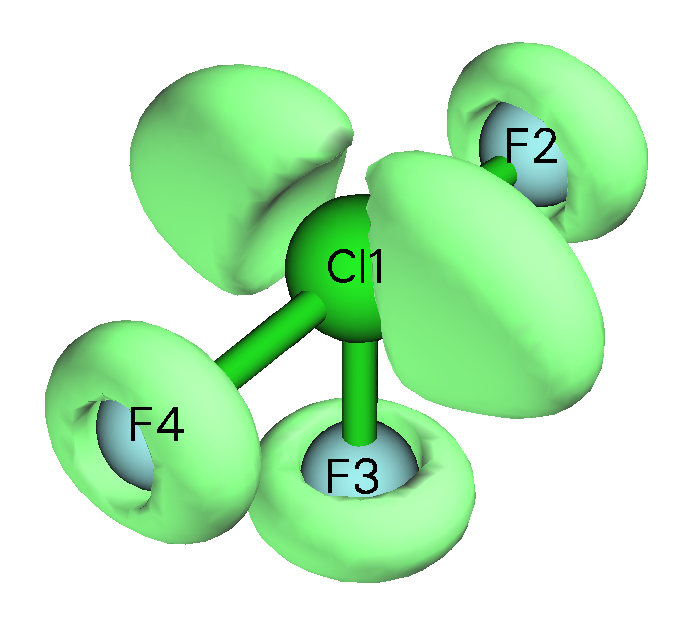

ELF 等值面清晰地揭示了氟和氯原子的孤对区域。

若想将格点数据导出为当前目录下的 Gaussian cube 文件，应点击“Return”按钮关闭图形界面窗口再选择选项 2。

若用 ChimeraX 基于 Multiwfn 导出的 ELF cube 文件绘制等值面图，可为不同区域的各个域自由设置颜色。例如，下图是用 ChimeraX 绘制的乙酸 ELF=0.83 等值面，若认真跟随视频教程"Plotting electron localization function (ELF) isosurface using Multiwfn and ChimeraX"（<https://youtu.be/vC48iEB8PwI>），可轻松再现该图。

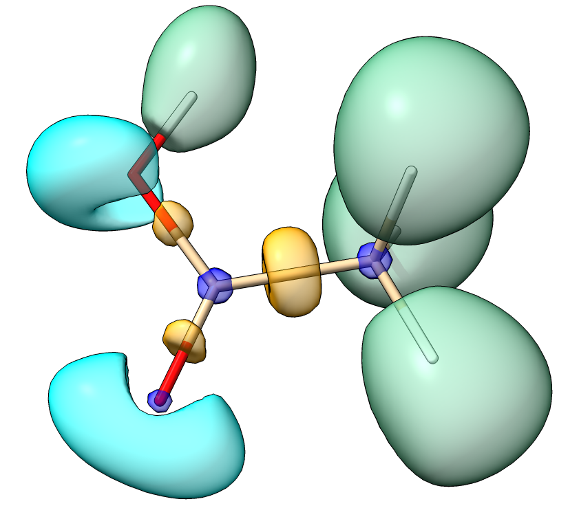

有些论文绘制了按相应盆类型（单触或双触）着色的 ELF 等值面图，虽然可用上述方式实现，但有明显的缺点：若改变等值面数值，等值面的着色会改变，而且不可能用不同颜色为整个等值面着色以展示对应于不同类型盆的各个子区域。4.17.10 节 [4.17.10](sec-4-17-basin-analysis.md#41710-绘制按流域类型着色的-elf-等值面图)介绍的方法完美解决了这些问题，它需要使用盆分析模块。

## **4.5.2 1,3-丁二烯的电子密度拉普拉斯**

电子密度拉普拉斯是另一个像 ELF 和 LOL 一样揭示电子结构的有用实空间函数。由于分辨能力差，拉普拉斯不如 ELF 和 LOL 善于突出定域区域。例如，比氪重的原子的壳层结构不能被拉普拉斯完整展示，若尝试用拉普拉斯分析三氟化氯，会发现氟原子的孤对区域难以辨认。而且，拉普拉斯的数值范围太大，给直观分析带来困难。不过，对很多体系电子密度的拉普拉斯仍有用。本例为 1,3-丁二烯绘制该函数的等值面图。

启动 Multiwfn 并输入以下命令

```text
examples\butadiene.fch  // Yielded at B3LYP/6-31G** level
5  // Generate grid data and view isosurface
3  // Electron density Laplacian
2  // Medium-quality grid (If you want to obtain better graphical effect, choose "high-quality grid" instead)
-1  // View isosurface
```

在新弹出的窗口中，将等值面数值从默认值改为 0.3，绿色和蓝色等值面将分别对应于 0.3 和 -0.3 的等值面数值。当前图形如下所示

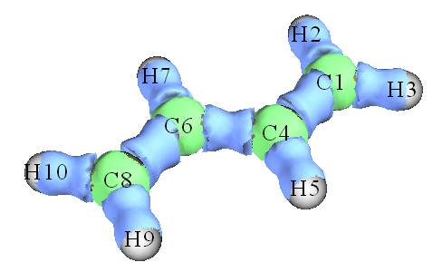

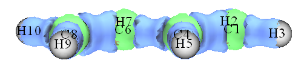

C-C 和 C-H 之间蓝色等值面的存在表明价层电子强烈集中在这些区域，这是共价键的典型模式。若仔细观察碳原子之间的等值面，会发现 C6-C8 或 C1-C4 之间的等值面比 C4-C6 之间的等值面更宽，该现象反映两边的 C-C 共价键比中央的强。该结论也可用其他波函数分析方法验证，例如 Mayer 键级（C6-C8 之间的键级为 1.863，而 C4-C6 之间的键级仅为 1.136）。

本节得到的等值面图不太光滑，这是因为只用了中等质量格点。若改用高质量格点，可得到好得多的等值面。

## **4.5.3 计算 ELF-σ 和 ELF-π 以研究苯的芳香性**

ELF-σ 和 ELF-π 是常用的 σ 和 π 芳香性指标，分别定义为仅由 σ 轨道和 π 轨道贡献的 ELF 域的分岔点（即 (3,-1) 型临界点）处的 ELF 值，细节见 *J. Chem. Phys.*, **120**, 1670 (2004) 和 *J. Chem. Theory Comput.*, **1**, 83 (2005)。这两篇论文包含用 ELF-π 分析 π 离域很好的例子：*Theor. Chem. Acc.*, **139**, 25 (2020) 和 *Carbon*, **165**, 468 (2020)。

这些指标的理论基础是，分岔点处的 ELF 值衡量相邻 ELF 域之间的相互作用，值越大意味着电子在这些域之间离域得越好。强多中心离域被公认为芳香性的本质。据认为，若 ELF-π 大于 0.70，则分子有 π 芳香性。而若 ELF-π 和 ELF-σ 的平均值大于 0.70，则可说分子是全局芳香的。本例将计算苯的 ELF-σ 和 ELF-π。

为了分离 σ 和 π 轨道，首先需要知道哪些轨道是 π 轨道。启动 Multiwfn 并输入以下命令

```text
examples\benzene.wfn  // Optimized at B3LYP/6-311G* level
0  // View molecular orbitals (MOs)
```

现在依次查看每个分子轨道的形状，发现第 17、20、21 个分子轨道是 π 轨道，如下所示。所有其他分子轨道都被认定为 σ 轨道。

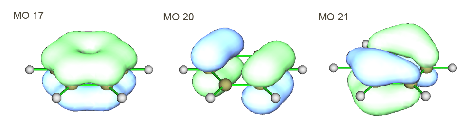

先计算 ELF-π。应去掉 σ 轨道对 ELF 的贡献；**这可通过将所有 σ 轨道的占据数设为零来实现**。

```text
6  // Enter "Modify & Check wavefunction" interface
26  // Set occupation number for some orbitals
0  // Selecting all orbitals
0  // Set occupation number of all orbitals to zero
17,20,21  // Select MO 17, 20 and 21, namely all π orbitals
2  // Set occupation numbers of MO 17, 20 and 21 to 2.0 (doubly occupied). If you want to check if occupation numbers have been correctly set, choose option 3. You will find occupation number of all σ orbitals have become zero, namely they will have no contribution to all results yielded in following calculations
q  // Return to last menu
-1  // Return to main menu
```

对本体系，事实上有一个方便得多的方法将除 π 轨道外所有轨道的占据数设为零。做法是：进入主功能 100 的子功能 22，选择 0，则所有 π 轨道将被自动识别，再选择 1 将所有其他轨道的占据数设为零（若本体系涉及硅等较重元素，则选择选项 3）。最后，选择 0 返回主菜单。关于 π 轨道自动识别的更多细节见 3.100.22 节 [3.100.22](sec-3-100-other-functions-part-1.md#310022-检测π轨道设置占据数并计算π组成detect-π-orbitals-set-occupation-numbers-and-calculate-π-composition)。

### **研究 ELF-π**

研究 ELF-π 有两种方式，方式 1 是直接查看 ELF 等值面，方式 2 是做拓扑分析。方式 1 更直观但不如方式 2 准确。这里先说明方式 1。按常规用主功能 5 产生并查看 ELF 的等值面（回想 4.5.1 节 [4.5.1](#451-三氟化氯的电子定域函数)。建议用高质量格点）。此时的 ELF 等值面只反映 π 电子定域特征。逐渐增大等值面数值，会发现在等值面数值约为 0.91 时，两个圆环形 ELF 域分岔为十二个球状域（见下图），说明苯的 ELF-π 指标约为 0.91。

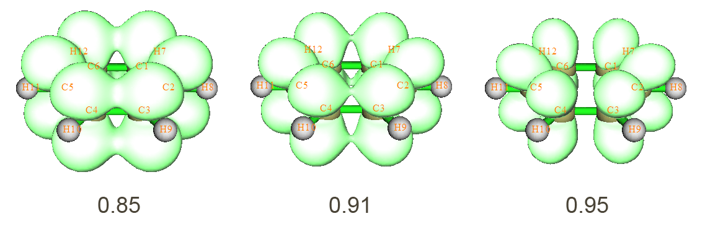

接着，用方式 2 再次求 ELF-π 指标，该方式比方式 1 更严格。选择 0 返回主菜单。

```text
2  // Topology analysis
-11  // Select real space function
9  // ELF
6  // The starting points will be distributed around each atom in turn. This searching mode is the most appropriate one for locating ELF CPs
-1  // Start the CP search
-9  // Return to upper menu
0  // Visualize results. The resulting graph is shown below, two (3,+1) CPs are not shown
```

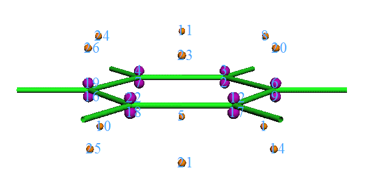

将该图与 ELF 等值面图比较，很清楚 (3,-1) 临界点（橙色）是 ELF 域的分岔位置，而 (3,-3) 临界点（紫色）对应于十二个 ELF 域的极大值点。现在查看一个 (3,-1) 临界点处的 ELF 值，任选一个即可，因为它们都等价。

```text
7  // Show all properties at a CP
23  // CP23
```

从输出发现 CP 23 处的 ELF 值，即苯的 ELF-π 指标为 0.91247，该结果与 *Chem. Phys. Lett.*, **443**, 439 (2007)给出的 0.913 非常吻合，注意我们的计算水平与该论文完全相同。显然，该值超过了 π 芳香性的标准（0.70），说明苯有很强的 π 芳香性。

### **研究 ELF-σ**

现在计算苯的 ELF-σ。重启 Multiwfn 并载入 *benzene.wfn*，将 MO 17、20、21 的占据数设为零（用主功能 100 的子功能 22 做更方便）。然后按常规产生 ELF 的等值面，逐渐调节等值面数值，找出碳原子间 σ 键对应的域在哪个等值面数值下分岔。最终可发现在等值面数值等于 0.71 时域分岔，说明 ELF-σ 指标约为 0.71。分岔点在下图中用红箭头指出：

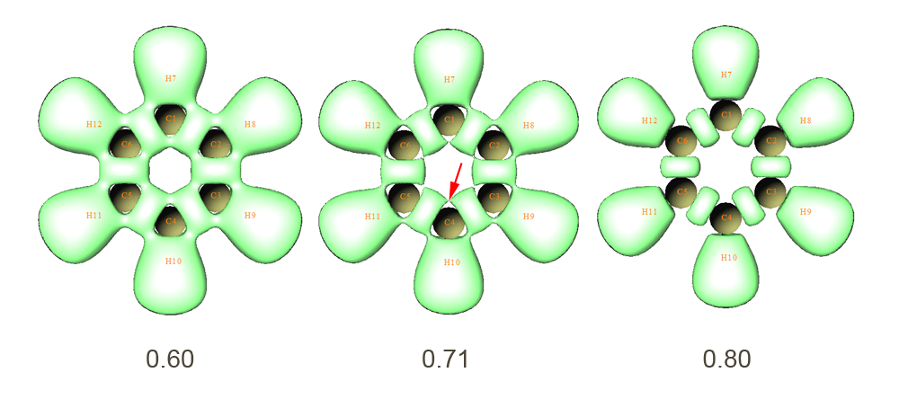

进入拓扑分析模块并搜索 ELF 临界点，如同在 ELF-π 分析的方式 2 中所做的。可得到下图。为清楚起见，隐藏了 (3,+1) 和 (3,+3) 临界点。

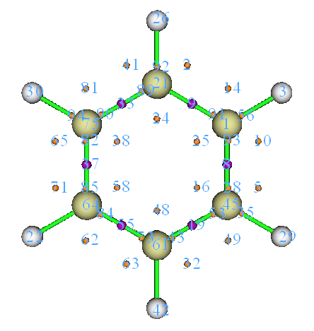

将临界点的位置与 ELF 等值面图比较，很清楚 (3,-1) 临界点（如 CP 48 和 58）对应于碳原子间 σ 键域的分岔点。查看 CP 48 处的 ELF 值，得到 0.70907，这就是精确的 ELF-σ 值。我们的结果与 *Chem. Phys. Lett.*, **443**, 439 (2007)的 0.717 吻合得很好。

ELF-σ 和 ELF-π 的平均值为 (0.70907+0.91247)/2=0.81077，大于全局芳香性的标准，因此苯具有全局芳香特征。

## **4.5.4 用福井函数和对偶描述符研究苯酚亲电进攻的有利位点**

Multiwfn 支持一批预测最活泼位点的方法，细节见 4.A.4 节 [4.A.4](sec-4-A-special-topics-and-advanced-tutorials.md#4a4-反应位点预测方法概述)。本节介绍如何实现福井（Fukui）函数和对偶描述符（dual descriptor），它们是揭示活泼位点最常用的两种方法。

**重要提示**：在日常研究中，强烈建议直接用主功能 22 自动计算福井函数和对偶描述符，因为步骤比下面介绍的简单得多，同时还能得到概念密度泛函理论中很多有用的量作为副产品，介绍见 3.25 节 [3.25](sec-3-25-conceptual-density-functional-theory-analysis.md)，例子见 [4.22.1](sec-4-22-examples-of-conceptual-density-functional-theory-cdft-analysis.md#4221-自动计算苯酚的概念密度泛函理论量)。

### **4.5.4.1 福井函数**

#### **理论**

福井函数是概念密度泛函理论中非常重要的概念，已广泛用于预测活泼位点。福井函数定义如下，原始论文见 *J. Am. Chem. Soc.*, **106**, 4049 (1984)，相关讨论和比较见我的论文 [*Acta Phys. -Chim. Sin.*](http://www.whxb.pku.edu.cn/CN/abstract/abstract28694.shtml)[,](http://www.whxb.pku.edu.cn/CN/abstract/abstract28694.shtml) [**30**](http://www.whxb.pku.edu.cn/CN/abstract/abstract28694.shtml)[, 628 (2014)](http://www.whxb.pku.edu.cn/CN/abstract/abstract28694.shtml)。

$$
f(\mathbf{r})=\left[\frac{\partial\rho(\mathbf{r})}{\partial N}\right]_{\nu}
$$

其中 *N* 为本体系的电子数，偏导数中的常数项 *ν* 为外势。一般外势只来自核电荷，因此对孤立化学体系 *ν* 可简单视为核坐标。据认为，活泼位点的福井函数值应比其他区域大。由于 *N* 为整数时不连续，无法直接求该偏导数。用有限差分近似，福井函数可明确地计算三种情形：

Nucleophilic attack: $\displaystyle f^{+}(\mathbf{r})=\rho_{N+1}(\mathbf{r})-\rho_{N}(\mathbf{r})\approx\rho^{\mathrm{LUMO}}(\mathbf{r})$

Electrophilic attack: $\displaystyle f^{-}(\mathbf{r})=\rho_{N}(\mathbf{r})-\rho_{N-1}(\mathbf{r})\approx\rho^{\mathrm{HOMO}}(\mathbf{r})$

Radical attack: $\displaystyle f^{0}(\mathbf{r})=\frac{f^{+}(\mathbf{r})+f^{-}(\mathbf{r})}{2}=\frac{\rho_{N+1}(\mathbf{r})-\rho_{N-1}(\mathbf{r})}{2}\approx\frac{\rho^{\mathrm{HOMO}}(\mathbf{r})+\rho^{\mathrm{LUMO}}(\mathbf{r})}{2}$

#### **准备波函数文件**

下面先用上面所示的福井函数 $f^-$ 揭示苯酚亲电进攻的活泼位点。这里不用基于前线轨道的近似形式的福井函数。

需要准备 $f^-$ 计算所需的文件。假设你是 Gaussian 用户，可用 .wfn、.wfx 或 .fch 作为本目的的输入文件。本例做以下计算以产生所需的 .wfn 文件，所有计算都在 B3LYP/6-31G\* 水平下进行，这是产生有意义结果最低可接受的水平（当然可用更好的水平改进结果）：

- (1) 优化中性态苯酚的几何结构。得到的几何结构将用于后续步骤

- (2) 对中性态苯酚做单点任务以产生 *phenol.wfn*（见 *examples\phenol.gjf*）

- (3) 对 *N*-1 态（即阳离子态）苯酚做单点任务以产生 *phenol_N-1.wfn*（见 *examples\phenol_N-1.gjf*）

注意，在做 *N*-1 态单点任务之前不应优化 *N*-1 态的几何结构，因为在福井函数的偏导数中 *ν*（此语境下即核坐标）是常数。顺便一提，若在步骤 (1) 直接指定 *out=wfn* 关键词和 .wfn 文件的输出路径，事实上可省略步骤 (2)。

#### **计算福井函数 *f*⁻**

要研究 $f^-$ 的等值面，需正确使用 Multiwfn 的“自定义操作”功能（细节见 3.7.1 节 [3.7.1](sec-3-7-custom-operation-promolecular-and-deformation-properties.md#371-多个波函数的自定义操作-custom-operation-for-multiple-wavefunctions0)）。启动 Multiwfn 并输入以下命令：

```text
examples\phenol.wfn  // Phenol of neutral state
5  // Calculate grid data
0  // Set custom operation
1  // Only one file will be operated with the file that has been loaded (namely phenol.wfn)
-,examples\phenol_N-1.wfn  // “-“ is subtraction sign. Property of the firstly loaded file (namely phenol.wfn) will be subtracted by corresponding property of phenol_N-1.wfn
1  // Electron density
2  // Medium-quality grid
```

现在 Multiwfn 开始计算 *phenol.wfn* 的电子密度格点数据，再计算 *phenol_N-1.wfn* 的，最后求它们的差得到 $f^-$ 的格点数据。选择选项 -1 查看等值面，将等值面数值调到合适的值（0.007）后，图形为

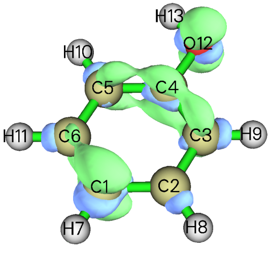

图中绿色和蓝色等值面分别对应于 $f^-$ 的正值和负值区域。显然，$f^-$ 最正的部分定域在 O12、C1、C3、C4 和 C5 上，意味着羟基的*对位*和*邻位*是亲电进攻有利的活泼位点，该结论与常识一致，即羟基是*邻对位*定位基。

#### **计算福井函数 *f*⁰**

接着，以丙烯为例说明如何绘制自由基进攻的福井函数，即 $f^0 = (\rho_{N+1}-\rho_{N-1})/2$。当然，应产生对应于 *N*+1 态和 *N*-1 态的波函数文件。先优化中性态的几何结构（*examples\propylene\opt_N.gjf*），再用该几何结构做 *N*-1 和 *N*+1 态的单点任务以产生相应的 .fch 文件。

启动 Multiwfn 并输入：

```text
examples\propylene\N+1.fch  // N+1 electrons state, namely -1 charged state
5  // Calculate grid data
0  // Set custom operation
1  // One file will be operated with propylene-1.fch
-,examples\propylene\N-1.fch  // N-1 electrons state, namely +1 charged state
1  // Electron density
2  // Medium-quality grid
6  // Divide all grid data by a factor
2  // Divided by 2
-1  // Visualize isosurface map
```

$f^0$ = 0.01 的等值面图如下所示

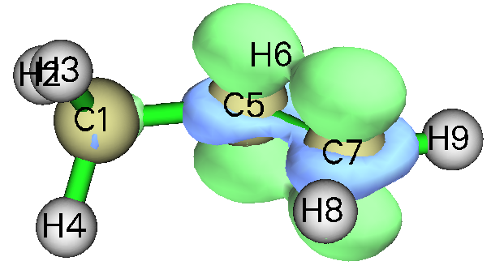

### **4.5.4.2 对偶描述符**

#### **理论**

对偶描述符是另一个用于揭示活泼位点的有用函数，细节见 *J. Phys. Chem. A*, **109**, 205 (2005)。形式上，对偶描述符 Δ*f* 的定义与福井函数有密切关系：

$$
\begin{aligned}\Delta f(\mathbf{r})&=f^{+}(\mathbf{r})-f^{-}(\mathbf{r})\\ &=[\rho_{N+1}(\mathbf{r})-\rho_{N}(\mathbf{r})]-[\rho_{N}(\mathbf{r})-\rho_{N-1}(\mathbf{r})]=\rho_{N+1}(\mathbf{r})-2\rho_{N}(\mathbf{r})+\rho_{N-1}(\mathbf{r})\end{aligned}
$$

值得注意的是，对偶描述符也可用自旋密度 ${\rho}^{s}$ 求值。由于 ${\rho}_{N+1}-{\rho}_{N}$ 和 ${\rho}_{N}-{\rho}_{N-1}$ 可分别近似为 ${\rho}_{N+1}^{s}$ 和 ${\rho}_{N-1}^{s}$，显然 $\Delta f\left( \mathbf{r} \right)\approx {\rho}_{N+1}^{s}\left( \mathbf{r} \right)-{\rho}_{N-1}^{s}(\mathbf{r})$。通常，基于三个态（*N*+1、*N*、*N*-1）电子密度求的对偶描述符与基于两个态（*N*+1、*N*-1）自旋密度求的对偶描述符之间没有明显的定性差别。

与福井函数不同，用 Δ*f* 可同时揭示两类活泼位点。据认为，若 Δ*f* \> 0，则该位点有利于亲核进攻，而若 Δ*f* \< 0，则该位点有利于亲电进攻。但根据我的经验，若目的是弄清很多潜在位点中哪些更有利，不必关心 Δ*f* 的符号，只需研究哪些位点的 Δ*f* 更正或更负。若某位点 *A* 周围 Δ*f* 的分布比另一位点 *B* 更正，则可说 *A* 是比 *B* 更有利的亲核进攻位点，同时 *B* 是比 *A* 更优先的亲电进攻位点。

#### **基于自旋密度近似求对偶描述符**

这里基于 *N*-1 和 *N*+1 态的自旋密度计算苯酚的对偶描述符。由于前面已算得 *phenol_N-1.wfn*，现在只需计算 *phenol_N+1.wfn*（该文件和相应的输入文件 *phenol_N+1.gjf* 已在 "example" 文件夹中提供）。之后，启动 Multiwfn 并输入：

```text
examples\phenol_N+1.wfn  // N+1 electron system, namely anionic state
5  // Calculate grid data
0  // Set custom operation
1  // Only one file will be operated with the file that has been loaded
-,examples\phenol_N-1.wfn  // N-1 electron system, namely cationic state
5  // Electron spin density
2  // Medium-quality grid
-1  // Visualize isosurface of dual descriptor
```

逐渐改变等值面数值以便清晰区分不同位点的对偶描述符，发现 0.02 是合适的值，相应的等值面如下所示

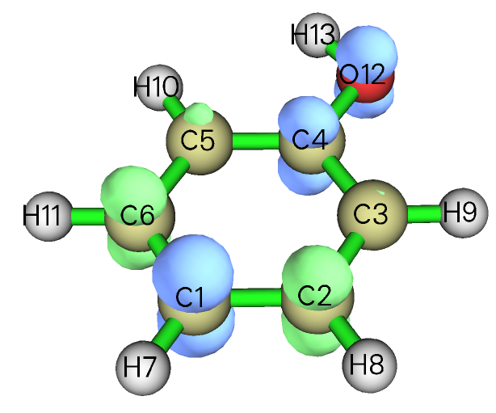

可见，在环内（不能参与反应的 C4 除外），*对位*碳有明显的 Δ*f* 负值，同时两个*邻位*碳的 Δ*f* 不如两个间位碳正，因此 Δ*f* 的结论与福井函数 $f^-$ 完全相同，即只有*对位*和*邻位*碳被羟基活化为亲电进攻位点。

#### **基于电子密度精确求对偶描述符**

若想以精确形式（基于三个态的 *ρ*）求 Δ*f*，可按以下步骤：

```text
examples\phenol_N+1.wfn  // N+1 electron system
5  // Calculate grid data
0  // Set custom operation
3  // Three files will be operated with the file that has been loaded
-,examples\phenol.wfn  // N electron system
-,examples\phenol.wfn  // N electron system
+,examples\phenol_N-1.wfn  // N-1 electron system
1  // Electron density
2  // Medium-quality grid
-1  // Visualize isosurface of dual descriptor
```

等值面数值为 0.01 对应的图形如下所示

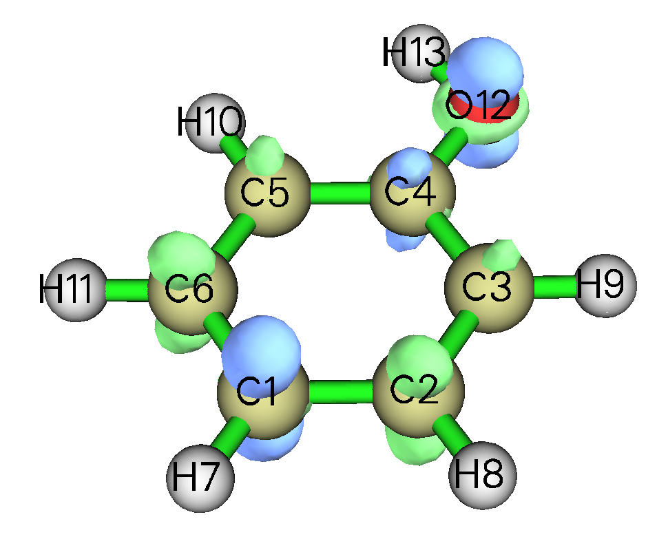

可见，虽然该图与基于自旋密度求的 Δ*f* 图定性一致，但*邻位*碳与*间位*碳的差别不那么显著，表明这次的 Δ*f* 辨别优先位点的能力不好。因此，用精确形式求 Δ*f* 不一定比用自旋密度近似求 Δ*f* 得到更好的结果！

#### **关于“凝聚”福井函数和对偶描述符**

上面用可视化方式考察了福井函数和对偶描述符，得到了预期的结论。但直观分析有些含糊和主观。因此，有时希望将福井函数和对偶描述符的讨论定量化，即为每个原子赋一个值以展示它作为活泼位点的程度。为此，应基于布居分析技术计算“凝聚”版的福井函数和对偶描述符。由于布居分析在 4.7 节 [4.7](sec-4-7-population-analysis-and-atomic-charge-calculation.md)举例说明，凝聚福井函数和凝聚对偶描述符的计算方法将推迟到 4.7.3 节 [4.7.3](sec-4-7-population-analysis-and-atomic-charge-calculation.md#473-计算凝聚fukui函数和凝聚对偶描述符)介绍。研究福井函数和对偶描述符的另一种方案是先将整个分子表面分割为每个原子对应的局域表面，再考察它们在这些局域表面上的平均值。由于该方案依赖于定量分子表面分析技术，说明推迟到 4.12.4 节 [4.12.4](sec-4-12-quantitative-analysis-of-molecular-surface.md#4124-苯酚-phenol分子表面-molecular-surface上福井函数-fukui-function的定量分析)。

## **4.5.5 绘制电子密度差值图以研究咪唑配位镁卟啉的电子转移**

本例展示如何在 Multiwfn 中绘制片段电子密度差值。在咪唑与镁卟啉配位过程中，发生电子转移和极化，用整个体系（以下称为 MN-NN）减去孤立态的咪唑（以下称为 NN）和镁卟啉（以下称为 MN）的电子密度，可清晰揭示电子密度的变化。MN-NN 的几何结构如下所示：

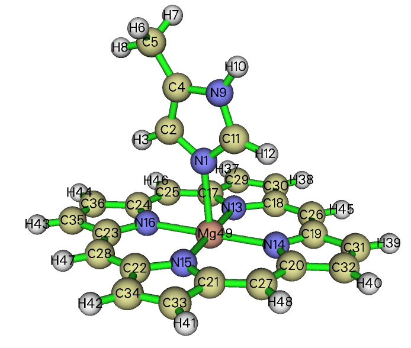

*examples\MN-NN.gjf* 是 MN-NN 体系的 Gaussian 输入文件（几何结构已优化），修改最后一行的 .wfn 输出路径后用 Gaussian 运行它，即产生 *MN-NN.wfn*。接着，分别从 *MN-NN.gjf* 中删除 MN 和 NN 部分并适当修改 .wfn 输出路径，再保存为 *MN.gjf* 和 *NN.gjf*（它们已在 "example" 文件夹中提供）。然后用 Gaussian 运行它们以得到 *MN.wfn* 和 *NN.wfn*。应注意，默认情况下 Gaussian 总是将体系放到标准取向，这使 *MN.wfn* 和 *NN.wfn* 中的坐标与 *MN-NN.wfn* 不一致，从而密度差值将毫无意义。因此，***nosymm*** 关键词必须写在输入文件的 route 部分以避免坐标被自动调整。（*MN.wfn*、*NN.wfn* 和 *MN-NN.wfn* 也可从这里直接载入：<http://sobereva.com/multiwfn/extrafiles/MN-NN.zip>）

现在用 Multiwfn 产生电子密度差值的格点数据。启动 Multiwfn 并输入以下命令

```text
MN-NN.wfn
5  // Calculate grid data
0  // Set custom operation
2  // Two files will be operated with MN-NN.wfn
-,MN.wfn  // Will subtract property of MN.wfn from that of MN-NN.wfn
-,NN.wfn  // Will subtract property of NN.wfn from that of MN-NN.wfn
1  // The property is selected as electron density
3  // Since present system is relatively huge, we need more grid points than normal cases, so we choose high-quality grid
```

计算完成后，选择选项 -1 再将等值面数值设为约 0.001 以可视化格点数据的等值面，如下所示。

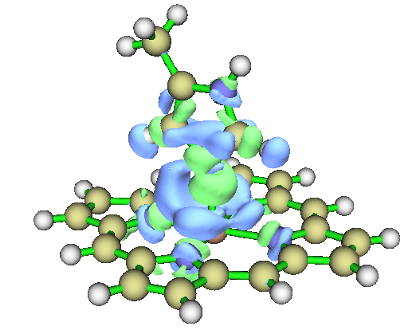

### **在 VMD 中绘制等值面图**

Multiwfn 在格点数据可视化方面不是很专业，对大尺寸格点数据可视化速度相对较慢。可选择选项 2 将格点数据导出为 cube 文件再用 VMD 等外部工具可视化。下面是用 VMD（在 <http://www.ks.uiuc.edu/Research/vmd/> 免费获得）基于 Multiwfn 产生的 cube 文件生成的图。

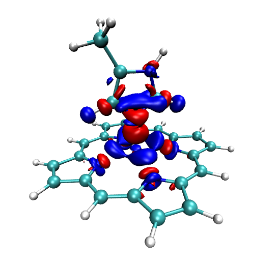

红色和蓝色等值面（分别为 +0.0012 和 -0.0012 a.u.）分别表示 NN 配位到 MN 后电子密度增加和减少的区域。显然，电子密度从 NN 中氮背侧移向镁原子以加强配位键。此外可见，NN 的出现没有显著扰动卟啉环的电子密度分布，只在 MN 的四个配位氮上发生轻微极化。

> **注记**
>
> 在 VMD 中绘制上图的详细步骤：首先，将 cube 文件 *density.cub* 拖入 VMD 主窗口。选择 "Graphics" - "Representations"，点击 "Create Rep" 按钮新建一个 representation，将 "drawing method" 改为 "isosurface"，将 "Draw" 设为 "solid surface"，将 "Show" 设为 "Isosurface"，将等值面数值改为 0.0012，将 "coloring method" 设为 "ColorID" 并选择红色。现在密度差值正部分的等值面已显示。再点击 "Create Rep" 按钮新建另一个 representation，在 "ColorID" 中选蓝色并将等值面数值改为 -0.0012。若想用白色背景代替默认的黑色背景，选择 Graphics - Colors - Display - Background - 8 white。

事实上，用我提供的 VMD 绘图脚本和批处理文件，用少得多的步骤可得到比上图好得多的效果。务必查看 4.A.14 节 [4.A.14](sec-4-A-special-topics-and-advanced-tutorials.md#4a14-用vmd脚本将cube文件渲染为最先进水平的等值面图)，其中说明了如何实现。

### **绘制等值线图**

接着，在原子 16、14、9 定义的平面内绘制电子密度差值的等值线图。输入以下命令：

```text
0  // Return to main menu
4  // Draw a plane graph
0
2
-,MN.wfn
-,NN.wfn
1
2  // Contour line map
[Press ENTER button to use default grid setting]
4  // Define the plane by three atoms
16,14,9
```

等值线图立即弹出。实和虚等值线分别表示电子密度增加和减少的位置。图中等值线有点稀疏，因此调节等值线设置使图形看起来更密从而信息更丰富。关闭图形再输入

```text
3  // Change contour line setting
9  // Generate contour value by geometric series
0.0001,2,30  // Start value, step size and the number of steps, respectively
y  // Clean existing contour lines
9
-0.0001,2,30  // Set negative contour lines
n  // Append the newly generated contour lines to existing ones
1  // Save setting and return
-1  // Redraw the graph
```

下面是最终的图形，很漂亮！

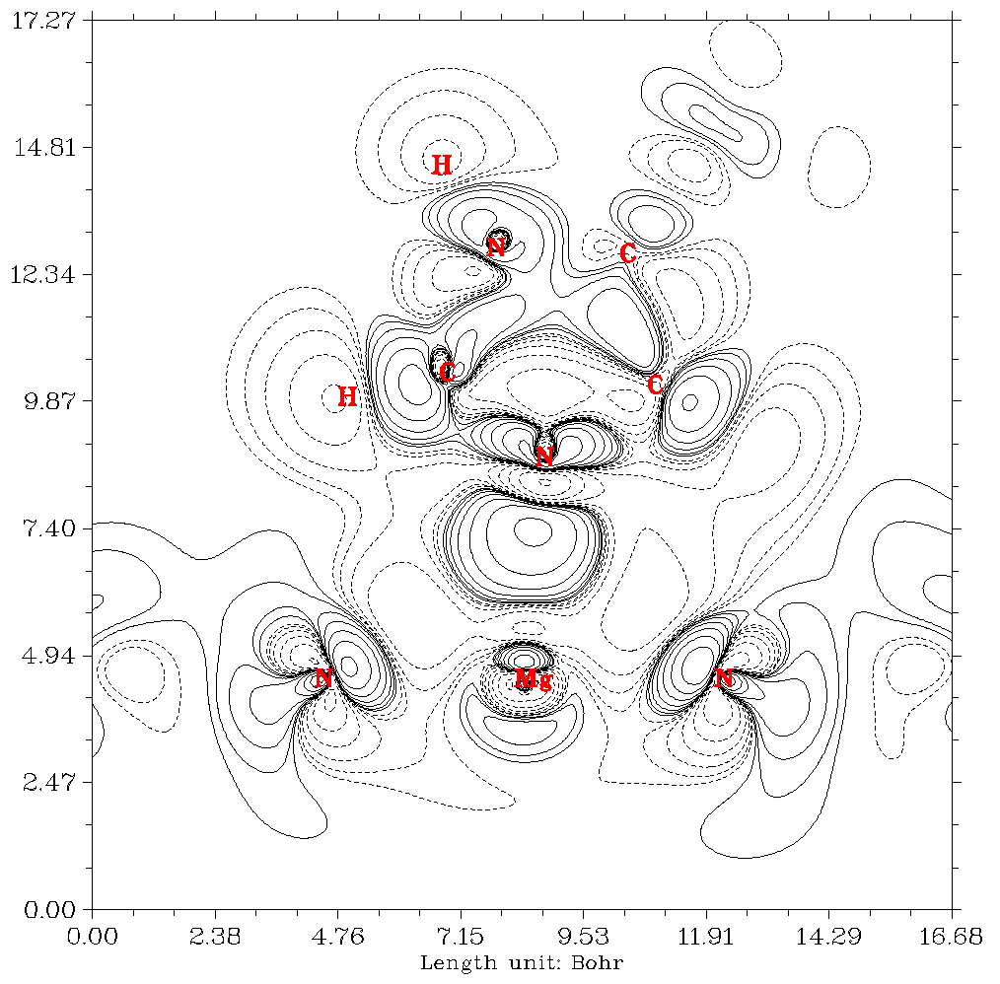

> **提示**
>
> 完成等值线的定义后，可选择选项 6 将设置保存到外部纯文本文件。下次可用选项 7 直接载入该设置。

注意，在 Multiwfn 中，绘制电子密度或其他实空间函数的差值图可轻松推广到多于两个片段的情形，例子见 4.4.8 节 [4.4.8](sec-4-4-output-and-plot-various-properties-in-a-plane.md#448-绘制水四聚体相对其组成单体的电子密度和-elf-差值图)。

## **4.5.6 研究阴离子水二聚体的电子离域范围函数 EDR(r;d)**

> **注记**
>
> 本节由 Arshad Mehmood 撰写，Tian Lu 略作修改。

本例展示如何在用户定义的长度尺度 *d* 下计算阴离子水团簇 (H₂O)₂⁻ 的电子离域范围函数 EDR(**r**;*d*)（参见 *Phys. Chem. Chem. Phys.*, **17**, 18305 (2015)）。用 EDR(**r**;*d*) 可生动地观察溶剂化电子的分布。

启动 Multiwfn 并输入以下命令：

```text
examples\solvatedelectron.wfn  // Anionic water dimer optimized at B3LYP/6-311++G(2d,2p) level
5  // Calculate grid data
20  // EDR(r;d)
11.22  // Input length scale d (Bohr). Here we consider the relatively delocalized solvated electron at d=11.22 Bohr. Further details are given in J. Chem. Phys., 141, 144104 (2014).
2  // Medium-quality grid
-1  // Show isosurface graph
```

现在弹出图形界面窗口。在“Isosurface value”框中输入等值面数值 0.74 并按回车。出现以下等值面。

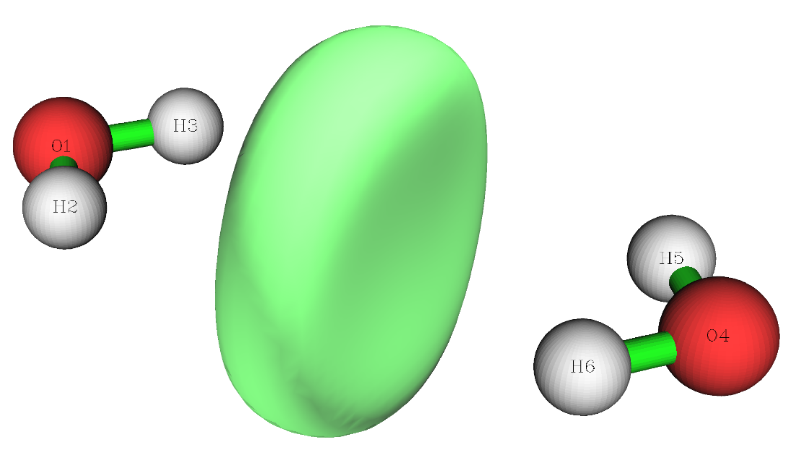

该图表明，在 *d*=11.22 Bohr 的长度尺度下，溶剂化电子位于两个 H₂O 分子之间。

## **4.5.7 研究硫代甲酸的轨道重叠距离函数 D(r)**

> **注记**
>
> 本节由 Arshad Mehmood 撰写，Tian Lu 略作修改。

本例展示硫代甲酸的轨道重叠距离函数 *D*(**r**) 的计算流程，并将其映射到分子电子密度表面上。若对 *D*(**r**) 不熟悉，可查看 2.6 节 [2.6](sec-2-6-real-space-functions.md)的条目 21 或 *J. Chem. Theory Comput.*, **12**, 3185 (2016)。

启动 Multiwfn 并输入以下命令：

```text
examples\ThioformicAcid.wfn  // Thioformic acid optimized at B3LYP/6-311++G(2d,2p)
5  // Calculate grid data
21  // Orbital overlap length function D(r), which maximizes EDR(r;d) with respect to d
```

现在需要设置 EDR 指数 $α_{i}$=1/$d_{i}$² 的输入总数、起始值和增量，因为重叠距离是用指数的均匀递变格点拟合的。起始值为最大指数（*α*₁），后续指数由 $α_{i}$₊₁/$α_{i}$ = 1/*α*$_{inc}$ 产生，其中 *α*$_{inc}$ 为增量。默认设置（即 *n*=20、*α*₁=2.50、*α*$_{inc}$=1.50）对常见体系足够。选择手动输入（选项 1）或默认设置（选项 2）后，出现将用于求 *D*(**r**) 的指数列表

```text
2  // Medium-quality grid
```

此时 Multiwfn 开始计算。等待计算完成，再选择选项 2 将 *D*(**r**) 的格点数据导出为当前目录下的 *EDRDmax.cub*。下一步是产生分子密度等值面。

```text
0  // Return to main menu
5  // Calculate grid data
1  // Electron density
2  // Medium-quality grid (The grid setting must be the same as for D(r) calculation)
```

再选择选项 2 将电子密度的格点数据导出为当前目录下的 density.cub。

基于 *EDRDmax.cub* 和 *density.cub*，再用 VMD、GaussView 等很多可视化程序将 *D*(**r**) 格点数据映射到分子密度等值面上。下面是用 GaussView 绘制的映射到电子密度等值面（*ρ* = 0.001 a.u.）上的 *D*(**r**)（若不知道如何用 GaussView 和 VMD 基于两个 cube 文件将实空间函数用各种颜色映射到另一实空间函数的等值面上，可查阅我的博文“基于 Multiwfn 产生的 cube 文件绘制填充色等值面图的方法”（<http://sobereva.com/402>，中文）。

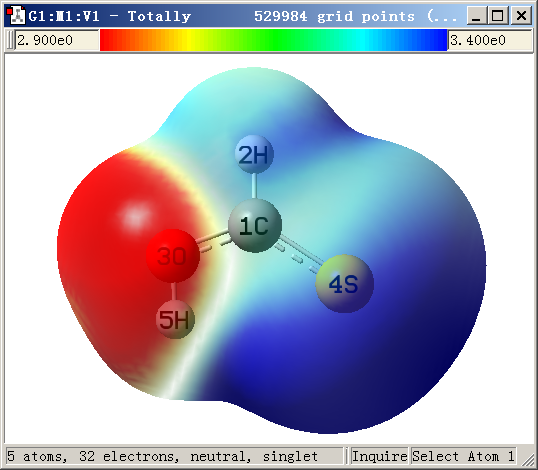

从图中可见，绘制在 2.9 Bohr（红）到 3.4 Bohr（蓝）之间的 *D*(**r**) 清晰地区分了化学上硬的氧孤对（红）与较软的硫孤对（蓝）。

该体系将用定量分子表面分析模块在 4.12.8 节 [4.12.8](sec-4-12-quantitative-analysis-of-molecular-surface.md#4128-硫代甲酸分子表面上轨道重叠距离函数-orbital-overlap-distance-function-dr的定量分析)进一步研究。
