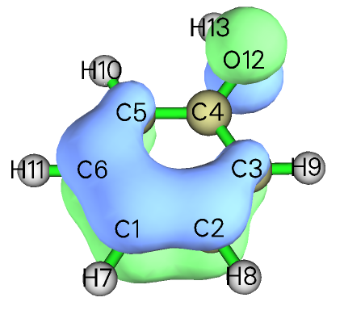
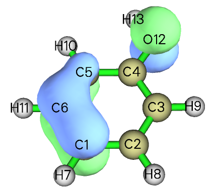
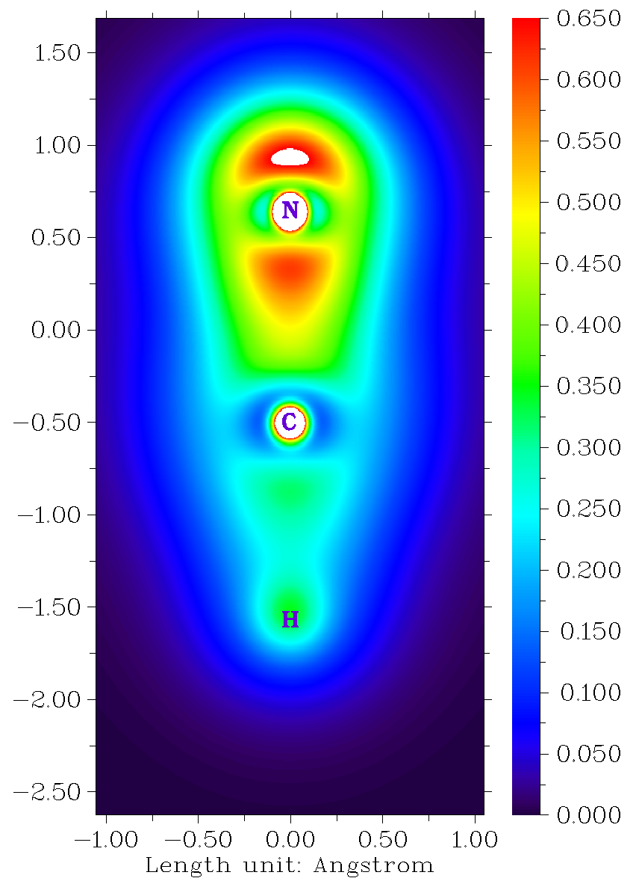
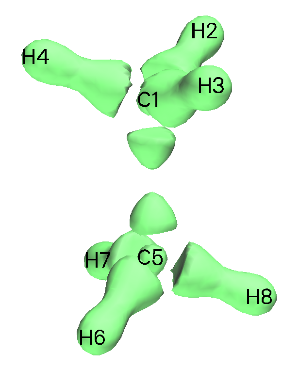
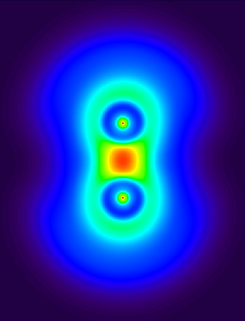
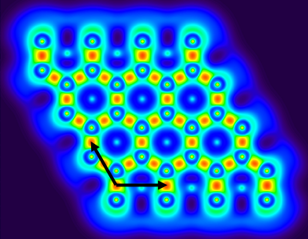

# **4.6 修改和检查波函数**

## **4.6.1 删除特定的高斯函数**

在主功能 6 的子功能 25 中，可设置满足特定条件的高斯型函数（GTF，Gaussian type function）的轨道展开系数。若系数被设为零，就意味着这些 GTF 的信息被删除。本例从苯酚的轨道 23 中删除原子 2、3、4 上的所有 Z 型 GTF，再为该分子轨道绘制等值面。启动 Multiwfn 并输入以下命令

```text
examples\phenol.wfn
6  // Modify wavefunction
25  // Set the coefficients of some GTFs that satisfied certain conditions
0,0  // Set the index range of GTFs, only the GTFs satisfied this condition will be reserved to next step. 0,0 tell Multiwfn the range is “ALL”
2,4  // Only the GTFs attributed to atoms 2, 3, 4 will be reserved to next step
Z  // Only reserve Z-type GTFs to next step
23,23  // Set lower and upper limit of orbital, if they are identical, then only one orbital is selected
0  // Set coefficients of selected GTFs in orbital 23 to zero, that is delete their information
0  // Save current wavefunction to new.wfn in current directory
```

可选择选项 4 并输入 *23* 查看轨道 23 的展开系数，以验证操作是否正确。比较修改前后轨道 23 的等值面。为了绘制修改后的轨道 23，可关闭 Multiwfn 再载入 *new.wfn*，或直接选选项 -1 返回主菜单，再进入主功能 0 绘制其等值面。

 

左边是未修改的状态，分子平面平行于 XY 平面，因此若删除某些原子上的 Z 型 GTF，等值面的相应部分应消失，这正是右边（修改后状态）看到的情况。

## **4.6.2 价层电子密度分析：去掉某些轨道对实空间函数贡献的例子**

在 Multiwfn 中，可去掉某些轨道对实空间函数的贡献。从 2.6 节 [2.6](sec-2-6-real-space-functions.md)中的公式很清楚，若将某些轨道的占据数设为零，它们就没有贡献，如同不存在一样。事实上，在 4.5.3 节 [4.5.3](sec-4-5-generate-grid-data-and-view-isosurface-map.md#453-计算-elf-σ-和-elf-π-以研究苯的芳香性)已用该技巧将 ELF 分离为 ELF-σ 和 ELF-π。注意，有些实空间函数相对轨道不是线性的，如 ELF 和 LOL，因此不能算作每个占据轨道贡献之和。相反，有些实空间函数相对轨道是线性的，如电子密度和动能密度，它们可分解为各轨道的贡献。

若研究去掉内层分子轨道贡献后的电子密度，该分析称为“价层电子密度分析”，已被证明在分析分子电子结构方面相当强大。这类分析的大量例子见我的论文 "Revealing Molecular Electronic Structure via Analysis of Valence Electron Density" [*Acta Phys. -Chim. Sin.*](http://www.whxb.pku.edu.cn/EN/10.3866/PKU.WHXB201709252)[,](http://www.whxb.pku.edu.cn/EN/10.3866/PKU.WHXB201709252) [**34**](http://www.whxb.pku.edu.cn/EN/10.3866/PKU.WHXB201709252)[, 503 (2018)](http://www.whxb.pku.edu.cn/EN/10.3866/PKU.WHXB201709252) DOI: 10.3866/PKU.WHXB201709252。

下面，给出两个研究价层电子密度的例子。

### **例 1：绘制 HCN 价层电子密度的填充色图**

本例手动去掉 HCN 中由内层原子轨道组成的分子轨道对电子密度的贡献，以绘制其价层电子密度图，步骤非常简单。内层原子轨道能量总是很低，因此只对能量最低的分子轨道有贡献。氢没有内层原子轨道，而碳和氮各有一个内层原子轨道，因此需要做的就是将前两个分子轨道的占据数设为零（注意这是闭壳层波函数）。

现在，启动 Multiwfn，输入以下命令

```text
examples\HCN.wfn
6  // Modifying wavefunction
26  // Set occupation numbers
1,2  // Select MOs 1 and 2
0  // Set their occupation numbers to zero
q  // Return to last menu
-1  // Return to main menu
```

然后，若按常规用主功能 4 绘制电子密度的填充色图（例子见 4.4 节 [4.4](sec-4-4-output-and-plot-various-properties-in-a-plane.md)），可得到下图



从上图可轻松辨认 C-N 和 C-H 键的成键区域，氮的孤对区域也清晰可见。注意，碳和氮中心的白色小圆圈不是对应 1s 电子，而是由于价层原子轨道向芯区穿透的结果。

### **例 2：绘制乙烷价层电子密度的等值面图**

为方便起见，Multiwfn 在主功能 6 中提供选项 34，可直接将所有由内层原子轨道组成的分子轨道的占据数设为零。本例用该功能绘制乙烷价层电子密度的等值面图。

启动 Multiwfn 并输入

```text
examples\ethane.wfn
6  // Modify wavefunction
34  // Set occupation number of inner orbitals to zero
-1  // Return to main menu
5  // Calculate grid data and visualize isosurface map
1  // Electron density
3  // High-quality grid
-1  // Show isosurface map
```

将等值面数值改为合适的值 0.25 并关闭分子结构的显示后，可看到



可见，碳的内层电子以及形成 C-C 键和 C-H 键的电子都被等值面清晰地揭示出来。

最后，值得一提的是，价层电子密度分析绝不限于绘图分析。例如，用主功能 2 和 17 也可直接对价层电子密度做拓扑分析和盆分析；需要做的只是在按常规做电子密度分析之前去掉内层分子轨道的贡献（如上所示）。

关于价层电子密度分析的更多例子，见我的博文“通过电子定域函数（ELF）和价层电子密度分析研究亲核进攻方向”（<http://sobereva.com/606>，中文）。

## **4.6.3 平移和复制石墨烯原胞波函数到周期体系**

> **注记**
>
> 重要提示：要分析周期体系的波函数，最好将 Multiwfn 与 CP2K 联用，见 2.9.2 节 [2.9.2](sec-2-9-analysis-of-periodic-systems.md#292-基于周期性波函数的波函数分析)。本节的主要目的只是展示平移和复制波函数的功能。

Gaussian 的周期性边界条件（PBC，periodic boundary condition）计算产生的 .fch 或 .wfn 文件只包含原胞的波函数，因此分析结果不显示任何周期特征，当然可在 PBC 计算之前将体系扩展为多个原胞，但计算要花多得多的时间。Multiwfn 提供了一种将原胞波函数转换为大超胞波函数的方法，使感兴趣区域内的实空间函数显示周期特征。

> **注记**
>
> 注意，以该方式构建超胞波函数只是非常粗糙的近似！由于忽略了相邻原胞之间的轨道混合，超胞的轨道波函数无法被忠实再现。

本节以石墨烯为例。首先，产生石墨烯原胞的 .fch（或 .wfn）文件。Gaussian 输入文件中“分子坐标”部分的内容为

```text
C                  0.000000    0.000000    0.000000
C                  0.000000    1.429118    0.000000
TV                 2.475315    0.000000    0.000000
TV                -1.219952    2.133447    0.000000
```

在 route 部分写“#P PBEPBE/3-21g/Auto SCF=Tight”。用 Gaussian 运行该输入文件再用 formchk 将二进制 checkpoint 文件转换为 *graphene.fch*。然后启动 Multiwfn 并输入：

```text
examples\graphene.fch
6  // Modify wavefunction
32  // Translate and duplicate primitive cell wavefunction
2.475315,0.0,0.0  // Translation vector 1
2  // Unit is Å
3  // Translate and duplicate present system three times in this direction
32  // Notice that current system already has four primitive cells, this time we will translate and duplicate current system in another direction three times, so the final system will contain 16 primitive cells
-1.219952,2.133447,0.0  // Translation vector 2
2  // Unit is Å
3  // Translate and duplicate present system three times in this direction
```

下图左边是原胞的 LOL 函数。经上述操作后，重新计算 LOL 函数得到右图（黑色箭头表示平移矢量）。显然，扩展体系的中央区域显示了正确的周期特征，但边界区域的行为仍不正确，可进一步扩展体系以扩大“正确”区域。

注意，若 PBC 计算没有指定 *nosymm* 关键词，Gaussian 可能自动将体系放到标准取向，此时不应将 Gaussian 输入文件中的平移矢量用作在 Multiwfn 中平移和复制体系的平移矢量，而应用 .fch 文件“Translation vectors”部分或 Gaussian 输出文件“PBC vector”段中的内容。

 
