# **4.7 布居分析与原子电荷计算**

## **4.7.0 三重态乙醇的Mulliken布居分析**

在本节中，我将以三重态乙醇为例，说明如何使用Multiwfn进行Mulliken分析。值得注意的是，Mulliken分析与弥散函数不兼容，如果使用了弥散函数，分析结果将毫无意义。

启动Multiwfn并输入

```text
examples\ethanol_triplet.fch  // Calculated at UB3LYP/6-31G** level based on optimized singlet structure
7  // Population analysis and atomic charges
5  // Mulliken population analysis
1  // Output Mulliken analysis result. By default, the result is outputted on screen, you can also select "-1 Choose output destination for option 1" to change the output destination to a specified plain text file
```

从输出结果中，首先可以看到每个基函数的布居：

```text
Population of basis functions:
  Basis Type    Atom    Shell   Alpha pop.   Beta pop.  Total pop.   Spin pop.
     1   S        1(C )    1      0.99597     0.99597     1.99193    -0.00000
     2   S        1(C )    2      0.34180     0.34330     0.68510    -0.00150
     3   X        1(C )    3      0.34747     0.35290     0.70037    -0.00543
     4   Y        1(C )    3      0.34869     0.35220     0.70088    -0.00351
...
    60   Z        8(O )   30      0.64840     0.09113     0.73953     0.55726
    61   S        8(O )   31      0.30323     0.47550     0.77873    -0.17228
...
```

由于当前体系是开壳层体系，不仅分别输出α和β布居，还输出总布居（*即* α+β），同时还打印了自旋布居，其等于α与β布居之差。输出内容易于理解，例如，从输出中可以看到，C1原子的第一个S基函数上几乎有两个电子，而O8原子的一个PZ基函数上有大量未成对电子（0.557）。

接下来，可以看到每个原子的每个基函数壳层的布居：

```text
Population of shells:
Shell  Type     Atom     Alpha pop.  Beta pop.   Total pop.  Spin pop.
   1     S      1(C )     0.99597     0.99597     1.99193    -0.00000
   2     S      1(C )     0.34180     0.34330     0.68510    -0.00150
   3     P      1(C )     1.05533     1.06504     2.12037    -0.00971
   4     S      1(C )     0.30449     0.30842     0.61291    -0.00393
...
   28     S      8(O )     0.99668     0.99637     1.99305     0.00032
   29     S      8(O )     0.51929     0.45809     0.97739     0.06120
   30     P      8(O )     1.71305     1.06458     2.77763     0.64846
...
```

可以看到，例如，基函数壳层30对应于O8的一个P壳层，其未成对电子数为0.648，总布居数为2.777。

接下来，可以看到每个原子的每种角动量原子轨道的布居：

```text
Population of each type of angular moment atomic orbitals:
     Atom    Type   Alpha pop.   Beta pop.    Total pop.   Spin pop.
...
     8(O )    s      1.81920      1.92996      3.74916     -0.11076
              p      2.49431      1.65216      4.14647      0.84216
              d      0.00748      0.00607      0.01355      0.00142
...
     Total    s      8.35987      7.42761     15.78748      0.93226
              p      5.61927      4.56478     10.18405      1.05448
              d      0.02087      0.00761      0.02847      0.01326
```

输出结果表明，*d*型原子轨道对体系总布居（0.02847）和自旋布居（0.01326）的贡献很小，因为D型基函数在当前体系中仅起极化函数的作用。在O8中，大多数未成对α电子位于其*p*原子轨道上，而少量未成对β电子分布在其*s*原子轨道上（正值和负值分别表示未成对电子为α和β）。

最后，可以看到原子布居和原子电荷：

```text
Population of atoms:
     Atom      Alpha pop.   Beta pop.    Spin pop.     Atomic charge
     1(C )      3.15460      3.16849     -0.01388        -0.32309
     2(H )      0.43857      0.43159      0.00698         0.12984
     3(H )      0.43857      0.43159      0.00698         0.12984
     4(H )      0.46846      0.43410      0.03437         0.09744
     5(C )      3.13963      2.95977      0.17986        -0.09940
     6(H )      0.49613      0.36169      0.13444         0.14218
     7(H )      0.49613      0.36169      0.13444         0.14218
     8(O )      4.32100      3.58819      0.73281         0.09082
     9(H )      1.04690      0.26289      0.78401        -0.30979
 Total net charge:  -0.00000      Total spin electrons:   2.00000
```

三重态体系有两个未成对电子，可以看到，在三重态乙醇中，大多数未成对电子（超过1.5个）位于羟基上。众所周知，在基态乙醇中，由于氧的电负性很大，氧原子应带有显著的负电荷。然而，在当前体系中，氧甚至带有微弱的正电荷。这一现象反映了不同电子态的电子结构可能彼此差异显著这一事实。

Mulliken布居分析不给出每个原子轨道的布居信息，但是，如果你首先确定了基函数与原子轨道之间的对应关系（详见[4.7.6节](#476-通过布居分析确定基函数与原子轨道的对应关系)），只需将相应基函数的布居加和，便可很容易地得到每个原子轨道的布居。

在Mulliken分析界面中还有其他几个选项，它们可以帮助你更深入地理解电子布居，请参照[3.9.3节](sec-3-9-population-analysis-and-calculation-of-atomic-charges.md#393-mulliken-原子与基函数布居分析-5)中的相应说明逐一尝试。

## **4.7.1 计算三氟化氯的Hirshfeld和CHELPG原子电荷以及片段电荷**

### **计算Hirshfeld电荷**

我已在[3.9.1节](sec-3-9-population-analysis-and-calculation-of-atomic-charges.md#391-hirshfeld-原子电荷-1)中介绍了Hirshfeld布居理论，要计算ClF₃的Hirshfeld电荷，在Multiwfn中输入以下命令

```text
examples\ClF3.wfn
7  // Population analysis and atomic charges
1  // Hirshfeld population
```

Hirshfeld布居分析需要自由状态下原子的电子密度，你需要选择一种计算原子密度的方法。选择1使用内建原子密度非常方便，详见[附录3](sec-6-3-detail-of-built-in-atomic-densities.md)；或者，你也可以选择2基于原子.wfn文件计算原子密度，详见[3.7.3节](sec-3-7-custom-operation-promolecular-and-deformation-properties.md#373-原子波函数的生成-generation-of-atomic-wavefunctions)。这里我们选择选项1。现在你可以看到以下输出，不仅打印了原子电荷，还打印了基于原子电荷计算的偶极矩。

```text
Hirshfeld charge of atom     1(Cl) is    0.523322
Hirshfeld charge of atom     2(F ) is   -0.223879
Hirshfeld charge of atom     3(F ) is   -0.075550
Hirshfeld charge of atom     4(F ) is   -0.223879
Summing up all charges:     0.00001373

Total dipole moment from atomic charges:    0.309313 a.u.
X/Y/Z of dipole moment from atomic charges:    0.000000   -0.000000    0.309313 a.u.
```

从结果中发现，三个氟原子的电荷并不相等，平伏位置的F3为-0.075，而轴向的F2和F4拥有更多电子，因此其电荷更负，为-0.224。

如屏幕上所示，所有计算电荷之和为0.00001373，而不是我们预期的严格为零，这是由于空间积分不可避免的数值误差。考虑到这一点，Multiwfn还打印了归一化到实际电子数之后的结果，以消除微小的数值误差：

```text
Final atomic charges, after normalization to actual number of electrons
 Atom    1(Cl):     0.523317
 Atom    2(F ):    -0.223882
 Atom    3(F ):    -0.075553
 Atom    4(F ):    -0.223882
```

在将计算得到的原子电荷用于研究和文章时，建议采用归一化后的电荷，因为它们之和严格等于当前体系的净电荷。

最后，Multiwfn会询问你是否导出结果，如果你选择*y*，元素名称、原子坐标和原子电荷将被输出到一个扩展名为.chg的纯文本文件中，关于.chg格式的介绍见[2.6节](sec-2-6-real-space-functions.md)。你可以用该文件作为Multiwfn输入文件，并在主功能3、4、5（或其他功能）中选择“Electrostatic potential from atomic charges”，以研究由Hirshfeld电荷导出的静电势。

### **计算CHELPG电荷**

接下来，我们计算CHELPG电荷。CHELPG电荷已在[3.9.10节](sec-3-9-population-analysis-and-calculation-of-atomic-charges.md#3910-chelpg-charges-from-electrostatic-potentials-using-a-grid-based-method-esp-拟合原子电荷-12)中介绍过。首先，在布居分析模块中选择子功能12，你将看到一个新菜单。一般来说，你不需要修改默认选项，可以直接选择选项1开始计算。由于ESP的计算耗时较长，对于大体系你可能需要等待一段时间。结果为：Cl为0.5772，轴向F为-0.2496，平伏位置F为-0.0779。CHELPG电荷的结论与Hirshfeld电荷相同，即轴向F比平伏位置F带有更多的负电荷。

### **快速计算片段电荷**

片段电荷（fragment charge）定义为组成片段的原子的电荷之和。你可以手动加和原子电荷得到片段电荷；但是，对于大体系，这一过程必然十分繁琐。在Multiwfn中可以直接计算片段的电荷。例如，这里我们计算由两个轴向F原子组成的片段的CHELPG电荷。启动Multiwfn并输入

```text
examples\ClF3.wfn
7  // Population analysis
-1  // Define fragment
2,4  // Index of the two axial F atoms
12  // CHELPG charge
1  // Start calculation
```

由于已经定义了片段，Multiwfn不仅打印原子电荷，还在所有输出的末尾打印片段电荷：

```text
Fragment charge:   -0.499331
```

## **4.7.2 计算并比较乙酰胺的ADCH原子电荷与Hirshfeld原子电荷**

我提出的ADCH（原子偶极矩校正的Hirshfeld布居，atomic dipole moment corrected Hirshfeld population）电荷是Hirshfeld电荷的改进版本，它解决了Hirshfeld电荷的许多固有缺陷，如偶极矩重现性差，简要介绍见[3.9.9节](sec-3-9-population-analysis-and-calculation-of-atomic-charges.md#399-原子偶极矩校正的-hirshfeld-原子电荷-adch-11)，讨论和比较见我的论文[*J. Theor. Comput. Chem.*](https://www.worldscientific.com/doi/abs/10.1142/S0219633612500113)[,](https://www.worldscientific.com/doi/abs/10.1142/S0219633612500113) [**11**](https://www.worldscientific.com/doi/abs/10.1142/S0219633612500113)[, 163 (2012)](https://www.worldscientific.com/doi/abs/10.1142/S0219633612500113)。我强烈推荐使用ADCH电荷来表征电荷分布。ADCH电荷的计算过程与上一节所述完全相同，唯一区别是在布居分析界面中应选择选项11而非选项1。例如，这里我们计算CH₃CONH₂的ADCH电荷。启动Multiwfn并输入

```text
examples\CH3CONH2.fch
7  // Population analysis and atomic charges
11  // Calculate ADCH charges
1  // Use built-in atomic densities in free-state
```

Multiwfn将首先计算Hirshfeld电荷，然后对其进行原子偶极矩校正以得到ADCH电荷。结果如下所示

```text
    ======= Summary of atomic dipole moment corrected (ADC) charges =======
 Atom:    1C   Corrected charge:   -0.265840  Before:   -0.090370
 Atom:    2H   Corrected charge:    0.096194  Before:    0.037254
 Atom:    3H   Corrected charge:    0.105929  Before:    0.043058
 Atom:    4H   Corrected charge:    0.117894  Before:    0.048339
 Atom:    5C   Corrected charge:    0.272281  Before:    0.170596
 Atom:    6O   Corrected charge:   -0.364414  Before:   -0.308866
 Atom:    7N   Corrected charge:   -0.677574  Before:   -0.159120
 Atom:    8H   Corrected charge:    0.355620  Before:    0.131920
 Atom:    9H   Corrected charge:    0.359828  Before:    0.127108
 Summing up all corrected charges:  -0.0000816
 Note: The values shown after "Corrected charge" are ADCH charges, the ones afte
r "Before" are Hirshfeld charges

 Total dipole from ADC charges (a.u.)  1.4368131  Error:  0.0001385
 X/Y/Z of dipole moment from the charge (a.u.)  0.0432390 -1.4253486  0.1759079
```

显然，对于所有原子，ADCH电荷的绝对值明显大于Hirshfeld电荷，前者符合常见的化学直觉，而后者则显得过小。

ADCH电荷的一个显著特点是可以严格重现分子偶极矩。由ADCH电荷得到的偶极矩为1.4368 a.u.（如上所示），与实际偶极矩完全相同，即基于当前电子密度分布得到的偶极矩。（误差0.0001385来自细微的数值因素，完全可以忽略）。

如果你向上滚动命令行窗口，会发现以下信息

```text
Total dipole from atomic charges:    1.073849 a.u.
```

这是由Hirshfeld电荷得到的偶极矩，与实际偶极矩（1.4368 a.u.）明显偏离。事实上，对于几乎所有小分子，Hirshfeld电荷总是严重低估分子偶极矩。

同样，建议采用归一化后的原子电荷（即打印在“Final atomic charges”标签下的电荷）。

## **4.7.3 计算凝聚Fukui函数和凝聚对偶描述符**

### **理论**

在[4.5.4节](sec-4-5-generate-grid-data-and-view-isosurface-map.md#454-用福井函数和对偶描述符研究苯酚亲电进攻的有利位点)中，我已介绍过如何计算和可视化Fukui函数和对偶描述符。在本节中，我们将计算这两种函数的“凝聚（condensed）”版本，从而可以将一个原子能否作为反应位点的讨论提高到定量水平。仍以苯酚为例。

在计算苯酚之前，我们先推导凝聚Fukui函数和凝聚对偶描述符的表达式。在凝聚版本中，用原子布居数来表示原子周围的电子密度分布量。回想Fukui函数$f^+$的定义：

$$
f^{+}(\mathbf{r})=\rho_{N+1}(\mathbf{r})-\rho_{N}(\mathbf{r})
$$

原子（例如*A*）的凝聚Fukui函数可写为

$$
f_{A}^{+}=p_{N+1}^{A}-p_{N}^{A}
$$

其中$p^{\mathrm{A}}$是原子*A*的电子**布居数（population number）**。

由于**原子电荷（atomic charge）**定义为$\displaystyle q^{A}=Z^{A}-p^{A}$，其中*Z*是原子核电荷，$f^+$可表示为两种状态下原子电荷之差（注意两个*Z*项相互抵消）

$$
f_{A}^{+}=q_{N}^{A}-q_{N+1}^{A}
$$

通过类似处理，可以很容易地写出其他类型的凝聚Fukui函数

$$
\begin{gathered}\text{Nucleophilic attack}:f_{A}^{+}=q_{N}^{A}-q_{N+1}^{A}\\ \text{Electrophilic attack}:f_{A}^{-}=q_{N-1}^{A}-q_{N}^{A}\\ \text{Radical attack}:f_{A}^{0}=\left( q_{N-1}^{A}-q_{N+1}^{A} \right)/2\end{gathered}
$$

类似地，凝聚对偶描述符可写为

$$
\Delta f_{A}=f_{A}^{+}-f_{A}^{-}=(q_{N}^{A}-q_{N+1}^{A})-(q_{N-1}^{A}-q_{N}^{A})=2q_{N}^{A}-q_{N+1}^{A}-q_{N-1}^{A}
$$

计算原子电荷的方法有很多，虽然目前对于哪种方法最适合研究凝聚Fukui函数和对偶描述符尚无共识，但至少Hirshfeld电荷已被证明是非常合适的选择。例如，*J. Phys. Chem. A*，**106**，3885 (2002)、*J. Phys. Chem. A*，**107**，10428 (2003)以及我的工作*J. Phys. Chem. A*，**118**，3698 (2014)表明，Hirshfeld电荷可成功用于通过凝聚Fukui函数研究反应位点。此外，*Theor. Chem. Acc.*，138，124 (2019)给出的全面比较表明，Hirshfeld电荷可能是计算凝聚Fukui函数的最佳选择。

### **实际例子：苯酚**

这里我们计算苯酚的凝聚Fukui函数和对偶描述符，仍使用“examples”文件夹中的*phenol.wfn*、*phenol_N+1.wfn*和*phenol_N-1.wfn*，它们已在[4.5.4节](sec-4-5-generate-grid-data-and-view-isosurface-map.md#454-用福井函数和对偶描述符研究苯酚亲电进攻的有利位点)中使用过

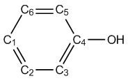

按照[4.7.1节](#471-计算三氟化氯的hirshfeld和chelpg原子电荷以及片段电荷)介绍的步骤，我们分别计算苯酚在*N*、*N*+1和*N*-1电子状态下所有碳的Hirshfeld电荷，它们汇总于下表。然后，根据上面给出的公式，可以很容易地算出凝聚$f^-$、$f^+$和对偶描述符，如下所示。

|        | *N*    | *N*-1 | *N*+1  | *f* ⁻ | *f* ⁺ | Δ*f*   |
|--------|--------|-------|--------|-------|-------|--------|
| C1 (p) | -0.059 | 0.085 | -0.119 | 0.144 | 0.060 | -0.084 |
| C2 (m) | -0.039 | 0.027 | -0.167 | 0.066 | 0.128 | 0.063  |
| C3 (o) | -0.060 | 0.032 | -0.187 | 0.092 | 0.128 | 0.036  |
| C4     | 0.074  | 0.174 | 0.022  | 0.100 | 0.052 | -0.048 |
| C5 (o) | -0.073 | 0.009 | -0.196 | 0.082 | 0.123 | 0.040  |
| C6 (m) | -0.041 | 0.034 | -0.173 | 0.075 | 0.131 | 0.056  |

> **注**
>
> 上表中的Hirshfeld电荷是基于内建球化原子密度估算的。

对于$f^-$，最小的两个值出现在C2和C6，因此*间位*原子不利于亲电进攻。

对于对偶描述符，最正的值出现在C2和C6，表明它们是最不利于亲电进攻的位点。C1有很大的负值，因而受亲电试剂青睐。虽然两个*邻位*碳（C3和C5）的值为正，但其幅度不如*间位*碳大，因此对偶描述符表明*邻位*碳比*间位*碳更可能是亲电进攻的反应位点。我们的结论与[4.5.4节](sec-4-5-generate-grid-data-and-view-isosurface-map.md#454-用福井函数和对偶描述符研究苯酚亲电进攻的有利位点)完全一致，在该节中我们是通过观察Fukui函数和对偶描述符的等值面得到结论的。

**重要提示**：在日常研究中，我强烈建议你直接使用主功能22自动计算凝聚Fukui函数和对偶描述符，因为步骤极为简单，同时还可以一起打印概念密度泛函理论中其他有用的量，介绍见[3.25节](sec-3-25-conceptual-density-functional-theory-analysis.md)，例子见[4.22.1节](sec-4-22-examples-of-conceptual-density-functional-theory-cdft-analysis.md#4221-自动计算苯酚的概念密度泛函理论量)。

## **4.7.4 Hirshfeld-I原子电荷计算示例**

Hirshfeld-I (HI)是比其前身（Hirshfeld）更先进的原子空间划分方法。在学习下面的例子之前，请先简要阅读[3.9.13节](sec-3-9-population-analysis-and-calculation-of-atomic-charges.md#3913-hirshfeld-i-原子电荷-15)，以掌握HI方法的基本知识及其在Multiwfn中的实现。非常重要的一点是，要计算HI电荷，必须有当前体系中各种元素在不同带电状态下的原子径向密度文件（.rad）。通常，我建议你直接使用Multiwfn中的内建.rad文件，这样在HI计算之前就不需要生成它们。关于这一点详见[3.9.13节](sec-3-9-population-analysis-and-calculation-of-atomic-charges.md#3913-hirshfeld-i-原子电荷-15)。

这里我们计算CH₃COCl的HI电荷。为方便起见，本例将直接使用内建.rad文件。具体做法是将“examples”目录下的“atmrad”文件夹复制到当前目录，然后Multiwfn在HI电荷计算中将使用该文件夹中的.rad文件。

启动Multiwfn并输入

```text
examples\CH3COCl.wfn  // Generated at B3LYP/6-31G* level
7  // Population analysis and atomic charges
15  // Hirshfeld-I method
1  // Start calculation with default settings
```

然后你会看到迭代过程

```text
Performing Hirshfeld-I iteration to refine atomic spaces...
Cycle    1
Cycle    2   Maximum change:  0.202864
Cycle    3   Maximum change:  0.152850
Cycle    4   Maximum change:  0.106642
Cycle    5   Maximum change:  0.080325
Cycle    6   Maximum change:  0.063412
[ignored]
```

“maximum change”表示HI原子电荷的最大变化量，迭代持续进行直到“maximum change”低于阈值，默认阈值为0.0002。收敛后，Multiwfn打印最终的HI原子电荷：

```text
 Atom    1(C ):    -0.64593923
 Atom    2(H ):     0.18144874
 Atom    3(H ):     0.17983150
 Atom    4(H ):     0.18144874
 Atom    5(C ):     0.72667580
 Atom    6(O ):    -0.42009700
 Atom    7(Cl):    -0.20336855
```

然后你可以选择是否将这些电荷输出到当前文件夹下的.chg文件。我建议你将上述结果与Hirshfeld电荷比较，你会发现HI电荷的绝对值远大于Hirshfeld电荷。这一现象是预期的，因为HI原子空间根据实际化学环境相对于中性状态适当收缩或扩张，因而不同原子之间原子空间的尺寸差异大大增加。

### **让Multiwfn自动调用Gaussian生成.rad文件**

原则上，最好在与当前分子相同的理论水平下生成原子的.rad文件，因为此时结果具有最强的物理意义。你可以直接让Multiwfn调用Gaussian来准备.rad文件。

计算之前，你应在*settings.ini*文件中将“gaupath”正确设置为实际的Gaussian可执行文件。另外，如果当前目录下已存在“atmrad”文件夹且其中含有C、H、O和Cl元素的.rad文件，你应将其删除。

启动Multiwfn并输入

```text
examples\CH3COCl.wfn  // Generated at B3LYP/6-31G* level
7  // Population analysis and atomic charges
15  // Hirshfeld-I method
1  // Start calculation with default settings
B3LYP/6-31G*  // The keyword of Gaussian used to calculate atomic .wfn files
```

从屏幕上显示的提示中，你可以看到Multiwfn调用Gaussian计算当前分子所涉及的所有元素在各种带电状态下的原子.wfn文件。然后Multiwfn将原子.wfn文件转换为记录球平均原子径向密度的.rad文件。自动生成的Gaussian输入文件（.gjf）、得到的Gaussian输出文件（.out或.log）以及.rad文件都产生在当前文件夹的“atmrad”文件夹中，如果你感兴趣可以手动查看它们。

在当前情况下，得到的电荷为

```text
Atom    1(C ):    -0.667920
Atom    2(H ):     0.194766
Atom    3(H ):     0.188545
Atom    4(H ):     0.194766
Atom    5(C ):     0.755439
Atom    6(O ):    -0.414041
Atom    7(Cl):    -0.251555
```

可以看到，基于在B3LYP/6-31G\*水平下生成的.rad文件计算的HI电荷与基于内建.rad文件计算的基本相同，因此通常我建议直接使用内建.rad文件，因为此时计算更简便且不需要Gaussian。

如果你不删除“atmrad”文件夹或不清理它，那么当你重新计算CH₃COCl的HI电荷，或计算仅由C、H、O和Cl元素中的几种组成的分子时，Multiwfn将直接基于“atmrad”文件夹中已有的.rad文件进行HI计算，而不会调用Gaussian重新计算它们。

最后，值得注意的是，Multiwfn对Hirshfeld-I的支持绝不限于布居分析，该划分方法还可用于计算轨道成分（主功能8），也可应用于模糊分析模块（主功能15）。

## **4.7.5 计算乙醇-水团簇的EEM原子电荷**

在学习本例之前，请先阅读[3.9.15节](sec-3-9-population-analysis-and-calculation-of-atomic-charges.md#3915-电负性均衡方法-eem-原子电荷-17)，以了解电负性均衡方法（Electronegativity Equalization Method，EEM）电荷的基本特点。这里我们计算乙醇-水团簇的EEM电荷，该团簇多达492个原子：

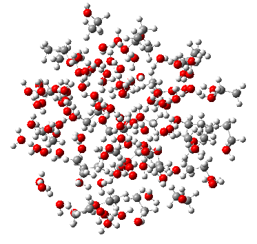

显然，对如此大的体系用量子化学方法计算原子电荷过于昂贵；但是，如你将看到的，即使对由数百个原子组成的体系，计算EEM电荷也相当容易。

注意，在Multiwfn中计算EEM电荷时，目前必须使用MDL molfile（.mol）或.mol2作为输入文件，因为只有该文件提供计算EEM电荷所需的原子连接信息。

启动Multiwfn并输入以下命令

```text
examples\ethanol_water.mol  // This is a snapshot of molecular dynamics simulation
7  // Population analysis and atomic charges
17  // EEM charge
0  // Start calculation
```

你将立即看到

```text
 EEM charge of atom    1(O ):   -0.658886
 EEM charge of atom    2(H ):    0.322520
 EEM charge of atom    3(H ):    0.270187
...
 EEM charge of atom  488(C ):   -0.071564
 EEM charge of atom  489(H ):    0.145191
 EEM charge of atom  490(H ):    0.125555
 EEM charge of atom  491(O ):   -0.616013
 EEM charge of atom  492(H ):    0.310970
 Electronegativity:    2.454144
```

默认的EEM参数是一些研究者为重现B3LYP/6-31G\* CHELPG电荷而拟合的，因此，上述EEM电荷应接近于在B3LYP/6-31G\*水平下计算的CHELPG电荷（事实上，对于当前体系，即使CHELPG电荷的计算可行，其结果也应远不如我们刚才得到的EEM电荷。因为众所周知，静电拟合电荷对于远离范德华表面的原子的质量很低，而当前体系中有大量深埋原子）。

注意，还有许多其他内建EEM参数，你可以在计算前通过选项1选择它们。

### **关于计算含π共轭体系的EEM电荷的说明**

值得注意的是，如果一个或多个原子处于π共轭区域，则输入的.mol或.mol2文件中的共轭必须表示为Lewis结构，否则计算无法进行。

例如，我们用GaussView创建一个偶氮苯分子：

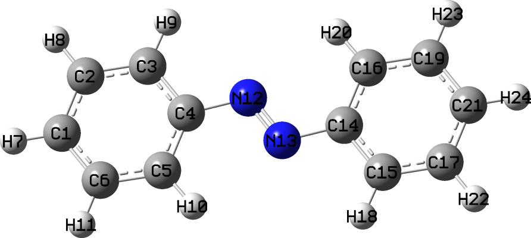

将其保存为.mol文件，然后用Multiwfn基于该文件计算EEM电荷，你会发现以下错误：

```text
Error: Multiplicity of atom    1 ( 4) exceeded upper limit ( 3)!
 The present EEM parameters do not support such bonding status, or connectivity
in your input file is wrong
```

要理解原因，用文本编辑器打开.mol文件，可以发现以下两行

```text
  1  2  4  0  0  0  0
  1  6  4  0  0  0  0
```

这表明1-2和1-6键的键级为4，显然不合理，因为两个碳之间的形式键级不可能是4！该问题源于GaussView总是将.mol中的共轭键记录为四重键。要解决此问题，最好的办法是安装OpenBabel（可从<http://openbabel.org>免费获得），然后用该命令将旧的.mol文件转换为新的.mol文件：*obabel old.mol -O new.mol*。然后如果你用GaussView打开*new.mol*，会发现成键已完全满足Lewis结构：

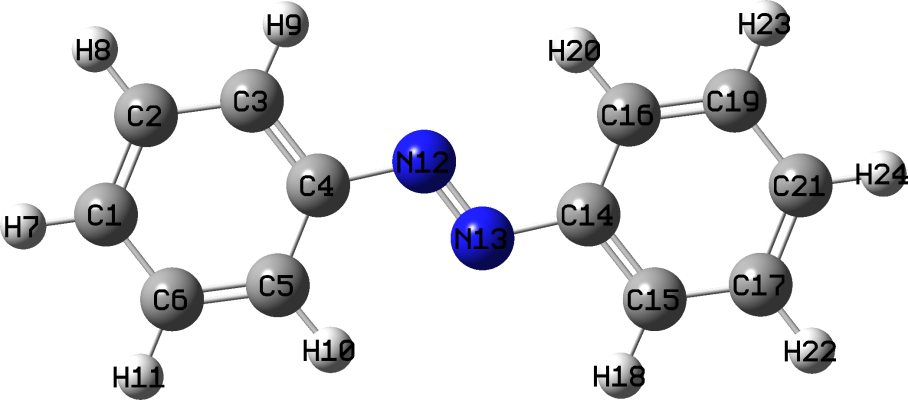

现在我们再次用Multiwfn计算其EEM电荷，你会发现以下输出，这是相当合理的：

```text
 EEM charge of atom    1(C ):  -0.1021985241
 EEM charge of atom    2(C ):  -0.0879338435
 EEM charge of atom    3(C ):  -0.1330865020
...ignored
 EEM charge of atom   11(H ):   0.1188370423
 EEM charge of atom   12(N ):  -0.3186294612
 EEM charge of atom   13(N ):  -0.3186294612
...ignored
```

## **4.7.6 通过布居分析确定基函数与原子轨道的对应关系**

如果想通过主功能10绘制某些原子轨道的PDOS，或用主功能8计算特定原子轨道对分子轨道的贡献，确定基函数与原子轨道之间的对应关系很重要。如果使用Pople基组，对应关系很容易确定。例如，6-31G\*意味着用一个收缩度为6的基函数表示每个内层原子轨道，而每个价层原子轨道由一个收缩度为3的基函数和一个非收缩基函数表示。然而，对于大多数其他类型的基组，对应关系往往难以确定。幸运的是，如本节将说明的，如果通过Mulliken布居分析研究基函数壳层的总布居和自旋布居，对应关系可以明确地确定。

下面将给出两个典型例子，更多例子和讨论见我的博客文章“Determining correspondence between basis functions and atomic orbitals via population analysis”（<http://sobereva.com/418>，中文）。下文中原子轨道将用小写表示（*e.g.* s、p、d……），而基函数将用大写表示（*e.g.* S、P、D……）。

### **例1：硫的cc-pVTZ**

硫原子的电子组态为1$s^2$ 2$s^2$ 2$p^6$ 3$s^2$ 3$p^4$，基态为三重态。*examples\sulfur_cc-pVTZ.fch*是由Gaussian 16在B3LYP/cc-pVTZ水平下为三重态单个硫原子计算的.fch文件。将该文件载入Multiwfn，然后输入

```text
7  // Population analysis and atomic charges
5  // Mulliken analysis
1  // Output Mulliken analysis result
```

你将立即看到

```text
Shell  Type     Atom     Alpha_pop.  Beta_pop.   Total_pop.  Spin_pop.
   1     S      1(S )     0.99997     0.99997     1.99994    -0.00000
   2     S      1(S )     0.94424     0.94387     1.88812     0.00037
   3     S      1(S )     0.60678     0.56547     1.17225     0.04131
   4     S      1(S )     0.12371     0.13260     0.25631    -0.00889
   5     S      1(S )     0.32408     0.35782     0.68189    -0.03374
   6     P      1(S )     2.93141     2.90842     5.83983     0.02299
   7     P      1(S )     1.58628     0.47788     2.06416     1.10840
   8     P      1(S )     0.59303     0.26385     0.85688     0.32918
   9     P      1(S )     0.88863     0.34985     1.23848     0.53879
  10     D      1(S )     0.00064     0.00017     0.00081     0.00048
  11     D      1(S )     0.00058     0.00011     0.00069     0.00046
  12     F      1(S )     0.00065     0.00000     0.00065     0.00064
```

我们要确定哪些S基函数分别对应1*s*、2*s*和3*s*原子轨道，以及哪些P基函数壳层分别对应2*p*和3*p*原子轨道壳层。

三重态硫原子的两个未成对电子全部分布在3*p*壳层上，因为7P、8P和9P的自旋布居之和为1.10840+0.32918+0.53879=1.976，几乎等于2，我们可以说这三个P壳层对应于3*p*壳层。剩下的6P壳层显然对应于2*p*壳层，这也可以由其布居数为5.840得到证实，该值接近2*p*壳层的预期占据数（6.0）。

再看S壳层的情况。3S、4S和5S的布居数之和为1.17225+0.25631+0.68189=2.110，接近3*s*原子轨道的实际占据数（2.0）；考虑到1S和2S的占据数都接近2.0，可以得出结论：1S、2S和（3S、4S、5S）主要分别代表1*s*、2*s*和3*s*原子轨道。

### **例2：Au的def2-TZVP**

对于Au原子，def2-TZVP是带Stuttgart小核赝势的赝势基组，60个内层电子被赝势取代，因此只有价电子5$s^2$ 5$p^6$ 5$d^{10}$ 6$s^1$由def2-TZVP基组显式表示。*examples\Au_def2-TZVP.fch*是由Gaussian 16在B3LYP/def2-TZVP水平下为基态（双重态）单个Au原子计算的.fch文件。将该文件载入Multiwfn并像上例一样进行布居分析，你将看到

```text
Shell  Type     Atom     Alpha_pop.  Beta_pop.   Total_pop.  Spin_pop.
   1     S      1(Au)     0.01764     0.01588     0.03352     0.00175
   2     S      1(Au)    -0.25037    -0.22638    -0.47675    -0.02399
   3     S      1(Au)     0.90648     0.84814     1.75462     0.05834
   4     S      1(Au)     0.33047     0.35849     0.68895    -0.02802
   5     S      1(Au)     0.60949     0.00436     0.61385     0.60513
   6     S      1(Au)     0.38630    -0.00049     0.38581     0.38679
   7     P      1(Au)     1.32302     1.32562     2.64864    -0.00260
   8     P      1(Au)     1.43496     1.44146     2.87642    -0.00650
   9     P      1(Au)     0.24145     0.23250     0.47395     0.00896
  10     P      1(Au)     0.00057     0.00042     0.00099     0.00015
  11     D      1(Au)     3.11664     3.17522     6.29186    -0.05859
  12     D      1(Au)     1.48961     1.45237     2.94198     0.03724
  13     D      1(Au)     0.39375     0.37241     0.76616     0.02135
  14     F      1(Au)     0.00000     0.00000     0.00000     0.00000
```

毫无疑问，所有P壳层（7P、8P、9P、10P）代表唯一的p壳层（5*p*），而所有D壳层（11D、12D、13D）代表唯一的*d*壳层（5*d*）。由于5S和6S的布居数之和（*即* 0.61385+0.38581）恰好等于1.0，同时5S和6S的自旋布居数之和也等于1.0，显然5S和6S壳层共同代表具有单个未成对电子的6*s*原子轨道。另外四个S壳层（1S、2S、3S、4S）中的总电子数几乎恰好为2.0，显然双占据的5*s*主要由它们表示。

## **4.7.7 推导 RESP 电荷和带额外约束的常规 ESP 拟合电荷的示例说明**

在本节中，我将通过多个例子详细介绍功能极其强大灵活的 Multiwfn 的 RESP 模块（RESP，restrained electrostatic potential，约束性静电势），该模块可非常方便地计算标准 RESP 原子电荷以及带/不带电荷约束和等价约束的常规 ESP 拟合电荷。强烈建议先阅读第[3.9.16](sec-3-9-population-analysis-and-calculation-of-atomic-charges.md#3916-约束静电势-resp-原子电荷-18)节，以便对 RESP 模块以及 ESP 拟合法的思想有足够的了解。

更详细的描述和讨论见我的博客文章“RESP 电荷的原理及其在 Multiwfn 中的计算”（中文，<http://sobereva.com/441>）。

为节省篇幅，下面例子中涉及的最重要文件放在 "examples\RESP" 文件夹中，其它文件（包括 Gaussian 输出文件和 .fch 文件）可从 <http://sobereva.com/multiwfn/extrafiles/RESP.zip> 下载。

> **注**
>
> 本节只给出推导基态 RESP 电荷的例子。计算激发态的 RESP 电荷同样容易。若你是 Gaussian 用户，可参考此例 <http://sobereva.com/wfnbbs/viewtopic.php?pid=747>。

### **4.7.7.1 例 1：推导乙醇环境下多巴胺的 RESP 电荷**

本节介绍计算多巴胺的标准 RESP 原子电荷的流程。假设乙醇溶剂环境，用 IEFPCM 隐式溶剂模型描述。多巴胺的结构如下所示。

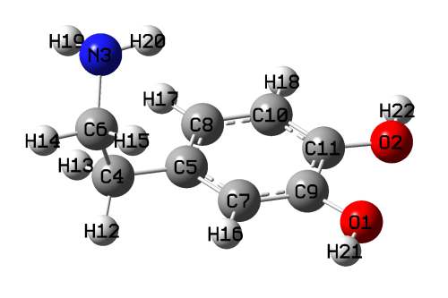

通常，用于推导 RESP 电荷的几何结构应在合理水平上优化过。上述几何在 B3LYP-D3(BJ)/6-311G\*\* 水平结合 IEFPCM 隐式溶剂模型优化得到，是该分子目前最稳定的构象。

现在用 Gaussian 运行 *examples\RESP\dopamine-single\dopamine.gjf*，为该几何生成相应的 .fch 文件。如 .gjf 文件所示，关键词为 *b3lyp/6-311g(d,p) SCRF=solvent=ethanol*，该组合计算量不大，所得波函数完全足以给出可靠的 RESP 电荷。

启动 Multiwfn 并输入

```text
dopmaine.fch  // The .fch file just yielded
7  // Population analysis
18  // RESP module
1  // Calculate standard RESP charges using two-stage fitting procedure
```

计算过程中，Multiwfn 首先设置原子半径并确定拟合点的位置，然后计算拟合点处的 ESP 值。之后开始标准 RESP 计算的第一阶段，本阶段采用的参数和条件可从输出信息中找到：

```text
 No charge constraint is imposed in this stage
 No atom equivalence constraint is imposed in this fitting stage

 **** Stage 1: RESP fitting under weak hyperbolic penalty
 Convergence criterion: 0.00000100
 Hyperbolic restraint strength (a): 0.000500    Tightness (b): 0.100000
 Iter:   1   Maximum charge variation:    1.0067306224
 Iter:   2   Maximum charge variation:    0.0503406929
 Iter:   3   Maximum charge variation:    0.0040155661
 Iter:   4   Maximum charge variation:    0.0003425806
 Iter:   5   Maximum charge variation:    0.0000329903
 Iter:   6   Maximum charge variation:    0.0000032384
 Iter:   7   Maximum charge variation:    0.0000003207
 Successfully converged!
```

可见，本阶段原子电荷的变化经过 7 轮循环后收敛。然后第二阶段开始：

```text
**** Stage 2: RESP fitting under strong hyperbolic penalty
 Atoms equivalence constraint imposed in this fitting stage:
 Constraint   1:   12(H )   13(H )
 Constraint   2:   14(H )   15(H )
 Fitting objects: sp3 carbons, methyl carbons and hydrogens attached to them
 Indices of these atoms:
    4C    12H    13H     6C    14H    15H
 Convergence criterion: 0.00000100
 Hyperbolic restraint strength (a): 0.001000    Tightness (b): 0.100000
 Iter:   1   Maximum charge variation:    1.0237455608
 Iter:   2   Maximum charge variation:    0.0068736797
 Iter:   3   Maximum charge variation:    0.0000294321
 Iter:   4   Maximum charge variation:    0.0000001351
 Successfully converged!
```

如输出所示，在第二拟合阶段，两个 −CH₂− 基团上的两个氢分别被要求在拟合中保持等价。此外，第二阶段只拟合 6 个原子的电荷，即两个 −CH₂− 基团中的碳和氢，其它原子的电荷保持第一阶段拟合得到的值不变。

所得 RESP 电荷为

```text
   Center      Charge
     1(O )  -0.5406621847
     2(O )  -0.5360154461
...[ignored]
    12(H )   0.0727189426
    13(H )   0.0727189426
    14(H )  -0.0640826813
    15(H )  -0.0640826813
...[ignored]
 Sum of charges:    0.000000
 RMSE:    0.002097   RRMSE:    0.110457
```

若仔细检查电荷，会发现所有电荷都具有化学意义。RMSE 和 RRMSE 不大，说明 ESP 拟合质量很好。可见等价约束确实起作用，H12 和 H13 电荷相同，为 0.0727，而 H14 和 H15 的电荷均为 -0.064。

#### **直接从 Gaussian 输出文件载入拟合点和 ESP 值**

如第[3.9.16.2](sec-3-9-population-analysis-and-calculation-of-atomic-charges.md#39162-用法与一些细节)节所述，在 RESP 模块中计算 ESP 拟合电荷时，可以让 Multiwfn 直接从 *pop=MK* 或 *pop=CHELPG* 任务的 Gaussian 输出文件中载入拟合点和 ESP 值。作为示例，用于此目的的多巴胺 Gaussian 输入文件已提供为 *examples\RESP\dopamine-single\dopamine_pop_MK.gjf*，用 Gaussian 运行它，然后启动 Multiwfn 并输入

```text
dopmaine.fch  // In present situation this file in fact is only used to provide geometry information so that Multiwfn can determine atomic connectivity, therefore you can also use other formats such as .xyz, .pdb and .wfn instead
7  // Population analysis
18  // RESP module
8  // Let Multiwfn directly load fitting points information from Gaussian output file
1  // Calculate standard RESP charges using two-stage procedure
dopamine_pop_MK.out  // The Gaussian output file with IOp(6/33=2,6/42=6) pop=MK keywords
```

此时原子电荷的计算会非常快，因为避免了 ESP 值的计算。由于 Multiwfn 生成的拟合点的数目和位置与 Gaussian *pop=MK* 任务生成的不同，当前结果与之前得到的结果略有差异。

### **4.7.7.2 例 2：在多巴胺 RESP 电荷计算中考虑多个构象**

本例仍计算多巴胺的标准 RESP 电荷，但在 ESP 拟合过程中明确考虑多个构象。已发现多巴胺在气相中有四个主要构象，B3LYP-D3(BJ)/6-311G\*\* 水平优化任务的相应 Gaussian 输入文件已在 *examples\RESP\dopamine_4conf* 文件夹中提供，用 Gaussian 运行它们，再将所得 .chk 文件转为 .fch 文件。

我早期的吉布斯自由能计算表明，在室温下按 Boltzmann 分布，四个构象体的布居分别为 8.48%、2.66%、48.45% 和 40.42%。因此应写一个名为 *conf.txt* 的纯文本文件（其它文件名亦可），内容如下，假设所有 .fch 文件都已放在当前文件夹中。

```text
dopamine1.fch 0.0848
dopamine2.fch 0.0265
dopamine3.fch 0.4844
dopamine4.fch 0.4041
```

第一列为每个构象体的文件路径，第二列为相应权重。显然，所有权重之和必须恰好等于或约等于 1。

启动 Multiwfn 并输入

```text
dopamine1.fch  // In present case, the file loaded at this stage is only used to provide geometry information that used to determine atomic connectivity, thus you can also use .fch of other conformers, the result will not be affected
7  // Population analysis
18  // RESP module
-1  // Load conformation list file
conf.txt  // Input actual path of this file
1  // Calculate standard RESP charges using the two-stage procedure
```

结果为

```text
   Center      Charge
     1(O )  -0.5127119135
     2(O )  -0.4946153408
...[ignored]
    21(H )   0.4040820785
    22(H )   0.3885435037
 Sum of charges:    0.000000
 Conformer:    1   RMSE:    0.002885   RRMSE:    0.176042
 Conformer:    2   RMSE:    0.002727   RRMSE:    0.163666
 Conformer:    3   RMSE:    0.002234   RRMSE:    0.146771
 Conformer:    4   RMSE:    0.002102   RRMSE:    0.134091
 Weighted RMSE:    0.002249   Weighted RRMSE    0.144547
```

可见，考虑多个构象时，Multiwfn 给出每个构象体的 RMSE 和 RRMSE 以及加权 RMSE 和加权 RRMSE。数据显示，当前原子电荷对构象 3 和 4 的 ESP 再现性好于构象 1 和 2。原因不难理解，因为 *conf.txt* 中构象 3 和 4 的权重显著高于 1 和 2，因此拟合电荷倾向于忠实反映构象 3 和 4 的电荷分布。

值得注意的是，若将 *conf.txt* 中构象 1 的权重设为 1.0 而其它设为零，则输出的统计误差为

```text
 Conformer:    1   RMSE:    0.002047   RRMSE:    0.124925
 Conformer:    2   RMSE:    0.002862   RRMSE:    0.171810
 Conformer:    3   RMSE:    0.003391   RRMSE:    0.222734
 Conformer:    4   RMSE:    0.004172   RRMSE:    0.266133
```

可见，此时所得原子电荷很好地再现了构象 1 的 ESP，因为 RMSE 和 RRMSE 很小，而出现概率最高的构象 3 和 4 的 ESP 再现性不再很好。因此，当前 RESP 电荷不适合用于多巴胺的分子动力学模拟。这一现象反映了对柔性分子考虑多个构象的重要性。确实，在 ESP 拟合中明确考虑多个构象有些麻烦且耗时，若决定只用单个结构得到 ESP 拟合电荷，至少应尽量使用自由能最低的结构。

#### **直接从每个构象体的 Gaussian 输出文件载入拟合点和 ESP 值**

考虑多个构象时，拟合点的坐标以及 ESP 值也可直接从 Gaussian 输出文件载入，这里给出一个例子。对本分子，四个构象体相应的 *pop=MK* 任务的 Gaussian 输入文件已在 "examples\RESP\dopamine_4conf\ESP" 文件夹中提供，用 Gaussian 运行得到 .out 文件，然后写一个纯文本文件，例如命名为 confESP.txt，内容如下，假设四个 .out 文件已放在 C: 盘根目录。

```text
C:\dopamine1_ESP.out 0.0848
C:\dopamine2_ESP.out 0.0265
C:\dopamine3_ESP.out 0.4844
C:\dopamine4_ESP.out 0.4041
```

之后，将任意构象体的 .fch（或其它类型的文件）载入 Multiwfn，进入 RESP 模块界面，然后选择

```text
-1  // Load conformation list file
confESP.txt  // Input actual path of this file
8  // Make Multiwfn directly load fitting point information from Gaussian output file
1  // Calculate standard RESP charges using the two-stage procedure
```

标准 RESP 电荷将立即给出。

### **4.7.7.3 例 3：在磷酸二甲酯的 ESP 拟合中施加等价约束**

上面两个例子已说明标准 ESP 电荷的计算，下面举例说明如何计算带等价约束的常规 ESP 拟合（即单阶段拟合）电荷。以磷酸二甲酯为例，其结构如下所示

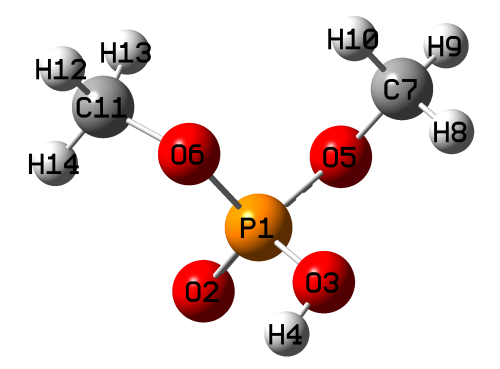

该体系的两个甲氧基化学等价，在分子动力学模拟中易绕 O-P 键旋转。因此，O5 和 O6 的电荷应相同，C7 和 C11 的电荷应相同，两个甲基上的共 6 个氢（H8、H9、H10、H12、H13、H14）也应相同。但只考虑一个结构时，显然无法实现这种电荷分布预期。本例用该体系演示如何计算满足上述等价要求的 ESP 拟合电荷。

我们先创建一个纯文本文件，例如命名为 *eqvcons.txt*，其中每行包含电荷将被约束为相同的原子的序号。因此，对应当前情形的文件内容应为（顺序随意）

```text
5,6
7,11
8-10,12-14
```

在 B3LYP-D3(BJ)/6-311G\*\* 水平运行本分子的优化任务 Gaussian 输入文件（*examples\RESP\C2H7O4P\C2H7O4P.gjf*），再将所得 .chk 文件转为 .fch。然后启动 Multiwfn 并输入

```text
C2H7O4P.fch
7  // Population analysis
18  // RESP module
5  // Modify equivalence constraint (Note that for one-stage ESP fitting, by default hydrogens in each CH_2 and CH_3 group are constrained to be equivalent)
1  // Load equivalence constraint setting from external plain text file
eqvcons.txt  // The file we just created
2  // Start one-stage ESP fitting calculation with constraints
```

结果为

```text
   Center       Charge
     1(P )   1.1205246388
     2(O )  -0.6229795460
     3(O )  -0.5887730856
     4(H )   0.4109873910
     5(O )  -0.4034641689
     6(O )  -0.4034641689
     7(C )   0.0352980588
     8(H )   0.0694288037
     9(H )   0.0694288037
    10(H )   0.0694288037
    11(C )   0.0352980588
    12(H )   0.0694288037
    13(H )   0.0694288037
    14(H )   0.0694288037
 Sum of charges:   0.0000000000
 RMSE:    0.002541   RRMSE:    0.136047
```

显然，结果完全满足我们设定的等价约束，原子电荷值也很合理，具有化学意义。若不作自定义约束而采用默认等价设置，RRMSE 为 0.113024。我们设定的等价约束虽使 RRMSE 增大，表明 ESP 再现性降低，但 RRMSE 增加不多，说明目前采用的约束在合理范围内。

> **注**
>
> 注意，在标准两阶段 RESP 电荷计算中，也可以施加自定义电荷约束和等价约束，但它们只在第一阶段生效（默认本阶段不采用约束）。对本分子，若从上述 *eqvcons.txt* 载入等价约束再选 0 进行两阶段 RESP 拟合，会发现结果中 O5 和 O6 电荷相同，但 C7 和 C11 的电荷不同，不同甲基中氢的电荷也不同，这是因为自定义约束在第二阶段不生效（按标准定义的两阶段 RESP 拟合，两个甲基中的碳和氢在第二阶段被重拟合）。

### **4.7.7.4 例 4：带等价约束和电荷约束的天冬氨酸残基原子电荷评估**

本例比前三个更复杂，因为同时涉及多个构象、等价约束和电荷约束。仔细读完本节，相信你会深切感受到 Multiwfn 的 RESP 模块（RESP，restrained electrostatic potential，约束性静电势）惊人地灵活。

本节计算天冬氨酸（ASP）残基的 ESP 拟合电荷。ASP 是蛋白质中最重要的氨基酸之一。一般为了使量子化学计算中给定残基的电子结构接近实际蛋白质环境中的情形，残基的氮端应用乙酰基（ACE）封端，碳端应用 N-甲基酰胺（NME）封端。对本情形，该处理得到模型体系 ACE-ASP-NME。

蛋白质两种最典型的二级结构为 α 螺旋和 β 折叠。从组成它们的残基角度看，差别来自残基主链的 phi 和 psi 二面角。已有建议认为，ESP 拟合过程中应同时考虑对应两种二级结构的残基构象。还要注意，ACE-ASP-NME 体系中残基片段的净电荷必须为整数。假设 ASP 侧链羧基的质子已解离，ASP 残基的净电荷应被约束为 -1.0。此外，鉴于羧酸根的两个氧化学等价，最好对这两个氧施加等价约束。ASP 侧链 CH₂ 基团中的两个氢也应被约束为等价。

α 螺旋和 β 折叠对应的 ACE-ASP-NME 模型的优化任务 Gaussian 输入文件已作为 *alpha.gjf* 和 *beta.gjf* 在 "examples\RESP\ACE-ASP-NME" 文件夹中提供。如文件中所示，关键词对应 B3LYP-D3/6-311G\*\* 水平结合 IEFPCM 溶剂模型描述水环境。优化中 phi 和 psi 二面角固定为初值（若不冻结，优化过程中二面角会显著变化）。*alpha.gjf* 中 phi 和 psi 分别为 -90° 和 -60°，对应 α 螺旋的典型情形。而 *beta.gjf* 中两个二面角设为 -100° 和 130°，反映 β 折叠的典型情形。

用 Gaussian 运行这两个 .gjf 文件，将所得 .chk 文件转为 .fch 格式。两个优化结构如下所示。绿色虚线椭圆包围的区域为 ASP 残基，这些原子的电荷是我们感兴趣的。上述 phi 和 psi 二面角分别对应 6-3-1-13 和 1-3-6-19。

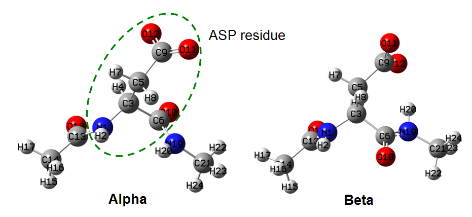

我们创建一个纯文本文件，例如命名为 *chgcons.txt*，该文件中每行定义一项电荷约束。由于要求 ASP 残基总电荷为 -1，应在该文件中写入以下内容

```text
1-12 -1
```

注意，在 RESP 模块中，电荷约束项数没有上限。还要注意，参与电荷约束的原子的序号不一定要连续，例如若写 *1,3-5,8,9-12 1.5*，则原子 1、3、4、5、8、9、10、11、12 的电荷之和将被约束为 1.5。

然后创建一个纯文本文件，例如命名为 *eqvcons.txt*，该文件中每行定义一项等价约束。如前所述，O11 和 O12 应等价，H7 和 H8 应等价，因此本情形的内容应为

```text
11,12
7,8
```

尽管模型体系两端甲基中的氢化学等价，但因不是我们感兴趣的，忽略等价约束设置。

接下来写一个文件，例如命名为 *conflist.txt*，其中包含所有构象体的 .fch 文件列表。在当前情形下，我们希望所得原子电荷能同等好地代表 ASP 残基在 α 螺旋和 β 折叠两种二级结构中的实际电荷分布，因此两个构象体的权重都应为 0.5。假设 .fch 文件已放在 D: 盘根目录，文件内容应为

```text
D:\alpha.fch 0.5
D:\beta.fch 0.5
```

最后，启动 Multiwfn，载入 *alpha.fch* 或 *beta.fch*，然后进入 RESP 模块并输入以下命令

```text
5  // Modify the equivalence constraint
1  // Load equivalence constraint setting from external plain text file
eqvcons.txt  // The equivalence constraint file we created
6  // Set charge constraint
1  // Load charge constraint setting from external plain text file
chgcons.txt  // The charge constraint file we created
-1  // Load list of conformers and weights from external file
conflist.txt  // The conformation list file we created
2  // Start one-stage ESP fitting calculation with constraint
```

输出为

```text
   Center       Charge
     1(N )  -0.5680297892
     2(H )   0.2986898310
     3(C )   0.2320659798
     4(H )   0.0039518865
     5(C )  -0.1872465380
     6(C )   0.5806052594
     7(H )   0.0309424424
     8(H )   0.0309424424
     9(C )   0.7732537802
    10(O )  -0.6023381592
    11(O )  -0.7964185676
    12(O )  -0.7964185676
[ignored...]
 Sum of charges:  -1.0000000000
 Conformer:    1   RMSE:    0.002175   RRMSE:    0.017514
 Conformer:    2   RMSE:    0.002087   RRMSE:    0.017379
 Weighted RMSE:    0.002131   Weighted RRMSE    0.017446
```

上述计算结果非常合理，可见电荷约束和等价约束都完美起作用。而且，由于两个构象体的权重设为相同，两个构象体对应的 RMSE 或 RRMSE 量级相当。鉴于 RRMSE 很小，当前拟合电荷应能很好地描述 ASP 残基在各种蛋白质中的状态。

### **4.7.7.5 例 5：根据局域或整体点群对称性设置等价约束**

#### **1：小分子**

为得到下面分子的 ESP 拟合电荷，应约束三个氟原子具有相同电荷，因为它们化学等价。此外，由于苯环部分局域几何的对称性，其两侧原子应等价，即应约束 H5=H7、H10=H6、C2=C4、C3=C9。

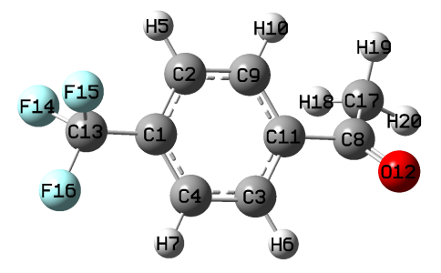

虽可手动创建包含上述等价约束的文件，但如下所示，让 Multiwfn 根据 CF₃ 基团和苯环部分的局域点群对称性自动创建文件更方便。

启动 Multiwfn 并输入

```text
CF3benCOCH3.fch
7  // Population analysis and atomic charge calculation
18  // RESP module
5  // Set equivalence constraint
11  // Generate a file containing equivalence constraints according to point group symmetry of selected regions
```

然后需在每个具有局域对称性的片段中输入原子序号。为方便查找序号，建议用 GaussView 打开上述 .fch 文件，将片段选中为黄色，然后进入 "Tools" - "Atom Selection"，将文本框中的原子序号复制到 Multiwfn 窗口，如下图所示

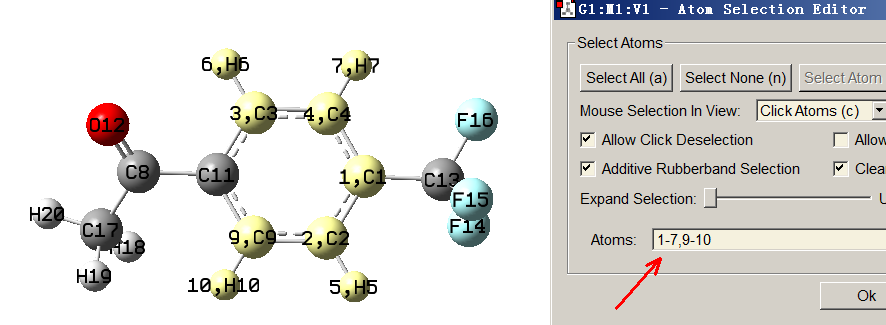

黄色区域的点群为 C$_{2v}$，若向 Multiwfn 提供相应序号 1-7,9-10，Multiwfn 将找出对称等价原子并写入当前文件夹的 *eqvcons_PG.txt*（注意，不应选择整个苯环部分，即 1-7,9-11，因为该片段点群为 D$_{2h}$，此时 Multiwfn 还会把 C1 和 C11 视为对称等价原子）。

现在在 Multiwfn 窗口输入 *1-7,9-10*，将看到

```text
 Detected point group: C2v
 Number of symmetry-equivalence classes:    4
 Class    1 (C ):    2 atoms
    2,    4
 Class    2 (C ):    2 atoms
    3,    9
 Class    3 (H ):    2 atoms
    5,    7
 Class    4 (H ):    2 atoms
    6,   10
 Accept and append to eqvcons_PG.txt in current folder? (y/n)
```

显然，对称等价原子已被正确识别，因此输入 *y* 将相应约束设置写入当前文件夹的 *eqvcons_PG.txt*。

接下来，用该功能将三个氟原子加入等价约束文件。在 Multiwfn 窗口输入 CF₃ 基团的原子序号，即 *13-16*，将看到

```text
 Detected point group: C3v
 Number of symmetry-equivalence classes:    1
 Class    1 (C ):    3 atoms
   14,   15,   16
```

打印信息显然正确，因此输入 *y*。然后输入 *q* 退出。现在会发现当前 *eqvcons_PG.txt* 的内容为

```text
    2,    4
    3,    9
    5,    7
    6,   10
   14,   15,   16
```

该内容完全符合预期。事实上，也可用此界面类似地将甲基中的三个氢设为等价原子，但我们不这样做，因为本例将采用两阶段 RESP 拟合，第二阶段会自动对三个氢施加等价约束。

随后，在 Multiwfn 窗口输入

```text
1  // Load equivalence constraint from external file
eqvcons_PG.txt  // The file just generated
1  // Start standard two-stage RESP fitting
```

结果为

```text
   Center       Charge
     1(C )   0.0091127275
     2(C )  -0.1055999399
     3(C )  -0.1400843859
     4(C )  -0.1055999399
     5(H )   0.1287865888
     6(H )   0.1361477888
     7(H )   0.1287865888
     8(C )   0.6140083901
     9(C )  -0.1400843859
    10(H )   0.1361477888
    11(C )  -0.0475485792
    12(O )  -0.4669646019
    13(C )   0.4344682195
    14(F )  -0.1667205104
    15(F )  -0.1667205104
    16(F )  -0.1667205104
    17(C )  -0.4512569713
    18(H )   0.1232807476
    19(H )   0.1232807476
    20(H )   0.1232807476
 Sum of charges:  -0.0000000000
 RMSE:    0.001518   RRMSE:    0.115139
```

可见，电荷非常合理，完全符合预期。

#### **2：蔻（coronene）**

看一个原子数较多、点群阶数高的分子，即蔻（coronene），其点群为 D$_{6h}$。

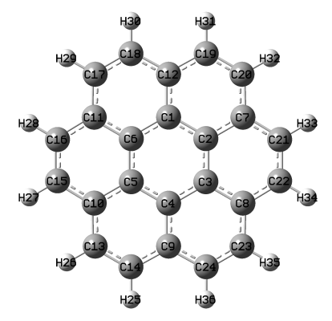

由于 ESP 拟合点的分布不满足点群对称性，所得电荷也不满足 D$_{6h}$ 对称。例如会发现 C17 和 C18 的电荷分别为 -0.2243 和 -0.2169，而它们的电荷本应相同。尽管差别可忽略，最好消除它。使所得电荷完全满足点群的最理想方法，是按对称性施加等价约束，但对这样大的体系手动写约束文件相当费力，因此再次用 Multiwfn 识别点群并自动生成约束文件。

启动 Multiwfn 并输入

```text
coronene.fch
7  // Population analysis and atomic charge calculation
18  // RESP module
5  // Set equivalence constraint
11  // Generate file containing equivalence constraints according to point group symmetry of selected region
a  // Select the entire system
```

将看到等价原子已被正确识别：

```text
 Detected point group: D6h
 Number of symmetry-equivalence classes:    4
 Class    1 (C ):    6 atoms
    1,    2,    3,    4,    5,    6
 Class    2 (C ):    6 atoms
    7,    8,    9,   10,   11,   12
 Class    3 (C ):   12 atoms
   13,   14,   15,   16,   17,   18,   19,   20,   21,   22,   23,   24
 Class    4 (H ):   12 atoms
   25,   26,   27,   28,   29,   30,   31,   32,   33,   34,   35,   36
```

然后输入以下命令

```text
y  // Write the four classes equivalent constraints to eqvcons_PG.txt in current folder
q  // Exit
1  // Load equivalence constraint file
eqvcons_PG.txt
1  // Perform standard two-stage RESP fitting (note that the result is identical to one-stage fitting, because no atoms will be refitted in the second stage for this molecule)
```

从打印结果可见，四个类别中每类的原子确实等价。上述 C17 和 C18 的电荷目前均为 -0.220866，相当合理。

顺便提一下，通过选项 5 的子选项 10 可将所有 CH₂ 和 CH₃ 中氢的等价约束导出到当前文件夹的 *eqvcons_H.txt*。若将该文件与 *eqvcons_PG.txt* 合并为单个文件，再载入 Multiwfn 进行常规 ESP 拟合，两种等价约束将同时生效（但两套约束的内容不应相互矛盾）

> **注**
>
> 值得注意的是，有时在上述选项 5 的子功能 11 中输入原子序号后，Multiwfn 不打印点群，这意味着点群判定失败。但该失败不一定表示对称等价原子未被正确识别，因此若打印的原子序号合理，仍可输入 *y* 将约束写入 *eqvcons_PG.txt*。相反，若发现对称等价原子的序号未被正确识别，应输入 *n* 取消写入，再修改判定点群的容差（例如输入 *t 0.05* 表示将容差改为 0.05），之后重新输入原子序号并检查等价类是否被合理识别。默认容差为 0.1，遇到问题时可尝试增大或减小。还要注意，若点群被正确打印，等价原子总是被正确识别。

### **4.7.7.6 例 6：带额外拟合中心的 RESP 电荷计算**

Multiwfn 能计算带额外拟合中心的 RESP 电荷，换言之，一些待拟合点电荷不一定位于原子核位置。这种非原子点电荷在某些情形很有价值，例如更好地再现孤对电子和 σ-hole 区域周围的 ESP，少量力场已采用此思想。本例以 C₁₈ 体系为例说明如何为非原子点拟合电荷。

C₁₈ 在我的工作 *Carbon*，**165**，468 (2020)、*Carbon*，**165**，461 (2020) 和 <http://sobereva.com/carbon_ring.html> 中得到非常系统详细的研究。ESP 着色的 vdW 表面图如下所示

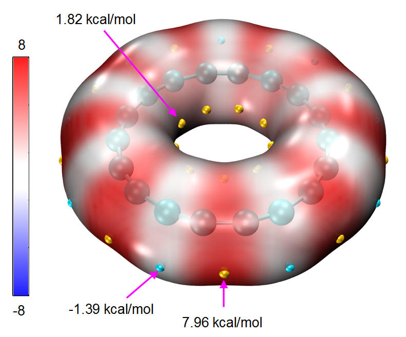

C₁₈ 的最低点结构点群为 D$_{9h}$，因此若按常规计算 RESP 电荷，所有原子电荷将恰为零。显然这种原子中心电荷对再现该特殊体系 vdW 表面周围的 ESP 完全无用。为更好地表示其 ESP，最好在每个 C-C 键中点处拟合一些点电荷。

.fchk 文件对应 ωB97XD/def2-TZVP 波函数最低点结构的 C₁₈ 体系可从 <http://sobereva.com/multiwfn/extrafiles/C18.zip> 下载。若在每个 C-C 键中点放置额外拟合中心，情形对应下图，其中每个紫色小球对应一个额外拟合中心。对应下图的 Gaussian .gjf 文件已作为 *examples\RESP\C18\C18.gjf* 提供。

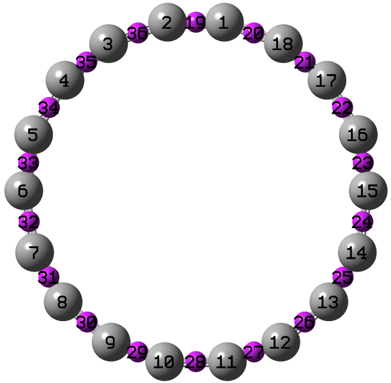

本例中，我们将同时拟合原子电荷和 C-C 键中点处的点电荷。

在开始 RESP 拟合计算前，需写一个文本文件，包含所有额外拟合中心的 X、Y、Z 坐标，第一行为额外拟合中心总数，见 *examples\RESP\C18\fitcen.txt*。

此外，需写一个等价约束文件，确保每组所得点电荷完全相同：(1) 所有碳的原子电荷 (2) 所有短 C-C 键中点处的点 (3) 所有长 C-C 键中点处的点。约束文件已作为 *examples\RESP\C18\eqvcons.txt* 提供，其内容定义了三批约束：

```text
1-18
19,21,23,25,27,29,31,33,35
20,22,24,26,28,30,32,34,36
```

注意，额外拟合中心的序号在实际原子之后，因此 *eqvcons.txt* 中的 19\~36 号点对应 *fitcen.txt* 中定义的 18 个点。

还要注意，没有理由施加 RESP 方法中定义的惩罚函数，它在本情形会损害 ESP 的再现性，因此我们将其关闭，默认是开启的。

现在启动 Multiwfn 并输入以下命令

```text
C18.fchk
7  // Atomic charge calculation and population analysis
18  // RESP
4  // Set hyperbolic penalty parameters
2  // Set restraint strength (a) for one-stage fitting
0  // Remove effect of penalty function
0  // Return
9  // Load additional fitting centers
examples\RESP\C18\fitcen.txt  // The file containing additional fitting centers
5  // Set equivalence constraint in fitting
1  // Load equivalence constraint setting from external plain text file
examples\RESP\C18\eqvcons.txt
2  // Start one-stage ESP fitting calculation with constraints
```

结果如下所示

```text
   Center       Charge
     1(C )   0.0642410906
     2(C )   0.0642410906
     3(C )   0.0642410906
...[ignored]
    19(X )  -0.5038220210
    20(X )   0.3753398397
    21(X )  -0.5038220210
    22(X )   0.3753398397
...[ignored]
 Sum of charges:   0.0000000000
 RMSE:    0.001058   RRMSE:    0.553294
```

可见，碳的原子电荷为 0.064，而短、长 C-C 键中点处的拟合电荷分别为 -0.504 和 0.375。该现象与前面给出的 ESP 映射 vdW 表面图一致，即电子在短 C-C 键周围比长 C-C 键周围集中得多。

若在 RESP 计算中不指定额外拟合中心，会发现所有碳的原子电荷恰为零，ESP 再现误差为

```text
RMSE:    0.001911   RRMSE:    1.000000
```

该误差几乎是键中点有额外拟合中心情形的两倍，表明采用不在原子中心的点电荷对忠实表示分子表面 ESP 至关重要。

关于额外拟合中心，有几点说明：

- 额外拟合中心半径为零，即不影响拟合点的分布和数目。

- RESP 方法中的惩罚函数对额外拟合中心同样生效。

- 在拟合中考虑多个构象体时，应为不同构象体定义额外拟合中心，此情形下定义这些点的文件格式见第[3.9.16.2](sec-3-9-population-analysis-and-calculation-of-atomic-charges.md#39162-用法与一些细节)节的“选项 9”。不同构象体的额外拟合中心分布可以不同，但数目必须相同。

- 等价约束（如本例所示）和电荷约束对额外拟合中心都正常起作用。

### **4.7.7.7 技巧 1：用两次单阶段拟合等价实现标准 RESP 两阶段拟合**

在本节例 1 中，我已说明如何用标准 RESP 两阶段拟合流程推导 RESP 电荷。得益于 Multiwfn 的 RESP 模块的灵活性，该“组合流程”也可通过两次独立的单阶段拟合手动实现，如本节所示。读完本节，相信你会更好地理解如何自定义 RESP 计算流程。下面以非常简单的甲醇分子为例，其 .fch 文件可在 <http://sobereva.com/multiwfn/extrafiles/RESP.zip> 找到。

启动 Multiwfn 并输入

```text
methanol.fch
7  // Population analysis
18  // RESP charge calculation
5  // Set equivalence constraint
0  // Remove default equivalence constraint
2  // Using one-stage fitting to derive charges
```

结果为

```text
   Center      Charge
     1(C )    0.238915
     2(H )    0.045904
     3(H )   -0.018089
     4(H )   -0.018089
     5(O )   -0.664522
     6(H )    0.415880
```

它们与标准 RESP 两阶段拟合第一阶段所得电荷完全相同。

按标准 RESP 电荷计算流程的定义，甲醇羟基中原子的电荷在第二拟合阶段应保持固定，因此创建 *chgcons.txt* 文件，内容如下。

```text
5 -0.664522
6 0.415880
```

然后在 Multiwfn 界面输入以下命令

```text
n  // Do not export .chg file
4  // Set hyperbolic penalty parameters
2  // Set restraint strength (a)
0.001  // This value is the one used in the second stage of standard RESP fitting procedure
0  // Return to the upper menu
5  // Set equivalence constraint
2  // Constraint hydrogens in CH_2 and CH_3 groups to be equivalent, as required by the second stage of standard RESP fitting
6  // Set charge constraint
1  // Load charge constraint setting file
chgcons.txt
2  // Calculate charges by one-stage fitting
```

最终结果为

```text
     1(C )    0.235334
     2(H )    0.004436
     3(H )    0.004436
     4(H )    0.004436
     5(O )   -0.664522
     6(H )    0.415880
```

与标准两阶段 RESP 拟合推导的电荷完全相同。

提示：分子较大时，手动编辑 *chgcons.txt* 常很麻烦。事实上，可在当前文件夹创建空文件 *chgcons_stage2.txt* 并进行标准两阶段 RESP 拟合，在执行第二阶段拟合前，Multiwfn 会自动将被固定电荷的原子的序号和电荷导出到该文件，这样就不必手动写 *chgcons.txt* 文件。

### **4.7.7.8 技巧 2：仅用一条命令从分子结构文件快速得到 RESP 电荷**

> **注 1**
>
> 本节的中文版是我的博客文章“一个超级懒的计算 RESP 原子电荷的脚本（一行命令就算出结果）”（<http://sobereva.com/476>）。

> **注 2**
>
> *examples\RESP\RESP_ORCA.sh* 脚本与本节所述 *RESP.sh* 脚本用法相同，但调用 ORCA 而非 Gaussian。使用前请适当修改脚本开头的“ORCA=”、“orca_2mkl=”和“nprocs=”后的内容。

本节将展示，仅用*一条*命令从分子结构文件出发，经 Linux shell 脚本直接生成 RESP 电荷完全可行，用户不需要任何量子化学程序的知识。

假设机器上已正确安装 Gaussian 和 Multiwfn，要计算 *H2O.xyz* 在乙醇环境中的 RESP 电荷，只需：

- 将“examples\RESP”文件夹中的 *RESP.sh* 复制到当前文件夹。

- 运行 `chmod +x ./RESP.sh` 为脚本添加可执行权限

- 将 *H2O.xyz* 移到当前文件夹

- 运行 *./RESP.sh H2O.xyz 0 1 ethanol*，其中 0 和 1 对应净电荷和自旋多重度，ethanol 为溶剂名。

该脚本首先自动调用 Gaussian 在 B3LYP-D3(BJ)/def2-SVP 水平优化几何，然后在 B3LYP-D3(BJ)/def2-TZVP 水平做单点任务并同时在 vdW 表面上产生 ESP 数据。用隐式溶剂模型表示乙醇环境。然后该脚本经 formchk 将 .chk 文件转为 .fchk 文件，最后调用 Multiwfn 以标准方式给出 RESP 电荷。所有步骤成功完成后，会在当前文件夹发现 *H2O.chg*，其最后一列即 RESP 电荷。

Multiwfn 支持的任何含分子几何信息的输入文件都可用作该脚本的输入文件，如 .xyz、.mol、.mol2、.pdb、.gjf、.fch 等。

若启动脚本时未明确指定净电荷和自旋多重度，系统默认为单重态中性体系；若未指定溶剂名，默认为水；若将溶剂名设为 *gas*，计算将在真空下进行。支持的溶剂名见本页末尾：<http://sobereva.com/g09/k_scrf.htm>。

注意，有时运行前需适当修改 *RESP.sh*。该脚本默认调用 Gaussian 09，若使用其它版本，需将脚本中的 "g09" 替换为 "g16"。此外，若发现 def2-TZVP 太贵或极少数情形几何优化难收敛，需手动修改脚本中的关键词。

### **4.7.7.9：专题：RESP2 电荷的计算**

注：关于 RESP2 电荷更深入的讨论见我的博客文章“RESP2 原子电荷的思想及其在 Multiwfn 中的计算”（中文，<http://sobereva.com/531>）。

#### **RESP2 电荷的定义**

在溶剂环境中，溶质的电荷分布明显被周围溶剂极化。因此，若分子动力学（MD）模拟采用固定电荷力场（即非极化力场）使用分子的原子电荷，必须在原子电荷中有效计入极化效应。

在 *Commun. Chem.*，3，44 (2020) 中，作者将 RESP2 电荷定义为

$$
q^{\mathrm{RESP2}}=(1-\delta)q_{\mathrm{gas}}^{\mathrm{RESP}}+\delta q_{\mathrm{water}}^{\mathrm{RESP}}
$$

其中 *δ* 为可调参数，${q}_{\mathrm{gas}}^{\mathrm{RESP}}$ 和 ${q}_{\mathrm{water}}^{\mathrm{RESP}}$ 分别为气相和水环境（用 PCM 隐式溶剂模型表示）中计算的 RESP 电荷。作者在量子化学计算过程中采用 PW6B95 交换相关泛函结合 aug-cc-pVDZ 基组。发现 *δ*=0.6 使模拟各种凝聚相性质的总体误差最低（*δ*=0.5 效果同样好）。注意 *δ*=0.5 的 RESP2，即 RESP2$_{0.5}$，等价于 *J. Comput. Aided Mol. Des.*，**28**，277 (2014) 中定义的 IPolQ-mod 原子电荷。这些研究表明，*δ*=0.5 应为计算 RESP2 电荷较通用且理想的选择。注意，直接用 ${q}_{\mathrm{water}}^{\mathrm{RESP}}$ 做水环境 MD 模拟，对很多性质的结果差于 RESP2$_{0.6}$，这主要是因为 ${q}_{\mathrm{water}}^{\mathrm{RESP}}$ 夸大了极化程度或未恰当计入电子极化的代价。

在我看来，用于凝聚相 MD 模拟的原子电荷的最佳计算方式应为如下定义的 RESP2$_{0.5}$

$$
q^{\mathrm{RESP2}}=0.5\times q_{\mathrm{gas}}^{\mathrm{RESP}}+0.5\times q_{\mathrm{solv}}^{\mathrm{RESP}}
$$

其中 ${q}_{\mathrm{solv}}^{\mathrm{RESP}}$ 为实际溶剂环境（用 PCM（或 IEFPCM、CPCM、SMD）模型表示）下计算的 RESP 电荷。建议用 B3LYP-D3(BJ) 结合 def2-SVP（或更好的 def-TZVP）做几何优化，气相和溶剂相的后续单点任务都用 B3LYP-D3(BJ)/def2-TZVP。原则上最好在实际溶剂环境下优化，但若体系为中性且无强离子性局域区域，溶剂对几何的影响可安全忽略。

#### **计算 RESP2 电荷的例子**

作为例子，我们按上述推荐方式计算 H₂CO 在乙醇环境中的 RESP2$_{0.5}$ 电荷。

将以下内容复制到 Gaussian 输入文件并用 Gaussian 运行。该任务由三步组成，即几何优化、气相单点计算和乙醇相单点计算。

```text
%chk=C:\opt.chk
# B3LYP/TZVP em=GD3BJ opt

niconiconi

0 1
 C                  0.00000000    0.00000000    0.52887991
 H                  0.00000000    0.93775230    1.12379107
 O                  0.00000000    0.00000000   -0.67757652
 H                  0.00000000   -0.93775230    1.12379107

--link1--
%oldchk=C:\opt.chk
%chk=C:\SP_gas.chk
# B3LYP/def2TZVP em=GD3BJ geom=allcheck

--link1--
%oldchk=C:\opt.chk
%chk=C:\SP_solv.chk
# B3LYP/def2TZVP em=GD3BJ scrf=solvent=ethanol geom=allcheck
    ← Blank line
    ← Blank line
```

计算完成后，在 C: 盘根目录得到 *SP_gas.chk* 和 *SP_solv.chk*。将其转为 .fch 文件再用 Multiwfn 按常规计算 RESP 电荷，会发现气相电荷为

```text
Center       Charge
  1(C )   0.4195430529
  2(H )  -0.0050085243
  3(O )  -0.4095260044
  4(H )  -0.0050085243
```

而乙醇相结果为

```text
Center       Charge
  1(C )   0.4625344852
  2(H )   0.0093031373
  3(O )  -0.4811407598
  4(H )   0.0093031373
```

用 *Excel* 等简单地对上述两套电荷取平均，即得 RESP2$_{0.5}$ 电荷：

```text
0.441038769
0.002147307
-0.445333382
0.002147307
```

#### **用 shell 脚本方便地计算 RESP2$_{0.5}$ 电荷**

为使 RESP2 电荷计算更简便，在 "examples\RESP" 文件夹中提供名为 *calcRESP2.sh* 的 Linux 脚本，可计算 RESP 和 RESP2 电荷。用例：

- 计算 RESP 电荷：*./calcRESP.sh gas.fchk*

- 计算 RESP2$_{0.5}$ 电荷：*./calcRESP.sh gas.fchk solv.fchk*

- 计算 RESP2$_{0.7}$ 电荷：*./calcRESP.sh gas.fchk solv.fchk 0.7*

运行脚本前应确保 Linux 系统中已正确安装 Multiwfn，安装方法见第[2.1.2](sec-2-1-install.md#212-linux-版)节。

脚本成功运行完毕后，会在当前文件夹发现 *RESP2.chg*，最后一列对应所得 RESP2 电荷。

#### **仅用一条命令从分子结构文件快速得到 RESP2 电荷**

为使 RESP2 电荷计算尽量简便，我还在 "examples\RESP" 文件夹中提供名为 *RESP2.sh* 的脚本。只需含（未优化）几何的文件作为输入文件。该脚本与第[4.7.7.8](#4778-技巧-2仅用一条命令从分子结构文件快速得到-resp-电荷)节介绍的 *RESP.sh* 很相似。

用例：

- 为水相 MD 模拟计算单重态中性分子的 RESP2$_{0.5}$ 电荷：

*./RESP2.sh H2O.pdb*

- 为水相 MD 模拟计算三重态中性分子的 RESP2$_{0.5}$ 电荷：

*./RESP2.sh yoshiko.xyz 0 3*

- 为乙醇相 MD 模拟计算单重态阴离子的 RESP2$_{0.5}$ 电荷：

*./RESP2.sh yohane.mol -1 1 ethanol*

由例子可见，电荷和自旋多重度分别默认为 0 和 1，溶剂默认为水。

若脚本成功运行完毕，会在当前文件夹发现与输入文件同名的 .chg 文件，最后一列对应 RESP2$_{0.5}$ 电荷。当前文件夹中还可找到 *gas.chg* 和 *solv.chg*，它们对应气相和溶剂相的 RESP 电荷。

> **注**
>
> 具体说，该脚本依次做以下事情，过程中调用 Gaussian 和 Multiwfn：
>
> \(1\) 在溶剂环境下 B3LYP-D3(BJ)/def2-SVP 水平几何优化
>
> \(2\) 气相 B3LYP-D3(BJ)/def2-TZVP 水平单点任务
>
> \(3\) 计算气相相应的 RESP 电荷
>
> \(4\) 溶剂相 B3LYP-D3(BJ)/def2-TZVP 水平单点任务
>
> \(5\) 计算溶剂相相应的 RESP 电荷
>
> \(6\) 将 (3) 和 (5) 的结果平均生成 RESP2$_{0.5}$ 电荷

*examples\RESP\RESP2_ORCA.sh* 脚本与本节所述 *RESP2.sh* 脚本用法相同，但调用 ORCA 而非 Gaussian。使用前请适当修改脚本开头的“ORCA=”、“orca_2mkl=”和“nprocs=”后的内容。

## **4.7.8 检验原子电荷的静电势再现性**

静电势（ESP，electrostatic potential）再现性是原子电荷的关键性质，只有 ESP 再现性好的原子电荷才能用于揭示分子内和分子间静电相互作用。可用 MK 和 CHELPG 电荷计算模块检验用户提供的原子电荷的 ESP 再现性，这两个模块已分别在第[3.9.10](sec-3-9-population-analysis-and-calculation-of-atomic-charges.md#3910-chelpg-charges-from-electrostatic-potentials-using-a-grid-based-method-esp-拟合原子电荷-12)和第[3.9.11](sec-3-9-population-analysis-and-calculation-of-atomic-charges.md#3911-merz-kollmann-mk-esp-拟合原子电荷-13)节介绍。这里比较 Hirshfeld 和 ADCH 电荷在 Merz-Kollmann ESP 拟合点（分布在分子范德华表面周围）处再现 CH₃CONH₂ 的 ESP 值的能力。我们先用 *examples\CH3CONH2.fch* 按常规计算 Hirshfeld 电荷（见第[4.7.1](#471-计算三氟化氯的hirshfeld和chelpg原子电荷以及片段电荷)节），再选 "y" 将原子电荷导出到 *CH3CONH2.chg*。然后进入 MK 电荷计算模块（主功能 7 的子功能 13）并输入

```text
-3  // Using atomic charges from a .chg file instead of fitting new charges
CH3CONH2.chg  // Atomic charges (i.e. Hirshfeld charges) will be directly loaded from this file
1  // Start calculation. In current case MK charges will not be yielded
```

屏幕上显示的数据为

```text
   Center      Charge
     1(C )   -0.090370
     2(H )    0.037254
     3(H )    0.043058
     4(H )    0.048339
     5(C )    0.170596
     6(O )   -0.308866
     7(N )   -0.159120
     8(H )    0.131920
     9(H )    0.127108
 Sum of charges:   -0.000081
 RMSE:    0.006214   RRMSE:    0.310394
```

这些电荷即从 *CH3CONH2.chg* 载入的 Hirshfeld 电荷（Hirshfeld），RMSE 和 RRMSE 度量 Hirshfeld 电荷的 ESP 再现性。若按常规计算 MK 电荷，会发现 RRMSE 约为 0.05，而如上所示 Hirshfeld 电荷的 RRMSE 高达 0.31，显然 Hirshfeld 电荷的 ESP 再现性远差于 MK 电荷。若基于含 ADCH 电荷的 .chg 文件重做分析，会发现 RRMSE 为 0.21。显然，ADCH 电荷再现 ESP 的误差明显小于 Hirshfeld 电荷。

### **考察不同原子或片段周围的 ESP 再现性**

还可度量特定原子或片段对应拟合点上的 ESP 再现性。默认 MK 点依次在所有原子周围生成，再删除最内层以内的点。若只考虑特定原子，构建的 MK 拟合点将只对应这些原子。比较 Hirshfeld 和 ADCH 电荷在氨基周围的 ESP 再现性，只考虑两层 MK 层，比例因子为 1.4 和 1.6（无特殊原因，仅作示例）。进入 MK 模块并输入

```text
-3  // Using atomic charges from a .chg file
CH3CONH2.chg  // Assume that this file contains Hirshfeld charges
3  // Set number and scale factors of layers of MK fitting points
1.4  // Set scale factor of layer 1
1.6  // Set scale factor of layer 2
q  // Setting has finished, now quit
4  // Choose the atoms considered in the construction of fitting points
7-9  // Atomic indices of amino group
1  // Start calculation
```

由输出会发现以下信息

```text
RMSE:    0.008745   RRMSE:    0.374584
```

若基于含 ADCH 电荷（ADCH）的 .chg 文件重复计算，输出为

```text
RMSE:    0.003817   RRMSE:    0.163478
```

ADCH 电荷的 RRMSE（0.163）远小于 Hirshfeld 电荷（0.374），ADCH 电荷在氨基周围的 ESP 再现性好得多。

> **注**
>
> CHELPG 模块也支持只对特定片段采用拟合点。

### **拟合点和 ESP 值的可视化**

若要将氨基对应的拟合点可视化，可选择“6 Toggle if exporting fitting points with ESP after the task”一次将其状态改为“Yes”，再用选项 1 开始计算。计算完成后选 *2* 将拟合点导出到当前文件夹的 *ESPfitpt.pqr*。该文件可直接载入著名可视化工具 VMD。若将绘制方式设为“VDW”并将“Sphere Scale”改为 0.8，将“Coloring Method”设为“Charge”，再将颜色过渡模式设为“BWR”（Graphics - “Colors” - “Color Scale”），将看到下图（分子结构文件也已载入）。

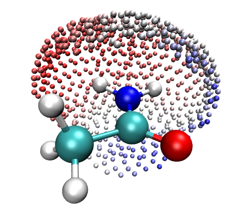

显然，拟合点很好地对应氨基。越红（越蓝），点上 ESP 越正（越负）。

### **拟合点处 ESP 再现误差的可视化**

最后提一下，ESP 的再现误差也可用 Multiwfn 和 VMD 联合可视化。这里考察 MK 电荷的情形。将 *examples\CH3CONH2.fch* 载入 Multiwfn，进入 MK 模块，选一次选项 6，再选选项 1 开始计算。计算完成后，选 *3* 将带 ESP 再现误差的 ESP 拟合点导出到当前文件夹的 *ESPerr.pqr*。该文件中 "Charge" 列对应精确 ESP 与基于当前原子电荷（即 MK 电荷）计算的 ESP 之差的绝对值（单位 kcal/mol）。若用 VMD 渲染该文件，将看到下图。颜色范围已设为 -1.5 到 1.5（可在 "Graphics" - "Representation" - "Trajectory" 页设置），用默认颜色过渡 "Red-White-Blue"，视角已设为正交（"Display" - "Orthographic"）。

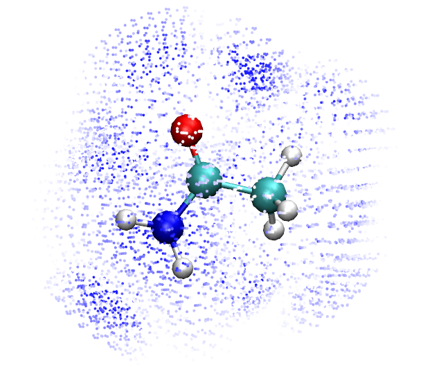

该图中，越蓝区域对应 ESP 再现误差越高，而白色点处 ESP 可被 MK 电荷很好地再现（即绝对误差接近零）。也可用此方法可视化其它原子电荷的 ESP 再现性（需用 .chg 文件，如前所示）。

## **4.7.9 计算 PEOE (Gasteiger) 电荷**

本例为典型有机体系多巴胺计算 PEOE 电荷（亦称 Gasteiger 电荷）。建议阅读第[3.9.17](sec-3-9-population-analysis-and-calculation-of-atomic-charges.md#3917-peoe-partial-equalization-of-orbital-electronegativity-或-gasteiger-电荷-19)节，了解 Multiwfn 中 PEOE 方法的原理、细节和实现的基本知识。

PEOE 电荷计算只需几何信息，可用 .xyz、.pdb、.mol 等输入文件。启动 Multiwfn 并输入

```text
examples\dopamine.xyz
7  // Population analysis
19  // PEOE (Gasteiger) charge
```

首先打印 PEOE 计算涉及的参数：

```text
Determined parameters:
    1(O )  numbond= 2   a=  14.180   b=  12.920   c=   1.390
    2(O )  numbond= 2   a=  14.180   b=  12.920   c=   1.390
    3(N )  numbond= 3   a=  11.540   b=  10.820   c=   1.360
    4(C )  numbond= 4   a=   7.980   b=   9.180   c=   1.880
[ignored...]
```

然后迭代开始

```text
Max cycles: 50  Charge convergence criterion: 0.00010  Damping factor: 0.500

 Cycle    1    Maximum change of charges:    0.312435
 Cycle    2    Maximum change of charges:    0.039963
[ignored...]
 Cycle   10    Maximum change of charges:    0.000062
 Convergence succeeded after  10 cycles
```

PEOE 方法涉及的公式极其简单，迭代在一秒内完成（即使体系由数百原子组成亦如此！）。然后可找到 PEOE 电荷：

```text
Atom      Charge
  1(O )   -0.358163
  2(O )   -0.358170
  3(N )   -0.330120
  4(C )   -0.015405
[ignored...]
```

## **4.7.10 计算 CM5 和 1.2\*CM5 电荷**

### **CM5 原子电荷的计算**

计算 CM5 电荷很容易。例如启动 Multiwfn 并输入以下命令：

```text
examples\oxirane.fchk
7  // Population analysis and atomic charges
16  // CM5
1  // Use built-in sphericalized atomic densities in free-states
```

将看到

```text
Total dipole moment from CM5 charges   0.8110842 a.u.
 X/Y/Z of dipole moment from CM5 charges   0.00000  -0.00000  -0.81108 a.u.

 Final atomic charges, after normalization to actual number of electrons
 Atom    1(C ):    -0.07363783
 Atom    2(C ):    -0.07363783
 Atom    3(O ):    -0.27339074
 Atom    4(H ):     0.10516660
 Atom    5(H ):     0.10516660
 Atom    6(H ):     0.10516660
 Atom    7(H ):     0.10516660
```

注意，按 CM5 电荷原始论文，由 CM5 电荷计算的偶极矩能很好地再现气相实验偶极矩，因此上式偶极矩应为环氧乙烷实际气相偶极矩的合理估计。

### **1.2\*CM5 原子电荷的计算**

如 *J. Phys. Chem. B*，**121**，3864 (2017) 所示，1.2\*CM5 电荷非常适合在 OPLS-AA 力场的分子动力学模拟中用于中性体系，即当采用 OPLS-AA 时可视为推导原子电荷的通用方法。可手动将上述打印的 CM5 电荷乘以 1.2 得 1.2\*CM5 电荷，或更方便地，直接在主功能 7 中选选项 -16。注意此时 CM5 电荷应基于真空计算产生的波函数计算，增强因子 1.2 用于计入溶剂环境对溶质的有效极化。CM5 对计算水平不敏感，常见 DFT 泛函结合 2-zeta 基组即足够，如 B3LYP/def2-SVP。

为最大限度简化对不懂量子化学计算的人计算 1.2\*CM5 电荷的流程，提供 Linux shell 脚本，调用 Gaussian 和 Multiwfn 全自动计算 1.2\*CM5 电荷，见 *examples\scripts\1.2CM5.sh*。用该脚本极其简单。例如假设该脚本和手动搭建的分子结构文件 *phenol.xyz* 已在当前文件夹，只需运行 *./1.2CM5.sh phenol.xyz*，该脚本先调用 Gaussian 在 B3LYP-D3(BJ)/def2-SVP 水平优化苯酚并给出相应水平的波函数，再调用 Multiwfn 计算 CM5 电荷，最后在当前文件夹自动给出名为 *phenol.chg* 的文件，其最后一列即 1.2\*CM5 电荷。运行该脚本时也可指定净电荷和自旋多重度。别忘了打开 *1.2CM5.sh* 查看开头更多信息。

*examples\scripts\1.2CM5_ORCA.sh* 脚本与上述 *1.2CM5.sh* 脚本用法相同，但调用 ORCA 而非 Gaussian。使用前请适当修改脚本开头“ORCA=”、“orca_2mkl=”和“nprocs=”后的内容。

## **4.7.11 计算 AIM 电荷**

本例计算 CH₃NH₂ 的 AIM 电荷。启动 Multiwfn 并输入

```text
examples\CH3NH2.wfn
7  // Population analysis and atomic charge calculations
14  // AIM charge
2  // Medium-quality grid. This is a good compromise between cost and accuracy. The higher the grid quality, the higher the cost, while better the integration accuracy
```

得到以下输出

```text
Final atomic charges:
 Atom    1(C ):     0.38812508
 Atom    2(H ):    -0.01581265
 Atom    3(H ):    -0.01581168
 Atom    4(H ):    -0.04790806
 Atom    5(N ):    -0.98865587
 Atom    6(H ):     0.34001793
 Atom    7(H ):     0.34004525
```

可见 AIM 电荷化学合理性不佳，甲基上两个氢 H2 和 H3 竟带轻微负电荷，这显然与氢和碳电负性关系矛盾。这是 AIM 电荷众所周知的缺陷。坦率说，AIM 电荷基本没有优点，原子电荷的全面比较和讨论见我的综述：Partial Charges, In *Exploring Chemical Concepts Through Theory and Computation*. WILEY-VCH GmbH: Weinheim (2024); pp. 161-187. DOI: [10.1002/9783527843435.ch6](https://doi.org/10.1002/9783527843435.ch6)。
