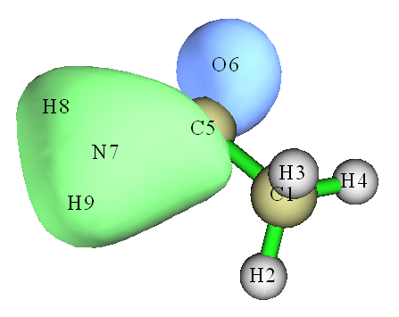
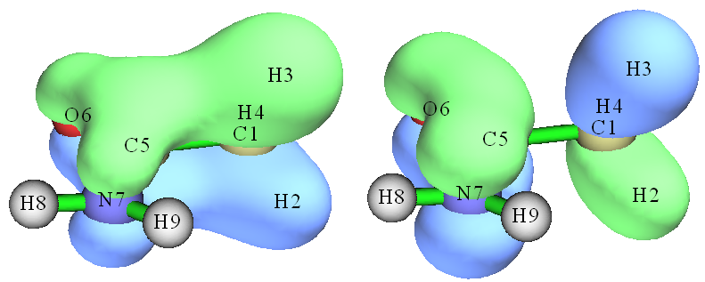
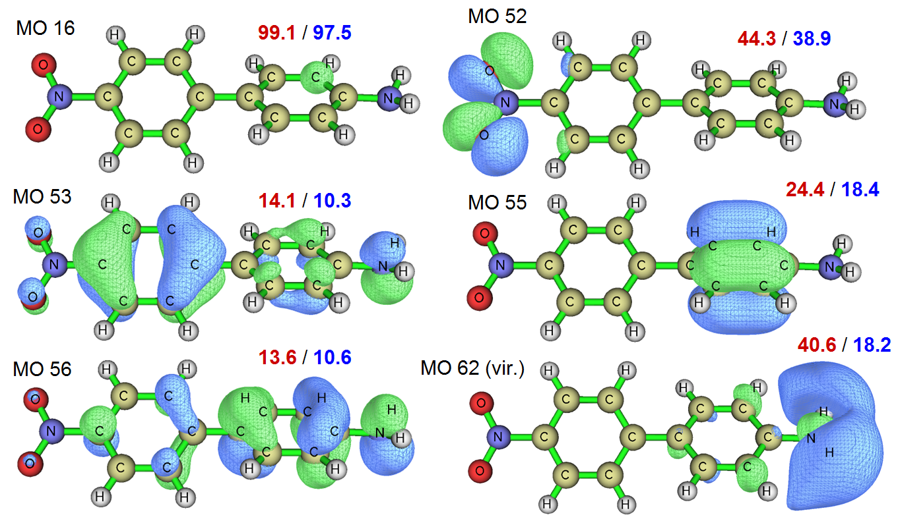
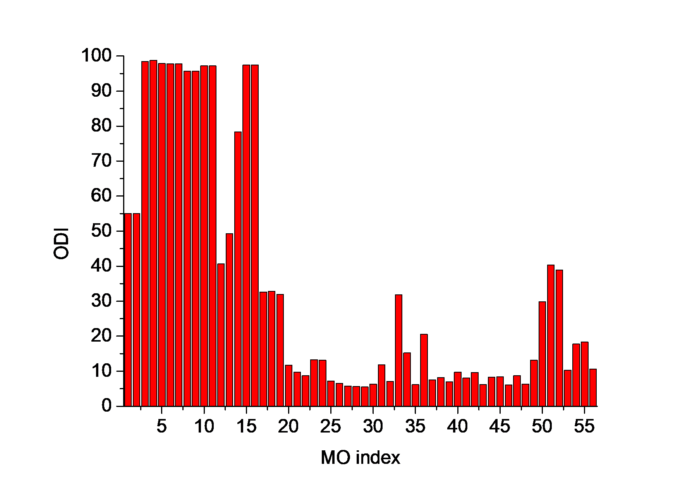
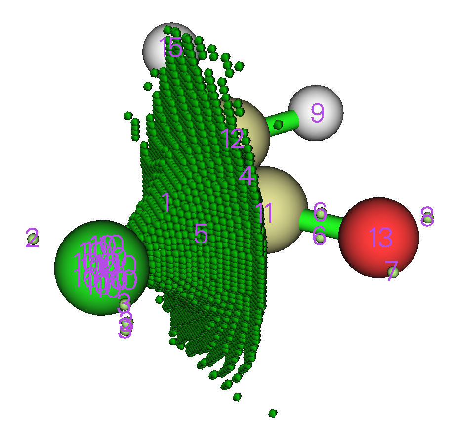
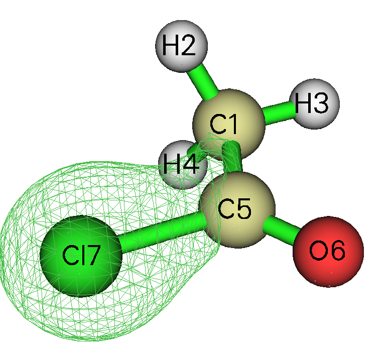

# **4.8 分子轨道组成分析**

在本节中，我将展示如何使用多种方法分析分子轨道组成。所演示的方法同样适用于任何其他类型的轨道，例如自然轨道、自然跃迁轨道（NTOs）和定域分子轨道（LMOs）。关于轨道组成分析的细节可见第[3.10节](sec-3-10-orbital-composition-analysis.md)。不同方法的优缺点在我的论文 *Acta Chim. Sinica*，**69**，2393（2011，<http://sioc-journal.cn/Jwk_hxxb/CN/abstract/abstract340458.shtml>）中有非常详细的讨论，欢迎引用。如果你能阅读中文，也可以参阅我的博客文章“轨道组成计算方法”（<http://sobereva.com/131>）。

简单来说，如果你的目的仅仅是获得轨道中的原子组成，Hirshfeld/Becke方法可能是最稳健、最方便的方法，见第[4.8.3节](#483-用hirshfeld和becke方法分析乙酰胺)；如果你还想获得原子轨道组成，那么第[4.8.2节](#482-用自然原子轨道方法分析水)中示例的NAO方法可能是最佳选择。第[4.8.1节](#481-用mulliken方法分析乙酰胺)中演示的Mulliken方法通常也表现良好，但不应使用弥散函数。

## **4.8.1 用Mulliken方法分析乙酰胺**

在本例中，我们使用Mulliken方法先分析乙酰胺第6个分子轨道的组成，然后分析哪些轨道对甲酰胺部分与甲基之间成键有主要贡献。注意Mulliken方法与弥散函数不兼容，如果计算中含有弥散函数，你应当选择其他轨道组成方法（例如NAO、Hirshfeld……）或将其从基组中删除。

启动Multiwfn并输入以下命令

```text
examples\CH3CONH2.fch  // You have to use .mwfn/.fch/.molden/.gms file as input for this type of analysis
8  // Orbital composition analysis
1  // Use Mulliken partition
6  // The orbital index is 6 (Note that as shown in the prompt on the screen, you can also input orbital label here, for example h-3 corresponds to HOMO-3, l+1 corresponds to LUMO+1, etc.)
```

基函数、壳层和原子的组成会立即打印出来，见下。

```text
Threshold of absolute value:  >   0.50000 %    // Only the basis functions with composition larger than 0.5% will be printed, you can change the threshold by “compthres” parameter in settings.ini.
Orbital:     6  Energy(a.u.):     -0.905290  Occ:  2.000000  Type: Alpha&Beta
 Basis Type    Atom    Shell      Local       Cross term        Total
   23   S        5(C )   14      0.44902 %      0.67507 %      1.12409 %
   24   X        5(C )   15      0.31240 %      0.50522 %      0.81762 %
   25   Y        5(C )   15      4.25271 %      5.88221 %     10.13493 %
   29   Y        5(C )   17      0.00777 %     -0.61063 %     -0.60286 %
   38   S        6(O )   20      3.50037 %      2.65507 %      6.15544 %
   42   S        6(O )   22      3.29488 %      1.71316 %      5.00803 %
   53   S        7(N )   26     15.20411 %     15.32688 %     30.53098 %
   57   S        7(N )   28     16.89006 %     17.40040 %     34.29046 %
   61   XX       7(N )   30      0.00774 %      0.58279 %      0.59053 %
   63   ZZ       7(N )   30      0.02793 %     -0.98090 %     -0.95297 %
   67   S        8(H )   31      1.27855 %      3.03091 %      4.30946 %
   69   S        9(H )   33      1.52931 %      3.60949 %      5.13880 %
Sum up those listed above:      46.75484 %     49.78967 %     96.54451 %
Sum up all basis functions:     51.95605 %     48.04395 %    100.00000 %

Composition of each shell, threshold of absolute value:  >    0.500000 %
Shell    14 Type: S    in atom    5(C ) :     1.12409 %
Shell    15 Type: P    in atom    5(C ) :    10.95268 %
Shell    17 Type: P    in atom    5(C ) :    -0.97156 %
Shell    20 Type: S    in atom    6(O ) :     6.15544 %
Shell    22 Type: S    in atom    6(O ) :     5.00803 %
Shell    26 Type: S    in atom    7(N ) :    30.53098 %
Shell    28 Type: S    in atom    7(N ) :    34.29046 %
Shell    31 Type: S    in atom    8(H ) :     4.30946 %
Shell    33 Type: S    in atom    9(H ) :     5.13880 %

Composition of different types of shells (%):
s:  88.193  p:  11.391  d:   0.416  f:   0.000  g:   0.000  h:   0.000

Composition of each atom:
Atom     1(C ) :     1.17249 %
Atom     2(H ) :     0.05445 %
Atom     3(H ) :     0.03212 %
Atom     4(H ) :     0.00817 %
Atom     5(C ) :    11.81245 %
Atom     6(O ) :    11.63274 %
Atom     7(N ) :    65.50085 %
Atom     8(H ) :     4.47022 %
Atom     9(H ) :     5.31651 %

Orbital delocalization index:   46.15
```

结果表明氮对轨道6有主要贡献（65.5%），该贡献由两个S壳层组成（30.5%和34.3%）。相邻碳的P壳层和氧的S壳层也有少量贡献（均为约12%）。我们可以通过查看等值面（此处等值设为0.1）检验该结果是否合理：



从图中可见，轨道波函数值较大的区域主要定域在氮周围，且没有节面，因此该区域中构成轨道波函数的应为*s*型轨道。等值面也一定程度侵入原子C5和O6的区域，因此它们对MO 6应有少量贡献，而且由于C5中存在节面，用于构成MO 6的C5原子轨道应为*p*型。显然，这些结论与组成分析相当一致。组成分析的优点在于结果可以定量化，而通过目视研究只能得出定性结论，对于某些复杂体系甚至连定性结论都得不出。

输出末尾打印的“轨道离域指数（Orbital delocalization index）”与轨道空间离域程度密切相关，这一点将在第[4.8.5节](#485-通过轨道离域指数odi定量轨道的空间离域程度)中详细介绍。

现在让我们找出哪些分子轨道对甲酰胺部分与甲基之间的成键有主要贡献。启动Multiwfn并输入

```text
examples\CH3CONH2.fch
8  // Orbital composition analysis
-1  // Define fragment 1
a 1-4  // Add all basis functions in atom 1, 2, 3, 4 (methyl group) into fragment1
q  // Save fragment and return to upper menu
-2  // Define fragment 2
a 5-9  // Add all basis functions in atom 5, 6, 7, 8, 9 (formamide moiety) into fragment 2
q
4  // Print composition of fragment 1 and the cross term between fragment 1 and 2 in all orbitals by Mulliken analysis. If you only defined fragment 1, then only composition of fragment 1 will be printed
```

由于打印的信息量巨大，我只摘取出所有占据轨道中的交叉项组成：

```text
Cross term between fragment 1 and 2 and their individual parts:
Orb#  Type   Ene(a.u.)   Occ       Frag.1 part     Frag.2 part        Total
    1  AB    -19.1036  2.00000       -0.0013 %       -0.0013 %       -0.0026 %
    2  AB    -14.3492  2.00000       -0.0001 %       -0.0001 %       -0.0003 %
    3  AB    -10.2819  2.00000        0.0606 %        0.0606 %        0.1211 %
    4  AB    -10.1845  2.00000        0.0604 %        0.0604 %        0.1209 %
    5  AB     -1.0376  2.00000        0.3535 %        0.3535 %        0.7070 %
    6  AB     -0.9053  2.00000        0.7295 %        0.7295 %        1.4590 %
    7  AB     -0.7387  2.00000        7.9504 %        7.9504 %       15.9008 %
    8  AB     -0.5884  2.00000       -1.8755 %       -1.8755 %       -3.7510 %
    9  AB     -0.5410  2.00000       -0.7506 %       -0.7506 %       -1.5011 %
   10  AB     -0.4663  2.00000        3.8098 %        3.8098 %        7.6197 %
   11  AB     -0.4472  2.00000        5.5270 %        5.5270 %       11.0539 %
   12  AB     -0.4016  2.00000       -0.3983 %       -0.3983 %       -0.7965 %
   13  AB     -0.3961  2.00000       -0.4274 %       -0.4274 %       -0.8549 %
   14  AB     -0.3674  2.00000       -5.8826 %       -5.8826 %      -11.7653 %
   15  AB     -0.2661  2.00000        0.1192 %        0.1192 %        0.2383 %
   16  AB     -0.2438  2.00000       -6.0931 %       -6.0931 %      -12.1863 %
```

片段1与2之间在轨道*i*中的交叉项组成与相应轨道占据数的乘积即为轨道*i*贡献的它们之间的Mulliken键级。从以上信息可见MO 7和11有利于成键，因为组成相对较大，而MO 14和16不利于成键。MO 11（左侧）和14（右侧）的等值面如下所示，可见组成分析的结果是合理的。



如你所见，使用Mulliken方法分析轨道组成非常方便。但Mulliken方法的结果对基组敏感，不如下面介绍的NAO方法和Hirshfeld方法稳健。特别地，当你的计算中含有弥散函数时不要使用Mulliken方法，否则结果将毫无意义！

## **4.8.2 用自然原子轨道方法分析水**

在本例中，我们用第[3.10.4节](sec-3-10-orbital-composition-analysis.md#3104-用自然原子轨道方法做轨道成分分析-7)讨论的自然原子轨道（NAO）方法分析水的分子轨道组成。与Mulliken或类Mulliken方法（如SCPA和Stout-Politzer）相比，NAO方法具有好得多的基组稳定性（即对基组的选择不敏感）和更强的理论基础。

> **注**
>
> NAO绝不是获得MO中原子轨道组成的唯一途径，你也可以用Mulliken或类似方法（例如SCPA）来做。基函数与原子轨道之间的对应关系可根据基组定义或通过布居分析来确定，见第[4.7.6节](sec-4-7-population-analysis-and-atomic-charge-calculation.md#476-通过布居分析确定基函数与原子轨道的对应关系)。

进行NAO方法需要NAO基下的MO系数矩阵，该矩阵不能由Multiwfn自身产生，但Multiwfn可以利用独立NBO程序或量子化学软件内嵌NBO模块输出的包含该矩阵的信息。Gaussian程序内嵌的NBO 3.1模块为L607。下面是水的Gaussian输入文件，它将输出我们所需的矩阵。注意Gaussian任务应为单点任务，不要同时做几何优化！

```text
# HF/6-31g* pop=nboread

Title Card Required

0 1
 O                  0.00000000    0.00000000    0.11472000
 H                  0.00000000    0.75403100   -0.45888100
 H                  0.00000000   -0.75403100   -0.45888100

$NBO NAOMO $END
[blank line]
[blank line]
```

其中*pop=nboread*关键词表示\$NBO与\$END之间的文本，即*NAOMO*，将被传递给NBO模块。*NAOMO*关键词告诉NBO模块输出NAO基下的MO系数矩阵。

假设Gaussian输出文件名为*H2O_NAOMO.out*（可在“example”文件夹中找到），我们启动Multiwfn并输入：

```text
examples/H2O_NAOMO.out  // Note that DO NOT use .fch as input file in current case
8  // Enter orbital composition analysis module
7  // Enter NAO analysis function
```

你会发现默认输出模式为“只显示核与价NAOs”。核与价NAOs与实际原子轨道有一一对应关系，若待分析的MO是占据轨道，一般只需关注这些NAOs，而Rydberg NAOs可忽略。假设我们要分析MO 4，输入

```text
0  // Show orbital composition of specific MO
4  // Analyze MO 4
```

屏幕上将出现以下信息

```text
Note: All Rydberg NAOs/shells or contributions <=  0.50 % will not be printed

    NAO#   Center   Label      Type    Composition
       2    1(O )    S        Val( 2s)     8.573 %
       9    1(O )    pz       Val( 2p)    84.089 %
      16    2(H )    S        Val( 1s)     3.542 %
      18    3(H )    S        Val( 1s)     3.542 %

 Condensed NAO terms to shells:
   Atom:     1(O )  Shell:     2( 2s Val)     8.573 %
   Atom:     1(O )  Shell:     5( 2p Val)    84.089 %
   Atom:     2(H )  Shell:     8( 1s Val)     3.542 %
   Atom:     3(H )  Shell:    10( 1s Val)     3.542 %

 Composition of different types of shells (%):
 s:  15.761  p:  84.104  d:   0.130  f:   0.000  g:   0.000  h:   0.000

 Condensed NAO terms to atoms:
   Center   Composition
     1(O )    92.899 %
     2(H )     3.548 %
     3(H )     3.548 %

 Core composition:        0.031 %
 Valence composition:    99.746 %
 Rydberg composition:     0.218 %

 Orbital delocalization index:   86.55
```

根据该结果，我们可以说例如氧的2 $p_{\mathrm{z}}$ 原子轨道对MO 4有84.09%的贡献。上面列出的NAOs的贡献（本例中不含Rydberg组成）还按其所属中心加和为原子贡献。

注意非Rydberg组成之和（即核+价），如上所示，不是100%而是99.777%。为了使物理意义更明确，我个人建议对手动结果做重归一化。例如，2 $p_{\mathrm{z}}$ 的组成应为84.089 % / 0.99777=84.277%。由于重归一化前后差异仅为0.188%，当前情况下重归一化并非必要。只有当非Rydberg组成不可忽略（例如大于2%）时，重归一化才是必不可少的。

### **计算片段对特定MOs的贡献**

输入*0*返回上一级菜单。接下来，我们分析位于两个氢上的NAOs对MO 1\~10的贡献。

输入*-1*进入定义片段的界面。若输入*all*，则列出所有NAOs的详细信息（此步可选）：

```text
  NAO#   Atom&Index    Type   Set&Shell    Occupancy   Energy (a.u.)
    1      O     1     S       Cor( 1S)     1.99992     -20.39645
    2      O     1     S       Val( 2S)     1.74644      -1.14691
...[ignored]
   15      O     1     dz2     Ryd( 3d)     0.00254       2.02361
   16      H     2     S       Val( 1S)     0.52321       0.33308
   17      H     2     S       Ryd( 2S)     0.00086       0.70497
   18      H     3     S       Val( 1S)     0.52321       0.33308
   19      H     3     S       Ryd( 2S)     0.00086       0.70497
```

我们输入*a 2,3*，即把属于原子2和3的所有NAOs加入当前片段。然后输入*q*保存并退出。从屏幕上打印的提示可见该片段中包含NAOs 16、17、18和19。

然后选择选项1并输入*1-8*，将显示这四个NAOs对MO 1\~8的贡献，如下

```text
Orb.#       Core      Valence     Rydberg      Total
    1        0.000 %     0.119 %     0.002 %     0.121 %
    2        0.000 %    18.556 %     0.054 %    18.611 %
    3        0.000 %    26.557 %     0.018 %    26.576 %
    4        0.000 %     7.084 %     0.012 %     7.096 %
    5        0.000 %     0.000 %     0.000 %     0.000 %
    6        0.000 %    35.482 %    46.832 %    82.314 %
    7        0.000 %    27.558 %    61.538 %    89.096 %
    8        0.000 %    32.433 %    29.568 %    62.002 %
```

由于该片段中四个NAOs均非核型，MOs中的核项均为0%。价项和Rydberg项分别对应NAOs 16、18和NAOs 17、19的贡献。NAOs 16和18直接对应H2和H3的1s原子轨道，因此可以说两个氢总体对MO 3贡献26.56%。

本体系前五个MOs为双占据。可见Rydberg NAOs对占据MOs的贡献很低，而它们对虚MOs的贡献显著，不再能忽略。Rydberg NAOs的物理意义难以解释，且这些NAOs并不直接反映原子轨道特征。说两个氢对MO 8贡献32.43%或62.00%都是值得怀疑的。虽然表面上可用重归一化过程“消除”Rydberg组成，但当Rydberg组成太大，例如大于10%时，这种处理会破坏结果的意义。因此一般不建议用NAO方法分析虚MOs的原子贡献；对于这种情况，第[3.10.5节](sec-3-10-orbital-composition-analysis.md#3105-用-hirshfeld-或-hirshfeld-i-方法计算原子和片段贡献-810)介绍、下一节示例的Hirshfeld和Becke方法是最好的选择。

## **4.8.3 用Hirshfeld和Becke方法分析乙酰胺**

在本节中，我们将先用Hirshfeld方法、再用Becke方法分析乙酰胺的MO组成，并与第[4.8.1节](#481-用mulliken方法分析乙酰胺)中Mulliken方法得到的结果比较。注意Hirshfeld和Becke方法只能分析轨道中原子或片段的组成，而无法获得原子轨道的组成。

启动Multiwfn并输入

```text
examples\CH3CONH2.fch  // You can also use such as .wfn and .wfx file as input. But .wfn and .wfx files do not contain virtual orbital information!
8  // Orbital composition analysis
8  // Use Hirshfeld partition
```

Hirshfeld分析需要自由态原子的电子密度，你需要选择一种计算原子密度的方法。选择1使用内建原子密度非常方便，细节见[附录3](sec-6-3-detail-of-built-in-atomic-densities.md)；你也可以选择2基于原子.wfn文件计算原子密度，细节见第[3.7.3节](sec-3-7-custom-operation-promolecular-and-deformation-properties.md#373-原子波函数的生成-generation-of-atomic-wavefunctions)。此处我们选择选项1。

然后Multiwfn初始化数据，对大体系你可能需要等待一会儿。假设你要分析MO 6，直接输入*6*，结果将打印在屏幕上，如下所示。（由于积分是数值计算的，所有项之和会略偏离100%，因此Multiwfn自动对结果归一化。）

```text
 Atom     1(C ) :      1.555%
 Atom     2(H ) :      0.249%
 Atom     3(H ) :      0.155%
 Atom     4(H ) :      0.037%
 Atom     5(C ) :     14.922%
 Atom     6(O ) :     12.109%
 Atom     7(N ) :     56.339%
 Atom     8(H ) :      6.688%
 Atom     9(H ) :      7.946%
```

C5、O6和N7的组成分别为14.92%、12.11%和56.34%。该结果接近Mulliken方法（第[4.8.1节](#481-用mulliken方法分析乙酰胺)）得到的结果，即分别为11.81%、11.63%和65.50%。事实上，对于占据MOs，若不使用弥散基函数，一般Mulliken、NAO和Hirshfeld方法给出相似的结果。

现在我们查看7N在MO 14至19中的组成。输入

```text
-2  // Print atom contribution to a range of orbitals
7  // Atom index
14-19  // Orbital range
```

你将看到：

```text
Orb#    Type       Ene(a.u.)     Occ    Composition    Population
  14 Alpha&Beta      -0.3674    2.000     16.072%       0.321446
  15 Alpha&Beta      -0.2661    2.000     48.508%       0.970161
  16 Alpha&Beta      -0.2438    2.000      6.792%       0.135840
  17 Alpha&Beta       0.0410    0.000     12.378%       0.000000
  18 Alpha&Beta       0.0762    0.000     21.755%       0.000000
  19 Alpha&Beta       0.1252    0.000     14.512%       0.000000
Population of this atom in these orbitals:    1.427447
```

其中1.427447（即0.321446+0.970161+0.135840）为N7在MO 14\~19中的总布居数。

> **附**
>
> 若你指定的轨道范围是1\~16，即全部占据MO，则输出值7.1589将为N7的原子布居数，其Hirshfeld原子电荷因此为7.0-7.1589 = -0.1589。

接下来，我们考察氨基对特定轨道HOMO的贡献。输入以下命令：

```text
-9  // Define fragment
7-9  // The atoms in the amino group
h  // This stands for HOMO. You can also directly input its index (16)
```

如下所示，你不仅能看到所有原子对该轨道的贡献，还能找到片段对该轨道的贡献，8.703%即为6.791%+0.974%+0.938%之和。

```text
[...ignored]
 Atom     6(O ) :     69.178%
 Atom     7(N ) :      6.791%
 Atom     8(H ) :      0.974%
 Atom     9(H ) :      0.938%

 Fragment contribution:      8.703%
```

用Becke方法分析轨道组成的步骤与Hirshfeld方法完全相同。此处我们计算MO 6的组成。启动Multiwfn并输入

```text
examples\CH3CONH2.fch
8  // Orbital composition analysis
9  // Use Becke partition
6  // The 6th orbital
```

结果为

```text
Atom     1(C ) :      1.229%
Atom     2(H ) :      0.085%
Atom     3(H ) :      0.049%
Atom     4(H ) :      0.002%
Atom     5(C ) :     14.902%
Atom     6(O ) :     12.070%
Atom     7(N ) :     60.742%
Atom     8(H ) :      4.929%
Atom     9(H ) :      5.992%
```

可见，该结果与Hirshfeld方法产生的结果非常接近。

在Multiwfn中也可以用Hirshfeld-I划分计算轨道组成，但这并不常用，因为产生Hirshfeld-I原子空间需要额外计算成本，而结果并无很大改进（Hirshfeld方法计算的轨道组成已足够可靠且有意义）。

## **4.8.4 用LOBA/mLOBA方法计算氧化态**

> **注**
>
> 本节的中文版是我的博客文章“在Multiwfn中使用LOBA方法计算氧化态”（<http://sobereva.com/362>），其中包含更多讨论。

请先阅读第[3.10.100节](sec-3-10-orbital-composition-analysis.md#310100-用-loba-和-mloba-方法评估氧化态-100)以理解LOBA和mLOBA方法的基本思想。这是一种计算氧化态（OS）的简单有用方法。在本节中我将用两个例子说明Multiwfn中的LOBA/mLOBA模块。所用的.fch文件可直接在<http://sobereva.com/multiwfn/extrafiles/LOBA.rar>加载。

### **(1) Fe(CN)₆³⁻**

首先，我们用Gaussian对此体系做常规计算，输入文件为*examples\Fe(CN)6_3-.gjf*，请自行运行以得到*Fe(CN)6_3-.fch*文件。LOBA或mLOBA分析需要定域分子轨道（LMOs），因此我们用Multiwfn进行轨道定域。启动Multiwfn并输入以下命令：

```text
Fe(CN)6_3-.fch
19  // Orbital localization
1  // Only localize occupied orbitals, this is enough for LOBA/mLOBA analysis
```

此时内存中的分子轨道已被替换为LMOs。然后输入

```text
8  // Orbital composition analysis
100  // LOBA/mLOBA analysis
50  // Percentage threshold for performing LOBA
```

```text
Oxidation state of atom   1(Fe) :  3
Oxidation state of atom   2(C ) :  2
Oxidation state of atom   3(C ) :  2
Oxidation state of atom   4(C ) :  2
Oxidation state of atom   5(C ) :  2
Oxidation state of atom   6(C ) :  2
Oxidation state of atom   7(C ) :  2
Oxidation state of atom   8(N ) : -3
Oxidation state of atom   9(N ) : -3
Oxidation state of atom  10(N ) : -3
Oxidation state of atom  11(N ) : -3
Oxidation state of atom  12(N ) : -3
Oxidation state of atom  13(N ) : -3
The sum of oxidation states:  -3
```

该结果看起来合理，与化学直觉很好地相符。所有氧化态之和正好对应-3的总净电荷。然而，LOBA并非没有任意性，阈值的选择高度任意。若输入60而非50，将看到碳和氧的氧化态变为4和-1，氧化态之和变为21。幸运的是，过渡金属的氧化态对阈值的选择不那么敏感，只要阈值不设得过小或过大，本例中铁始终保持+3氧化态。通常，评估过渡金属氧化态最合适的阈值为50\~60%。

我强烈建议使用mLOBA而非LOBA。若在此输入*m*，你将得到mLOBA方法的结果，本例中mLOBA与LOBA的结果完全相同。mLOBA完全消除了阈值选择的任意性。

### **(2) 二茂铁**

对于该体系，我们不仅考察铁的氧化态，还考察C₅H₅片段的氧化态。相应的常规Gaussian输入文件为*examples\Ferrocene.gjf*，自行运行以获得相应的.fch文件，然后将其载入Multiwfn并如上所示先进行轨道定域，之后进入LOBA/mLOBA分析界面并输入以下命令：

```text
-1  // Define fragment
1-5,7-11  // Index of the atoms constituting the C_5H_5 fragment
50  // Percentage threshold for performing LOBA
```

结果为

```text
Oxidation state of atom   1(C ) :  2
Oxidation state of atom   2(C ) :  2
Oxidation state of atom   3(C ) :  2
Oxidation state of atom   4(H ) :  1
Oxidation state of atom   5(H ) :  1
Oxidation state of atom   6(Fe) :  2
Oxidation state of atom   7(C ) :  2
Oxidation state of atom   8(C ) :  2
...[ignored]
The sum of oxidation state:  32
Oxidation state of the fragment:  -1
```

在该体系中Fe的氧化态为+2，这同样是合理的。从输出可见单个碳的氧化态没有用处，但整个C₅H₅片段的氧化态是有意义的值-1。

接下来，我们输入*m*查看mLOBA方法的结果，你会发现Zn和C₅H₅片段的氧化态与LOBA完全相同。显然使用mLOBA优于LOBA，因为你无需担心如何设置合适的阈值。

最后，我们研究碳的氧化态。LOBA得到的所有碳的氧化态均为2，这显然不正确，因为每个碳没有与任何电负性比它更负的原子成键，因此碳的氧化态不应为正。mLOBA对不同碳给出不同的氧化态，即4、2或-2，这一不可接受的结果是由二茂铁的对称性造成的。用mLOBA推导碳氧化态的正确方法是先将所有等价的10个碳定义为一个片段（原子1-3、7、8、12-16），然后输入*m*后，你会发现mLOBA给出的该片段氧化态为-12，因此每个碳的氧化态为-12/10 = -1.2。注意虽然氧化态通常为整数，但对当前体系我们不得不接受非整数氧化态，否则所有氧化态之和将不等于体系净电荷。若需要碳的整数氧化态，将其视为-1可能是合理的，因为-1是与-1.2最接近的整数。

## **4.8.5 通过轨道离域指数（ODI）定量轨道的空间离域程度**

> **注**
>
> 本节的中文版是我的博客文章“使用轨道离域指数（ODI）衡量轨道空间离域程度”（<http://sobereva.com/525>）。

当Multiwfn输出轨道中各原子的组成时，还会打印轨道离域指数（ODI）。ODI由我定义，轨道*i*的值表示为

$$
\mathrm{ODI}_{i}=0.01\times\sum_{A}\left( \Theta_{A,i} \right)^{2}
$$

其中$\Theta_{A,i}$为原子*A*在轨道*i*中的组成。

ODI是定量轨道空间离域程度的有用指标，ODI越低（高），轨道离域（定域）越强。

> **注**
>
> 若你熟悉Pipek-Mezey轨道定域方法，你可以很容易理解ODI的思想。举一个非常简单的例子，我们考虑两个轨道。第一个完全定域在一个原子上，而另一个均匀分布在两个原子上，则第一个轨道的ODI为(100²)/100=100，而第二个轨道的ODI为(50²+50²)/100=50。由于后者远小于前者，第二个轨道比第一个轨道离域得多。

此外，Multiwfn还能计算空间离域指数（SDI）以研究轨道空间离域程度，介绍见第[3.200.19节](sec-3-200-other-functions-part-2.md#320019-计算轨道或函数的空间离域指数-sdi)，例子见第[4.200.19节](sec-4-200-other-functions-part-2.md#420019-计算空间离域指数的例子)。SDI还能研究任意实空间函数的空间离域，因此比ODI通用得多。

### **4.8.5.1 基于轨道组成计算ODI的例子**

在本节中，我将以一个实际分子为例演示它的有用性和可靠性。

启动Multiwfn并输入

```text
examples\excit\D-pi-A.fchk
8  // Orbital composition analysis
1  // Mulliken method
52  // Analyze MO 52
```

你会发现以下输出，即用Mulliken方法计算的MO 52的ODI为44.28

```text
Orbital delocalization index:   44.28
```

类似地，我们计算并记录MO 16、MO 53、MO 55、MO 56、MO 62的ODI。注意只有MO62是虚轨道。

为比较起见，我们还基于Hirshfeld轨道组成分析方法计算ODI。输入以下命令

```text
0  // Return
8  // Hirshfeld method
1  // Use built-in atomic density
52  // Analyze MO52
```

输出为

```text
Orbital delocalization index:   38.93
```

类似地，我们用Hirshfeld方法计算并记录MO 16、MO 53、MO 55、MO 56、MO 62的ODI。

所分析MOs在等值0.04下的等值面总结如下，红色和蓝色文字分别对应Mulliken和Hirshfeld方法计算的ODI。



通过比较ODI值和轨道等值面图可见，ODI值确实能忠实地定量轨道离域程度。MO 16本质上是一个碳原子的核轨道，由于完全定域，ODI几乎达到其理论上限（100）。MO 52呈现部分离域特征，两个氧主要且均等地贡献于该轨道，因此其ODI不算很高。MO 55对应于一个环的π轨道，因而显然分布在多于两个原子上，这就是其ODI低于MO 52的原因。MO 53和MO 56呈现强全局离域特征，因此它们的ODI值相当低。由于它们的ODI值相当，可得出MO 53和MO 56具有相似空间离域程度的结论。

虚轨道MO 62很值得一提，它本质上是一个Rydberg轨道，其主体包围着氨基。从等值面图可见MO 62和MO 55具有相当的离域特征，用Hirshfeld方法计算的这两个轨道的ODI（18.4对18.2）与该观察一致。然而，用Mulliken方法计算的MO 62的ODI远大于MO 55，这与事实完全相反，表明Mulliken（及其变体SCPA和Stout-Politzer）在计算虚轨道ODI时通常不可靠。

还请记住，由于Mulliken、SCPA和Stout-Politzer与弥散函数不兼容，当存在弥散函数时不应使用它们计算ODI，此时应改用例如Hirshfeld和NAO方法。

总之，我建议用Hirshfeld方法计算ODI，它适用于任何情况。但若你只需分析占据轨道且未使用弥散函数，也可用Mulliken或SCPA方法，对大体系它们比Hirshfeld方法更快。

### **4.8.5.2 对一批轨道基于轨道组成计算ODI**

Hirshfeld、Hirshfeld-I和Becke轨道组成分析模块能直接对一批轨道计算ODI。例如，此处我们对上面研究的D-π-A体系的所有占据MOs计算ODI。

启动Multiwfn并输入

```text
examples\excit\D-pi-A.fchk
8  // Orbital composition analysis
8  // Hirshfeld method
1  // Use built-in atomic density
-5  // Print ODI for a batch of orbitals
1-56  // The range of occupied MOs
```

我们立即得到以下结果

```text
 Orb:    1 Ene(a.u.):    -19.246317 Occ:  2.0000 Type: Alpha&Beta ODI:   55.03
 Orb:    2 Ene(a.u.):    -19.246291 Occ:  2.0000 Type: Alpha&Beta ODI:   55.03
 Orb:    3 Ene(a.u.):    -14.644365 Occ:  2.0000 Type: Alpha&Beta ODI:   98.40
[ignored...]
 Orb:   55 Ene(a.u.):     -0.315850 Occ:  2.0000 Type: Alpha&Beta ODI:   18.36
 Orb:   56 Ene(a.u.):     -0.257102 Occ:  2.0000 Type: Alpha&Beta ODI:   10.61
```

你可以复制出数据并绘制成柱状图：



从该图可非常快速地识别出呈现显著离域特征的轨道。该体系前16个MOs为核轨道，从图中可见它们比价轨道定域得多。该图显示MO 50、51和52也高度定域，若你通过主功能0查看它们的等值面图，会发现它们主要定域在硝基上。

### **4.8.5.3 对片段计算ODI**

为衡量特定片段上的轨道离域程度，我定义了片段ODI：

$$
\begin{gathered}\mathrm{ODI}_{i}^{\mathrm{frag}}=0.01\times\sum_{A\in\mathrm{frag}}\left( \frac{\Theta_{A,i}}{p_{i}} \right)^{2}\\ p_{i}=0.01\times\sum_{A\in\mathrm{frag}}\Theta_{A,i}\end{gathered}
$$

其中*p*为归一化因子，以考虑不同片段上轨道分布总量差异。若片段包含所有原子，则ODI$^{\mathrm{frag}}$与前述ODI相同。

显然，若你想定量比较类似物共有片段的轨道离域，片段ODI非常有用。目前，只有Hirshfeld、Hirshfeld-I和Becke轨道组成分析模块能计算片段ODI。现在来看一个例子。

如上给出的*D-pi-A.fchk*轨道等值面图所示，对于氨基，MO 53完全定域在氮原子上，而MO 56离域在整个基团上。现在我们用片段ODI定量这一点。启动Multiwfn并输入

```text
examples\excit\D-pi-A.fchk
8  // Orbital composition analysis
8  // Hirshfeld method
-9  // Define fragment
24-26  // Index of the atoms in the amino group
```

接下来，若输入*53*，你将看到

```text
Fragment contribution:     13.564%
Orbital delocalization index of the fragment:   77.26
```

若输入*62*，你将看到

```text
Fragment contribution:     71.819%
Orbital delocalization index of the fragment:   33.41
```

由于MO 62的片段ODI显著小于MO 53，显然MO 62在氨基上的离域比MO 53强得多。

注意你也可以用“对一批轨道打印轨道离域指数（ODI）”选项对一批轨道计算ODI和ODI$^{\mathrm{frag}}$。ODI值将打印在前，其后为ODI$^{\mathrm{frag}}$值。

## **4.8.6 计算AIM盆及其他类型盆贡献的轨道组成**

如第[3.10.7节](sec-3-10-orbital-composition-analysis.md#3107-用-aim-方法计算原子和片段贡献-11)所述，Multiwfn能通过盆分析模块（主功能17）基于AIM划分计算轨道组成，换言之，计算AIM盆贡献的轨道组成。此外，由于盆分析模块极其灵活，还可以计算其他种类盆贡献的轨道组成，如ELF盆、静电势盆和Fukui函数盆。在本节中，我将以CH₃COCl为例说明这一点。只要输入文件包含GTF信息，你可用任何种类文件作为输入文件，更多信息见第[2.6节](sec-2-6-real-space-functions.md)。

> **注**
>
> 若你对盆分析不熟悉，在理解以下例子时遇到困难，建议先阅读第[3.20节](sec-3-20-basin-analysis.md)以获得盆分析的基本知识，并查看第[4.17节](sec-4-17-basin-analysis.md)以熟悉盆分析模块的使用。

### **计算AIM盆对分子轨道的贡献**

启动Multiwfn并输入

```text
examples\CH3COCl.wfn  // You can also use other formats, e.g. wfx/fch/molden/mwfn... Note that .wfn and .wfx only contain occupied orbitals
17  // Basin analysis
1  // Generate basins and locate attractors
1  // Use electron density to partition basins, namely yielding AIM basins
2  // Medium-quality grid
11  // Calculate orbital compositions contributed by various basins
```

现在你可直接输入轨道序号以计算其组成。例如，输入*5*，你将看到

```text
Final data after normalization:
Basin:       1   Contribution:     0.731 %
Basin:       2   Contribution:    72.113 %
Basin:       3   Contribution:     6.860 %
Basin:       4   Contribution:    14.708 %
Basin:       5   Contribution:     4.527 %
Basin:       6   Contribution:     0.330 %
Basin:       7   Contribution:     0.731 %

Contributions from atoms:
     1 (C )    Contribution:   6.860 %
     2 (H )    Contribution:   0.731 %
     3 (H )    Contribution:   0.330 %
     4 (H )    Contribution:   0.731 %
     5 (C )    Contribution:  14.708 %
     6 (O )    Contribution:   4.527 %
     7 (Cl)    Contribution:  72.113 %

Orbital delocalization index:   54.85
```

可见，Multiwfn先输出各盆的贡献，然后为便于查看，再按原子顺序输出贡献（通常AIM盆与原子一一对应）。若用Hirshfeld方法计算该轨道的组成，会发现结果相似；例如Cl7为69.6%，C5为16.3%。由于对大体系产生AIM盆相当耗时，而AIM划分并无特殊优势，通常我建议用Hirshfeld或Becke方法计算原子贡献。

在当前界面中，你还可用选项-9将一组原子定义为片段，从而一并输出片段贡献。此外，你可用选项-4将所有轨道中的所有原子贡献输出到当前文件夹的*orbcomp.txt*。

### **计算ELF盆对分子轨道的贡献**

这次我们将基于ELF划分分子空间，从而获得各ELF盆对特定轨道的贡献。由于每个ELF盆通常对应于具有特色电子结构的局域区域，该分析在表征轨道时可能有用。

启动Multiwfn并输入

```text
examples\CH3COCl.wfn
17  // Basin analysis
1  // Generate basins and locate attractors
9  // Use ELF to partition basins
2  // Medium-quality grid
11  // Calculate orbital compositions contributed by various basins
10  // Study the 10th MO
```

然后你将看到

```text
Basin:       1   Contribution:     2.384 %
Basin:       2   Contribution:    30.179 %
Basin:       3   Contribution:    26.205 %
Basin:       4   Contribution:     8.479 %
Basin:       5   Contribution:    18.199 %
Basin:       6   Contribution:     1.953 %
Basin:       7   Contribution:     1.366 %
Basin:       8   Contribution:     1.870 %
Basin:       9   Contribution:     1.144 %
Basin:      10   Contribution:     4.512 %
Basin:      11   Contribution:     0.602 %
Basin:      12   Contribution:     0.244 %
Basin:      13   Contribution:     0.152 %
Basin:      14   Contribution:     0.326 %
Basin:      15   Contribution:     2.384 %
```

为理解数据的化学意义，我们可选0返回上一级菜单，然后选择“0 Visualize attractors and basins”。在GUI窗口中选择basin 5以将其可视化，你将看到下左图。若用主功能0绘制轨道10的等值面图，你将看到下右图（等值=0.09）。



可见轨道10部分呈现C5与Cl7之间的成键特征，而basin 5直接对应成键盆，可记为V(C5,Cl7)，显然该盆应对轨道10有显著贡献。从上面所示的轨道组成数据看，basin 5的贡献确实突出（18.2%），表明以上述方式计算的ELF盆贡献是合理的。
