# **4.9 键级分析**

在本节中，我将举例说明如何使用Multiwfn进行不同种类的键级分析以表征化学键。

## **4.9.1 乙酰胺的Mayer键级与模糊键级分析**

本例演示如何计算乙酰胺的Mayer键级（Mayer bond order）和模糊键级（fuzzy bond order）。相关理论已分别在第[3.11.1](sec-3-11-bond-order-analysis.md#3111-mayer键级分析mayer-bond-order-analysis-1)节和第[3.11.6](sec-3-11-bond-order-analysis.md#3116-模糊键级fuzzy-bond-order-7)节中介绍。最后，我介绍一个技巧，即借助GaussView把计算得到的键级标注到分子结构图上，以便更方便地查看键级。

### **Mayer键级的计算**

我们首先计算Mayer键级。注意，计算Mayer键级需要基函数信息，因此目前必须使用.mwfn/.fch/.molden/.gms文件作为输入文件。

启动Multiwfn并输入：

```text
examples\CH3CONH2.fch
9  // Bond order analysis
1  // Calculate Mayer bond order
```

随即得到如下输出：

```text
Bond orders with absolute value >=  0.050000
#    1:         1(C )    2(H )    0.93802674
#    2:         1(C )    3(H )    0.93473972
#    3:         1(C )    4(H )    0.94494566
#    4:         1(C )    5(C )    0.96585484
#    5:         5(C )    6(O )    1.90392771
#    6:         5(C )    7(N )    1.11849509
#    7:         6(O )    7(N )    0.07620305
#    8:         7(N )    8(H )    0.83250273
#    9:         7(N )    9(H )    0.83869874

Total valences and free valences defined by Mayer:
Atom     1(C ) :    3.77555991    0.00000000
Atom     2(H ) :    0.93147308    0.00000000
Atom     3(H ) :    0.92778456    0.00000000
Atom     4(H ) :    0.93657474    0.00000000
Atom     5(C ) :    3.97788022    0.00000000
Atom     6(O ) :    2.05925868    0.00000000
Atom     7(N ) :    2.85041375    0.00000000
Atom     8(H ) :    0.86522064    0.00000000
Atom     9(H ) :    0.85875080    0.00000000
```

默认只输出大于特定阈值的键级项，该阈值可在*settings.ini*中的"bndordthres"调节。Mayer键级通常与经验键级符合得很好。在本例中，C5与O6之间的键级为1.9，非常接近理想值2.0（双键）。

原子的总价（total valence）是它所形成的所有Mayer键级之和。原子的自由价（free valence）衡量其通过共用电子对形成新键的剩余能力，对于闭壳层该量恒为零。

然后若选择"y"，完整的键级矩阵将被输出到当前目录下的*bndmat.txt*。

### **轨道占据数微扰的Mayer键级分析**

接下来，我们想找出哪些轨道对C5与O6之间的Mayer键级有主要贡献，为此计算所谓“轨道占据数微扰的Mayer键级（Orbital occupancy-perturbed Mayer bond order）”很有用。于是，我们在键级分析模块中选择选项6，然后输入*5,6*。将输出以下信息：

```text
Mayer bond order before orbital occupancy-perturbation:    1.903928

Orbital     Occ      Energy    Bond order   Variance
     1     2.00000  -19.10356    1.906089    0.002162
     2     2.00000  -14.34920    1.903934    0.000006
     3     2.00000  -10.28192    1.905514    0.001586
     4     2.00000  -10.18447    1.903939    0.000011
     5     2.00000   -1.03758    1.606912   -0.297016
     6     2.00000   -0.90529    1.825661   -0.078267
     7     2.00000   -0.73868    1.872011   -0.031917
     8     2.00000   -0.58838    1.896333   -0.007594
     9     2.00000   -0.54103    1.868127   -0.035801
    10     2.00000   -0.46630    1.799351   -0.104576
    11     2.00000   -0.44722    1.512533   -0.391394
    12     2.00000   -0.40158    1.830827   -0.073101
    13     2.00000   -0.39610    1.659075   -0.244853
    14     2.00000   -0.36742    1.393122   -0.510805
    15     2.00000   -0.26611    1.743383   -0.160545
    16     2.00000   -0.24383    1.796157   -0.107770
Summing up occupancy perturbation from all orbitals:  -2.03987
```

从输出可知，例如，若从轨道15中移除两个电子，则C5与O6之间的Mayer键级将从1.903928降至1.743383（*即*1.903928-0.160545），也可以说轨道15的贡献为0.160545。所有占据分子轨道贡献之和为2.03987，该值不等于1.903928的原因在于Mayer键级不是密度矩阵的线性函数，我们无需为此担心。

轨道14的轨道占据数微扰Mayer键级具有最大的负值，因此该轨道必定对成键大有裨益。这一结论可通过观察轨道等值面图进一步证实，见第[4.8.1](sec-4-8-molecular-orbital-composition-analysis.md#481-用mulliken方法分析乙酰胺)节末尾给出的图。正如预期的那样，该轨道表现出C5与O6之间强的π成键特征。

### **模糊键级的计算**

现在我们计算模糊键级。与Mayer键级不同，模糊键级不依赖于基函数，因此也可使用.wfn/.wfx等作为输入文件。计算模糊键级比Mayer键级更耗时，其相对于Mayer键级的优势在于基组敏感性大大降低，且使用弥散基函数绝不会使结果变差。

在键级分析菜单中，我们选择"7 Fuzzy bond order analysis"，结果将被打印出来，如下所示

```text
Bond orders with absolute value >=  0.050000
#    1:         1(C )    2(H )    0.89666213
#    2:         1(C )    3(H )    0.89075146
#    3:         1(C )    4(H )    0.88888051
#    4:         1(C )    5(C )    1.08050669
#    5:         1(C )    6(O )    0.13600686
#    6:         1(C )    7(N )    0.11096284
#    7:         3(H )    5(C )    0.05357850
#    8:         5(C )    6(O )    2.00411901
#    9:         5(C )    7(N )    1.40339002
#   10:         6(O )    7(N )    0.24523041
#   11:         7(N )    8(H )    0.87233783
#   12:         7(N )    9(H )    0.88243512
```

将该结果与Mayer键级的结果比较，你会发现两种键级的结果非常相似，事实上这是常见情形。然而，对于强极性键，它们的结果可能彼此偏离较明显。

### **技巧：用GaussView把键级标注到分子结构图上**

若你有GaussView（版本≥6.0），可用它把Multiwfn计算的键级显示在分子结构图上，以便查看其数值。这里以乙酰胺的Mayer键级为例说明这一点。

启动Multiwfn并输入

```text
examples\CH3CONH2.fch
9  // Bond order analysis
1  // Calculate Mayer bond order
y  // Export the bond order matrix as bndmat.txt in current folder
0  // Return to main menu
1000  // Hidden main function
13  // Convert the bndmat.txt in current folder to Gaussian .gjf file with bond order information
```

现在当前目录下有了*gau.gjf*，它不仅包含现有分子坐标，还包含相连原子之间的键级（连接关系是根据当前几何结构自动猜测的，除非你使用包含连接信息的输入文件，如.mol和.mol2，详见第[2.5](sec-2-5-input-files-and-wavefunction-types.md)节）。

把*gau.gjf*载入GaussView，选择"Results" - "Bond Properties"，再经过适当调整，即可得到如下效果。

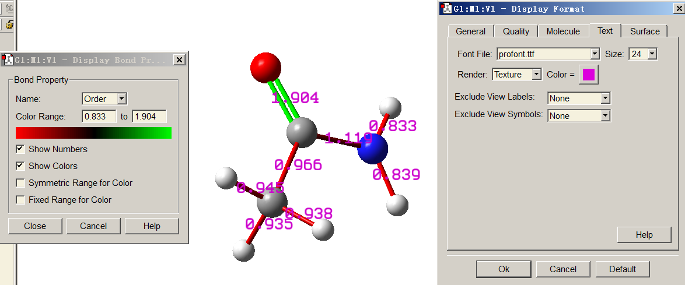

可见，我们还让GaussView用不同颜色展示键级。颜色越绿，键级越大；颜色越红，键级越小。

## **4.9.2 Li₆团簇与菲的多中心键级分析**

复杂体系（如团簇或存在大范围电子离域的体系）的电子结构特征难以用简单的化学经验规则研究，必须借助波函数分析方法。在本节中，给出应用多中心键级揭示多中心相互作用的例子。若你对多中心键级不熟悉，请查阅第[3.11.2](sec-3-11-bond-order-analysis.md#3112-多中心键级分析multi-center-bond-order-analysis-2--2--3)节以获得基础知识。注意多中心键级分析需要基函数信息，因此必须使用.mwfn/.fch/.molden/.gms文件作为输入文件。

### **第一部分：研究Li₆团簇中的三中心键**

在平面Li₆团簇中，如下图所示，有两种三元环，即三个边界三元环和一个中心三元环。我们将用多中心键级研究哪种三元环更稳定。

启动Multiwfn并输入以下命令

```text
examples\Li6.fch
9  // Bond order analysis
2  // Multi-center bond order analysis
1,3,4  // Indices of the atoms in the boundary three-member ring
```

输出为

```text
 The multicenter bond order:    0.1247848038
 The normalized multicenter bond order:    0.4997129069
```

然后我们计算中心三元环的三中心键级，因此输入*1,2,3*，结果为

```text
 The multicenter bond order:    0.0351782167
 The normalized multicenter bond order:    0.3276608901
```

由于两个环中的原子数相同，只需比较它们的"The multicenter bond order"值。数据已标注在下图中。粉色文字表示Mayer键级。

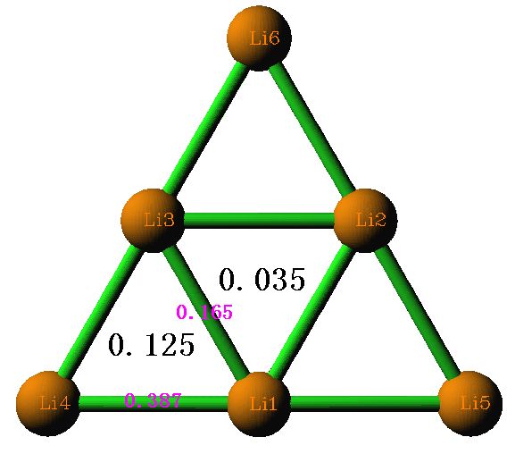

从三中心键级数值显然看出，边界三元环比中心三元环更稳定（*即*结合得更强），Mayer键级也在一定程度上反映了这一结论。我们可通过绘制团簇平面内的LOL图进一步证明该结论（关于如何绘制此类图的说明见第[4.4.2](sec-4-4-output-and-plot-various-properties-in-a-plane.md#442-一氟乙烷电子定域函数elf带投影效果的阴影浮雕图)节）

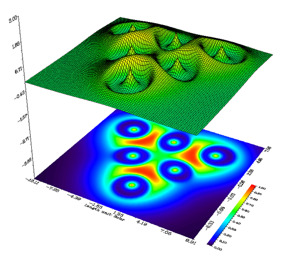

可见电子倾向于定域在边界三元环中以稳定它们，该实空间函数分析的结论与键级分析的结论符合得很好。通过查看Laplacian图、ELF图、电子密度形变图和价电子密度图，可得出完全相同的结论。

本例所用的*Li6.fch*是在B3LYP/6-31G\*水平下产生的。通常对于阴离子体系应使用弥散函数以恰当描述，此时应如上所述基于自然原子轨道（NAO）而非原始基函数计算多中心键级，否则结果可能完全无用，详见第[3.11.2](sec-3-11-bond-order-analysis.md#3112-多中心键级分析multi-center-bond-order-analysis-2--2--3)节（另见本节第三部分的例子）。或者，也可以去掉弥散函数并做单点计算以生成用于多中心键级分析的波函数，但基组至少应为三zeta质量，*例如*6-311G(2d,p)或def2-TZVP。

### **第二部分：研究菲中的六中心共轭**

*examples\phenanthrene.fch*包含在B3LYP/6-31G\*水平下生成的菲的波函数。原子编号如下所示。在本例中，我们将用多中心键级研究哪个六元环具有更强的多中心共轭效应。

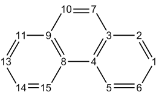

启动Multiwfn并输入以下命令

```text
examples\phenanthrene.fch
9  // Bond order analysis
2  // Multi-center bond order analysis
1,2,3,4,5,6  // Indices of the atoms in the boundary ring. Note that the inputting order must be in consistency with atomic connectivity, namely inputting such as 1,3,5,6,4,2 will be meaningless
```

输出为

> **注**
>
> 值得一提的是，在此情况下若按相反顺序输入原子序号，即*6,5,4,3,2,1*，结果会不同，即0.0591177129。但由于0.05935与0.05911之间的差别很小，我们不作区分。关于输入顺序影响的更多信息见第[3.11.2](sec-3-11-bond-order-analysis.md#3112-多中心键级分析multi-center-bond-order-analysis-2--2--3)节

```text
 The multicenter bond order:    0.0593516368
 The normalized multicenter bond order:    0.6245570525
```

接下来，我们研究中心环的情形。输入*3,4,8,9,10,7*，结果为

```text
 The multicenter bond order:    0.0264989378
 The normalized multicenter bond order:    0.5460152146
```

显然，中心环的电子共轭特征弱于边界环，因此我们也可得出边界环芳香性更强的结论。在第[4.14.3](sec-4-14-adaptive-natural-density-partitioning-adndp-analysis.md#4143-分析菲)、[4.15.2](sec-4-15-fuzzy-atomic-space-analysis.md#4152-用-pdifluflu-π-和-plr-研究菲的芳香性)和[4.25.6](sec-4-25-examples-of-electron-delocalization-and-aromaticity-analyses.md#4256-计算菲的-homa-和-bird-芳香性指标)节中，我们将用其它分析方法进一步研究环芳香性。

注意，原子数不同的环之间可比较"The normalized multicenter bond order"的数据。由于菲边界六元环的该值为0.6245，而Li₆团簇边界三元环的该值为0.4997，我们可推断前者的多中心相互作用可能更显著。

### **第三部分：基于自然原子轨道（NAO）计算六中心键级**

在Multiwfn中，多中心键级也可基于自然原子轨道（NAO）计算，如第[3.11.2](sec-3-11-bond-order-analysis.md#3112-多中心键级分析multi-center-bond-order-analysis-2--2--3)节所述。相对于通常情形，使用NAO作基组的主要优势在于即使存在弥散函数仍能得到合理结果。

这里我们在NAO基组下计算菲的多中心键级，此时需要带有*DMNAO*关键词的NBO输出信息作为输入。本例涉及的Gaussian输入文件为*exampes\phenanthrene_DMNAO.gjf*，相应输出文件为*examples\phenanthrene_DMNAO.out*。从.gjf文件可见，调用了Gaussian内嵌的NBO模块，并向NBO模块传入了*DMNAO*关键词。

启动Multiwfn并输入

```text
examples\phenanthrene_DMNAO.out
9  // Bond order analysis
-2  // Multi-center bond order analysis in NAO basis
1,2,3,4,5,6  // Calculate six-center bond order for the boundary ring
```

输出为

```text
 The multicenter bond order:    0.0588977456
 The normalized multicenter bond order:    0.6237584547
```

可见，该结果与我们之前用功能9中的选项2得到的结果几乎完全相同，这是预期的，因为目前没有使用弥散函数。

## **4.9.3 计算Laplacian键级（LBO）**

Laplacian键级（LBO）由本人在*J. Phys. Chem. A*，**117**，3100 (2013)中提出，详见第[3.11.7](sec-3-11-bond-order-analysis.md#3117-拉普拉斯键级laplacian-bond-order-8)节。LBO非常适合有机体系，且与成键强度密切相关。下面计算乙烷、乙烯和乙炔中C-C键的LBO。

启动Multiwfn并输入以下命令

```text
examples\ethane.wfn  // Optimized and produced at B3LYP/6-31G**
9  // Bond order analysis
8  // Laplacian bond order
```

将看到如下结果：

```text
The bond order >=  0.050000
#    1:    1(C )    2(H ):  0.887111
#    2:    1(C )    3(H ):  0.889492
#    3:    1(C )    4(H ):  0.889492
#    4:    1(C )    5(C ):  1.059879
#    5:    5(C )    6(H ):  0.887111
#    6:    5(C )    7(H ):  0.889492
#    7:    5(C )    8(H ):  0.889492
```

可见，C-C和C-H的LBO都非常接近形式键级（1.0）。LBO只反映共价成键特征，由于C-H是弱极性键，其值略小于1.0。

然后用*examples\ethene.wfn*计算乙烯的LBO

```text
#    1:    1(C )    2(H ):  0.919443
#    2:    1(C )    3(H ):  0.919443
#    3:    1(C )    4(C ):  2.022583
#    4:    4(C )    5(H ):  0.919443
#    5:    4(C )    6(H ):  0.919443
```

然后用*examples\C2H2.wfn*计算乙炔的LBO

```text
#    1:    1(C )    2(H ):  0.958393
#    2:    1(C )    3(C ):  2.767449
#    3:    3(C )    4(H ):  0.958393
```

三个体系中C-C键的LBO分别为1.060、2.022和2.767，比值为1:1.907:2.61。已知三者键离解能（BDE）之比为1:1.85:2.61。显然，LBO与BDE的相关性好得惊人，换言之，LBO很好地反映了成键强度（与LBO相比，没有其它键级定义与BDE有如此密切的关系）。

此外，LBO预测三个体系中C-H成键强度的顺序为乙炔（0.958）>乙烯（0.919）>乙烷（0.889），这与实验BDE顺序完全一致！（其它键级定义，如Mayer键级，未能重现该顺序）。

最后，用*examples\H2O.fch*计算水中O-H键的LBO，结果为0.638。该值明显小于C-H键级，反映O-H键的极性比C-H键强得多。

## **4.9.4 甲醛在NAO基组下的Wiberg键级的分解分析**

本例简要说明Multiwfn键级分析模块的一个独特功能，即把Wiberg键级分解为原子轨道对和原子壳层对贡献。将以非常简单的甲醛分子为例，当然你可把该分析推广到复杂得多的体系。请先阅读第[3.11.8](sec-3-11-bond-order-analysis.md#3118-将nao基nao-basis中的wiberg键级分解为原子轨道对贡献atomic-orbital-pair-contributions-9)节以理解该分析方法的基本思想。

该分析需要Weinhold的NBO程序输出的自然原子轨道（NAO）信息和NAO基组下的密度矩阵。对于Gaussian用户，可运行*examples\H2CO_DMNAO.gjf*，并用相应输出文件（*examples\H2CO_DMNAO.out*）作为本分析的输入文件。H₂CO分子在笛卡尔坐标系中的取向如下图所示。

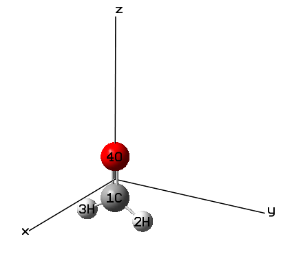

启动Multiwfn并输入以下命令：

```text
examples\H2CO_DMNAO.out
9  // Bond order analysis
9  // Decompose Wiberg bond order in NAO basis
```

然后可输入两个原子序号得到它们在NAO基组下的Wiberg键级，同时得到主要成分（打印成分的阈值由*settings.ini*中的"bndordthres"参数控制）。例如，输入*1,4*，屏幕上随即显示以下结果：

```text
Contribution from NAO pairs that larger than printing threshold:
 Contri.  NAO   Center   NAO type            NAO   Center   NAO type
 0.0823     2    1(C )  Val( 2S) S      ---    21    4(O )  Val( 2S) S
 0.1907     2    1(C )  Val( 2S) S      ---    28    4(O )  Val( 2p) pz
 0.9145     5    1(C )  Val( 2p) px     ---    24    4(O )  Val( 2p) px
 0.0658     7    1(C )  Val( 2p) py     ---    26    4(O )  Val( 2p) py
 0.2482     9    1(C )  Val( 2p) pz     ---    21    4(O )  Val( 2S) S
 0.3700     9    1(C )  Val( 2p) pz     ---    28    4(O )  Val( 2p) pz

Contribution from NAO shell pairs that larger than printing threshold:
 Contri.  Shell  Center  Type        Shell  Center  Type
 0.0823     2    1(C )    2S   ---     2    4(O )    2S
 0.1907     2    1(C )    2S   ---     5    4(O )    2p
 0.2482     5    1(C )    2p   ---     2    4(O )    2S
 1.3504     5    1(C )    2p   ---     5    4(O )    2p

Total Wiberg bond order:  1.9161
```

从以上信息可清楚了解总Wiberg键级1.9161的细节。根据前面所示的分子图，$p_{x}$型NAO对应于垂直于分子平面的2*p*原子轨道，因此$p_{x}$-$p_{x}$混合形成π键，其对总键级的贡献（0.9145）接近1，与化学直觉相符。*2s*-*2s*相互作用对C=O键只有微弱贡献，因为0.0823的值几乎可忽略；原因应归于轨道重叠不足。此外，2$p_{y}$-2$p_{y}$相互作用的作用也不显著，贡献仅为0.0658。2*s*(C)-2$p_{z}$(O)、2$p_{z}$(C)-2$p_{z}$(O)以及2$p_{z}$(C)-*s*(O)之间的相互作用对总键级有显著贡献，分别为0.1907、0.3700和0.2482，加和高达0.8089。这些大的贡献必定主要源于良好的轨道重叠。

为便于讨论，程序还输出各类原子壳层对对Wiberg键级的贡献。例如，从以上信息可见，碳的所有2*p*轨道与氧的所有2*p*轨道之间的相互作用共贡献了1.3504的键级。

在本功能中还可输入-1以定义两个片段，然后给出两片段之间壳层相互作用的贡献。例如，我们想研究CO片段与两个H原子之间相互作用的本质，在本功能中应输入

```text
-1  // Decompose interfragment Wiberg bond order
1,4  // Atoms in fragment 1
2,3  // Atoms in fragment 2
```

此时可见

```text
Interfragment bond order analysis:
 Contribution   Fragment 1   Fragment 2
    0.66301         2s           1s
    1.27591         2p           1s

Interfragment Wiberg bond order:  1.9575
```

显然，CO部分主要用其2*p*壳层与两个H原子形成共价键，而该片段的2*s*壳层也起着不可忽视的作用。

## **4.9.5 研究CH₃CONH₂中C-C键的Mulliken键级的轨道贡献**

Mulliken键级已在第[3.11.4](sec-3-11-bond-order-analysis.md#3114-mulliken键级mulliken-bond-order分析4与分解5)节中介绍，它也被称为Mulliken重叠布居（Mulliken overlap population）。这种键级不是特别有用，因为它既与成键强度相关不好，也不与键级数密切相关。但其独特优势在于可精确分解为轨道贡献，正值和负值分别对应成键和反键效应，该特征有助于揭示轨道特性。本节将以CH₃CONH₂为例说明这一点。

启动Multiwfn并输入

```text
examples\CH3CONH2.fch
9  // Bond order analysis
5  // Decompose Mulliken bond order between two atoms to orbital contributions
1,5  // Decompose C1-C5 bond
```

结果为

```text
...[ignored]
 Orbital     7 Occ:  2.000000 Energy:   -0.738679 contributes    0.30341308
 Orbital     8 Occ:  2.000000 Energy:   -0.588379 contributes   -0.03865545
 Orbital     9 Occ:  2.000000 Energy:   -0.541034 contributes   -0.00559743
 Orbital    10 Occ:  2.000000 Energy:   -0.466302 contributes    0.20938473
 Orbital    11 Occ:  2.000000 Energy:   -0.447220 contributes    0.12977388
 Orbital    12 Occ:  2.000000 Energy:   -0.401575 contributes    0.14101027
 Orbital    13 Occ:  2.000000 Energy:   -0.396099 contributes   -0.02147123
 Orbital    14 Occ:  2.000000 Energy:   -0.367424 contributes   -0.11159089
 Orbital    15 Occ:  2.000000 Energy:   -0.266106 contributes    0.00503022
 Orbital    16 Occ:  2.000000 Energy:   -0.243833 contributes    0.02829203
 Total Mulliken bond order:    0.66486037
```

可见许多分子轨道有明显的正贡献，如MO7（0.303）和MO10（0.209）；少数分子轨道有负贡献，尤其是MO14（-0.111）。还有一些分子轨道的贡献几乎为零，如MO15（0.005）。因此，占据MO7和MO10应增强C1-C5键的强度，而占据MO14必定不利于C1-C5键的形成。

MO对Mulliken键级的贡献值也可用轨道等值面图来理解：

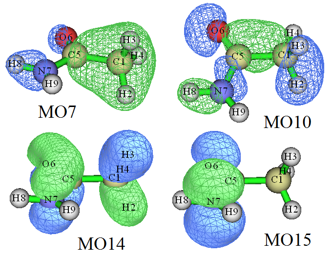

对于MO7和MO10，从上图可见C1与C5之间没有节面，等值面大体包围了C1-C5成键区，因此MO7和MO10是C1-C5的成键轨道，对其Mulliken键级有正贡献。对于MO14，在C1-C5中点处可清楚看到一个垂直于C1-C5键的明显节面，显然MO14是C1-C5键的反键轨道，因而对其Mulliken键级应有负贡献。对于MO15，轨道等值面没有覆盖C1-C5成键区，这就是MO15对C1-C5的Mulliken键级贡献可忽略的原因。

注意，在极少数情况下MO对Mulliken键级的贡献值不能用等值面图很好地解释，这表明Mulliken键级定义的不足。此时可尝试改用轨道占据数微扰的Mayer键级（如第[4.9.1](#491-乙酰胺的mayer键级与模糊键级分析)节所示），它更稳健。

值得注意的是，Mulliken和Mayer键级的分解不仅可基于正则分子轨道，还可基于定域分子轨道（LMO），后者通常更有意义。为此，一般应先用主功能19产生LMO，再照常进行分解分析。

## **4.9.6 用本征键强度指数（IBSI）衡量化学键强度**

*J. Phys. Chem. A*，**124**，1850 (2020)中提出的本征键强度指数（IBSI）在表征共价键强度方面有一定能力，请先查阅第[3.11.9](sec-3-11-bond-order-analysis.md#3119-本征键强度指数intrinsic-bond-strength-index-ibsi-10)节中的介绍。本节说明其计算方法。

如第[3.11.9](sec-3-11-bond-order-analysis.md#3119-本征键强度指数intrinsic-bond-strength-index-ibsi-10)节所述，IBSI可按IGM、IGMH或mIGM形式计算，分别记为IBSI$^{IGM}$、IBSI$^{IGMH}$、IBSI$^{mIGM}$。计算IBSI$^{IGM}$或IBSI$^{mIGM}$时，输入文件只需包含原子坐标，而IBSI$^{IGMH}$则要求输入文件包含波函数信息。这里我们计算乙炔的IBSI$^{IGM}$和IBSI$^{IGMH}$指数，.wfn文件在B3LYP/6-31G\*\*水平下生成，几何结构在同一水平下优化。

启动Multiwfn并输入

```text
examples\C2H2.wfn
9  // Bond order analysis
10  // Intrinsic bond strength index (IBSI)
1  // Start calculation. Since the current input file contains wavefunction information, by default the IBSI to be calculated is IBSI^IGMH
2  // Use high-quality integration grid (using "ultrafine grid" will result in marginally better numerical accuracy, while the cost will be correspondingly increased)
```

结果为

```text
1(C )    2(H )  Dist:  1.0657   Int(dg_pair): 0.46835   IBSI: 0.72771
1(C )    3(C )  Dist:  1.2054   Int(dg_pair): 1.27376   IBSI: 1.54718
1(C )    4(H )  Dist:  2.2711   Int(dg_pair): 0.11093   IBSI: 0.03795
2(H )    3(C )  Dist:  2.2711   Int(dg_pair): 0.11093   IBSI: 0.03795
2(H )    4(H )  Dist:  3.3368   Int(dg_pair): 0.01482   IBSI: 0.00235
3(C )    4(H )  Dist:  1.0657   Int(dg_pair): 0.46835   IBSI: 0.72771
```

其中"Dist"对应两原子间距离，Int(dg_pair)表示IBSI表达式中的$\int \delta{g}^{\mathrm{pair}}\mathrm{d}\mathbf{r}$项，"IBSI"即IBSI$^{IGMH}$值。

接下来计算IBSI$^{IGM}$。选择选项"2 Set type of IGM"，然后输入*1*把待计算的IBSI形式改为IBSI$^{IGM}$，再选择选项1并选"high-quality"进行计算，结果为

```text
1(C )    2(H )  Dist:  1.0657   Int(dg_pair): 0.58725   IBSI: 0.92620
1(C )    3(C )  Dist:  1.2054   Int(dg_pair): 1.32387   IBSI: 1.63228
1(C )    4(H )  Dist:  2.2711   Int(dg_pair): 0.19366   IBSI: 0.06726
2(H )    3(C )  Dist:  2.2711   Int(dg_pair): 0.19366   IBSI: 0.06726
2(H )    4(H )  Dist:  3.3368   Int(dg_pair): 0.02242   IBSI: 0.00361
3(C )    4(H )  Dist:  1.0657   Int(dg_pair): 0.58725   IBSI: 0.92620
```

类似地，可计算乙烷和乙炔的$\int \delta{g}^{\mathrm{pair}}\mathrm{d}\mathbf{r}$和IBSI，它们与*C2H2.wfn*同一水平生成的.wfn文件已作为*ethane.wfn*和*ethene.wfn*提供在"examples"目录下。三个体系中C-C键的计算数据相对于其键离解能（BDE）作图如下，其中δ $g^{\mathrm{IGM}}$和δ $g^{\mathrm{IGMH}}$分别对应按IGM和IGMH计算的$\int \delta{g}^{\mathrm{pair}}\mathrm{d}\mathbf{r}$。

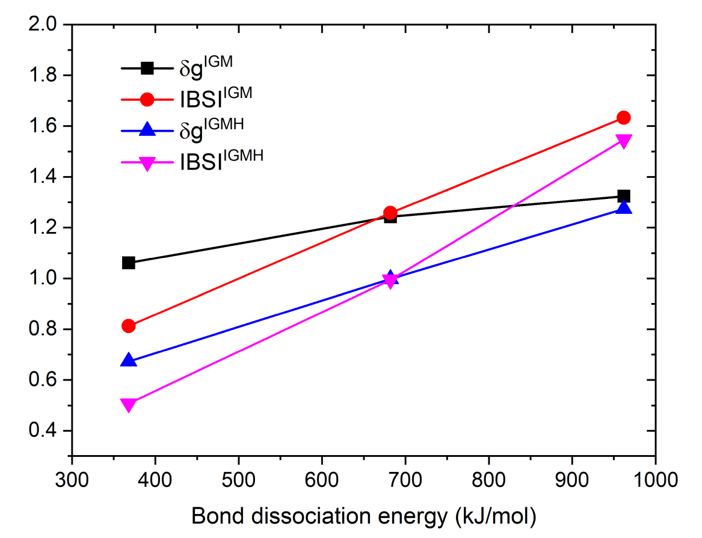

可见，δ $g^{\mathrm{IGM}}$与成键强度（直接体现为BDE）的相关性不好。两种形式的IBSI和δ $g^{\mathrm{IGMH}}$与BDE呈完美的线性关系，彰显了它们的巨大价值。

注意，若输入文件只包含几何信息，如.pdb和.xyz，则默认计算的IBSI形式为IBSI$^{IGM}$。

严格地说，IBSI的参考值（即IBSI表达式中的分母）应在与当前体系相同的水平下计算，但在本例中我们直接使用了内置数据。若希望得到更严格的结果可更改它，参考值也可用本功能计算，详见第[3.11.9](sec-3-11-bond-order-analysis.md#3119-本征键强度指数intrinsic-bond-strength-index-ibsi-10)节。

## **4.9.11 用AV1245和AVmin指数研究芳香性的例子**

> **注**
>
> 本节的中文版是我的博客文章“使用Multiwfn计算AV1245指数研究大环芳香性”（<http://sobereva.com/519>）。

请先阅读第[3.11.10](sec-3-11-bond-order-analysis.md#31110-av1245指数av1245-index大环的近似多中心键级approximate-multi-center-bond-order-for-large-rings和avmin)节以获得关于AV1245和AVmin指数的基础知识。在第[4.9.11.1](#49111-用av1245和avmin研究菲的局域芳香性)节中，将用AV1245和AVmin区分菲中两种六元环的芳香性，然后在第[4.9.11.2](#49112-用av1245和avmin衡量卟啉的全局芳香性)节中以卟啉为例展示这些指数定量大环芳香性的能力。

### **4.9.11.1 用AV1245和AVmin研究菲的局域芳香性**

在第[4.9.2](#492-li₆团簇与菲的多中心键级分析)节中，已用MCBO研究了菲中两种环局域芳香性的差异，其几何结构和原子编号如下所示。本节将再次用AV1245和AVmin研究它。


启动Multiwfn并输入

```text
examples\phenanthrene.fch
9  // Bond order analysis
11  // Calculate AV1245
1,2,3,4,5,6  // Calculate AV1245 for the boundary six-membered ring. Note that the order of inputting should be in line with connectivity
```

结果为

```text
 4-center electron sharing index of     1     2     4     5:    0.01304820
 4-center electron sharing index of     2     3     5     6:    0.01245026
 4-center electron sharing index of     3     4     6     1:    0.00801537
 4-center electron sharing index of     4     5     1     2:    0.01304820
 4-center electron sharing index of     5     6     2     3:    0.01245026
 4-center electron sharing index of     6     1     3     4:    0.00801537

 AV1245 times 1000 for the selected atoms is   11.17127674
 AVmin times 1000 for the selected atoms is     8.015375 (    3    4    6    1)
```

即1000\*AV1245和1000\*AVmin分别为11.171和8.015。AVmin值对应于3-4-6-1的4c-ESI。

接下来，输入*3,4,8,9,10,7*计算中心环的1000\*AV1245和1000\*AVmin，结果分别为5.012和3.996。显然，边界环的芳香性强于中心环，因为它的AV1245和AVmin更大，该结论与第[4.9.2](#492-li₆团簇与菲的多中心键级分析)节中的MCBO分析一致。在AV1245的原文中认为AV1245是MCBO的近似。

#### **在自然原子轨道（NAO）基组下计算AV1245和AVmin**

在Multiwfn中，AV1245和AVmin也可基于自然原子轨道（NAO）计算，如第[3.11.10](sec-3-11-bond-order-analysis.md#31110-av1245指数av1245-index大环的近似多中心键级approximate-multi-center-bond-order-for-large-rings和avmin)节所述。这种方式的主要优势在于即使存在弥散函数仍能得到合理结果（而若在有弥散函数时按我们之前的做法计算AV1245和AVmin，结果会很误导人）

这里我们在NAO基组下计算菲的AV1245和AVmin，此时应使用带有*DMNAO*关键词的NBO输出信息作为输入。本例涉及的Gaussian输入文件为*exampes\phenanthrene_DMNAO.gjf*，相应输出文件为*examples\phenanthrene_DMNAO.out*。从.gjf文件可见，调用了Gaussian内嵌的NBO模块，并向NBO模块传入了*DMNAO*关键词。

启动Multiwfn并输入

```text
examples\phenanthrene_DMNAO.out
9  // Bond order analysis
11  // Calculate AV1245
1,2,3,4,5,6  // Calculate AV1245 for the boundary ring
```

输出为

```text
AV1245 times 1000 for the selected atoms is   10.98247818
AVmin times 1000 for the selected atoms is     8.283826 (    3    4    6    1)
```

可见，结果与我们之前得到的（11.171和8.015）几乎相同，这是预期的，因为目前没有使用弥散函数。

### **4.9.11.2 用AV1245和AVmin衡量卟啉的全局芳香性**

在本例中我们用AV1245和AVmin定量卟啉不同离域路径对应的芳香性。在B3LYP/6-31G\*水平下生成的.fch文件可从<http://sobereva.com/multiwfn/extrafiles/porphyrin.rar>下载。结构如下所示。

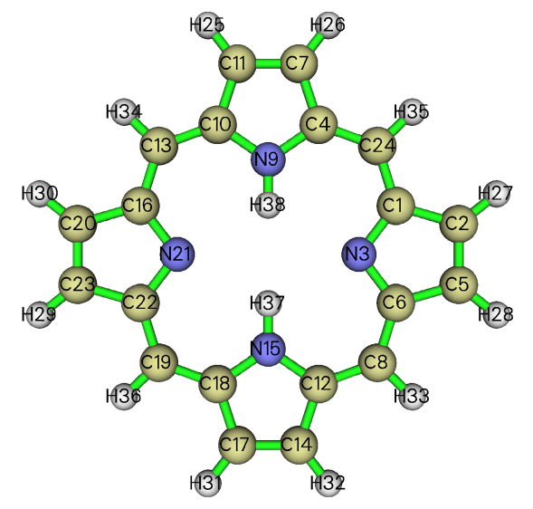

卟啉周围有几种可能的全局离域路径，现在计算其中之一。尽管可按上图所示原子连接关系手动输入原子序号追踪，但该过程很繁琐，尤其当所研究的环较大时。用GaussView直观选择感兴趣环中的原子并直接提取其序号要好得多。为此，我们用GaussView打开*porphyrin.fch*，然后点击刷子图标，再按住鼠标左键让光标经过环中每个原子，原子即被高亮为黄色，如下图左侧所示。之后选择"Tools" - "Atom Selection"，从文本框（见下图）中把原子序号复制出来，即*1,3-4,6-8,10-14,16-19,21-22,24*。

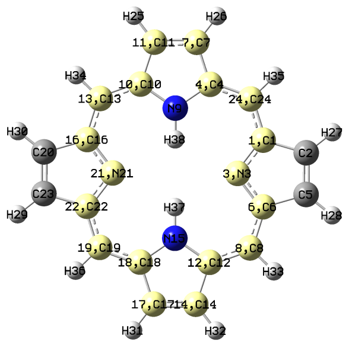 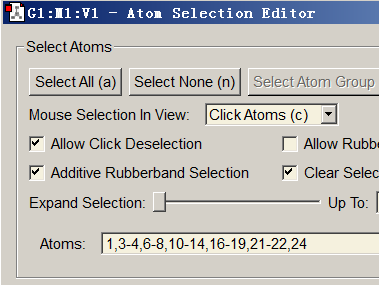

现在启动Multiwfn并输入

```text
porphyrin.fch
9  // Bond order analysis
11  // Calculate AV1245
d  // After entering this mode, you can input the atom indices in arbitrary order, because in this case the actual atom sequence will be automatically guessed based on recognized connectivity
1,3-4,6-8,10-14,16-19,21-22,24  // Indices of the atoms in the selected ring
```

此时可见以下信息：

```text
 Number of selected atoms:    18
 Atomic sequence:
     1     3     6     8    12    14    17    18    19    22    21    16
    13    10    11     7     4    24
...[ignored]
AV1245 times 1000 for the selected atoms is    2.75856093
AVmin times 1000 for the selected atoms is     1.943425 (    3    6   12   14)
```

可见原子顺序已被正确识别，与环中实际连接关系完全一致，因此结果2.76应是有意义的。AVmin对应于N3-C6-C12-C14，意味着该局域区域是整条路径上电子离域的瓶颈。

类似地，输入以下命令计算其它环的AV1245

```text
d
1-2,4-8,10-14,16-20,22-24
d
1,3-4,6,8-10,12-13,15-16,18-19,21-22,24
d
1-2,4-6,8-10,12-13,15-16,18-20,22-24
```

所有计算的环的所选原子及结果总结如下，蓝色和绿色文字分别对应1000\*AV1245和1000\*AVmin。

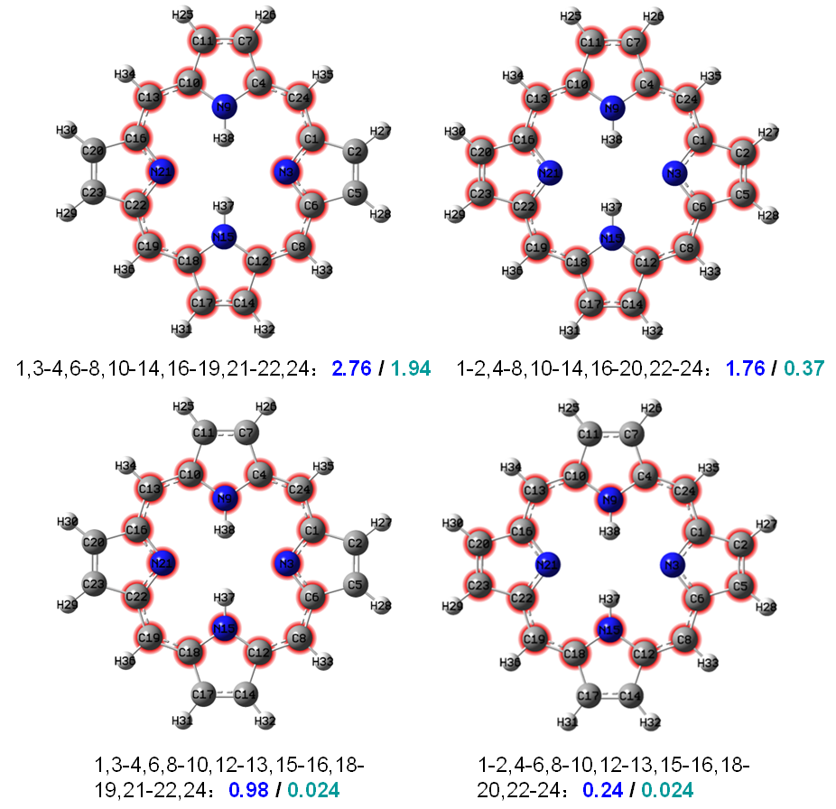

毫无疑问，经过吡咯氮但绕过N-H基团的路径是最有利的离域通道，因为它的1000\*AV1245和1000\*AVmin值（2.76和1.94）都大于其它路径。值得一提的是，对于上图中底部所示的两条路径，尽管它们的AV1245不等，AVmin却完全相同。该现象表明，尽管两条所选路径上电子离域的平均程度明显不同，瓶颈却是相同的。

该体系在第[4.4.9](sec-4-4-output-and-plot-various-properties-in-a-plane.md#449-绘制卟啉的-lol-π-图以揭示有利的电子离域路径)节中也曾通过LOL-π研究过，所得图形如下，从中可清楚看到不同路径的电子离域程度显著不同，最优先的离域路径被红色或橙色生动揭示。显然AV1245和AVmin揭示的最有利离域路径与LOL-π揭示的符合得很好。

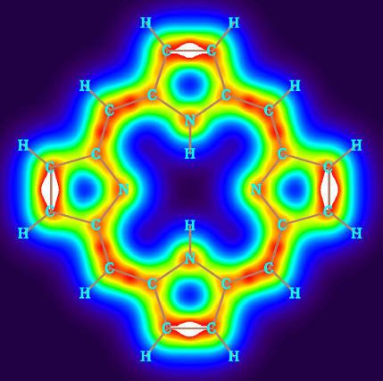

值得注意的是，使用便捷的"d"模式输入原子序号的前提是环中没有同时与环中另外两个以上原子相连的原子。例如，对于下面所示的萘，不应进入"d"模式并输入*1-10*来计算AV1245和AVmin以研究整个体系的全局芳香性，因为原子9和10同时连接三个原子，此时Multiwfn无法自动确定环中正确的原子顺序。

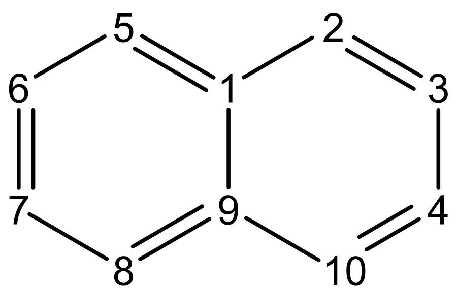
