# **4.A 专题与高级教程**

本节内容涉及Multiwfn的多个主要功能，或包含特殊用法与技巧。

## **4.A.1 沿IRC路径研究电子结构的变化**

> **注**
>
> 本节的中文版是我的博客文章“Studying chemical reaction process via curve map of bond order and anime of ELF/LOL/RDG isosurface”(<http://sobereva.com/200>)，该文基本涵盖了本节的全部内容。

在本教程中，我将简要展示如何使用Multiwfn研究Diels-Alder加成反应的IRC路径上电子结构的变化。我们将研究Mayer键级的变化，并制作ELF等值面的变形动画。用类似的方式，你也可以很容易地研究其他性质的变化，如原子电荷、电子密度、芳香性等。

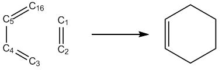

本教程全程使用Gaussian 09。除非另有说明，所有计算均在Windows 7 64位系统下进行。本教程中标为深红色的文件可在"examples\IRC"或"examples"文件夹中找到。

在开始本教程之前，应先配置好Gaussian的运行环境，否则在Windows环境下无法正常调用Gaussian。配置方法为：进入“控制面板”-“系统属性”-“高级”，点击“环境变量”按钮，然后在“用户变量”框中点击“新建”按钮，变量名输入GAUSS_EXEDIR，变量值输入Gaussian的安装目录(*例如*D:\study\g09w\\，假设*g09.exe*位于该文件夹中)。之后修改"PATH"环境变量，将Gaussian的安装目录加入其中。

### **1 进行IRC计算**

用Gaussian运行*DA_IRC.gjf*以生成*DA_IRC.out*。我们会发现这条IRC路径在两个方向上实际上分别包含18个和13个点。本计算采用B3LYP/6-31+G\*。

### **2 为IRC的每个点生成波函数文件**

编写一个Gaussian单点任务的输入文件(*DA_SP.gjf*)，稍后将用作“模板”。其中的几何结构实际上可以任意填写。

```text
DO NOT write anything here (e.g. %chk)
#p B3LYP/6-31G* nosymm

DA adduction

0 1
 C                 -0.26156800    1.56679300    0.69509600
 C                 -0.26156800    1.56679300   -0.69509600
 C                  0.50031400   -0.43279300   -1.43864500
 C                 -0.26156800   -1.32826500   -0.70392000
 C                 -0.26156800   -1.32826500    0.70392000
 H                 -1.19341600    1.44689700   -1.23752300
 H                 -1.19341600    1.44689700    1.23752300
 H                  0.52507600    2.08588200    1.23621300
 H                  0.38154400   -0.37781200    2.51847500
 H                  0.38154400   -0.37781200   -2.51847500
 H                  1.46467600   -0.09643600   -1.07409700
 H                 -1.04094400   -1.89294000   -1.21418700
 H                 -1.04094400   -1.89294000    1.21418700
 H                  1.46467600   -0.09643600    1.07409700
 H                  0.52507600    2.08588200   -1.23621300
 C                  0.50031400   -0.43279300    1.43864500
[blank line]
[blank line]
```

注意，这里使用的基组(6-31G\*)与IRC任务中使用的基组(6-31+G\*)不同，因为存在弥散函数时Mayer键级效果不佳。顺带一提，忽略弥散函数不会导致ELF等值面可察觉的变化。还要注意指定了"nosymm"关键词，因为若不这样做，Gaussian会自动平移和旋转分子以将其置于标准取向，这可能导致ELF动画出现不连续问题(你会看到在动画的某些帧中分子突然跳动)。

```text
DA_IRC.out  //The file of the output file of the IRC task
DA_SP.gjf  //The template file used to generate single point input files
2  //Only yield .chk files
C:\DA_IRCchk\DA  //The path and prefix of the finally generated .chk files
18,13  // The program detected that in DA_IRC.out there are 18 and 13 points in the two directions of IRC, respectively. Here we extract all of them, together with the TS point
```

*IRCsplit.exe*是用于为Gaussian的IRC和SCAN任务的每个点生成.wfn/.chk文件的工具，*IRCsplit.f90*是相应的源代码，可用它编译Linux版IRCsplit。双击图标启动*IRCsplit.exe*，然后输入

现在你可以在当前文件夹中找到*DA_SP0001.gjf*、*DA_SP0002.gjf* …… *DA_SP0032.gjf*。请手动检查其中一个，以确认这些输入文件的合理性。注意*DA_SP0014.gjf*对应TS几何结构。

新建文件夹"C:\DA_IRCchk"，将.gjf文件以及脚本*runall.bat*复制进去。双击runall.bat的图标，它将调用Gaussian 09依次运行所有的.gjf文件。

现在"C:\DA_IRCchk"文件夹中有*DA0001.chk*、*DA0002.chk* …… *DA0032.chk*。将*chk2fch.bat*复制到该文件夹并运行，Gaussian程序包中的formchk工具将被自动调用，把所有.chk文件转换为.fch文件。

### **3 计算所有IRC点的Mayer键级**

我们特别关注C1-C16的Mayer键级，其形成是DA加成的关键过程。由于默认情况下Multiwfn只输出数值\> 0.05的Mayer键级，而在DA加成初期C1-C16必然非常弱，因此需要将Multiwfn文件夹中*settings.ini*文件的"bndordthres"参数设为0.0，以便输出所有大于0.0的键级。

编写一个纯文本文件(*MBObatch.txt*)并放入Multiwfn文件夹，内容为

```text
9  // Enter bond order analysis module
1  // Calculate Mayer bond order
```

> **注**
>
> 若不明白该文件为何如此编写，请阅读[5.2](sec-5-2-running-multiwfn-in-silent-mode.md)节以学习如何在静默模式下运行Multiwfn。

然后编写一个带.bat后缀的纯文本文件(*MBObatchrun.bat*)并放入Multiwfn文件夹，内容应为

```bat
for /f %%i in ('dir C:\DA_IRCchk\*.fch /b') do Multiwfn C:\DA_IRCchk\%%i < MBObatch.txt > C:\DA_IRCchk\%%~ni.txt
```

*batchrun.bat*实际上是一个Windows批处理脚本。双击其图标运行，"C:\DA_IRCchk\\"文件夹中的.fch文件将被依次载入Multiwfn，计算得到的Mayer键级将被导出到同一文件夹中的.txt文件。

### **4 绘制Mayer键级**

接下来我们需要从*DA0001.txt*、*DA0002.txt* …… *DA0032.txt*中提取C1-C16的键级。最方便的方法是利用Linux中的"grep"命令。因此将所有这些.txt文件复制到Linux系统中的一个文件夹，然后在该文件夹中运行

```bash
grep "1(C )   16(C )" * > out.txt
```

*out.txt*文件现在包含IRC上所有点的C1-C16键级：

```text
DA0001.txt:#    9:         1(C )   16(C )    0.05929972
DA0002.txt:#    7:         1(C )   16(C )    0.06877306
DA0003.txt:#    7:         1(C )   16(C )    0.07926829
DA0004.txt:#    7:         1(C )   16(C )    0.09089774
DA0005.txt:#    7:         1(C )   16(C )    0.10380144
DA0006.txt:#    7:         1(C )   16(C )    0.11815120
DA0007.txt:#    7:         1(C )   16(C )    0.13417828
DA0008.txt:#    7:         1(C )   16(C )    0.15218555
```

...

最后一列是C1-C16的Mayer键级数值，现在可以用你喜欢的程序绘制它们，你将看到

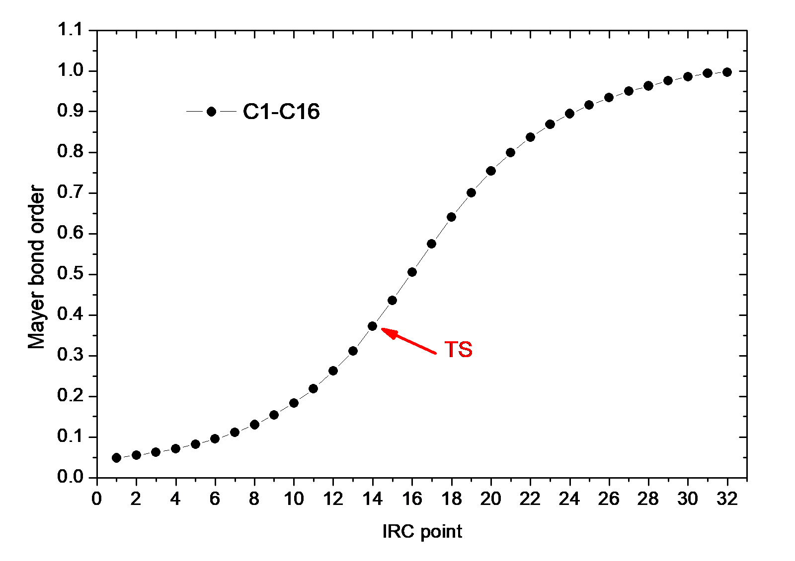

显然，随着反应的进行，C1-C16越来越强，其Mayer键级逐渐增大到1.0(典型的单键)。

用同样的方法，我们还计算C1-C2和C4-C5的Mayer键级，即运行以下命令

```bash
grep "1(C )    2(C )" * > out2.txt
grep "4(C )    5(C )" * > out3.txt
```

将*out.txt*、*out2.txt*和*out3.txt*中的数据画在一起，你将看到

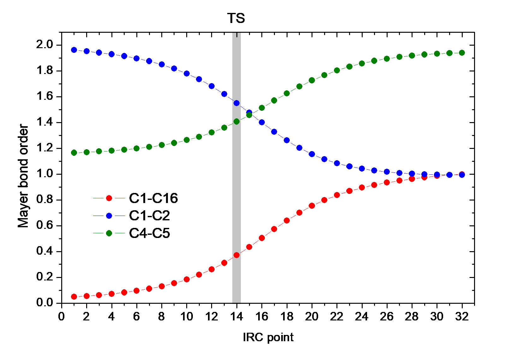

该图生动地显示，在DA加成过程中C1-C2平稳地从双键变为单键，且反应显著增强了C4-C5的双键特征。

### **5 制作ELF等值面动画**

接下来，我们制作动画以研究DA加成过程中ELF等值面如何变化。

在Multiwfn文件夹中创建一个纯文本文件*ELFbatch.txt*，内容如下

```text
5  // Generate grid data
9  // ELF
2  // Medium-quality grid
2  // Export the grid data to ELF.cub in current folder
```

创建一个名为*ELFbatchrun.bat*的脚本文件，其内容为

```bat
for /f %%i in ('dir C:\DA_IRCchk\*.fch /b') do (
Multiwfn C:\DA_IRCchk\%%i < ELFbatch.txt
rename ELF.cub %%~ni.cub
)
```

运行*ELFbatchrun.bat*，Multiwfn将依次载入"C:\DA_IRCchk"中的.fch文件，并将相应的ELF格点数据导出为当前文件夹中的*DA0001.cub*、*DA0002.cub* …… *DA0032.cub*。

我们使用VMD 1.9.1程序(可从<http://www.ks.uiuc.edu/Research/vmd/>免费获得)为这些cube文件渲染等值面。将所有cube文件移到VMD文件夹，并在VMD文件夹中创建一个名为*isoall.tcl*的纯文本文件，内容为

```tcl
set isoval 0.88
axes location Off
color Display Background white
for {set i 1} {$i<=32} {incr i} {
set name DA[format %04d $i]
puts "Processing $name.cub..."
mol default style CPK
mol new $name.cub
#translate by -0.100000 0.20000 0.000000
#scale to 0.30
rotate y by 50
rotate z by 90
rotate x by -30
rotate y by -20
mol addrep top
mol modstyle 1 top Isosurface $isoval 0 0 0 1 1
mol modcolor 1 top ColorID 3
render snapshot $name.bmp
mol delete top
}
```

该文件本质上是一个VMD脚本，其中命令`set isoval 0.88`表示将绘制0.88的等值面，默认视角通过*scale*、*rotate*和*translate*命令调节。*for {set i 1} {\$i\<=32} {incr i}*表示将处理从*DA0001.cub*到*DA0032.cub*的文件。

现在启动VMD，在其命令行窗口中输入命令`source isoall.tcl`，然后你将得到*DA0001.bmp*、*DA0002.bmp* …… *DA0032.bmp*。

有许多程序可将单帧图形文件转换为动画，如Atani、FFmpeg、Videomach等。这里我们使用Linux中的ImageMagick工具来做，并选择gif作为动画格式，因为gif动画可直接嵌入网页。

将所有的.bmp文件复制到Linux系统，并在相应文件夹中运行以下命令：

```bash
convert -delay 12 -colors 100 -monitor *.bmp ELF_IRC.gif
```

其中*-delay*控制动画中每帧之间的时间间隔，*-colors*决定使用的颜色数，该值越大，颜色变化越平滑，但动画文件也越大。可以运行*convert --help*以了解该工具的更多参数。

若生成的ELF_IRC.gif在你的系统上无法正常显示，请用网页浏览器或高级图像浏览器(*例如*IrfanView)打开它。该动画中ELF等值面的变形非常直观地展示了新键如何形成以及已有键的特征如何变化。

## **4.A.2 自旋布居的计算**

正如有多种计算原子电荷的方法(介绍见[3.9](sec-3-9-population-analysis-and-calculation-of-atomic-charges.md)节，实例见4.7节)，计算自旋布居也有多种方法。自旋布居(spin population)定义为α电子布居数减去β电子布居数。自旋布居是表征开壳层体系(*即*自由基和反铁磁体系)电子结构的关键量。由自旋布居可以清楚地知道自旋电子主要分布在哪里。此外，还可以讨论不同区域(原子轨道、原子或片段)对由电子自旋引起的总磁偶极矩**m**的贡献。若某区域的自旋布居为*x*，则其对**m**的贡献为*xμ*$_{B}$，其中玻尔磁子*μ*$_{B}$=*eћ*/(2 $m_{\mathrm{e}}$ )(e: electron charge, $m_{\mathrm{e}}$ : mass of electron)表示单个电子产生的磁矩。注意，在化学体系中，电子在轨道中的运动和核自旋对**m**也有贡献，但其量级明显更弱，因此通常可以忽略。

在Multiwfn中，可通过三个模块计算多种不同定义的自旋布居，简介如下。

**(1) 布居分析模块(主功能7)**。在该模块中，若选择Mulliken或Löwdin布居分析，将输出每个基函数、壳层和角动量轨道的α、β和自旋布居。若选择修正的Mulliken布居分析(*例如*SCPA)，则只显示每个原子的α/β/自旋布居。若先通过主功能7中的选项-1定义片段，则片段的自旋布居将一并打印。当基组中含有弥散基函数时不要使用这些方法，否则结果可能可靠也可能不可靠。

**(2) 模糊原子空间分析模块(主功能15)**。进入该模块后，选择选项1并选择电子自旋密度，将显示每个原子的自旋布居。它们通过在每个原子的模糊空间内积分电子自旋密度得到。若要获得片段的自旋布居，应先用选项-5定义要计算的原子。

默认采用Becke定义的模糊原子空间，因此结果可称为Becke自旋布居。若在计算前选择选项-1切换到Hirshfeld或Hirshfeld-I模糊原子空间，则结果对应Hirshfeld或Hirshfeld-I自旋布居。Becke、Hirshfeld和Hirshfeld-I方法在所有情况下都是可靠的。更多细节可查阅[3.18](sec-3-18-fuzzy-atomic-space-analysis.md)节。

**(3) 盆分析模块(主功能17)。**在该模块中，可用AIM方法计算自旋布居。关于如何在AIM原子盆中积分实空间函数，请查阅[4.17.1](sec-4-17-basin-analysis.md#4171-hcn-和-li₆-的-aim-流域分析)节。若选择电子自旋密度作为被积函数，则结果对应AIM自旋布居。一般来说，我不建议使用该方法，因为其计算代价明显高于使用布居分析模块和模糊原子空间分析模块。

总体而言，若只需计算原子自旋布居，推荐使用模糊原子空间分析模块，而在没有弥散函数时SCPA也是不错的选择。但若需要更详细的信息，如不同角动量轨道中的自旋布居，请使用Mulliken或Löwdin布居分析。

## **4.A.3 芳香性研究方法概述**

芳香性(aromaticity)是有机化学和波函数分析领域的基本概念。我以前曾写过一篇文章深入讨论研究芳香性的方法，见“The methods for measuring aromaticity and their calculations in Multiwfn”(中文，<http://sobereva.com/176>)。Multiwfn支持大量研究芳香性的方法，总结于下表，并将依次简要介绍。还有许多其他方法，如诱导环电流、ARCS、磁化率放大、芳香稳定化能(ASE)、CiLC；由于它们与Multiwfn的功能无直接关系，将不作介绍。

|     | Method            | Principle | Year | Pop. | Reliab. | Univ. | Ref. | Anti. | σ/π | Cost | Value |
|-----|-------------------|-----------|------|------|---------|-------|------|-------|-----|------|-------|
| 1   | Molecular orbital | Hückel    | 1951 | ++   | 0       | 0     | N    | Y     | Y   | 0    | \+    |
| 2   | AdNDP             | Hückel    | 2008 | \+   | 0       | \+    | N    | Y     | Y   | 0    | \+    |
| 3   | NICS              | Magnet.   | 1996 | +++  | ++      | ++    | N    | Y     | Y   | \+   | +++   |
| 4   | ICSS              | Magnet.   | 2001 | 0    | ++      | ++    | N    | Y     | Y   | +++  | \+    |
| 5   | HOMA              | Geom.     | 1972 | \+   | \+      | 0     | Y    | Y     | N   | − −  | \+    |
| 6   | Bird              | Geom.     | 1985 | − −  | 0       | −     | Y    | ?     | N   | − −  | −     |
| 7   | Multi-center BO   | Delocal.  | 1990 | \+   | +++     | ++    | N    | N     | Y   | −    | +++   |
| 8   | ELF-σ/π           | Delocal.  | 2004 | \+   | 0       | −     | N    | Y     | Y   | 0    | \+    |
| 9   | PDI               | Delocal.  | 2003 | 0    | \+      | 0     | N    | N     | Y   | 0    | \+    |
| 10  | ATI               | Delocal.  | 2005 | − −  | \+      | 0     | N    | N     | Y   | −    | 0     |
| 11  | PLR               | Delocal.  | 2012 | − −  | \+      | 0     | N    | N     | Y   | 0    | 0     |
| 12  | ΔDI               | Delocal.  | 2003 | − −  | −       | −     | N    | N     | Y   | 0    | − −   |
| 13  | FLU, FLU-π        | Delocal.  | 2005 | 0    | \+      | 0     | Y/N  | N     | Y   | 0    | \+    |
| 14  | RCP properties    | ρ         | 1997 | −    | 0       | 0     | N    | N     | ?   | −    | 0     |
| 15  | Shannon aromat.   | ρ         | 2010 |      |         |       | N    | Y     | N   | −    |       |
| 16  | EL index          | ρ         | 2012 | − −  | −       | −     | Y    | Y     | N   | −    | − −   |
| 17  | AV1245/AVmin      | Delocal.  | 2017 | −    | \+      | ++    | N    | N     | Y   | − −  | ++    |

在表中，"+++"、"++"、"+"、"0"、"−"和"− −"分别对应非常高、高、较高、一般、较低和低。"Y"和"N"分别代表"Yes"和"No"。各列的含义如下。

- **原理(Principle)**：方法背后的原理。"Hückel" = Hückel规则；"Magnet." = 磁性质；"Geom." = 分子几何；"Delocal." = 电子离域特征；"*ρ*" = 电子密度分布。

- **年份(Year)**：该方法首次提出的年份。

- **流行度(Pop.)**：近年来的流行程度。

- **可靠性(Reliab.)**：衡量该方法能否忠实反映芳香性。

- **通用性(Univ.)**：通用性高的方法必须能应用于多种体系和情形，如含杂原子和过渡金属的环、非平衡几何(*例如*Diels-Alder加成的过渡态)、激发态等。

- **参考(Ref.)**：该方法是否依赖参考体系。通用的方法必须避免这一特点。

- **反芳香性(Anti)**：该方法是否也能衡量反芳香性。

- **σ/π**：该方法能否分别讨论σ和π芳香性。

- **代价(Cost)**：应用该方法的计算代价。

- **价值(Value)**：总体价值。这是最重要的描述符。

接下来，将依次简介上表中的方法，并说明如何在Multiwfn中实现它们。

**1. 分子轨道(MO)**：著名的判断芳香性特征的Hückel 4*n*+2和4*n*规则最早明确发表于*J. Am. Chem. Soc.*，**73**，876 (1951)。对于一个分子，若在π(σ)分子轨道中共有4*n*+2个电子，且这组分子轨道具有相似的离域模式，则这些分子轨道涉及的环将表现出π(σ)芳香性。若有4*n*个电子，则该环应具有反芳香性。注意，对于Möbius型分子，4*n*+2和4*n*规则是反过来的。

为了用Hückel规则判断芳香性，应先通过观察分子轨道等值面挑选合适的分子轨道，为此可用主功能0。若体系严格平面，可直接利用[3.100.22](sec-3-100-other-functions-part-1.md#310022-检测π轨道设置占据数并计算π组成detect-π-orbitals-set-occupation-numbers-and-calculate-π-composition)节介绍的功能找出所有π分子轨道的序号。

**2. AdNDP(自适应自然密度划分)**：上面展示的MO方法通常只适用于只含一个环的分子。当存在多个环时，如菲，分子轨道就无用了，因为分子轨道一般离域在整个分子上，无法用于研究不同环的局域芳香性。AdNDP方法发表于*Phys. Chem. Chem. Phys.*，**10**，5207 (2008)，能够克服这一困难。AdNDP已在[3.17](sec-3-17-adaptive-natural-density-partitioning-analysis.md)节中仔细介绍，许多实例见[4.14](sec-4-14-adaptive-natural-density-partitioning-adndp-analysis.md)节。

**3. NICS(核独立化学位移)**：NICS用环中心处磁屏蔽值的负值衡量其芳香性。这是目前最流行的芳香性指标，最早发表于*J. Am. Chem. Soc.*，**118**，6317 (1996)，综述见*Chem. Rev.*，**105**，3842 (2005)。还有一些变体，其中研究π芳香性最好的是NICS(1)$_{ZZ}$，比较见*Org. Lett*，**8**，863 (2006)。对于非平面体系，常难以计算NICS(1)$_{ZZ}$，此时你会发现[3.28.4](sec-3-28-electron-delocalization-and-aromaticity-analyses.md#3284-求非平面或倾斜体系的-nics_zz-值)节介绍的功能极为有用。

Multiwfn还可沿一条直线扫描NICS并绘制一维NICS曲线图，介绍见[3.28.13](sec-3-28-electron-delocalization-and-aromaticity-analyses.md#32813-nics-1d-扫描曲线图积分-nics-inics-和-fipc-nics)节，实例见[4.25.13](sec-4-25-examples-of-electron-delocalization-and-aromaticity-analyses.md#42513-绘制一维-nics-曲线计算积分-inics-和-fipc-nics-的例子)节。Multiwfn还可在平面内扫描NICS并绘制二维NICS平面图，介绍见[3.28.14](sec-3-28-electron-delocalization-and-aromaticity-analyses.md#32814-nics-2d-扫描平面图)节，实例见[4.25.14](sec-4-25-examples-of-electron-delocalization-and-aromaticity-analyses.md#42514-绘制二维-nics-平面图的例子)节。通过曲线图和平面图，可比仅计算特定点的NICS获得丰富得多的信息，且这些分析要直观得多。

**4. ICSS(等化学屏蔽面)**：ICSS的原始文献为*J. Chem. Soc., Perkin Trans.*，**2**，1893 (2001)。该方法通过观察分子周围磁屏蔽值的等值面分析芳香性。介绍见[3.28.3](sec-3-28-electron-delocalization-and-aromaticity-analyses.md#3283-生成等化学屏蔽表面-icss-及相关量)节，实例见[4.25.3](sec-4-25-examples-of-electron-delocalization-and-aromaticity-analyses.md#4253-研究苯的等化学屏蔽面-icss-和磁屏蔽分布)节。该方法的主要缺点是计算三维区域内磁屏蔽值的格点数据相当耗时。

**5. HOMA(谐振子芳香性度量)、HOMAc和HOMER**：HOMA基于所关注环中的键长衡量芳香性。介绍见[3.28.6](sec-3-28-electron-delocalization-and-aromaticity-analyses.md#3286-计算-homa-和-bird-芳香性指数)节，实例见[4.25.6](sec-4-25-examples-of-electron-delocalization-and-aromaticity-analyses.md#4256-计算菲的-homa-和-bird-芳香性指标)节。HOMAc是HOMA的改进版，更值得推荐。HOMA完全无法表征T₁态的芳香性，而其变体HOMER对此情形效果合理。HOMAc和HOMER的介绍见[3.28.7](sec-3-28-electron-delocalization-and-aromaticity-analyses.md#3287-homac-和-homer)节。

**6. Bird指数**：同上。

**7. 多中心键级(MCBO)**：MCBO是环上电子离域能力的指标，是我最强烈推荐的芳香性指标。MCBO值越大对应芳香性越强。介绍见[3.11.2](sec-3-11-bond-order-analysis.md#3112-多中心键级分析multi-center-bond-order-analysis-2--2--3)节。MCBO在芳香性研究中的一些应用见*J. Phys. Org. Chem.*，**26**，473 (2013)、*Phys. Chem. Chem. Phys.*，**2**，3381 (2000)和*J. Phys. Chem. A*，**109**，6606 (2005)。用MCBO分别讨论π和σ芳香性很直接，即在计算MCBO值之前，先通过主功能100的子功能22分别将所有σ和π分子轨道的占据数置零。

注意，许多文献中MCBO的定义与Multiwfn中的相差一个常数系数。

**8. ELF-σ/π**：仅基于π轨道计算的ELF和基于其余所有轨道计算的ELF分别称为ELF-π和ELF-σ。据称ELF-π(ELF-σ)的分岔点数值是π(σ)芳香性的指标，一些应用见*J. Chem. Phys.*，**120**，1670 (2004)、*J. Chem. Theory Comput.*，**1**，83 (2005)和*Chem. Rev.*，**105**，3911 (2005)。计算ELF-σ/π的实例见[4.5.3](sec-4-5-generate-grid-data-and-view-isosurface-map.md#453-计算-elf-σ-和-elf-π-以研究苯的芳香性)节。此外，[4.4.9](sec-4-4-output-and-plot-various-properties-in-a-plane.md#449-绘制卟啉的-lol-π-图以揭示有利的电子离域路径)节给出了通过绘制平面图研究LOL-π(与ELF-π非常相似)的例子。我认为ELF-σ/π不是衡量芳香性很理想的方法，主要是因为该方法常有歧义(若你曾用该方法研究过许多实际体系就会认识到这一点)。还要注意，许多文献中ELF-σ/π的分岔值是错误的；若你尝试，会发现根本不可能重复它们的结果。(所以不要总是相信文献！)

**9. PDI(对位离域指数)**：该芳香性指标仅适用于六元环。PDI最早发表于*Chem. Eur. J.*，**9**，400 (2003)，综述见*Chem. Rev.*，**105**，3911 (2005)。PDI的介绍见[3.18.6](sec-3-18-fuzzy-atomic-space-analysis.md#3186-对位离域化指数-pdi-5)节，使用PDI的实例见[4.15.2](sec-4-15-fuzzy-atomic-space-analysis.md#4152-用-pdifluflu-π-和-plr-研究菲的芳香性)节。

**10. ATI(平均两中心指数)**：ATI最早发表于*J. Phys. Org. Chem.*，**18**，706 (2005)。事实上，ATI不含任何新思想，它只是把PDI公式中的离域指数换成相应的Mayer键级，而根据*J. Phys. Chem. A*，**109**，9904 (2005)中的讨论，Mayer键级与离域指数在物理本质上没有实质差别。若想使用ATI，可直接用Multiwfn计算Mayer键级，再按其公式手动计算ATI。

**11. PLR(对位线性响应指数)**：与ATI一样，PLR也与PDI非常相似。PLR与PDI的唯一区别是PDI中的离域指数被换成相应的凝聚线性响应核。PLR的原始文献为*Phys. Chem. Chem. Phys.*，**14**，3960 (2012)。PLR的介绍见[3.18.9](sec-3-18-fuzzy-atomic-space-analysis.md#3189-对位线性响应指数-plr-10)节，使用PLR的实例见[4.15.2](sec-4-15-fuzzy-atomic-space-analysis.md#4152-用-pdifluflu-π-和-plr-研究菲的芳香性)节。

**12. ΔDI：**该方法发表于*Chem. Eur. J.*，**9**，400 (2003)，用于衡量五元体系的芳香性。考虑下面的情形

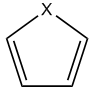

ΔDI简单定义为形式C=C键与C-C键之间离域指数(DI)之差。DI既可用模糊原子空间分析模块计算，也可用盆分析模块计算(尽管这两个模块中原子空间的定义不同，但通常结果相似)。事实上，也可用Mayer键级代替DI。我认为ΔDI不可靠，因为芳香性是体系的整体性质，而ΔDI中完全忽略了C-X键上的离域。

**13. FLU和FLU-π(芳香涨落指数)**：它们发表于*J. Chem. Phys.*，**122**，014109 (2005)。介绍见[3.18.7](sec-3-18-fuzzy-atomic-space-analysis.md#3187-芳香涨落指数-flu与-flu-π-67)节，实例见[4.15.2](sec-4-15-fuzzy-atomic-space-analysis.md#4152-用-pdifluflu-π-和-plr-研究菲的芳香性)节。

**14. RCP性质**：在*Can. J. Chem.*，**75**，1174 (1997)中表明，环临界点(RCP)处密度以及垂直于环平面方向的密度曲率与环的芳香性密切相关。密度越大，或曲率越负，芳香性越大。可用Multiwfn的拓扑分析模块应用该方法。详细介绍见[3.14.6](sec-3-14-topology-analysis.md#3146-基于电子密度拓扑性质计算芳香性指数aromaticity-indices)节，实例见[4.2.1](sec-4-2-topology-analysis.md#421-2-吡哆醇-2-氨基吡啶的分子中的原子-aim-拓扑分析与芳香性分析)节。

**15. Shannon芳香性**：该方法发表于*Phys. Chem. Chem. Phys.*，**12**，4742 (2010)，基于环中键临界点(BCP)处的电子密度衡量芳香性。介绍见[3.14.6](sec-3-14-topology-analysis.md#3146-基于电子密度拓扑性质计算芳香性指数aromaticity-indices)节，实例见[4.2.1](sec-4-2-topology-analysis.md#421-2-吡哆醇-2-氨基吡啶的分子中的原子-aim-拓扑分析与芳香性分析)节。

**16. EL指数**：EL指数的思想与HOMA颇为相似，最突出的区别是HOMA公式中的键长被换成环中BCP处的电子密度椭率。更多细节见原始文献*Struct. Chem.*，**23**，1173 (2012)。BCP处的电子密度椭率可直接用Multiwfn的拓扑分析模块计算。由于强极性键的BCP处椭率通常不明确，EL指数对含杂原子的环可能不可靠。此外，EL指数与HOMA有同样的缺点，即需要参考体系。若无法获得参考体系，如金属团簇的情形，该方法就不起作用。

**17. 基于信息论量定义的芳香性指标**：在*ACS Omega*，**3**，18370 (2018)中表明，构成环的原子的平均信息论量与芳香性密切相关。该方法作为主功能15的子功能12被支持，细节见[3.18.11](sec-3-18-fuzzy-atomic-space-analysis.md#31811-信息论芳香性指数-12)节。

**18. AV1245和AVmin**：AV1245可视为MCBO的近似。AVmin与AV1245密切相关，能揭示所选路径电子离域的瓶颈从而反映芳香性。介绍见[3.11.10](sec-3-11-bond-order-analysis.md#31110-av1245指数av1245-index大环的近似多中心键级approximate-multi-center-bond-order-for-large-rings和avmin)节，实例见[4.9.11](sec-4-9-bond-order-analysis.md#4911-用av1245和avmin指数研究芳香性的例子)节。

## **4.A.4 反应位点预测方法概述**

> **注**
>
> 更丰富的信息见我的博客文章“An overview of methods supported by Multiwfn for predicting reaction sites and reactivity of chemical systems”(<http://sobereva.com/767>)。

有许多方法可预测亲电、亲核和自由基反应的反应位点，几乎所有这些方法都被Multiwfn支持。在本节中，我将总结并简要介绍Multiwfn中可用的方法。强烈建议感兴趣的读者阅读[*Acta Phys.-Chim. Sinica*](http://www.whxb.pku.edu.cn/EN/abstract/abstract28694.shtml)[,](http://www.whxb.pku.edu.cn/EN/abstract/abstract28694.shtml) [**30**](http://www.whxb.pku.edu.cn/EN/abstract/abstract28694.shtml)[, 628 (2014)](http://www.whxb.pku.edu.cn/EN/abstract/abstract28694.shtml)和[*Sci. China Chem.*](https://doi.org/10.1007/s11426-015-5494-7)[,](https://doi.org/10.1007/s11426-015-5494-7) [**58**](https://doi.org/10.1007/s11426-015-5494-7)[, 1845 (2015)](https://doi.org/10.1007/s11426-015-5494-7)，其中仔细介绍并深入比较了预测亲电和亲核位点的各种方法。你可能还会发现Multiwfn网站"Related resources and posts"栏目中的幻灯片"Predicting reactive sites"很有用。

**1 静电势(ESP)**。若不熟悉ESP，请查阅[2.6](sec-2-6-real-space-functions.md)节中的相应介绍。由于亲电体(亲核体)局域带正(负)电荷，因而倾向于被ESP为负(正)的区域吸引，分子vdW表面上ESP极小(极大)值的位置和数值常用于揭示亲电(亲核)进攻的有利位点。ESP分析可通过定量分子表面分析模块实现，详细介绍见[4.12](sec-4-12-quantitative-analysis-of-molecular-surface.md)节，实例见[4.12.1](sec-4-12-quantitative-analysis-of-molecular-surface.md#4121-苯酚分子表面的静电势-electrostatic-potential分析)节。还有其他研究ESP的方式；如[4.12.3](sec-4-12-quantitative-analysis-of-molecular-surface.md#4123-丙烯醛-acrolein-的原子局域分子表面分析)节所示，每个原子对应的局域vdW表面上ESP的平均值也很有用，且该方法比分析vdW表面上的ESP极值更可靠、更稳健。对于平面体系，还可计算并比较分子平面上1.6Å(约等于碳的vdW半径)处不同原子上方的ESP值以考察它们的反应活性；为此需使用主功能1，它直接输出给定点处的各种实空间函数值。

然而，如我的论文[*Acta Phys.-Chim. Sin.*](http://www.whxb.pku.edu.cn/CN/abstract/abstract28694.shtml)[, 30, 628 (2014)](http://www.whxb.pku.edu.cn/CN/abstract/abstract28694.shtml)所示，ESP通常不是预测反应位点的可靠性质。

**2 平均局域离子化能(ALIE)和局域电子亲和能(LEA)**。若不熟悉ALIE，请阅读[2.6](sec-2-6-real-space-functions.md)节中的相应介绍。ALIE可以与ESP类似的方式研究。用ALIE预测反应位点最常见的方式是分析vdW表面上ALIE的极小值，实例见[4.12.2](sec-4-12-quantitative-analysis-of-molecular-surface.md#4122-苯酚分子表面上的平均局部离子化能-average-local-ionization-energy-alie分析)节。此外，还可研究局域vdW表面上ALIE的平均值，或对平面体系评估分子平面上1.6Å处的ALIE。

ALIE分析适用于亲电和自由基进攻，但对亲核进攻无用。而以类似方式定义的局域电子亲和能(LEA)可能对此有用，见*J. Mol. Model*.，**9**，342 (2003)。LEA在Multiwfn中作为自定义函数27被支持，细节见[2.7](sec-2-7-user-defined-real-space-function.md)节中的相应描述。分析LEA的最佳方式应是绘制LEA映射的分子表面图，如[4.12.13](sec-4-12-quantitative-analysis-of-molecular-surface.md#41213-使用局域电子亲和能-local-electron-affinity和局域电子附着能-local-electron-attachment-energy揭示亲电区域-electrophilic-regions)节明确所示。

**3 原子电荷**。容易理解，有利的亲电和亲核反应位点应分别带负和正的原子电荷，以便吸引亲电体和亲核体进攻。Multiwfn支持多种计算原子电荷的方法，介绍见[3.9](sec-3-9-population-analysis-and-calculation-of-atomic-charges.md)节，实例见[4.7](sec-4-7-population-analysis-and-atomic-charge-calculation.md)节。在可用的原子电荷中，用于预测反应位点目的最好的可能是Hirshfeld，建议感兴趣的读者查阅*J. Phys. Chem. A*，**118**，3698 (2014)，特别是*Theor. Chem. Acc.*，**138**，124 (2019)，后者很好地证明了Hirshfeld电荷在预测亲电和亲核反应位点方面的可靠性和价值。不要使用Mulliken电荷，它可能是最差的一种，尽管它是最流行的电荷模型。

**4 前线分子轨道(FMO)理论**。对HOMO(LUMO)贡献较大的原子更可能是亲电(亲核)进攻的优先位点。Multiwfn支持多种计算分子轨道组成的方法，介绍见[3.10](sec-3-10-orbital-composition-analysis.md)节，实例见[4.8](sec-4-8-molecular-orbital-composition-analysis.md)节。通常我建议使用Becke或Hirshfeld方法。若没有弥散函数，Mulliken方法效果同样好。NAO方法也是不错的选择，但不适合分析虚轨道。此外，还可直接通过主功能0观察分子轨道等值面以讨论其组成。

**5 Fukui函数和凝聚Fukui函数**。Parr在*J. Am. Chem. Soc.*，**106**，4049 (1984)中提出的Fukui函数是目前最常用的预测反应位点的方法。介绍和图示见[4.5.4](sec-4-5-generate-grid-data-and-view-isosurface-map.md#454-用福井函数和对偶描述符研究苯酚亲电进攻的有利位点)节。Fukui函数是实空间函数，通常通过等值面可视化研究。为了便于不同位点间的定量比较，可基于原子电荷计算凝聚Fukui函数，请查阅[4.7.3](sec-4-7-population-analysis-and-atomic-charge-calculation.md#473-计算凝聚fukui函数和凝聚对偶描述符)节。此外，如[4.12.4](sec-4-12-quantitative-analysis-of-molecular-surface.md#4124-苯酚-phenol分子表面-molecular-surface上福井函数-fukui-function的定量分析)节所示，Fukui函数的分布也可用局域定量分子表面分析技术表征。再者，Multiwfn能评估各类轨道(MO、NBO、NAO等)对Fukui函数的贡献以从轨道角度表征它，实例见[4.200.13.1](sec-4-200-other-functions-part-2.md#4200131-分子轨道对苯酚-fukui-函数-f-的贡献)节，算法介绍见[3.200.13](sec-3-200-other-functions-part-2.md#320013-计算轨道对密度差或其它格点数据的贡献)节。

**6 对偶描述符、描述符势、凝聚对偶描述符和键对偶描述符**。如[*Acta Phys.-Chim. Sinica*](http://www.whxb.pku.edu.cn/CN/abstract/abstract28694.shtml)[,](http://www.whxb.pku.edu.cn/CN/abstract/abstract28694.shtml) [**30**](http://www.whxb.pku.edu.cn/CN/abstract/abstract28694.shtml)[, 628 (2014)](http://www.whxb.pku.edu.cn/CN/abstract/abstract28694.shtml)所示，在*J. Phys. Chem. A*，**109**，205 (2005)中提出的对偶描述符可能是预测反应位点最稳健的方法，至少对亲电反应如此。与Fukui函数一样，对偶描述符也有凝聚版本以便于定量比较不同原子。对偶描述符及凝聚版本的介绍分别见[4.5.4](sec-4-5-generate-grid-data-and-view-isosurface-map.md#454-用福井函数和对偶描述符研究苯酚亲电进攻的有利位点)和[4.7.3](sec-4-7-population-analysis-and-atomic-charge-calculation.md#473-计算凝聚fukui函数和凝聚对偶描述符)节。

注意，计算Fukui函数、对偶描述符及其凝聚版本最简便的方法是使用主功能22，介绍见[3.25](sec-3-25-conceptual-density-functional-theory-analysis.md)节，图示见[4.22.1](sec-4-22-examples-of-conceptual-density-functional-theory-cdft-analysis.md#4221-自动计算苯酚的概念密度泛函理论量)节。一个额外的优点是，在概念密度泛函理论框架下定义的许多其他重要量可不花任何额外代价一并获得，包括Mulliken电负性、硬度、亲电性和亲核性指数、软度、凝聚局域软度、相对亲电性和亲核性等，这些对研究反应活性问题也很有用。

键对偶描述符针对每根键定义，可方便定量地研究哪些键是亲核或亲电的，并研究不同键之间亲核性和亲电性的相对强弱。介绍见[3.25.1](sec-3-25-conceptual-density-functional-theory-analysis.md#3251-理论)节，实际例子见[4.22.5](sec-4-22-examples-of-conceptual-density-functional-theory-cdft-analysis.md#4225-计算键对偶描述符-bond-dual-descriptor-bdd-的例子)节。

对偶描述符势(DDP)在原理上比对偶描述符在预测反应位点方面更严格，但计算代价大得多。若体系不大，强烈推荐用DDP代替对偶描述符。DDP的计算方法见[4.22.4](sec-4-22-examples-of-conceptual-density-functional-theory-cdft-analysis.md#4224-绘制-fukui-势和对偶描述符势的例子)节。

**7 轨道加权Fukui函数和轨道加权对偶描述符**：它们是Fukui函数和对偶描述符的特殊形式，这种轨道加权形式的独特优点是能合理处理具有简并或近简并前线分子轨道的体系，如C₆₀、coronene和cyclo\[18\]carbon，通常这类体系具有高点群对称性。介绍见[3.25.3](sec-3-25-conceptual-density-functional-theory-analysis.md#3253-专题-1轨道加权-fukui-函数与对偶描述符)节，图示应用见[4.22.2](sec-4-22-examples-of-conceptual-density-functional-theory-cdft-analysis.md#4222-轨道加权-fukui-函数和轨道加权对偶描述符研究示例)节。

**8 (准)简并HOMO和LUMO情形的Fukui函数和对偶描述符**：这种特殊形式的Fukui函数和对偶描述符的目的与轨道加权形式类似，但它完全基于电子密度定义，因而物理上更严格。介绍见[3.25.4](sec-3-25-conceptual-density-functional-theory-analysis.md#3254-专题-2基于电子密度的准简并-fukui-函数与对偶描述符)节，实例见[4.22.3](sec-4-22-examples-of-conceptual-density-functional-theory-cdft-analysis.md#4223-准简并-homolumo-情形的-cdft-分析实例)节。

**9 轨道重叠距离函数**。该函数的分析可能有助于揭示有利的反应位点，实例见[4.12.8](sec-4-12-quantitative-analysis-of-molecular-surface.md#4128-硫代甲酸分子表面上轨道重叠距离函数-orbital-overlap-distance-function-dr的定量分析)节。

## **4.A.5 弱相互作用研究方法概述**

表征弱相互作用的方法很多，其中大多数都被Multiwfn支持，这里我给出简要总结。若能阅读中文，建议阅读我的博客文章“An overview of the weak interaction analysis methods supported by Multiwfn”(<http://sobereva.com/252>)，其中对该主题有更深入广泛的讨论。

**(1)** AIM拓扑分析是研究强和弱相互作用都非常流行的方法。其在弱相互作用分析中的应用部分示于[4.2.1](sec-4-2-topology-analysis.md#421-2-吡哆醇-2-氨基吡啶的分子中的原子-aim-拓扑分析与芳香性分析)节。

**(2)** 2010年提出的NCI分析可视为AIM分析的可视化扩展，该方法提出后迅速流行起来。使用NCI分析的例子见[3.23.1](sec-3-23-visual-study-of-weak-interaction.md#3231-非共价相互作用-noncovalent-interaction-nci分析-1)、[4.20.1](sec-4-20-visual-study-of-weak-interactions.md#4201-用-nci-方法研究-2-吡哆素-2-氨基吡啶中的弱相互作用)和[4.20.2](sec-4-20-visual-study-of-weak-interactions.md#4202-基于前分子密度的-nci-方法研究-dna-中的弱相互作用)节。NCI分析也可用于研究动态环境(如分子动力学模拟)中的弱相互作用，即平均NCI(aNCI)分析，介绍见[3.23.2](sec-3-23-visual-study-of-weak-interaction.md#3232-基于前分子-promolecular密度的-nci-分析-2)节，相应实例见[4.20.3](sec-4-20-visual-study-of-weak-interactions.md#4203-用-anci-方法可视化研究体相环境中水的弱相互作用)节。对NCI区域积分是定量讨论弱相互作用的有用方式，例子见[4.200.14](sec-4-200-other-functions-part-2.md#420014-域分析例子)节。

IRI和DORI分析与NCI方法密切相关。IRI和DORI的优点是可同时可视化各类相互作用，包括化学键和弱相互作用，如[4.20.4](sec-4-20-visual-study-of-weak-interactions.md#4204-用-iri-分析揭示苯酚二聚体中的化学键和弱相互作用区域)和[4.20.5](sec-4-20-visual-study-of-weak-interactions.md#4205-用-dori-分析同时揭示苯酚二聚体中的共价和非共价相互作用)节所示。IRI明显优于DORI，因为IRI的图形效果好得多且计算代价更低。IRI、DORI和NCI的详细比较见IRI的原始论文：*Chemistry−Methods*，**1**，231 (2021)。

**(3)** IGM分析。与NCI分析相比，IGM分析的关键优点是可通过合理定义片段分别可视化研究片段内和片段间相互作用区域。原子和原子对的贡献可分别量化为IGM框架下定义的原子δ*g*指数和原子对δ*g*指数，并可按原子δ*g*指数对原子着色以生动展示各原子的作用。支持三种形式的IGM，即原始IGM，以及我提出的IGMH和mIGM，介绍分别见[3.23.5](sec-3-23-visual-study-of-weak-interaction.md#3235-基于前分子-promolecular密度的独立梯度模型-independent-gradient-model-igm分析-10)、[3.23.6](sec-3-23-visual-study-of-weak-interaction.md#3236-基于电子密度-hirshfeld-分区的-igm-igmh分析-11)、[3.23.10](sec-3-23-visual-study-of-weak-interaction.md#32310-修正-igm-migm分析--10)节，实例分别见[4.20.10](sec-4-20-visual-study-of-weak-interactions.md#42010-用独立梯度模型-igm-可视化和定量弱相互作用)、[4.20.11](sec-4-20-visual-study-of-weak-interactions.md#42011-用-igmh基于-hirshfeld-分割分子密度的-igm研究弱相互作用)、[4.20.12](sec-4-20-visual-study-of-weak-interactions.md#42012-用-migm-研究弱相互作用)节。IGMH的图形效果比IGM好得多，但计算代价明显更高。mIGM的图形效果与IGMH相似，而代价与原始IGM相同，因此依我之见原始IGM已无用。

我还把IGM分析推广到分子动力学模拟情形并提出了一种新形式的IGM，即平均IGM(aIGM)，它能表示模拟轨迹中特定片段间的平均相互作用。aIGM的一个变体是amIGM，后者的图形效果显著更好，因此应始终用amIGM代替aIGM。amIGM的介绍见[3.23.11](sec-3-23-visual-study-of-weak-interaction.md#32311-平均修正-igm-amigm分析--12)节，实例见[4.20.13](sec-4-20-visual-study-of-weak-interactions.md#42013-用-amigm-揭示动态环境中的弱相互作用)节。

**(4)** 静电势(ESP)分析。ESP已在[2.6](sec-2-6-real-space-functions.md)节中介绍，这是研究静电主导的弱相互作用极其重要的实空间函数。进行ESP分析有许多不同方式：

- 观察ESP映射的分子vdW表面进行可视化研究，该分析可用于快速找出潜在的静电相互作用位点并定性研究相互作用强度。实例见[4.12.1](sec-4-12-quantitative-analysis-of-molecular-surface.md#4121-苯酚分子表面的静电势-electrostatic-potential分析)节末和*J. Mol. Model.*，**13**，291 (2007)。

- 研究分子vdW表面上的ESP极小值和极大值。这可通过定量分子表面分析模块完成，实例见[4.12.1](sec-4-12-quantitative-analysis-of-molecular-surface.md#4121-苯酚分子表面的静电势-electrostatic-potential分析)节，更多细节见[3.15](sec-3-15-quantitative-analysis-of-molecular-surface.md)节。vdW表面上这些ESP极值与静电相互作用能强烈相关，已有许多论文使用该方法，例如*Phys. Chem. Chem. Phys.*，**15**，14377 (2013)、*J. Mol. Model.*，**13**，305 (2007)、*Int. J. Quantum. Chem.*，**107**，3046 (2007)、*Phys. Chem. Chem. Phys.*，**12**，7748 (2010)、*J. Mol. Model.*，**14**，659 (2008)、*J. Mol. Model.*，**18**，541 (2012)、*J. Mol. Model.*，**15**，723 (2009)、专著*Practical Aspects of Computational Chemistry* (2009)第6章。

- 研究特征区域(如σ-hole、π-hole和孤对电子)对应的面积和平均ESP值，实例见[4.12.10](sec-4-12-quantitative-analysis-of-molecular-surface.md#41210-σ洞-sigma-hole与π洞-pi-hole面积的定量化)节。

- ESP等值线图的叠加分析。该方法由Tian Lu在*J. Mol. Model.*，**19**，5387 (2013)中提出，非常生动、易用且强大。已证明用该方法可相当好地预测复合物构型的稳定性。[4.4.4](sec-4-4-output-and-plot-various-properties-in-a-plane.md#444-三氟化氯静电势的等值线图)节展示了如何绘制ESP等值线图。

- 在*J. Phys. Chem. A*，**118**，1697 (2014)中，作者表明利用原子核位置处的ESP可非常准确地预测静电主导的分子间相互作用能。介绍和实例见[4.1.2](sec-4-1-calculate-properties-at-a-point.md#412-计算核位置处静电势-esp以评估-h₂ohf-的相互作用强度)节。

**(5)** 范德华(vdW)势。vdW势与ESP同等重要，尤其当相互作用由vdW相互作用而非静电相互作用主导时。Multiwfn能以多种形式方便地进行vdW势分析。介绍见[3.23.7](sec-3-23-visual-study-of-weak-interaction.md#3237-范德华势的可视化-6)节，实例见[4.20.6](sec-4-20-visual-study-of-weak-interactions.md#4206-范德华势的可视化与分析)节。vdW势的深入介绍和讨论见我的研究论文*J. Mol. Model.*，**26**，315 (2020)。

**(6)** 原子电荷分析。原子电荷是描述电荷分布非常简单直观的模型，可用于分析不同位点间静电相互作用的强度。计算原子电荷的功能见[3.9](sec-3-9-population-analysis-and-calculation-of-atomic-charges.md)节，一些实际例子见[3.7](sec-3-7-custom-operation-promolecular-and-deformation-properties.md)节。

**(7)** Hirshfeld和Becke表面分析。这类分析对揭示分子晶体中的弱相互作用极为有用，也可应用于分子簇，实例见[4.12.5](sec-4-12-quantitative-analysis-of-molecular-surface.md#4125-鸟嘌呤-胞嘧啶碱基对的becke表面-becke-surface分析)和[4.12.6](sec-4-12-quantitative-analysis-of-molecular-surface.md#4126-尿素晶体的hirshfeld表面分析和指纹图分析-fingerprint-plot-analysis)节，理论介绍见[3.15.5](sec-3-15-quantitative-analysis-of-molecular-surface.md#3155-专题hirshfeld-和-becke-表面分析)节。

**(8)** 键级和离域指数(DI)分析。通常弱相互作用由静电和/或vdW相互作用主导，因此主要反映共价特征的键级和DI分析在这些情形常无用。但对“强”弱相互作用，如低垒氢键(LBHB)和电荷辅助卤键，共价贡献可能不可忽略，因而可应用键级和DI分析。键级计算示于[4.9](sec-4-9-bond-order-analysis.md)节。在Multiwfn中，DI可基于模糊原子空间或AIM盆计算，前者等价于模糊键级，后者可在盆分析模块中评估，实例见[4.17.1](sec-4-17-basin-analysis.md#4171-hcn-和-li₆-的-aim-流域分析)节。

**(9)** ELF分析。在*Theor. Chem. Acc.*，**104**，13 (2000)中，Fuster和Silvi基于ELF定义了CVB指数以区分H键强度。*J. Phys. Chem. A*，**115**，10078 (2011)用该方法研究了大量共振辅助氢键，发现该指数与其他H键强度指标有良好的相关性。CVB指数可在Multiwfn中方便地计算，细节见[3.200.1](sec-3-200-other-functions-part-2.md#32001-计算核-价分叉-cvb-指数及相关量)节。还有其他用ELF研究H键的论文，*例如* *Chem. Rev.*，**111**，2597 (2011)。

**(10)** 电荷变化分析。弱相互作用常伴随电荷转移和极化，因此研究电子如何在分子之间或分子内转移，以及电子密度如何因另一分子的存在而极化很重要。有许多可用方法研究这些问题：

- 绘制复合物与单体之间电子密度的差值图。这是最直接直观的研究电子密度变化的方式。步骤示于[4.5.5](sec-4-5-generate-grid-data-and-view-isosurface-map.md#455-绘制电子密度差值图以研究咪唑配位镁卟啉的电子转移)节。

- 绘制电荷位移曲线。在生成密度差的格点数据后，为了定量研究某方向上的电荷变化，可绘制电荷位移曲线，介绍见[3.16.14](sec-3-16-processing-grid-data.md#31614-绘制-xyz-方向的局域积分曲线与平面平均曲线-18)节，实例见[4.13.6](sec-4-13-process-grid-data.md#4136-绘制电荷位移曲线)节。

- 单体在孤立状态和复合物状态下原子电荷的变化可定量清楚地显示由于相互作用电子在不同原子/片段之间如何转移。

- 在生成复合物与单体之间电子密度差的格点数据后，可用盆分析模块对密度差的盆积分，以研究各特征区域(*例如*对应σ-hole的区域)中电子变化的量。可查阅[4.17.4](sec-4-17-basin-analysis.md#4174-h₂o-的电子密度差流域分析)节中的例子。

- 电荷分解分析(CDA)。CDA用于揭示电荷转移的内在细节，可研究由于各种复合物分子轨道导致的两个片段之间电子的施予和反馈的量。此外，Multiwfn的CDA模块可告诉你片段分子轨道如何混合从而生成复合物分子轨道。CDA常用于强相互作用，但也可能有助于探索弱相互作用。CDA的理论见[3.19](sec-3-19-charge-decomposition-analysis-and-orbital-interaction-diagram.md)节，实际例子见[4.16](sec-4-16-charge-decomposition-analysis-and-orbital-interaction-diagram.md)节。

- Multiwfn有一个基于电子密度差分析电子激发中电荷转移的专用功能，可获得许多表征转移的重要量，介绍见[3.21.3](sec-3-21-electron-excitation-analysis.md#3213-基于密度差格点数据分析电荷转移-3)节，实例见[4.18.3](sec-4-18-electron-excitation-analysis.md#4183-基于电子密度差分析电子激发中的电荷转移)节。基于复合物与单体之间电子密度差的格点数据，该功能也可能有助于研究弱相互作用导致的电荷转移。

**(11)** vdW表面的相互穿透距离。对于同种弱相互作用，一般vdW表面的穿透越大，相互作用强度越强。对于非共价相互作用的原子对AB，A-B距离与它们非键半径之和之差称为相互穿透距离。非键原子半径是原子核到分子vdW表面的最短距离，可通过Multiwfn定量分子表面分析模块后处理界面的选项10获得。

**(12)** 能量分解分析是表征弱相互作用本质的一类重要方法，可分别获得总相互作用能的物理分量。sobEDA和sobEDAw能量分解方法分别是研究化学键相互作用和弱相互作用本质的很好选择。它们可结合Multiwfn和Gaussian实现，见[3.24.3](sec-3-24-energy-decomposition-analysis.md#3243-sobeda-与-sobedaw-能量分解分析)节。Multiwfn还可基于分子力场进行能量分解分析，该功能非常有用、灵活，可用于评估/分解大体系(甚至数千原子)的弱相互作用能，介绍见[3.24.1](sec-3-24-energy-decomposition-analysis.md#3241-基于分子力场-force-field-ff-的能量分解分析-eda-ff)节，实例见[4.21.1](sec-4-21-energy-decomposition-analysis.md#4211-基于力场的能量分解分析-eda-ff示例)节。

**(13)** LOLIPOP指数有助于衡量π-π堆积能力，介绍见[3.100.14](sec-3-100-other-functions-part-1.md#310014-计算lolipopcalculate-lolipop-lol-integrated-pi-over-plane)节，实例见[4.100.14](sec-4-100-other-functions-part-1.md#410014-计算-lolipop-指数)节。

**(14)** 源函数分析在AIM理论框架下定义。Gatti等人建议用源函数研究强和弱相互作用。源函数的介绍见[2.6](sec-2-6-real-space-functions.md)节，进行源函数分析的教程见[4.17.5](sec-4-17-basin-analysis.md#4175-在-aim-流域中研究源函数)节。深入的综述为*Struct. & Bond.*，**147**，193 (2010)，其中涉及H键分析。

**(15)** 原子多极矩分析。原子多极矩的定义见[3.18.3](sec-3-18-fuzzy-atomic-space-analysis.md#3183-原子与分子多极矩及--2)节。原子多极矩衡量原子周围电子密度分布的各向异性，这对原子间静电相互作用有重要影响。Bader专著*Atoms in molecules-A quantum theory*第7.4.3节有说明性例子。在Multiwfn中，原子多极矩既可用模糊空间分析模块计算，也可用盆分析模块计算，后者的例子见[4.17.1](sec-4-17-basin-analysis.md#4171-hcn-和-li₆-的-aim-流域分析)节。

**(16)** 轨道重叠。对于涉及轨道相互作用的弱相互作用，可用Multiwfn研究轨道重叠，它与轨道相互作用强度密切相关。[4.100.15](sec-4-100-other-functions-part-1.md#410015-计算-db-ttf-的分子间轨道重叠积分-intermolecular-orbital-overlap-integral)节示例了如何计算分子间轨道重叠积分。[4.0.2](sec-4-0-view-orbitals-and-structure.md#402-查看乙醇的自然键轨道-nbo)节示例了如何观察两个NBO轨道的重叠程度，重叠程度高(低)通常意味着两个NBO之间的二阶微扰能E(2)大(小)。

**(17)** 如*J. Mol. Model.*，**19**，2035 (2013)所示，卤键复合物的相互作用能与σ-hole位置处电子密度Laplacian的(3,-1)临界点的性质很好地相关。电子密度Laplacian的拓扑分析可在主功能2中方便地实现。[4.2.2](sec-4-2-topology-analysis.md#422-乙酸的定域轨道指示剂-lol-拓扑分析)节展示了如何对LOL进行拓扑分析，可用同样的方法分析电子密度的Laplacian。

**(18)** 概念密度泛函理论框架下定义的*ω*$_{cubic}$亲电性指数与弱相互作用能强度有密切关系。在*J. Phys. Chem. A*，**124**，2090 (2020)中表明，卤键二聚体中卤原子处*ω*$_{cubic}$的凝聚形式与结合能有很好的线性关系，因此该量在某些情形可能有助于预测相互作用强度和揭示相互作用本质。该量可通过主功能22全自动计算，细节见[3.25](sec-3-25-conceptual-density-functional-theory-analysis.md)节。

**(18)** ETS-NOCV。该流行方法发表于*J. Chem. Theory Comput.*，**5**，962 (2009)，专注于解析片段间的轨道相互作用。该分析的关键优点是能把由轨道相互作用引起的电子密度变化转换为一组NOCV对，每对对轨道相互作用能有相应的能量贡献，并有可可视化的相应密度以便理解本质，因此ETS-NOCV分析对轨道相互作用提供了非常深刻的洞察。详细介绍见[3.26](sec-3-26-ets-nocv-analysis.md)节，将ETS-NOCV用于研究各类相互作用的例子见[4.23](sec-4-23-examples-of-ets-nocv-analysis.md)节。尽管轨道相互作用通常不是弱相互作用的主导物理分量，ETS-NOCV在某些情形仍有用。例如，[4.23.4](sec-4-23-examples-of-ets-nocv-analysis.md#4234-弱相互作用例子a-t-碱基对)节示例了如何利用ETS-NOCV研究氢键相互作用。

**(19)** Multiwfn能计算原子对色散能的贡献并计算色散密度。使用非常方便，计算特别快，还支持周期体系。可通过对原子着色和绘制等值面图直观显示哪些原子对当前体系中的色散效应有显著贡献。也可通过获得两个不同体系中原子贡献的色散能之差讨论与色散效应相关的问题，如在构象变化过程中哪些原子的色散贡献有显著变化、哪些原子对物理吸附(当色散效应主导时)有主要贡献等。该功能的介绍见[3.24.4](sec-3-24-energy-decomposition-analysis.md#3244-原子对色散能贡献的分析)节，分析例子见[3.21.4](sec-3-21-electron-excitation-analysis.md#3214-计算-r-指数衡量电荷转移长度-4)节。

还有其他研究弱相互作用的可能方法，但它们与Multiwfn无直接关系。这些方法包括：NBO E(2)和NBO删除分析、再杂化分析(专用于H键，基于自然布居分析)、键长和振动频率的变化、Mayer能量分解分析(*Phys. Chem. Chem. Phys.*，**8**，4630 (2006))、磁诱导电流(*Phys. Chem. Chem. Phys.*，**13**，20500 (2011))、相互作用量子原子(IQA，例子见*J. Phys. Chem. A*，**117**，8969 (2013))、SAPT分析(PSI4、Molpro等支持，见*WIREs Comput. Mol. Sci.*，**2**，254 (2012))。

## **4.A.6 计算奇电子密度**

奇电子（odd electron）是指未成对电子。所谓的奇电子密度（odd electron density，OED）被定义用于表示奇电子的分布，其思想源自 *Chem. Phys. Lett.*，**372**，508 (2003)，并在 *Theor. Chem. Acc.*，**130**，711 (2011) 和 *J. Phys. Chem. C*，**116**，19729 (2012) 中进一步明确表述为函数形式。当无法获得自旋密度时（例如由 TDDFT 计算的激发态），OED 在以图形方式展示未成对电子分布方面很有用。在本节中，我将介绍 OED，并展示如何结合 Gaussian 产生的 .wfn 文件使用 Multiwfn 绘制它。

### **OED理论**

对总密度矩阵对角化得到空间（无自旋）自然轨道，其占据数在 0.0 到 2.0 之间。第 *k* 个自然轨道贡献的 OED 定义为

$$
\rho_{k}^{\mathrm{odd}}(\mathbf{r})=\min(2-\eta_{k},\eta_{k})\rho_{k}(\mathbf{r})
$$

其中 $ρ_{k}$(**r**) 和 $η_{k}$ 分别是自然轨道 *k* 的概率密度和占据数。显然，对于 $η_{k}$\<1，前因子直接对应占据数，而对于 $η_{k}$≥1，前因子对应为达到闭壳层所需的补数。*min*(2-$η_{k}$，$η_{k}$) 项度量了当前轨道占据数对闭壳层极限的偏离，被视为该轨道所表达的有效未成对电子数。

OED 定义为所有自然轨道的 OED 之和，即

$$
\rho^{\mathrm{odd}}(\mathbf{r})=\sum_{k}\rho_{k}^{\mathrm{odd}}(\mathbf{r})
$$

奇电子总数为

$$
N^{\mathrm{odd}}=\sum_{k}\min(2-\eta_{k},\eta_{k})
$$

### **闭壳层体系OC-BH₃的OED计算**

尽管 OED 最初被提出来展示未成对电子的分布，但依笔者个人观点，该函数也可能有助于揭示电子相关效应显著的区域，因为轨道占据数对 0.0 和 2.0 的偏离是由电子相关效应引起的。

作为例子，我们在 CCSD/def2-SVP 水平上计算典型闭壳层体系 OC-BH₃ 的 OED（而在 HF/DFT 水平上，该量显然处处为零）。Gaussian 输入文件见 *examples\COBH3_CCSD.gjf*，注意其中使用了 *density out=wfn* 关键词。所得文件 *examples\COBH3_CCSD.wfn* 包含全部 CCSD 自然轨道。

我们首先计算总 OED。启动 Multiwfn 并输入

```text
examples\COBH3_CCSD.wfn
6  // Modify wavefunction
26  // Modify occupation number
0  // Select all orbitals
odd  // Taking min(2-η_k, η_k) as occupation number for all orbitals
```

此时从屏幕上可以看到

```text
Sum of occupation numbers of selected orbitals:    0.628552
```

该值即为奇电子总数，也对应 OED 在全空间的积分。它可用作电子相关的度量。然后输入

```text
q  // Return
-1  // Return to main menu
```

然后按通常方式输入以下命令绘制电子密度的等值面图。由于当前轨道占据数已转换为 *min*(2-$η_{k}$，$η_{k}$)，所得图形即对应 OED 图

```text
5  // Calculate grid data
1  // Electron density
2  // Medium-quality grid
-1  // Visualize isosurface
```

然后将等值设为 0.005 a.u.，GUI 窗口中显示的 OED 图为

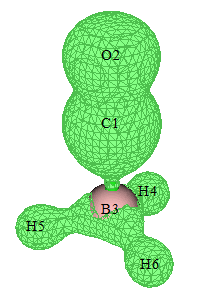

从上图可以看出，电子相关效应在 CO 多重键区域最为突出。众所周知，多重键的电子相关比单键强得多。

若要查看每个自然轨道对 OED 的贡献，可进入主功能 0，在菜单栏选择“Orbital info.”-“Show all”，然后在命令行窗口中可以看到

```text
[ignored...]
Orb:     8 Ene(au/eV):     0.000000       0.0000 Occ: 0.044509 Type:A+B
Orb:     9 Ene(au/eV):     0.000000       0.0000 Occ: 0.047150 Type:A+B
Orb:    10 Ene(au/eV):     0.000000       0.0000 Occ: 0.052490 Type:A+B
Orb:    11 Ene(au/eV):     0.000000       0.0000 Occ: 0.052490 Type:A+B
Orb:    12 Ene(au/eV):     0.000000       0.0000 Occ: 0.054139 Type:A+B
Orb:    13 Ene(au/eV):     0.000000       0.0000 Occ: 0.054139 Type:A+B
Orb:    14 Ene(au/eV):     0.000000       0.0000 Occ: 0.023915 Type:A+B
[ignored...]
```

“Occ”后的值即为上述公式中的 *min*(2-$η_{k}$，$η_{k}$)。在主功能 0 的 GUI 窗口中可以可视化“Occ”较大的轨道，以考察哪些轨道与电子相关效应密切相关。

也可以计算原子对 OED 的贡献。返回主菜单后，输入以下命令

```text
15  // Fuzzy atomic space analysis
1  // Perform integration in fuzzy atomic spaces for a real space function
1  // Electron density (corresponds to OED currently)
```

然后可以看到

```text
  Atomic space        Value                % of sum            % of sum abs
    1(C )            0.17435408            27.739003            27.739003
    2(O )            0.20206854            32.148257            32.148257
    3(B )            0.14039803            22.336737            22.336737
    4(H )            0.03724382             5.925335             5.925335
    5(H )            0.03724381             5.925334             5.925334
    6(H )            0.03724381             5.925334             5.925334
Summing up above values:          0.62855211
Summing up absolute value of above values:          0.62855211
```

显然，O 对 OED 的贡献最大，其次是 C，再次是 B。默认采用 Becke 原子空间划分，也可通过选项 -1 换用其他原子划分方法。

值得注意的是，还可以只绘制特定轨道贡献的 OED。例如，我们只想绘制自然轨道 10 至 13 贡献的 OED。在主功能 6 的子功能 26 中输入 *odd* 之后，还需要清除所有其他轨道的占据数，即在子功能 26 中还需输入

```text
1-9  // Select orbitals 1 to 9
0  // Set occupation number to 0
14-57  // Select orbitals 14 to 57
0  // Set occupation number to 0
```

之后即可返回主菜单并按通常方式绘制电子密度。

### **开壳层体系C₄H₈双自由基的OED计算**

为了说明 OED 在表示双自由基未成对电子分布方面的价值，接下来我们将在非限制 M06-2X 水平上绘制典型双自由基体系 C₄H₈ 的 OED。此时需要进行非限制开壳层计算，并应使用 *guess=mix* 关键词以实现破对称态。此外，必须指定 *pop=no out=wfn*，以便通过混合α和β密度矩阵并对角化产生空间自然轨道，再导出到 .wfn 文件中。这种由非限制 DFT 计算得到的自然轨道有时被称为非限制自然轨道（unrestricted natural orbital，UNO）。生成 .wfn 文件的 Gaussian 输入文件为 *examples\C4H8-UNO.gjf*，所得 .wfn 文件为 *examples\C4H8-UNO.wfn*。请用该文件如上例一样绘制 OED，等值取 0.02 a.u. 时等值面图应如下所示。可见其分布特征与自旋密度颇为相似，只是不能用正负号区分α和β自旋。

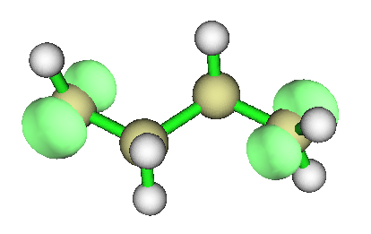

CASSCF 方法在计算双自由基体系时非常常用。OED 也可绘制 CASSCF 波函数的 OED，只需生成包含 CASSCF 计算产生的自然轨道的波函数文件即可。

OED 也可用于表示 TDDFT 方法计算的激发态未成对电子的分布，详见我的博客文章“使用 Multiwfn 计算奇电子密度研究激发态未成对电子分布”(<http://sobereva.com/583>，中文)中的详细说明和讨论。值得注意的是，TDDFT 激发态波函数没有自旋密度，因此 OED 是表征未成对电子分布的唯一途径。

## **4.A.7 直观揭示不同区域的电子相关**

电子相关效应在化学体系中普遍存在，可分为动态和静态（非动态）两部分。本节介绍两种旨在直观揭示不同局域区域电子相关效应的方法。[4.A.7.1节](#4a71-分数占据数加权电子密度fod)所述的分数占据数加权电子密度（fractional occupation number weighted electron density，FOD）更为常用，侧重于揭示静态相关，而[4.A.7.2节](#4a72-局域电子相关函数)所述的局域电子相关函数能够分别揭示电子相关的动态和非动态成分。因此，这两种方法都有用。

这两种方法都需要以包含部分占据轨道的波函数文件作为输入。换言之，若所有轨道不是完全占据就是完全空置，则这些函数将处处为零，无法揭示电子相关。FOD 基于 DFT 定义，部分占据轨道应通过有限温度 DFT 计算获得（ORCA、CP2K 等程序支持）。相比之下，局域电子相关函数基于波函数理论定义，部分占据轨道应为通过 CCSD 和 CASSCF 等多组态方法得到的自然轨道。由于有限温度 DFT 的计算代价与普通 DFT 基本相同，且显著低于任何多组态方法，若只关心静态电子相关，FOD 是首选。

FOD 和局域电子相关函数都可在全空间积分，得到用于定量整个体系相应类型电子相关强度的数值。

### **4.A.7.1 分数占据数加权电子密度(FOD)**

#### **理论**

FOD 最早由 Grimme 在 *Angew. Chem. Int. Ed.*，**54**，1 (2015) 中定义，并在 *Chem. Eur. J.*，**23**，6150 (2017) 中进一步讨论。FOD 表述为

$$
\rho^{\mathrm{FOD}}(\mathbf{r})=\sum_{i}(\delta_{1}-\delta_{2}\eta_{i})|\varphi_{i}(\mathbf{r})|^{2}
$$

其中 *i* 遍历所有自旋分子轨道，其占据数范围为 \[0,1\]。这些轨道由特定电子温度下的 DFT 计算得到。温度设置得当时，所得前线轨道将明显部分占据。对于低于 Fermi 能级的轨道，*δ*₁=*δ*₂=1，而对于其他轨道，*δ*₁=0 且 *δ*₂=-1。因此，FOD 相当于度量各位置电子密度在有限温度下相对 0 K（整数占据）的偏离程度。某处 FOD 越大，相应区域的静态相关越强。FOD 在全空间的积分称为 $N_{\mathrm{FOD}}$，它如同著名的 T1 诊断值一样定量整个体系的整体静态相关。由于 T1 诊断依赖于昂贵的 CCSD 计算，对于中等到大体系静态相关的度量，强烈推荐使用 $N_{\mathrm{FOD}}$。

注意，FOD 对应第 90 号自定义函数。

#### **实例**

作为例子，我们对 HNO₂ 进行 FOD 分析。使用 ORCA 6.0.1 程序在 9000 K 下对该分子做有限温度 B3LYP 计算。注意，FOD 分析的合适电子温度为 *T*=20000\* $a_{\mathrm{x}}$ +5000，其中 $a_{\mathrm{x}}$ 为所用 DFT 泛函中的 Hartree-Fock 成分。由于 B3LYP 的 $a_{\mathrm{x}}$ 为 0.2，本例所用温度为 9000 K。ORCA 输入文件为 *examples\HNO2_FOD.inp*。用 ORCA 运行后得到 *HNO2_FOD.gbw*，再用 `orca_2mkl HNO2_FOD -molden` 命令将其转换为 *HNO2_FOD.molden.input*，该文件已在“examples”文件夹中提供。

首先绘制 FOD 等值面图。将 settings.ini 中的“iuserfunc”设为 90，然后启动 Multiwfn 并载入 *examples\HNO2_FOD.molden.input*，再输入

```text
5  // Calculate grid data
100  // User-defined function, which corresponds to FOD now
2  // Medium-quality grid
```

此时从屏幕上可以看到以下信息，表明用均匀格点对 FOD 在全空间积分为 0.139，即 $N_{\mathrm{FOD}}$ 指标。HNO₂ 的 $N_{\mathrm{FOD}}$ 不大（丰富例子见 *Chem. Eur. J.*，**23**，6150 (2017)），表明 HNO₂ 没有明显的静态相关。

```text
Summing up all value and multiply differential element:
 0.139077305675630
```

然后选择选项 -1 可视化等值面图，将等值设为 0.005 a.u.，即可看到如下图形。它表明静态相关主要来自氮上下方的区域，以及 O2 周围的环形区域。

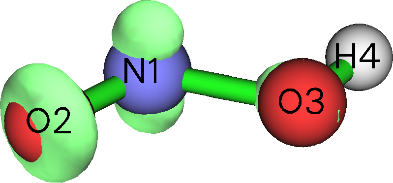

由于 Multiwfn 的设计非常灵活，还可以得到基函数、壳层、角动量、原子、片段对 $N_{\mathrm{FOD}}$ 的贡献。下面我说明如何用 Mulliken 布居分析实现这一目的（Löwdin、Hirshfeld 等许多其他布居方法同样可行）。在 Multiwfn 主菜单中直接输入 *fod*，按 FOD 公式转换轨道占据数，然后从屏幕上可发现 $N_{\mathrm{FOD}}$ 为 0.139077，它对应当前（转换后）轨道占据数之和。从现在起，按通常步骤研究电子密度即等价于研究 FOD。

接下来输入

```text
7  // Population analysis
5  // Mulliken analysis
1  // Output Mulliken population and atomic charges on screen
```

此时可以看到以下信息，布居数即对应原子对 $N_{\mathrm{FOD}}$ 的贡献。“Net charge”在此情形下没有意义。可见该体系的静态相关主要来自 N1 和 O2，其次是 O3，这与等值面图完全一致

```text
Atom     1(N )    Population:  0.05877131    Net charge:  6.94122869
Atom     2(O )    Population:  0.05320397    Net charge:  7.94679603
Atom     3(O )    Population:  0.02487142    Net charge:  7.97512858
Atom     4(H )    Population:  0.00223030    Net charge:  0.99776970
```

由于 Mulliken 布居分析以非常细致的方式分解电子布居，还能发现更多关于 $N_{\mathrm{FOD}}$ 性质的信息。例如，屏幕上以下信息表明静态相关几乎完全由 *p* 电子产生。

```text
Population of each type of angular moment orbitals:
 Atom     1(N ) s: 0.0104 p: 0.0477 d: 0.0007 f: 0.0000 g: 0.0000 h: 0.0000
 Atom     2(O ) s:-0.0003 p: 0.0535 d: 0.0001 f: 0.0000 g: 0.0000 h: 0.0000
 Atom     3(O ) s:-0.0013 p: 0.0261 d: 0.0001 f: 0.0000 g: 0.0000 h: 0.0000
 Atom     4(H ) s: 0.0020 p: 0.0002 d: 0.0000 f: 0.0000 g: 0.0000 h: 0.0000
 Sum  s:   0.0107 p:   0.1275 d:   0.0008 f:   0.0000 g:   0.0000 h:   0.0000
```

### **4.A.7.2 局域电子相关函数**

#### **理论**

*J. Chem. Theory Comput.*，**13**，2705 (2017) 提出的局域总、动态和非动态电子相关函数是分别旨在揭示各区域总、动态和非动态电子相关的实空间函数。它们分别对应自定义函数 87、88 和 89，定义如下：

- 局域总电子相关函数：$\displaystyle I_{\mathrm{T}}(\mathbf{r})=\frac{1}{4}\sum_{i}\sqrt{\eta_{i}(1-\eta_{i})}|\varphi_{i}(\mathbf{r})|^{2}$，*i* 表示自然自旋轨道指标，*η* 为相应占据数。注意在某些情况下 *η* 可能略大于 1.0 或为负值，Multiwfn 会自动将其分别置为 1.0 和 0.0 以使计算可行。

- 局域动态电子相关函数：$\displaystyle I_{\mathrm{D}}(\mathbf{r})=\frac{1}{4}\sum_{i}\left[\sqrt{\eta_{i}(1-\eta_{i})}-2\eta_{i}(1-\eta_{i})\right]|\varphi_{i}(\mathbf{r})|^{2}$

- 局域非动态电子相关函数：$\displaystyle I_{\mathrm{ND}}(\mathbf{r})=\frac{1}{2}\sum_{i}\eta_{i}(1-\eta_{i})|\varphi_{i}(\mathbf{r})|^{2}$

显然 $I_{\mathrm{T}}(\mathbf{r})$ = $I_{\mathrm{D}}(\mathbf{r})$ + $I_{\mathrm{ND}}(\mathbf{r})$。值得注意的是，这些函数的形式与[4.A.6节](#4a6-计算奇电子密度)介绍的 OED 密切相关。

局域总、动态和非动态电子相关函数的积分分别对应 *Phys. Chem. Chem. Phys.*，**18**，24015 (2016) 中提出的总、动态和非动态相关指标。

#### **实例**

作为例子，绘制 OC-BH₃ 的 $I_{\mathrm{T}}$。将 *settings.ini* 中的“iuserfunc”设为 87，然后启动 Multiwfn 并输入

```text
examples\COBH3_CCSD.wfn  //Wavefunction file containing CCSD/def2-SVP natural orbitals
5  // Grid data calculation
100  // User-defined function, currently corresponding to I_T
2  // Medium-quality grid
-1  // Visualize isosurface
```

将等值设为 0.013，即可看到

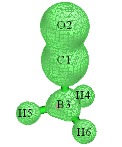

该图与[4.A.6节](#4a6-计算奇电子密度)中 OED 的等值面图颇为相似。由于 $I_{\mathrm{T}}$ 是专门揭示电子相关的实空间函数，我们的观察意味着 OED 也能够直观展示电子相关。

用类似方法也可轻松绘制 $I_{\mathrm{D}}$ 和 $I_{\mathrm{ND}}$ 函数，只需在启动 Multiwfn 前将 *settings.ini* 中的“iuserfunc”分别设为 88 和 89，再重复上述操作即可。

注意，还可以绘制特定轨道对局域电子相关函数的贡献，可通过主功能 6 的子选项 26 将不感兴趣的自然轨道占据数置零来屏蔽它们。

用主功能 100 的子功能 4 可对局域电子相关函数在全空间积分，结果表示整个体系电子相关的大小。例如，返回主菜单并输入

```text
100  // Other function (Part 1)
4  // Integrate a real space function over the whole space
100  // User-defined function, currently corresponding to I_T
```

结果即所谓的总相关指标，为 1.576。对动态和非动态电子相关函数重复此计算，会发现所得指标分别为 1.267 和 0.309。显然，对 OC-BH₃ 体系，动态相关主导了总相关效应。

#### **一次性便捷计算所有电子相关指标**

总、动态和非动态相关指标也可用主功能 200 的子功能 15 计算，显著更快更便捷。仍以 *COBH3_CCSD.wfn* 为例，进入主功能 200 再选择子功能 15，即可立即看到以下输出，结果与我们先前手动所得完全相同

```text
Nondynamic correlation index:  0.30880061
Dynamic correlation index:     1.26746042
Total correlation index:       1.57626103
```

## **4.A.8 分析高于CCSD水平的波函数**

> **注记**
>
> 本节的中文版是我的博客文章“在 Multiwfn 中分析高于 CCSD 水平的波函数的方法”(<http://sobereva.com/395>)。

在最常用的程序 Gaussian 中，波函数的最高水平是 CCSD。尽管 CCSD 波函数对几乎所有情况都绝对够用，但由于某些特殊原因，人们可能想研究更高水平产生的波函数。下面我介绍如何使 Multiwfn 能够分析以下波函数：

- ORCA 的 AUTOCI 模块产生的波函数（CCSD(T)、CCSDT、CISDT、MP5 等）

- PSI4 程序(<http://www.psicode.org>)产生的 CCSD(T) 波函数

- MRCC 程序(<http://www.mrcc.hu>)产生的任意阶耦合簇和 CI 波函数（包括 Full CI）

### **(1) ORCA**

这里我说明如何使 Multiwfn 能够分析 ORCA 产生的（弛豫）CCSD(T) 波函数。我目前使用的 ORCA 版本是 6.1。下面是一个名为 *H2CO.inp* 的输入文件示例，它用 AUTOCI 模块在 CCSD(T)/cc-pVTZ 水平上计算 H₂CO。

```orca
! autoci-CCSD(T) cc-pVTZ verytightSCF
%maxcore     5000
%pal nprocs  96 end
%autoci density relaxed end
* xyz   0   1
 C                  0.00000000    0.00000000   -0.52887900
 H                  0.00000000    0.93777000   -1.12367000
 O                  0.00000000    0.00000000    0.67757700
 H                  0.00000000   -0.93777000   -1.12367000
*
```

运行该输入文件后，当前文件夹中会有很多文件，包括 *H2CO.gbw*、*H2CO.densities* 等，但后续步骤只需要这两个文件。

首先运行 `orca_2mkl H2CO -molden` 将 .gbw 转换为 .molden 文件，然后当前文件夹中即有 *H2CO.molden.input*。

然后，需要将 CCSD(T) 水平的 AO 基第一密度矩阵（1RDM）从二进制 .gbw 和 .densities 文件导出为纯文本 .json 文件。为此，在当前文件夹创建一个名为 *orca.json.conf* 的文本文件，内容如下。该文件将要求 orca_2json 把 AUTOCI 模块产生的 1RDM 导出为 json 文件。

```json
{
"Densities": ["autocipre"]
}
```

现在运行 *orca_2json H2CO.gbw*，则当前文件夹中即有 *H2CO.json*。

启动 Multiwfn 并输入

```text
H2CO.molden.input  // Input actual path
1000  // Main function 1000 (a hidden function)
98  // Generate natural orbitals based on density matrix outputted by ORCA program
H2CO.json  // Input actual path
autocipre  // Label of the 1RDM to be loaded in the json file
```

此后，Multiwfn 载入 1RDM 并通过对角化产生自然轨道（natural orbital，NO），可在屏幕上看到各 NO 的占据数。接着输入 *y*，Multiwfn 会把 NO 导出为 *new.mwfn* 并载入。现在内存中的波函数是以 NO 表示的 CCSD(T) 波函数，可按通常方式进行各种波函数分析，也可用主功能 0 可视化 NO。

下面我提及一些细节和相关信息：

- 若参考波函数是非限制的，需让 orca_2json 也把自旋密度的 1RDM 导出到 json 文件，即应将

  ```json
  "Densities": ["autocipre"]
  ```

  改为

  ```json
  "Densities": ["autocipre","autocirre"]
  ```

  然后，在主功能 1000 中选择选项 98 并输入 *autocipre* 后，Multiwfn 会询问如何产生 NO。若选择产生“α和β自然轨道”或“自旋自然轨道”，Multiwfn 还会要求输入 json 文件中自旋密度 1RDM 的标签，应输入 *autocirre*。

- 用与上面完全相同的方式，也可使 Multiwfn 分析 AUTOCI 模块产生的其他弛豫波函数。例如，希望在 CCSDT 水平上做波函数分析，只需把 ORCA 输入文件中的 *autoci-CCSD(T)* 换成 *autoci-CCSDT*。AUTOCI 可用的所有水平列表见 ORCA 手册的 AUTOCI 部分。

- 只要在 *orca.json.conf* 和 Multiwfn 中正确指定 1RDM 的标签，Multiwfn 也能分析任何其他水平的波函数。例如，SCF 水平总密度和自旋密度的 1RDM 标签分别为“scfp”和“scfr”；MDCI 模块产生的则分别为“mdcip”和“mdcir”。可运行 *orca_plot H2CO.gbw -i* 再选择“Enter type of plot”选项查看该文件中有哪些密度可用，各种密度的标签也会明确显示在屏幕上。

还需注意，若写入

```json
"Densities": ["all"]
```

到 *orca.json.conf* 中，则 orca_2json 会把所有可用的 1RDM 导出到 .json 文件（可在屏幕上看到导出的 1RDM 完整列表），然后可在 Multiwfn 中输入相应标签选择载入其中任意一个；此外，若计算中使用了 AUTOCI 模块，此时 2RDM 也会被导出到 .json 文件，使文件体积很大。

### **(2) PSI4**

我目前使用的 PSI4 版本是 1.3.2。下面是输入文件示例，它在 CCSD(T)/cc-pVTZ 水平上计算氟化氢，并在当前文件夹产生 *HF_CCSDpT.fchk*。

```tcl
molecule HF {
H        0.0        0.0       -0.831975
F        0.0        0.0        0.092442
 }

set basis cc-pVTZ
grad, wfn = gradient('CCSD(T)', return_wfn=True)
fchk_writer = psi4.FCHKWriter(wfn)
fchk_writer.write('HF_CCSDpT.fchk')
```

若所用 PSI4 版本≥ 1.4，上例最后两行应替换为 *fchk(wfn,'HF_CCSDpT.fchk')*。

所得 *HF_CCSDpT.fchk* 记录了 Hartree-Fock 分子轨道和 CCSD(T) 密度矩阵。若直接把该文件交给 Multiwfn，由于 Multiwfn 从不利用密度矩阵而只从文件载入轨道，后续分析结果将对应 Hartree-Fock 水平。为使 Multiwfn 分析 CCSD(T) 波函数，应做以下步骤：

1.  像通常一样启动 Multiwfn 并载入 *HF_CCSDpT.fchk*

2.  进入主功能 200 并选择子功能 16。该功能用于把 .fch/.fchk 文件中的密度矩阵转换为自然轨道，详见[3.200.16节](sec-3-200-other-functions-part-2.md#320016-基于-fchfchk-文件中的密度矩阵生成自然轨道自然自旋轨道-nso-和自旋自然轨道-sno)。

3.  输入 *CCSD*，则 .fchk 文件中的“Total CCSD Density”字段将被载入，立即即可看到对 CCSD(T) 密度矩阵对角化产生的自然轨道（NO）占据数。

4.  输入 *y*。则当前文件夹中产生记录 CCSD(T) 水平 NO 的 *new.mwfn*。该文件被自动载入 Multiwfn，因此内存中的轨道现在对应 CCSD(T) 波函数的 NO，从而之后所有分析都将对应 CCSD(T) 波函数。

注意，若是开壳层体系，可选择要产生的 NO 类型，包括空间 NO、α/β NO 和自旋 NO。更多细节见[3.200.16节](sec-3-200-other-functions-part-2.md#320016-基于-fchfchk-文件中的密度矩阵生成自然轨道自然自旋轨道-nso-和自旋自然轨道-sno)。

### **(3) MRCC**

我目前使用的 MRCC 版本是 Sep 25, 2017。下面是输入文件示例，它在 CCSDT/cc-pVTZ 水平上计算氟化氢。

```text
basis=cc-pvtz
calc=CCSDT
mem=2500MB
dens=1

geom=xyz
2

H        0.0        0.0       -0.831975
F        0.0        0.0        0.092442
```

用 MRCC 运行后，当前文件夹中会有一个名为 *MOLDEN* 的文件，它是 Molden 输入文件，记录 Hartree-Fock 分子轨道。当前文件夹中还有一个名为 *CCDENSITIES* 的文件，记录第 2 和第 1 约化密度矩阵（2RDM 和 1RDM）。为使 Multiwfn 分析 CCSDT 波函数，必须把 1RDM 转换为自然轨道并保存为 .molden 文件。

启动 Multiwfn 并载入 *MOLDEN* 文件，进入主功能 1000 选择子功能 97，输入 *CCDENSITIES* 文件路径。然后输入冻结核轨道数。默认 MRCC 在电子相关计算中冻结核分子轨道。当前体系有两个核电子（在输出文件中可见“ Number of core electrons: 2”），又是闭壳层体系，每个占据分子轨道有两个电子，因此只有一个核分子轨道被冻结，故输入 *1*。通过对角化 CCSDT 密度矩阵产生自然轨道完成后，占据数打印在屏幕上，一个名为 *MOLDEN.mwfn* 的文件自动导出到当前文件夹，其中载有 CCSDT 波函数的自然轨道。然后若输入 *y*，Multiwfn 将载入 *MOLDEN.mwfn*，即可对 CCSDT 波函数进行各种波函数分析。

用 MRCC 产生的 CI 波函数的分析流程与上面所示完全相同。下面是一个在 FCI/aug-cc-pVDZ 水平上计算拉伸 LiH、不冻结核处理的输入文件示例。

```text
basis=aug-cc-pvdz
calc=fci
mem=2500MB
dens=1
core=0

geom=xyz
2

H        0.0        0.0      0.0
Li       0.0        0.0      3.0
```

## **4.A.9 计算TrEsp（由静电势得到的跃迁电荷）电荷并分析激子耦合**

### **1. 关于TrEsp的理论**

分子（比如记为*A*）的静电势（ESP，electrostatic potential）的一般形式可写为

$$
\phi_{aa'}^{A}(\mathbf{r})=\delta_{aa'}\sum_{I}\frac{Z_{I}}{|\mathbf{r}-\mathbf{R}_{I}|}-\int\frac{\rho_{aa'}(\mathbf{r}')}{|\mathbf{r}-\mathbf{r}'|}\mathrm{d}\mathbf{r}'
$$

其中**Z***$_{I}$*和**R***$_{I}$*分别为原子*I*的核电荷和坐标。*δ*为Kronecker函数。$\rho_{aa'}$为状态$a$与$a'$之间的跃迁密度。

我们通常研究的ESP是单个状态的ESP，即$a=a'$的情形。当$a$和$a'$对应不同状态时，该势可称为“跃迁静电势”，它度量了对应于$a-a'$跃迁的激发所产生的ESP。

已知单个状态的精确ESP通常可以很好地近似表示为基于ESP拟合电荷（例如CHELPG和MK电荷，见[3.9.10节](sec-3-9-population-analysis-and-calculation-of-atomic-charges.md#3910-chelpg-charges-from-electrostatic-potentials-using-a-grid-based-method-esp-拟合原子电荷-12)和[3.9.11节](sec-3-9-population-analysis-and-calculation-of-atomic-charges.md#3911-merz-kollmann-mk-esp-拟合原子电荷-13)）计算的势，

$$
\phi_{a}^{A}(\mathbf{r})=\sum_{I}\frac{Z_{I}}{|\mathbf{r}-\mathbf{R}_{I}|}-\int\frac{\rho_{a}(\mathbf{r}')}{|\mathbf{r}-\mathbf{r}'|}\mathrm{d}\mathbf{r}'\approx\sum_{I}\frac{q_{a}^{I}}{|\mathbf{r}-\mathbf{R}_{I}|}
$$

其中${q}_{a}^{I}$为电子态$a$下原子*I*的ESP拟合电荷。

有鉴于此，*J. Phys. Chem. B*，**110**，17268（2006）提出了TrEsp（由静电势得到的跃迁电荷，transition charge from electrostatic potential）的概念，并证明精确的跃迁ESP可以很好地近似为

$$
\phi_{aa'}^{A}(\mathbf{r})=-\int\frac{\rho_{aa'}(\mathbf{r}')}{|\mathbf{r}-\mathbf{r}'|}\mathrm{d}\mathbf{r}'\approx\sum_{I}\frac{q_{aa'}^{I}}{|\mathbf{r}-\mathbf{R}_{I}|}
$$

其中${q}_{aa'}^{I}$为由$a-a'$跃迁密度得到的原子*I*的TrEsp电荷。

计算TrEsp电荷的方法与计算普通ESP拟合电荷的方法几乎完全相同，唯一的区别在于应忽略核的贡献，并将单个状态的密度替换为两个状态之间的跃迁密度。

### **2. 计算TrEsp电荷的例子**

现在我以简单的4-硝基苯胺分子为例，说明如何计算其S0-S2跃迁的TrEsp电荷。这里假设你是Gaussian用户（如果你更喜欢使用ORCA程序，步骤会稍繁琐一些，但通过编写shell脚本可大大简化。详情请查看该帖子的#2楼：<http://sobereva.com/wfnbbs/viewtopic.php?pid=389>）。

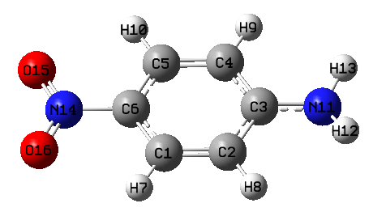

首先，运行Gaussian输入文件*examples\4-Nitroaniline_TrESP.gjf*，关键词*PBE1PBE/6-31g(d) TD density=transition=2 out=wfn*表示将在TD-PBE0/6-31G(d)水平下生成基态（S0）到S2的跃迁密度，然后将其自动对角化得到相应的自然轨道，最后保存到指定的.wfn文件中。如果你感到困惑或手头没有Gaussian，可以直接从<http://sobereva.com/multiwfn/extrafiles/TrEsp.zip>下载相关文件。

启动Multiwfn并输入

```text
S0S2.wfn  // The .wfn file generated in above process. Can be found in the TrEsp.zip
7  // Population analysis
12  // CHELPG fitting method (you can also use MK or RESP method instead)
5  // Choose form of ESP
3  // Transition electronic (i.e. the ESP specific for evaluating TrEsp)
1  // Start calculation
```

即使对中等大小的体系，ESP的计算也很耗时，你需要耐心等待。最后，TrEsp电荷显示在屏幕上：

```text
   Center       Charge
     1(C )   0.2134106035
     2(C )  -0.1679471876
     3(C )   0.1841565861
[...ignored]
    16(O )  -0.0948987209
 Sum of charges:  -0.0000000000
 RMSE:    0.000970   RRMSE:    0.044908
```

电荷之和恰好为零，这正是我们预期的，因为电子跃迁过程不改变电子总数。然后，如果你想把原子的X、Y、Z坐标和TrESP电荷导出到.chg文件（该格式的说明见[2.5节](sec-2-5-input-files-and-wavefunction-types.md)），可以输入*y*。

注意，这样得到的TrEsp电荷**必须再手动除以**$\sqrt{2}$！这是因为导出的.wfn文件中的自然轨道是基于对称化形式的跃迁密度矩阵（TDM）生成的，而Gaussian对称化的方式很奇怪，即TDM*$_{i,j}$*=(TDM*$_{i,j}$*+TDM*$_{j,i}$*)/ $\sqrt{2}$，而不是预期的TDM*$_{i,j}$*=(TDM*$_{i,j}$*+TDM*$_{j,i}$*)/2，因此应通过把所得电荷除以$\sqrt{2}$来手动修正这一问题。

事实上，在Multiwfn中也可以通过空穴-电子分析模块用Mulliken方法计算跃迁电荷，见[3.21.12节](sec-3-21-electron-excitation-analysis.md#32112-计算-mulliken-原子跃迁电荷-12)，计算代价几乎可以忽略。然而，Mulliken跃迁电荷在近似表示跃迁静电势和分析分子间激子耦合方面肯定不如TrEsp电荷好。

### **技巧1：利用cubegen工具加速TrEsp计算**

如果你的CPU核心数有限（少于10核），利用Gaussian包中的cubegen工具可显著降低ESP相关分析的开销，详情请阅读[5.7节](sec-5-7-make-use-of-cubegen-utility-in-gaussian-package.md)。cubegen也可用于降低TrEsp电荷的计算代价，步骤如下。

由于cubegen基于.fch/fchk文件中的密度矩阵信息计算ESP，我们必须先生成TDM并存入.fch文件，[3.21.9节](sec-3-21-electron-excitation-analysis.md#3219-产生并导出跃迁密度矩阵-9)中提到的功能可以做到这一点。我们先在Gaussian中使用*PBE1PBE/6-31g(d) TD IOp(9/40=4)*关键词进行电子激发计算，同时保留.fch文件，上述*TrEsp.zip*压缩包中4-硝基苯胺的对应文件为*4-Nitroaniline_IOp.gjf*、*4-Nitroaniline_IOp.out*和*4-Nitroaniline.fchk*。

启动Multiwfn并输入

```text
4-Nitroaniline.fchk
18  // Electron excitation analysis
9  // Generate and export TDM
1  // Generate TDM between ground state and excited state
4-Nitroaniline_IOp.out
2  // Generate TDM between S0 and S2
y  // Symmetrize the resulting TDM in usual way, namely TDM_i,j=(TDM_i,j+TDM_j,i)/2
y  // Export TDM.fch, whose density matrix field corresponds to the just generated TDM
```

请确保*settings.ini*中的“cubegenpath”参数已设为Gaussian文件夹中cubegen工具的实际路径，然后重启Multiwfn并输入

```text
TDM.fch
7  // Population analysis
12  // CHELPG fitting method
5  // Choose form of ESP
3  // The ESP type specific for evaluating TrEsp
1  // Start calculation
```

TrESP电荷会立即显示在屏幕上。你不需要再手动把所得电荷除以$\sqrt{2}$，因为Multiwfn生成的TDM已经以正确的方式对称化了。

值得注意的是，如果你想检验拟合的TrEsp电荷是否合理，可以比较由这些电荷计算的电偶极矩与Gaussian（或其他量子化学程序）输出的跃迁电偶极矩。众所周知，ESP拟合电荷能很好地复现电偶极矩，通常TrEsp电荷也能很好地复现实际的跃迁电偶极矩。

算完TrEsp电荷后，我们选择*y*让Multiwfn把电荷导出到当前文件夹下的*TDM.chg*文件。然后启动并载入该文件，你会在屏幕上看到以下信息

```text
Component of electric dipole moment:
X=   -0.011607 a.u.  (   -0.029501 Debye )
Y=   -1.781254 a.u.  (   -4.527495 Debye )
Z=    0.000011 a.u.  (    0.000029 Debye )
```

在*4-Nitroaniline_IOp.out*中可以找到以下信息

```text
Ground to excited state transition electric dipole moments (Au):
       state          X           Y           Z        Dip. S.      Osc.
         1        -0.0000     -0.0000      0.0001      0.0000      0.0000
         2        -0.0165     -1.7911      0.0000      3.2083      0.3408
         3         0.0210      0.0188      0.0000      0.0008      0.0001
```

由于基于我们的TrEsp电荷求得的电偶极矩与精确的跃迁电偶极矩非常接近，显然我们的TrEsp电荷必定是合理的。

### **技巧2：在TrEsp拟合过程中施加自定义电荷约束**

Multiwfn的约束性静电势拟合（RESP，restrained electrostatic potential）模块已在[3.9.16节](sec-3-9-population-analysis-and-calculation-of-atomic-charges.md#3916-约束静电势-resp-原子电荷-18)中详细介绍。如你所见，该模块比MK或CHELPG模块更通用、更强大，因为你可以对所得的ESP拟合电荷任意施加自定义约束，例如，你可以要求某些原子必须具有完全相同的电荷，或要求一批电荷之和必须等于预定值。

这里，我举例说明如何使用RESP模块基于MK拟合格点计算TrEsp，并附加所有氢原子电荷必须为零的约束。

首先，写一个纯文本文件（例如*chgcons.txt*），内容如下：

```text
7 0
8 0
9 0
10 0
```

该文件将用于RESP模块。其中7~10为氢原子的序号，0表示在拟合中将其电荷约束为零。

启动Multiwfn并输入

```text
S0S2.wfn  // The .wfn file we previously used
7  // Population analysis
18  // RESP module
11  // Choose form of ESP
3  // Transition electronic
6  // Set charge constraint in one-stage fitting
1  // Load charge constraint setting from external plain text file
chgcons.txt  // The file containing charge constraint
2  // Start one-stage ESP fitting calculation with customized constraint. The default fitting grid is MK (you can also change to CHELPG by option 3)
```

结果为

```text
Center      Charge
   1(C )    0.158613
...
   7(H )    0.000000
   8(H )   -0.000000
   9(H )    0.000000
  10(H )   -0.000000
  11(N )    0.178112
...
```

显然，我们的电荷约束已经生效，而所有其他原子仍具有合理的TrEsp电荷。关于RESP模块的更多内容，可通过阅读[4.7.7节](sec-4-7-population-analysis-and-atomic-charge-calculation.md#477-推导-resp-电荷和带额外约束的常规-esp-拟合电荷的示例说明)中的相应例子来学习。值得注意的是，当你在选项3中选择“Transition electric”时，默认的原子等价约束会被自动移除，一步拟合中的约束强度也会被自动设为零，因为这些处理在当前情形下没有用处。

### **3. 基于TrEsp计算激子耦合能**

分子间库仑相互作用能的一般形式可表示为

$$
\begin{aligned}V_{aa',bb'}^{A,B}={}&\delta_{a,a'}\delta_{b,b'}\sum_{I\in A}\sum_{J\in B}\frac{Z_{I}Z_{J}}{|\mathbf{R}_{I}-\mathbf{R}_{J}|}+\iint\frac{\rho_{aa}^{A}(\mathbf{r})\rho_{bb}^{B}(\mathbf{r}')}{|\mathbf{r}-\mathbf{r}'|}\mathrm{d}\mathbf{r}\mathrm{d}\mathbf{r}'\\&-\delta_{a,a'}\sum_{I\in A}\int\frac{Z_{I}\rho_{bb}^{B}(\mathbf{r})}{|\mathbf{R}_{I}-\mathbf{r}|}\mathrm{d}\mathbf{r}-\delta_{b,b'}\sum_{J\in B}\int\frac{Z_{J}\rho_{aa}^{A}(\mathbf{r})}{|\mathbf{R}_{J}-\mathbf{r}|}\mathrm{d}\mathbf{r}\end{aligned}
$$

该物理量可以有不同的物理含义。例如，

${V}_{00,00}^{A,B}$：处于基态的*A*与*B*之间的库仑相互作用能

${V}_{00,11}^{A,B}$：处于基态的*A*与处于第一激发态的*B*之间的库仑相互作用能

${V}_{01,10}^{A,B}={V}_{10,01}^{A,B}$：两个分子跃迁之间的激发能转移耦合

计算${V}_{a{a}^{'},b{b}^{'}}^{A,B}$中的积分很困难，有一种称为跃迁密度立方（TDC，transition density cube）的方法，它基于均匀分布的格点用数值积分计算这些积分，对大体系代价极高。幸运的是，研究表明，利用为两个分子算得的TrEsp电荷，它们的激子耦合能${V}_{a{a}^{'},b{b}^{'}}^{A,B}$可以用下式以通常令人满意的精度方便地求得：

$$
V_{aa',bb'}^{A,B}\approx\sum_{I\in A}\sum_{J\in B}\frac{q_{aa'}^{I}q_{bb'}^{J}}{|\mathbf{R}_{I}-\mathbf{R}_{J}|}
$$

在Multiwfn中，你可以基于两个分子的TrEsp电荷很容易地计算激子耦合能。步骤简述如下：

- （1）优化二聚体结构

- （2）提取每个单体的坐标并写入Gaussian输入文件，适当修改关键词并进行电子激发计算，得到包含由跃迁密度导出的自然轨道的.wfn文件。注意必须使用*nosymm*关键词，以避免Gaussian自动平移和旋转单体的整体坐标。

- （3）利用上一步为各自单体生成的.wfn文件为每个单体生成TrEsp电荷，然后把TrEsp电荷导出为.chg文件。

- （4）手动把两个单体的.chg文件内容合并为一个.chg文件。该文件中的单体坐标应与优化后的二聚体坐标一致。

- （5）把二聚体的.chg文件载入Multiwfn，进入主功能7并选择选项-2，然后依次输入两个单体的原子列表，激子耦合能会立即输出。

## **4.A.10 通过给原子着色直观展示原子性质**

有一种非常有用的直观展示Multiwfn算得的原子性质的方法，即在VMD程序（<http://www.ks.uiuc.edu/Research/vmd/>）中给原子着色，这里我通过两个例子说明做法。更详细的讨论和例子见我的博文“使用Multiwfn+VMD通过给原子着色展示原子电荷、自旋布居、电荷转移和凝聚Fukui函数”（<http://sobereva.com/425>）。

### **（1）按原子电荷给原子着色**

首先，我说明如何用这种方式生动地表示聚炔的原子电荷。该体系在[4.13.6节](sec-4-13-process-grid-data.md#4136-绘制电荷位移曲线)中也涉及过。

第一步是计算原子电荷。启动Multiwfn并输入以下命令：

```text
examples\polyyne.wfn
7  // Population analysis
11  // ADCH charge (this type of charge is generally recommended)
1
y  // Export atomic coordinates and atomic charges to polyyne.chg in current folder
```

现在重启Multiwfn，然后输入

```text
polyyne.chg
100  // Other functions (Part 1)
2  // Export new file
1  // The format of the new file is .pqr
polyyne.pqr
```

现在当前文件夹下有了*polyyne.pqr*。.pqr格式与流行的.pdb格式非常相似，主要区别在于.pqr格式中最后两列专门分别记录原子电荷和原子半径。在当前文件中，原子电荷对应聚炔的ADCH电荷，而原子半径对应Bondi范德华半径。

.pqr文件可被VMD识别。我们启动VMD，然后把*polyyne.pqr*拖入VMD主窗口载入。之后，修改绘图设置：

\(a\) 使用白色背景：在VMD命令行窗口中输入*color Display Background white*

\(b\) 修改绘制风格和着色设置：进入“Graphics”-“Representations”，把绘制方法设为“CPK”，把着色方法设为“Charge”。然后选择“Trajectory”选项卡，在“Color Scale Data Range”文本框中输入*-0.4*和*0.4*并按回车键。

\(c\) 改变颜色过渡风格：进入“Graphics”-“Colors”，选择“Color Scale”选项卡，把默认的RWB改为BWR（蓝-白-红）

\(e\) 选择“Display”-“Orthographic”以使用正交投影视角。

现在你会在VMD的OpenGL窗口中看到下图。两端的原子为氢，其余原子均为碳。

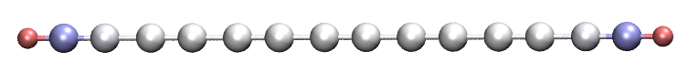

上图中，红色和蓝色分别反映原子带正电荷和负电荷。红色（蓝色）越深，电荷越正（越负）。可见，由于碳的电负性比氢大，两个氢带明显的正电荷，与之相连的碳带明显的负电荷。白色表明分子中部区域碳的电荷接近零。

聚炔是高度共轭的体系，预计外电场会显著极化其电荷分布。为研究这一问题，我们用同样的步骤基于*examples\polyyne_field.wfn*绘制该图，该文件是在沿分子轴0.03 a.u.外电场下生成的。所得图形如下，外电场方向为从右向左。

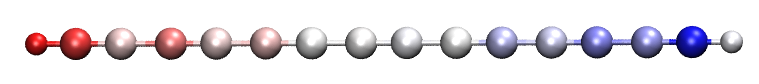

可见原子电荷分布不再对称。由于场源在右侧，大量电子从左侧转移到右侧，结果左侧碳原子的净电荷变为正，而右侧的变为负。

### **（2）按原子对分子轨道的贡献给原子着色**

原子着色法不仅能用于展示原子电荷，还能用于展示其他原子性质。作为例子，我说明如何通过给原子着色表示原子对分子轨道的贡献，以*examples\N-phenylpyrrole.fch*为例。

首先，我们计算一个轨道的轨道组成。启动Multiwfn并输入

```text
examples\N-phenylpyrrole.fch
8  // Orbital composition
3  // SCPA method
36  // Select MO 36 as example
```

然后用[5.4节](sec-5-4-copy-outputs-from-command-line-window-to-clipboard.md)中介绍的方法把Multiwfn窗口中的所有原子贡献复制到文本文件。

```text
0  // Return
-10  // Return to main menu
100 // Other functions (Part 1)
2  // Export new file
2  // The format of the new file is xyz, because .xyz is very similar to .chg
N-phenylpyrrole.chg   // Name of the new file
```

现在用你喜欢的文本编辑器（推荐Ultraedit）手动修改*N-phenylpyrrole.chg*，删除前两行，并用列模式把轨道组成复制到最后一列，然后保存文件。最终*N-phenylpyrrole.chg*的内容应为

```text
C      -0.00000000      1.12162908      1.82507914  0.396870
C      -0.00000000      0.71310006      3.13457424  0.099898
C      -0.00000000     -0.71310006      3.13457424  0.099898
...[ignored]
H       0.00000000      2.14896316     -3.05414223  0.000000
H       0.00000000     -0.00000000     -4.31975533  0.000000
```

我们用Multiwfn载入该.chg文件并转换为*N-phenylpyrrole.pqr*，然后用与上例完全相同的步骤在VMD中可视化。不过，这次颜色标尺的下限和上限应分别设为-50和50。所得图形如下图左半部分所示；作为对比，MO36相应的等值面图示于右半部分。

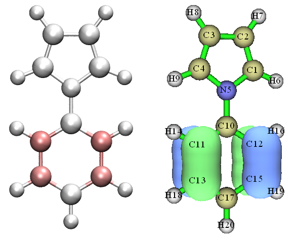

原子越红，其对该轨道的贡献越大。可见，本节介绍的原子着色很好地反映了实际的轨道分布。对非常大的分子，等值面图可能变得相当复杂，而原子着色图则清晰得多。

当然，原子着色法也适用于Multiwfn算得的其他各类原子性质，如凝聚Fukui函数、原子自旋布居、原子跃迁电荷、原子的源函数、原子空间中电子能量的积分、电子跃迁或分子间相互作用中原子电荷的变化。更多例子见我的博文<http://sobereva.com/425>（中文）。

## **4.A.11 研究化学键的方法概述**

> **注**
>
> 本节的中文版是我的博文“Multiwfn支持的化学键分析方法概述”（<http://sobereva.com/471>），其中还包含扩展讨论。

在本节中，我概述所有可用于研究化学键的方法。你会发现Multiwfn在表征和揭示键的本质方面不可或缺。大多数分析既可用于基态，也可用于激发态（关于这一点，见[4.18.13节](sec-4-18-electron-excitation-analysis.md#41813-研究单个激发态的电子结构和两激发态之间的差别)的更多信息）

### **1 AIM（分子中的原子）分析**

在AIM框架下，键临界点（BCP）是键最具代表性的点，因此化学键的特征可用相应BCP处的各种性质来表征，例如：

- BCP处的电子密度和势能，即*ρ*(BCP)和*V*(BCP)，常用于讨论成键强度。对同一种键，它们通常分别与成键强度正相关和负相关。

- BCP处的电子密度的Laplacian，即∇²*ρ*(BCP)，常用于判断键是否主要呈现共价特征。负值和正值分别意味着该键的主导性质为共价和非共价。但注意该判据经常是错的（例如CO的∇²*ρ*(BCP)为正，但它显然是极性共价键）

- 在*Angew. Chem. Int. Ed. Engl.*，**23**，627（1984）中提出，BCP处能量密度的负值和正值，即*H*(BCP)，分别意味着该键具有共价和非共价性质。但该判据并非总是成立；例如CaO中的Ca-O是典型的离子键，但其*H*(BCP)为负。

- *V*(BCP)/*G*(BCP)是在*J. Chem. Phys.*，**117**，5529（2002）中提出的，其中*G*(BCP)表示BCP处的Lagrangian动能密度。据称该物理量的<0、>1但<2、>2分别意味着成键主要属于闭壳层相互作用、中间（混合）相互作用和共价相互作用。

- eta指数是在*J. Phys. Chem. A*，**114**，552（2010）中提出的，并在*Angew. Chem. Int. Ed.*，**53**，2766（2014）中进一步研究，其定义为|*λ*₁(**r**)|/*λ*₃(**r**)，其中*λ*₁和*λ*₃分别为电子密度Hessian矩阵的最小和最大本征值。据称若BCP处的eta指数小于1，则成键应为闭壳层相互作用；若大于1，则相互作用应具有共价性质，且数值越正，共价特征越强。然而，我发现该说法并非总是成立，例如Ni(CO)₄中Ni-C和C-O键的该物理量都小于1，但它们无疑应归为极性共价键。

- 键度（BD，bond degree）是在*J. Chem. Phys.*，**117**，5529（2002）中提出的，定义为*H*(BCP)/*ρ*(BCP)。BD的物理含义是BCP处单位电子的能量密度。对共价相互作用（通常*H*(BCP)<0），BD越负，成键越强；而对非共价相互作用（通常*H*(BCP)>0），BD越正，相互作用越弱。

- 键椭率是在*J. Am. Chem. Soc.*，**105**，5061（1983）中提出的，定义为*ε*(**r**)= [*λ*₁(**r**)/*λ*₂(**r**)]-1。在BCP处*λ*₁和*λ*₂必为负，体现垂直于键方向的电子密度曲率。该值偏离0越大，BCP处电子密度在垂直于键的平面内非对称分布的倾向越强。

- 以BCP为参考点的源函数已被用于研究化学键，全面综述见*Struct. & Bond.*，**147**，193（2010），分析例子见[4.17.5节](sec-4-17-basin-analysis.md#4175-在-aim-流域中研究源函数)。

还有一些研究论文利用BCP性质讨论化学键，例如*J. Am. Chem. Soc.*，**120**，13429（1998）和*J. Comput. Chem.*，**39**，1697（2018）。值得注意的是，某些临界点处的性质也可用于估计晶体的金属性，见*J. Am. Chem. Soc.*，**124**，14721（2002）、*Chem. Phys. Lett.*，**471**，174（2009）和*J. Phys.: Condens. Matter*，**14**，10251（2002）。

键径也是AIM框架中非常重要的概念，它严格揭示了连接各原子的主要相互作用路径。需要理解的一个事实是，强的化学键必定伴随键径和BCP，而键径和BCP的存在并不意味着化学键存在。

AIM拓扑分析已在[3.14节](sec-3-14-topology-analysis.md)中系统介绍，并在[4.12.1节](sec-4-12-quantitative-analysis-of-molecular-surface.md#4121-苯酚分子表面的静电势-electrostatic-potential分析)中举例说明，上述所有物理量都可用Multiwfn容易而快速地求得。值得注意的是，在Multiwfn中临界点（或特定点）处的许多实空间函数可分解为各轨道（通常为MO或LMO）的贡献，例子见[4.2.4节](sec-4-2-topology-analysis.md#424-把临界点处的性质分解为轨道贡献)；此外，任何实空间函数都可沿键径绘制，例子见[4.2.3节](sec-4-2-topology-analysis.md#423-沿键径绘制实空间函数)。这些有用的功能常常能对成键提供更深入的理解。

上述实空间函数还可绘制为曲线图、平面图或等值面图，以便直观研究其分布，例子分别见[4.3节](sec-4-3-output-and-plot-various-properties-in-a-line.md)、[4.4节](sec-4-4-output-and-plot-various-properties-in-a-plane.md)和[4.5节](sec-4-5-generate-grid-data-and-view-isosurface-map.md)。∇²*ρ*(**r**)的等值线图和等值面图特别有用且经常使用。

### **2 键级与离域指数分析**

键级是表征化学键非常有用且直接的方式。Multiwfn支持很多键级定义，详细介绍请查阅[3.11节](sec-3-11-bond-order-analysis.md)。不同键级有不同的特点和物理含义。例如，Laplacian键级（LBO）度量键的共价成分，通常与键解离能（BDE）有很好的关系，而Mayer键级本质上反映两个相互作用原子间共享的电子数。Multiwfn的键分析模块还能做比只算键级数值更多的事情。例如，Multiwfn可把某些键级分解为各轨道的贡献，Wiberg键级可分解为原子轨道对的贡献。键级的许多详细分析例子见[4.8节](sec-4-8-molecular-orbital-composition-analysis.md)。

值得一提的是，离域指数（DI）在物理本质上与Mayer键级和模糊（fuzzy）键级基本等价。差别源于原子空间的定义方式。对非极性键，DI通常与Mayer和Fuzzy键级非常接近，但对极性键它们在数值上有差异。对DI，采用AIM原子 basin 作为原子空间。DI可通过 basin 分析模块计算，DI的详细介绍见[3.18.5节](sec-3-18-fuzzy-atomic-space-analysis.md#3185-定域化指数-li与离域化指数-di-4-44)，DI分析例子见[4.17.1节](sec-4-17-basin-analysis.md#4171-hcn-和-li₆-的-aim-流域分析)。通常我不建议使用DI，因为它的代价远高于Mayer和Fuzzy键级的计算。

对同一种化学键，例如不同过渡金属配合物中的C-O键，Mayer键级和LBO与成键强度正相关。对不同种类的化学键，不应用Mayer键级比较成键强度，例如，N₂中的键与P₂中的键的BDE明显不同，但它们具有基本相同的Mayer键级，因为两者都是典型的三键。相比之下，LBO能忠实反映P₂中的键比N₂中的弱得多。更多讨论、比较和例子请查阅LBO的原始论文（*J. Phys. Chem. A*，**117**，3100（2013））。

绘制键级随反应坐标的变化是揭示化学反应中电子结构潜在变化的非常好的办法，实现方法见[4.A.1节](#4a1-沿irc路径研究电子结构的变化)。

### **3 键级密度与自然自适应轨道分析**

键级密度（BOD）与自然自适应轨道（NAdO）的概念已在[3.200.20节](sec-3-200-other-functions-part-2.md#320020-键级密度-bod-和自然自适应轨道-nado-分析)中详细介绍，如果你想从图形上讨论给定共价键的键级，它们相当有用。BOD是表示各处对键级贡献的实空间函数（严格说，在当前语境下即离域指数），而NAdO则从轨道角度揭示键级的本质。应用例子见[4.200.20节](sec-4-200-other-functions-part-2.md#420020-用键级密度与自然适应性轨道研究化学键)，你会发现该方法在很多情形下特别有用。

### **4 轨道定域化分析**

分子轨道（MO）通常高度离域，不直接对应化学键，因而不能用于研究成键特征。轨道定域化是非常强大的技术，它可把MO转化为定域分子轨道（LMO），后者高度定域，与成键有非常密切的关系。通过LMO，可提取关于化学键的许多有用信息，如键极性、键级数、键类型、参与成键的原子轨道等。LMO的详细介绍请查阅[3.22节](sec-3-22-orbital-localization-analysis.md)，并跟随[4.19节](sec-4-19-orbital-localization-analysis.md)中的LMO分析例子学习。

### **5 AdNDP分析**

自适应自然密度划分（AdNDP）方法的目的与轨道定域化方法有些类似，AdNDP的优点在于它还能从复杂的多电子波函数中导出具有半离域特征的轨道。若AdNDP分析得到恰当执行，所得轨道将忠实揭示当前体系中的所有多中心键。AdNDP分析的缺点是用户必须从候选列表中手动挑选轨道，这一过程稍显麻烦，要求用户具备足够的化学直觉。当不存在多中心键时，使用轨道定域化远比AdNDP优先，因为它全自动、快速且没有主观性；而若你怀疑当前体系可能有明显的多中心键并想研究它们，通常AdNDP是唯一选择。AdNDP方法在[3.17节](sec-3-17-adaptive-natural-density-partitioning-analysis.md)中详细介绍，相关例子见[4.14节](sec-4-14-adaptive-natural-density-partitioning-adndp-analysis.md)。

### **6 ELF及相关实空间函数的分析**

ELF是非常重要的实空间函数，它能揭示化学体系中电子的定域与离域。ELF的简介见[2.6节](sec-2-6-real-space-functions.md)。在Multiwfn中ELF可用多种不同方式分析，如下所示

- 可视化研究。在Multiwfn中，ELF可用主功能3绘制为曲线图，用主功能4绘制为平面图，用主功能5绘制为等值面图，例子分别见[4.3节](sec-4-3-output-and-plot-various-properties-in-a-line.md)、[4.4节](sec-4-4-output-and-plot-various-properties-in-a-plane.md)和[4.5节](sec-4-5-generate-grid-data-and-view-isosurface-map.md)。从图中可容易识别哪个区域包含明显的共价相互作用（即明显的电子共享），并判断给定化学键的性质。此外，还可从键周围ELF等值面的形状推断键级数。Multiwfn还能研究ELF-π和ELF-σ，从而把π相互作用和σ相互作用分开研究，例子见[4.5.3节](sec-4-5-generate-grid-data-and-view-isosurface-map.md#453-计算-elf-σ-和-elf-π-以研究苯的芳香性)和[4.100.22节](sec-4-100-other-functions-part-1.md#410022-分析非平面体系-non-planar-system的π电子-π-electron特征环庚三烯-cycloheptatriene)。

  注意，有很多实函数具有与ELF类似的分布特征，尽管其背后的思想与ELF可能并不十分相似。Multiwfn支持其中的大多数，它们也都可以用与ELF完全相同的方式绘制。这些实空间函数包括LOL、SCI、SEDD、RoSE、PS-FID。LOL在[2.6节](sec-2-6-real-space-functions.md)中介绍，因图形效果更清晰有时比ELF更受青睐；其他实空间函数的介绍见[2.7节](sec-2-7-user-defined-real-space-function.md)。

  两个原子之间∇²*ρ*图中的负值部分能揭示因共价键形成而电子聚集的区域，这一点与ELF类似。在*J. Phys. Chem.*，**100**，15398（1996）中，Bader认为∇²*ρ*与ELF是同胚的，它们的相似与差异能为理解化学键提供互补信息。但注意，对涉及很重原子的键，∇²*ρ*图常无法揭示共价特征。例如，Re-Re键相互作用区中的∇²*ρ*全为正。

  利用Multiwfn和shell脚本以及第三方软件，可容易地生成化学过程（常表示为内禀反应坐标或刚性扫描任务得到的轨迹）中ELF或其他函数的动画，这种动画能非常生动地展示化学键特征的变化，制作方法见[4.A.1节](#4a1-沿irc路径研究电子结构的变化)。

- ELF（或类似函数）的 basin 分析：这类分析可通过 basin 分析模块（主功能17）进行，例子见[4.17.2节](sec-4-17-basin-analysis.md#4172-elf-流域分析例子)。所有ELF basin 合在一起构成全空间，每个ELF basin 对应具有特征电子结构的区域。例如，ELF basin 可对应共价键、孤对电子、芯区等。通过分析成键 basin 的特征，可获得关于键的很多信息，如出现在成键区的平均电子数、成键区电子定域程度、成键区的偶极矩。成键区电子布居中各原子的贡献也可得到，如[4.17.7节](sec-4-17-basin-analysis.md#4177-计算-elf-流域布居数的原子贡献)所示。

- ELF（或类似函数）的拓扑分析：这类分析可得到ELF极大点（也称ELF吸引子）和（3,-1）型ELF临界点（也称ELF分岔点）的精确位置，前者显示ELF basin 最具代表性的点，后者的数值在一定程度上反映两个ELF basin 之间电子共享（离域）的程度。ELF的拓扑分析可通过主功能2实现，例子见[4.2.2节](sec-4-2-topology-analysis.md#422-乙酸的定域轨道指示剂-lol-拓扑分析)。基于ELF和LOL拓扑分析的实际研究见*Nature*，**371**，683（1994）和*J. Comput. Chem.*，**30**，1093（2009）。追踪ELF吸引子的变化对理解化学过程中电子结构和成键特征的变化特别有用，此类分析的示例有*RSC Adv.*，**5**，62248（2015）、*Chem. Phys.*，**501**，128（2018）和*Comput. Theor. Chem.*，**1154**，17（2019）。

  > **注**
  >
  > 注意 basin 分析也能给出ELF吸引子的位置，步骤甚至比用拓扑分析模块更简单，但 basin 分析模块给出的位置精度不如拓扑分析模块，因为 basin 分析基于均匀分布的格点进行。

### **7 IRI分析**

与ELF/LOL相比，Tian Lu定义的相互作用区指示符（IRI）的独特优点是能清晰揭示化学体系中的各类相互作用，包括共价和非共价作用。在IRI的原始论文中证明，IRI甚至能完美地直观表示整个化学反应中成键的变化。IRI的介绍见[3.23.8节](sec-3-23-visual-study-of-weak-interaction.md#3238-相互作用区域指示函数-interaction-region-indicator-iri与-iri-π-分析-4)，相关分析例子见[4.20.4节](sec-4-20-visual-study-of-weak-interactions.md#4204-用-iri-分析揭示苯酚二聚体中的化学键和弱相互作用区域)。

在IRI的同一篇论文中，还提出了其变体IRI-π，证明它能很好地区分不同化学键上π相互作用的类型和强度，很多例子见其原始论文。

一份展示如何进行IRI和IRI-π分析的非常详细的文档见<http://sobereva.com/multiwfn/res/IRI_tutorial.zip>。注意DORI是另一个与IRI能力类似的函数，但其图形效果明显不如IRI，且定义比IRI复杂得多。

### **8 价电子密度的分析**

如我的论文*Acta Phys. -Chim. Sin.*，**34**，503（2018）DOI：[10.3866/PKU.WHXB201709252](http://www.whxb.pku.edu.cn/EN/10.3866/PKU.WHXB201709252)中清楚展示的，可视化价电子密度是揭示电子结构、研究化学键特征的非常有用、强大而直观的方式，请仔细阅读该论文。此外，basin 分析可用于价电子密度，以揭示更多有化学意义的信息。如何进行这类分析的例子见[4.6.2节](sec-4-6-modify-and-check-wavefunction.md#462-价层电子密度分析去掉某些轨道对实空间函数贡献的例子)。

### **9 电子密度差分析**

化学键的形成总是导致显著的电子重组（极化和电荷转移），特别是，共价键的形成必定伴随电子向成键区聚集的现象。绘制电子密度差（EDD）图是揭示这一点的最好方式之一，EDD在Multiwfn中可分别通过主功能3、4和5很容易地绘制为曲线图、平面图和等值面图。EDD有不同的定义方式，若想研究两个片段之间形成的键，应研究全体系与这两个片段之间的EDD，例子见[4.5.5节](sec-4-5-generate-grid-data-and-view-isosurface-map.md#455-绘制电子密度差值图以研究咪唑配位镁卟啉的电子转移)；若想研究体系中各原子间成键导致的电子密度重组，应研究变形密度，其定义为全体系电子密度与所有原子孤立态密度之差，例子见[4.4.7节](sec-4-4-output-and-plot-various-properties-in-a-plane.md#447-乙酰氯电子密度的变形图)。

不要忘记Multiwfn还为分析EDD提供了高级技术，例如，basin 分析可用于EDD，例子见[4.17.4节](sec-4-17-basin-analysis.md#4174-h₂o-的电子密度差流域分析)。也可绘制电荷位移曲线，以更好地定量研究沿特定方向的电子重组，例子见[4.13.6节](sec-4-13-process-grid-data.md#4136-绘制电荷位移曲线)。

值得注意的是，绘制全体系与其片段之间ELF的差值图也很有价值，示例见[4.4.8节](sec-4-4-output-and-plot-various-properties-in-a-plane.md#448-绘制水四聚体相对其组成单体的电子密度和-elf-差值图)。

### **10 δ*g*函数与IBSI指数的分析**

实空间函数δ*g*在IGM理论框架下定义，介绍见[3.23.5节](sec-3-23-visual-study-of-weak-interaction.md#3235-基于前分子-promolecular密度的独立梯度模型-independent-gradient-model-igm分析-10)。δ*g*能揭示各类相互作用，包括化学成键和弱相互作用，也包括共价和非共价作用。此外，成键区δ*g*的大小常与成键强度正相关，因此可通过查看彩色填充图中的颜色或在等值面图中适当调节等值面值来容易地考察不同区域的成键强度。另外，δ*g*等值面可用*sign*(*λ*₂)*ρ*函数以多种颜色映射，使等值面图信息丰富。IGM的例子请查阅[4.20.10节](sec-4-20-visual-study-of-weak-interactions.md#42010-用独立梯度模型-igm-可视化和定量弱相互作用)和[4.20.11节](sec-4-20-visual-study-of-weak-interactions.md#42011-用-igmh基于-hirshfeld-分割分子密度的-igm研究弱相互作用)；虽然这些例子侧重研究弱相互作用，但同样步骤也可用于化学键分析。

本征键强度指数（IBSI）基于δ*g*在全空间的积分定义。在*J. Phys. Chem. A*，**124**，1850（2020）中证明它在一定程度上有能力度量成键强度并区分键的类型，介绍见[3.11.9节](sec-3-11-bond-order-analysis.md#3119-本征键强度指数intrinsic-bond-strength-index-ibsi-10)，例子见[4.9.6节](sec-4-9-bond-order-analysis.md#496-用本征键强度指数ibsi衡量化学键强度)。

### **11 定量成键导致的电荷转移量**

两个不同片段之间化学键的形成必定导致两片段间可观的电荷转移（CT）。转移量可作为实际体系中片段电荷与片段孤立态净电荷之差得到。片段电荷定义为片段中原子的电荷之和。在Multiwfn的布居分析模块中，若已定义片段，计算原子电荷时会直接输出片段电荷，例子见[4.7.1节](sec-4-7-population-analysis-and-atomic-charge-calculation.md#471-计算三氟化氯的hirshfeld和chelpg原子电荷以及片段电荷)。

### **12 电荷分解分析（CDA）**

用片段电荷可容易地讨论总CT量，但为了考察成键导致电荷转移的细节，必须用CDA。CDA能在轨道相互作用分辨率下明确给出每对用户定义片段之间的电子授受和反馈，还清楚给出全体系MO如何由各片段MO组成。介绍见[3.19节](sec-3-19-charge-decomposition-analysis-and-orbital-interaction-diagram.md)，例子见[4.16节](sec-4-16-charge-decomposition-analysis-and-orbital-interaction-diagram.md)。

### **13 扩展过渡态-化学价自然轨道（ETS-NOCV）**

该流行方法是在*J. Chem. Theory Comput.*，**5**，962（2009）中提出的，着重解析片段间的轨道相互作用。该分析的关键优点是能把轨道相互作用导致的电子密度变化转化为一组NOCV对，每对都有相应的对轨道相互作用能的能量贡献和可可视化以容易理解本质的相应密度，因此ETS-NOCV分析对轨道相互作用提供了非常深刻的洞见。该分析的详细介绍见[3.26节](sec-3-26-ets-nocv-analysis.md)，把ETS-NOCV用于研究各类相互作用的例子见[4.23节](sec-4-23-examples-of-ets-nocv-analysis.md)。

### **14 态密度（DOS）分析**

分态密度（PDOS）曲线图有助于直观展示各能量范围内用户定义片段（可定义为一批原子、壳层或原子轨道）之间相互作用导致的成键与反键，介绍见[3.12节](sec-3-12-plotting-density-of-states-pes-and-cohp.md)，例子见[4.10.1节](sec-4-10-plot-density-of-states-dos-maps.md#4101-绘制-n-phenylpyrrole-的总态密度偏态密度和重叠态密度-total-partial-and-overlap-dos)。

### **15 能量分解分析**

能量分解分析用于把键能分解为不同物理成分，以更深入理解成键本质。Multiwfn支持的“简单能量分解”可用于化学键，例子请查阅[4.100.8节](sec-4-100-other-functions-part-1.md#41008-使用组合的碎片波函数-fragment-wavefunction进行简单的能量分解-energy-decomposition)。使用该功能需要Gaussian。

### **16 研究键极性**

研究键的极性常很有意思，有几种可能的方式，如下所示。由于概念本身不能唯一定义，结果常显著不同。

- 计算成键两原子各自对该键对应LMO的贡献（Θ*$_{A}$*和Θ*$_{B}$*），则键的离子性可评价为|Θ*$_{A}$*-Θ*$_{B}$*|。显然该值越大，键极性越高。为得到Θ*$_{A}$*和Θ*$_{B}$*，应先做轨道定域化，然后在主功能0中找到该键对应的LMO，最后用主功能8以适当方法计算该LMO的组成。

- 先按[4.17.7节](sec-4-17-basin-analysis.md#4177-计算-elf-流域布居数的原子贡献)所示计算成键两原子各自对该键对应ELF basin 布居数的贡献，然后取两贡献值之差估计键极性。

- 计算键极性指数。介绍见[3.200.12节](sec-3-200-other-functions-part-2.md#320012-计算能量指数-ei-或键极性指数-bpi)，例子见[4.200.12节](sec-4-200-other-functions-part-2.md#420012-计算能量指数ei与键极性指数bpi)。

- 值得注意的是，Laplacian键级只反映键的共价成分，而Mayer键级可视为总键级。因此，在某些情形下，Laplacian与Mayer键级之差可用于揭示键极性。

### **17 研究键偶极矩**

在Multiwfn中有三种可能的方式：

- 基于双中心定域分子轨道计算键偶极矩，介绍请查阅[3.22节](sec-3-22-orbital-localization-analysis.md)，例子见[4.19.4节](sec-4-19-orbital-localization-analysis.md#4194-基于-ch₃nh₂-的双中心-lmo-研究键偶极矩)。

- 做ELF basin 分析并查看感兴趣的键对应 basin 的偶极矩。示例见[4.17.2节](sec-4-17-basin-analysis.md#4172-elf-流域分析例子)。同时，还可得到成键 basin 的四极矩。

- 在Hilbert空间中计算键偶极矩。介绍见[3.200.2节](sec-3-200-other-functions-part-2.md#32002-在-hilbert-空间计算原子与键偶极矩)

### **18 分子中作用于单电子的势（PAEM）分析**

PAEM指作用于某点处电子的总势。通过分析两原子间适当位置处的PAEM，可确定相互作用本质（共价或非共价）。示例见[4.3.3节](sec-4-3-output-and-plot-various-properties-in-a-line.md#433-用-paem-mo-方法研究原子间相互作用)。

## **4.A.12 电子激发分析方法概述**

在本节中，我将系统概述Multiwfn支持的、可用于分析电子激发问题的所有方法。

> **注记**
>
> 本节的中文版对应我的博文“Multiwfn支持的电子激发分析方法概述”(<http://sobereva.com/437>)。

### **1 空穴-电子分析（hole-electron analysis）**

所有激发本质上都可描述为“空穴到电子”的跃迁，即“空穴”（hole）是被激发电子离开的区域，“电子”（electron）是被激发电子最终到达的区域。空穴-电子分析对应主功能18的子功能1，介绍见[3.21.1](sec-3-21-electron-excitation-analysis.md#3211-分析并可视化空穴电子分布跃迁密度和跃迁电磁偶极矩密度-1)节，示例见[4.18.1](sec-4-18-electron-excitation-analysis.md#4181-用空穴-电子分析完整表征电子激发)节。该分析非常强大且普适，是各类电子激发问题几乎不可或缺的分析方法。具体而言，空穴-电子分析具有以下功能：

- 显示空穴和电子的等值面图。从该图中可直观理解电子是如何被激发的

- 将空穴和电子分布转换为以高斯（Gaussian）函数描述的形式，使其在视觉观察上明显更容易

- 计算衡量电子激发特征的定量指标，包括衡量空穴与电子重叠程度的$S_{\mathrm{r}}$指数、衡量空穴与电子质心距离的*D*指数、衡量空穴与电子分布宽度的*σ*指数、衡量空穴与电子分离程度的*t*指数等

- 绘制密度差图，即电子减去空穴

- 计算基函数、原子轨道、原子、分子片段和分子轨道对空穴和电子的贡献，从而透彻分析空穴和电子的性质。此外，各个原子和片段上的空穴量、电子量以及空穴-电子重叠程度可直接显示为热图（颜色填充的矩阵图），非常便于直观的横向比较

- 计算空穴与电子之间的库仑（Coulomb）吸引作用，这是激子结合能的一种常用定义

### **2 自然跃迁轨道（nature transition orbital, NTO）分析**

在做电子激发计算时，常发现许多轨道跃迁对电子激发的贡献可忽略不计，这一现象使得通过观察轨道来讨论电子激发特征变得困难，此时需要同时考察多个轨道。使用主功能18的子功能6将分子轨道变换为NTO后，在大多数情况下电子激发仅用一对NTO跃迁即可描述，从而使讨论大为简化。NTO分析的介绍见[3.21.6](sec-3-21-electron-excitation-analysis.md#3216-产生自然跃迁轨道-ntos-6)节，实际示例见[4.18.6](sec-4-18-electron-excitation-analysis.md#4186-产生并分析尿嘧啶的自然跃迁轨道-nto)节。

### **3 Λ指数和Δ*r*指数**

2008年提出的Λ指数可能是最早定量考察电子激发特征的指数，其内在物理意义是衡量电子与空穴的重叠程度。2013年提出的Δ*r*是基于Λ指数的思想表征电子激发的另一指数。Δ*r*本质上衡量电子与空穴的质心距离。Λ和Δ*r*分别在[3.21.14](sec-3-21-electron-excitation-analysis.md#32114-计算-λ-指数表征电子激发-14)节和[3.21.4](sec-3-21-electron-excitation-analysis.md#3214-计算-r-指数衡量电荷转移长度-4)节详细介绍，可分别通过主功能18的子功能14和子功能4计算。

事实上，有了空穴-电子分析框架下定义的$S_{\mathrm{r}}$和*D*指数，就不再需要使用Δ*r*和Λ指数，因为$S_{\mathrm{r}}$和*D*原则上具有更重要的物理意义。然而，由于Multiwfn能同时计算大量选定激发态的Δ*r*和Λ，如果只是想一次性粗略考察一批激发态的电子激发特征，使用Δ*r*和Λ仍是很好的选择。

### **4 段间电荷转移（interfragment charge transfer, IFCT）分析**

IFCT的全称是“interfragment charge transfer”（片段间电荷转移），是我提出的用于估计电子激发过程中原子或片段间电子转移量的方法，计算代价极低。该方法在[3.21.8](sec-3-21-electron-excitation-analysis.md#3218-用-ifct-方法计算电子激发中的片段间电荷转移-8)节详细描述，在[4.18.8](sec-4-18-electron-excitation-analysis.md#4188-用-ifct-方法和电荷转移矩阵热图研究电子激发中的片段间电荷转移)节举例说明。虽然利用激发态与基态的片段电荷之差也能研究电子激发过程中的电子布居变化，但无法在“谁转移给谁”的层次上理解电荷转移细节，因此IFCT分析对研究电子激发问题具有重要且不可替代的实用价值。特别地，在研究过渡金属配合物时，可用IFCT分析分别评估MC、LC、LLCT、MLCT和LMCT的确切量。

如[4.18.16](sec-4-18-electron-excitation-analysis.md#41816-绘制电荷转移光谱并计算所有激发态的主要特征以-n-苯基吡咯为例)节所示，Multiwfn能非常容易地计算当前体系所有激发态的IFCT项，并可直接打印主要项（贡献\> 5%），从而可以轻松识别所有激发态的主要特征。

### **5 电荷转移光谱（charge-transfer spectrum, CTS）**

“电荷转移光谱（charge-transfer spectrum, CTS）”已在[3.21.16](sec-3-21-electron-excitation-analysis.md#32116-电荷转移光谱-cts-分析)节介绍，示例见[4.18.16](sec-4-18-electron-excitation-analysis.md#41816-绘制电荷转移光谱并计算所有激发态的主要特征以-n-苯基吡咯为例)节。CTS是我在IFCT分析基础上定义的。CTS与常见紫外-可见光谱的关系类似于分波态密度与总态密度的关系。CTS将整个紫外-可见光谱分解为子曲线，包括片段内电子重排曲线和片段间电子转移曲线。通过CTS可生动理解紫外-可见光谱的主要特征。

### **6 基于激发态与基态密度差的分析**

密度差分析是研究体系两个电子态间电荷分布差异的常用且被广泛接受的方法。Multiwfn支持多种基于激发态与基态密度差的分析方法，如下所示：

- 绘制密度差图

  首先，Multiwfn可轻松计算激发态与基态的密度差，并分别通过主功能3、4、5将其绘制为曲线图、平面图和等值面图，示例分别见[4.3](sec-4-3-output-and-plot-various-properties-in-a-line.md)、[4.4](sec-4-4-output-and-plot-various-properties-in-a-plane.md)和[4.5](sec-4-5-generate-grid-data-and-view-isosurface-map.md)节。而且，不仅可以绘制激发态与基态的密度差，还可以轻松绘制两个激发态之间的密度差，示例见[4.18.13](sec-4-18-electron-excitation-analysis.md#41813-研究单个激发态的电子结构和两激发态之间的差别)节。

- 平滑密度差并计算密度差的统计数据

  激发态与基态的原始密度差图不易观察，因为其正负区域交错，显得杂乱。计算密度差格点数据后，可用主功能18的子功能3将其变换，用非常光滑的高斯函数替代密度差的正负部分，此时图像将变得直观得多，更易分析。同时，程序输出关于密度差的各种统计数据，如正负部分质心坐标、电荷转移距离、正负部分分离程度。介绍见[3.21.3](sec-3-21-electron-excitation-analysis.md#3213-基于密度差格点数据分析电荷转移-3)节，示例见[4.18.3](sec-4-18-electron-excitation-analysis.md#4183-基于电子密度差分析电子激发中的电荷转移)节。

- 局域积分曲线和电荷位移曲线

  如果所研究的体系是线性的或界面体系（如吸附在TiO₂表面的染料分子），可沿分子链方向或垂直于界面的方向绘制局域积分曲线和电荷位移曲线。局域积分曲线显示垂直于所选方向各截面上的密度差积分值，而电荷位移曲线显示从起始端到当前位置的密度差积分。这两类图有助于定量研究沿特定方向的电子转移特征。在Multiwfn中很容易绘制这两类图，介绍见手册[3.16.14](sec-3-16-processing-grid-data.md#31614-绘制-xyz-方向的局域积分曲线与平面平均曲线-18)节，示例见[4.13.6](sec-4-13-process-grid-data.md#4136-绘制电荷位移曲线)节。

- 密度差的盆积分

  Multiwfn能对密度差做盆积分，从而研究某些特征局域区域内电子数的变化，示例见[4.17.4](sec-4-17-basin-analysis.md#4174-h₂o-的电子密度差流域分析)节。

### **7 分析激发态与基态在电子布居或原子/片段电荷上的差异**

主功能7用于做布居分析或原子电荷计算，若在计算原子电荷前通过子功能-1定义了片段，输出中也会给出片段电荷。相应示例见[4.7](sec-4-7-population-analysis-and-atomic-charge-calculation.md)节。分别计算激发态和基态的片段电荷后，利用二者之差可了解电子激发过程中不同片段失去或获得多少电子，从而在定量水平上考察电子激发对电荷分布的影响。

虽然IFCT分析能实现同样目的，但用原子/片段电荷讨论该问题的好处是评估原子电荷的方法有很大的选择余地，且激发态的电荷分布可对应弛豫密度。

### **8 绘制跃迁密度等值面图、绘制跃迁密度矩阵热图**

跃迁密度矩阵（transition density matrix, TDM）对揭示电子激发的内在本质非常有用。TDM有两种形式：

- （1）三维实空间形式，可通过绘制等值面图表示。某点处数值大对应空穴与电子在该处重叠大，详细介绍见[3.21.1.1](sec-3-21-electron-excitation-analysis.md#32111-理论)节，分析示例见[4.18.2.1](sec-4-18-electron-excitation-analysis.md#41821-在实空间分析跃迁密度和跃迁偶极矩密度)节。

- （2）通常意义上的矩阵形式。这种形式的TDM可展示为热图（即颜色填充的矩阵图），可以是基于原子或基于片段的。其对角元生动显示哪些原子或片段同时被空穴和电子占据，而非对角元直接反映相应原子或片段间电子转移的方向和程度。TDM热图的介绍见[3.21.2](sec-3-21-electron-excitation-analysis.md#3212-把各种原子片段跃迁矩阵绘制为热图-2)节，分析示例见[4.18.2.2](sec-4-18-electron-excitation-analysis.md#41822-绘制并分析跃迁密度矩阵-tdm)节。

### **9 分析电荷转移矩阵热图**

若在上述IFCT分析中将每个原子定义为一个片段，各原子间的电荷转移量和各原子内的电荷重排量将构成一个矩阵，我称之为“原子-原子电荷转移矩阵”，可进一步收缩为片段-片段电荷转移矩阵。这两个矩阵都可用主功能18的子功能2绘制为热图，介绍见[3.21.2](sec-3-21-electron-excitation-analysis.md#3212-把各种原子片段跃迁矩阵绘制为热图-2)节和[3.21.8](sec-3-21-electron-excitation-analysis.md#3218-用-ifct-方法计算电子激发中的片段间电荷转移-8)节，实际示例见[4.18.8](sec-4-18-electron-excitation-analysis.md#4188-用-ifct-方法和电荷转移矩阵热图研究电子激发中的片段间电荷转移)节。电荷转移矩阵热图携带的信息与TDM热图非常相似，分析方式完全相同，但电荷转移矩阵的定义更严格，物理意义更明确。此外，电荷转移矩阵与空穴-电子分析模块给出的空穴和电子分布完全一致，因此我认为电荷转移矩阵图分析是比流行的TDM热图分析更好的方法。

### **10 跃迁偶极矩分析**

对吸收过程，电子激发的振子强度越大，相应吸收峰越强。两个激发态间的跃迁概率主要由振子强度决定，而振子强度正比于相应跃迁电偶极矩的平方。因此，深入分析影响跃迁电偶极矩的内在因素非常有意义。Multiwfn提供了多种分解跃迁偶极矩（包括电偶极矩和磁偶极矩）的功能，如下所述。

- 绘制跃迁偶极矩密度

  跃迁偶极矩密度是衡量三维空间中一点对跃迁偶极矩贡献的函数，其在全空间的积分恰好等于跃迁偶极矩。显然，若将跃迁偶极矩密度绘制为等值面图或平面图，可生动展示各区域对跃迁偶极矩的贡献。介绍见[3.21.1.1](sec-3-21-electron-excitation-analysis.md#32111-理论)节，示例见[4.18.2.1](sec-4-18-electron-excitation-analysis.md#41821-在实空间分析跃迁密度和跃迁偶极矩密度)节。

- 绘制跃迁偶极矩矩阵热图

  主功能18的子功能2可绘制跃迁偶极矩矩阵热图，可以是基于原子或基于片段的。所有矩阵元之和恰好为体系的跃迁偶极矩，因此图中的对角元显示原子或片段仅靠自身对跃迁偶极矩的贡献，而非对角元反映原子-原子或片段-片段耦合对跃迁偶极矩的贡献。显然，通过这类热图可清楚理解跃迁偶极矩的内部结构。分析示例见[4.18.2.3](sec-4-18-electron-excitation-analysis.md#41823-绘制并分析跃迁偶极矩矩阵)节。

- 将跃迁偶极矩分解为基函数贡献和原子贡献

  主功能18的子功能11可将跃迁偶极矩分解为每个原子和每个基函数的贡献，详情见[3.21.11](sec-3-21-electron-excitation-analysis.md#32111-把跃迁电磁偶极矩分解为基函数和原子贡献-11)节。此外，基于Multiwfn输出的数据，通过VMD脚本可绘制箭头展示自定义片段对跃迁偶极矩的贡献矢量，从而直观理解体系各部分对跃迁偶极矩的贡献，示例见[4.18.11](sec-4-18-electron-excitation-analysis.md#41811-把分子片段贡献的跃迁偶极矩画成箭头)节。

- 将跃迁偶极矩分解为轨道跃迁的贡献

  主功能18的子功能10可将跃迁偶极矩分解为每个轨道跃迁的贡献，同时程序输出基于当前电子激发信息评估的振子强度。因此，当许多轨道显著参与电子激发时，可用该功能立即识别哪些轨道跃迁对振子强度有关键影响，以便进一步讨论。此外，可在主功能18的子功能-1中将某些轨道跃迁的组态系数设为零，然后再次进入该功能，查看忽略这些轨道跃迁对振子强度的影响。相应介绍见[3.21.10](sec-3-21-electron-excitation-analysis.md#32110-把跃迁电磁偶极矩分解为分子轨道对贡献-10)节，示例见[4.18.10](sec-4-18-electron-excitation-analysis.md#41810-获得分子轨道对对跃迁偶极矩的贡献)节。

- 计算激发态间的跃迁偶极矩和各激发态的偶极矩

  激发态间的跃迁偶极矩对某些研究很重要。例如，加和态（sum-over-states, SOS）方法需要它们，该方法可用于计算（超）极化率（见[3.27.2](sec-3-27-hyperpolarizability-analysis.md#3272-用态求和-sos-方法研究超极化率及两三能级模型分析)节）；此外，模拟瞬态吸收光谱需要激发态间的振子强度（*f*），而*f*的评估需要相应两个激发态间的跃迁偶极矩。在Multiwfn中，主功能18的子功能5可计算激发态间的跃迁偶极矩，也可直接输出各激发态的偶极矩。该功能的详情见[3.21.5](sec-3-21-electron-excitation-analysis.md#3215-计算所有态之间的跃迁电磁偶极矩和每个态的偶极矩-5)节。

### **11 分析激发态波函数**

Multiwfn在电子结构分析方面极为强大，这些分析不仅可应用于基态，也可应用于激发态，只要输入文件包含激发态波函数。注意，若激发态是用CIS/TDHF/TDDFT/TDA-DFT方法计算的，输入文件必须记录相应激发态的自然轨道（NO）。用Multiwfn可基于.fch文件中的激发态密度矩阵生成NO，详情见[3.200.16](sec-3-200-other-functions-part-2.md#320016-基于-fchfchk-文件中的密度矩阵生成自然轨道自然自旋轨道-nso-和自旋自然轨道-sno)节；也可基于组态系数生成NO，如[3.21.13](sec-3-21-electron-excitation-analysis.md#32113-产生特定激发态的自然轨道-13)节所示。

将激发态波函数载入Multiwfn后，可进行各种电子结构分析。例如，主功能9可用于计算激发态的各种键级，主功能7可对激发态做布居分析和计算原子电荷，主功能3、4、5能对激发态绘制一百多种实空间函数，主功能2和17可对激发态做AIM分析，主功能20可直观研究激发态的弱相互作用，激发态芳香性可用Multiwfn中的一系列方法研究（见[4.A.3](#4a3-芳香性研究方法概述)节）。通过比较激发态与基态的分析结果，可充分揭示电子激发对电子结构的影响。

### **12 轨道成分分析**

Multiwfn有非常强大的轨道成分分析模块（主功能8），支持所有轨道成分分析方法。用该功能可研究主要参与电子激发的MO或NTO，以明确各种原子轨道、原子和片段所起的作用。

### **13 考察轨道间的重叠程度和质心距离**

主功能100的子功能11用于计算两个选定轨道间的重叠程度和质心距离。显然，该功能有助于研究电子激发。例如，用该功能分析主导电子激发的MO对或NTO对，可考察电子激发过程中的电荷位移和分离程度。

### **14 计算原子跃迁电荷**

常说的原子电荷是针对单个电子态的，本质上由该态的密度矩阵决定。也可用两个态间的跃迁密度矩阵计算每个原子的电荷，这些电荷称为原子跃迁电荷。正如计算原子电荷的方法不唯一，计算原子跃迁电荷也有许多不同方法。Multiwfn可计算Mulliken原子跃迁电荷，相应描述见[3.21.12](sec-3-21-electron-excitation-analysis.md#32112-计算-mulliken-原子跃迁电荷-12)节。Multiwfn也可用静电势拟合方法计算原子跃迁电荷，*J. Phys. Chem. B*, **110**, 17268 (2006)等文献称这类电荷为TrEsp（transition charge from electrostatic potential，源自静电势的跃迁电荷）。TrEsp的基本理论和计算示例见手册[4.A.9](#4a9-计算tresp由静电势得到的跃迁电荷电荷并分析激子耦合)节。原子跃迁电荷的主要用途是快速计算对应于跃迁密度的静电势，从而考察分子间的激子耦合，这一点在[4.A.9](#4a9-计算tresp由静电势得到的跃迁电荷电荷并分析激子耦合)节也有详细介绍。

### **15 考察轨道跃迁对电子激发的贡献**

计算轨道跃迁对电子激发的贡献相当简单，介绍见[3.21](sec-3-21-electron-excitation-analysis.md)节开头。为便于分析，进入主功能18的子功能-1时，对所选电子激发贡献最大的十个轨道跃迁的贡献会被直接列出，更多信息见[3.21.0](sec-3-21-electron-excitation-analysis.md#3210-检查修改和导出激发的组态系数--1)节。

### **16 识别鬼态**

HF交换成分低的纯或杂化DFT泛函的交换势渐近行为明显不正确。当用这类交换相关泛函的TDDFT计算大共轭体系的激发态时，往往会出现一批能量低的人工电荷转移激发态。鬼态没有物理意义，它们的存在不仅浪费计算时间，还可能使初学者误将鬼态当作发光态。*J. Comput. Chem.*, **38**, 2151 (2017)提出的ghost-hunter指数可用于诊断TDDFT计算产生的激发态是否为鬼态。该指数在做空穴-电子分析后会自动输出，详细介绍见[3.21.7](sec-3-21-electron-excitation-analysis.md#3217-计算-ghost-hunter-指数-7)节，示例见[4.18.1](sec-4-18-electron-excitation-analysis.md#4181-用空穴-电子分析完整表征电子激发)节。若发现鬼态，研究者可在讨论中避开这些态，或尝试用HF交换成分更高或长程校正的DFT泛函消除这些态。

### **17 评估NBO轨道对电子跃迁的贡献**

如[4.200.13.3](sec-4-200-other-functions-part-2.md#4200133-nbo-轨道对-h₂co-的-s0-与-s1-态之间密度差的贡献)节充分示例的，通过将NBO轨道密度拟合到两个电子态间的密度差，可得到NBO轨道对电子跃迁的贡献。由于NBO轨道常有明确特征和化学意义，该方法能对电子跃迁的本质提供更深入的洞见。同一模块也可用于研究其它各类轨道（如LMO）对电子跃迁的贡献，理论和算法介绍见[3.200.13](sec-3-200-other-functions-part-2.md#320013-计算轨道对密度差或其它格点数据的贡献)节。

### **其它**

主功能18的子功能17能对外扰动（如点电荷）下电子密度极化的本质提供非常有价值的洞见，可用于研究取代效应、亲电/亲核反应机理、原子极化率等。介绍见Multiwfn手册[3.21.17](sec-3-21-electron-excitation-analysis.md#32117-基于电子激发的电子密度极化分析)节，示例见[4.18.17](sec-4-18-electron-excitation-analysis.md#41817-基于电子激发做电子密度极化分析的例子)节。

主功能18的子功能15能快速打印每个激发态中所有主要的分子轨道跃迁，若想从分子轨道角度考察每个电子激发的基本特征，该功能很有用。该功能的介绍见[3.21.15](sec-3-21-electron-excitation-analysis.md#32115-打印所有激发态中的主要-mo-跃迁)节。

不要忘记Multiwfn还有主功能11，它可基于量子化学程序输出的振子/旋光强度和激发能绘制紫外-可见和ECD光谱。该模块比其它任何绘图工具都强大灵活得多，能提供关于光谱的详细信息。介绍见[3.13](sec-3-13-plotting-spectra.md)节，丰富示例见[4.11](sec-4-11-plot-various-kinds-of-spectra.md)节。

还值得一提的是双正交化方法，它在研究三重态激发态的本质时也可能有用，即该方法通常能用轨道跃迁模型描述用UKS或UHF方法计算的三重态激发态，从而简化对激发本质的讨论。介绍见[3.100.12](sec-3-100-other-functions-part-1.md#310012-alpha与beta轨道之间的双正交化biorthogonalization-between-alpha-and-beta-orbitals)节，示例见[4.100.12](sec-4-100-other-functions-part-1.md#410012-非限制性开壳层波函数-unrestricted-open-shell-wavefunction轨道的双正交化-biorthogonalization分析)节。

最后，注意只有上述条目5（密度差分析）、条目6（原子/片段电荷分析）和条目10（激发态波函数分析）可使用任意电子激发计算方法，只要它们能产生激发态波函数。例如，对密度差分析，可对KS-DFT计算的最低三重态激发态与单重态的电子密度作差，也可对EOM-CCSD产生的激发态密度与CCSD产生的基态密度作差。而其它各类分析，如空穴-电子分析、IFCT分析，只能用CIS、TDHF、TDDFT和TDA-DFT计算激发态。

## **4.A.13 绘制静电势着色的范德华表面图和范德华表面穿透图**

> **注记1**
>
> 我**强烈**建议观看该视频教程<https://youtu.be/QFpDf_GimA0>，它清楚充分地展示了本节的大部分内容。

> **注记2**
>
> 分子表面平均局域电离能（ALIE）也可用VMD脚本绘制，示例见[4.12.2](sec-4-12-quantitative-analysis-of-molecular-surface.md#4122-苯酚分子表面上的平均局部离子化能-average-local-ionization-energy-alie分析)节。

> **注记3**
>
> 本教程的中文版是我的博文“使用Multiwfn+VMD快速绘制静电势着色的分子范德华表面图和分子间穿透图”(<http://sobereva.com/443>)，其中包含比本节更多的讨论和示例。

> **注记4**
>
> 也可只绘制范德华表面局域区域对应的静电势，见“使用Multiwfn结合VMD绘制分子表面局域区域静电势的方法”（中文，<http://sobereva.com/750>）

### **1 前言**

在教程“用Multiwfn和VMD绘制带静电势表面极值点的静电势着色分子表面图”(<http://sobereva.com/multiwfn/res/plotESPsurf.pdf>)中，我详细描述了如何绘制静电势（ESP）着色的分子范德华（vdW）表面，这类图非常重要，在文献中经常涉及。然而，该教程步骤繁多。为了使绘制这类图尽可能容易，这里我介绍一种基于脚本的方法绘制类似图形，同时我将介绍如何绘制范德华表面穿透图，这对讨论分子间相互作用非常有用。不过，我仍建议在阅读本节内容后也读一下上述教程，以便理解更多细节，并能手动改善所得图形的效果。

本节提到的范德华表面对应电子密度0.001 a.u.的等值面。

### **2 准备工作**

本节绘图需要VMD程序，可从<http://www.ks.uiuc.edu/Research/vmd/>免费下载，这里用的版本是1.9.3。这里假设你用的是Windows系统，但下述方法也适用于Linux系统，见本节第9部分。

下面用到的所有文件都已在“examples\drawESP”文件夹中给出，这里简要介绍：

- .bat文件：Windows系统的批处理文件。它们用于调用Multiwfn计算在VMD中绘图所需的数据。文件内容非常易懂，可轻松修改。若你不知如何在静默模式下运行Multiwfn，见[5.2](sec-5-2-running-multiwfn-in-silent-mode.md)节

- .txt文件：.bat文件中涉及的Multiwfn输入流文件。

- .vmd文件：VMD绘图脚本。

绘图前，应做以下事情：

- （1）将所有.bat和.txt文件移到含有Multiwfn可执行文件的文件夹

- （2）将.bat文件中的VMD路径改为你机器上VMD的实际路径

- （3）将所有.vmd文件复制到VMD文件夹

- （4）在VMD文件夹中的*vmd.rc*文件末尾添加以下内容：

```tcl
proc iso {} {source ESPiso.vmd}
proc iso2 {} {source ESPiso2.vmd}
proc pt {} {source ESPpt.vmd}
proc pt2 {} {source ESPpt2.vmd}
proc ext {} {source ESPext.vmd}
```

这些定义了快捷命令。例如，直接输入*iso*等价于输入`source ESPiso.vmd`。

### **3 为单分子绘制ESP着色的范德华表面**

这里以乙酰胺为例。将“examples”文件夹中的*CH3CONH2.fch*移到含有Multiwfn可执行文件的文件夹，把文件名改为*1.fch*。双击*ESPpt.bat*，Multiwfn将被调用对*1.fch*做定量分子表面分析（主功能12），计算完成后，导出的*mol1.pdb*和*vtx1.pdb*会被自动移到VMD文件夹。然后启动VMD，在VMD命令行窗口输入命令*pt*，*ESPpt.vmd*将被激活以载入*mol1.pdb*和*vtx1.pdb*绘制如下图：

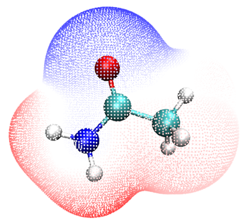

默认颜色标尺下限和上限分别为-50和50 kcal/mol，默认颜色过渡为BWR（蓝-白-红），因此上图中白色区域对应静电势值几乎为零的区域，而红色和蓝色点分别有明显正和负的静电势。你可通过修改*ESPpt.vmd*手动更改默认设置，也可在VMD图形界面中更改设置，详情见*plotESPsurf.pdf*教程。

上图中，ESP着色的范德华表面以表面顶点的形式表示，该图也可用另一种方式绘制，即把ESP映射到电子密度等值面上，我们现在就来做。双击*ESPiso.bat*，Multiwfn将被调用计算并导出电子密度和ESP的cube文件，得到的*density1.cub*和*ESP1.cub*会被自动移到VMD文件夹。然后启动VMD，在VMD命令行窗口输入命令*iso*，*ESPiso.vmd*将被激活以载入这两个cube文件绘制下图。注意，为了获得稍好的效果，我用了内置的Tachyon渲染得到下图，即选择“File” - “Render”，改为“Tachyon (internal, in-memory rendering)”并点击“Start Rendering”按钮（所得文件为.tga格式，需用高级图像浏览器查看，如IrfanView，可从<https://www.irfanview.com>免费获得）。

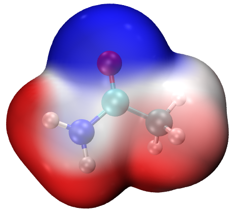

> **注记**
>
> 很值得解释一下“ESPrhoiso”参数。它既可通过运行命令的参数设置（如你可在*ESPiso.bat*中看到“-ESPrhoiso 0.001”），也可通过*settings.ini*中的相应参数设置。若ESPrhoiso设为大于0的值，如0.001，则用Multiwfn自身代码计算ESP格点数据时，只对电子密度0.001 a.u.等值面附近的格点评估ESP，而其它格点的ESP会自动设为0。该技巧绝不影响所得ESP着色范德华表面图的质量，而计算代价*显著*降低，因为完全忽略了无关格点的ESP评估。

### **4 同时显示分子表面上的ESP极值点**

可以在图上附加ESP表面极值点。为此，双击*ESPext.bat*，它会做*ESPpt.bat*做的所有事情，但还会输出*surfanalysis.pdb*并移到VMD文件夹。该文件记录了所有表面极值点。然后启动VMD，先输入命令*pt*或*iso*绘制相应图，再输入*ext*，*ESPext.vmd*将被激活以载入*surfanalysis.pdb*并将表面极值点渲染为小球。下图中左右两侧分别显示了pt+ext和iso+ext的组合。注意，为了使背面的ESP极值点可见，我已将电子密度等值面的材质改为“Transparent”（即进入“Graphics” - “Representation”，切换到“density1.cub”，将“Material”改为“Transparent”。若想将其作为默认设置，修改*ESPiso.vmd*并将“\$id EdgyGlass”改为“id Transparent”）

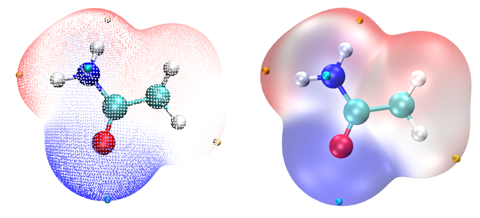

上图中，橙色和青色小球对应范德华表面上ESP极大值和极小值的位置。你也可用图像编辑器手动在极值点上标注ESP值，如何操作见*plotESPsurf.pdf*教程。获取某极值点ESP值的一个简便方法是：在键盘上按“0”进入查询模式，点击某小球中心，其序号会显示在命令行窗口。假设序号为3，应在VMD命令行窗口输入以下命令

\[atomselect top "index 3"\] get beta

随后ESP值会显示。打印的ESP的单位见*surfanalysis.pdb*的第一行。

如我在[4.12.1](sec-4-12-quantitative-analysis-of-molecular-surface.md#4121-苯酚分子表面的静电势-electrostatic-potential分析)节提到的，即使对中性体系，也可能有一些带正值（负值）的表面极小点（极大点），它们通常化学上不重要，可忽略。若不想在图上绘制它们，可用*examples\drawESP\ESPext_noinsig.txt*的内容替换*ESPext.txt*的内容。该文件相对于*ESPext.txt*多出的四行用于去除这些不重要的极值点。

### **5 绘制单体的ESP着色范德华表面穿透图**

这里我用水四聚体说明如何绘制这类图。本例所用文件在“examples\water_tetramer\fch”文件夹中给出。四个水分子的Gaussian输入文件分别为*1/2/3/4.gjf*，其坐标直接取自优化后四聚体的坐标，可在*complex.gjf*中找到。用Gaussian运行这些.gjf文件，会得到*1/2/3/4.fch*。注意用了*nosymm*关键词，否则单体的笛卡尔坐标将不再与复合物中的一致，因为若无此关键词Gaussian会自动将体系转到标准取向。

将*1/2/3/4.fch*文件复制到含有Multiwfn可执行文件的文件夹，运行*ESPpt.bat*，Multiwfn将被调用依次计算四个.fch文件，所得*mol1/2/3/4.pdb*和*vtx1/2/3/4.pdb*会被自动移到VMD文件夹。然后启动VMD并输入*pt2*以激活*ESPpt2.vmd*脚本，你会立即看到下图的左半部分。若改用运行*ESPiso.bat*然后在VMD中输入*iso2*，*ESPiso2.vmd*将被激活以基于导出的*density1/2/3/4.cub*和*ESP1/2/3/4.cub*绘制下图的右半部分。

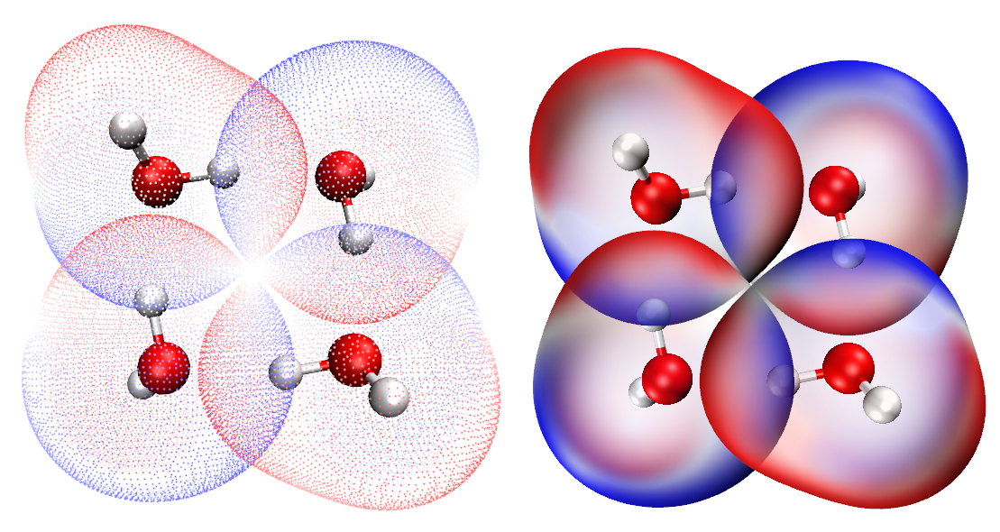

从上图可清楚看到四个单体的范德华表面因形成氢键而相互穿透。此外，映射的颜色表明四聚体以ESP正负互补的方式形成，揭示了氢键的静电本质。

作为练习，请尝试用上述两种方式绘制鸟嘌呤（Guanine）-胞嘧啶（Cytosine）二聚体的ESP着色范德华表面穿透图，两个单体的.fch文件可从<http://sobereva.com/multiwfn/extrafiles/GC_fch.rar>下载。注意，绘图前应手动删除VMD文件夹中先前体系生成的.pdb和.cub文件。

### **6 提示：关于材质的调节**

对某些体系，用*iso*命令绘制的ESP着色图不太理想。例如，下图看起来很杂乱

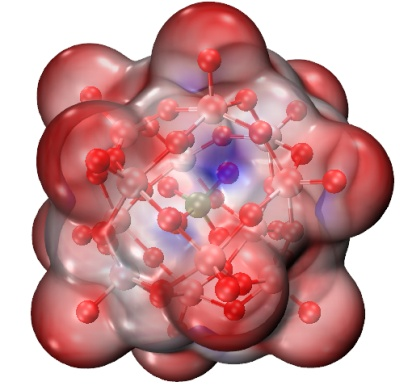

此时可进入“Graphics” - “Materials”，选择“EdgyGlass”，即当前用于表示表面的材质。然后调节其各项设置，特别是“Opacity”。若改为如下设置，会发现范德华表面上ESP的差异现在能更清楚地区分。

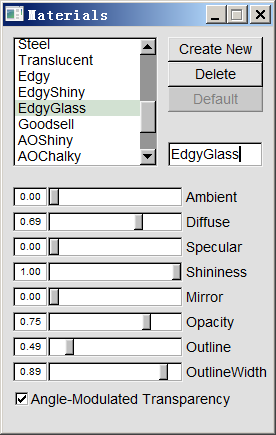 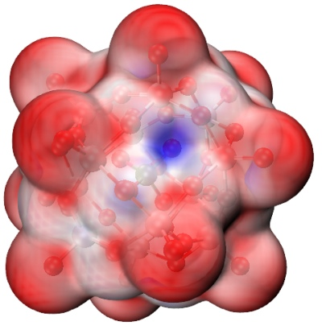

### **7 提示：为非常巨大的体系绘制ESP映射的范德华表面**

有时需要为由数百原子组成的体系绘制ESP映射表面，此时即使用DFT加6-31G\*做单点计算也非常昂贵或计算上不可行。对这种情况，我建议的步骤如下：

- 用Grimme的xtb程序(<https://github.com/grimme-lab/xtb/>)做单点或优化任务。xtb的所有计算基于GFN-xTB理论，可视为DFT的半经验版本。应使用*--molden*参数使xtb输出Molden输入文件（*molden.input*）。由于xtb极快，即使对由数百原子组成的体系，在个人电脑上单点任务也不超过1分钟即可完成。

- 将*molden.input*载入Multiwfn，然后用主功能100的子功能2中的相应选项导出.fch文件（如*xtb.fch*）。

- 确保*settings.ini*中的“cubegenpath”已正确设置。确保已定义GAUSS_MEMDEF环境变量，详情见[5.7](sec-5-7-make-use-of-cubegen-utility-in-gaussian-package.md)节。

- 将*xtb.fch*载入Multiwfn，用主功能5依次计算电子密度和ESP的格点数据并导出cube文件，导出的*density.cub*和*totesp.cub*应手动重命名为*density1.cub*和*ESP1.cub*。注意，由于体系大，应使用“高质量格点”。ESP的计算比较耗时，例如，用常见的Intel 4核CPU，336原子的体系耗时半小时。

- 将*density1.cub*和*ESP1.cub*以及上述examples\drawESP中的*ESPiso.vmd*移到VMD文件夹。

- 启动VMD，在VMD命令行窗口输入`source ESPiso.vmd`。

现在可看到ESP着色的范德华表面图。我建议也如前所述适当调节材质设置。下面是一个含336原子的体系。

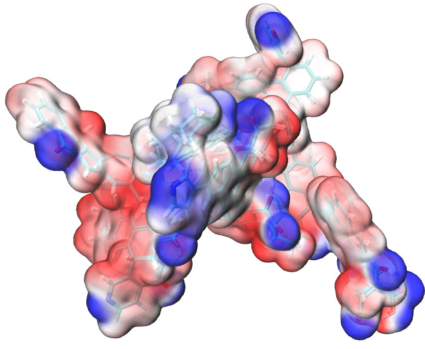

即使只有4核的个人电脑，从结构文件出发，总耗时不超过1小时即可得到上图。而若有数十核的服务器，10分钟内即可得到该图。

值得注意的是，虽然xtb程序极快，但xtb波函数对应的ESP质量通常令人满意。据我的测试，基于xtb波函数生成的ESP着色分子表面图与高质量B3LYP/def2-TZVP波函数的结果间没有明显差别。

关于该主题的更多信息见我的文章“快速为大体系绘制静电势着色的范德华表面”（中文，<http://sobereva.com/481>）。

### **8 其它值得注意的事项**

ESP的颜色条可添加到图上，见该视频结尾附近的说明：<https://youtu.be/QFpDf_GimA0>。

强烈建议读者查看.bat、.txt和.vmd文件的内容以弄清它们如何工作。可以看到，*ESPpt.bat*和*ESPiso.bat*至多处理四个.fch文件（*1/2/3/4.fch*），你也可将其扩展到更多分子。在*ESPpt2.vmd*和*ESPiso2.vmd*中，变量“nsystem”设为4，即至多载入并绘制*mol4.pdb*和*vtx4.pdb*以及*density4.cub*和*ESP4.cub*，显然若想用绘图脚本同时绘制更多单体，应增大“nsystem”。

值得注意的是，*ESPpt.txt*中的0.15值是定量分子表面分析中的格点间距；若增大它，表面顶点会变稀疏，计算代价会降低。*ESPiso.txt*中的默认命令对应对电子密度用高质量格点而对ESP用低质量格点（为节省计算代价），该组合适合大多数体系，但对极大体系，可能需要修改该文件以分别对电子密度和ESP使用更好质量的格点，否则所得等值面可能不光滑，映射的颜色可能模糊。

为获得更好的图形效果，建议用户手动改变颜色标尺的下限和上限，以便范德华表面上ESP的变化能尽可能清楚地用颜色表示。对带电体系，默认颜色标尺总应改变，否则范德华表面会是单色的。对这些体系，应载入输入文件，进入主功能12，选择选项1对ESP做定量分子表面分析，将ESP的全局最小值和最大值复制到设置颜色标尺的文本框，如下所示，然后按ENTER按钮使设置生效。

> **注记**
>
> 若图是用*ESPiso.bat*绘制的，应取a.u.为单位的ESP值并设为颜色标尺。但若图是用*ESPpt.bat*绘制的，应在VMD文件夹中用文本编辑器打开*vtx1.pdb*，开头几行清楚指明了该文件所用单位，应从Multiwfn命令行窗口读取该单位下的ESP值并设置颜色标尺。

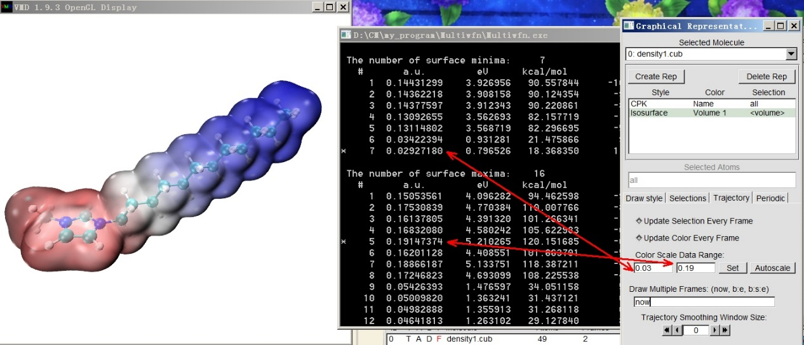

若用*iso*或*iso2*命令绘制ESP图时更喜欢用eV而非a.u.作ESP单位，在上述步骤中应用“examples\drawESP”文件夹中的*ESPiso_eV.bat*和*ESPiso_eV.txt*分别代替*ESPiso.bat*和*ESPiso.txt*，并手动编辑*ESPiso.vmd*和*ESPiso2.vmd*文件，去掉“set colorlow -0.8”和“set colorhigh 0.8”两行前的\#号。此时.cub文件中的ESP数据单位为eV，颜色标尺默认下限和上限分别为-0.8和0.8 eV。按上述YouTube教程视频绘制的颜色条单位也为eV。

对极端带电体系，如DNA，用*ESPpt.bat*时B-factor列可能无法正确记录映射的ESP值，因为其量级太大。此时，在上述步骤中应用“examples\drawESP”文件夹中的*ESPpt_pqr.bat*、*ESPpt_pqr.txt*、*ESPpt_pqr.vmd*和*ESPext_pqr.vmd*分别代替上述*ESPpt.bat*、*ESPpt.txt*、*ESPpt.vmd*和*ESPext.vmd*，此时将用.pqr文件的“Charge”列代替.pqr文件的B-factor列记录数据，前者能记录大得多范围的数据，单位恒为a.u.。还注意不再需要*ESPext.txt*和*ESPext.bat*，因为用*ESPpt_pqr.bat*时*extrema1.pqr*也会被导出并移到VMD文件夹。

### **9 在Linux下绘制ESP着色的范德华表面图**

上述方法也可在Linux（或许MacOS）环境中使用。在“examples\drawESP”文件夹中可找到*ESPiso.sh*、*ESPpt.sh*和*ESPext.sh*，它们是上述.bat文件的相应Linux脚本。

例如，你想用*ESPiso.sh*为*cosplay.fchk*绘制ESP着色的范德华表面，需要做的是

- 严格按[2.1.2](sec-2-1-install.md#212-linux-版)节安装Multiwfn。用通常方式安装VMD

- 将“examples\drawESP”中的*ESPiso.sh*、*ESPiso.txt*和*ESPiso.vmd*复制到工作目录

- 将*cosplay.fchk*复制到工作目录

- 编辑*ESPiso.sh*，将*1.fchk*改为*cosplay.fchk*

- 进入工作目录，运行`chmod +x ./ESPiso.sh`，然后运行*./ESPiso.sh*。（随后可能发现“File not found”和“No such file or directory”等报错。它们无害，直接忽略）

- 输入*vmd*启动VMD，然后在VMD命令行窗口输入`source ESPiso.vmd`以绘图

## **4.A.14 用VMD脚本将cube文件渲染为最先进水平的等值面图**

> **注记**
>
> 本教程的中文版见<http://sobereva.com/483>，其中包含比本节更多的讨论和示例。

### **引言**

虽然在多数情况下Multiwfn直接绘制的等值面图已令人满意，但用VMD渲染等值面可获得更好效果。VMD可从<http://www.ks.uiuc.edu/Research/vmd/>免费获得。事实上，在[4.5.5](sec-4-5-generate-grid-data-and-view-isosurface-map.md#455-绘制电子密度差值图以研究咪唑配位镁卟啉的电子转移)节我已示例了如何基于Multiwfn产生的cube文件绘制等值面图，但步骤有些冗长，且效果达不到最先进水平。在本节，我将展示用VMD脚本仅用很少步骤绘制非常高质量等值面图的方法。本节方法只适用于Windows平台，但你或许也能找到办法使该方法在Linux下工作。

VMD脚本是*examples\scripts\showcub.vmd*。使用前，应将其移到VMD文件夹，并在VMD文件夹中的*vmd.rc*文件中加一行`source showcub.vmd`，以便启动VMD后该文件中的四个自定义命令可用。这些命令描述如下。

- *cub*和*cubiso*：用于显示单个cube文件。用法示例：

```text
cub DD : Draw DD.cub in current folder as isosurface map, both positive and negative parts are shown as green and blue with default isovalue of 0.05 and -0.05, respectively.
cubiso 0.02 : Changing isovalue of both positive and negative parts to 0.02.
cub DD 0.02 : Equivalent to using cub DD and then cubiso 0.02.
```

- *cub2*和*cub2iso*：用于同时显示两个cube文件。用法示例：

```text
cub2 f+ f- : Draw f+.cub and f-.cub in current folder as green and blue isosurfaces, respectively. Note that only positive part of the cubes will be shown.
cub2iso 0.02 : Changing isovalue of both isosurfaces to 0.02.
cub2 f+ f- 0.02 : Equivalent to using cub2 f+ f- and then cub2iso 0.02.
```

用上述命令在VMD图形窗口显示等值面后，可用examples\scripts文件夹中的批处理文件*VMDrender_full.bat*或*VMDrender_noshadow.bat*调用Tachyon渲染以获得更好效果，如后文所示。两文件的区别在于前者启用阴影效果而后者禁用。

接下来，我给出两个实际示例。跟随操作前，请将上述两个.bat文件和*showcub.vmd*复制到VMD文件夹，并正确设置*vmd.rc*。我用的VMD版本是1.9.3。

### **示例1：C₄H₈单重态双自由基的自旋密度图**

启动Multiwfn并输入

```text
examples\C4H8.wfn  // .wfn file of C_4H_8 singlet biradical
5  // Calculate grid data
5  // Spin density
3  // High-quality grid
2  // Export the grid data to spindensity.cub in current folder
```

现在，将*spindensity.cub*移到VMD文件夹，启动VMD并在VMD命令行窗口输入*cub spindensity 0.01*，会看到等值面值为0.01的该cube文件的等值面图已显示在图形窗口。

为获得更好效果，在VMD中选择“File” - “Render” - “Tachyon”，然后点击“Start Rendering”，会发现VMD文件夹中出现了*vmdscene.dat*。现在双击*VMDrender_full.bat*，它将以*vmdscene.dat*为Tachyon渲染的输入文件，在当前文件夹产生名为*full.bmp*的图像文件。所得图形如下所示，质量显然非常好！

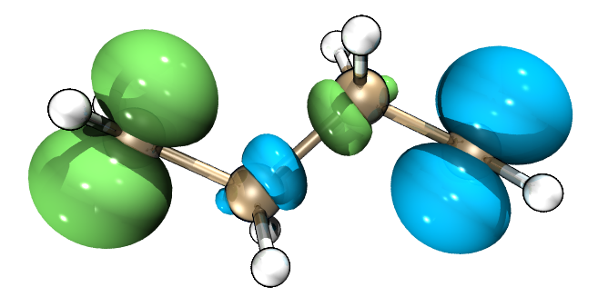

### **示例2：NH₂-联苯-NO₂的空穴-电子图**

[4.18.1](sec-4-18-electron-excitation-analysis.md#4181-用空穴-电子分析完整表征电子激发)节示例的空穴-电子分析对理解电子激发的本质极为有用。虽然Multiwfn可直接在内置GUI窗口同时绘制空穴和电子分布，但用VMD可获得好得多的效果。

我仍用[4.18.1](sec-4-18-electron-excitation-analysis.md#4181-用空穴-电子分析完整表征电子激发)节分析的NH₂-联苯-NO₂为例，将用VMD绘制S0→S2跃迁的空穴和电子的等值面。为此，启动Multiwfn并输入

```text
examples\excit\D-pi-A.fchk
18  // Electron excitation analysis
1  // Hole-electron analysis
examples\excit\D-pi-A.out
2  // Study excitation between ground state (S0) and the second excited state (S2)
1  // Calculate distribution of hole, electron and so on as well as various indices
3  // High-quality grid
```

计算完成后，依次选择选项10和11，分别将空穴和电子的格点数据导出到当前文件夹的*hole.cub*和*electron.cub*。然后将它们移到VMD文件夹，启动VMD并输入*cub2 electron hole*。会发现没有显示等值面，这是因为默认等值面值（0.05）不适合该格点数据。我们用*cub2*命令测试不同等值面值，最终发现输入*cub2 0.005*后图形效果令人满意，即等值面能充分体现空穴和电子的分布特征。VMD图形窗口中当前显示的图形如下所示，绿色和蓝色分别对应电子和空穴。

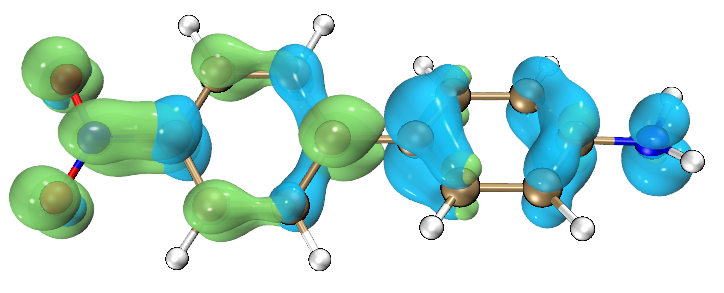

当前效果已经不错，但空穴与电子的重叠特征还不能清楚辨认。为改进效果，进入“Graphics” - “Representation”，将“Material”设为“EdgyGlass”，然后在“Selected Molecules”中选择“electron.cub”，也将其“Material”设为“EdgyGlass”。接着，选择“File” - “Render” - “Tachyon”，然后点击“Start Rendering”。若这次直接用*VMDrender_full.bat*渲染图形，会发现图形太暗。为获得最佳效果，用文本编辑器打开*VMDrender_full.bat*，将“-trans_raster3d”改为“-trans_vmd”，再加一个参数“-shadow_filter_off”。最后，执行该.bat文件产生*full.bmp*，如下所示，效果完美！（注意，我用Photoshop将图形亮度提高了20）

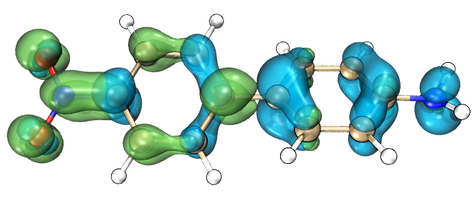

## **4.A.15 计算信息论量及一些相关量**

Shubin Liu教授提出了许多信息论量并将其应用于各种化学问题，得到了许多有价值的发现。Multiwfn能计算所有信息论量。Multiwfn网站“Resources”页面有一篇文档“Calculating information-theoretic quantities and some relevant quantities by Multiwfn”专门描述如何用Multiwfn计算这些量，请查阅。
