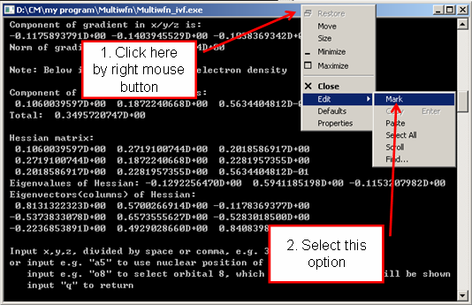
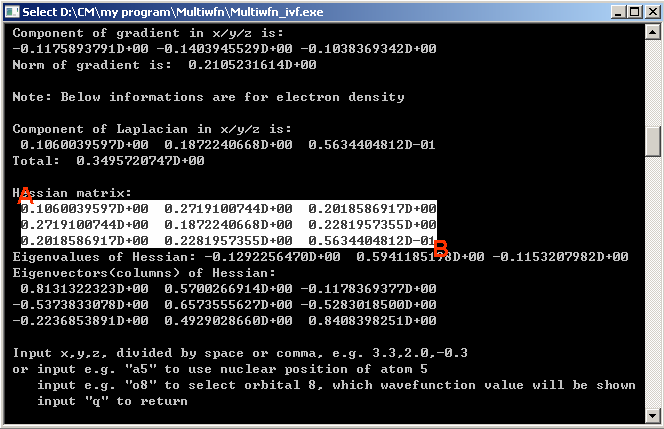

# **5.4 从命令行窗口复制输出到剪贴板**

有时需要将 Multiwfn 在命令行窗口 (command-line window) 中的输出永久保存，或通过纯文本文件载入第三方软件。这里介绍如何将这些输出复制到 Windows 剪贴板 (clipboard)。

如果你使用的是 Windows 11，只需按住“ALT”键并用鼠标左键在窗口中拖出一个矩形区域，然后按 ENTER 键，该区域内的内容就会被复制到剪贴板。

如果你使用的是较旧版本的 Windows，则需要按照以下步骤操作。假设你想要复制电子密度的 Hessian 矩阵。

在选择“Mark”（标记）之后，按住鼠标左键从 A 点拖到 B 点

然后按 ENTER 键，被白色矩形高亮显示的信息就会被复制到剪贴板，你可以将它们粘贴到任何地方，例如纯文本文件。

对于在图形界面环境下运行的 MacOS 或 Linux 系统，你也可以用类似的方式将 Multiwfn 的输出从终端复制到纯文本文件。
