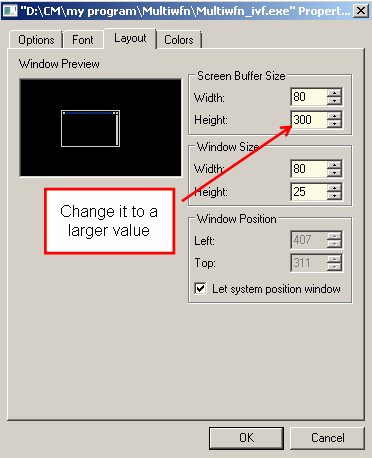

# **5.5 让命令行窗口能够记录更多输出**

偶尔你会发现命令行窗口无法记录 Multiwfn 的全部输出。例如，在波函数修改模块中选择选项 6 以输出一个较大波函数的密度矩阵 (density matrix) 时，却只能在命令行窗口中找到该矩阵的最后一部分。解决方法是增大窗口的缓冲区大小 (buffer size)，请按以下步骤操作。

启动 Multiwfn，用鼠标右键点击窗口标题栏，点击“Properties”（属性），选择“Layout”（布局）选项卡，你会发现窗口默认的缓冲区大小为 300（见下方截图），也就是说窗口中最多只能记录 300 行，这显然太小了。把该值改大一些，例如 9999，然后点击 OK 按钮。之后你会发现窗口能够记录多得多的输出（如果完整输出仍无法被记录下来，就再次增大缓冲区大小）。

缓冲区大小的设置会被永久保存在系统中，下次启动 Multiwfn 时无需再次设置该值。

对于 Linux 和 MacOS，你同样可以找到用于设置终端缓冲区大小的类似选项。
